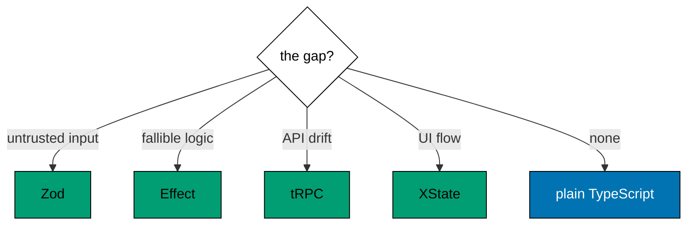

Examples 44-48 choose the right tool per gap and combine the tools coherently
(co-12, co-13, co-14, co-15, co-16). The progression guards a procedure with a
schema, powers a procedure body with an Effect, gates procedure calls behind a
machine, reduces selection to a matrix of gap, check, and cost, and tests each
tool at its own seam. The models compose the real APIs' shapes (Zod gates,
Effect pipelines, tRPC callers, XState actors) the way production code does;
the lesson text maps each model line to the real construct it stands for.

Read the five examples as the course's conclusion: no single tool covers every
gap, every combination has a direction (validate, then run, then route, then
render), and the selection matrix plus the testing seams keep the combination
honest. When the text names a library construct, it names the production
behaviour that library's documentation describes.

---

### Worked Example 44: Zod Guards tRPC

_ex-44 · exercises co-12, co-01_

A schema guards the procedure input: two tools, one boundary. The model
validates a nickname through the schema gate before the procedure runs, and a
one-character nickname stops at the schema with the rule named.

**`learning/code/ex-44-zod-guards-trpc/example.ts`**:

```typescript
// => Worked Example 44: a Zod schema guards the tRPC input: two tools, one boundary.
// => co-12: the schema validates, the procedure routes: each tool does its own job.
// => co-01: the same schema object the form used now guards the procedure.
function checkNickname(input: unknown): { ok: true; nickname: string } | { ok: false; issue: string } {
  // => the Zod-shaped gate: z.string().min(2).max(20) at the procedure door
  if (typeof input !== "string" || input.length < 2 || input.length > 20) {
    // => too short, too long, or not a string: the procedure never runs
    return { ok: false, issue: "nickname: 2-20 characters" }; // => gate error out
  } // => valid nickname: fall through
  return { ok: true, nickname: input }; // => trusted nickname out
}
function setNickname(nickname: string): string {
  // => the tRPC-shaped procedure: routing plus the write, no validation inside
  return "nickname set to " + nickname; // => handler trusts the gate
}
function nicknameProcedure(input: unknown): { ok: true; value: string } | { ok: false; issue: string } {
  // => the composed boundary: schema gate first, procedure second
  const checked = checkNickname(input); // => Zod's job: validate
  if (!checked.ok) {
    // => gate failed: the procedure never runs
    return { ok: false, issue: checked.issue }; // => gate error out
  } // => gate passed: fall through to routing
  return { ok: true, value: setNickname(checked.nickname) }; // => tRPC's job: route and run
}
function main(): void {
  // => entry point; a good nickname sets, a short one stops at the schema
  // => a valid nickname passes both tools and the procedure runs
  const good = nicknameProcedure("ada_lovelace"); // => schema-valid input
  if (good.ok) {
    // => narrow before reading the value
    console.log("good: " + good.value); // => Output: good: nickname set to ada_lovelace
  } // => good done
  // => a one-character nickname stops at the schema: the procedure never sees it
  const bad = nicknameProcedure("x"); // => schema-invalid input
  if (!bad.ok) {
    // => the schema's message reaches the caller unchanged
    console.log("bad: " + bad.issue); // => Output: bad: nickname: 2-20 characters
  } // => bad done
}
main(); // => run once; a throw exits nonzero
```

**Output** (`learning/code/ex-44-zod-guards-trpc/expected/main.stdout.txt`):

```text
good: nickname set to ada_lovelace
bad: nickname: 2-20 characters
```

**Verify**: the valid nickname passes both tools to the procedure's reply, and
the short one stops at the schema gate, the procedure never running.

**Key takeaway**: Zod validates, tRPC routes: the schema is the lock on the
procedure's door, and the handler trusts whatever gets through.

**Why it matters**: this is the most common combination in production tRPC
code, and its direction matters: schema first, handler second. Reversing it
(validating inside the handler) reintroduces scattered checks; skipping it
trusts the wire. The combination also shows the tools' contract with each
other: Zod owns the input shape, tRPC owns the routing and transport, and the
procedure's input type is where they shake hands. Learn this seam and every
procedure you write follows it; miss it and every procedure invents its own.

---

### Worked Example 45: Effect Inside Procedure

_ex-45 · exercises co-12, co-04_

An Effect pipeline powers the procedure body. The model charges a wallet
through the Effect step (typed shortfall on failure) and converts the outcome
into the procedure's reply, proving both the funded receipt and the broke
error.

**`learning/code/ex-45-effect-inside-procedure/example.ts`**:

```typescript
// => Worked Example 45: an Effect pipeline powers the procedure body.
// => co-12: Effect handles failure inside, tRPC handles routing outside: errors become replies.
// => co-04: the procedure composes andThen steps exactly like Theme D's pipelines.
type Outcome = { ok: true; credits: number } | { ok: false; error: string }; // => the Effect-shaped pipeline result
// => The Effect step: deduct the cost or fail with a typed shortfall.
function charge(credits: number, cost: number): Outcome {
  // => the Effect step: deduct or fail with a typed error
  if (credits < cost) {
    // => insufficient credits: the typed failure
    return { ok: false, error: "insufficient credits: have " + String(credits) + ", need " + String(cost) }; // => error value
  } // => affordable: fall through
  return { ok: true, credits: credits - cost }; // => remaining credits
}
// => The procedure runs the Effect and converts its error into a reply.
function purchaseProcedure(
  balance: number,
  cost: number,
): { ok: true; receipt: string } | { ok: false; issue: string } {
  // => the tRPC-shaped procedure: runs the Effect, converts its error into a reply
  const result: Outcome = charge(balance, cost); // => Effect's job: the fallible logic
  if (!result.ok) {
    // => Effect failed: tRPC's job turns the error into a typed reply
    return { ok: false, issue: result.error }; // => error crosses the wire as data
  } // => Effect succeeded: fall through
  return { ok: true, receipt: "paid, balance " + String(result.credits) }; // => success crosses the wire as data
}
// => A funded purchase receipts; an empty wallet replies with the error.
function main(): void {
  // => entry point; a funded purchase receipts, an empty wallet replies with the error
  // => enough credits: the pipeline succeeds and the procedure receipts it
  const funded = purchaseProcedure(100, 30); // => affordable purchase
  if (funded.ok) {
    // => narrow before reading the receipt
    console.log("funded: " + funded.receipt); // => Output: funded: paid, balance 70
  } // => funded done
  // => too few credits: the Effect error becomes the procedure's error reply
  const broke = purchaseProcedure(10, 30); // => unaffordable purchase
  if (!broke.ok) {
    // => the client receives the typed error, not an exception
    console.log("broke: " + broke.issue); // => Output: broke: insufficient credits: have 10, need 30
  } // => broke done
}
main(); // => run once; a throw exits nonzero
```

**Output** (`learning/code/ex-45-effect-inside-procedure/expected/main.stdout.txt`):

```text
funded: paid, balance 70
broke: insufficient credits: have 10, need 30
```

**Verify**: the funded purchase receipts the new balance, and the broke
purchase replies with the typed shortfall, no throw on either path.

**Key takeaway**: Effect owns the fallible logic, tRPC owns the boundary: the
pipeline's error becomes the procedure's error reply unchanged.

**Why it matters**: procedure bodies grow fallible logic (charge, reserve,
notify), and throwing through the transport turns typed failures into 500s.
Running the body as an Effect keeps every failure typed up to the procedure
edge, where it converts into a reply the client matches on (Theme F's error
matching starts here). The composition direction holds again: validate input
with Zod, run logic with Effect, expose with tRPC. Each tool does the job it
was designed for, and the procedure reads as three lines: gate, run, reply.

---

### Worked Example 46: Machine Drives Procedures

_ex-46 · exercises co-12, co-08_

The machine decides when the procedure runs. The model submits through the
editing state exactly once (the call counter proves it), swallows the illegal
double-submit, and reopens with edit, so the network follows the UI state.

**`learning/code/ex-46-machine-drives-procedures/example.ts`**:

```typescript
// => Worked Example 46: the machine decides when the procedure runs.
// => co-12: XState owns the UI state, tRPC owns the server call: events trigger procedures.
// => co-08: only the ready state can submit: the machine gates the network, not the button handler.
type SubmitState = "editing" | "submitting" | "done"; // => the UI states around the call
interface SubmitActor {
  // => the actor: UI state plus the server answer, never both pending and answered
  state: SubmitState; // => where the UI is
  answer: string | null; // => the procedure reply once done
}
function send(actor: SubmitActor, event: { type: "SUBMIT"; call: () => string } | { type: "EDIT" }): SubmitActor {
  // => SUBMIT runs the procedure only from editing; EDIT returns from done
  if (event.type === "SUBMIT" && actor.state === "editing") {
    // => the legal trigger: run the procedure and land in submitting, then done
    const answer: string = event.call(); // => tRPC's job: the server call, exactly once
    return { state: "done", answer: answer }; // => XState's job: the state move with the answer
  } // => submit handled
  if (event.type === "EDIT" && actor.state === "done") {
    // => re-editing clears the answer and returns to editing
    return { state: "editing", answer: null }; // => fresh editing round
  } // => edit handled
  return actor; // => every other pair ignored: double-submit is unrepresentable
}
function main(): void {
  // => entry point; submit once, double-submit ignored, edit reopens
  // => the actor starts editing with no answer
  let actor: SubmitActor = { state: "editing", answer: null }; // => fresh form
  let calls = 0; // => counts procedure invocations: must stay at one
  const call = (): string => {
    // => the procedure stand-in: counts its own invocations
    calls = calls + 1; // => record the call
    return "order_1"; // => the server answer
  };
  actor = send(actor, { type: "SUBMIT", call: call }); // => legal submit: procedure runs
  console.log("submitted: state=" + actor.state + " answer=" + String(actor.answer) + " calls=" + String(calls)); // => Output: submitted: state=done answer=order_1 calls=1
  // => a second SUBMIT from done is ignored: the procedure never runs twice
  actor = send(actor, { type: "SUBMIT", call: call }); // => illegal submit: swallowed
  console.log("double: calls=" + String(calls)); // => Output: double: calls=1
  // => EDIT from done reopens the form for a new round
  actor = send(actor, { type: "EDIT" }); // => legal edit: back to editing
  console.log("editing: state=" + actor.state); // => Output: editing: state=editing
}
main(); // => run once; a throw exits nonzero
```

**Output** (`learning/code/ex-46-machine-drives-procedures/expected/main.stdout.txt`):

```text
submitted: state=done answer=order_1 calls=1
double: calls=1
editing: state=editing
```

**Verify**: one legal submit runs the procedure once and lands done, the
second submit from done is swallowed with the counter still at one, and edit
reopens the form.

**Key takeaway**: the UI state gates the network: only the right state can
fire, so double-submits and edits-after-send are unrepresentable.

**Why it matters**: disabling the submit button during flight is the flag-based
version of this, and it fails the moment two code paths can submit or the
disabled flag resets early. The machine makes the gate structural: the event
exists only in the state that allows it, so the illegal call cannot be
constructed, let alone sent. This is the full four-tool stack in miniature:
the schema validates the form, the Effect runs the charge, the procedure
exposes it, and the machine decides when, which is exactly the capstone's
architecture at full scale.

---

### Worked Example 47: Selection Matrix

_ex-47 · exercises co-13, co-14, co-15_

Match each gap to its tool, and know what each tool costs. The model prints
the four-row decision matrix (gap, tool, check, cost) plus the default row: no
gap means no tool, because plain TypeScript stays plain.



**`learning/code/ex-47-selection-matrix/example.ts`**:

```typescript
// => Worked Example 47: match each gap to its tool, and know what each tool costs.
// => co-15: the selection matrix: validation, errors, API typing, UI flow each name one tool.
// => co-13: the matrix also names what each tool checks at runtime versus type time.
// => co-14: and what adopting it costs an existing codebase.
interface Row {
  // => one matrix row: the gap, its tool, its check, and its adoption cost
  gap: string; // => the problem you actually have
  tool: string; // => the tool that closes it
  check: string; // => runtime, compile-time, or both
  cost: string; // => what adopting it costs
}
function main(): void {
  // => entry point; the four-row matrix every selection decision reduces to
  // => the matrix: four gaps, four tools, four checks, four costs
  const rows: Row[] = [
    // => row one: untrusted data at the boundary
    { gap: "untrusted input", tool: "Zod", check: "runtime", cost: "schemas per boundary" }, // => parse-dont-validate
    // => row two: fallible logic with many failure modes
    { gap: "typed errors", tool: "Effect", check: "compile-time + runtime", cost: "rewrite throws as values" }, // => typed error channel
    // => row three: client and server types drifting apart
    { gap: "API typing", tool: "tRPC", check: "compile-time", cost: "router plus shared types" }, // => end-to-end inference
    // => row four: UI states reachable that should not be
    { gap: "UI flow", tool: "XState", check: "runtime", cost: "model every state" }, // => explicit machines
  ];
  for (const row of rows) {
    // => each row prints as one decision line
    console.log(row.gap + " -> " + row.tool + " [" + row.check + "] cost: " + row.cost); // => gap, tool, check, cost
  } // => matrix printed
  // => the default row: no gap, no tool: plain TypeScript stays plain
  console.log("no gap -> none [compile-time] cost: nothing"); // => Output: no gap -> none [compile-time] cost: nothing
}
main(); // => run once; a throw exits nonzero
```

**Output** (`learning/code/ex-47-selection-matrix/expected/main.stdout.txt`):

```text
untrusted input -> Zod [runtime] cost: schemas per boundary
typed errors -> Effect [compile-time + runtime] cost: rewrite throws as values
API typing -> tRPC [compile-time] cost: router plus shared types
UI flow -> XState [runtime] cost: model every state
no gap -> none [compile-time] cost: nothing
```

**Verify**: all four rows print their gap, tool, check kind, and adoption
cost, plus the no-gap default row.

**Key takeaway**: the matrix is the whole selection discipline: name the gap,
take its tool, pay its cost, and reach for nothing when there is no gap.

**Why it matters**: tool adoption fails in two directions: reaching for a
state machine to validate a string, or hand-rolling validation the schema
would have given for free. The matrix prevents both by tying each tool to the
gap it closes and naming the check it performs (runtime, compile-time, or
both) alongside what adopting it costs an existing codebase. The default row is
the most important one: most functions need no tool at all, and a team that
knows when not to adopt is a team whose adoptions stick. Revisit this matrix
before every dependency decision, not after.

---

### Worked Example 48: Testing Each Tool

_ex-48 · exercises co-16, co-15_

Test each tool at its own seam. The model runs a hostile-input suite against a
schema (three rejections required), walks a legal event script through a
machine (full trace as proof), and fails a suite loudly on an illegal script
step with the state and event named.

**`learning/code/ex-48-testing-each-tool/example.ts`**:

```typescript
// => Worked Example 48: test each tool at its own seam.
// => co-16: schemas get hostile inputs, effects get failing layers, procedures get callers, machines get event scripts.
// => co-15: the seam decides the tool, and the tool decides the seam: selection and testing agree.
function testSchema(check: (input: unknown) => boolean, hostile: unknown[]): string {
  // => the Zod seam: hostile inputs in, rejection count out
  let rejected = 0; // => rejections counted
  for (const input of hostile) {
    // => every hostile input must fail
    if (!check(input)) {
      // => rejected as required
      rejected = rejected + 1; // => count it
    } // => input handled
  } // => all hostile inputs tried
  return "schema: " + String(rejected) + "/" + String(hostile.length) + " rejected"; // => full rejection required
}
function testMachine(events: string[], legal: Record<string, string[]>): string {
  // => the XState seam: an event script in, the visited states out
  let state = "idle"; // => actors start at initial
  const visited: string[] = [state]; // => trace starts at initial
  for (const event of events) {
    // => each scripted event must transition
    const next: string | undefined = (legal[state] as unknown as Record<string, string> | undefined)?.[event]; // => table lookup
    if (next === undefined) {
      // => illegal script step: the test fails loudly
      return "machine: illegal " + event + " in " + state; // => script bug, not machine bug
    } // => legal: advance
    state = next; // => new current state
    visited.push(state); // => trace grows
  } // => script consumed
  return "machine: " + visited.join(">"); // => the full trace as proof
}
function main(): void {
  // => entry point; one hostile-input suite and one event-script suite, both green
  // => the schema suite: three hostile inputs, three rejections required
  const isName = (input: unknown): boolean => typeof input === "string" && input.length > 0; // => the schema stand-in
  console.log(testSchema(isName, ["", 42, null])); // => Output: schema: 3/3 rejected
  // => the machine suite: two legal events walk idle to done
  console.log(testMachine(["START", "FINISH"], { idle: { START: "working" }, working: { FINISH: "done" }, done: {} })); // => Output: machine: idle>working>done
  // => an illegal script step fails the suite with the exact state and event
  console.log(testMachine(["FINISH"], { idle: { START: "working" }, working: { FINISH: "done" }, done: {} })); // => Output: machine: illegal FINISH in idle
}
main(); // => run once; a throw exits nonzero
```

**Output** (`learning/code/ex-48-testing-each-tool/expected/main.stdout.txt`):

```text
schema: 3/3 rejected
machine: idle>working>done
machine: illegal FINISH in idle
```

**Verify**: the schema suite rejects all three hostile inputs, the legal
script traces idle to working to done, and the illegal step fails naming the
event and the state.

**Key takeaway**: the seam decides the test: hostile inputs for schemas and
procedures, failing layers for Effects, event scripts for machines.

**Why it matters**: each tool's tests look different because each tool's
contract lives somewhere different: schemas promise verdicts on inputs, so
feed them hostile ones; Effects promise behavior under failure, so fail their
layers; procedures promise routing plus logic, so call them in-process;
machines promise states for events, so script the events and assert the trace.
A team that tests each tool at its seam gets suites that break exactly when
the contract breaks; a team that tests everything through the UI gets suites
that break when anything changes. The selection matrix picks the tools, and
these seams prove the picks keep working.

---

← Previous: [Theme H: State Charts (Nested and Parallel)](./theme-h-state-charts-nested-and-parallel.md) · Next: [Capstone](./capstone/overview.md) →
