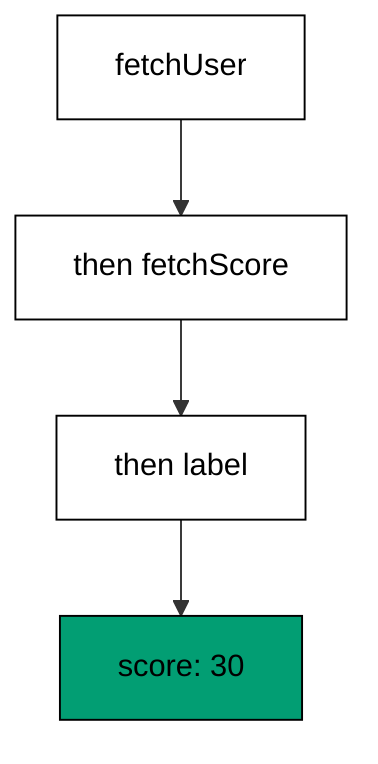
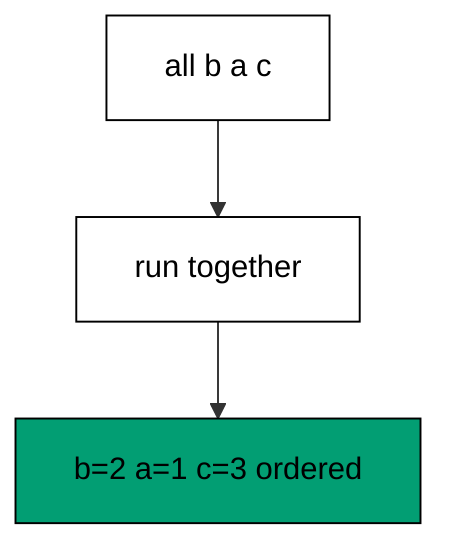
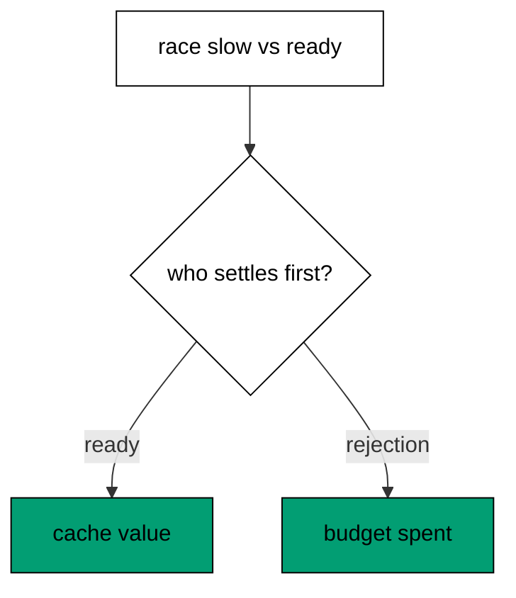
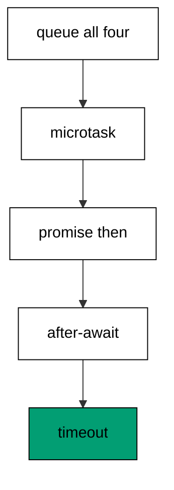
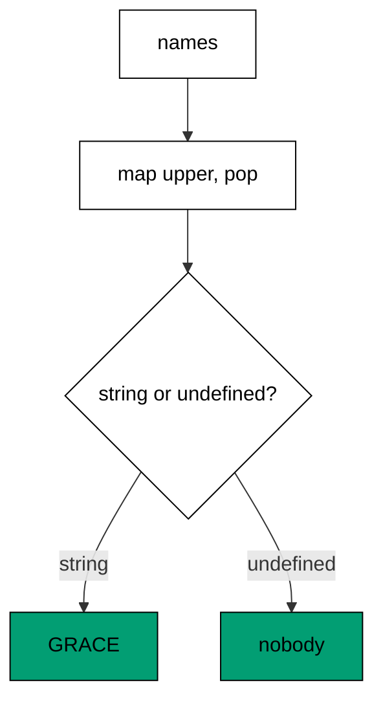
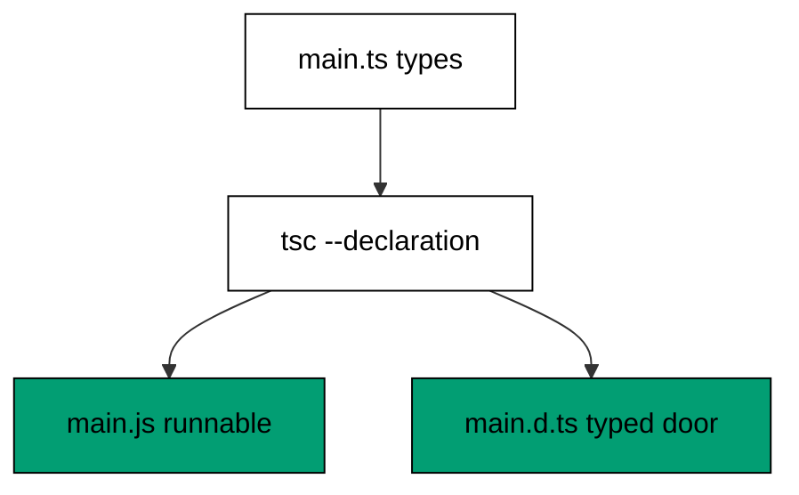
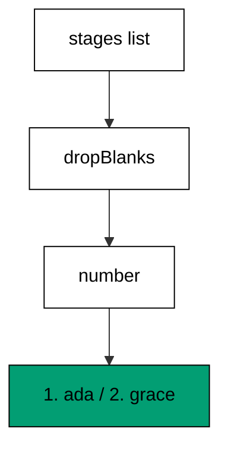
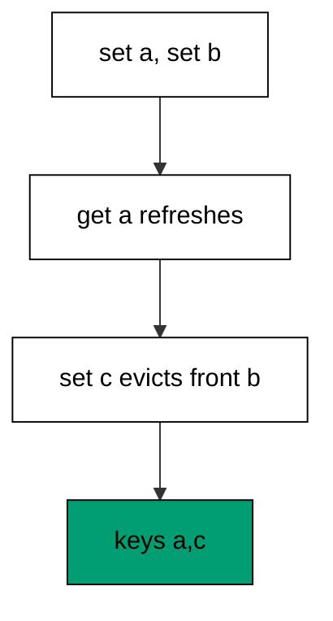

Examples 54–78 survey what working TypeScript developers touch weekly: concurrency primitives, the strictness and style tooling that guards real codebases, and the systematic reading of idiomatic code written by others. Three clusters carry the level: concurrency primitives at survey depth (Examples 54–61), tooling, linting, and style (Examples 62–70), and reading and explaining idiomatic code (Examples 71–78). Every concurrent program joins its work and prints ordered results; no output carries timings.

### Example 54: Promise Chains

Sequential async steps nest callbacks three levels deep; promise chains sequence the same steps as mappings, one `then` per transformation. This example fetches a user, derives a score, and renders a label through two mappings. (Concepts: co-09.)



Each `then` receives the previous step's value and returns the next, so the chain reads as a pipeline with suspension points instead of nested callbacks. Returning a promise from a `then` flattens it — the chain waits without nesting — which is the behavior `async`/`await` in the next example makes syntactic. The `async main` wrapper exists because CommonJS modules have no top-level `await`; the wrapper is the idiomatic shape, not scaffolding to apologize for.

**`learning/code/ex-54-promise-chain/main.ts`**:

```typescript
// => Example 54: promise chains sequence async steps; each then maps the value.
function fetchUser(): Promise<{ login: string }> {
  // => fixed async source
  return Promise.resolve({ login: "ada" }); // => resolves on the microtask queue
} // => end of function fetchUser(): Promise<{ login: string }>
function fetchScore(login: string): Promise<number> {
  // => second async step
  return Promise.resolve(login.length * 10); // => deterministic derived value
} // => end of function fetchScore(login: string): Promise<number>
async function main(): Promise<void> {
  // => WHY wrapper: no top-level await in commonjs
  const label = await fetchUser() // => step one resolves first
    .then((u) => fetchScore(u.login)) // => WHY chain: each then maps the value onward
    .then((score) => `score: ${score}`); // => final mapping to display text
  console.log(label); // => Output: score: 30
} // => end of async function main(): Promise<void>
void main(); // => floating promise: rejections would fail the run loudly
```

**Output** (`learning/code/ex-54-promise-chain/expected/main.stdout.txt`):

```text
score: 30
```

**Key takeaway**: Chain sequential async steps with `then` mappings; wrap in `async main` under CommonJS.

**Why it matters**: Nested callbacks invert the reading order — the last step sits deepest — and error handling splits across levels. Chains restore top-to-bottom order with one rejection path for the whole sequence, which is why every later async pattern in this cluster builds on the chain's semantics.

### Example 55: async-await Flattening

Chains are correct but inside-out; `async`/`await` writes the same sequence as straight-line code with suspension points. This example loads a login and its access level in two awaits that read like two assignments. (Concepts: co-09.)

Each `await` suspends the function until its promise settles and resumes with the value — sequential lines, sequential work, no nesting. The function stays asynchronous throughout: callers still receive a promise, rejections still propagate to the caller's `catch`, and concurrent steps still want `Promise.all` rather than sequential awaits. `await` in a loop serializes iterations, which Example 70's reduce and the `all` pattern in the next example exist to prevent; reach for sequential awaits when steps depend, for `all` when they do not.

**`learning/code/ex-55-async-await/main.ts`**:

```typescript
// => Example 55: await flattens nested thens; the order of lines is the order of work.
function getLogin(): Promise<string> {
  // => fixed async source
  return Promise.resolve("grace"); // => resolves on the microtask queue
} // => end of function getLogin(): Promise<string>
function getAccess(login: string): Promise<string> {
  // => second async step
  return Promise.resolve(login === "grace" ? "admin" : "guest"); // => deterministic mapping
} // => end of function getAccess(login: string): Promise<string>
async function main(): Promise<void> {
  // => sequential awaits read top to bottom
  const login = await getLogin(); // => suspension point one
  const access = await getAccess(login); // => suspension point two, uses step one
  console.log(login, access); // => Output: grace admin
} // => end of async function main(): Promise<void>
void main(); // => floating promise: rejections would fail the run loudly
```

**Output** (`learning/code/ex-55-async-await/expected/main.stdout.txt`):

```text
grace admin
```

**Key takeaway**: Write dependent async steps as sequential awaits; independent steps belong to `Promise.all`.

**Why it matters**: Straight-line async code reviews like sync code — the order of lines is the order of work — while behaving asynchronously underneath. That readability is load-bearing in incident response: the on-call reader follows two awaits faster than three nested callbacks, and the suspension points show exactly where waiting happens.

### Example 56: Promise All and Order

Awaiting independent steps in sequence pays each step's latency in turn; `Promise.all` starts them together and returns results in input order. This example resolves three out-of-order steps and prints them in call order. (Concepts: co-09.)



All three promises start before any is awaited — that is the concurrency — and the result array follows the input array, not completion order, which removes bookkeeping for matching results to requests. One rejection rejects the whole `all`, so the pattern fits batches where any failure voids the batch; partial-value batches belong to `allSettled` in the next example. The standing rule: independent work fans out with `all`, dependent work sequences with `await`.

**`learning/code/ex-56-promise-all/main.ts`**:

```typescript
// => Example 56: Promise.all runs steps together and keeps result order.
function step(id: string, value: number): Promise<string> {
  // => fixed async step
  return Promise.resolve(`${id}=${value}`); // => resolves on the microtask queue
} // => end of function step(id: string, value: number): Promise<st
async function main(): Promise<void> {
  // => WHY wrapper: no top-level await in commonjs
  const out = await Promise.all([step("b", 2), step("a", 1), step("c", 3)]); // => WHY all: together, ordered
  console.log(out.join(" ")); // => Output: b=2 a=1 c=3, input order kept
} // => end of async function main(): Promise<void>
void main(); // => floating promise: rejections would fail the run loudly
```

**Output** (`learning/code/ex-56-promise-all/expected/main.stdout.txt`):

```text
b=2 a=1 c=3
```

**Key takeaway**: Fan independent promises out with `Promise.all`; results arrive in input order.

**Why it matters**: Sequential awaits of independent I/O multiply latency — three 100ms fetches cost 300ms in sequence, 100ms together — and the waste hides behind correct output. `all` recovers the parallelism with ordered results, which is the single highest-leverage async change in most codebases.

### Example 57: allSettled Partial Wins

`Promise.all` voids the batch on one rejection; `allSettled` lands every outcome so partial success still ships. This example batches three tasks where one fails and reports values plus problems separately. (Concepts: co-09, co-02.)

The settled array preserves input order with a status discriminant per entry, so the split loop narrows each outcome and collects successes and messages without a single `try`. This is the async twin of Example 15's `AggregateError` pattern: same batch contract, same complete reporting. Choose `all` when the batch is atomic and `allSettled` when the batch is a harvest — imports, notifications, fan-out renders — where most-of-the-work still has value.

**`learning/code/ex-57-allsettled-partial/main.ts`**:

```typescript
// => Example 57: allSettled tolerates partial failure; the batch still reports.
function task(id: string, ok: boolean): Promise<number> {
  // => fixed async task
  const cause = new Error(`down: ${id}`); // => named failure
  return ok ? Promise.resolve(id.length) : Promise.reject(cause); // => one arm each
} // => end of function task(id: string, ok: boolean): Promise<numb
async function main(): Promise<void> {
  // => WHY wrapper: no top-level await in commonjs
  const jobs = [task("ab", true), task("c", false), task("def", true)]; // => mixed outcomes ahead
  const settled = await Promise.allSettled(jobs); // => every outcome lands
  const values: number[] = []; // => collected successes
  const problems: string[] = []; // => collected failure messages
  for (const s of settled) {
    // => split the mixed outcomes
    if (s.status === "fulfilled") {
      // => success arm
      values.push(s.value); // => keep the value
    } else {
      // => failure arm
      problems.push((s.reason as Error).message); // => keep the message only
    } // => end of else
  } // => end of for (const s of settled)
  console.log("values:", values.join(",")); // => Output: values: 2,3
  console.log("problems:", problems.join(",")); // => Output: problems: down: c
} // => end of async function main(): Promise<void>
void main(); // => floating promise: rejections would fail the run loudly
```

**Output** (`learning/code/ex-57-allsettled-partial/expected/main.stdout.txt`):

```text
values: 2,3
problems: down: c
```

**Key takeaway**: Harvest partial batches with `allSettled`; split by status and report both sides.

**Why it matters**: Atomic-only batching turns one sick task into a failed harvest — ninety-nine successes discarded for one rejection. Settled outcomes let the batch keep what worked and name what did not, which matches how operators actually handle partial failure: ship the good, queue the bad.

### Example 58: race-built Timeouts

Slow work needs a budget; `Promise.race` awards the result to the first settler, so a ready fallback beats a pending task deterministically. This example races a never-settling stand-in against cache and fallback values. (Concepts: co-09.)



The pending promise stands in for slow I/O without waiting — deterministic, since the ready value always settles first. The second race shows rejections winning too: a fast budget error beats pending work, and the `catch` reports it. Production timeouts pair `race` with a delay promise plus `AbortController` cleanup; the pattern here is the core, and Example 59 adds the cooperation half. Never leave the loser's work running unobserved — cancel it, or its late settlement becomes a surprise.

**`learning/code/ex-58-race-timeout/main.ts`**:

```typescript
// => Example 58: race picks the first settler; a ready fallback beats slow work.
function slow(): Promise<string> {
  // => a task that never settles in this demo
  return new Promise<string>(() => undefined); // => pending forever, stands in for slow I/O
} // => end of function slow(): Promise<string>
async function main(): Promise<void> {
  // => WHY wrapper: no top-level await in commonjs
  const winner = await Promise.race([slow(), Promise.resolve("cache")]); // => WHY race: first settler wins
  console.log("winner:", winner); // => Output: winner: cache
  try {
    // => rejection can win the race too
    await Promise.race([slow(), Promise.reject(new Error("budget spent"))]); // => fallback rejects fast
  } catch (err) {
    // => report the winning rejection
    console.log("lost:", err instanceof Error ? err.message : err); // => Output: lost: budget spent
  } // => end of catch (err)
} // => end of async function main(): Promise<void>
void main(); // => floating promise: rejections would fail the run loudly
```

**Output** (`learning/code/ex-58-race-timeout/expected/main.stdout.txt`):

```text
winner: cache
lost: budget spent
```

**Key takeaway**: Budget slow work with `Promise.race` against a ready fallback or a fast rejection.

**Why it matters**: Unbudgeted awaits hang forever on sick dependencies — the request never returns, the worker never frees, and the outage spreads through exhausted pools. Racing every external wait against a budget converts hangs into handled fallbacks, which is the difference between degraded and dead.

### Example 59: AbortController Cooperation

Races pick winners but cannot stop losers; `AbortController` lets cooperative work observe cancellation and exit early. This example runs one worker against a dead signal and one against a live signal. (Concepts: co-09.)

Cancellation in JavaScript is cooperative — the signal announces, the worker checks — because preemptive kills would strand resources mid-step. The worker checks `signal.aborted` at each step boundary, which keeps the check cheap and the exit prompt; the pre-aborted run exits before the first step, deterministically. Real I/O APIs take the signal directly and reject with an abort error; hand-rolled loops check it themselves. Either way the contract holds: abort means stop soon, never stop now.

**`learning/code/ex-59-abort-signal/main.ts`**:

```typescript
// => Example 59: AbortController cancels cooperative work; the checks stay synchronous.
async function run(signal: AbortSignal): Promise<string> {
  // => cooperative worker
  const done: string[] = []; // => completed steps
  for (const s of ["one", "two", "three"]) {
    // => fixed step list
    if (signal.aborted) {
      // => WHY check: cooperative cancellation point
      return "aborted"; // => early exit with a fixed label
    } // => end of if (signal.aborted)
    done.push(s); // => step completed
  } // => end of for (const s of ["one", "two", "three"])
  return `finished: ${done.length} steps`; // => fixed completion label
} // => end of async function run(signal: AbortSignal): Promise<str
async function main(): Promise<void> {
  // => WHY wrapper: no top-level await in commonjs
  const dead = new AbortController(); // => the cancelled handle
  dead.abort(); // => abort before the work starts: deterministic
  console.log(await run(dead.signal)); // => Output: aborted
  const live = new AbortController(); // => a live signal for the success path
  console.log(await run(live.signal)); // => Output: finished: 3 steps
} // => end of async function main(): Promise<void>
void main(); // => floating promise: rejections would fail the run loudly
```

**Output** (`learning/code/ex-59-abort-signal/expected/main.stdout.txt`):

```text
aborted
finished: 3 steps
```

**Key takeaway**: Cancel cooperatively: pass `AbortSignal`, check `aborted` at step boundaries, exit with a fixed label.

**Why it matters**: Fire-and-forget work outlives its usefulness — the user navigated away, the request timed out, the newer run superseded it — and keeps consuming resources invisibly. Cooperative cancellation reclaims those resources promptly without stranding them mid-step, which keeps long-lived processes lean under cancel-heavy loads.

### Example 60: Microtask Before Macrotask

`await` continuations, promise callbacks, and `queueMicrotask` all run before the next timer fires; knowing the drain order explains async sequencing surprises. This example records the exact completion order of four queued pieces. (Concepts: co-09.)



The microtask queue drains first-in-first-out: the explicit microtask was queued first, the promise callback second, and the `await` continuation third — all before the zero-millisecond timer, which waits in the macrotask queue. The main function awaits the wrapped timer so the transcript prints after every piece landed. This order is load-bearing knowledge: state set in a microtask is visible to the `await` continuation but not vice versa, and timer callbacks always observe the fully drained microtask queue.

**`learning/code/ex-60-microtask-order/main.ts`**:

```typescript
// => Example 60: microtasks drain before the next macrotask; the order is fixed.
async function main(): Promise<void> {
  // => WHY wrapper: no top-level await in commonjs
  const order: string[] = []; // => observed completion order
  const tick = new Promise<void>((resolve) => {
    // => macrotask wrapped for awaiting
    setTimeout(() => {
      order.push("timeout");
      resolve();
    }, 0); // => runs after every microtask
  }); // => end of const tick = new Promise<void>((resolve) =>
  queueMicrotask(() => {
    order.push("microtask");
  }); // => explicit microtask, queued first
  await Promise.resolve().then(() => {
    order.push("promise");
  }); // => promise microtask, queued second
  order.push("after-await"); // => continuation runs third, still inside the microtask drain
  await tick; // => wait for the macrotask last
  console.log(order.join(" ")); // => Output: microtask promise after-await timeout
} // => end of async function main(): Promise<void>
void main(); // => floating promise: rejections would fail the run loudly
```

**Output** (`learning/code/ex-60-microtask-order/expected/main.stdout.txt`):

```text
microtask promise after-await timeout
```

**Key takeaway**: Microtasks drain FIFO before timers; `await` continuations are microtasks too.

**Why it matters**: Half of async confusion is ordering confusion — why the log line appears before the state it describes, why the timer sees settled promises. The drain order answers every instance: microtasks first in queue order, macrotasks after, always. Internalize it once and async traces read deterministically forever.

### Example 61: Async Generators

Paged data arrives in chunks with waits between; async generators yield each page as it lands and `for-await` consumes them with backpressure. This example streams three fixed pages in order. (Concepts: co-09, co-03.)

The generator suspends at each `yield` until the consumer asks for more, so a slow consumer throttles a fast producer without buffering the whole stream — that is backpressure, and it falls out of the syntax rather than requiring queue code. `for-await` awaits each resumption transparently, which makes the consumption loop read like the sync `for-of` from Example 7 with waits hidden inside. Reach for async generators at every paged boundary: database cursors, API pagination, file line streams.

**`learning/code/ex-61-async-generator/main.ts`**:

```typescript
// => Example 61: async generators stream pages; for-await consumes them in order.
async function* pages(total: number): AsyncGenerator<string> {
  // => WHY async generator: paged stream
  for (let p = 1; p <= total; p++) {
    // => fixed page list
    yield `page-${p}`; // => one page per resumption
  } // => end of for (let p = 1; p <= total; p++)
} // => end of async function* pages(total: number): AsyncGenerator
async function main(): Promise<void> {
  // => WHY wrapper: no top-level await in commonjs
  const seen: string[] = []; // => consumed pages
  for await (const page of pages(3)) {
    // => WHY for-await: backpressure-friendly consumption
    seen.push(page); // => pages arrive in order
  } // => end of for await (const page of pages(3))
  console.log(seen.join(" ")); // => Output: page-1 page-2 page-3
} // => end of async function main(): Promise<void>
void main(); // => floating promise: rejections would fail the run loudly
```

**Output** (`learning/code/ex-61-async-generator/expected/main.stdout.txt`):

```text
page-1 page-2 page-3
```

**Key takeaway**: Stream paged data with `async function*` and consume with `for-await`; backpressure is automatic.

**Why it matters**: collect-then-process loads every page before handling the first — memory grows with the dataset and nothing downstream starts early. Streaming starts work on page one while page two loads, which cuts latency and bounds memory no matter how many pages follow.

### Example 62: strict Null Gates

Without strict null checks, `undefined` flows wherever it pleases and crashes far from its source; `strict` plus `??` gates force every absence to be handled at the boundary. This example pops a loudest name with an empty-safe fallback. (Concepts: co-12.)



Under `strict`, `pop` returns `string | undefined` — the type admits what the runtime does — so returning it as `string` fails compilation until the `??` gate handles absence. The gate sits at the function's edge, which keeps the interior total: callers receive a string always, never a surprise. Strictness converts an entire runtime crash class into authoring-time errors; the `??` habit converts each error into a one-line policy.

**`learning/code/ex-62-strict-gate/main.ts`**:

```typescript
// => Example 62: strict null checks force every absence to be handled, never assumed.
function loudest(names: string[]): string {
  // => total function: always returns a string
  const top = names.map((n) => n.toUpperCase()).pop(); // => WHY strict: pop is string | undefined
  return top ?? "nobody"; // => absence handled at the boundary
} // => end of function loudest(names: string[]): string
console.log(loudest(["ada", "grace"])); // => Output: GRACE
console.log(loudest([])); // => Output: nobody, empty handled too
```

**Output** (`learning/code/ex-62-strict-gate/expected/main.stdout.txt`):

```text
GRACE
nobody
```

**Key takeaway**: Compile under `strict` and gate every `| undefined` with `??` at the boundary.

**Why it matters**: `Cannot read properties of undefined` is the most common production TypeError precisely because non-strict code lets `undefined` travel unchecked. Strictness stops it at the border of every function, which moves the diagnosis from a crash dump three layers deep to a red squiggle at the exact line missing its policy.

### Example 63: noUncheckedIndexedAccess

Index reads miss silently — `row[9]` on a two-item array is `undefined` wearing a `string` costume; the `noUncheckedIndexedAccess` flag makes the costume come off. This example types an index helper honestly and defaults both outcomes. (Concepts: co-12, co-10.)

With the flag, every index expression gains `| undefined`, which forces the same `??` handling strictness demands for `pop` and `get`. The helper's signature advertises the hole instead of hiding it, and callers handle absence where the miss is visible. Enable the flag on every strict project: it closes the largest remaining soundness hole in indexed access, and the fixes are mechanical — default, guard, or narrow at each newly visible `undefined`.

**`learning/code/ex-63-unchecked-index/main.ts`**:

```typescript
// => Example 63: indexed access may miss; the flag makes the compiler say so.
function at<T>(items: T[], i: number): T | undefined {
  // => honest signature under the flag
  return items[i]; // => T | undefined: the hole is visible
} // => end of function at<T>(items: T[], i: number): T | undefined
const row = ["a", "b"]; // => two elements
console.log(at(row, 0) ?? "missing"); // => Output: a
console.log(at(row, 9) ?? "missing"); // => Output: missing, no silent undefined
```

**Output** (`learning/code/ex-63-unchecked-index/expected/main.stdout.txt`):

```text
a
missing
```

**Key takeaway**: Enable `noUncheckedIndexedAccess`; treat every index read as possibly missing.

**Why it matters**: Out-of-range reads are silent data corruption — `undefined` flows into arithmetic as `NaN`, into templates as text, into logic as falsy — and the crash or wrongness surfaces far from the index that caused it. The flag relocates the failure to the read itself, where `??` disposes of it in one expression.

### Example 64: Naming That Reads

Names are the user interface of code: verbs for functions, nouns for values, shout for constants, and `is` for booleans. This example applies all four rules to one small policy. (Concepts: co-14.)

`toSlug` reads as an action because it is one; `RetryPolicy` reads as a thing because it is one. `MAX_RETRIES` in shout signals module-level constancy — never reassigned, safe to import anywhere. `isReady` reads as a question with a yes-no answer, which is exactly what booleans are. Violations tax every reader: a noun-named function hides its effect, a lowercase constant invites reassignment, a bare-adjective boolean forces a double-take. The style guide exists so naming decisions are made once, collectively, instead of per author per line.

**`learning/code/ex-64-naming-style/main.ts`**:

```typescript
// => Example 64: names carry the style guide: verbs for functions, nouns for values.
function toSlug(raw: string): string {
  // => WHY verb: functions do something
  return raw.trim().toLowerCase().replace(/\s+/g, "-"); // => one transformation, verb name
} // => end of function toSlug(raw: string): string
const MAX_RETRIES = 3; // => WHY shout: module constant, never reassigned
interface RetryPolicy {
  // => WHY noun: interfaces name things
  attempts: number; // => plain field, no prefix
} // => end of interface RetryPolicy
const policy: RetryPolicy = { attempts: MAX_RETRIES }; // => policy assembled from the constant
console.log(toSlug("  Grace Hopper  ")); // => Output: grace-hopper
console.log(policy.attempts); // => Output: 3
const isReady = policy.attempts > 0; // => WHY is-prefix: booleans read as questions
console.log(isReady); // => Output: true
```

**Output** (`learning/code/ex-64-naming-style/expected/main.stdout.txt`):

```text
grace-hopper
3
true
```

**Key takeaway**: Verbs for functions, nouns for types and values, shout for constants, `is` for booleans.

**Why it matters**: A misleading name is worse than a bad one — readers trust it and reason from false premises, so the bug hides behind the vocabulary. Consistent naming converts reading from decoding into recognition, which compounds across every file because names are the most-read part of any codebase.

### Example 65: Importing Plain JavaScript

TypeScript projects inherit plain JavaScript — a helper from another team, a vendored script — and rewriting it just for types wastes the migration budget. A `.d.ts` declaration draws the typed boundary over untouched JavaScript. This example imports a CommonJS helper through its declarations. (Concepts: co-13.)

The JavaScript file never changes: untyped parameters, `module.exports` shape, owner's conventions intact. The declaration file states the typed door — `shout(text: unknown): string` — which the compiler checks and the runtime never loads. The `.js` suffix on the import resolves to the `.d.ts` at compile time and the `.js` at runtime, one specifier serving both worlds. This is the survey-level interop story: typed code calling untyped code through a declared boundary, with the migration proceeding file by file instead of all at once.

**`learning/code/ex-65-js-boundary-import/helper.js`**:

```javascript
// => Example 65 file 1: plain JavaScript helper owned by another team.
function shout(text) {
  // => untyped parameters: JavaScript as shipped
  return String(text).trim().toUpperCase(); // => loud normalized text
} // => end of function shout(text)
module.exports = { shout }; // => CommonJS export shape
```

**`learning/code/ex-65-js-boundary-import/helper.d.ts`**:

```typescript
// => Example 65 file 2: the declaration draws the typed boundary over raw JavaScript.
export function shout(text: unknown): string; // => typed door into untyped code
```

**`learning/code/ex-65-js-boundary-import/main.ts`**:

```typescript
// => Example 65 file 3: TypeScript imports the JavaScript helper through its declarations.
import { shout } from "./helper.js"; // => WHY .d.ts: types without touching the JavaScript
console.log(shout("  hello js  ")); // => Output: HELLO JS
console.log(typeof shout); // => Output: function
```

**Output** (`learning/code/ex-65-js-boundary-import/expected/main.stdout.txt`):

```text
HELLO JS
function
```

**Key takeaway**: Type foreign JavaScript with `.d.ts` doors; migrate file by file, never all at once.

**Why it matters**: Big-bang rewrites stall migrations for quarters while the boundary stays untyped and untested. Declared boundaries deliver type safety this week for the files you touch, leave the rest running untouched, and accumulate until the JavaScript is an island the team deletes on its own schedule.

### Example 66: Declaration Emit

Typed packages serve JavaScript consumers too, and those consumers deserve types without reading TypeScript; `--declaration` emits the `.d.ts` alongside the JavaScript. This example compiles a point module and prints its generated declarations. (Concepts: co-13, co-06.)



Only exported shapes land in the declarations — the public surface, nothing internal — which makes the `.d.ts` a reviewable API contract as well as a compiler artifact. JavaScript importers get completions, hovers, and errors from the same types TypeScript authors wrote, with no extra maintenance: the declarations regenerate on every build. The transcript shows both artifacts' duties — declarations printed, behavior run — in one golden output.

**`learning/code/ex-66-declaration-emit/main.ts`**:

```typescript
// => Example 66: declarations let JavaScript consumers use typed packages.
export interface Point {
  // => exported shape lands in the .d.ts
  x: number; // => coordinate
  y: number; // => coordinate
} // => end of export interface Point
export function origin(): Point {
  // => exported helper lands in the .d.ts
  return { x: 0, y: 0 }; // => the origin
} // => end of export function origin(): Point
console.log(JSON.stringify(origin())); // => Output: {"x":0,"y":0}
```

**Output** (`learning/code/ex-66-declaration-emit/expected/main.stdout.txt`):

```text
export interface Point {
    x: number;
    y: number;
}
export declare function origin(): Point;
{"x":0,"y":0}
```

**Key takeaway**: Emit declarations with `--declaration`; the `.d.ts` is the package's typed contract for JavaScript consumers.

**Why it matters**: Untyped packages tax every consumer with rediscovery — what fields, what returns, what throws — paid in debugging sessions instead of hovers. Generated declarations publish the contract the authors already wrote, which turns consumption from archaeology into autocomplete.

### Example 67: unknown Over any

`any` opts out of checking and pushes every mistake to runtime; `unknown` states ignorance honestly and forces narrowing before use. This example areas a circle from an unknown payload with a named rejection for anything else. (Concepts: co-12, co-02.)

`any` is contagious — one `any` parameter silences every expression it touches, and the silence spreads through assignments until half the file is unchecked. `unknown` contains the ignorance at the boundary: nothing flows out without a `typeof` gate, an `in` test, or a narrowing assertion. The shape gate plus field narrowing here is three lines that replace an entire class of `undefined is not an object` crashes. Ban `any` in new code; when migration needs an escape hatch, `unknown` with narrowing is the honest one.

**`learning/code/ex-67-no-explicit-any/main.ts`**:

```typescript
// => Example 67: unknown plus narrowing replaces any; the compiler guards every use.
function areaOf(raw: unknown): number {
  // => WHY unknown: honest about ignorance
  if (typeof raw === "object" && raw !== null && "r" in raw) {
    // => shape gate
    const { r } = raw as { r: unknown }; // => pull the field loosely
    if (typeof r === "number") {
      // => narrow the field
      return Math.PI * r * r; // => safe arithmetic
    } // => end of if (typeof r === "number")
  } // => end of if (typeof raw === "object" && raw !== null && "r" i
  throw new Error("need { r: number }"); // => rejection names the shape
} // => end of function areaOf(raw: unknown): number
console.log(areaOf({ r: 2 }).toFixed(2)); // => Output: 12.57
try {
  // => the unshaped payload below
  areaOf(42); // => a bare number has no r
} catch (err) {
  // => report the boundary rejection
  console.log("rejected:", err instanceof Error ? err.message : err); // => Output: rejected: need { r: number }
} // => end of catch (err)
```

**Output** (`learning/code/ex-67-no-explicit-any/expected/main.stdout.txt`):

```text
12.57
rejected: need { r: number }
```

**Key takeaway**: Take `unknown` at boundaries, narrow with `typeof` and `in`, reject the rest by name; never ship `any`.

**Why it matters**: Every `any` is a hole in the type system exactly where input is least trustworthy — the boundary — so the crashes it causes are both frequent and far from their cause. `unknown` keeps the flexibility and restores the checking, which is strictly more safety for the same three lines of narrowing.

### Example 68: join Instead of Plus

String accumulation with `+=` copies the growing string on every append — quadratic work for linear output; `join` builds the whole string in one pass. This example assembles one roster both ways and proves identical text. (Concepts: co-15.)

Each `+=` allocates a new string and copies both halves, so ten thousand appends copy roughly fifty million characters for a hundred-thousand-character result. `join` sizes once and fills once — linear total. The transcript asserts equality so the optimization never changes behavior, plus the length as a stable scalar. This is the performance idiom in miniature: same result, better complexity, proven by the transcript rather than trusted by folklore.

**`learning/code/ex-68-join-not-plus/main.ts`**:

```typescript
// => Example 68: join builds big strings in one pass; += copies on every line.
const names = ["ada", "grace", "margaret", "alan"]; // => fixed roster
const joined = names.join(", "); // => WHY join: one allocation for the whole string
console.log(joined); // => Output: ada, grace, margaret, alan
let plus = ""; // => the accumulator to avoid
for (const n of names) {
  // => same roster, plus-equals loop
  plus += (plus === "" ? "" : ", ") + n; // => copies the growing string per item
} // => end of for (const n of names)
console.log(plus === joined); // => Output: true, same text, wasted copies
console.log(joined.length); // => Output: 26
```

**Output** (`learning/code/ex-68-join-not-plus/expected/main.stdout.txt`):

```text
ada, grace, margaret, alan
true
26
```

**Key takeaway**: Assemble strings with `join`; reserve `+=` for a handful of appends where clarity wins.

**Why it matters**: Quadratic string building is invisible at small sizes and crippling at large ones — the report generator that slows yearly as data grows, with no code change to blame. `join` keeps assembly linear from the start, so growth in data never becomes growth in mystery latency.

### Example 69: Set Membership Speed

Membership tested with `includes` scans the array every call; a `Set` hashes once and answers in constant time. This example checks one member and one stranger both ways with identical verdicts. (Concepts: co-15, co-03.)

Linear scans cost per call times calls — a thousand members checked a thousand times is a million comparisons — while the `Set` pays the hash once per lookup regardless of size. The example's verdicts match exactly, proving the faster structure changes nothing but cost. Reach for `Set` whenever the question is membership asked repeatedly; keep `includes` for one-off checks on tiny lists where setup outweighs scanning.

**`learning/code/ex-69-set-lookup-fast/main.ts`**:

```typescript
// => Example 69: a Set answers membership in O(1); includes scans the array.
const allowlist = new Set(["ada", "grace", "margaret"]); // => WHY Set: hashed membership
function viaSet(who: string): boolean {
  // => constant-time check
  return allowlist.has(who); // => hash lookup
} // => end of function viaSet(who: string): boolean
function viaScan(who: string): boolean {
  // => linear check for contrast
  return ["ada", "grace", "margaret"].includes(who); // => scans each element
} // => end of function viaScan(who: string): boolean
for (const who of ["ada", "alan"]) {
  // => one member, one stranger
  console.log(who, viaSet(who), viaScan(who)); // => Output: ada true true, then alan false false
} // => end of for (const who of ["ada", "alan"])
```

**Output** (`learning/code/ex-69-set-lookup-fast/expected/main.stdout.txt`):

```text
ada true true
alan false false
```

**Key takeaway**: Answer repeated membership with `Set.has`; keep `includes` for one-off tiny checks.

**Why it matters**: Linear membership in a hot path — authorization checks, feature flags, dedup filters — multiplies with traffic until the profiler blames the innocent loop. The `Set` removes the scaling term entirely, so growth in members never becomes growth in latency.

### Example 70: One-Pass reduce

Filter-then-map walks the data twice and parks an interim array; one `reduce` pass filters and maps together with no middleman. This example totals bulk order lines both ways with identical results. (Concepts: co-15, co-03.)

Two passes cost two traversals plus the interim array's allocation and collection — fine for hundreds of rows, felt at millions. The single pass pushes into the accumulator under the same condition, preserving order and values exactly, which the transcript's identical joins prove. Prefer staged chains for readability at small scale; fuse into one pass when profiling names the traversal, not before — clarity first, fusion on evidence.

**`learning/code/ex-70-map-chain-once/main.ts`**:

```typescript
// => Example 70: one reduce pass beats filter-plus-map; the array is walked once.
const orders = [
  // => fixed order lines
  { item: "lamp", qty: 2, price: 25 }, // => kept: bulk lamp
  { item: "pen", qty: 1, price: 3 }, // => dropped: single pen
  { item: "desk", qty: 2, price: 150 }, // => kept: bulk desk
]; // => end of the order lines
const chained = orders.filter((o) => o.qty >= 2).map((o) => o.qty * o.price); // => two passes, interim array
const single = orders.reduce<number[]>((out, o) => {
  // => WHY reduce: one pass, no interim array
  if (o.qty >= 2) {
    // => same filter inside the pass
    out.push(o.qty * o.price); // => same map inside the pass
  } // => end of if (o.qty >= 2)
  return out; // => accumulator carries on
}, []); // => end of const single = orders.reduce<number[]>((out, o) =>
console.log(chained.join(","), single.join(",")); // => Output: 50,300 then 50,300, identical
console.log(single.reduce((n, x) => n + x, 0)); // => Output: 350
```

**Output** (`learning/code/ex-70-map-chain-once/expected/main.stdout.txt`):

```text
50,300 50,300
350
```

**Key takeaway**: Fuse filter-plus-map into one `reduce` pass when profiling names the traversal; prove equality in the transcript.

**Why it matters**: Interim arrays are silent memory churn — allocated, filled, discarded per stage — that reads as clean code and profiles as garbage-collection pressure. Single-pass fusion removes the churn while the equality assertion keeps the refactor honest, so performance work never risks behavior drift.

### Example 71: Reading a Pipeline

Reading unfamiliar code starts outside in: find the data structure first, then trace the flow through it. This example stages a text pipeline as data — filter, number — and folds input through it. (Concepts: co-16.)



The reading method: name the types (`Stage` — functions over string arrays), name the data (`stages` — the pipeline as a list), then run the fold mentally on the fixed input. Each stage is total and pure, so reasoning stays local: blanks drop, survivors number, and the composition needs no step-through debugging. When stages live in data rather than syntax, the pipeline is configurable — reorder, add, remove — without touching the runner, which is why mature systems converge on this shape.

**`learning/code/ex-71-read-pipeline/main.ts`**:

```typescript
// => Example 71: read the pipeline outside in: stages first, data flow second.
type Stage = (lines: string[]) => string[]; // => every stage shares one shape
const dropBlanks: Stage = (lines) => lines.filter((l) => l.trim() !== ""); // => stage one: filter
const number: Stage = (lines) => lines.map((l, i) => `${i + 1}. ${l.trim()}`); // => stage two: map
const stages: Stage[] = [dropBlanks, number]; // => WHY list: the pipeline is data
function run(stages: Stage[], input: string[]): string[] {
  // => fold stages over the input
  return stages.reduce((lines, stage) => stage(lines), input); // => left to right
} // => end of function run(stages: Stage[], input: string[]): stri
const out = run(stages, ["  ada", "", "grace  ", " "]); // => messy input
console.log(out.join(" / ")); // => Output: 1. ada / 2. grace
console.log(stages.length); // => Output: 2, two stages composed
```

**Output** (`learning/code/ex-71-read-pipeline/expected/main.stdout.txt`):

```text
1. ada / 2. grace
2
```

**Key takeaway**: Read pipelines outside in — shared type, stage list, fold — then trace the fixed input through.

**Why it matters**: Unfamiliar code tempts line-by-line simulation, which exhausts working memory on the fifth function. Structural reading — types, then data, then flow — bounds the effort: each layer answers one question, and the fixed input makes the trace checkable instead of imagined.

### Example 72: Reading a Retry Loop

Retry code hides its policy in loop mechanics; reading it means extracting budget, attempt counting, and the give-up before anything else. This example fails twice on schedule, succeeds on the third, and gives up loudly on a short budget. (Concepts: co-16, co-02.)

Read the signature first: `withRetry` returns value plus attempt count, which tells you the policy is observable, not buried. The bounded `for` is the budget — no `while (true)` with a break hidden three levels deep — and each iteration either returns success or records the message and continues. The give-up `throw` after the loop names the budget and the last failure, so the transcript shows both the happy path with its count and the exhausted path with its cause.

**`learning/code/ex-72-read-retry/main.ts`**:

```typescript
// => Example 72: read the policy first: tries, attempts, and the give-up at the bottom.
function flaky(attempt: number): string {
  // => fails twice, then succeeds: fixed script
  if (attempt < 3) {
    // => the failure window
    throw new Error(`boom on ${attempt}`); // => numbered failure
  } // => end of if (attempt < 3)
  return `steady on ${attempt}`; // => success after the window
} // => end of function flaky(attempt: number): string
function withRetry(tries: number): { value: string; attempts: number } {
  // => WHY attempts out: policy visible
  let last = ""; // => last failure message
  for (let attempt = 1; attempt <= tries; attempt++) {
    // => bounded loop: gives up
    try {
      // => each attempt guarded
      return { value: flaky(attempt), attempts: attempt }; // => success exits with the count
    } catch (err) {
      // => record and continue
      last = err instanceof Error ? err.message : String(err); // => message only, no stack
    } // => end of catch (err)
  } // => end of for (let attempt = 1; attempt <= tries; attempt++)
  throw new Error(`all ${tries} tries failed, last: ${last}`); // => give-up names the budget
} // => end of function withRetry(tries: number): { value: string;
const done = withRetry(5); // => budget of five
console.log(done.value, `after ${done.attempts}`); // => Output: steady on 3 after 3
try {
  // => the too-small budget below
  withRetry(2); // => the window needs three
} catch (err) {
  // => report the give-up
  console.log("gave up:", err instanceof Error ? err.message : err); // => Output: gave up, budget named
} // => end of catch (err)
```

**Output** (`learning/code/ex-72-read-retry/expected/main.stdout.txt`):

```text
steady on 3 after 3
gave up: all 2 tries failed, last: boom on 2
```

**Key takeaway**: Read retry code as policy — budget, counting, give-up — before reading mechanics.

**Why it matters**: Retry bugs are policy bugs — unbounded loops, swallowed causes, budgets that reset per call — and mechanics-first reading normalizes whatever loop it finds. Policy-first reading asks the three questions every retry must answer, and missing answers show as missing code instead of hidden behavior.

### Example 73: Reading an Event Bus

Event systems obscure who calls whom; reading them means mapping subscriptions before tracing emissions. This example subscribes two listeners, emits to a known and an unknown event, and counts every delivery. (Concepts: co-16.)

Start with the state: a `Map` from event names to handler lists — the entire routing table in one field. `on` appends, `emit` fans out in subscribe order and returns the count, and unknown events reach nobody with a zero that callers can assert. The transcript's three lines map the full contract: two deliveries, zero for the stranger, ordered payloads. Event code reads cleanly when subscription, emission, and delivery each own one method; it rots when handlers subscribe inside handlers, which the flat `Map` makes unnecessary.

**`learning/code/ex-73-read-event-bus/main.ts`**:

```typescript
// => Example 73: read the map first: event names to listener lists, emit fans out.
type Handler = (payload: string) => void; // => every listener shares one shape
class Bus {
  // => minimal typed event bus
  private routes = new Map<string, Handler[]>(); // => WHY map: names to subscriber lists
  on(event: string, fn: Handler): void {
    // => subscribe one listener
    const list = this.routes.get(event) ?? []; // => existing list or fresh
    list.push(fn); // => append
    this.routes.set(event, list); // => store back, covers the fresh case
  } // => end of on(event: string, fn: Handler): void
  emit(event: string, payload: string): number {
    // => returns the delivery count
    const list = this.routes.get(event) ?? []; // => missing event reaches nobody
    for (const fn of list) {
      // => deliver in subscribe order
      fn(payload); // => same payload each
    } // => end of for (const fn of list)
    return list.length; // => count delivered
  } // => end of emit(event: string, payload: string): number
} // => end of class Bus
const bus = new Bus(); // => one bus
const heard: string[] = []; // => observed deliveries
bus.on("hi", (p) => {
  heard.push(`a:${p}`);
}); // => first subscriber
bus.on("hi", (p) => {
  heard.push(`b:${p}`);
}); // => second subscriber
console.log(bus.emit("hi", "ada")); // => Output: 2
console.log(bus.emit("unknown", "x")); // => Output: 0, nobody subscribed
console.log(heard.join(" ")); // => Output: a:ada b:ada
```

**Output** (`learning/code/ex-73-read-event-bus/expected/main.stdout.txt`):

```text
2
0
a:ada b:ada
```

**Key takeaway**: Read event code as state plus two methods — the routes map, `on` to subscribe, `emit` to deliver.

**Why it matters**: Implicit invocation hides control flow — nothing calls the handler visibly, so readers grep for strings instead of following calls. Naming the routing state and its two operations restores followable flow: subscriptions listed, emissions traced, deliveries counted, all in the open.

### Example 74: Reading an LRU Cache

Cache code entangles policy with storage; reading it means stating the invariant first — here, `Map` order is recency and the front is coldest. This example holds two entries, refreshes one, and evicts the coldest on insert. (Concepts: co-16, co-03.)



`get` deletes and reinserts on hits — the refresh that keeps hot keys at the back — while misses leave the order alone. `set` inserts as most recent, then evicts the front iterator when over capacity; the front is coldest by the invariant, so eviction needs no search. The transcript walks the order through four operations to its final `a,c`, with `b` provably evicted. State the invariant before the methods whenever you read cache code: every method is either maintaining the order or spending it.

**`learning/code/ex-74-read-lru-cache/main.ts`**:

```typescript
// => Example 74: read the invariant first: Map order is recency; the front is coldest.
class Lru {
  // => tiny least-recently-used cache
  private store = new Map<string, number>(); // => WHY Map: insertion order is the policy
  constructor(private capacity: number) {} // => max entries held
  get(key: string): number | undefined {
    // => lookup refreshes recency
    const hit = this.store.get(key); // => probe
    if (hit === undefined) {
      // => miss leaves order alone
      return undefined; // => honest absence
    } // => end of if (hit === undefined)
    this.store.delete(key); // => remove...
    this.store.set(key, hit); // => ...and reinsert: now most recent
    return hit; // => value out
  } // => end of get(key: string): number | undefined
  set(key: string, value: number): void {
    // => insert evicts the front when full
    this.store.delete(key); // => refresh position if present
    this.store.set(key, value); // => insert as most recent
    const oldest = this.store.keys().next().value; // => front is coldest
    if (this.store.size > this.capacity && oldest !== undefined) {
      // => over budget
      this.store.delete(oldest); // => evict the coldest
    } // => end of if (this.store.size > this.capacity && oldest !== un
  } // => end of set(key: string, value: number): void
  keys(): string[] {
    // => coldest first, for inspection
    return [...this.store.keys()]; // => snapshot in order
  } // => end of keys(): string[]
} // => end of class Lru
const cache = new Lru(2); // => holds two
cache.set("a", 1); // => order: a
cache.set("b", 2); // => order: a, b
cache.get("a"); // => refresh a: b, a
cache.set("c", 3); // => evicts b: a, c
console.log(cache.keys().join(",")); // => Output: a,c
console.log(cache.get("b") ?? "evicted"); // => Output: evicted
```

**Output** (`learning/code/ex-74-read-lru-cache/expected/main.stdout.txt`):

```text
a,c
evicted
```

**Key takeaway**: Read stateful classes by invariant first — here order-is-recency — then verify each method against it.

**Why it matters**: Methods without their invariant read as arbitrary mutations — delete here, reinsert there, why? — and reviewers approve what they cannot explain. The invariant turns each mutation into a maintenance step with a checkable purpose, which is how stateful code earns trust instead of demanding it.

### Example 75: Reading Layered Config

Configuration assembles from competing layers — flags, env, file, defaults — and reading it means establishing precedence before values. This example resolves a database address through all four layers plus one invalid combination. (Concepts: co-16, co-06.)

Precedence is order: the `first` helper takes slots flag-to-file and returns the first present value, so the chain reads as policy, not plumbing. Validation happens once on the assembled port — invalid anywhere becomes a `Result` failure with the offending layer's value named — instead of per layer, which would triple the checks. The three transcripts cover the matrix: flag wins, all-miss defaults, env-invalid rejects. Layered config reads cleanly when precedence is data and validation is singular; it rots when layers merely override in scattered assignments.

**`learning/code/ex-75-read-config-loader/main.ts`**:

```typescript
// => Example 75: read the precedence first: flags beat env, env beats file, file beats default.
type Result<T> = { ok: true; value: T } | { ok: false; error: string }; // => outcome union
interface DbConfig {
  // => the assembled shape
  host: string; // => where
  port: number; // => which door
} // => end of interface DbConfig
function first(...slots: Array<string | undefined>): string | undefined {
  // => WHY rest: precedence as order
  return slots.find((s) => s !== undefined && s !== ""); // => first present wins
} // => end of function first(...slots: Array<string | undefined>):
function loadConfig( // => three layers in
  file: { host?: unknown; port?: unknown }, // => file layer
  envPort: string | undefined, // => environment layer
  flagPort: number | undefined, // => flag layer
): Result<DbConfig> {
  // => assembled config out
  const filePort = typeof file.port === "number" ? String(file.port) : undefined; // => file layer as text
  const portRaw = flagPort !== undefined ? String(flagPort) : first(envPort, filePort); // => precedence chain
  const port = portRaw === undefined ? 5432 : Number(portRaw); // => default when all layers miss
  if (!Number.isInteger(port)) {
    // => validated once, at the edge
    return { ok: false, error: `bad port: ${String(portRaw)}` }; // => failure as data
  } // => end of if (!Number.isInteger(port))
  const hostRaw = typeof file.host === "string" ? file.host : undefined; // => file layer for host
  return { ok: true, value: { host: hostRaw ?? "localhost", port } }; // => assembled config
} // => end of function loadConfig(file: { host?: unknown; port?: u
const good = loadConfig({ host: "db", port: 5433 }, undefined, 5434); // => flag wins over file
if (good.ok) {
  // => narrow to success
  console.log(`${good.value.host}:${good.value.port}`); // => Output: db:5434
} // => end of if (good.ok)
const fallback = loadConfig({}, undefined, undefined); // => every layer misses
if (fallback.ok) {
  // => narrow to success
  console.log(`${fallback.value.host}:${fallback.value.port}`); // => Output: localhost:5432
} // => end of if (fallback.ok)
const bad = loadConfig({ port: 1 }, "abc", undefined); // => env beats file, still invalid
if (!bad.ok) {
  // => narrow to failure
  console.log("rejected:", bad.error); // => Output: rejected: bad port: abc
} // => end of if (!bad.ok)
```

**Output** (`learning/code/ex-75-read-config-loader/expected/main.stdout.txt`):

```text
db:5434
localhost:5432
rejected: bad port: abc
```

**Key takeaway**: Read layered config as precedence-order plus one validation; cover wins, defaults, and rejections.

**Why it matters**: Scattered overrides make the effective configuration unknowable — which layer won is decided by read order across files, and production differs from development for no visible reason. Centralized precedence with singular validation makes the resolution reviewable and the rejections actionable, which is what turns config incidents from mysteries into reports.

### Example 76: Reading a CSV Transform

Data scripts chain split-shape-filter-total; reading them means naming the stages and checking the fixture through each. This example parses a three-row order file, keeps bulk lines, and totals them. (Concepts: co-16, co-04.)

The fixture ships beside the program — header plus three rows, one single-pen line destined for the filter — so the trace is concrete: parse shapes all three, the filter keeps two, the total folds to 350. Splitting the header off with `slice(1)` and blanks with `filter` keeps the shaper total over data rows. Report lines print per kept row plus the grand total, which is the script's whole contract in four lines. Read data scripts with the fixture in hand; without it the stages are abstractions, with it they are checkable facts.

**`learning/code/ex-76-read-csv-transform/rows.csv`**:

```csv
item,qty,price
lamp,2,25
pen,1,3
desk,2,150
```

**`learning/code/ex-76-read-csv-transform/node.d.ts`**:

```typescript
// => Shared ambient declarations for the Node.js builtins this unit touches.
// => The pinned toolchain ships no network and no @types/node, so the few
// => APIs each example needs are declared here instead of installed.
declare module "node:fs" {
  // => file scratch: read, write, list, remove
  export function readFileSync(path: string, encoding: "utf-8"): string; // => text reads only
  export function writeFileSync(path: string, data: string): void; // => text writes only
  export function mkdirSync(path: string, options?: { recursive?: boolean }): void; // => scratch folders
  export function rmSync(path: string, options?: { force?: boolean; recursive?: boolean }): void; // => cleanup
  export function readdirSync(path: string): string[]; // => directory listings
  export function existsSync(path: string): boolean; // => presence checks
} // => end of declare module "node:fs"
declare module "node:path" {
  // => portable path assembly, no string concat
  export function join(...parts: string[]): string; // => joins with the platform separator
  export function basename(path: string, ext?: string): string; // => final segment only
  export function extname(path: string): string; // => extension including the dot
  export function dirname(path: string): string; // => parent directory only
} // => end of declare module "node:path"
declare module "node:os" {
  // => scratch root for deterministic file demos
  export function tmpdir(): string; // => writable temp directory
} // => end of declare module "node:os"
declare module "node:test" {
  // => the standard test runner used by the testing cluster
  export function describe(name: string, fn: () => void): void; // => groups related tests
  export interface CaseFn {
    // => a case function with parked and planned variants
    (name: string, fn: () => void | Promise<void>): void; // => normal case
    skip(name: string, fn?: () => void | Promise<void>): void; // => parked case
    todo(name: string, fn?: () => void | Promise<void>): void; // => planned case
  } // => end of export interface CaseFn
  export const it: CaseFn; // => nested case inside describe
  export interface TestContext {
    // => per-test handle for subtests
    test(name: string, fn: () => void | Promise<void>): Promise<void>; // => nested subtest
  } // => end of export interface TestContext
  export interface TopFn {
    // => top-level case with context plus variants
    (name: string, fn: (t: TestContext) => void | Promise<void>): void; // => standalone case
    skip(name: string, fn?: () => void | Promise<void>): void; // => parked case
    todo(name: string, fn?: () => void | Promise<void>): void; // => planned case
  } // => end of export interface TopFn
  export const test: TopFn; // => standalone case runner
  export function beforeEach(fn: () => void | Promise<void>): void; // => fixture setup per case
  export function afterEach(fn: () => void | Promise<void>): void; // => fixture teardown per case
  export interface MockCall {
    // => one recorded mock invocation
    arguments: unknown[]; // => the arguments that call received
  } // => end of export interface MockCall
  export interface MockHandle {
    // => recorded calls of one mock function
    calls: MockCall[]; // => every invocation in order
  } // => end of export interface MockHandle
  export function mockFn<T extends (...args: never[]) => unknown>( // => call recorder
    impl: T, // => the wrapped implementation
  ): T & { mock: MockHandle }; // => recorded handle out
  export const mock: {
    // => the mock namespace the runner provides
    fn: typeof mockFn; // => function-call recorder
    timers: {
      // => deterministic clock for timer tests
      enable(options: { apis: string[]; now: number }): void; // => swaps in the fake clock
      tick(ms: number): void; // => advances the fake clock synchronously
      reset(): void; // => restores the real timers
    }; // => end of timers
  }; // => end of mock namespace
} // => end of declare module "node:test"
declare module "node:assert/strict" {
  // => the standard assertion library
  export function strictEqual(actual: unknown, expected: unknown, message?: string): void; // => Object.is comparison
  export function deepStrictEqual(actual: unknown, expected: unknown, message?: string): void; // => deep check
  export function ok(value: unknown, message?: string): void; // => truthiness check
  export function throws(fn: () => unknown, expected?: RegExp): void; // => sync-throw check
  export function rejects(fn: () => Promise<unknown>, expected?: RegExp): Promise<void>; // => expects a rejection
} // => end of declare module "node:assert/strict"
declare const process: {
  // => the few process handles CLI examples need
  argv: string[]; // => raw command-line arguments
  version: string; // => running Node.js version string
  exit(code?: number): never; // => terminates with a status code
  env: Record<string, string | undefined>; // => environment map
}; // => end of declare const process:
```

**`learning/code/ex-76-read-csv-transform/main.ts`**:

```typescript
/// <reference path="./node.d.ts" />
// => Example 76: read the stages first: split, shape, filter, total.
import { readFileSync } from "node:fs"; // => read the committed fixture
interface Line {
  // => the shaped row
  item: string; // => product name
  qty: number; // => units ordered
  price: number; // => unit price
} // => end of interface Line
function parse(csv: string): Line[] {
  // => header skipped, rows shaped
  return csv
    .split("\n")
    .slice(1)
    .filter((l) => l.trim() !== "")
    .map((l) => {
      // => drop header and blanks
      const [item, qty, price] = l.split(","); // => three columns
      return { item: item.trim(), qty: Number(qty), price: Number(price) }; // => shaped row
    }); // => end of return csv.split("\n").slice(1).filter((l) => l.trim
} // => end of function parse(csv: string): Line[]
const lines = parse(readFileSync("rows.csv", "utf-8")); // => fixture parsed
const bulk = lines.filter((l) => l.qty >= 2); // => WHY filter: bulk lines only
for (const l of bulk) {
  // => report each kept line
  console.log(`${l.item}: ${l.qty}x${l.price}=${l.qty * l.price}`); // => Output: lamp and desk lines
} // => end of for (const l of bulk)
console.log(
  "total:",
  bulk.reduce((n, l) => n + l.qty * l.price, 0),
); // => Output: total: 350
```

**Output** (`learning/code/ex-76-read-csv-transform/expected/main.stdout.txt`):

```text
lamp: 2x25=50
desk: 2x150=300
total: 350
```

**Key takeaway**: Read data scripts stage by stage against their fixture; check each transformation's input and output.

**Why it matters**: Data code without its fixture is unreviewable — the shapes are imagined, the edge rows hypothetical, and the total uncheckable. Fixtures make every stage concrete, so reviewers verify instead of trusting, and the golden transcript proves the whole chain on every run.

### Example 77: Reading argv Parsing

CLI parsing loops look fiddly until the rule emerges: flags consume the next token, positionals collect, everything else skips. This example parses a fixed demo argv and reports the live runner's extra arguments. (Concepts: co-16.)

Read the loop as three cases in order: `--limit` with a following token updates the limit and skips the value; non-flag tokens collect as files; anything else — unknown flags — falls through silently. The fixed demo argv exercises the first two cases deterministically, while `process.argv.length - 2` proves the live runner passes no extras — a count, never raw paths. Real CLIs add `--help`, validation, and errors; the loop here is the core that every fuller parser wraps.

**`learning/code/ex-77-read-arg-cli/node.d.ts`**:

```typescript
// => Shared ambient declarations for the Node.js builtins this unit touches.
// => The pinned toolchain ships no network and no @types/node, so the few
// => APIs each example needs are declared here instead of installed.
declare module "node:fs" {
  // => file scratch: read, write, list, remove
  export function readFileSync(path: string, encoding: "utf-8"): string; // => text reads only
  export function writeFileSync(path: string, data: string): void; // => text writes only
  export function mkdirSync(path: string, options?: { recursive?: boolean }): void; // => scratch folders
  export function rmSync(path: string, options?: { force?: boolean; recursive?: boolean }): void; // => cleanup
  export function readdirSync(path: string): string[]; // => directory listings
  export function existsSync(path: string): boolean; // => presence checks
} // => end of declare module "node:fs"
declare module "node:path" {
  // => portable path assembly, no string concat
  export function join(...parts: string[]): string; // => joins with the platform separator
  export function basename(path: string, ext?: string): string; // => final segment only
  export function extname(path: string): string; // => extension including the dot
  export function dirname(path: string): string; // => parent directory only
} // => end of declare module "node:path"
declare module "node:os" {
  // => scratch root for deterministic file demos
  export function tmpdir(): string; // => writable temp directory
} // => end of declare module "node:os"
declare module "node:test" {
  // => the standard test runner used by the testing cluster
  export function describe(name: string, fn: () => void): void; // => groups related tests
  export interface CaseFn {
    // => a case function with parked and planned variants
    (name: string, fn: () => void | Promise<void>): void; // => normal case
    skip(name: string, fn?: () => void | Promise<void>): void; // => parked case
    todo(name: string, fn?: () => void | Promise<void>): void; // => planned case
  } // => end of export interface CaseFn
  export const it: CaseFn; // => nested case inside describe
  export interface TestContext {
    // => per-test handle for subtests
    test(name: string, fn: () => void | Promise<void>): Promise<void>; // => nested subtest
  } // => end of export interface TestContext
  export interface TopFn {
    // => top-level case with context plus variants
    (name: string, fn: (t: TestContext) => void | Promise<void>): void; // => standalone case
    skip(name: string, fn?: () => void | Promise<void>): void; // => parked case
    todo(name: string, fn?: () => void | Promise<void>): void; // => planned case
  } // => end of export interface TopFn
  export const test: TopFn; // => standalone case runner
  export function beforeEach(fn: () => void | Promise<void>): void; // => fixture setup per case
  export function afterEach(fn: () => void | Promise<void>): void; // => fixture teardown per case
  export interface MockCall {
    // => one recorded mock invocation
    arguments: unknown[]; // => the arguments that call received
  } // => end of export interface MockCall
  export interface MockHandle {
    // => recorded calls of one mock function
    calls: MockCall[]; // => every invocation in order
  } // => end of export interface MockHandle
  export function mockFn<T extends (...args: never[]) => unknown>( // => call recorder
    impl: T, // => the wrapped implementation
  ): T & { mock: MockHandle }; // => recorded handle out
  export const mock: {
    // => the mock namespace the runner provides
    fn: typeof mockFn; // => function-call recorder
    timers: {
      // => deterministic clock for timer tests
      enable(options: { apis: string[]; now: number }): void; // => swaps in the fake clock
      tick(ms: number): void; // => advances the fake clock synchronously
      reset(): void; // => restores the real timers
    }; // => end of timers
  }; // => end of mock namespace
} // => end of declare module "node:test"
declare module "node:assert/strict" {
  // => the standard assertion library
  export function strictEqual(actual: unknown, expected: unknown, message?: string): void; // => Object.is comparison
  export function deepStrictEqual(actual: unknown, expected: unknown, message?: string): void; // => deep check
  export function ok(value: unknown, message?: string): void; // => truthiness check
  export function throws(fn: () => unknown, expected?: RegExp): void; // => sync-throw check
  export function rejects(fn: () => Promise<unknown>, expected?: RegExp): Promise<void>; // => expects a rejection
} // => end of declare module "node:assert/strict"
declare const process: {
  // => the few process handles CLI examples need
  argv: string[]; // => raw command-line arguments
  version: string; // => running Node.js version string
  exit(code?: number): never; // => terminates with a status code
  env: Record<string, string | undefined>; // => environment map
}; // => end of declare const process:
```

**`learning/code/ex-77-read-arg-cli/main.ts`**:

```typescript
/// <reference path="./node.d.ts" />
// => Example 77: read the loop first: flags consume the next token, positionals collect.
function parseArgs(argv: string[]): { limit: number; files: string[] } {
  // => tiny flag parser
  let limit = 10; // => default limit
  const files: string[] = []; // => collected positionals
  for (let i = 0; i < argv.length; i++) {
    // => walk every token
    const token = argv[i]; // => current token
    if (token === "--limit" && i + 1 < argv.length) {
      // => flag with a value
      limit = Number(argv[i + 1]); // => consume the next token
      i += 1; // => skip it
    } else if (!token.startsWith("--")) {
      // => positional token
      files.push(token); // => collect
    } // => end of else if (!token.startsWith("--"))
  } // => end of for (let i = 0; i < argv.length; i++)
  return { limit, files }; // => parsed outcome
} // => end of function parseArgs(argv: string[]): { limit: number;
const demo = parseArgs(["--limit", "3", "a.csv", "b.csv"]); // => fixed demo argv, not the live one
console.log(demo.limit, demo.files.join(",")); // => Output: 3 a.csv,b.csv
console.log("live-extra-args:", process.argv.length - 2); // => Output: live-extra-args: 0, runner passes none
```

**Output** (`learning/code/ex-77-read-arg-cli/expected/main.stdout.txt`):

```text
3 a.csv,b.csv
live-extra-args: 0
```

**Key takeaway**: Parse argv as flags-consume-next plus positionals-collect; demo on fixed input, assert counts live.

**Why it matters**: CLI parsing against live `argv` is untestable — the transcript depends on whoever invoked it — while parsing fixed arrays is pure and golden-testable. The demo split keeps the logic deterministic and the live touch minimal, which is the pattern behind every testable command-line tool.

### Example 78: Memo and Its Limits

Memoization trades memory for repeated work, and the trade needs explicit switching rules — otherwise every pure function gets a cache it never repays. This example memoizes a counted squaring function and states when to skip the pattern. (Concepts: co-16, co-15.)

The generic `memo` wraps any unary function with a `Map` from argument to result: hits return at once, misses compute once and store. The run counter proves the economics — three calls, two computations, the repeated argument free. The closing line states the switching rules, because memoization without them leaks memory on unique inputs, adds lookup overhead to cheap functions, and serves stale results where freshness matters. Cache by measured repetition, never by habit.

**`learning/code/ex-78-tradeoff-memo/main.ts`**:

```typescript
// => Example 78: memo trades memory for repeated work; the rules say when it pays.
function memo<T, R>(fn: (arg: T) => R): (arg: T) => R {
  // => WHY generic memo: caches by argument
  const cache = new Map<T, R>(); // => argument to result
  return (arg: T) => {
    // => the memoized door
    const hit = cache.get(arg); // => probe
    if (hit !== undefined) {
      // => hit returns at once
      return hit; // => no recompute
    } // => end of if (hit !== undefined)
    const value = fn(arg); // => miss computes once
    cache.set(arg, value); // => stored for later
    return value; // => fresh value out
  }; // => end of return (arg: T) =>
} // => end of function memo<T, R>(fn: (arg: T) => R): (arg: T) =>
let runs = 0; // => counts real computations
const square = memo((n: number) => {
  runs += 1;
  return n * n;
}); // => counted squaring
console.log(square(4), square(4), square(5)); // => Output: 16 16 25, middle call free
console.log("computed:", runs); // => Output: computed: 2, three calls, two computations
const rule = "skip memo when: inputs rarely repeat, results are cheap, or memory is tight"; // => the switching rule
console.log(rule); // => Output: the switching rule
```

**Output** (`learning/code/ex-78-tradeoff-memo/expected/main.stdout.txt`):

```text
16 16 25
computed: 2
skip memo when: inputs rarely repeat, results are cheap, or memory is tight
```

**Key takeaway**: Memoize measured repetition with a `Map` cache; skip when inputs vary, results are cheap, or memory is tight.

**Why it matters**: Indiscriminate caching is a memory leak with a performance excuse — unique inputs grow the map forever for zero hits, and stale entries serve yesterday's answers. The counted transcript makes the trade visible: two computations for three calls is the win, and the rules name the cases where the same code would be the loss.
