Examples 1–25 build the habits every later example assumes: truthiness and optional chaining instead of guard pyramids, unions and narrowing instead of assertions, and the standard library for text, files, and time. Three clusters carry the level: idiomatic control flow and collections (Examples 1–8), the error-handling idiom (Examples 9–17), and standard-library text, files, and time (Examples 18–25). Every program compiles under `tsc --strict` and runs on the pinned Node.js toolchain with the standard library only; every output is a fixed transcript.

### Example 1: Truthy Guards and Defaults

JavaScript values already know whether they count as true or false, so idiomatic code asks the value directly instead of comparing it against an empty literal. This example shows truthiness tests on strings, the `||` fallback, and the `??` fallback that keeps legitimate zeroes. (Concepts: co-01.)

Every string, number, and object implements truthiness: empty strings, zero numbers, `null`, and `undefined` test false, and almost everything else tests true. Comparing against an explicit literal repeats what the language already computes, and the longer form hides intent behind mechanics. The two fallback operators split the remaining work: `||` falls back on any falsy value, which suits display defaults, while `??` falls back only on `null` and `undefined`, which suits measurements where zero is valid data. Reaching for `??` by default and `||` for display strings removes a whole class of vanishing-zero bugs.

**`learning/code/ex-01-truthy-guards/main.ts`**:

```typescript
// => Example 1: ask the value itself; ?? keeps zeroes that || would drop.
const userName = "ada"; // => non-empty string: truthy, the common case
const nick = ""; // => empty string: falsy, treated as missing here
const count: number | undefined = 0; // => zero is valid data, not absence
if (userName) {
  // => WHY implicit: presence is the whole question
  console.log("name:", userName); // => Output: name: ada, truthy branch ran
} // => end of if (userName)
if (nick) {
  // => falsy, so this branch never runs
  console.log("unreachable"); // => skipped: the empty nick stays silent
} else {
  // => the falsy path: empty means nothing to do
  console.log("nick: missing"); // => Output: nick: missing
} // => end of else
const label = nick || "anonymous"; // => WHY ||: any falsy value falls back
console.log("label:", label); // => Output: label: anonymous
const kept = count ?? -1; // => WHY ??: only null/undefined fall back, zero stays
console.log("kept:", kept); // => Output: kept: 0, the valid zero survived
```

**Output** (`learning/code/ex-01-truthy-guards/expected/main.stdout.txt`):

```text
name: ada
nick: missing
label: anonymous
kept: 0
```

**Key takeaway**: Test the value itself in conditions; fall back with `||` for display strings and `??` for data where zero counts.

**Why it matters**: Truthiness tests are the most visible marker of fluent TypeScript: they shorten every condition and generalize across types without edits. The `||` versus `??` choice is where real bugs hide — a port number of zero, a retry count of zero, an empty-but-valid code — and the habit of reaching for `??` first keeps those zeroes alive through every default.

### Example 2: Optional Chaining at Depth

Nested optional shapes turn access code into guard pyramids: check the contact, then check the email, then finally read it. Optional chaining with nullish coalescing collapses the pyramid into one expression that names the fallback once. This example walks a two-deep optional shape three ways. (Concepts: co-01.)

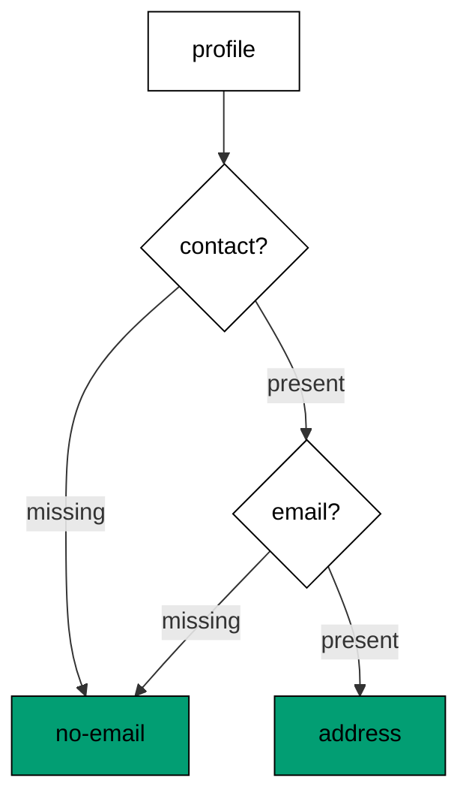

Each `?.` in the chain short-circuits to `undefined` at the first missing link, and the single `??` at the end converts any depth of absence into the fallback. The pyramid version needs one fallback per level and drifts when a level is added; the chain version adds one `?.` segment and keeps one fallback. Reserve explicit `if` chains for cases where each level needs a different fallback — different absences, different defaults — and let the chain handle uniform absence everywhere else.

**`learning/code/ex-02-optional-chaining-deep/main.ts`**:

```typescript
// => Example 2: ?. plus ?? walks optional shapes with no guard pyramid.
interface Profile {
  // => a user record with optional contact details
  name: string; // => always present: the required core
  contact?: {
    // => optional nest: may be missing entirely
    email?: string; // => optional leaf: present only when known
  }; // => end of contact?:
} // => end of interface Profile
const ada: Profile = { name: "ada" }; // => no contact block at all
const grace: Profile = { name: "grace", contact: {} }; // => contact present, email missing
function emailOf(p: Profile): string {
  // => one expression, no nesting
  return p.contact?.email ?? "no-email"; // => WHY ?. plus ??: missing at any depth falls back
} // => end of function emailOf(p: Profile): string
console.log(emailOf(ada)); // => Output: no-email, contact itself missing
console.log(emailOf(grace)); // => Output: no-email, the leaf missing instead
console.log(emailOf({ name: "alan", contact: { email: "a@example.com" } })); // => Output: a@example.com
```

**Output** (`learning/code/ex-02-optional-chaining-deep/expected/main.stdout.txt`):

```text
no-email
no-email
a@example.com
```

**Key takeaway**: Walk optional shapes with `?.` and land on one `??` fallback; uniform absence needs no pyramid.

**Why it matters**: Guard pyramids push the happy path rightward until it leaves the screen, and every added level doubles the paths a reader must hold. The chain keeps access code flat no matter how deep the shape grows, which is exactly why configuration objects, API responses, and parsed payloads — all deep and all partial — read cleanly in fluent code.

### Example 3: for-of With Destructuring

Looping over indexes to fetch items is a translation from languages without direct iteration; `for-of` yields items directly, `.entries()` pairs index and item, and destructuring names both halves at once. This example numbers a task list and walks a Map without a single index expression. (Concepts: co-01, co-03.)

The index pattern — `for (let i = 0; i < tasks.length; i++) use(tasks[i])` — mentions the collection three times to express one traversal, and each mention is a place a later edit can desynchronize. The `for-of` form states the traversal once: items arrive whole, the collection is named once, and filtering or reversing touches one line. Maps iterate entries by default, so the same destructuring shape serves key-value data with no API switch. Reach for indexes only when the position itself is data — windowing, lookahead, in-place writes — where the number genuinely matters apart from the item.

**`learning/code/ex-03-for-of-destructuring/main.ts`**:

```typescript
// => Example 3: for-of plus entries plus destructuring replaces index loops.
const tasks = ["write", "test", "review"]; // => the list drives the loop
for (const [index, task] of tasks.entries()) {
  // => WHY entries: index and item arrive paired
  console.log(index + 1, task); // => Output: 1 write / 2 test / 3 review
} // => end of for (const [index, task] of tasks.entries())
const scores = new Map<string, number>([
  ["ada", 9],
  ["grace", 10],
]); // => name-to-score lookup
for (const [who, score] of scores) {
  // => maps iterate entries by default
  console.log(who, score); // => Output: ada 9, then grace 10
} // => end of for (const [who, score] of scores)
```

**Output** (`learning/code/ex-03-for-of-destructuring/expected/main.stdout.txt`):

```text
1 write
2 test
3 review
ada 9
grace 10
```

**Key takeaway**: Let `for-of` carry traversals; pair it with `.entries()` and destructuring when positions matter.

**Why it matters**: Index arithmetic is accidental complexity around a simple idea — visit each item — and it fails silently when bounds, steps, or collections change. Direct iteration removes the failure mode entirely, so the loop states what it visits and nothing else, and reviewers check logic instead of arithmetic.

### Example 4: Spread and Rest

Copying arrays by hand and fixing function arity are both translations from less expressive languages; spread copies and extends in one expression, rest collects any argument count into a typed array. This example grows a list without touching the original and sums a variadic call. (Concepts: co-01, co-03.)

Spread copies one level and appends in the same breath, which makes immutable updates — new array, old contents plus changes — the path of least resistance. Rest turns call-site commas into a function-body array, so helpers accept one argument or twenty with one signature and one implementation. Destructuring with rest completes the trio: name the head, collect the tail, and both stay typed. The shared rule is copies at boundaries, views inside: spread when a new owner needs independence, rest when a function needs flexibility.

**`learning/code/ex-04-spread-rest-collect/main.ts`**:

```typescript
// => Example 4: spread copies arrays, rest collects arguments; both beat manual loops.
const base = [1, 2, 3]; // => the original stays untouched below
const extended = [...base, 4, 5]; // => WHY spread: copy plus additions in one line
console.log(extended.join(",")); // => Output: 1,2,3,4,5
console.log(base.length); // => Output: 3, the original never grew
function sum(...nums: number[]): number {
  // => WHY rest: callers pass any count
  return nums.reduce((a, b) => a + b, 0); // => the collected array reduces directly
} // => end of function sum(...nums: number[]): number
console.log(sum(1, 2, 3, 4)); // => Output: 10
const [first, ...others] = extended; // => head plus tail destructured together
console.log(first, others.length); // => Output: 1 4
```

**Output** (`learning/code/ex-04-spread-rest-collect/expected/main.stdout.txt`):

```text
1,2,3,4,5
3
10
1 4
```

**Key takeaway**: Copy with spread, collect with rest, split with destructuring-plus-rest; never loop to copy.

**Why it matters**: Manual copies alias when they should duplicate and duplicate when they should share, and fixed arity forces overloads or option bags for simple cases. The three dots make the common cases one-liners, which pushes code toward value semantics — new arrays instead of mutated ones — where whole classes of aliasing bugs cannot form.

### Example 5: Array Pipelines

Map-filter chains state data transformations left to right, in the order the data flows; the equivalent loop scatters input, condition, mapping, and accumulation across five lines. This example filters, maps, sorts, reduces, and flattens one small dataset. (Concepts: co-03.)

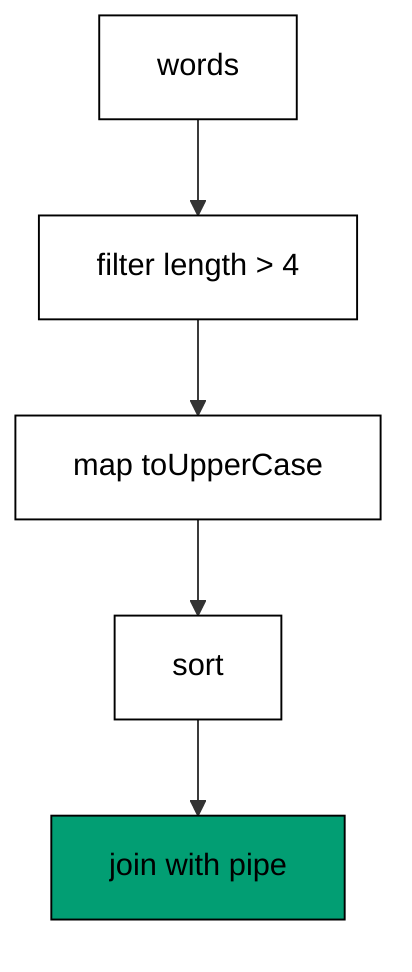

Each stage names one idea — keep, transform, order — and the chain reads as a sentence about the data rather than instructions for a machine. `reduce` folds a collection to a scalar in one pass when no staged chain fits, and `flatMap` maps plus flattens one level for grouped input. Expand back to a loop when the body needs side effects, early exit with complex conditions, or step debugging — pipelines trade breakpoints for brevity, and that trade is wrong during diagnosis.

**`learning/code/ex-05-array-pipeline/main.ts`**:

```typescript
// => Example 5: map-filter-sort chains read left to right, the way data flows.
const words = ["ada", "grace hopper", "alan", "margaret"]; // => raw mixed-length input
const long = words // => the pipeline reads as one sentence
  .filter((w) => w.length > 4) // => keep only names longer than four chars
  .map((w) => w.toUpperCase()) // => shout the survivors
  .sort(); // => fixed order: byte-stable output
console.log(long.join("|")); // => Output: GRACE HOPPER|MARGARET
const total = words.reduce((n, w) => n + w.length, 0); // => WHY reduce: one pass to a scalar
console.log(total); // => Output: 27, every name counted once
const nested = [[1, 2], [3], [4, 5]]; // => grouped numbers
console.log(nested.flatMap((g) => g).join(",")); // => Output: 1,2,3,4,5, one level flattened
```

**Output** (`learning/code/ex-05-array-pipeline/expected/main.stdout.txt`):

```text
GRACE HOPPER|MARGARET
27
1,2,3,4,5
```

**Key takeaway**: Chain filter-map-sort for staged transforms, reduce for folds, flatMap for grouped input.

**Why it matters**: Accumulator loops mix what with how — initialization, condition, push — on every line, so readers simulate the machine instead of reading the intent. Pipelines separate the stages visually, which makes wrong stages obvious: a misplaced filter reads wrong in a way a misplaced `if` inside a loop never does.

### Example 6: Map and Set Lookup

Objects double as dictionaries until prototypes, key types, and iteration order bite; `Map` and `Set` are the purpose-built collection types with none of that baggage. This example looks up roles with a fallback and deduplicates a stream in order. (Concepts: co-03.)

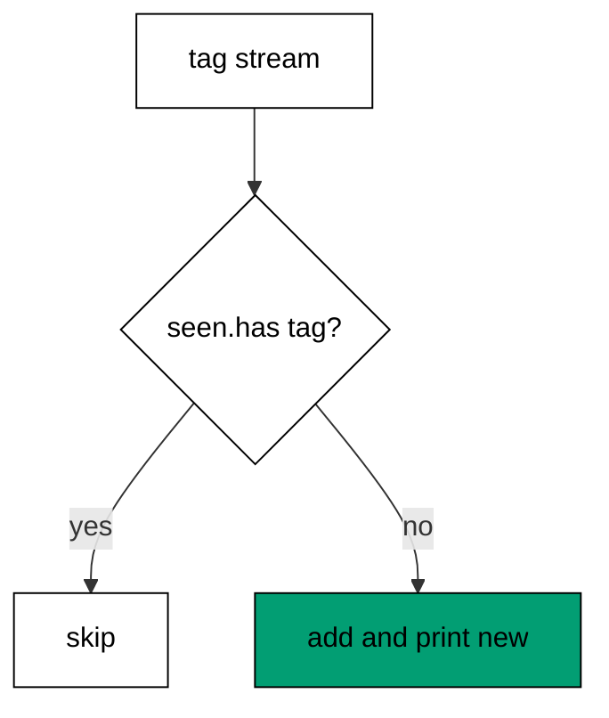

`Map.get` returns `undefined` on absence, which pairs with `??` for one-line defaults — the lookup and its fallback stay adjacent. `Set.has` answers membership in constant time with no prototype keys to collide, and iteration follows insertion order, so dedup-while-recording needs no second structure. Plain objects still fit JSON-shaped data with fixed string keys; reach for `Map` when keys are unknown at authoring time or non-strings, and for `Set` whenever the question is membership rather than mapping.

**`learning/code/ex-06-map-set-lookup/main.ts`**:

```typescript
// => Example 6: Map and Set make lookup and membership explicit.
const roles = new Map<string, string>([
  ["ada", "admin"],
  ["grace", "editor"],
]); // => name-to-role table
console.log(roles.get("ada") ?? "none"); // => Output: admin, present key
console.log(roles.get("alan") ?? "none"); // => Output: none, ?? covers absence
const seen = new Set<string>(); // => insertion-ordered membership ledger
for (const tag of ["ts", "js", "ts", "node", "js"]) {
  // => stream with repeats
  if (!seen.has(tag)) {
    // => WHY Set: O(1) membership, no indexOf scan
    seen.add(tag); // => first sighting recorded
    console.log("new:", tag); // => Output: new: ts, then js, then node
  } // => end of if (!seen.has(tag))
} // => end of for (const tag of ["ts", "js", "ts", "node", "js"])
console.log(seen.size); // => Output: 3, duplicates never stored
```

**Output** (`learning/code/ex-06-map-set-lookup/expected/main.stdout.txt`):

```text
admin
none
new: ts
new: js
new: node
3
```

**Key takeaway**: Look up with `Map.get` plus `??`, deduplicate with `Set`; leave plain objects for fixed JSON shapes.

**Why it matters**: Object-as-map code carries three silent risks — prototype key collisions, string-only keys that coerce numbers, and iteration order that surprises — and each has caused real production incidents. The dedicated types remove all three by construction, so the collection choice documents the access pattern instead of hoping for it.

### Example 7: Lazy Generators

Materializing a range to loop over it wastes memory on values that are consumed once and discarded; generators yield values on demand and pause between them. This example sums squares from a range that is never stored and takes two values from an endless-feeling sequence. (Concepts: co-01, co-03.)

A generator function suspends at each `yield` and resumes on the next request, so the consumer pulls exactly as many values as it needs — destructuring two items from a ninety-item range runs two iterations, not ninety. The pattern shines for paged data, token streams, and infinite sequences, where materializing everything is impossible rather than merely wasteful. Reach for arrays when the data needs reuse, indexing, or length; reach for generators when it needs one forward pass.

**`learning/code/ex-07-generator-lazy-range/main.ts`**:

```typescript
// => Example 7: generators stream values; nothing is stored until consumed.
function* range(start: number, end: number): Generator<number> {
  // => WHY generator: lazy pausable loop
  for (let n = start; n < end; n++) {
    // => ordinary loop, suspended per yield
    yield n; // => pause here: the caller resumes for the next value
  } // => end of for (let n = start; n < end; n++)
} // => end of function* range(start: number, end: number): Generat
let total = 0; // => running total, no array anywhere
for (const n of range(1, 5)) {
  // => values arrive one at a time
  total += n * n; // => squares accumulate: 1 + 4 + 9 + 16
} // => end of for (const n of range(1, 5))
console.log(total); // => Output: 30
const [a, b] = range(10, 99); // => WHY lazy: destructuring takes two, the rest never runs
console.log(a, b); // => Output: 10 11
```

**Output** (`learning/code/ex-07-generator-lazy-range/expected/main.stdout.txt`):

```text
30
10 11
```

**Key takeaway**: Generate lazy sequences with `function*` and `yield`; consume with `for-of` or destructuring.

**Why it matters**: Eager materialization couples memory to input size, which turns large inputs into crashes and infinite inputs into hangs. Laziness decouples the two — the consumer's appetite bounds the work, not the producer's size — and that decoupling is the difference between a program that streams and one that merely hopes the data fits.

### Example 8: Exhaustive Switch With never

A union of shapes demands one branch per member, but nothing reminds the author when a member is added — until the `default` arm assigns to `never`, which breaks compilation on the missing case. This example areas two shapes with a compiler-checked guarantee of coverage. (Concepts: co-01, co-10.)

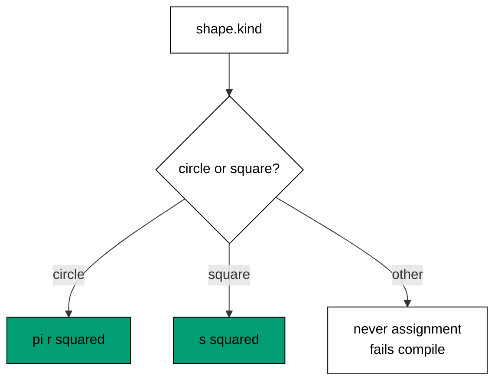

Switching on the discriminant narrows each branch to its member, so `shape.r` typechecks only inside the circle arm — the narrowing is the documentation. The `default` arm's `never` assignment is the ratchet: today it is unreachable, and the day a third shape joins the union it becomes a compile error pointing at exactly the switch that needs a new arm. If-else chains over the same discriminant work but never offer that ratchet; prefer switch wherever the union is closed and coverage must survive future edits.

**`learning/code/ex-08-switch-never-exhaustive/main.ts`**:

```typescript
// => Example 8: a switch over a union plus never proves every case is handled.
type Shape = { kind: "circle"; r: number } | { kind: "square"; s: number }; // => closed union, two members
function area(shape: Shape): number {
  // => every member must map to a number
  switch (
    shape.kind // => WHY switch: the discriminant narrows each branch
  ) {
    case "circle": // => narrowed to the circle member here
      return Math.PI * shape.r * shape.r; // => r is known to exist
    case "square": // => narrowed to the square member here
      return shape.s * shape.s; // => s is known to exist
    default: // => unreachable while the union stays covered
      const check: never = shape; // => WHY never: a new member breaks compilation here
      throw new Error(`unhandled shape: ${JSON.stringify(check)}`); // => documents the impossible
  } // => end of switch (shape.kind)
} // => end of function area(shape: Shape): number
console.log(area({ kind: "circle", r: 1 }).toFixed(2)); // => Output: 3.14
console.log(area({ kind: "square", s: 3 })); // => Output: 9
```

**Output** (`learning/code/ex-08-switch-never-exhaustive/expected/main.stdout.txt`):

```text
3.14
9
```

**Key takeaway**: Switch on the discriminant, narrow per arm, and assign `default` to `never` so new members break the build.

**Why it matters**: Uncovered union members fail at runtime in exactly the code paths nobody retests — the new variant through the old switch. The `never` ratchet converts that runtime surprise into a compile error at the edit site, which is the cheapest possible place to learn about a missing case.

### Example 9: try-catch Over unknown

Caught values are typed `unknown` because anything can be thrown — Error instances, strings, even objects — and treating the catch binding as an Error without checking is the translation to unlearn. This example parses strict JSON numbers and narrows both the payload and the failure. (Concepts: co-02.)

`JSON.parse` returns `any`, so the first act is demoting it to `unknown` and earning trust back through `typeof` checks — the parse boundary pattern in miniature. The `try` block stays narrow around the risky call only, so a failure inside success-handling code cannot be misattributed to the parse. In the catch arm, `instanceof Error` selects real errors and `String(err)` covers the rest; the transcript prints messages, never stacks, because stacks carry machine paths that would poison determinism.

**`learning/code/ex-09-try-catch-unknown/main.ts`**:

```typescript
// => Example 9: catch holds unknown; narrowing decides what the failure was.
function parseCount(raw: string): number {
  // => strict JSON number parsing
  const value: unknown = JSON.parse(raw); // => WHY unknown: JSON promises nothing
  if (typeof value !== "number") {
    // => narrow before trusting the shape
    throw new Error(`not a number: ${raw}`); // => precise failure, raw echoed
  } // => end of if (typeof value !== "number")
  return value; // => narrowed to number here
} // => end of function parseCount(raw: string): number
for (const raw of ["42", '"oops"']) {
  // => one valid payload, one wrong shape
  try {
    // => narrow block: only the risky parse lives here
    console.log("count:", parseCount(raw)); // => Output: count: 42, once
  } catch (err) {
    // => WHY unknown: throwers promise no type
    console.log("failed:", err instanceof Error ? err.message : String(err)); // => Output: failed: not a number
  } // => end of catch (err)
} // => end of for (const raw of ["42", '"oops"'])
```

**Output** (`learning/code/ex-09-try-catch-unknown/expected/main.stdout.txt`):

```text
count: 42
failed: not a number: "oops"
```

**Key takeaway**: Catch `unknown`, narrow with `instanceof`, keep `try` blocks around the risky call alone.

**Why it matters**: Blind `(err as Error).message` crashes on thrown strings and lies about thrown objects, usually inside error-handling code where a second crash buries the first. Narrowing makes the catch arm honest about every possibility, and narrow `try` blocks keep each handler's name attached to exactly one operation.

### Example 10: Result Unions

Exceptions suit the truly exceptional; routine failures — a zero divisor, a missing key, a rejected row — read better as data the caller must handle. The `Result` union makes both outcomes visible in the type, so ignoring failure becomes a compile-time conversation rather than a runtime surprise. This example divides with no `try` in sight. (Concepts: co-02, co-10.)

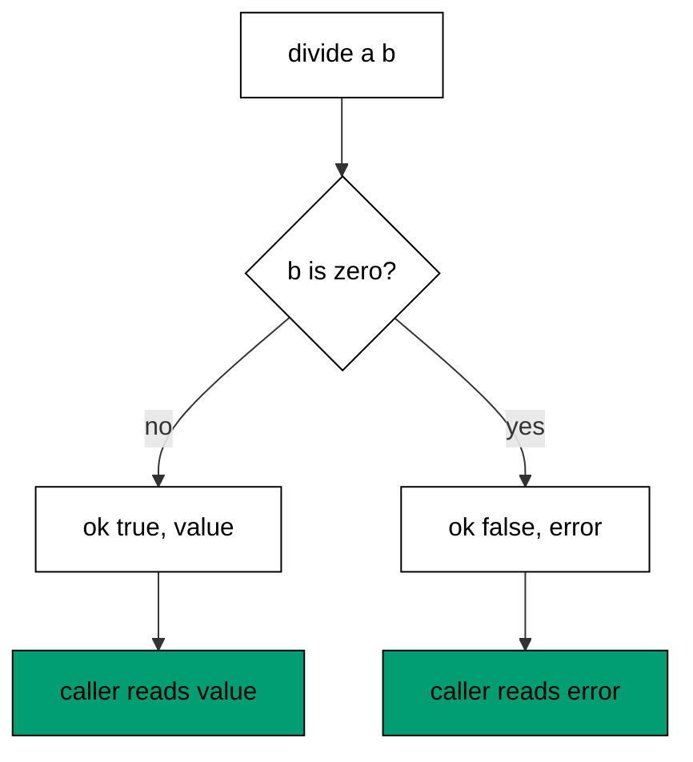

The `ok` discriminant narrows each arm, so `out.value` exists only where success was proven and `out.error` only where failure was proven — the compiler enforces handling by construction. Total functions compose: maps, filters, and collectors thread `Result` values without a single `try`, and the one place that must decide — the boundary — sees every failure at once. Reserve exceptions for programmer errors and truly unexpected states; model expected failures as values callers cannot help but handle.

**`learning/code/ex-10-result-union/main.ts`**:

```typescript
// => Example 10: Result carries failure as data; callers handle both arms.
type Result<T> = { ok: true; value: T } | { ok: false; error: string }; // => closed outcome union
function divide(a: number, b: number): Result<number> {
  // => total function: never throws
  if (b === 0) {
    // => the failure case, stated first
    return { ok: false, error: "division by zero" }; // => failure as data
  } // => end of if (b === 0)
  return { ok: true, value: a / b }; // => success as data
} // => end of function divide(a: number, b: number): Result<number
for (const pair of [
  [7, 2],
  [7, 0],
]) {
  // => one clean division, one zero divisor
  const [a, b] = pair; // => destructure the operands
  const out = divide(a, b); // => no try needed: failure is a value
  if (out.ok) {
    // => narrowing picks the success arm
    console.log("value:", out.value); // => Output: value: 3.5
  } else {
    // => the failure arm, error known to exist
    console.log("error:", out.error); // => Output: error: division by zero
  } // => end of else
} // => end of for (const pair of [[7, 2], [7, 0]])
```

**Output** (`learning/code/ex-10-result-union/expected/main.stdout.txt`):

```text
value: 3.5
error: division by zero
```

**Key takeaway**: Model routine failure as a `Result` union; narrow on `ok` and handle both arms every time.

**Why it matters**: Exceptions are invisible in signatures — every call is a hidden branch the reader must remember. `Result` writes the branch into the type, so the failure policy is reviewed at authoring time instead of discovered in production, and batch code can collect every failure instead of dying on the first.

### Example 11: Custom Errors With cause

Wrapping a low-level failure in a domain error without keeping the original destroys the diagnosis; the `cause` chain preserves every layer. This example validates a port through two layers and reports both the domain message and its cause. (Concepts: co-02.)

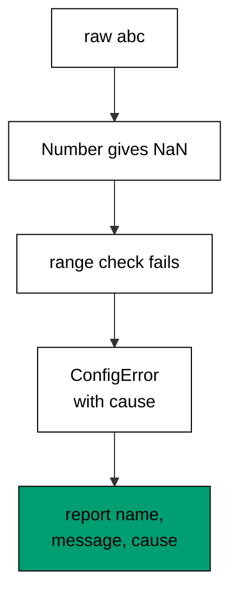

Subclassing `Error` with a stable `name` lets catch sites filter by type instead of matching message strings — `instanceof ConfigError` survives rewording, string matching does not. The `cause` option links the wrapped layer: outer message for the operator, inner cause for the debugger, both printed in one report line. Chain by default and suppress visibly and rarely: a rewrapped error that drops its cause is a diagnosis destroyed on purpose.

**`learning/code/ex-11-custom-error-cause/main.ts`**:

```typescript
// => Example 11: custom errors plus cause chain each layer's context.
class ConfigError extends Error {
  // => WHY subclass: catch sites filter by type
  constructor(message: string, options?: { cause?: unknown }) {
    // => cause links the layer below
    super(message, options); // => Error keeps name, message, and cause
    this.name = "ConfigError"; // => stable name across the chain
  } // => end of constructor(message: string, options?: { cause?: unk
} // => end of class ConfigError extends Error
function loadPort(raw: string): number {
  // => stringly config to validated port
  const port = Number(raw); // => coercion first
  if (!Number.isInteger(port) || port < 1 || port > 65535) {
    // => range policy in one test
    throw new ConfigError(`bad port: ${raw}`, { cause: `parsed as ${String(port)}` }); // => both layers kept
  } // => end of if (!Number.isInteger(port) || port < 1 || port > 65
  return port; // => valid port escapes
} // => end of function loadPort(raw: string): number
try {
  // => single risky call below
  loadPort("abc"); // => NaN fails the integer test
} catch (err) {
  // => filter by the custom type
  if (err instanceof ConfigError) {
    // => only ConfigError lands here
    console.log(err.name, "-", err.message, "| cause:", String(err.cause)); // => Output: ConfigError - bad port
  } // => end of if (err instanceof ConfigError)
} // => end of catch (err)
console.log(loadPort("3101")); // => Output: 3101
```

**Output** (`learning/code/ex-11-custom-error-cause/expected/main.stdout.txt`):

```text
ConfigError - bad port: abc | cause: parsed as NaN
3101
```

**Key takeaway**: Subclass domain errors for `instanceof` filtering and chain every layer with `cause`.

**Why it matters**: A bare `throw new Error("bad port")` answers what but never why — the coercion result, the offending input, the layer that produced it all vanish. Chained errors preserve the full story from operator message down to root value, which is the difference between a five-minute fix and an afternoon of reproduction.

### Example 12: Assertion Functions

Validation that throws and validation that narrows are usually two separate chores; assertion functions with `asserts` signatures do both at once. This example gates a host-port pair so the template below compiles with plain strings and numbers. (Concepts: co-02, co-10.)

The `asserts value is T` signature is a contract with the compiler: if the call returns, the value has the narrower type — no cast, no second check, no drift between the test and the assumption. Each assertion names its field in the failure, so the report points at the missing input rather than a downstream `undefined` crash. Prefer assertions at function entries and module boundaries, where unknown shapes enter; inside already-typed code they add noise without safety.

**`learning/code/ex-12-asserts-narrow/main.ts`**:

```typescript
// => Example 12: assertion helpers turn validation into narrowing the compiler trusts.
function assertDefined<T>(value: T | undefined, field: string): asserts value is T {
  // => WHY asserts: success narrows
  if (value === undefined) {
    // => the absence case throws
    throw new Error(`missing: ${field}`); // => names the absent field
  } // => end of if (value === undefined)
} // => end of function assertDefined<T>(value: T | undefined, fiel
function start(host: string | undefined, port: number | undefined): string {
  // => raw optional config
  assertDefined(host, "host"); // => host narrows to string below
  assertDefined(port, "port"); // => port narrows to number below
  return `${host}:${port}`; // => both known present: template is safe
} // => end of function start(host: string | undefined, port: numbe
console.log(start("localhost", 3101)); // => Output: localhost:3101
try {
  // => the missing-host case below
  start(undefined, 3101); // => host absent: the assertion must throw
} catch (err) {
  // => report the assertion failure
  console.log("failed:", err instanceof Error ? err.message : err); // => Output: failed: missing: host
} // => end of catch (err)
```

**Output** (`learning/code/ex-12-asserts-narrow/expected/main.stdout.txt`):

```text
localhost:3101
failed: missing: host
```

**Key takeaway**: Assert at entries with `asserts value is T`; success narrows, failure names the field.

**Why it matters**: Manual checks plus casts duplicate the policy — the `if` says one thing, the `as` says another, and they drift. Assertions state the policy once and hand the narrowed type to everything below, so validation and typing can never disagree again.

### Example 13: finally Cleanup

Cleanup written after the work runs only when the work succeeds; cleanup in `finally` runs on success, failure, and early return alike. This example writes scratch, fails on purpose, and still removes every trace. (Concepts: co-02.)

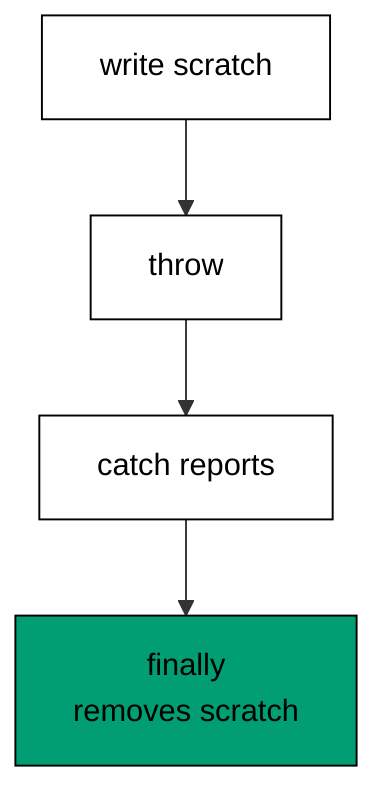

The scratch file lives in the OS temp directory under a fixed name — never printed, so no machine path leaks into the transcript — and `finally` removes it whatever happened above. The catch arm reports the message only; stacks would print file paths and break byte-stability. This is the shape behind every resource discipline: acquire, `try`, release in `finally`, with the release unconditional and the report minimal.

**`learning/code/ex-13-try-finally-cleanup/node.d.ts`**:

```typescript
// => Shared ambient declarations for the Node.js builtins this unit touches.
// => The pinned toolchain ships no network and no @types/node, so the few
// => APIs each example needs are declared here instead of installed.
declare module "node:fs" {
  // => file scratch: read, write, list, remove
  export function readFileSync(path: string, encoding: "utf-8"): string; // => text reads only
  export function writeFileSync(path: string, data: string): void; // => text writes only
  export function mkdirSync(path: string, options?: { recursive?: boolean }): void; // => scratch folders
  export function rmSync(path: string, options?: { force?: boolean; recursive?: boolean }): void; // => cleanup
  export function readdirSync(path: string): string[]; // => directory listings
  export function existsSync(path: string): boolean; // => presence checks
} // => end of declare module "node:fs"
declare module "node:path" {
  // => portable path assembly, no string concat
  export function join(...parts: string[]): string; // => joins with the platform separator
  export function basename(path: string, ext?: string): string; // => final segment only
  export function extname(path: string): string; // => extension including the dot
  export function dirname(path: string): string; // => parent directory only
} // => end of declare module "node:path"
declare module "node:os" {
  // => scratch root for deterministic file demos
  export function tmpdir(): string; // => writable temp directory
} // => end of declare module "node:os"
declare module "node:test" {
  // => the standard test runner used by the testing cluster
  export function describe(name: string, fn: () => void): void; // => groups related tests
  export interface CaseFn {
    // => a case function with parked and planned variants
    (name: string, fn: () => void | Promise<void>): void; // => normal case
    skip(name: string, fn?: () => void | Promise<void>): void; // => parked case
    todo(name: string, fn?: () => void | Promise<void>): void; // => planned case
  } // => end of export interface CaseFn
  export const it: CaseFn; // => nested case inside describe
  export interface TestContext {
    // => per-test handle for subtests
    test(name: string, fn: () => void | Promise<void>): Promise<void>; // => nested subtest
  } // => end of export interface TestContext
  export interface TopFn {
    // => top-level case with context plus variants
    (name: string, fn: (t: TestContext) => void | Promise<void>): void; // => standalone case
    skip(name: string, fn?: () => void | Promise<void>): void; // => parked case
    todo(name: string, fn?: () => void | Promise<void>): void; // => planned case
  } // => end of export interface TopFn
  export const test: TopFn; // => standalone case runner
  export function beforeEach(fn: () => void | Promise<void>): void; // => fixture setup per case
  export function afterEach(fn: () => void | Promise<void>): void; // => fixture teardown per case
  export interface MockCall {
    // => one recorded mock invocation
    arguments: unknown[]; // => the arguments that call received
  } // => end of export interface MockCall
  export interface MockHandle {
    // => recorded calls of one mock function
    calls: MockCall[]; // => every invocation in order
  } // => end of export interface MockHandle
  export function mockFn<T extends (...args: never[]) => unknown>( // => call recorder
    impl: T, // => the wrapped implementation
  ): T & { mock: MockHandle }; // => recorded handle out
  export const mock: {
    // => the mock namespace the runner provides
    fn: typeof mockFn; // => function-call recorder
    timers: {
      // => deterministic clock for timer tests
      enable(options: { apis: string[]; now: number }): void; // => swaps in the fake clock
      tick(ms: number): void; // => advances the fake clock synchronously
      reset(): void; // => restores the real timers
    }; // => end of timers
  }; // => end of mock namespace
} // => end of declare module "node:test"
declare module "node:assert/strict" {
  // => the standard assertion library
  export function strictEqual(actual: unknown, expected: unknown, message?: string): void; // => Object.is comparison
  export function deepStrictEqual(actual: unknown, expected: unknown, message?: string): void; // => deep check
  export function ok(value: unknown, message?: string): void; // => truthiness check
  export function throws(fn: () => unknown, expected?: RegExp): void; // => sync-throw check
  export function rejects(fn: () => Promise<unknown>, expected?: RegExp): Promise<void>; // => expects a rejection
} // => end of declare module "node:assert/strict"
declare const process: {
  // => the few process handles CLI examples need
  argv: string[]; // => raw command-line arguments
  version: string; // => running Node.js version string
  exit(code?: number): never; // => terminates with a status code
  env: Record<string, string | undefined>; // => environment map
}; // => end of declare const process:
```

**`learning/code/ex-13-try-finally-cleanup/main.ts`**:

```typescript
/// <reference path="./node.d.ts" />
// => Example 13: finally runs on every path, so cleanup cannot be skipped.
import { writeFileSync, rmSync } from "node:fs"; // => scratch write plus removal
import { join } from "node:path"; // => portable path assembly
import { tmpdir } from "node:os"; // => writable scratch root
const scratch = join(tmpdir(), "ex13-draft.txt"); // => fixed scratch name, no output leak
try {
  // => work that may throw sits inside
  writeFileSync(scratch, "draft"); // => create the scratch payload
  console.log("wrote: draft"); // => Output: wrote: draft
  throw new Error("simulated failure"); // => failure after the write
} catch (err) {
  // => report, then fall through to cleanup
  console.log("caught:", err instanceof Error ? err.message : err); // => Output: caught: simulated failure
} finally {
  // => WHY finally: runs on success, failure, and early return alike
  rmSync(scratch, { force: true }); // => scratch removed whatever happened
  console.log("cleaned: true"); // => Output: cleaned: true
} // => end of finally
```

**Output** (`learning/code/ex-13-try-finally-cleanup/expected/main.stdout.txt`):

```text
wrote: draft
caught: simulated failure
cleaned: true
```

**Key takeaway**: Acquire, `try`, release in `finally`; the release is unconditional and the report is messages-only.

**Why it matters**: Cleanup-after-work is a promise the failure path silently voids — leaked temp files, held locks, half-written outputs accumulate exactly when the system is already distressed. `finally` keeps the promise on every path, which is why resource code reviews start by asking where the `finally` is.

### Example 14: Guard Clauses

Nested validation buries the happy path under its preconditions; guard clauses return early and leave the main line flat at the bottom. This example normalizes a nullable nickname through two guards to one obvious return. (Concepts: co-01, co-02.)

Each guard states one rejection policy and exits, so the reader meets absence, blankness, and success as three sequential facts rather than a tree of possibilities. The flat tail — trim, lowercase, return — reads as the function's purpose precisely because nothing above it indented the purpose away. Flatten with guards when preconditions are independent; nest only when a later check genuinely depends on an earlier one's success branch.

**`learning/code/ex-14-guard-early-return/main.ts`**:

```typescript
// => Example 14: guard clauses return early; the happy path stays flat.
function nicknameOf(raw: string | null): string {
  // => nullable input, plain output
  if (raw === null) {
    // => WHY early: absence exits before any work
    return "anonymous"; // => one-line absence policy
  } // => end of if (raw === null)
  const trimmed = raw.trim(); // => whitespace never reaches the result
  if (trimmed === "") {
    // => second guard: blank is absence too
    return "anonymous"; // => same policy, stated once more
  } // => end of if (trimmed === "")
  return trimmed.toLowerCase(); // => happy path: flat, last, obvious
} // => end of function nicknameOf(raw: string | null): string
for (const probe of [null, "   ", "  Ada  "]) {
  // => absent, blank, and padded inputs
  console.log(JSON.stringify(probe), "->", nicknameOf(probe)); // => Output: null -> anonymous, then blank, then ada
} // => end of for (const probe of [null, " ", " Ada "])
```

**Output** (`learning/code/ex-14-guard-early-return/expected/main.stdout.txt`):

```text
null -> anonymous
"   " -> anonymous
"  Ada  " -> ada
```

**Key takeaway**: Reject preconditions with early returns; the happy path sits flat and last.

**Why it matters**: Every nesting level halves the readers who follow the logic to the bottom, and validation code nests deepest exactly where correctness matters most. Guards spend one line per policy and return the indentation to the purpose, so the function's contract reads as a list and its body as a straight line.

### Example 15: AggregateError Batches

`Promise.all` dies on the first rejection and discards the rest; batch work needs every outcome plus one summary error for the caller. `Promise.allSettled` collects the mixed results and `AggregateError` bundles the failures with each cause intact. This example runs three tasks where the middle one fails. (Concepts: co-02.)

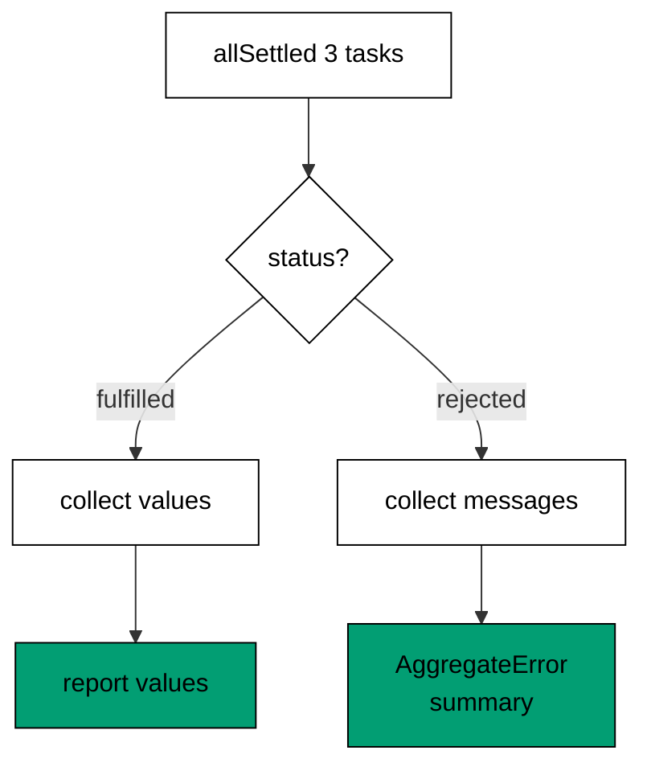

The split loop narrows each outcome — `value` exists only on fulfilled, `reason` only on rejected — so successes and problems collect without a single `any`. The summary `AggregateError` keeps every individual cause in its `errors` list while presenting one message to the caller, which is exactly the batch contract: proceed with what worked, report everything that did not. Reach for `all` when one failure voids the batch; reach for `allSettled` plus `AggregateError` when partial success still has value.

**`learning/code/ex-15-aggregate-errors/main.ts`**:

```typescript
// => Example 15: AggregateError reports every failure; allSettled keeps mixed outcomes.
async function maybe(id: string, ok: boolean): Promise<string> {
  // => deterministic stand-in task
  if (!ok) {
    // => the failing branch throws
    throw new Error(`task ${id} failed`); // => names the failed task
  } // => end of if (!ok)
  return `task ${id} ok`; // => success value
} // => end of async function maybe(id: string, ok: boolean): Promi
async function main(): Promise<void> {
  // => WHY wrapper: no top-level await in commonjs
  const tasks = [maybe("a", true), maybe("b", false), maybe("c", true)]; // => mixed outcomes ahead
  const results = await Promise.allSettled(tasks); // => WHY allSettled: every outcome lands
  for (const r of results) {
    // => walk the mixed outcomes in order
    if (r.status === "fulfilled") {
      // => narrow to the success arm
      console.log("ok:", r.value); // => Output: ok: task a ok, then task c ok
    } else {
      // => the rejection arm, reason known present
      console.log("bad:", (r.reason as Error).message); // => Output: bad: task b failed
    } // => end of else
  } // => end of for (const r of results)
  const failures = results.filter((r) => r.status === "rejected"); // => gather only failures
  if (failures.length > 0) {
    // => report them as one error
    const causes = failures.map((f) => (f as PromiseRejectedResult).reason); // => keep every cause
    const err = new AggregateError(causes, "batch failed"); // => WHY AggregateError: one summary
    console.log(err.message, "with", err.errors.length, "causes"); // => Output: batch failed with 1 causes
  } // => end of if (failures.length > 0)
} // => end of async function main(): Promise<void>
void main(); // => floating promise: rejections would fail the run loudly
```

**Output** (`learning/code/ex-15-aggregate-errors/expected/main.stdout.txt`):

```text
ok: task a ok
bad: task b failed
ok: task c ok
batch failed with 1 causes
```

**Key takeaway**: Settle batches with `allSettled`, split outcomes by status, summarize failures in one `AggregateError`.

**Why it matters**: First-failure-wins reporting lies by omission — four failures become one, and the fix cycle repeats per failure instead of per batch. Collecting every outcome turns one red run into a complete repair list, and the aggregate keeps each cause inspectable when the summary is not enough.

### Example 16: The never fail() Helper

Impossible branches still need a return type, and required values still need absence handling; a `never`-returning `fail()` serves both from one helper. This example guards a required port and closes a two-arm function with the same tool. (Concepts: co-02, co-10.)

`fail` throws, so the compiler treats the call site as unreachable — the `??` chain keeps its type, the function's end stays covered, and no dead default value pollutes the logic. Compared with non-null assertions, which silence the compiler and crash at runtime, `fail` crashes loudly at exactly the boundary that was violated, with a message naming the expectation. Use it for invariants the types cannot express: required configuration, exhaustive remainders, and internal consistency checks.

**`learning/code/ex-16-fail-never-helper/main.ts`**:

```typescript
// => Example 16: a never-returning fail() marks impossible branches and feeds ??.
function fail(message: string): never {
  // => WHY never: callers know it cannot return
  throw new Error(message); // => always throws, never produces a value
} // => end of function fail(message: string): never
const port: number | undefined = 3101; // => optional config, present here
const live = port ?? fail("port is required"); // => WHY ??: absence throws at the boundary
console.log(live); // => Output: 3101
function area(kind: "a" | "b"): number {
  // => closed input pair
  if (kind === "a") {
    // => first arm handled
    return 1; // => plain value out
  } // => end of if (kind === "a")
  if (kind === "b") {
    // => second arm handled
    return 2; // => plain value out
  } // => end of if (kind === "b")
  return fail(`impossible kind: ${kind}`); // => WHY never: return typechecks, throws if reached
} // => end of function area(kind: "a" | "b"): number
console.log(area("b")); // => Output: 2
```

**Output** (`learning/code/ex-16-fail-never-helper/expected/main.stdout.txt`):

```text
3101
2
```

**Key takeaway**: Throw invariants through a `never` helper; call sites stay typed and failures name their expectation.

**Why it matters**: Placeholder defaults for impossible cases — return zero, return empty — corrupt downstream data silently when the impossible happens. `fail` converts the same situation into a loud, named crash at the boundary, which is always preferable to wrong data traveling three layers before anyone notices.

### Example 17: Parse, Don't Validate

Validating data where it is used spreads the policy across every consumer; parsing once at the boundary concentrates it in one function whose output type is the proof. This example turns unknown JSON-ish input into a trusted `User` that downstream code uses without a single check. (Concepts: co-02, co-14.)

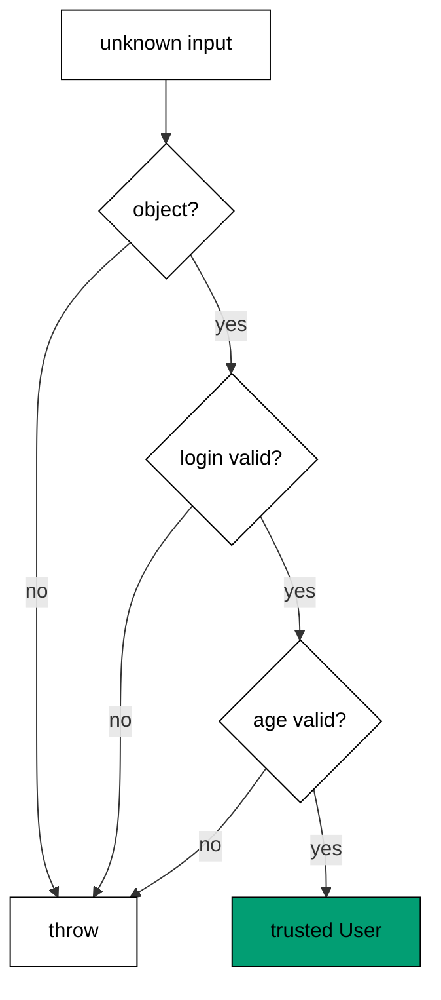

The parser's return type is the policy made visible: everything past `parseUser` holds a trimmed login and a finite age by construction, so no consumer re-checks. Each rejection names its rule, which turns malformed input into actionable reports instead of downstream `NaN` mysteries. This is the same boundary discipline behind assertion functions and `Result` unions — decide trust once, at the edge, and let the interior run on proven shapes.

**`learning/code/ex-17-parse-dont-validate/main.ts`**:

```typescript
// => Example 17: parse once at the boundary; the core trusts the parsed type.
interface User {
  // => the trusted core shape
  login: string; // => already trimmed and checked
  age: number; // => already a finite number
} // => end of interface User
function parseUser(raw: unknown): User {
  // => WHY parse: unknown enters, User leaves
  if (typeof raw !== "object" || raw === null) {
    // => shape gate first
    throw new Error("user must be an object"); // => rejects primitives and null
  } // => end of if (typeof raw !== "object" || raw === null)
  const { login, age } = raw as { login?: unknown; age?: unknown }; // => pull the fields loosely
  if (typeof login !== "string" || login.trim() === "") {
    // => login policy in one test
    throw new Error("login must be a non-empty string"); // => names the violated rule
  } // => end of if (typeof login !== "string" || login.trim() === ""
  if (typeof age !== "number" || !Number.isFinite(age)) {
    // => age policy in one test
    throw new Error("age must be a finite number"); // => names the violated rule
  } // => end of if (typeof age !== "number" || !Number.isFinite(age)
  return { login: login.trim(), age }; // => parsed value: trusted downstream
} // => end of function parseUser(raw: unknown): User
console.log(JSON.stringify(parseUser({ login: "  ada  ", age: 36 }))); // => Output: {"login":"ada","age":36}
try {
  // => the invalid payload below
  parseUser({ login: "", age: 36 }); // => blank login must fail parsing
} catch (err) {
  // => report the boundary rejection
  console.log("rejected:", err instanceof Error ? err.message : err); // => Output: rejected, rule named
} // => end of catch (err)
```

**Output** (`learning/code/ex-17-parse-dont-validate/expected/main.stdout.txt`):

```text
{"login":"ada","age":36}
rejected: login must be a non-empty string
```

**Key takeaway**: Parse unknown input into trusted types once at the boundary; the core never re-validates.

**Why it matters**: Per-consumer validation multiplies the policy by the consumer count, and the copies drift — one checks emptiness, another forgets, a third checks differently. A single parser holds one policy that every consumer inherits through the type, so fixes land once and hold everywhere.

### Example 18: String Trim, Split, Join

Pasted text arrives messy — padding, mixed case, wrong separators — and three small methods normalize it without regex. This example cleans a roster line, splits it into pieces, and rejoins it twice. (Concepts: co-04.)

`trim` plus `toLowerCase` plus `replace` form the standard normalization prefix: strip the edges, unify the case, fix the known separator, and only then split. Splitting before normalizing bakes the mess into the pieces; trimming each piece after the split finishes the job. The `endsWith` and `startsWith` checks classify by shape — extensions, prefixes — where equality would demand the whole string. Reach for regex only when the pattern varies; fixed affixes and single separators belong to the plain methods.

**`learning/code/ex-18-string-methods/main.ts`**:

```typescript
// => Example 18: trim, split, and join normalize pasted text without regex.
const raw = "  ada, GRACE; margaret  "; // => messy pasted input
const cleaned = raw.trim().toLowerCase().replace(";", ","); // => WHY chain: normalize once at the edge
console.log(cleaned); // => Output: ada, grace, margaret
const parts = cleaned.split(",").map((s) => s.trim()); // => split then trim each piece
console.log(parts.join("|")); // => Output: ada|grace|margaret
console.log("report.csv".endsWith(".csv"), "Ada".toLowerCase().startsWith("a")); // => Output: true true
```

**Output** (`learning/code/ex-18-string-methods/expected/main.stdout.txt`):

```text
ada, grace, margaret
ada|grace|margaret
true true
```

**Key takeaway**: Normalize once at the edge with trim-case-replace, then split, trim pieces, and rejoin.

**Why it matters**: Text mess travels: an untrimmed name mismatches a lookup, a cased key duplicates a record, a stray separator splits a field. Normalizing at entry keeps every downstream comparison honest, and the plain methods do it readably where a regex would obscure a fixed, simple rule.

### Example 19: Regex matchAll

Repeated structure — pairs, tags, records — needs every match plus its fields, not just the first; `matchAll` with named groups delivers the whole sequence with fields by name. This example extracts scored names and masks one digit run. (Concepts: co-04.)

Named groups turn capture indexes into field names, so `m.groups?.who` survives pattern edits that would renumber `m[1]`. The global flag drives the iteration; without it `matchAll` throws, which is the API insisting on intent. The `?.` guard on `groups` satisfies strict null checks where a bare access would not compile. Keep patterns small and anchored to their purpose — one pattern per structure — because a regex that parses two shapes parses neither reliably.

**`learning/code/ex-19-regex-matchall/main.ts`**:

```typescript
// => Example 19: matchAll plus named groups parse repeated structure.
const line = "ada:9, grace:10, alan:7"; // => repeated name-score pairs
const re = /(?<who>[a-z]+):(?<score>\d+)/g; // => WHY named groups: fields by name, not index
const pairs: string[] = []; // => collected readable pairs
for (const m of line.matchAll(re)) {
  // => every non-overlapping match in order
  pairs.push(`${m.groups?.who ?? "?"}=${m.groups?.score ?? "?"}`); // => named fields, guarded
} // => end of for (const m of line.matchAll(re))
console.log(pairs.join(" ")); // => Output: ada=9 grace=10 alan=7
console.log("call 3101 now".replace(/\d+/, "#")); // => Output: call # now, first digit run only
```

**Output** (`learning/code/ex-19-regex-matchall/expected/main.stdout.txt`):

```text
ada=9 grace=10 alan=7
call # now
```

**Key takeaway**: Parse repeated structure with `matchAll` and named groups; guard `groups` with `?.`.

**Why it matters**: Hand-rolled splitting breaks on nested separators and encoded values — the kata in drilling shows the damage — while one declarative pattern states the structure once. Named fields keep the extraction readable months later, when `m[2]` would demand re-reading the pattern to answer what it holds.

### Example 20: URL and Search Params

Query strings built by concatenation break on spaces, ampersands, and repeats; the `URL` and `URLSearchParams` classes encode once and parse completely. This example reads a multi-tag URL and builds a query with a hostile value. (Concepts: co-04.)

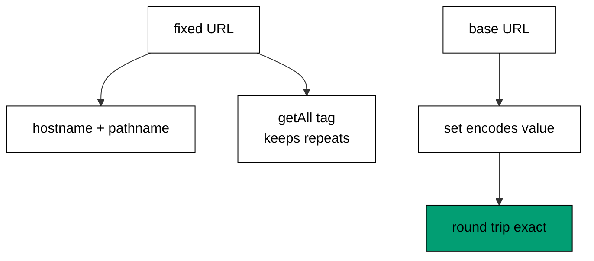

`getAll` preserves repeated parameters that `get` would collapse — the tag list survives as a list. `set` percent-encodes the value exactly once, so `generics & types` round-trips through `q=generics+%26+types` without double-encoding or injection. String-built URLs cannot promise either: one unencoded ampersand splits a value into two parameters, and one `+` becomes a space. Treat URLs as parsed structures from construction to read, never as strings to glue.

**`learning/code/ex-20-url-search-params/main.ts`**:

```typescript
// => Example 20: URL and URLSearchParams build and read query strings safely.
const url = new URL("https://api.example.com/search?tag=ts&tag=node&page=2"); // => fixed input URL
console.log(url.hostname, url.pathname); // => Output: api.example.com /search
console.log(url.searchParams.getAll("tag").join(",")); // => Output: ts,node, repeats kept
const built = new URL("https://api.example.com/items"); // => base with no query
built.searchParams.set("q", "generics & types"); // => WHY API: encoding handled once
console.log(built.searchParams.get("q")); // => Output: generics & types, round-tripped
console.log(built.toString()); // => Output: encoded query string
```

**Output** (`learning/code/ex-20-url-search-params/expected/main.stdout.txt`):

```text
api.example.com /search
ts,node
generics & types
https://api.example.com/items?q=generics+%26+types
```

**Key takeaway**: Parse URLs into `URL`, read repeats with `getAll`, build queries with `set`; never concatenate.

**Why it matters**: A manually glued query string is an injection bug waiting for its first ampersand — values become structure, filters leak across parameters, and signatures over the URL stop matching. The classes make malformed output unrepresentable, which beats reviewing every concatenation for encoding discipline.

### Example 21: path Join Over Concat

String-concatenated paths guess the separator and double it or drop it; `node:path` joins segments with the platform's own separator every time. This example assembles a course path and dissects it into name, extension, and directory. (Concepts: co-04.)

Concatenation bakes one platform's separator into the code — forward slashes break on old Windows tooling, backslashes break everywhere else — while `join` normalizes each segment and inserts exactly one separator. `basename`, `extname`, and `dirname` dissect without splitting on separators by hand, which keeps dots in directory names and multi-dot filenames from confusing the parse. Whenever a path is built, joined, or split, the path module owns the operation; string methods own the names inside it.

**`learning/code/ex-21-path-join/node.d.ts`**:

```typescript
// => Shared ambient declarations for the Node.js builtins this unit touches.
// => The pinned toolchain ships no network and no @types/node, so the few
// => APIs each example needs are declared here instead of installed.
declare module "node:fs" {
  // => file scratch: read, write, list, remove
  export function readFileSync(path: string, encoding: "utf-8"): string; // => text reads only
  export function writeFileSync(path: string, data: string): void; // => text writes only
  export function mkdirSync(path: string, options?: { recursive?: boolean }): void; // => scratch folders
  export function rmSync(path: string, options?: { force?: boolean; recursive?: boolean }): void; // => cleanup
  export function readdirSync(path: string): string[]; // => directory listings
  export function existsSync(path: string): boolean; // => presence checks
} // => end of declare module "node:fs"
declare module "node:path" {
  // => portable path assembly, no string concat
  export function join(...parts: string[]): string; // => joins with the platform separator
  export function basename(path: string, ext?: string): string; // => final segment only
  export function extname(path: string): string; // => extension including the dot
  export function dirname(path: string): string; // => parent directory only
} // => end of declare module "node:path"
declare module "node:os" {
  // => scratch root for deterministic file demos
  export function tmpdir(): string; // => writable temp directory
} // => end of declare module "node:os"
declare module "node:test" {
  // => the standard test runner used by the testing cluster
  export function describe(name: string, fn: () => void): void; // => groups related tests
  export interface CaseFn {
    // => a case function with parked and planned variants
    (name: string, fn: () => void | Promise<void>): void; // => normal case
    skip(name: string, fn?: () => void | Promise<void>): void; // => parked case
    todo(name: string, fn?: () => void | Promise<void>): void; // => planned case
  } // => end of export interface CaseFn
  export const it: CaseFn; // => nested case inside describe
  export interface TestContext {
    // => per-test handle for subtests
    test(name: string, fn: () => void | Promise<void>): Promise<void>; // => nested subtest
  } // => end of export interface TestContext
  export interface TopFn {
    // => top-level case with context plus variants
    (name: string, fn: (t: TestContext) => void | Promise<void>): void; // => standalone case
    skip(name: string, fn?: () => void | Promise<void>): void; // => parked case
    todo(name: string, fn?: () => void | Promise<void>): void; // => planned case
  } // => end of export interface TopFn
  export const test: TopFn; // => standalone case runner
  export function beforeEach(fn: () => void | Promise<void>): void; // => fixture setup per case
  export function afterEach(fn: () => void | Promise<void>): void; // => fixture teardown per case
  export interface MockCall {
    // => one recorded mock invocation
    arguments: unknown[]; // => the arguments that call received
  } // => end of export interface MockCall
  export interface MockHandle {
    // => recorded calls of one mock function
    calls: MockCall[]; // => every invocation in order
  } // => end of export interface MockHandle
  export function mockFn<T extends (...args: never[]) => unknown>( // => call recorder
    impl: T, // => the wrapped implementation
  ): T & { mock: MockHandle }; // => recorded handle out
  export const mock: {
    // => the mock namespace the runner provides
    fn: typeof mockFn; // => function-call recorder
    timers: {
      // => deterministic clock for timer tests
      enable(options: { apis: string[]; now: number }): void; // => swaps in the fake clock
      tick(ms: number): void; // => advances the fake clock synchronously
      reset(): void; // => restores the real timers
    }; // => end of timers
  }; // => end of mock namespace
} // => end of declare module "node:test"
declare module "node:assert/strict" {
  // => the standard assertion library
  export function strictEqual(actual: unknown, expected: unknown, message?: string): void; // => Object.is comparison
  export function deepStrictEqual(actual: unknown, expected: unknown, message?: string): void; // => deep check
  export function ok(value: unknown, message?: string): void; // => truthiness check
  export function throws(fn: () => unknown, expected?: RegExp): void; // => sync-throw check
  export function rejects(fn: () => Promise<unknown>, expected?: RegExp): Promise<void>; // => expects a rejection
} // => end of declare module "node:assert/strict"
declare const process: {
  // => the few process handles CLI examples need
  argv: string[]; // => raw command-line arguments
  version: string; // => running Node.js version string
  exit(code?: number): never; // => terminates with a status code
  env: Record<string, string | undefined>; // => environment map
}; // => end of declare const process:
```

**`learning/code/ex-21-path-join/main.ts`**:

```typescript
/// <reference path="./node.d.ts" />
// => Example 21: node:path joins segments; string concat guesses separators.
import { join, basename, extname, dirname } from "node:path"; // => portable path assembly
const rel = join("courses", "ts", "overview.md"); // => WHY join: separator comes from the platform
console.log(rel); // => Output: courses/ts/overview.md
console.log(basename(rel), extname(rel), dirname(rel)); // => Output: overview.md .md courses/ts
```

**Output** (`learning/code/ex-21-path-join/expected/main.stdout.txt`):

```text
courses/ts/overview.md
overview.md .md courses/ts
```

**Key takeaway**: Join paths with `node:path`, dissect with `basename`, `extname`, `dirname`; never concatenate separators.

**Why it matters**: A hardcoded separator is a portability lie that passes every test on the author's machine and fails on the first foreign one. The path module states the operation — join, split, extend — and lets the platform supply the punctuation, so the same code runs correctly on both separator conventions.

### Example 22: UTF-8 Round Trips

Text written with one encoding and read with another corrupts silently; stating `utf-8` explicitly on both sides makes the round trip portable. This example writes three lines to scratch and reads them back whole. (Concepts: co-04.)

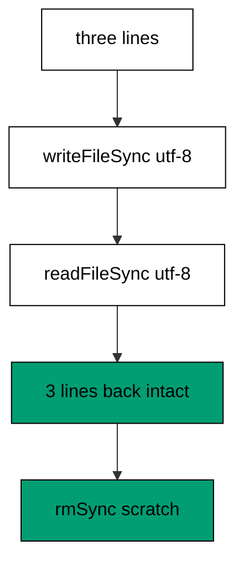

The platform default encoding varies, so omitting it makes the program's behavior a property of the machine — the classic mojibake source. Explicit `utf-8` on write and read pins the behavior in the code where reviewers can see it. Scratch lives in the OS temp directory under a fixed name that never reaches stdout, and `rmSync` removes it, so the unit leaves no trace and prints no machine-specific path.

**`learning/code/ex-22-read-write-utf8/node.d.ts`**:

```typescript
// => Shared ambient declarations for the Node.js builtins this unit touches.
// => The pinned toolchain ships no network and no @types/node, so the few
// => APIs each example needs are declared here instead of installed.
declare module "node:fs" {
  // => file scratch: read, write, list, remove
  export function readFileSync(path: string, encoding: "utf-8"): string; // => text reads only
  export function writeFileSync(path: string, data: string): void; // => text writes only
  export function mkdirSync(path: string, options?: { recursive?: boolean }): void; // => scratch folders
  export function rmSync(path: string, options?: { force?: boolean; recursive?: boolean }): void; // => cleanup
  export function readdirSync(path: string): string[]; // => directory listings
  export function existsSync(path: string): boolean; // => presence checks
} // => end of declare module "node:fs"
declare module "node:path" {
  // => portable path assembly, no string concat
  export function join(...parts: string[]): string; // => joins with the platform separator
  export function basename(path: string, ext?: string): string; // => final segment only
  export function extname(path: string): string; // => extension including the dot
  export function dirname(path: string): string; // => parent directory only
} // => end of declare module "node:path"
declare module "node:os" {
  // => scratch root for deterministic file demos
  export function tmpdir(): string; // => writable temp directory
} // => end of declare module "node:os"
declare module "node:test" {
  // => the standard test runner used by the testing cluster
  export function describe(name: string, fn: () => void): void; // => groups related tests
  export interface CaseFn {
    // => a case function with parked and planned variants
    (name: string, fn: () => void | Promise<void>): void; // => normal case
    skip(name: string, fn?: () => void | Promise<void>): void; // => parked case
    todo(name: string, fn?: () => void | Promise<void>): void; // => planned case
  } // => end of export interface CaseFn
  export const it: CaseFn; // => nested case inside describe
  export interface TestContext {
    // => per-test handle for subtests
    test(name: string, fn: () => void | Promise<void>): Promise<void>; // => nested subtest
  } // => end of export interface TestContext
  export interface TopFn {
    // => top-level case with context plus variants
    (name: string, fn: (t: TestContext) => void | Promise<void>): void; // => standalone case
    skip(name: string, fn?: () => void | Promise<void>): void; // => parked case
    todo(name: string, fn?: () => void | Promise<void>): void; // => planned case
  } // => end of export interface TopFn
  export const test: TopFn; // => standalone case runner
  export function beforeEach(fn: () => void | Promise<void>): void; // => fixture setup per case
  export function afterEach(fn: () => void | Promise<void>): void; // => fixture teardown per case
  export interface MockCall {
    // => one recorded mock invocation
    arguments: unknown[]; // => the arguments that call received
  } // => end of export interface MockCall
  export interface MockHandle {
    // => recorded calls of one mock function
    calls: MockCall[]; // => every invocation in order
  } // => end of export interface MockHandle
  export function mockFn<T extends (...args: never[]) => unknown>( // => call recorder
    impl: T, // => the wrapped implementation
  ): T & { mock: MockHandle }; // => recorded handle out
  export const mock: {
    // => the mock namespace the runner provides
    fn: typeof mockFn; // => function-call recorder
    timers: {
      // => deterministic clock for timer tests
      enable(options: { apis: string[]; now: number }): void; // => swaps in the fake clock
      tick(ms: number): void; // => advances the fake clock synchronously
      reset(): void; // => restores the real timers
    }; // => end of timers
  }; // => end of mock namespace
} // => end of declare module "node:test"
declare module "node:assert/strict" {
  // => the standard assertion library
  export function strictEqual(actual: unknown, expected: unknown, message?: string): void; // => Object.is comparison
  export function deepStrictEqual(actual: unknown, expected: unknown, message?: string): void; // => deep check
  export function ok(value: unknown, message?: string): void; // => truthiness check
  export function throws(fn: () => unknown, expected?: RegExp): void; // => sync-throw check
  export function rejects(fn: () => Promise<unknown>, expected?: RegExp): Promise<void>; // => expects a rejection
} // => end of declare module "node:assert/strict"
declare const process: {
  // => the few process handles CLI examples need
  argv: string[]; // => raw command-line arguments
  version: string; // => running Node.js version string
  exit(code?: number): never; // => terminates with a status code
  env: Record<string, string | undefined>; // => environment map
}; // => end of declare const process:
```

**`learning/code/ex-22-read-write-utf8/main.ts`**:

```typescript
/// <reference path="./node.d.ts" />
// => Example 22: explicit utf-8 on both sides makes text I/O portable.
import { writeFileSync, readFileSync, rmSync } from "node:fs"; // => scratch write, read, removal
import { join } from "node:path"; // => portable scratch path
import { tmpdir } from "node:os"; // => writable scratch root
const scratch = join(tmpdir(), "ex22-names.txt"); // => fixed scratch name, never printed
const lines = ["ada\n", "grace hopper\n", "margaret\n"]; // => plain ASCII payload lines
writeFileSync(scratch, lines.join("")); // => three lines written as utf-8
const back = readFileSync(scratch, "utf-8")
  .split("\n")
  .filter((l) => l !== ""); // => lines back, trailer cut
console.log(back.length); // => Output: 3, every line survived
console.log(back[1]); // => Output: grace hopper, content intact
rmSync(scratch, { force: true }); // => scratch removed: no trace left
```

**Output** (`learning/code/ex-22-read-write-utf8/expected/main.stdout.txt`):

```text
3
grace hopper
```

**Key takeaway**: State `utf-8` on every text read and write; scratch in temp, fixed names, always removed.

**Why it matters**: Encoding defaults are invisible machine state, and invisible state is where portability dies — the file that reads fine in development corrupts in production because the servers disagree about defaults. Explicit encodings move the decision into version control, where it is reviewed once and holds everywhere.

### Example 23: JSON Round Trips

JSON carries plain data across every boundary, but `parse` returns `unknown` in honest code and functions never survive the trip. This example stringifies an order, parses it back through a shape gate, and measures pretty printing. (Concepts: co-04.)

`stringify` is deterministic for fixed objects — same keys, same order, same bytes — which makes golden transcripts possible. `parse` promises nothing, so the shape gate (`typeof` object, non-null, key present) precedes every field touch, exactly the parse-boundary habit from Example 17 in miniature. The indent argument shapes human-readable output; counting its lines demonstrates the shape without printing machine paths.

**`learning/code/ex-23-json-roundtrip/main.ts`**:

```typescript
// => Example 23: stringify plus parse round-trips plain data; functions do not survive.
const order = { id: 7, item: "lamp", qty: 2, tags: ["home", "sale"] }; // => plain-data payload
const text = JSON.stringify(order); // => the wire form
console.log(text); // => Output: {"id":7,"item":"lamp","qty":2,"tags":["home","sale"]}
const back: unknown = JSON.parse(text); // => WHY unknown: parse promises nothing
if (typeof back === "object" && back !== null && "qty" in back) {
  // => narrow before touching fields
  console.log("qty:", (back as { qty: unknown }).qty); // => Output: qty: 2
} // => end of if (typeof back === "object" && back !== null && "qt
const prettyLines = JSON.stringify({ a: 1 }, null, 2).split("\n").length; // => two-space indent shape
console.log(prettyLines); // => Output: 3, brace, field, brace
```

**Output** (`learning/code/ex-23-json-roundtrip/expected/main.stdout.txt`):

```text
{"id":7,"item":"lamp","qty":2,"tags":["home","sale"]}
qty: 2
3
```

**Key takeaway**: Stringify fixed shapes for stable bytes; parse into `unknown` and narrow before touching fields.

**Why it matters**: Unchecked `parse` results propagate `undefined` fields deep into logic, where the crash loses all connection to the malformed payload. Gating at the parse site keeps the failure adjacent to its cause, and deterministic stringify makes wire formats testable with golden transcripts instead of eyeballing.

### Example 24: Intl Dates and Zones

Dates formatted in the local zone differ per machine; fixed instants plus explicit zones plus fixed locales make date output byte-stable. This example formats one UTC midnight three ways and does exact day arithmetic. (Concepts: co-05.)

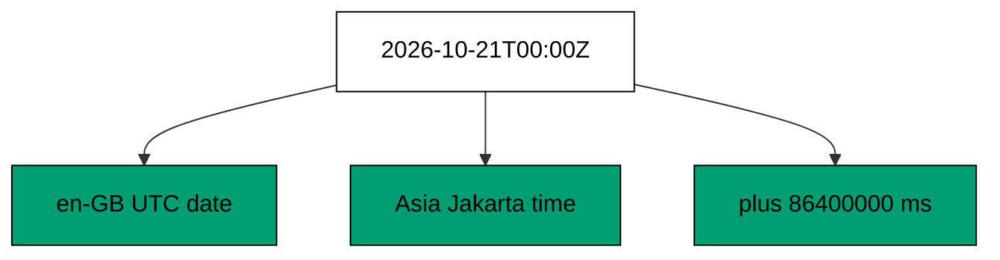

`Date.UTC` constructs without consulting the local zone, and each formatter names its own zone — UTC for the calendar date, Asia/Jakarta for the clock reading — so the transcript holds on every machine. Millisecond arithmetic keeps day math exact across daylight-saving transitions that defeat hour-based addition. The standing rule for deterministic time output: fixed instants in, explicit zones and locales through, durations as numbers out.

**`learning/code/ex-24-intl-dates/main.ts`**:

```typescript
// => Example 24: Intl formats fixed instants; date arithmetic stays in milliseconds.
const instant = new Date(Date.UTC(2026, 9, 21, 0, 0, 0)); // => WHY UTC: no local zone leaks in
const en = new Intl.DateTimeFormat("en-GB", { dateStyle: "medium", timeZone: "UTC" }); // => fixed zone and locale
console.log(en.format(instant)); // => Output: 21 Oct 2026
const jakarta = new Intl.DateTimeFormat("en-GB", {
  // => UTC+7 always
  hour: "2-digit", // => fixed digits
  minute: "2-digit", // => fixed digits
  timeZone: "Asia/Jakarta", // => named zone
}); // => end of jakarta formatter
console.log(jakarta.format(instant)); // => Output: 07:00
const plusDay = new Date(instant.getTime() + 24 * 60 * 60 * 1000); // => WHY ms math: days are exact
console.log(plusDay.getUTCDate()); // => Output: 22
```

**Output** (`learning/code/ex-24-intl-dates/expected/main.stdout.txt`):

```text
21 Oct 2026
07:00
22
```

**Key takeaway**: Format fixed UTC instants with explicit zones and locales; add days in milliseconds.

**Why it matters**: Local-zone formatting makes test expectations a property of the machine — green in Jakarta, red in London — and hour arithmetic breaks twice a year on DST boundaries. Fixed instants plus named zones remove the machine from the equation, which is the precondition for any date output that tests can assert.

### Example 25: Intl Numbers and Text Bytes

Money and percents formatted by hand vary by author; `Intl.NumberFormat` with a fixed locale renders them once, correctly. `TextEncoder` and `TextDecoder` bridge strings and UTF-8 bytes for the cases numbers cannot cover. This example prices, percents, encodes, and decodes. (Concepts: co-04, co-05.)

Currency style with a named currency supplies the symbol, separators, and fraction digits from locale data — no template strings with misplaced commas. Percent style scales and suffixes in one step with controlled fraction digits. The encoder turns a check-marked string into seven bytes (four ASCII plus three for U+2713), and the decoder restores it exactly, which demonstrates multi-byte honesty that `length` on strings hides. Fixed locales everywhere: formatting without a locale formats for the machine's locale, which is another machine-shaped test expectation.

**`learning/code/ex-25-intl-numbers-text/main.ts`**:

```typescript
// => Example 25: Intl numbers plus TextEncoder cover display text and bytes.
const money = new Intl.NumberFormat("en-US", { style: "currency", currency: "USD" }); // => fixed-locale money
console.log(money.format(1234.5)); // => Output: $1,234.50
const pct = new Intl.NumberFormat("en-US", { style: "percent", maximumFractionDigits: 1 }); // => fixed digits
console.log(pct.format(0.256)); // => Output: 25.6%
const bytes = new TextEncoder().encode("ada \u2713"); // => WHY encoder: strings to UTF-8 bytes
console.log(bytes.length); // => Output: 7, the check mark costs three bytes
const back = new TextDecoder().decode(bytes); // => bytes back to string
console.log(back); // => Output: ada \u2713
```

**Output** (`learning/code/ex-25-intl-numbers-text/expected/main.stdout.txt`):

```text
$1,234.50
25.6%
7
ada ✓
```

**Key takeaway**: Format money and percents with fixed-locale `Intl`; bridge strings and bytes with `TextEncoder` and `TextDecoder`.

**Why it matters**: Hand-formatted numbers carry the author's locale assumptions into every market — swapped separators, missing symbols, wrong fraction digits — while multi-byte characters silently break byte budgets. The standard formatters encode the world's rules once, so display code states intent instead of reimplementing locale data badly.
