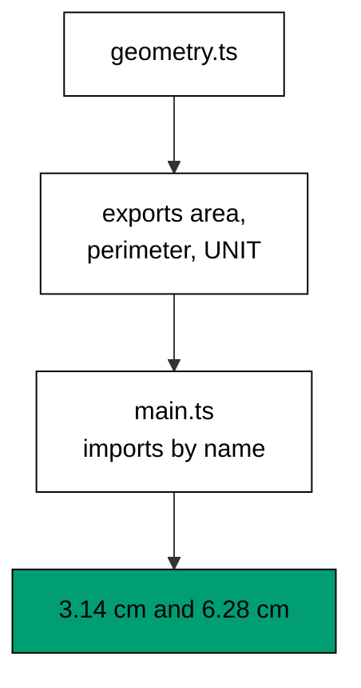
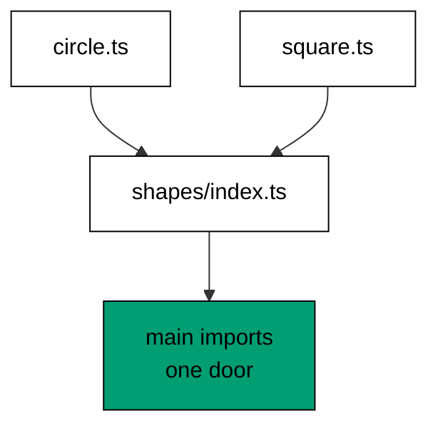
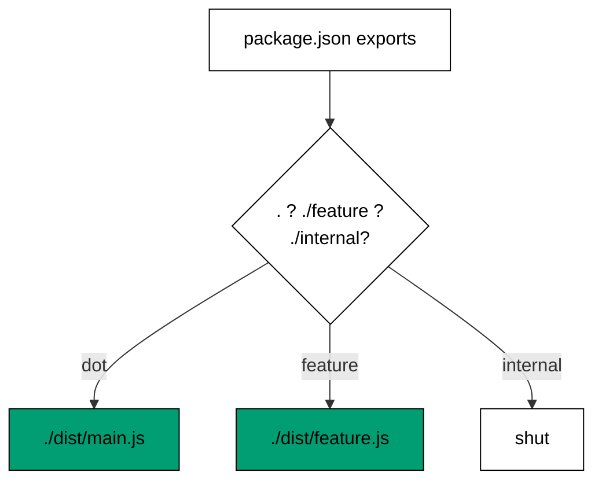
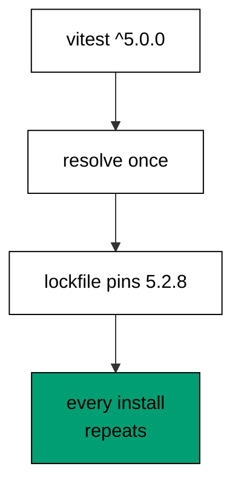
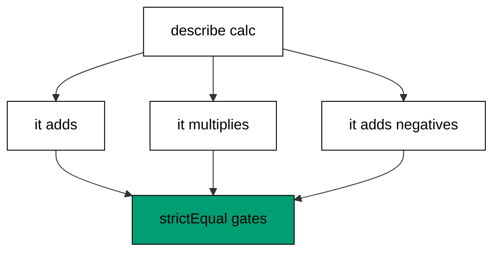
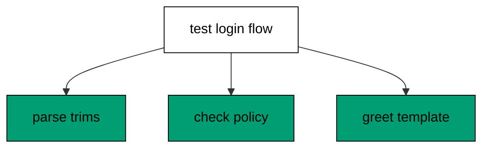
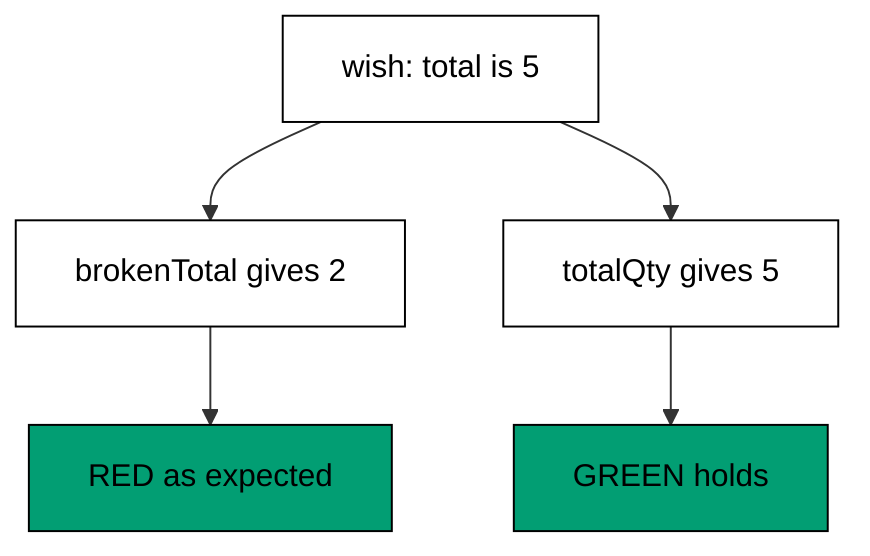
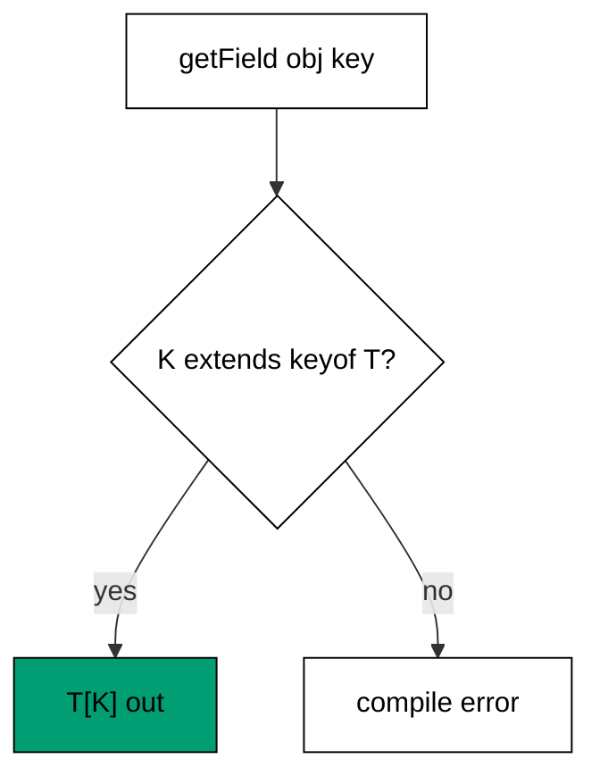
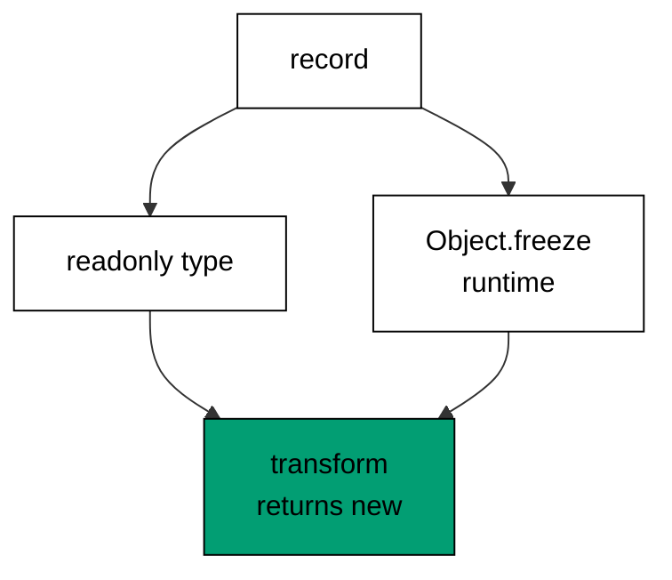
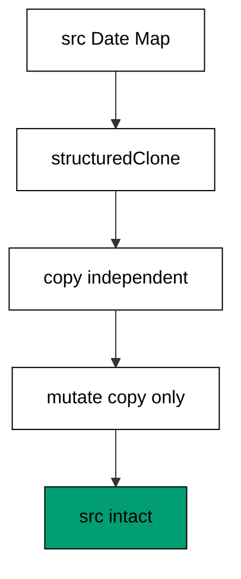

Examples 26-53 organize code for reuse and prove it works: module boundaries and package maps, declared and pinned dependencies, the standard `node:test` testing convention, and generic, value-shaped types. Three clusters carry the level: modules, packages, and dependencies (Examples 26-34), the testing convention (Examples 35-44), and generics with value semantics (Examples 45-53). Multi-file units anchor every file; the `node.d.ts` declarations appear once, in Example 13 of Beginner, and repeat wherever Node.js built-ins are touched.

### Example 26: Named ESM Exports

Modules share code through explicit export lists; named exports make the shared surface visible at both ends. This example splits circle math into a helper module and imports it by name. (Concepts: co-06.)



Named imports document the dependency at the use site — readers see exactly which helpers cross the boundary — and refactoring tools track them precisely. Default exports hide the surface behind one name that every importer spells differently. Prefer named exports for libraries of helpers, reserve default exports for modules with one clear protagonist, and keep the `.js` suffix on relative imports so the compiled output resolves under Node.js module rules.

**`learning/code/ex-26-esm-exports/geometry.ts`**:

```typescript
// => Example 26 file 1: named exports share pure helpers; main imports them.
export function area(radius: number): number {
  // => circle area from a radius
  return Math.PI * radius * radius; // => pi r squared
} // => end of export function area(radius: number): number
export function perimeter(radius: number): number {
  // => circle perimeter from a radius
  return 2 * Math.PI * radius; // => two pi r
} // => end of export function perimeter(radius: number): number
export const UNIT = "cm"; // => shared unit label
```

**`learning/code/ex-26-esm-exports/main.ts`**:

```typescript
// => Example 26 file 2: import the helpers by name; the module boundary is explicit.
import { area, perimeter, UNIT } from "./geometry.js"; // => WHY named: the surface is visible
console.log(area(1).toFixed(2), UNIT); // => Output: 3.14 cm
console.log(perimeter(1).toFixed(2), UNIT); // => Output: 6.28 cm
```

**Output** (`learning/code/ex-26-esm-exports/expected/main.stdout.txt`):

```text
3.14 cm
6.28 cm
```

**Key takeaway**: Export helpers by name; import with the `.js` suffix so compiled output resolves.

**Why it matters**: Implicit sharing — globals, deep relative reaches, copy-pasted helpers — hides dependencies until removal breaks distant code. Named exports write the sharing contract at both ends, so the module graph is reviewable, tree-shakeable, and safe to refactor one edge at a time.

### Example 27: import type Erasure

Types cross module boundaries too, but they should never cost a runtime import; `import type` erases completely at compile time. This example shares record and union types with zero runtime footprint. (Concepts: co-06, co-10.)

A value import of a types-only module still emits a `require` call, which can drag a module into the bundle — or worse, create a cycle — for something that never exists at runtime. `import type` states the intent: names for the checker only, nothing for the loader. The habit scales to large codebases, where type-only imports keep the runtime graph small and acyclic while the type graph stays rich. Whenever an import provides only types, spell it `import type` and let the erasure prove it.

**`learning/code/ex-27-import-type/types.ts`**:

```typescript
// => Example 27 file 1: types live apart from runtime code.
export interface Course {
  // => the shared record shape
  slug: string; // => unique key
  hours: number; // => estimated effort
} // => end of export interface Course
export type Level = "beginner" | "intermediate" | "advanced"; // => closed level set
```

**`learning/code/ex-27-import-type/main.ts`**:

```typescript
// => Example 27 file 2: import type erases at compile; no runtime import remains.
import type { Course, Level } from "./types.js"; // => WHY import type: zero runtime cost
const course: Course = { slug: "typescript-in-depth", hours: 6 }; // => typed record
const level: Level = "beginner"; // => checked against the union
console.log(course.slug, course.hours, level); // => Output: typescript-in-depth 6 beginner
```

**Output** (`learning/code/ex-27-import-type/expected/main.stdout.txt`):

```text
typescript-in-depth 6 beginner
```

**Key takeaway**: Import types with `import type`; the compiled output carries no trace of them.

**Why it matters**: Runtime imports of type-only modules bloat bundles and seed import cycles that surface as `undefined` at the worst moment — startup. Type-only imports give the checker everything and the loader nothing, which keeps the runtime graph honest about what the program actually needs to run.

### Example 28: Barrel index Files

Deep import paths couple every consumer to the internal file layout; a barrel `index.ts` offers one door per folder and frees the interior to reorganize. This example re-exports two shape modules through a single entry. (Concepts: co-06.)



Consumers import from the folder, never the leaves, so moving a helper between files touches the barrel alone — one line instead of every importer. The barrel also curates: only re-exported names are public, and the rest stay internal by omission. Barrels can slow down unbundled loading when overused at scale, since one door pulls every re-export; keep barrels per cohesive folder, not one per project, and the door stays cheap.

**`learning/code/ex-28-barrel-index/shapes/circle.ts`**:

```typescript
// => Example 28 file 1: one shape module.
export function circleArea(r: number): number {
  // => pi r squared
  return Math.PI * r * r; // => pure helper
} // => end of export function circleArea(r: number): number
```

**`learning/code/ex-28-barrel-index/shapes/square.ts`**:

```typescript
// => Example 28 file 2: a second shape module.
export function squareArea(s: number): number {
  // => s squared
  return s * s; // => pure helper
} // => end of export function squareArea(s: number): number
```

**`learning/code/ex-28-barrel-index/shapes/index.ts`**:

```typescript
// => Example 28 file 3: the barrel re-exports the public surface.
export { circleArea } from "./circle.js"; // => re-exported for one-door imports
export { squareArea } from "./square.js"; // => same door, second helper
```

**`learning/code/ex-28-barrel-index/main.ts`**:

```typescript
// => Example 28 file 4: import from the barrel, not the leaves.
import { circleArea, squareArea } from "./shapes/index.js"; // => WHY barrel: one import door
console.log(circleArea(1).toFixed(2), squareArea(3)); // => Output: 3.14 9
```

**Output** (`learning/code/ex-28-barrel-index/expected/main.stdout.txt`):

```text
3.14 9
```

**Key takeaway**: Re-export each folder's public surface from its `index.ts`; consumers enter through the door.

**Why it matters**: Deep imports freeze the file layout — renaming a file becomes a migration across every consumer. The barrel decouples the public surface from the interior arrangement, so authors reorganize freely and reviewers see the public API in one place instead of reconstructing it from import paths.

### Example 29: The exports Map

Without an `exports` map, every file in a package is importable, including internals the author never meant to support; the map draws the public door and shuts the rest. This example reads a manifest whose map opens two subpaths and closes a third. (Concepts: co-06.)



Consumers outside the map get resolution errors instead of accidental access, which means internals can change without a major version — the map is a compatibility boundary, not just documentation. The program reads the manifest as data and resolves three subpaths, proving the open doors and the shut one in one transcript. Every published package deserves a map: no map means every file is public API forever.

**`learning/code/ex-29-package-exports-map/package.json`**:

```json
{
  "name": "greeter",
  "version": "1.2.0",
  "exports": {
    ".": "./dist/main.js",
    "./feature": "./dist/feature.js"
  }
}
```

**`learning/code/ex-29-package-exports-map/node.d.ts`**:

```typescript
// => Shared ambient declarations for the Node.js builtins this unit touches.
// => The pinned toolchain ships no network and no @types/node, so the few
// => APIs each example needs are declared here instead of installed.
declare module "node:fs" {
  // => file scratch: read, write, list, remove
  export function readFileSync(path: string, encoding: "utf-8"): string; // => text reads only
  export function writeFileSync(path: string, data: string): void; // => text writes only
  export function mkdirSync(path: string, options?: { recursive?: boolean }): void; // => scratch folders
  export function rmSync(path: string, options?: { force?: boolean; recursive?: boolean }): void; // => cleanup
  export function readdirSync(path: string): string[]; // => directory listings
  export function existsSync(path: string): boolean; // => presence checks
} // => end of declare module "node:fs"
declare module "node:path" {
  // => portable path assembly, no string concat
  export function join(...parts: string[]): string; // => joins with the platform separator
  export function basename(path: string, ext?: string): string; // => final segment only
  export function extname(path: string): string; // => extension including the dot
  export function dirname(path: string): string; // => parent directory only
} // => end of declare module "node:path"
declare module "node:os" {
  // => scratch root for deterministic file demos
  export function tmpdir(): string; // => writable temp directory
} // => end of declare module "node:os"
declare module "node:test" {
  // => the standard test runner used by the testing cluster
  export function describe(name: string, fn: () => void): void; // => groups related tests
  export interface CaseFn {
    // => a case function with parked and planned variants
    (name: string, fn: () => void | Promise<void>): void; // => normal case
    skip(name: string, fn?: () => void | Promise<void>): void; // => parked case
    todo(name: string, fn?: () => void | Promise<void>): void; // => planned case
  } // => end of export interface CaseFn
  export const it: CaseFn; // => nested case inside describe
  export interface TestContext {
    // => per-test handle for subtests
    test(name: string, fn: () => void | Promise<void>): Promise<void>; // => nested subtest
  } // => end of export interface TestContext
  export interface TopFn {
    // => top-level case with context plus variants
    (name: string, fn: (t: TestContext) => void | Promise<void>): void; // => standalone case
    skip(name: string, fn?: () => void | Promise<void>): void; // => parked case
    todo(name: string, fn?: () => void | Promise<void>): void; // => planned case
  } // => end of export interface TopFn
  export const test: TopFn; // => standalone case runner
  export function beforeEach(fn: () => void | Promise<void>): void; // => fixture setup per case
  export function afterEach(fn: () => void | Promise<void>): void; // => fixture teardown per case
  export interface MockCall {
    // => one recorded mock invocation
    arguments: unknown[]; // => the arguments that call received
  } // => end of export interface MockCall
  export interface MockHandle {
    // => recorded calls of one mock function
    calls: MockCall[]; // => every invocation in order
  } // => end of export interface MockHandle
  export function mockFn<T extends (...args: never[]) => unknown>( // => call recorder
    impl: T, // => the wrapped implementation
  ): T & { mock: MockHandle }; // => recorded handle out
  export const mock: {
    // => the mock namespace the runner provides
    fn: typeof mockFn; // => function-call recorder
    timers: {
      // => deterministic clock for timer tests
      enable(options: { apis: string[]; now: number }): void; // => swaps in the fake clock
      tick(ms: number): void; // => advances the fake clock synchronously
      reset(): void; // => restores the real timers
    }; // => end of timers
  }; // => end of mock namespace
} // => end of declare module "node:test"
declare module "node:assert/strict" {
  // => the standard assertion library
  export function strictEqual(actual: unknown, expected: unknown, message?: string): void; // => Object.is comparison
  export function deepStrictEqual(actual: unknown, expected: unknown, message?: string): void; // => deep check
  export function ok(value: unknown, message?: string): void; // => truthiness check
  export function throws(fn: () => unknown, expected?: RegExp): void; // => sync-throw check
  export function rejects(fn: () => Promise<unknown>, expected?: RegExp): Promise<void>; // => expects a rejection
} // => end of declare module "node:assert/strict"
declare const process: {
  // => the few process handles CLI examples need
  argv: string[]; // => raw command-line arguments
  version: string; // => running Node.js version string
  exit(code?: number): never; // => terminates with a status code
  env: Record<string, string | undefined>; // => environment map
}; // => end of declare const process:
```

**`learning/code/ex-29-package-exports-map/main.ts`**:

```typescript
/// <reference path="./node.d.ts" />
// => Example 29: the exports map is the package's public door; deep paths stay shut.
import { readFileSync } from "node:fs"; // => read the manifest fixture
const manifest = JSON.parse(readFileSync("package.json", "utf-8")) as {
  // => manifest as data
  name: string; // => package name field
  exports: Record<string, string>; // => subpath-to-file map
}; // => end of const manifest = JSON.parse(readFileSync("package.js
console.log(manifest.name); // => Output: greeter
console.log(manifest.exports["."] ?? "shut"); // => Output: ./dist/main.js, the open door
console.log(manifest.exports["./internal"] ?? "shut"); // => Output: shut, deep paths closed
```

**Output** (`learning/code/ex-29-package-exports-map/expected/main.stdout.txt`):

```text
greeter
./dist/main.js
shut
```

**Key takeaway**: Publish an `exports` map; every unlisted subpath is closed by default.

**Why it matters**: Deep imports into package internals are the tightest coupling in the ecosystem — a refactor upstream breaks builds downstream with no version signal. The map converts internals into implementation details the author can change freely, which is what makes minor versions safe to consume on sight.

### Example 30: tsconfig Strictness

Compiler flags passed on the command line drift per invocation; `tsconfig.json` pins the policy where every build repeats it. This example compiles itself through a strict project file and reads the policy back as data. (Concepts: co-06.)

`strict` enables the whole family of soundness checks at once — null, property initialization, function types — instead of cherry-picking flags that later authors forget. `target` and `module` fix the output dialect so emit never depends on the compiler's defaults, and `outDir` with `rootDir` separates sources from artifacts so cleaning is one deletion. The policy file is reviewed like code because it is code: it decides which programs compile.

**`learning/code/ex-30-tsconfig-strict/tsconfig.json`**:

```json
{
  "compilerOptions": {
    "strict": true,
    "target": "es2022",
    "module": "commonjs",
    "outDir": "out",
    "rootDir": "."
  }
}
```

**`learning/code/ex-30-tsconfig-strict/node.d.ts`**:

```typescript
// => Shared ambient declarations for the Node.js builtins this unit touches.
// => The pinned toolchain ships no network and no @types/node, so the few
// => APIs each example needs are declared here instead of installed.
declare module "node:fs" {
  // => file scratch: read, write, list, remove
  export function readFileSync(path: string, encoding: "utf-8"): string; // => text reads only
  export function writeFileSync(path: string, data: string): void; // => text writes only
  export function mkdirSync(path: string, options?: { recursive?: boolean }): void; // => scratch folders
  export function rmSync(path: string, options?: { force?: boolean; recursive?: boolean }): void; // => cleanup
  export function readdirSync(path: string): string[]; // => directory listings
  export function existsSync(path: string): boolean; // => presence checks
} // => end of declare module "node:fs"
declare module "node:path" {
  // => portable path assembly, no string concat
  export function join(...parts: string[]): string; // => joins with the platform separator
  export function basename(path: string, ext?: string): string; // => final segment only
  export function extname(path: string): string; // => extension including the dot
  export function dirname(path: string): string; // => parent directory only
} // => end of declare module "node:path"
declare module "node:os" {
  // => scratch root for deterministic file demos
  export function tmpdir(): string; // => writable temp directory
} // => end of declare module "node:os"
declare module "node:test" {
  // => the standard test runner used by the testing cluster
  export function describe(name: string, fn: () => void): void; // => groups related tests
  export interface CaseFn {
    // => a case function with parked and planned variants
    (name: string, fn: () => void | Promise<void>): void; // => normal case
    skip(name: string, fn?: () => void | Promise<void>): void; // => parked case
    todo(name: string, fn?: () => void | Promise<void>): void; // => planned case
  } // => end of export interface CaseFn
  export const it: CaseFn; // => nested case inside describe
  export interface TestContext {
    // => per-test handle for subtests
    test(name: string, fn: () => void | Promise<void>): Promise<void>; // => nested subtest
  } // => end of export interface TestContext
  export interface TopFn {
    // => top-level case with context plus variants
    (name: string, fn: (t: TestContext) => void | Promise<void>): void; // => standalone case
    skip(name: string, fn?: () => void | Promise<void>): void; // => parked case
    todo(name: string, fn?: () => void | Promise<void>): void; // => planned case
  } // => end of export interface TopFn
  export const test: TopFn; // => standalone case runner
  export function beforeEach(fn: () => void | Promise<void>): void; // => fixture setup per case
  export function afterEach(fn: () => void | Promise<void>): void; // => fixture teardown per case
  export interface MockCall {
    // => one recorded mock invocation
    arguments: unknown[]; // => the arguments that call received
  } // => end of export interface MockCall
  export interface MockHandle {
    // => recorded calls of one mock function
    calls: MockCall[]; // => every invocation in order
  } // => end of export interface MockHandle
  export function mockFn<T extends (...args: never[]) => unknown>( // => call recorder
    impl: T, // => the wrapped implementation
  ): T & { mock: MockHandle }; // => recorded handle out
  export const mock: {
    // => the mock namespace the runner provides
    fn: typeof mockFn; // => function-call recorder
    timers: {
      // => deterministic clock for timer tests
      enable(options: { apis: string[]; now: number }): void; // => swaps in the fake clock
      tick(ms: number): void; // => advances the fake clock synchronously
      reset(): void; // => restores the real timers
    }; // => end of timers
  }; // => end of mock namespace
} // => end of declare module "node:test"
declare module "node:assert/strict" {
  // => the standard assertion library
  export function strictEqual(actual: unknown, expected: unknown, message?: string): void; // => Object.is comparison
  export function deepStrictEqual(actual: unknown, expected: unknown, message?: string): void; // => deep check
  export function ok(value: unknown, message?: string): void; // => truthiness check
  export function throws(fn: () => unknown, expected?: RegExp): void; // => sync-throw check
  export function rejects(fn: () => Promise<unknown>, expected?: RegExp): Promise<void>; // => expects a rejection
} // => end of declare module "node:assert/strict"
declare const process: {
  // => the few process handles CLI examples need
  argv: string[]; // => raw command-line arguments
  version: string; // => running Node.js version string
  exit(code?: number): never; // => terminates with a status code
  env: Record<string, string | undefined>; // => environment map
}; // => end of declare const process:
```

**`learning/code/ex-30-tsconfig-strict/main.ts`**:

```typescript
/// <reference path="./node.d.ts" />
// => Example 30: strict plus outDir in tsconfig; every build repeats the same policy.
import { readFileSync } from "node:fs"; // => read the tsconfig fixture itself
const config = JSON.parse(readFileSync("tsconfig.json", "utf-8")) as {
  // => config as data
  compilerOptions: { strict: boolean; outDir: string }; // => the two policy fields
}; // => end of const config = JSON.parse(readFileSync("tsconfig.jso
console.log("strict:", config.compilerOptions.strict); // => Output: strict: true
console.log("outDir:", config.compilerOptions.outDir); // => Output: outDir: out
```

**Output** (`learning/code/ex-30-tsconfig-strict/expected/main.stdout.txt`):

```text
strict: true
outDir: out
```

**Key takeaway**: Pin `strict`, `target`, `module`, `outDir`, and `rootDir` in `tsconfig.json`; build with `tsc -p`.

**Why it matters**: Flag drift means the program that compiles on one machine fails on another — or worse, compiles everywhere with different soundness. The project file makes the policy explicit, reviewable, and identical for every author, every editor, and every build, which is the precondition for strictness to mean anything at all.

### Example 31: The Lockfile Pin

Version ranges resolve to whatever is newest at install time, so two installs weeks apart build different programs; the lockfile pins every resolved version so installs repeat byte-identically. This example reads a lockfile fixture and reports its pins. (Concepts: co-07.)



Ranges belong in `package.json` — they state compatibility intent — and exact pins belong in the lockfile, which the installer writes and humans never hand-edit. Installing with `npm ci` from the lockfile reproduces the resolved tree instead of re-resolving, so CI builds the same program the author tested. Committing the lockfile is the policy; the transcript proves the pin is exact, not a range.

**`learning/code/ex-31-pin-with-lockfile/package-lock.json`**:

```json
{
  "name": "course-deps",
  "version": "0.0.0",
  "lockfileVersion": 3,
  "packages": {
    "": {
      "dependencies": {
        "vitest": "5.2.8"
      }
    }
  }
}
```

**`learning/code/ex-31-pin-with-lockfile/node.d.ts`**:

```typescript
// => Shared ambient declarations for the Node.js builtins this unit touches.
// => The pinned toolchain ships no network and no @types/node, so the few
// => APIs each example needs are declared here instead of installed.
declare module "node:fs" {
  // => file scratch: read, write, list, remove
  export function readFileSync(path: string, encoding: "utf-8"): string; // => text reads only
  export function writeFileSync(path: string, data: string): void; // => text writes only
  export function mkdirSync(path: string, options?: { recursive?: boolean }): void; // => scratch folders
  export function rmSync(path: string, options?: { force?: boolean; recursive?: boolean }): void; // => cleanup
  export function readdirSync(path: string): string[]; // => directory listings
  export function existsSync(path: string): boolean; // => presence checks
} // => end of declare module "node:fs"
declare module "node:path" {
  // => portable path assembly, no string concat
  export function join(...parts: string[]): string; // => joins with the platform separator
  export function basename(path: string, ext?: string): string; // => final segment only
  export function extname(path: string): string; // => extension including the dot
  export function dirname(path: string): string; // => parent directory only
} // => end of declare module "node:path"
declare module "node:os" {
  // => scratch root for deterministic file demos
  export function tmpdir(): string; // => writable temp directory
} // => end of declare module "node:os"
declare module "node:test" {
  // => the standard test runner used by the testing cluster
  export function describe(name: string, fn: () => void): void; // => groups related tests
  export interface CaseFn {
    // => a case function with parked and planned variants
    (name: string, fn: () => void | Promise<void>): void; // => normal case
    skip(name: string, fn?: () => void | Promise<void>): void; // => parked case
    todo(name: string, fn?: () => void | Promise<void>): void; // => planned case
  } // => end of export interface CaseFn
  export const it: CaseFn; // => nested case inside describe
  export interface TestContext {
    // => per-test handle for subtests
    test(name: string, fn: () => void | Promise<void>): Promise<void>; // => nested subtest
  } // => end of export interface TestContext
  export interface TopFn {
    // => top-level case with context plus variants
    (name: string, fn: (t: TestContext) => void | Promise<void>): void; // => standalone case
    skip(name: string, fn?: () => void | Promise<void>): void; // => parked case
    todo(name: string, fn?: () => void | Promise<void>): void; // => planned case
  } // => end of export interface TopFn
  export const test: TopFn; // => standalone case runner
  export function beforeEach(fn: () => void | Promise<void>): void; // => fixture setup per case
  export function afterEach(fn: () => void | Promise<void>): void; // => fixture teardown per case
  export interface MockCall {
    // => one recorded mock invocation
    arguments: unknown[]; // => the arguments that call received
  } // => end of export interface MockCall
  export interface MockHandle {
    // => recorded calls of one mock function
    calls: MockCall[]; // => every invocation in order
  } // => end of export interface MockHandle
  export function mockFn<T extends (...args: never[]) => unknown>( // => call recorder
    impl: T, // => the wrapped implementation
  ): T & { mock: MockHandle }; // => recorded handle out
  export const mock: {
    // => the mock namespace the runner provides
    fn: typeof mockFn; // => function-call recorder
    timers: {
      // => deterministic clock for timer tests
      enable(options: { apis: string[]; now: number }): void; // => swaps in the fake clock
      tick(ms: number): void; // => advances the fake clock synchronously
      reset(): void; // => restores the real timers
    }; // => end of timers
  }; // => end of mock namespace
} // => end of declare module "node:test"
declare module "node:assert/strict" {
  // => the standard assertion library
  export function strictEqual(actual: unknown, expected: unknown, message?: string): void; // => Object.is comparison
  export function deepStrictEqual(actual: unknown, expected: unknown, message?: string): void; // => deep check
  export function ok(value: unknown, message?: string): void; // => truthiness check
  export function throws(fn: () => unknown, expected?: RegExp): void; // => sync-throw check
  export function rejects(fn: () => Promise<unknown>, expected?: RegExp): Promise<void>; // => expects a rejection
} // => end of declare module "node:assert/strict"
declare const process: {
  // => the few process handles CLI examples need
  argv: string[]; // => raw command-line arguments
  version: string; // => running Node.js version string
  exit(code?: number): never; // => terminates with a status code
  env: Record<string, string | undefined>; // => environment map
}; // => end of declare const process:
```

**`learning/code/ex-31-pin-with-lockfile/main.ts`**:

```typescript
/// <reference path="./node.d.ts" />
// => Example 31: the lockfile pins exact versions; ranges resolve once, installs repeat.
import { readFileSync } from "node:fs"; // => read the lockfile fixture
const lock = JSON.parse(readFileSync("package-lock.json", "utf-8")) as {
  // => lockfile as data
  lockfileVersion: number; // => lock format version
  packages: { "": { dependencies: Record<string, string> } }; // => root pinned set
}; // => end of const lock = JSON.parse(readFileSync("package-lock.j
console.log("lockfileVersion:", lock.lockfileVersion); // => Output: lockfileVersion: 3
console.log("vitest:", lock.packages[""].dependencies["vitest"]); // => Output: vitest: 5.2.8, exact pin
```

**Output** (`learning/code/ex-31-pin-with-lockfile/expected/main.stdout.txt`):

```text
lockfileVersion: 3
vitest: 5.2.8
```

**Key takeaway**: State ranges in `package.json`, exact pins in the lockfile, install with `npm ci`, commit the lockfile.

**Why it matters**: Unpinned installs are time bombs — the build works until a transitive release breaks it on a Friday, with no code change to blame. The lockfile converts dependency time into a reviewed artifact, so every install builds the program that was tested and every upgrade is a deliberate diff.

### Example 32: Semver Specifier Windows

Caret, tilde, and exact specifiers open different update windows, and choosing blindly either freezes useful patches or admits breaking majors. This example checks candidates against all three specifier kinds. (Concepts: co-07.)

Caret floats minor and patch within a major — the default for compatible evolution. Tilde floats patches only — for dependencies whose minors have burned before. Exact pins one version — for the truly fragile. The checker parses bounds as numbers, never strings, because string comparison ranks `1.10.0` below `1.2.0`. Match the window to the trust: caret for the well-tested, tilde for the skittish, exact for the burned.

**`learning/code/ex-32-semver-specifiers/main.ts`**:

```typescript
// => Example 32: caret, tilde, and exact specifiers choose different update windows.
function allows(spec: string, version: string): boolean {
  // => tiny checker for ^, ~, and exact
  const [sMajor, sMinor] = spec.replace(/^[~^]/, "").split(".").map(Number); // => spec bounds parsed
  const [vMajor, vMinor] = version.split(".").map(Number); // => candidate parsed
  if (spec.startsWith("^")) {
    // => caret: same major, at least the minor
    return vMajor === sMajor && vMinor >= sMinor; // => major locked, minor floats up
  } // => end of if (spec.startsWith("^"))
  if (spec.startsWith("~")) {
    // => tilde: same major and minor
    return vMajor === sMajor && vMinor === sMinor; // => only patches float
  } // => end of if (spec.startsWith("~"))
  return spec === version; // => exact: byte-identical only
} // => end of function allows(spec: string, version: string): bool
console.log(allows("^1.2.0", "1.4.0"), allows("^1.2.0", "2.0.0")); // => Output: true false
console.log(allows("~1.2.0", "1.2.9"), allows("~1.2.0", "1.3.0")); // => Output: true false
console.log(allows("1.2.0", "1.2.0"), allows("1.2.0", "1.2.1")); // => Output: true false
```

**Output** (`learning/code/ex-32-semver-specifiers/expected/main.stdout.txt`):

```text
true false
true false
true false
```

**Key takeaway**: Caret floats minor, tilde floats patch, exact pins; compare versions as numbers.

**Why it matters**: A caret where an exact belongs admits a breaking major at the worst moment; an exact where a caret belongs freezes security patches out. The specifier is a trust statement about someone else's release discipline — write it deliberately, and the lockfile in Example 31 records whatever the window resolved to.

### Example 33: Dependencies vs devDependencies

Runtime dependencies ship to production; development dependencies stay on the build machine — mixing them bloats installs and widens the attack surface. This example reads a manifest and sorts its two dependency kinds. (Concepts: co-07.)

`dependencies` install everywhere the package installs, including production containers, so each entry must earn its runtime place. `devDependencies` install for development and CI only — test runners, linters, type packages — and production installs skip them. The program prints both lists from the fixture, making the split reviewable: anything in the wrong list is a packaging bug with a security or size cost. Audit the lists on every dependency change, because drift here is silent until the bundle is measured or breached.

**`learning/code/ex-33-dep-vs-dev-dep/package.json`**:

```json
{
  "name": "report-cli",
  "version": "1.0.0",
  "dependencies": {
    "commander": "12.0.0"
  },
  "devDependencies": {
    "vitest": "5.2.8"
  }
}
```

**`learning/code/ex-33-dep-vs-dev-dep/node.d.ts`**:

```typescript
// => Shared ambient declarations for the Node.js builtins this unit touches.
// => The pinned toolchain ships no network and no @types/node, so the few
// => APIs each example needs are declared here instead of installed.
declare module "node:fs" {
  // => file scratch: read, write, list, remove
  export function readFileSync(path: string, encoding: "utf-8"): string; // => text reads only
  export function writeFileSync(path: string, data: string): void; // => text writes only
  export function mkdirSync(path: string, options?: { recursive?: boolean }): void; // => scratch folders
  export function rmSync(path: string, options?: { force?: boolean; recursive?: boolean }): void; // => cleanup
  export function readdirSync(path: string): string[]; // => directory listings
  export function existsSync(path: string): boolean; // => presence checks
} // => end of declare module "node:fs"
declare module "node:path" {
  // => portable path assembly, no string concat
  export function join(...parts: string[]): string; // => joins with the platform separator
  export function basename(path: string, ext?: string): string; // => final segment only
  export function extname(path: string): string; // => extension including the dot
  export function dirname(path: string): string; // => parent directory only
} // => end of declare module "node:path"
declare module "node:os" {
  // => scratch root for deterministic file demos
  export function tmpdir(): string; // => writable temp directory
} // => end of declare module "node:os"
declare module "node:test" {
  // => the standard test runner used by the testing cluster
  export function describe(name: string, fn: () => void): void; // => groups related tests
  export interface CaseFn {
    // => a case function with parked and planned variants
    (name: string, fn: () => void | Promise<void>): void; // => normal case
    skip(name: string, fn?: () => void | Promise<void>): void; // => parked case
    todo(name: string, fn?: () => void | Promise<void>): void; // => planned case
  } // => end of export interface CaseFn
  export const it: CaseFn; // => nested case inside describe
  export interface TestContext {
    // => per-test handle for subtests
    test(name: string, fn: () => void | Promise<void>): Promise<void>; // => nested subtest
  } // => end of export interface TestContext
  export interface TopFn {
    // => top-level case with context plus variants
    (name: string, fn: (t: TestContext) => void | Promise<void>): void; // => standalone case
    skip(name: string, fn?: () => void | Promise<void>): void; // => parked case
    todo(name: string, fn?: () => void | Promise<void>): void; // => planned case
  } // => end of export interface TopFn
  export const test: TopFn; // => standalone case runner
  export function beforeEach(fn: () => void | Promise<void>): void; // => fixture setup per case
  export function afterEach(fn: () => void | Promise<void>): void; // => fixture teardown per case
  export interface MockCall {
    // => one recorded mock invocation
    arguments: unknown[]; // => the arguments that call received
  } // => end of export interface MockCall
  export interface MockHandle {
    // => recorded calls of one mock function
    calls: MockCall[]; // => every invocation in order
  } // => end of export interface MockHandle
  export function mockFn<T extends (...args: never[]) => unknown>( // => call recorder
    impl: T, // => the wrapped implementation
  ): T & { mock: MockHandle }; // => recorded handle out
  export const mock: {
    // => the mock namespace the runner provides
    fn: typeof mockFn; // => function-call recorder
    timers: {
      // => deterministic clock for timer tests
      enable(options: { apis: string[]; now: number }): void; // => swaps in the fake clock
      tick(ms: number): void; // => advances the fake clock synchronously
      reset(): void; // => restores the real timers
    }; // => end of timers
  }; // => end of mock namespace
} // => end of declare module "node:test"
declare module "node:assert/strict" {
  // => the standard assertion library
  export function strictEqual(actual: unknown, expected: unknown, message?: string): void; // => Object.is comparison
  export function deepStrictEqual(actual: unknown, expected: unknown, message?: string): void; // => deep check
  export function ok(value: unknown, message?: string): void; // => truthiness check
  export function throws(fn: () => unknown, expected?: RegExp): void; // => sync-throw check
  export function rejects(fn: () => Promise<unknown>, expected?: RegExp): Promise<void>; // => expects a rejection
} // => end of declare module "node:assert/strict"
declare const process: {
  // => the few process handles CLI examples need
  argv: string[]; // => raw command-line arguments
  version: string; // => running Node.js version string
  exit(code?: number): never; // => terminates with a status code
  env: Record<string, string | undefined>; // => environment map
}; // => end of declare const process:
```

**`learning/code/ex-33-dep-vs-dev-dep/main.ts`**:

```typescript
/// <reference path="./node.d.ts" />
// => Example 33: dependencies ship; devDependencies stay on the build machine.
import { readFileSync } from "node:fs"; // => read the manifest fixture
const manifest = JSON.parse(readFileSync("package.json", "utf-8")) as {
  // => manifest as data
  dependencies: Record<string, string>; // => ships to production
  devDependencies: Record<string, string>; // => test and build tools only
}; // => end of const manifest = JSON.parse(readFileSync("package.js
console.log("ships:", Object.keys(manifest.dependencies).join(",")); // => Output: ships: commander
console.log("build-only:", Object.keys(manifest.devDependencies).join(",")); // => Output: build-only: vitest
```

**Output** (`learning/code/ex-33-dep-vs-dev-dep/expected/main.stdout.txt`):

```text
ships: commander
build-only: vitest
```

**Key takeaway**: Ship `dependencies`, confine tools to `devDependencies`, audit both lists on every change.

**Why it matters**: A test runner in production dependencies ships hundreds of unneeded files to every server — slower deploys, larger images, and a wider vulnerability surface for code that never runs there. The two-list split is the cheapest supply-chain control available; keeping it honest costs one glance per dependency change.

### Example 34: The engines Gate

The `engines` field states the minimum runtime the package supports; a startup gate compares it with the live version and refuses to run below the floor. This example enforces a Node.js 22 floor against the actual runtime. (Concepts: co-07, co-12.)

Version strings compare wrong — `"9" > "22"` lexicographically — so the gate parses the major as a number before comparing. The transcript prints the floor and a boolean, never the raw version, keeping output free of machine-shaped values. Gating at startup converts mysterious syntax failures on old runtimes into one clear message; libraries state the floor for installers, CLIs enforce it before doing anything else.

**`learning/code/ex-34-version-gate/package.json`**:

```json
{
  "name": "report-cli",
  "version": "1.0.0",
  "engines": {
    "node": ">=22"
  }
}
```

**`learning/code/ex-34-version-gate/node.d.ts`**:

```typescript
// => Shared ambient declarations for the Node.js builtins this unit touches.
// => The pinned toolchain ships no network and no @types/node, so the few
// => APIs each example needs are declared here instead of installed.
declare module "node:fs" {
  // => file scratch: read, write, list, remove
  export function readFileSync(path: string, encoding: "utf-8"): string; // => text reads only
  export function writeFileSync(path: string, data: string): void; // => text writes only
  export function mkdirSync(path: string, options?: { recursive?: boolean }): void; // => scratch folders
  export function rmSync(path: string, options?: { force?: boolean; recursive?: boolean }): void; // => cleanup
  export function readdirSync(path: string): string[]; // => directory listings
  export function existsSync(path: string): boolean; // => presence checks
} // => end of declare module "node:fs"
declare module "node:path" {
  // => portable path assembly, no string concat
  export function join(...parts: string[]): string; // => joins with the platform separator
  export function basename(path: string, ext?: string): string; // => final segment only
  export function extname(path: string): string; // => extension including the dot
  export function dirname(path: string): string; // => parent directory only
} // => end of declare module "node:path"
declare module "node:os" {
  // => scratch root for deterministic file demos
  export function tmpdir(): string; // => writable temp directory
} // => end of declare module "node:os"
declare module "node:test" {
  // => the standard test runner used by the testing cluster
  export function describe(name: string, fn: () => void): void; // => groups related tests
  export interface CaseFn {
    // => a case function with parked and planned variants
    (name: string, fn: () => void | Promise<void>): void; // => normal case
    skip(name: string, fn?: () => void | Promise<void>): void; // => parked case
    todo(name: string, fn?: () => void | Promise<void>): void; // => planned case
  } // => end of export interface CaseFn
  export const it: CaseFn; // => nested case inside describe
  export interface TestContext {
    // => per-test handle for subtests
    test(name: string, fn: () => void | Promise<void>): Promise<void>; // => nested subtest
  } // => end of export interface TestContext
  export interface TopFn {
    // => top-level case with context plus variants
    (name: string, fn: (t: TestContext) => void | Promise<void>): void; // => standalone case
    skip(name: string, fn?: () => void | Promise<void>): void; // => parked case
    todo(name: string, fn?: () => void | Promise<void>): void; // => planned case
  } // => end of export interface TopFn
  export const test: TopFn; // => standalone case runner
  export function beforeEach(fn: () => void | Promise<void>): void; // => fixture setup per case
  export function afterEach(fn: () => void | Promise<void>): void; // => fixture teardown per case
  export interface MockCall {
    // => one recorded mock invocation
    arguments: unknown[]; // => the arguments that call received
  } // => end of export interface MockCall
  export interface MockHandle {
    // => recorded calls of one mock function
    calls: MockCall[]; // => every invocation in order
  } // => end of export interface MockHandle
  export function mockFn<T extends (...args: never[]) => unknown>( // => call recorder
    impl: T, // => the wrapped implementation
  ): T & { mock: MockHandle }; // => recorded handle out
  export const mock: {
    // => the mock namespace the runner provides
    fn: typeof mockFn; // => function-call recorder
    timers: {
      // => deterministic clock for timer tests
      enable(options: { apis: string[]; now: number }): void; // => swaps in the fake clock
      tick(ms: number): void; // => advances the fake clock synchronously
      reset(): void; // => restores the real timers
    }; // => end of timers
  }; // => end of mock namespace
} // => end of declare module "node:test"
declare module "node:assert/strict" {
  // => the standard assertion library
  export function strictEqual(actual: unknown, expected: unknown, message?: string): void; // => Object.is comparison
  export function deepStrictEqual(actual: unknown, expected: unknown, message?: string): void; // => deep check
  export function ok(value: unknown, message?: string): void; // => truthiness check
  export function throws(fn: () => unknown, expected?: RegExp): void; // => sync-throw check
  export function rejects(fn: () => Promise<unknown>, expected?: RegExp): Promise<void>; // => expects a rejection
} // => end of declare module "node:assert/strict"
declare const process: {
  // => the few process handles CLI examples need
  argv: string[]; // => raw command-line arguments
  version: string; // => running Node.js version string
  exit(code?: number): never; // => terminates with a status code
  env: Record<string, string | undefined>; // => environment map
}; // => end of declare const process:
```

**`learning/code/ex-34-version-gate/main.ts`**:

```typescript
/// <reference path="./node.d.ts" />
// => Example 34: engines states the floor; the gate compares it with the live runtime.
import { readFileSync } from "node:fs"; // => read the manifest fixture
const manifest = JSON.parse(readFileSync("package.json", "utf-8")) as { engines: { node: string } }; // => floor as data
const floor = Number(manifest.engines.node.replace(">=", "")); // => WHY parse: compare numbers, not strings
const live = Number(process.version.replace("v", "").split(".")[0]); // => live major, never printed raw
console.log("needs: >=", floor); // => Output: needs: >= 22
console.log("satisfied:", live >= floor); // => Output: satisfied: true
```

**Output** (`learning/code/ex-34-version-gate/expected/main.stdout.txt`):

```text
needs: >= 22
satisfied: true
```

**Key takeaway**: State the runtime floor in `engines`; enforce it at startup by comparing parsed majors.

**Why it matters**: New syntax on an old runtime fails with bewildering parse errors far from the real cause — a version mismatch. One numeric comparison at startup replaces the mystery with a sentence, and the manifest field lets installers warn before the code ever runs.

### Example 35: First Node Test Suite

The standard test tooling is `node:test` for structure plus `node:assert/strict` for checks — no install, no config, no plugin. This example groups three calculator cases and runs them through the real runner. (Concepts: co-08.)



`describe` groups cases per unit under test; each `it` holds one behavior with a name that reads as a specification. `strictEqual` compares with `Object.is` semantics — no coercion surprises. The unit's run wrapper executes the real `node --test` runner, discards its timing-bearing report into a log, and echoes one fixed `PASS` line, so the golden transcript stays byte-stable while the tests genuinely run. Failing-test-first starts here: write the `it` before the helper, watch it fail, then earn the green.

**`learning/code/ex-35-first-node-test/node.d.ts`**:

```typescript
// => Shared ambient declarations for the Node.js builtins this unit touches.
// => The pinned toolchain ships no network and no @types/node, so the few
// => APIs each example needs are declared here instead of installed.
declare module "node:fs" {
  // => file scratch: read, write, list, remove
  export function readFileSync(path: string, encoding: "utf-8"): string; // => text reads only
  export function writeFileSync(path: string, data: string): void; // => text writes only
  export function mkdirSync(path: string, options?: { recursive?: boolean }): void; // => scratch folders
  export function rmSync(path: string, options?: { force?: boolean; recursive?: boolean }): void; // => cleanup
  export function readdirSync(path: string): string[]; // => directory listings
  export function existsSync(path: string): boolean; // => presence checks
} // => end of declare module "node:fs"
declare module "node:path" {
  // => portable path assembly, no string concat
  export function join(...parts: string[]): string; // => joins with the platform separator
  export function basename(path: string, ext?: string): string; // => final segment only
  export function extname(path: string): string; // => extension including the dot
  export function dirname(path: string): string; // => parent directory only
} // => end of declare module "node:path"
declare module "node:os" {
  // => scratch root for deterministic file demos
  export function tmpdir(): string; // => writable temp directory
} // => end of declare module "node:os"
declare module "node:test" {
  // => the standard test runner used by the testing cluster
  export function describe(name: string, fn: () => void): void; // => groups related tests
  export interface CaseFn {
    // => a case function with parked and planned variants
    (name: string, fn: () => void | Promise<void>): void; // => normal case
    skip(name: string, fn?: () => void | Promise<void>): void; // => parked case
    todo(name: string, fn?: () => void | Promise<void>): void; // => planned case
  } // => end of export interface CaseFn
  export const it: CaseFn; // => nested case inside describe
  export interface TestContext {
    // => per-test handle for subtests
    test(name: string, fn: () => void | Promise<void>): Promise<void>; // => nested subtest
  } // => end of export interface TestContext
  export interface TopFn {
    // => top-level case with context plus variants
    (name: string, fn: (t: TestContext) => void | Promise<void>): void; // => standalone case
    skip(name: string, fn?: () => void | Promise<void>): void; // => parked case
    todo(name: string, fn?: () => void | Promise<void>): void; // => planned case
  } // => end of export interface TopFn
  export const test: TopFn; // => standalone case runner
  export function beforeEach(fn: () => void | Promise<void>): void; // => fixture setup per case
  export function afterEach(fn: () => void | Promise<void>): void; // => fixture teardown per case
  export interface MockCall {
    // => one recorded mock invocation
    arguments: unknown[]; // => the arguments that call received
  } // => end of export interface MockCall
  export interface MockHandle {
    // => recorded calls of one mock function
    calls: MockCall[]; // => every invocation in order
  } // => end of export interface MockHandle
  export function mockFn<T extends (...args: never[]) => unknown>( // => call recorder
    impl: T, // => the wrapped implementation
  ): T & { mock: MockHandle }; // => recorded handle out
  export const mock: {
    // => the mock namespace the runner provides
    fn: typeof mockFn; // => function-call recorder
    timers: {
      // => deterministic clock for timer tests
      enable(options: { apis: string[]; now: number }): void; // => swaps in the fake clock
      tick(ms: number): void; // => advances the fake clock synchronously
      reset(): void; // => restores the real timers
    }; // => end of timers
  }; // => end of mock namespace
} // => end of declare module "node:test"
declare module "node:assert/strict" {
  // => the standard assertion library
  export function strictEqual(actual: unknown, expected: unknown, message?: string): void; // => Object.is comparison
  export function deepStrictEqual(actual: unknown, expected: unknown, message?: string): void; // => deep check
  export function ok(value: unknown, message?: string): void; // => truthiness check
  export function throws(fn: () => unknown, expected?: RegExp): void; // => sync-throw check
  export function rejects(fn: () => Promise<unknown>, expected?: RegExp): Promise<void>; // => expects a rejection
} // => end of declare module "node:assert/strict"
declare const process: {
  // => the few process handles CLI examples need
  argv: string[]; // => raw command-line arguments
  version: string; // => running Node.js version string
  exit(code?: number): never; // => terminates with a status code
  env: Record<string, string | undefined>; // => environment map
}; // => end of declare const process:
```

**`learning/code/ex-35-first-node-test/main.ts`**:

```typescript
// => Example 35 file 1: two pure helpers under test.
export function add(a: number, b: number): number {
  // => addition helper
  return a + b; // => plain sum
} // => end of export function add(a: number, b: number): number
export function mul(a: number, b: number): number {
  // => multiplication helper
  return a * b; // => plain product
} // => end of export function mul(a: number, b: number): number
```

**`learning/code/ex-35-first-node-test/main.test.ts`**:

```typescript
/// <reference path="./node.d.ts" />
// => Example 35 file 2: describe groups cases; it holds one behavior each.
import { describe, it } from "node:test"; // => the standard runner pair
import { strictEqual } from "node:assert/strict"; // => the standard assertions
import { add, mul } from "./main.js"; // => helpers under test
describe("calc", () => {
  // => WHY describe: one group per unit under test
  it("adds two numbers", () => {
    // => first behavior
    strictEqual(add(2, 3), 5); // => 2 + 3 is 5
  }); // => end of it("adds two numbers", () =>
  it("multiplies two numbers", () => {
    // => second behavior
    strictEqual(mul(2, 3), 6); // => 2 * 3 is 6
  }); // => end of it("multiplies two numbers", () =>
  it("adds negatives", () => {
    // => third behavior, the edge
    strictEqual(add(-2, -3), -5); // => signs survive
  }); // => end of it("adds negatives", () =>
}); // => end of describe("calc", () =>
```

**Output** (`learning/code/ex-35-first-node-test/expected/main.stdout.txt`):

```text
PASS: ex-35-first-node-test (3 checks)
```

**Key takeaway**: Structure with `describe` and `it`, assert with `node:assert/strict`, run with `node --test`.

**Why it matters**: Tests are the only documentation that fails when it lies — prose rots, types check shape but not behavior, and manual verification does not repeat. The standard runner needs no install and no config, which removes the last excuse for untested helpers.

### Example 36: Table-Driven asserts

Copy-pasted tests drift apart; a table of input-expected rows plus one assertion loop keeps every case identical in shape. This example gates a slug helper through three rows with inline `PASS` lines. (Concepts: co-08.)

Each row is input plus expected output — nothing else — so adding a case means adding a row, not cloning a test. The loop throws on the first mismatch, which fails fast with the row's values visible, and the per-row `PASS` line plus the final count make the transcript self-describing. Where the real runner's report carries timings, this inline shape prints only fixed lines, which is why table-heavy examples in this course run inline while runner-shape examples use the `PASS`-echo wrapper.

**`learning/code/ex-36-assert-table/node.d.ts`**:

```typescript
// => Shared ambient declarations for the Node.js builtins this unit touches.
// => The pinned toolchain ships no network and no @types/node, so the few
// => APIs each example needs are declared here instead of installed.
declare module "node:fs" {
  // => file scratch: read, write, list, remove
  export function readFileSync(path: string, encoding: "utf-8"): string; // => text reads only
  export function writeFileSync(path: string, data: string): void; // => text writes only
  export function mkdirSync(path: string, options?: { recursive?: boolean }): void; // => scratch folders
  export function rmSync(path: string, options?: { force?: boolean; recursive?: boolean }): void; // => cleanup
  export function readdirSync(path: string): string[]; // => directory listings
  export function existsSync(path: string): boolean; // => presence checks
} // => end of declare module "node:fs"
declare module "node:path" {
  // => portable path assembly, no string concat
  export function join(...parts: string[]): string; // => joins with the platform separator
  export function basename(path: string, ext?: string): string; // => final segment only
  export function extname(path: string): string; // => extension including the dot
  export function dirname(path: string): string; // => parent directory only
} // => end of declare module "node:path"
declare module "node:os" {
  // => scratch root for deterministic file demos
  export function tmpdir(): string; // => writable temp directory
} // => end of declare module "node:os"
declare module "node:test" {
  // => the standard test runner used by the testing cluster
  export function describe(name: string, fn: () => void): void; // => groups related tests
  export interface CaseFn {
    // => a case function with parked and planned variants
    (name: string, fn: () => void | Promise<void>): void; // => normal case
    skip(name: string, fn?: () => void | Promise<void>): void; // => parked case
    todo(name: string, fn?: () => void | Promise<void>): void; // => planned case
  } // => end of export interface CaseFn
  export const it: CaseFn; // => nested case inside describe
  export interface TestContext {
    // => per-test handle for subtests
    test(name: string, fn: () => void | Promise<void>): Promise<void>; // => nested subtest
  } // => end of export interface TestContext
  export interface TopFn {
    // => top-level case with context plus variants
    (name: string, fn: (t: TestContext) => void | Promise<void>): void; // => standalone case
    skip(name: string, fn?: () => void | Promise<void>): void; // => parked case
    todo(name: string, fn?: () => void | Promise<void>): void; // => planned case
  } // => end of export interface TopFn
  export const test: TopFn; // => standalone case runner
  export function beforeEach(fn: () => void | Promise<void>): void; // => fixture setup per case
  export function afterEach(fn: () => void | Promise<void>): void; // => fixture teardown per case
  export interface MockCall {
    // => one recorded mock invocation
    arguments: unknown[]; // => the arguments that call received
  } // => end of export interface MockCall
  export interface MockHandle {
    // => recorded calls of one mock function
    calls: MockCall[]; // => every invocation in order
  } // => end of export interface MockHandle
  export function mockFn<T extends (...args: never[]) => unknown>( // => call recorder
    impl: T, // => the wrapped implementation
  ): T & { mock: MockHandle }; // => recorded handle out
  export const mock: {
    // => the mock namespace the runner provides
    fn: typeof mockFn; // => function-call recorder
    timers: {
      // => deterministic clock for timer tests
      enable(options: { apis: string[]; now: number }): void; // => swaps in the fake clock
      tick(ms: number): void; // => advances the fake clock synchronously
      reset(): void; // => restores the real timers
    }; // => end of timers
  }; // => end of mock namespace
} // => end of declare module "node:test"
declare module "node:assert/strict" {
  // => the standard assertion library
  export function strictEqual(actual: unknown, expected: unknown, message?: string): void; // => Object.is comparison
  export function deepStrictEqual(actual: unknown, expected: unknown, message?: string): void; // => deep check
  export function ok(value: unknown, message?: string): void; // => truthiness check
  export function throws(fn: () => unknown, expected?: RegExp): void; // => sync-throw check
  export function rejects(fn: () => Promise<unknown>, expected?: RegExp): Promise<void>; // => expects a rejection
} // => end of declare module "node:assert/strict"
declare const process: {
  // => the few process handles CLI examples need
  argv: string[]; // => raw command-line arguments
  version: string; // => running Node.js version string
  exit(code?: number): never; // => terminates with a status code
  env: Record<string, string | undefined>; // => environment map
}; // => end of declare const process:
```

**`learning/code/ex-36-assert-table/main.ts`**:

```typescript
/// <reference path="./node.d.ts" />
// => Example 36: a table of cases plus strictEqual beats three copy-pasted tests.
import { strictEqual } from "node:assert/strict"; // => the standard assertions, inline runner
function slugify(raw: string): string {
  // => lowercase, trim, spaces to dashes
  return raw.trim().toLowerCase().replace(/\s+/g, "-"); // => the unit under test
} // => end of function slugify(raw: string): string
const cases: Array<[string, string]> = [
  // => WHY table: input plus expected per row
  ["  Hello World  ", "hello-world"], // => trims and dashes
  ["Ada", "ada"], // => lowercases
  ["a  b", "a-b"], // => collapses runs
]; // => end of the case table
let passed = 0; // => green counter
for (const [input, want] of cases) {
  // => every row runs the same check
  strictEqual(slugify(input), want); // => throws on the first mismatch
  passed += 1; // => only reached when the row passed
  console.log(`PASS: ${JSON.stringify(input)} -> ${want}`); // => Output: one PASS line per row
} // => end of for (const [input, want] of cases)
console.log(`passed: ${passed}/3`); // => Output: passed: 3/3
```

**Output** (`learning/code/ex-36-assert-table/expected/main.stdout.txt`):

```text
PASS: "  Hello World  " -> hello-world
PASS: "Ada" -> ada
PASS: "a  b" -> a-b
passed: 3/3
```

**Key takeaway**: Tabulate input-expected rows and loop one assertion; print a PASS line per row plus the count.

**Why it matters**: Cloned tests rot independently — one gets a new edge, its siblings do not, and coverage lies about the family. Tables make the case list visible in one place, so missing rows are obvious and every row runs the identical check.

### Example 37: beforeEach Fixtures

Shared mutable fixtures leak state between cases until tests pass alone and fail together; `beforeEach` rebuilds the fixture per case so order never matters. This example tests a roster with a fixture that resets every time. (Concepts: co-08.)

The `let roster` binding plus the hook reads as a contract: fresh state per case, no exceptions. Cases stay independent — runnable alone, in any order, in parallel later — which is the property that keeps suites trustworthy as they grow. The roster returns copies from `list`, a second independence layer: callers cannot mutate roster state through a snapshot. Fixture discipline has two halves — rebuild before, copy on the way out — and this example shows both.

**`learning/code/ex-37-test-fixture/node.d.ts`**:

```typescript
// => Shared ambient declarations for the Node.js builtins this unit touches.
// => The pinned toolchain ships no network and no @types/node, so the few
// => APIs each example needs are declared here instead of installed.
declare module "node:fs" {
  // => file scratch: read, write, list, remove
  export function readFileSync(path: string, encoding: "utf-8"): string; // => text reads only
  export function writeFileSync(path: string, data: string): void; // => text writes only
  export function mkdirSync(path: string, options?: { recursive?: boolean }): void; // => scratch folders
  export function rmSync(path: string, options?: { force?: boolean; recursive?: boolean }): void; // => cleanup
  export function readdirSync(path: string): string[]; // => directory listings
  export function existsSync(path: string): boolean; // => presence checks
} // => end of declare module "node:fs"
declare module "node:path" {
  // => portable path assembly, no string concat
  export function join(...parts: string[]): string; // => joins with the platform separator
  export function basename(path: string, ext?: string): string; // => final segment only
  export function extname(path: string): string; // => extension including the dot
  export function dirname(path: string): string; // => parent directory only
} // => end of declare module "node:path"
declare module "node:os" {
  // => scratch root for deterministic file demos
  export function tmpdir(): string; // => writable temp directory
} // => end of declare module "node:os"
declare module "node:test" {
  // => the standard test runner used by the testing cluster
  export function describe(name: string, fn: () => void): void; // => groups related tests
  export interface CaseFn {
    // => a case function with parked and planned variants
    (name: string, fn: () => void | Promise<void>): void; // => normal case
    skip(name: string, fn?: () => void | Promise<void>): void; // => parked case
    todo(name: string, fn?: () => void | Promise<void>): void; // => planned case
  } // => end of export interface CaseFn
  export const it: CaseFn; // => nested case inside describe
  export interface TestContext {
    // => per-test handle for subtests
    test(name: string, fn: () => void | Promise<void>): Promise<void>; // => nested subtest
  } // => end of export interface TestContext
  export interface TopFn {
    // => top-level case with context plus variants
    (name: string, fn: (t: TestContext) => void | Promise<void>): void; // => standalone case
    skip(name: string, fn?: () => void | Promise<void>): void; // => parked case
    todo(name: string, fn?: () => void | Promise<void>): void; // => planned case
  } // => end of export interface TopFn
  export const test: TopFn; // => standalone case runner
  export function beforeEach(fn: () => void | Promise<void>): void; // => fixture setup per case
  export function afterEach(fn: () => void | Promise<void>): void; // => fixture teardown per case
  export interface MockCall {
    // => one recorded mock invocation
    arguments: unknown[]; // => the arguments that call received
  } // => end of export interface MockCall
  export interface MockHandle {
    // => recorded calls of one mock function
    calls: MockCall[]; // => every invocation in order
  } // => end of export interface MockHandle
  export function mockFn<T extends (...args: never[]) => unknown>( // => call recorder
    impl: T, // => the wrapped implementation
  ): T & { mock: MockHandle }; // => recorded handle out
  export const mock: {
    // => the mock namespace the runner provides
    fn: typeof mockFn; // => function-call recorder
    timers: {
      // => deterministic clock for timer tests
      enable(options: { apis: string[]; now: number }): void; // => swaps in the fake clock
      tick(ms: number): void; // => advances the fake clock synchronously
      reset(): void; // => restores the real timers
    }; // => end of timers
  }; // => end of mock namespace
} // => end of declare module "node:test"
declare module "node:assert/strict" {
  // => the standard assertion library
  export function strictEqual(actual: unknown, expected: unknown, message?: string): void; // => Object.is comparison
  export function deepStrictEqual(actual: unknown, expected: unknown, message?: string): void; // => deep check
  export function ok(value: unknown, message?: string): void; // => truthiness check
  export function throws(fn: () => unknown, expected?: RegExp): void; // => sync-throw check
  export function rejects(fn: () => Promise<unknown>, expected?: RegExp): Promise<void>; // => expects a rejection
} // => end of declare module "node:assert/strict"
declare const process: {
  // => the few process handles CLI examples need
  argv: string[]; // => raw command-line arguments
  version: string; // => running Node.js version string
  exit(code?: number): never; // => terminates with a status code
  env: Record<string, string | undefined>; // => environment map
}; // => end of declare const process:
```

**`learning/code/ex-37-test-fixture/main.ts`**:

```typescript
// => Example 37 file 1: a tiny roster with add and list.
export class Roster {
  // => in-memory roster under test
  private members: string[] = []; // => hidden state, the fixture resets it
  add(who: string): void {
    // => adds one member
    this.members.push(who); // => append only
  } // => end of add(who: string): void
  list(): string[] {
    // => snapshot in insertion order
    return [...this.members]; // => WHY copy: callers cannot mutate state
  } // => end of list(): string[]
} // => end of export class Roster
```

**`learning/code/ex-37-test-fixture/main.test.ts`**:

```typescript
/// <reference path="./node.d.ts" />
// => Example 37 file 2: beforeEach rebuilds the roster, so cases never share state.
import { describe, it, beforeEach } from "node:test"; // => runner plus fixture hook
import { deepStrictEqual } from "node:assert/strict"; // => structural assertions
import { Roster } from "./main.js"; // => roster under test
describe("Roster", () => {
  // => one group for the roster
  let roster: Roster; // => fresh fixture per case
  beforeEach(() => {
    // => WHY beforeEach: no case inherits another's state
    roster = new Roster(); // => reset before every case
  }); // => end of beforeEach(() =>
  it("starts empty", () => {
    // => first behavior
    deepStrictEqual(roster.list(), []); // => empty snapshot
  }); // => end of it("starts empty", () =>
  it("lists added members in order", () => {
    // => second behavior
    roster.add("ada"); // => arrange one member
    roster.add("grace"); // => arrange another
    deepStrictEqual(roster.list(), ["ada", "grace"]); // => insertion order kept
  }); // => end of it("lists added members in order", () =>
}); // => end of describe("Roster", () =>
```

**Output** (`learning/code/ex-37-test-fixture/expected/main.stdout.txt`):

```text
PASS: ex-37-test-fixture (2 checks)
```

**Key takeaway**: Rebuild mutable fixtures in `beforeEach`; return copies from getters so snapshots cannot leak.

**Why it matters**: Order-dependent suites are the flakiest kind — green in full runs, red in isolation, and nobody trusts either signal. Fresh fixtures per case make every case independently runnable, which is what lets developers run one test during a fix instead of the whole suite every time.

### Example 38: Subtests as Steps

Multi-step flows need per-step reporting without per-step suites; subtests nest steps inside one top-level case that runs them together. This example walks a login flow — parse, check, greet — with one subtest per step. (Concepts: co-08.)



The top-level `test` receives its context `t` and awaits each `t.test` in order, so steps sequence deterministically while reporting separately — a failing step names itself instead of failing the whole flow opaquely. Flat `it`s would lose the grouping; separate suites would lose the shared flow. Subtests fit procedures: parsers with stages, wizards with screens, protocols with handshakes — one journey, separately checkable legs.

**`learning/code/ex-38-subtest-steps/node.d.ts`**:

```typescript
// => Shared ambient declarations for the Node.js builtins this unit touches.
// => The pinned toolchain ships no network and no @types/node, so the few
// => APIs each example needs are declared here instead of installed.
declare module "node:fs" {
  // => file scratch: read, write, list, remove
  export function readFileSync(path: string, encoding: "utf-8"): string; // => text reads only
  export function writeFileSync(path: string, data: string): void; // => text writes only
  export function mkdirSync(path: string, options?: { recursive?: boolean }): void; // => scratch folders
  export function rmSync(path: string, options?: { force?: boolean; recursive?: boolean }): void; // => cleanup
  export function readdirSync(path: string): string[]; // => directory listings
  export function existsSync(path: string): boolean; // => presence checks
} // => end of declare module "node:fs"
declare module "node:path" {
  // => portable path assembly, no string concat
  export function join(...parts: string[]): string; // => joins with the platform separator
  export function basename(path: string, ext?: string): string; // => final segment only
  export function extname(path: string): string; // => extension including the dot
  export function dirname(path: string): string; // => parent directory only
} // => end of declare module "node:path"
declare module "node:os" {
  // => scratch root for deterministic file demos
  export function tmpdir(): string; // => writable temp directory
} // => end of declare module "node:os"
declare module "node:test" {
  // => the standard test runner used by the testing cluster
  export function describe(name: string, fn: () => void): void; // => groups related tests
  export interface CaseFn {
    // => a case function with parked and planned variants
    (name: string, fn: () => void | Promise<void>): void; // => normal case
    skip(name: string, fn?: () => void | Promise<void>): void; // => parked case
    todo(name: string, fn?: () => void | Promise<void>): void; // => planned case
  } // => end of export interface CaseFn
  export const it: CaseFn; // => nested case inside describe
  export interface TestContext {
    // => per-test handle for subtests
    test(name: string, fn: () => void | Promise<void>): Promise<void>; // => nested subtest
  } // => end of export interface TestContext
  export interface TopFn {
    // => top-level case with context plus variants
    (name: string, fn: (t: TestContext) => void | Promise<void>): void; // => standalone case
    skip(name: string, fn?: () => void | Promise<void>): void; // => parked case
    todo(name: string, fn?: () => void | Promise<void>): void; // => planned case
  } // => end of export interface TopFn
  export const test: TopFn; // => standalone case runner
  export function beforeEach(fn: () => void | Promise<void>): void; // => fixture setup per case
  export function afterEach(fn: () => void | Promise<void>): void; // => fixture teardown per case
  export interface MockCall {
    // => one recorded mock invocation
    arguments: unknown[]; // => the arguments that call received
  } // => end of export interface MockCall
  export interface MockHandle {
    // => recorded calls of one mock function
    calls: MockCall[]; // => every invocation in order
  } // => end of export interface MockHandle
  export function mockFn<T extends (...args: never[]) => unknown>( // => call recorder
    impl: T, // => the wrapped implementation
  ): T & { mock: MockHandle }; // => recorded handle out
  export const mock: {
    // => the mock namespace the runner provides
    fn: typeof mockFn; // => function-call recorder
    timers: {
      // => deterministic clock for timer tests
      enable(options: { apis: string[]; now: number }): void; // => swaps in the fake clock
      tick(ms: number): void; // => advances the fake clock synchronously
      reset(): void; // => restores the real timers
    }; // => end of timers
  }; // => end of mock namespace
} // => end of declare module "node:test"
declare module "node:assert/strict" {
  // => the standard assertion library
  export function strictEqual(actual: unknown, expected: unknown, message?: string): void; // => Object.is comparison
  export function deepStrictEqual(actual: unknown, expected: unknown, message?: string): void; // => deep check
  export function ok(value: unknown, message?: string): void; // => truthiness check
  export function throws(fn: () => unknown, expected?: RegExp): void; // => sync-throw check
  export function rejects(fn: () => Promise<unknown>, expected?: RegExp): Promise<void>; // => expects a rejection
} // => end of declare module "node:assert/strict"
declare const process: {
  // => the few process handles CLI examples need
  argv: string[]; // => raw command-line arguments
  version: string; // => running Node.js version string
  exit(code?: number): never; // => terminates with a status code
  env: Record<string, string | undefined>; // => environment map
}; // => end of declare const process:
```

**`learning/code/ex-38-subtest-steps/main.ts`**:

```typescript
// => Example 38 file 1: a three-step login flow: parse, check, greet.
export function parseLogin(raw: string): string {
  // => step one: trim the input
  return raw.trim(); // => whitespace never travels further
} // => end of export function parseLogin(raw: string): string
export function checkLogin(login: string): boolean {
  // => step two: policy check
  return login.length >= 3; // => at least three characters
} // => end of export function checkLogin(login: string): boolean
export function greet(login: string): string {
  // => step three: render the greeting
  return `hi, ${login}`; // => fixed template
} // => end of export function greet(login: string): string
```

**`learning/code/ex-38-subtest-steps/main.test.ts`**:

```typescript
/// <reference path="./node.d.ts" />
// => Example 38 file 2: one top-level test with a subtest per step.
import { test } from "node:test"; // => top-level case with context
import { strictEqual } from "node:assert/strict"; // => scalar assertions
import { parseLogin, checkLogin, greet } from "./main.js"; // => steps under test
test("login flow", async (t) => {
  // => WHY subtests: steps report separately, run together
  await t.test("parses by trimming", () => {
    // => step one as a subtest
    strictEqual(parseLogin("  ada  "), "ada"); // => padding removed
  }); // => end of await t.test("parses by trimming", () =>
  await t.test("checks the length policy", () => {
    // => step two as a subtest
    strictEqual(checkLogin("ada"), true); // => three chars pass
  }); // => end of await t.test("checks the length policy", () =>
  await t.test("greets with the template", () => {
    // => step three as a subtest
    strictEqual(greet("ada"), "hi, ada"); // => template filled
  }); // => end of await t.test("greets with the template", () =>
}); // => end of test("login flow", async (t) =>
```

**Output** (`learning/code/ex-38-subtest-steps/expected/main.stdout.txt`):

```text
PASS: ex-38-subtest-steps (3 checks)
```

**Key takeaway**: Nest ordered steps as `t.test` subtests inside one top-level case; await each in turn.

**Why it matters**: A flat failure in a multi-step flow names the flow but not the step, so diagnosis restarts from zero. Subtests attach each assertion to its leg of the journey, which turns a red run into a pointer at the broken step instead of a riddle about the whole trip.

### Example 39: Fake Timers

Timer code tested with real clocks waits for real milliseconds — slow and flaky; the mock clock replaces timers from a fixed now and advances them synchronously. This example debounces two rapid calls and proves one firing with zero waiting. (Concepts: co-08.)

`mock.timers.enable` swaps the timer APIs from a fixed starting instant, so `setTimeout(fn, 50)` schedules against the fake clock instead of the wall clock. `tick(50)` fires everything due within fifty fake milliseconds synchronously — no sleep, no race, no CI flake. `reset` restores the real timers so later tests behave normally. The rule for timer tests: never wait for time when you can advance it, because waiting makes the suite's duration and verdict properties of machine load.

**`learning/code/ex-39-mock-timers/node.d.ts`**:

```typescript
// => Shared ambient declarations for the Node.js builtins this unit touches.
// => The pinned toolchain ships no network and no @types/node, so the few
// => APIs each example needs are declared here instead of installed.
declare module "node:fs" {
  // => file scratch: read, write, list, remove
  export function readFileSync(path: string, encoding: "utf-8"): string; // => text reads only
  export function writeFileSync(path: string, data: string): void; // => text writes only
  export function mkdirSync(path: string, options?: { recursive?: boolean }): void; // => scratch folders
  export function rmSync(path: string, options?: { force?: boolean; recursive?: boolean }): void; // => cleanup
  export function readdirSync(path: string): string[]; // => directory listings
  export function existsSync(path: string): boolean; // => presence checks
} // => end of declare module "node:fs"
declare module "node:path" {
  // => portable path assembly, no string concat
  export function join(...parts: string[]): string; // => joins with the platform separator
  export function basename(path: string, ext?: string): string; // => final segment only
  export function extname(path: string): string; // => extension including the dot
  export function dirname(path: string): string; // => parent directory only
} // => end of declare module "node:path"
declare module "node:os" {
  // => scratch root for deterministic file demos
  export function tmpdir(): string; // => writable temp directory
} // => end of declare module "node:os"
declare module "node:test" {
  // => the standard test runner used by the testing cluster
  export function describe(name: string, fn: () => void): void; // => groups related tests
  export interface CaseFn {
    // => a case function with parked and planned variants
    (name: string, fn: () => void | Promise<void>): void; // => normal case
    skip(name: string, fn?: () => void | Promise<void>): void; // => parked case
    todo(name: string, fn?: () => void | Promise<void>): void; // => planned case
  } // => end of export interface CaseFn
  export const it: CaseFn; // => nested case inside describe
  export interface TestContext {
    // => per-test handle for subtests
    test(name: string, fn: () => void | Promise<void>): Promise<void>; // => nested subtest
  } // => end of export interface TestContext
  export interface TopFn {
    // => top-level case with context plus variants
    (name: string, fn: (t: TestContext) => void | Promise<void>): void; // => standalone case
    skip(name: string, fn?: () => void | Promise<void>): void; // => parked case
    todo(name: string, fn?: () => void | Promise<void>): void; // => planned case
  } // => end of export interface TopFn
  export const test: TopFn; // => standalone case runner
  export function beforeEach(fn: () => void | Promise<void>): void; // => fixture setup per case
  export function afterEach(fn: () => void | Promise<void>): void; // => fixture teardown per case
  export interface MockCall {
    // => one recorded mock invocation
    arguments: unknown[]; // => the arguments that call received
  } // => end of export interface MockCall
  export interface MockHandle {
    // => recorded calls of one mock function
    calls: MockCall[]; // => every invocation in order
  } // => end of export interface MockHandle
  export function mockFn<T extends (...args: never[]) => unknown>( // => call recorder
    impl: T, // => the wrapped implementation
  ): T & { mock: MockHandle }; // => recorded handle out
  export const mock: {
    // => the mock namespace the runner provides
    fn: typeof mockFn; // => function-call recorder
    timers: {
      // => deterministic clock for timer tests
      enable(options: { apis: string[]; now: number }): void; // => swaps in the fake clock
      tick(ms: number): void; // => advances the fake clock synchronously
      reset(): void; // => restores the real timers
    }; // => end of timers
  }; // => end of mock namespace
} // => end of declare module "node:test"
declare module "node:assert/strict" {
  // => the standard assertion library
  export function strictEqual(actual: unknown, expected: unknown, message?: string): void; // => Object.is comparison
  export function deepStrictEqual(actual: unknown, expected: unknown, message?: string): void; // => deep check
  export function ok(value: unknown, message?: string): void; // => truthiness check
  export function throws(fn: () => unknown, expected?: RegExp): void; // => sync-throw check
  export function rejects(fn: () => Promise<unknown>, expected?: RegExp): Promise<void>; // => expects a rejection
} // => end of declare module "node:assert/strict"
declare const process: {
  // => the few process handles CLI examples need
  argv: string[]; // => raw command-line arguments
  version: string; // => running Node.js version string
  exit(code?: number): never; // => terminates with a status code
  env: Record<string, string | undefined>; // => environment map
}; // => end of declare const process:
```

**`learning/code/ex-39-mock-timers/main.ts`**:

```typescript
// => Example 39 file 1: a debounce that restarts its wait on every call.
export function debounce(fn: () => void, ms: number): () => void {
  // => trailing-edge debounce
  let timer: ReturnType<typeof setTimeout> | undefined; // => pending wait handle
  return () => {
    // => each call restarts the wait
    if (timer !== undefined) {
      // => a pending wait exists
      clearTimeout(timer); // => cancel it
    } // => end of if (timer !== undefined)
    timer = setTimeout(fn, ms); // => schedule fresh
  }; // => end of return () =>
} // => end of export function debounce(fn: () => void, ms: number)
```

**`learning/code/ex-39-mock-timers/main.test.ts`**:

```typescript
/// <reference path="./node.d.ts" />
// => Example 39 file 2: the fake clock advances time synchronously; no test ever waits.
import { describe, it, mock } from "node:test"; // => runner plus the mock namespace
import { strictEqual } from "node:assert/strict"; // => scalar assertions
import { debounce } from "./main.js"; // => debounce under test
describe("debounce", () => {
  // => one group for the debounce
  it("fires once after quiet", () => {
    // => the core behavior
    mock.timers.enable({ apis: ["setTimeout"], now: 1000 }); // => WHY fake clock: no real waiting
    let calls = 0; // => manual counter
    const fire = debounce(() => {
      calls += 1;
    }, 50); // => 50ms debounce
    fire(); // => first call schedules
    fire(); // => second call resets the wait
    mock.timers.tick(50); // => advance past the wait synchronously
    strictEqual(calls, 1); // => exactly one firing
    mock.timers.reset(); // => restore the real timers
  }); // => end of it("fires once after quiet", () =>
}); // => end of describe("debounce", () =>
```

**Output** (`learning/code/ex-39-mock-timers/expected/main.stdout.txt`):

```text
PASS: ex-39-mock-timers (1 check)
```

**Key takeaway**: Replace timers with `mock.timers`, advance with `tick`, restore with `reset`; never sleep in tests.

**Why it matters**: Real-clock tests fail under load — the CI machine stalls, the fifty milliseconds lapse, and a correct debounce goes red for reasons outside the code. Fake clocks make timing behavior synchronous and exact, so the suite's verdict depends on logic alone and its duration stays flat as timer tests multiply.

### Example 40: Mock Function Records

Callbacks asserted by side effects need spies threaded through production code; `mock.fn` wraps any implementation and records every call for structural assertions. This example fans one message out to two listeners and proves both deliveries. (Concepts: co-08.)

The wrapped function behaves exactly like the original — same arguments in, same value out — while `.mock.calls` accumulates one entry per invocation with its arguments. Assertions then state the contract precisely: called once, called with this message, in this order. Hand-rolled recorder closures do the same job with more code and less tooling; the standard mock keeps every suite's spies shaped alike, which makes unfamiliar tests readable on sight.

**`learning/code/ex-40-mock-fn-calls/node.d.ts`**:

```typescript
// => Shared ambient declarations for the Node.js builtins this unit touches.
// => The pinned toolchain ships no network and no @types/node, so the few
// => APIs each example needs are declared here instead of installed.
declare module "node:fs" {
  // => file scratch: read, write, list, remove
  export function readFileSync(path: string, encoding: "utf-8"): string; // => text reads only
  export function writeFileSync(path: string, data: string): void; // => text writes only
  export function mkdirSync(path: string, options?: { recursive?: boolean }): void; // => scratch folders
  export function rmSync(path: string, options?: { force?: boolean; recursive?: boolean }): void; // => cleanup
  export function readdirSync(path: string): string[]; // => directory listings
  export function existsSync(path: string): boolean; // => presence checks
} // => end of declare module "node:fs"
declare module "node:path" {
  // => portable path assembly, no string concat
  export function join(...parts: string[]): string; // => joins with the platform separator
  export function basename(path: string, ext?: string): string; // => final segment only
  export function extname(path: string): string; // => extension including the dot
  export function dirname(path: string): string; // => parent directory only
} // => end of declare module "node:path"
declare module "node:os" {
  // => scratch root for deterministic file demos
  export function tmpdir(): string; // => writable temp directory
} // => end of declare module "node:os"
declare module "node:test" {
  // => the standard test runner used by the testing cluster
  export function describe(name: string, fn: () => void): void; // => groups related tests
  export interface CaseFn {
    // => a case function with parked and planned variants
    (name: string, fn: () => void | Promise<void>): void; // => normal case
    skip(name: string, fn?: () => void | Promise<void>): void; // => parked case
    todo(name: string, fn?: () => void | Promise<void>): void; // => planned case
  } // => end of export interface CaseFn
  export const it: CaseFn; // => nested case inside describe
  export interface TestContext {
    // => per-test handle for subtests
    test(name: string, fn: () => void | Promise<void>): Promise<void>; // => nested subtest
  } // => end of export interface TestContext
  export interface TopFn {
    // => top-level case with context plus variants
    (name: string, fn: (t: TestContext) => void | Promise<void>): void; // => standalone case
    skip(name: string, fn?: () => void | Promise<void>): void; // => parked case
    todo(name: string, fn?: () => void | Promise<void>): void; // => planned case
  } // => end of export interface TopFn
  export const test: TopFn; // => standalone case runner
  export function beforeEach(fn: () => void | Promise<void>): void; // => fixture setup per case
  export function afterEach(fn: () => void | Promise<void>): void; // => fixture teardown per case
  export interface MockCall {
    // => one recorded mock invocation
    arguments: unknown[]; // => the arguments that call received
  } // => end of export interface MockCall
  export interface MockHandle {
    // => recorded calls of one mock function
    calls: MockCall[]; // => every invocation in order
  } // => end of export interface MockHandle
  export function mockFn<T extends (...args: never[]) => unknown>( // => call recorder
    impl: T, // => the wrapped implementation
  ): T & { mock: MockHandle }; // => recorded handle out
  export const mock: {
    // => the mock namespace the runner provides
    fn: typeof mockFn; // => function-call recorder
    timers: {
      // => deterministic clock for timer tests
      enable(options: { apis: string[]; now: number }): void; // => swaps in the fake clock
      tick(ms: number): void; // => advances the fake clock synchronously
      reset(): void; // => restores the real timers
    }; // => end of timers
  }; // => end of mock namespace
} // => end of declare module "node:test"
declare module "node:assert/strict" {
  // => the standard assertion library
  export function strictEqual(actual: unknown, expected: unknown, message?: string): void; // => Object.is comparison
  export function deepStrictEqual(actual: unknown, expected: unknown, message?: string): void; // => deep check
  export function ok(value: unknown, message?: string): void; // => truthiness check
  export function throws(fn: () => unknown, expected?: RegExp): void; // => sync-throw check
  export function rejects(fn: () => Promise<unknown>, expected?: RegExp): Promise<void>; // => expects a rejection
} // => end of declare module "node:assert/strict"
declare const process: {
  // => the few process handles CLI examples need
  argv: string[]; // => raw command-line arguments
  version: string; // => running Node.js version string
  exit(code?: number): never; // => terminates with a status code
  env: Record<string, string | undefined>; // => environment map
}; // => end of declare const process:
```

**`learning/code/ex-40-mock-fn-calls/main.ts`**:

```typescript
// => Example 40 file 1: notify fans out to every registered listener.
export type Listener = (msg: string) => void; // => listener shape
export function notify(all: Listener[], msg: string): void {
  // => fan-out helper
  for (const fn of all) {
    // => every listener runs in order
    fn(msg); // => same message each
  } // => end of for (const fn of all)
} // => end of export function notify(all: Listener[], msg: string)
```

**`learning/code/ex-40-mock-fn-calls/main.test.ts`**:

```typescript
/// <reference path="./node.d.ts" />
// => Example 40 file 2: mock.fn records calls; the test asserts what it saw.
import { describe, it, mock } from "node:test"; // => runner plus the mock namespace
import { strictEqual } from "node:assert/strict"; // => scalar assertions
import { notify } from "./main.js"; // => fan-out under test
describe("notify", () => {
  // => one group for fan-out
  it("calls every listener once with the message", () => {
    // => the core behavior
    const first = mock.fn((msg: string) => undefined); // => first recorder
    const second = mock.fn((msg: string) => undefined); // => second recorder
    notify([first, second], "hi"); // => fan out one message
    strictEqual(first.mock.calls.length, 1); // => first called exactly once
    strictEqual(second.mock.calls.length, 1); // => second called exactly once
    strictEqual(first.mock.calls[0].arguments[0], "hi"); // => message arrived intact
  }); // => end of it("calls every listener once with the message", ()
}); // => end of describe("notify", () =>
```

**Output** (`learning/code/ex-40-mock-fn-calls/expected/main.stdout.txt`):

```text
PASS: ex-40-mock-fn-calls (1 check)
```

**Key takeaway**: Wrap collaborators in `mock.fn` and assert on `.mock.calls` — count, order, and arguments.

**Why it matters**: Listener and callback contracts are invisible — the code runs, nobody proves who was called with what, and a dropped subscriber surfaces as a missing side effect far away. Recorded calls make the delivery contract assertable, so fan-out, retries, and hooks carry the same proof as return values.

### Example 41: Scratch Files in Tests

File code tested against real paths pollutes the repository; scratch files under the OS temp directory keep tests hermetic and removable. This example round-trips rows through a fixed scratch name and removes it after. (Concepts: co-08, co-04.)

The scratch name is fixed — never random, never printed — so the transcript holds and reruns do not accumulate files. The test arranges through the store's own `save`, asserts through `load`, and cleans with `rmSync`, which exercises the public surface end to end instead of poking internals. Hermetic file tests run in any order on any machine; repository-relative fixtures would couple the suite to checkouts and permissions it cannot control.

**`learning/code/ex-41-tmpfile-test/node.d.ts`**:

```typescript
// => Shared ambient declarations for the Node.js builtins this unit touches.
// => The pinned toolchain ships no network and no @types/node, so the few
// => APIs each example needs are declared here instead of installed.
declare module "node:fs" {
  // => file scratch: read, write, list, remove
  export function readFileSync(path: string, encoding: "utf-8"): string; // => text reads only
  export function writeFileSync(path: string, data: string): void; // => text writes only
  export function mkdirSync(path: string, options?: { recursive?: boolean }): void; // => scratch folders
  export function rmSync(path: string, options?: { force?: boolean; recursive?: boolean }): void; // => cleanup
  export function readdirSync(path: string): string[]; // => directory listings
  export function existsSync(path: string): boolean; // => presence checks
} // => end of declare module "node:fs"
declare module "node:path" {
  // => portable path assembly, no string concat
  export function join(...parts: string[]): string; // => joins with the platform separator
  export function basename(path: string, ext?: string): string; // => final segment only
  export function extname(path: string): string; // => extension including the dot
  export function dirname(path: string): string; // => parent directory only
} // => end of declare module "node:path"
declare module "node:os" {
  // => scratch root for deterministic file demos
  export function tmpdir(): string; // => writable temp directory
} // => end of declare module "node:os"
declare module "node:test" {
  // => the standard test runner used by the testing cluster
  export function describe(name: string, fn: () => void): void; // => groups related tests
  export interface CaseFn {
    // => a case function with parked and planned variants
    (name: string, fn: () => void | Promise<void>): void; // => normal case
    skip(name: string, fn?: () => void | Promise<void>): void; // => parked case
    todo(name: string, fn?: () => void | Promise<void>): void; // => planned case
  } // => end of export interface CaseFn
  export const it: CaseFn; // => nested case inside describe
  export interface TestContext {
    // => per-test handle for subtests
    test(name: string, fn: () => void | Promise<void>): Promise<void>; // => nested subtest
  } // => end of export interface TestContext
  export interface TopFn {
    // => top-level case with context plus variants
    (name: string, fn: (t: TestContext) => void | Promise<void>): void; // => standalone case
    skip(name: string, fn?: () => void | Promise<void>): void; // => parked case
    todo(name: string, fn?: () => void | Promise<void>): void; // => planned case
  } // => end of export interface TopFn
  export const test: TopFn; // => standalone case runner
  export function beforeEach(fn: () => void | Promise<void>): void; // => fixture setup per case
  export function afterEach(fn: () => void | Promise<void>): void; // => fixture teardown per case
  export interface MockCall {
    // => one recorded mock invocation
    arguments: unknown[]; // => the arguments that call received
  } // => end of export interface MockCall
  export interface MockHandle {
    // => recorded calls of one mock function
    calls: MockCall[]; // => every invocation in order
  } // => end of export interface MockHandle
  export function mockFn<T extends (...args: never[]) => unknown>( // => call recorder
    impl: T, // => the wrapped implementation
  ): T & { mock: MockHandle }; // => recorded handle out
  export const mock: {
    // => the mock namespace the runner provides
    fn: typeof mockFn; // => function-call recorder
    timers: {
      // => deterministic clock for timer tests
      enable(options: { apis: string[]; now: number }): void; // => swaps in the fake clock
      tick(ms: number): void; // => advances the fake clock synchronously
      reset(): void; // => restores the real timers
    }; // => end of timers
  }; // => end of mock namespace
} // => end of declare module "node:test"
declare module "node:assert/strict" {
  // => the standard assertion library
  export function strictEqual(actual: unknown, expected: unknown, message?: string): void; // => Object.is comparison
  export function deepStrictEqual(actual: unknown, expected: unknown, message?: string): void; // => deep check
  export function ok(value: unknown, message?: string): void; // => truthiness check
  export function throws(fn: () => unknown, expected?: RegExp): void; // => sync-throw check
  export function rejects(fn: () => Promise<unknown>, expected?: RegExp): Promise<void>; // => expects a rejection
} // => end of declare module "node:assert/strict"
declare const process: {
  // => the few process handles CLI examples need
  argv: string[]; // => raw command-line arguments
  version: string; // => running Node.js version string
  exit(code?: number): never; // => terminates with a status code
  env: Record<string, string | undefined>; // => environment map
}; // => end of declare const process:
```

**`learning/code/ex-41-tmpfile-test/main.ts`**:

```typescript
/// <reference path="./node.d.ts" />
// => Example 41 file 1: a two-line file store: save joins rows, load splits them.
import { writeFileSync, readFileSync } from "node:fs"; // => file primitives
export function save(path: string, rows: string[]): void {
  // => writes rows plus trailer
  writeFileSync(path, rows.join("\n") + "\n"); // => newline-joined with trailer
} // => end of export function save(path: string, rows: string[]):
export function load(path: string): string[] {
  // => reads rows back
  return readFileSync(path, "utf-8")
    .split("\n")
    .filter((l) => l !== ""); // => trailer cut
} // => end of export function load(path: string): string[]
```

**`learning/code/ex-41-tmpfile-test/main.test.ts`**:

```typescript
/// <reference path="./node.d.ts" />
// => Example 41 file 2: the test owns its scratch file and removes it after.
import { test } from "node:test"; // => standalone case
import { deepStrictEqual } from "node:assert/strict"; // => structural assertions
import { join } from "node:path"; // => scratch path
import { tmpdir } from "node:os"; // => scratch root
import { rmSync } from "node:fs"; // => cleanup
import { save, load } from "./main.js"; // => store under test
test("round-trips rows through scratch", () => {
  // => one behavior
  const scratch = join(tmpdir(), "ex41-store.txt"); // => fixed scratch name, never printed
  save(scratch, ["ada", "grace"]); // => arrange through the store itself
  deepStrictEqual(load(scratch), ["ada", "grace"]); // => rows survive the trip
  rmSync(scratch, { force: true }); // => no trace left
}); // => end of test("round-trips rows through scratch", () =>
```

**Output** (`learning/code/ex-41-tmpfile-test/expected/main.stdout.txt`):

```text
PASS: ex-41-tmpfile-test (1 check)
```

**Key takeaway**: Test file code against fixed scratch names under temp; arrange and assert through the public API, then remove.

**Why it matters**: Tests that write into the repository fail on read-only checkouts and leave debris on every run; tests with random names cannot be cleaned reliably. Fixed scratch names are deterministic, removable, and unprintable — hermetic on every machine, invisible in every transcript.

### Example 42: Red First, Then Green

Failing-test-first means the test states the wish before the code exists, so the suite proves the wish was once unmet. This example runs the same wish against a broken attempt and the fix, printing RED then GREEN. (Concepts: co-08.)



The `try` around the broken attempt keeps RED as data — a printed line, not a crash — so the transcript shows both phases of the workflow in order. The wish (`strictEqual` against 5) never changes between phases; only the implementation does, which is the discipline's core: the test is fixed, the code moves until green. A test written after the fix can only confirm; a test written first can also discover, because RED proves the test is capable of failing.

**`learning/code/ex-42-red-first-demo/node.d.ts`**:

```typescript
// => Shared ambient declarations for the Node.js builtins this unit touches.
// => The pinned toolchain ships no network and no @types/node, so the few
// => APIs each example needs are declared here instead of installed.
declare module "node:fs" {
  // => file scratch: read, write, list, remove
  export function readFileSync(path: string, encoding: "utf-8"): string; // => text reads only
  export function writeFileSync(path: string, data: string): void; // => text writes only
  export function mkdirSync(path: string, options?: { recursive?: boolean }): void; // => scratch folders
  export function rmSync(path: string, options?: { force?: boolean; recursive?: boolean }): void; // => cleanup
  export function readdirSync(path: string): string[]; // => directory listings
  export function existsSync(path: string): boolean; // => presence checks
} // => end of declare module "node:fs"
declare module "node:path" {
  // => portable path assembly, no string concat
  export function join(...parts: string[]): string; // => joins with the platform separator
  export function basename(path: string, ext?: string): string; // => final segment only
  export function extname(path: string): string; // => extension including the dot
  export function dirname(path: string): string; // => parent directory only
} // => end of declare module "node:path"
declare module "node:os" {
  // => scratch root for deterministic file demos
  export function tmpdir(): string; // => writable temp directory
} // => end of declare module "node:os"
declare module "node:test" {
  // => the standard test runner used by the testing cluster
  export function describe(name: string, fn: () => void): void; // => groups related tests
  export interface CaseFn {
    // => a case function with parked and planned variants
    (name: string, fn: () => void | Promise<void>): void; // => normal case
    skip(name: string, fn?: () => void | Promise<void>): void; // => parked case
    todo(name: string, fn?: () => void | Promise<void>): void; // => planned case
  } // => end of export interface CaseFn
  export const it: CaseFn; // => nested case inside describe
  export interface TestContext {
    // => per-test handle for subtests
    test(name: string, fn: () => void | Promise<void>): Promise<void>; // => nested subtest
  } // => end of export interface TestContext
  export interface TopFn {
    // => top-level case with context plus variants
    (name: string, fn: (t: TestContext) => void | Promise<void>): void; // => standalone case
    skip(name: string, fn?: () => void | Promise<void>): void; // => parked case
    todo(name: string, fn?: () => void | Promise<void>): void; // => planned case
  } // => end of export interface TopFn
  export const test: TopFn; // => standalone case runner
  export function beforeEach(fn: () => void | Promise<void>): void; // => fixture setup per case
  export function afterEach(fn: () => void | Promise<void>): void; // => fixture teardown per case
  export interface MockCall {
    // => one recorded mock invocation
    arguments: unknown[]; // => the arguments that call received
  } // => end of export interface MockCall
  export interface MockHandle {
    // => recorded calls of one mock function
    calls: MockCall[]; // => every invocation in order
  } // => end of export interface MockHandle
  export function mockFn<T extends (...args: never[]) => unknown>( // => call recorder
    impl: T, // => the wrapped implementation
  ): T & { mock: MockHandle }; // => recorded handle out
  export const mock: {
    // => the mock namespace the runner provides
    fn: typeof mockFn; // => function-call recorder
    timers: {
      // => deterministic clock for timer tests
      enable(options: { apis: string[]; now: number }): void; // => swaps in the fake clock
      tick(ms: number): void; // => advances the fake clock synchronously
      reset(): void; // => restores the real timers
    }; // => end of timers
  }; // => end of mock namespace
} // => end of declare module "node:test"
declare module "node:assert/strict" {
  // => the standard assertion library
  export function strictEqual(actual: unknown, expected: unknown, message?: string): void; // => Object.is comparison
  export function deepStrictEqual(actual: unknown, expected: unknown, message?: string): void; // => deep check
  export function ok(value: unknown, message?: string): void; // => truthiness check
  export function throws(fn: () => unknown, expected?: RegExp): void; // => sync-throw check
  export function rejects(fn: () => Promise<unknown>, expected?: RegExp): Promise<void>; // => expects a rejection
} // => end of declare module "node:assert/strict"
declare const process: {
  // => the few process handles CLI examples need
  argv: string[]; // => raw command-line arguments
  version: string; // => running Node.js version string
  exit(code?: number): never; // => terminates with a status code
  env: Record<string, string | undefined>; // => environment map
}; // => end of declare const process:
```

**`learning/code/ex-42-red-first-demo/main.ts`**:

```typescript
/// <reference path="./node.d.ts" />
// => Example 42: RED first, then GREEN: the wish fails against the stub, holds on the fix.
import { strictEqual } from "node:assert/strict"; // => wish stated as assertions
function brokenTotal(lines: Array<{ qty: number }>): number {
  // => first attempt: counts lines, not qty
  return lines.length; // => wrong: two lines are not five items
} // => end of function brokenTotal(lines: Array<{ qty: number }>):
function totalQty(lines: Array<{ qty: number }>): number {
  // => the fix: sums quantities
  return lines.reduce((n, l) => n + l.qty, 0); // => every line contributes its qty
} // => end of function totalQty(lines: Array<{ qty: number }>): nu
const lines = [{ qty: 2 }, { qty: 3 }]; // => fixed fixture
try {
  // => RED: the wish against the broken attempt
  strictEqual(brokenTotal(lines), 5); // => must throw: 2 is not 5
  console.log("red: unexpected pass"); // => unreachable while the wish is honest
} catch {
  // => the RED transcript, kept as data
  console.log("red: wish failed as expected"); // => Output: red: wish failed as expected
} // => end of catch
strictEqual(totalQty(lines), 5); // => GREEN: the wish now holds
console.log("green: wish holds"); // => Output: green: wish holds
```

**Output** (`learning/code/ex-42-red-first-demo/expected/main.stdout.txt`):

```text
red: wish failed as expected
green: wish holds
```

**Key takeaway**: State the wish as an assertion, watch it fail against the stub, keep the wish fixed until green.

**Why it matters**: A suite that has never been red cannot distinguish a proving test from a vacuous one — `strictEqual(x, x)` passes forever and guards nothing. RED is the test's own test: it proves the assertion is capable of failing, which is what makes GREEN worth believing.

### Example 43: skip and todo

Not every case is ready: some need infrastructure that does not exist yet, others are planned but unwritten. `skip` parks the former visibly; `todo` records the latter honestly. This example ships one live case, one parked case, and one planned case. (Concepts: co-08.)

Skipped cases stay in the file with their reason — the comment names the missing store — instead of being deleted or commented out, so the gap is reviewable rather than forgotten. `todo` goes further: it declares intent with no body at all, which the report lists as pending rather than passing. Both beat the alternatives: deleted tests lose the knowledge, commented tests rot invisibly, and empty passing tests lie. A suite with honest skips tells the truth about its own coverage.

**`learning/code/ex-43-skip-todo/node.d.ts`**:

```typescript
// => Shared ambient declarations for the Node.js builtins this unit touches.
// => The pinned toolchain ships no network and no @types/node, so the few
// => APIs each example needs are declared here instead of installed.
declare module "node:fs" {
  // => file scratch: read, write, list, remove
  export function readFileSync(path: string, encoding: "utf-8"): string; // => text reads only
  export function writeFileSync(path: string, data: string): void; // => text writes only
  export function mkdirSync(path: string, options?: { recursive?: boolean }): void; // => scratch folders
  export function rmSync(path: string, options?: { force?: boolean; recursive?: boolean }): void; // => cleanup
  export function readdirSync(path: string): string[]; // => directory listings
  export function existsSync(path: string): boolean; // => presence checks
} // => end of declare module "node:fs"
declare module "node:path" {
  // => portable path assembly, no string concat
  export function join(...parts: string[]): string; // => joins with the platform separator
  export function basename(path: string, ext?: string): string; // => final segment only
  export function extname(path: string): string; // => extension including the dot
  export function dirname(path: string): string; // => parent directory only
} // => end of declare module "node:path"
declare module "node:os" {
  // => scratch root for deterministic file demos
  export function tmpdir(): string; // => writable temp directory
} // => end of declare module "node:os"
declare module "node:test" {
  // => the standard test runner used by the testing cluster
  export function describe(name: string, fn: () => void): void; // => groups related tests
  export interface CaseFn {
    // => a case function with parked and planned variants
    (name: string, fn: () => void | Promise<void>): void; // => normal case
    skip(name: string, fn?: () => void | Promise<void>): void; // => parked case
    todo(name: string, fn?: () => void | Promise<void>): void; // => planned case
  } // => end of export interface CaseFn
  export const it: CaseFn; // => nested case inside describe
  export interface TestContext {
    // => per-test handle for subtests
    test(name: string, fn: () => void | Promise<void>): Promise<void>; // => nested subtest
  } // => end of export interface TestContext
  export interface TopFn {
    // => top-level case with context plus variants
    (name: string, fn: (t: TestContext) => void | Promise<void>): void; // => standalone case
    skip(name: string, fn?: () => void | Promise<void>): void; // => parked case
    todo(name: string, fn?: () => void | Promise<void>): void; // => planned case
  } // => end of export interface TopFn
  export const test: TopFn; // => standalone case runner
  export function beforeEach(fn: () => void | Promise<void>): void; // => fixture setup per case
  export function afterEach(fn: () => void | Promise<void>): void; // => fixture teardown per case
  export interface MockCall {
    // => one recorded mock invocation
    arguments: unknown[]; // => the arguments that call received
  } // => end of export interface MockCall
  export interface MockHandle {
    // => recorded calls of one mock function
    calls: MockCall[]; // => every invocation in order
  } // => end of export interface MockHandle
  export function mockFn<T extends (...args: never[]) => unknown>( // => call recorder
    impl: T, // => the wrapped implementation
  ): T & { mock: MockHandle }; // => recorded handle out
  export const mock: {
    // => the mock namespace the runner provides
    fn: typeof mockFn; // => function-call recorder
    timers: {
      // => deterministic clock for timer tests
      enable(options: { apis: string[]; now: number }): void; // => swaps in the fake clock
      tick(ms: number): void; // => advances the fake clock synchronously
      reset(): void; // => restores the real timers
    }; // => end of timers
  }; // => end of mock namespace
} // => end of declare module "node:test"
declare module "node:assert/strict" {
  // => the standard assertion library
  export function strictEqual(actual: unknown, expected: unknown, message?: string): void; // => Object.is comparison
  export function deepStrictEqual(actual: unknown, expected: unknown, message?: string): void; // => deep check
  export function ok(value: unknown, message?: string): void; // => truthiness check
  export function throws(fn: () => unknown, expected?: RegExp): void; // => sync-throw check
  export function rejects(fn: () => Promise<unknown>, expected?: RegExp): Promise<void>; // => expects a rejection
} // => end of declare module "node:assert/strict"
declare const process: {
  // => the few process handles CLI examples need
  argv: string[]; // => raw command-line arguments
  version: string; // => running Node.js version string
  exit(code?: number): never; // => terminates with a status code
  env: Record<string, string | undefined>; // => environment map
}; // => end of declare const process:
```

**`learning/code/ex-43-skip-todo/main.ts`**:

```typescript
// => Example 43 file 1: a stack with push, pop, and size.
export class Stack {
  // => tiny stack under test
  private items: number[] = []; // => hidden state
  push(n: number): void {
    // => adds on top
    this.items.push(n); // => append
  } // => end of push(n: number): void
  pop(): number | undefined {
    // => removes from the top, empty gives undefined
    return this.items.pop(); // => native pop
  } // => end of pop(): number | undefined
  get size(): number {
    // => visible depth
    return this.items.length; // => current count
  } // => end of get size(): number
} // => end of export class Stack
```

**`learning/code/ex-43-skip-todo/main.test.ts`**:

```typescript
/// <reference path="./node.d.ts" />
// => Example 43 file 2: skip parks hard cases; todo plans unwritten ones.
import { describe, it, test } from "node:test"; // => runner plus top-level variants
import { strictEqual } from "node:assert/strict"; // => scalar assertions
import { Stack } from "./main.js"; // => stack under test
describe("Stack", () => {
  // => one group for the stack
  it("pushes and pops in order", () => {
    // => the live behavior
    const s = new Stack(); // => fresh stack
    s.push(1); // => arrange
    s.push(2); // => arrange more
    strictEqual(s.pop(), 2); // => last in, first out
    strictEqual(s.size, 1); // => one member left
  }); // => end of it("pushes and pops in order", () =>
  it.skip("persists across restarts", () => {
    // => WHY skip: needs a store this course never builds
    strictEqual(1, 1); // => parked body, never runs
  }); // => end of it.skip("persists across restarts", () =>
}); // => end of describe("Stack", () =>
test.todo("emits drain events"); // => WHY todo: planned, honestly unwritten
```

**Output** (`learning/code/ex-43-skip-todo/expected/main.stdout.txt`):

```text
PASS: ex-43-skip-todo (1 check)
```

**Key takeaway**: Park blocked cases with `skip` plus a reason; plan future cases with `todo` and no body.

**Why it matters**: Suites lie most often by omission — the hard case quietly deleted, the planned case never written, the coverage number inching up on easy tests. Visible skips and todos keep the gaps in the report where planning can see them, which is the difference between known debt and hidden rot.

### Example 44: Async Loader Tests

Async code needs async cases: `await` the loader inside `it` for success paths and `rejects` for failure paths. This example resolves fixed rows and rejects on a closed loader. (Concepts: co-08, co-09.)

An `async` case function lets `await` suspend the case until the loader settles, so assertions read sequentially while executing concurrently-safe. `deepStrictEqual` checks the whole row structure — shape and values at once — and `rejects` with a pattern proves the failure message, not just the fact of failure. Forgetting `await` is the classic async-test bug: the case passes before the loader settles. Awaiting every promise in the case body is the rule that keeps green honest.

**`learning/code/ex-44-async-test/node.d.ts`**:

```typescript
// => Shared ambient declarations for the Node.js builtins this unit touches.
// => The pinned toolchain ships no network and no @types/node, so the few
// => APIs each example needs are declared here instead of installed.
declare module "node:fs" {
  // => file scratch: read, write, list, remove
  export function readFileSync(path: string, encoding: "utf-8"): string; // => text reads only
  export function writeFileSync(path: string, data: string): void; // => text writes only
  export function mkdirSync(path: string, options?: { recursive?: boolean }): void; // => scratch folders
  export function rmSync(path: string, options?: { force?: boolean; recursive?: boolean }): void; // => cleanup
  export function readdirSync(path: string): string[]; // => directory listings
  export function existsSync(path: string): boolean; // => presence checks
} // => end of declare module "node:fs"
declare module "node:path" {
  // => portable path assembly, no string concat
  export function join(...parts: string[]): string; // => joins with the platform separator
  export function basename(path: string, ext?: string): string; // => final segment only
  export function extname(path: string): string; // => extension including the dot
  export function dirname(path: string): string; // => parent directory only
} // => end of declare module "node:path"
declare module "node:os" {
  // => scratch root for deterministic file demos
  export function tmpdir(): string; // => writable temp directory
} // => end of declare module "node:os"
declare module "node:test" {
  // => the standard test runner used by the testing cluster
  export function describe(name: string, fn: () => void): void; // => groups related tests
  export interface CaseFn {
    // => a case function with parked and planned variants
    (name: string, fn: () => void | Promise<void>): void; // => normal case
    skip(name: string, fn?: () => void | Promise<void>): void; // => parked case
    todo(name: string, fn?: () => void | Promise<void>): void; // => planned case
  } // => end of export interface CaseFn
  export const it: CaseFn; // => nested case inside describe
  export interface TestContext {
    // => per-test handle for subtests
    test(name: string, fn: () => void | Promise<void>): Promise<void>; // => nested subtest
  } // => end of export interface TestContext
  export interface TopFn {
    // => top-level case with context plus variants
    (name: string, fn: (t: TestContext) => void | Promise<void>): void; // => standalone case
    skip(name: string, fn?: () => void | Promise<void>): void; // => parked case
    todo(name: string, fn?: () => void | Promise<void>): void; // => planned case
  } // => end of export interface TopFn
  export const test: TopFn; // => standalone case runner
  export function beforeEach(fn: () => void | Promise<void>): void; // => fixture setup per case
  export function afterEach(fn: () => void | Promise<void>): void; // => fixture teardown per case
  export interface MockCall {
    // => one recorded mock invocation
    arguments: unknown[]; // => the arguments that call received
  } // => end of export interface MockCall
  export interface MockHandle {
    // => recorded calls of one mock function
    calls: MockCall[]; // => every invocation in order
  } // => end of export interface MockHandle
  export function mockFn<T extends (...args: never[]) => unknown>( // => call recorder
    impl: T, // => the wrapped implementation
  ): T & { mock: MockHandle }; // => recorded handle out
  export const mock: {
    // => the mock namespace the runner provides
    fn: typeof mockFn; // => function-call recorder
    timers: {
      // => deterministic clock for timer tests
      enable(options: { apis: string[]; now: number }): void; // => swaps in the fake clock
      tick(ms: number): void; // => advances the fake clock synchronously
      reset(): void; // => restores the real timers
    }; // => end of timers
  }; // => end of mock namespace
} // => end of declare module "node:test"
declare module "node:assert/strict" {
  // => the standard assertion library
  export function strictEqual(actual: unknown, expected: unknown, message?: string): void; // => Object.is comparison
  export function deepStrictEqual(actual: unknown, expected: unknown, message?: string): void; // => deep check
  export function ok(value: unknown, message?: string): void; // => truthiness check
  export function throws(fn: () => unknown, expected?: RegExp): void; // => sync-throw check
  export function rejects(fn: () => Promise<unknown>, expected?: RegExp): Promise<void>; // => expects a rejection
} // => end of declare module "node:assert/strict"
declare const process: {
  // => the few process handles CLI examples need
  argv: string[]; // => raw command-line arguments
  version: string; // => running Node.js version string
  exit(code?: number): never; // => terminates with a status code
  env: Record<string, string | undefined>; // => environment map
}; // => end of declare const process:
```

**`learning/code/ex-44-async-test/main.ts`**:

```typescript
// => Example 44 file 1: an async loader with fixed rows plus a fixed failure.
export interface Row {
  // => the loaded shape
  id: number; // => row key
} // => end of export interface Row
export function loadRows(): Promise<Row[]> {
  // => WHY async: real loaders await I/O
  return Promise.resolve([{ id: 1 }, { id: 2 }]); // => fixed rows, no waiting
} // => end of export function loadRows(): Promise<Row[]>
export function loadClosed(): Promise<Row[]> {
  // => a loader that always fails
  return Promise.reject(new Error("loader closed")); // => fixed failure
} // => end of export function loadClosed(): Promise<Row[]>
```

**`learning/code/ex-44-async-test/main.test.ts`**:

```typescript
/// <reference path="./node.d.ts" />
// => Example 44 file 2: async cases await the loader; rejects covers the failure path.
import { describe, it } from "node:test"; // => the standard runner pair
import { deepStrictEqual, rejects } from "node:assert/strict"; // => structural plus rejection assertions
import { loadRows, loadClosed } from "./main.js"; // => loaders under test
describe("loadRows", () => {
  // => one group for the loader
  it("resolves both rows", async () => {
    // => WHY async it: await the loader
    deepStrictEqual(await loadRows(), [{ id: 1 }, { id: 2 }]); // => rows arrive whole
  }); // => end of it("resolves both rows", async () =>
  it("rejects when closed", async () => {
    // => failure path awaited too
    await rejects(() => loadClosed(), /closed/); // => message matches
  }); // => end of it("rejects when closed", async () =>
}); // => end of describe("loadRows", () =>
```

**Output** (`learning/code/ex-44-async-test/expected/main.stdout.txt`):

```text
PASS: ex-44-async-test (2 checks)
```

**Key takeaway**: Await loaders inside `async` cases; assert structures with `deepStrictEqual` and failures with `rejects`.

**Why it matters**: Unawaited async assertions pass vacuously — the case ends before the loader settles, and the check never runs. Awaiting every promise makes the case's verdict describe the loader's behavior instead of the test's haste, which is the entire point of testing asynchronous code.

### Example 45: First Generic Function

One `head` per element type is copy-paste; one generic `head` serves every type while callers keep theirs. This example takes the first element of number, string, and empty arrays with full type safety. (Concepts: co-10.)

The type parameter `T` is a placeholder the caller fills: `head([1, 2, 3])` fixes `T` to `number`, and the return type follows without annotation. `T | undefined` in the signature makes emptiness visible instead of throwing, and the caller's `??` handles it. Type inference does the work — explicit type arguments are the exception, not the rule — so generic helpers read like concrete ones while serving every type.

**`learning/code/ex-45-generic-first/main.ts`**:

```typescript
// => Example 45: one generic head() serves every element type; callers keep their types.
function head<T>(items: T[]): T | undefined {
  // => WHY generic: works over every type
  return items[0]; // => first element or undefined when empty
} // => end of function head<T>(items: T[]): T | undefined
console.log(head([1, 2, 3])); // => Output: 1, number preserved
console.log(head(["a", "b"])?.toUpperCase() ?? "empty"); // => Output: A, string preserved
console.log(head([] as number[]) ?? "empty"); // => Output: empty, honest absence
```

**Output** (`learning/code/ex-45-generic-first/expected/main.stdout.txt`):

```text
1
A
empty
```

**Key takeaway**: Parameterize helpers with `<T>`; let inference fill it and say `| undefined` where absence is real.

**Why it matters**: Duplicated per-type helpers drift — the string version gains a fix the number version never gets — and `any`-typed helpers abandon every caller to runtime surprises. Generics write the logic once and check it per use, which is reuse without the tax in either direction.

### Example 46: Constrained Generics

An unconstrained generic accepts everything including the types it cannot handle; `extends` bounds and `keyof` lookups keep generics honest about what they touch. This example builds a total field getter and a longest-of-two that works for strings and arrays alike. (Concepts: co-10.)



`K extends keyof T` moves the missing-key error from runtime to authoring time: a typo in the key fails compilation instead of returning `undefined` three layers down. The structural bound `{ length: number }` accepts anything with a length — strings, arrays, custom buffers — without naming a single concrete type, which is duck typing the compiler verifies. Constraints are the difference between generic code that is flexible and generic code that is merely unchecked.

**`learning/code/ex-46-generic-constraint/main.ts`**:

```typescript
// => Example 46: extends plus keyof keep generics honest about what they touch.
function getField<T, K extends keyof T>(obj: T, key: K): T[K] {
  // => WHY constraint: key must exist on T
  return obj[key]; // => the lookup cannot miss
} // => end of function getField<T, K extends keyof T>(obj: T, key:
const course = { slug: "ts-in-depth", hours: 6 }; // => fixed record
console.log(getField(course, "slug")); // => Output: ts-in-depth
console.log(getField(course, "hours") + 1); // => Output: 7, number known
function longest<T extends { length: number }>(a: T, b: T): T {
  // => WHY structural bound: only length needed
  return a.length >= b.length ? a : b; // => works for strings, arrays, and more
} // => end of function longest<T extends { length: number }>(a: T,
console.log(longest("ada", "grace")); // => Output: grace
console.log(longest([1, 2], [1])); // => Output: 1,2
```

**Output** (`learning/code/ex-46-generic-constraint/expected/main.stdout.txt`):

```text
ts-in-depth
7
grace
[ 1, 2 ]
```

**Key takeaway**: Bound type parameters with `extends` and keys with `keyof`; structural bounds accept by shape.

**Why it matters**: Unconstrained generics push every misuse to runtime — the function accepts, the body assumes, the caller discovers. Constraints state the assumption in the signature, so misuse fails at the call site with the constraint as the explanation, and readers learn the contract without reading the body.

### Example 47: Partial, Pick, Record

Rewriting a type per use multiplies shapes that must change together; mapped utilities derive variants — subsets, optionals, dictionaries — from one source. This example patches a config, exposes an address view, and counts by key from single declarations. (Concepts: co-10.)

`Partial` makes every field optional for updates and patches, so the update shape can never demand the whole record. `Pick` carves a view — host plus port — that functions accept instead of the full config, which narrows what each consumer may see. `Record<string, number>` fixes the value type while leaving keys open for counters and indexes. All three derive from declarations, so changing the source reshapes every variant; hand-written twins would each need the same edit.

**`learning/code/ex-47-mapped-utility/main.ts`**:

```typescript
// => Example 47: Partial, Pick, and Record reshape types without rewriting them.
interface Config {
  // => the full configuration shape
  host: string; // => required host
  port: number; // => required port
  retries: number; // => required retries
} // => end of interface Config
const patch: Partial<Config> = { port: 8080 }; // => WHY Partial: updates state a subset
console.log(JSON.stringify(patch)); // => Output: {"port":8080}
type Addr = Pick<Config, "host" | "port">; // => WHY Pick: expose only the address half
const addr: Addr = { host: "db", port: 5432 }; // => retries correctly absent
console.log(`${addr.host}:${addr.port}`); // => Output: db:5432
const counts: Record<string, number> = { ts: 3, js: 1 }; // => WHY Record: fixed value type, open keys
counts["node"] = 2; // => new key, same value type
console.log(counts["ts"] + counts["node"]); // => Output: 5
```

**Output** (`learning/code/ex-47-mapped-utility/expected/main.stdout.txt`):

```text
{"port":8080}
db:5432
5
```

**Key takeaway**: Derive variants with `Partial`, `Pick`, and `Record`; never hand-write a type twice.

**Why it matters**: Duplicated shapes are a change-multiplier — one new field means hunting every twin, and the missed twin becomes a runtime hole the types swore was sealed. Derived types change once at the source and propagate everywhere, which keeps the type graph honest as the domain grows.

### Example 48: Frozen Records

Mutation shared across owners is the hardest bug class to trace; readonly types plus `Object.freeze` plus copy-on-write remove it at three levels. This example locks a point, types locked flags, and moves without mutating. (Concepts: co-11.)



`readonly` rejects reassignments at compile time; `Object.freeze` rejects them at runtime for consumers without the types, such as plain JavaScript. Transforms return new objects instead of editing inputs, so the caller's data survives the call — the transcript proves the original point unchanged after the move. Immutability costs allocations and pays in reasoning: values that cannot change need no alias analysis, no defensive copies, and no lock discipline to share.

**`learning/code/ex-48-frozen-record/main.ts`**:

```typescript
// => Example 48: readonly plus Object.freeze make records mutation-proof at both levels.
const point = Object.freeze({ x: 1, y: 2 }); // => WHY freeze: runtime lock on the object
console.log(point.x, point.y); // => Output: 1 2
interface Flags {
  // => compile-time lock on the shape
  readonly debug: boolean; // => readonly: assignments rejected by tsc
  readonly verbose: boolean; // => same lock, second field
} // => end of interface Flags
const flags: Flags = { debug: true, verbose: false }; // => set once at creation
console.log(flags.debug, flags.verbose); // => Output: true false
function moved(p: { x: number; y: number }, dx: number): { x: number; y: number } {
  // => transform returns new
  return { x: p.x + dx, y: p.y }; // => WHY new object: the input never mutates
} // => end of function moved(p: { x: number; y: number }, dx: numb
console.log(JSON.stringify(moved(point, 10))); // => Output: {"x":11,"y":2}
console.log(point.x); // => Output: 1, the original untouched
```

**Output** (`learning/code/ex-48-frozen-record/expected/main.stdout.txt`):

```text
1 2
true false
{"x":11,"y":2}
1
```

**Key takeaway**: Lock shapes with `readonly`, objects with `Object.freeze`, and transform by returning new values.

**Why it matters**: Shared mutable state couples every owner to every other owner's timing — the bug appears in one place, its cause in another, and the distance between them grows with the codebase. Immutable values travel without owners, so functions compose without coordination and concurrent readers need no locks.

### Example 49: as const Literals

Widened string types accept any typo; `as const` narrows literals so a union of allowed values rejects the rest at compile time. This example derives a mode union from a constant tuple and gates a function with it. (Concepts: co-10, co-11.)

Without `as const`, the array widens to `string[]` and the typo `"reed"` sails through to runtime. With it, the tuple keeps each literal, `(typeof MODES)[number]` unions them once, and the function parameter admits exactly three strings — the set is declared in one place and enforced everywhere. Deriving the union from the value keeps them in sync by construction; hand-written twins of value and union drift like every other duplication.

**`learning/code/ex-49-as-const-literals/main.ts`**:

```typescript
// => Example 49: as const narrows literals; the union then rejects typos.
const MODES = ["read", "write", "admin"] as const; // => WHY as const: tuple of literals, not string[]
type Mode = (typeof MODES)[number]; // => union "read" | "write" | "admin" derived once
function describe(mode: Mode): string {
  // => only the three literals accepted
  return `mode: ${mode}`; // => fixed template
} // => end of function describe(mode: Mode): string
console.log(describe("read")); // => Output: mode: read
console.log(MODES.length); // => Output: 3
const HTTP_OK = 200 as const; // => literal type 200, not number
console.log(HTTP_OK === 200); // => Output: true
```

**Output** (`learning/code/ex-49-as-const-literals/expected/main.stdout.txt`):

```text
mode: read
3
true
```

**Key takeaway**: Freeze literal sets with `as const` and derive their unions with `(typeof X)[number]`; typos fail compilation.

**Why it matters**: Stringly-typed APIs fail at runtime on values the author never intended — a mode, a status, a kind, each one keystroke from wrong. Literal unions move the typo from production logs to the editor's red squiggle, which is where the cheapest possible fix lives.

### Example 50: Spread Copies One Level

Spread copies look complete until a nested object mutates through the copy into the original; the copy is one level deep and every deeper level still shares. This example demonstrates the sharing, then fixes it with nested spread. (Concepts: co-11.)

The top-level replacement works — new host, original kept — because the first level is genuinely copied. But the nested `opts` object is copied by reference, so editing through the copy edits the original: the transcript shows the original's retries changed by someone else's write. Copying each touched level fixes it; untouched levels stay shared safely. For unknown depth, `structuredClone` in the next example copies everything; the rule is copy what you touch, share what you do not.

**`learning/code/ex-50-spread-copy/main.ts`**:

```typescript
// => Example 50: spread copies one level; nested objects still share references.
const base = { host: "db", opts: { retries: 3 } }; // => nested record
const shallow = { ...base, host: "cache" }; // => WHY spread: top level copied, host replaced
console.log(shallow.host, base.host); // => Output: cache db, original kept
shallow.opts.retries = 9; // => nested object is shared, not copied
console.log(base.opts.retries); // => Output: 9, the sharing made visible
const fixed = { ...base, opts: { ...base.opts, retries: 1 } }; // => WHY nested spread: copy each level touched
console.log(fixed.opts.retries, base.opts.retries); // => Output: 1 9, original now safe
```

**Output** (`learning/code/ex-50-spread-copy/expected/main.stdout.txt`):

```text
cache db
9
1 9
```

**Key takeaway**: Spread copies one level; spread each nested level you touch, or clone deeply.

**Why it matters**: Shallow-copy sharing is the quietest aliasing bug — the copy looks independent, tests pass on flat data, and nested edits corrupt the original in production shapes. Knowing the exact depth of the copy turns a mystery corruption into a deliberate choice about which levels to duplicate.

### Example 51: structuredClone Depth

Hand-rolled deep copies miss Dates, Maps, and cycles; `structuredClone` copies the whole value graph with real classes intact. This example clones a payload with a Date and a Map and mutates only the copy. (Concepts: co-11.)



JSON round-trips lose class identity — Dates come back as strings, Maps as objects — and spread copies share depth. `structuredClone` keeps Dates as Dates and Maps as Maps while severing every shared reference, which the transcript proves: the copy's year and map change, the original's do not. Reserve it for plain-data graphs; functions, DOM nodes, and prototypes do not survive, and the boundary types should say so.

**`learning/code/ex-51-structured-clone/main.ts`**:

```typescript
// => Example 51: structuredClone deep-copies plain data, including Dates and Maps.
const src = { who: "ada", at: new Date(Date.UTC(2026, 0, 1)), tags: new Map([["lang", "ts"]]) }; // => nested payload
const copy = structuredClone(src); // => WHY structuredClone: full depth, real classes kept
copy.tags.set("lang", "js"); // => mutate the copy's map
copy.at.setUTCFullYear(2000); // => mutate the copy's date
console.log(src.tags.get("lang"), src.at.getUTCFullYear()); // => Output: ts 2026, original intact
console.log(copy.tags.get("lang"), copy.at.getUTCFullYear()); // => Output: js 2000, copy changed
console.log(copy.who); // => Output: ada
```

**Output** (`learning/code/ex-51-structured-clone/expected/main.stdout.txt`):

```text
ts 2026
js 2000
ada
```

**Key takeaway**: Deep-copy plain-data graphs with `structuredClone`; classes survive, sharing does not.

**Why it matters**: Snapshot, undo, and retry logic all need independent copies, and every hand-rolled copier eventually meets a Date, a Map, or a cycle it mishandles. The standard clone handles the whole value graph in one call, so state snapshots become one-liners instead of bespoke traversal bugs.

### Example 52: Branded Units

`number` cannot tell meters from seconds, so `speed(10, 100)` compiles with the arguments swapped; branded types distinguish same-runtime shapes at compile time. This example gates a speed function with meter and second brands. (Concepts: co-10.)

The brand is a phantom field — present in the type, erased at runtime — so values stay plain numbers with zero overhead. Minting happens once at named gates (`asMeters`, `asSeconds`), and everything downstream trades only in branded values that cannot mix. The transcript's last line proves erasure: brands add at runtime because they never existed there. Brand units, IDs, and currencies — every domain where two numbers share a runtime and differ in meaning.

**`learning/code/ex-52-branded-types/main.ts`**:

```typescript
// => Example 52: branded types tell apart strings that share a runtime shape.
type Meters = number & { readonly brand: "m" }; // => WHY brand: meters are not seconds
type Seconds = number & { readonly brand: "s" }; // => same runtime, different meaning
function asMeters(n: number): Meters {
  // => the single gate that mints meters
  return n as Meters; // => branding happens once, at the boundary
} // => end of function asMeters(n: number): Meters
function asSeconds(n: number): Seconds {
  // => the single gate that mints seconds
  return n as Seconds; // => branding happens once, at the boundary
} // => end of function asSeconds(n: number): Seconds
function speed(distance: Meters, time: Seconds): number {
  // => mixed units rejected by tsc
  return distance / time; // => plain arithmetic on safe inputs
} // => end of function speed(distance: Meters, time: Seconds): num
console.log(speed(asMeters(100), asSeconds(10))); // => Output: 10
console.log(asMeters(5) + asSeconds(5)); // => Output: 10, brands erase at runtime
```

**Output** (`learning/code/ex-52-branded-types/expected/main.stdout.txt`):

```text
10
10
```

**Key takeaway**: Brand same-runtime types with phantom fields; mint at gates, enforce in signatures, pay nothing at runtime.

**Why it matters**: Unit confusion is a classic catastrophe class — swapped arguments compile, tests with symmetric values pass, and production divides meters by meters. Brands make the confusion unrepresentable: the compiler rejects the swap at the call site, where the fix is swapping two words.

### Example 53: ReadonlyArray Inputs

Array parameters invite `sort` and `push` that mutate the caller's data; `ReadonlyArray` advertises non-mutation in the signature and rejects mutating calls at compile time. This example totals, sorts-by-copy, and doubles without touching the input. (Concepts: co-11.)

`sort` mutates in place — the classic surprise — so the example copies before sorting and the transcript proves the original order survived. `map` and `reduce` already return new values, which makes them the natural readonly citizens. Typing inputs as `ReadonlyArray` converts every function into a promise about the caller's data; the promise is checked, not trusted, because mutating methods simply do not exist on the type.

**`learning/code/ex-53-readonly-array/main.ts`**:

```typescript
// => Example 53: ReadonlyArray plus non-mutating methods keep collections stable.
function total(items: ReadonlyArray<number>): number {
  // => WHY readonly: callers know it never mutates
  return items.reduce((n, x) => n + x, 0); // => reduce reads only
} // => end of function total(items: ReadonlyArray<number>): number
const nums = [3, 1, 2]; // => plain array, passed as readonly
console.log(total(nums)); // => Output: 6
const sorted = [...nums].sort((a, b) => a - b); // => WHY copy-then-sort: sort mutates in place
console.log(sorted.join(","), nums.join(",")); // => Output: 1,2,3 then 3,1,2, original kept
const doubled = nums.map((n) => n * 2); // => map returns new, never mutates
console.log(doubled.join(","), nums.length); // => Output: 6,2,4 then 3
```

**Output** (`learning/code/ex-53-readonly-array/expected/main.stdout.txt`):

```text
6
1,2,3 3,1,2
6,2,4 3
```

**Key takeaway**: Take `ReadonlyArray` inputs, copy before `sort`, transform with `map`; inputs survive every call.

**Why it matters**: In-place surprises — the sorted input, the pushed-to argument — corrupt callers that reasonably assumed reading. Readonly inputs make non-mutation part of the signature, so the guarantee is checked at every call site instead of hoped for in every implementation.
