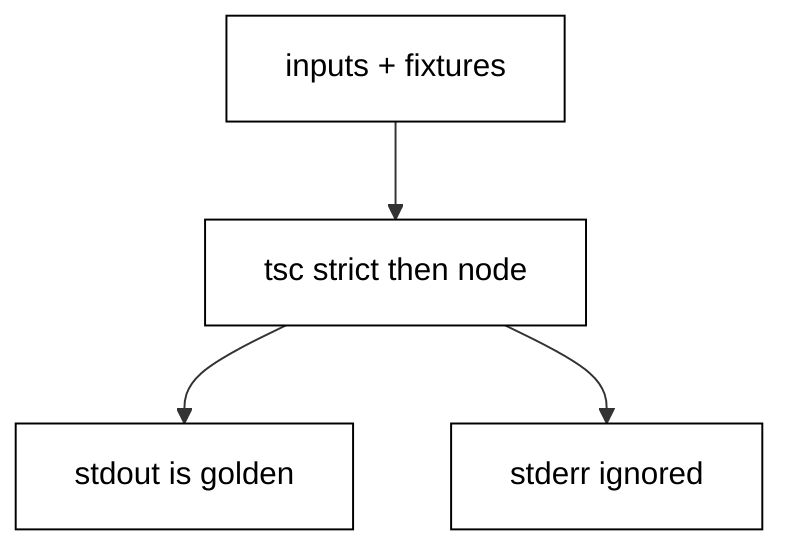

Prerequisites for this course: [just-enough-typescript](/en/learn/courses/just-enough-typescript/learning/overview) for basic syntax, types, functions, and modules. Comfort editing and running TypeScript programs from a terminal is assumed throughout, and every example builds only on the primer plus earlier examples in this course.

## Why this exists -- the big idea

**The problem before the solution**: developers who learn TypeScript as a second language write it with their first language accent — nullable checks from Java, error codes from Go, string paths from shell, `any` wherever the types get difficult. The programs work, but they resist the ecosystem: standard tools, reviewers, and future maintainers all expect the idiomatic forms. This course replaces each accent with the native habit, one small runnable program at a time, until the idiomatic form is the first one you reach for.

**Keep this if you forget everything else**: Write TypeScript the way its own standard library does — narrow unions instead of asserting, values over mutation, explicitness at boundaries.

## Tensions and trade-offs -- when NOT to reach for this

- **Idiom versus clarity**: chaining beats temporaries until it needs debugging; generics beat overloads until the constraint grows teeth; memoization beats recompute until memory matters. Each example names its cost alongside its form, and Example 78 collects the switching rules.
- **Standard library versus dependency**: the course reaches for the standard library first, which keeps every example runnable with zero installs. Real projects still adopt dependencies for genuinely hard problems — web frameworks, date arithmetic at scale, validation schemas — where the standard library ends and the ecosystem begins.
- **When NOT**: one-off exploration in a REPL needs no packaging, no tests, and no linting. The engineering in this course earns its place when the program runs twice — on a schedule, on someone else machine, or a year from now with you unavailable.

## Lineage -- where this language sits

TypeScript is the shared frontend and tooling language across much of this catalog: web courses render with it, testing courses drive it, CLI courses ship it. This course is the depth behind that ubiquity — the reason the same language serves scripts and systems alike. The primer teaches reading and writing; this course teaches fluency; later courses assume both and build domain systems on top.

## How this course is organized

[Beginner](/en/learn/courses/typescript-in-depth/learning/beginner) (Examples 1-25) installs idiomatic control flow and collections, the error-handling idiom, and standard-library text, files, and time. [Intermediate](/en/learn/courses/typescript-in-depth/learning/intermediate) (Examples 26-53) organizes modules and packages, declares and pins dependencies, tests with the standard `node:test` convention, and types generic, value-shaped code. [Advanced](/en/learn/courses/typescript-in-depth/learning/advanced) (Examples 54-78) surveys concurrency primitives, configures tooling and style, and trains systematic reading of idiomatic code. The [capstone](/en/learn/courses/typescript-in-depth/learning/capstone/overview) ships a report CLI with embedded selftests and a golden transcript, and [drilling](/en/learn/courses/typescript-in-depth/drilling/overview) turns the sixteen concepts into recall, katas, and checklists.

## About the runtime

Every example compiles as `tsc --strict --target es2022 --module commonjs` and runs as `node` in the pinned TypeScript container with no network and a read-only course tree: only the scratch directory is writable, so fixtures ship beside each program. Units that touch Node.js built-ins carry a small `node.d.ts` of ambient declarations instead of an install. Multi-file examples state their extra files explicitly; every file the lesson shows is embedded byte-identically. Standard output is the asserted golden transcript; standard error is ignored where the lesson says so. Programs print booleans, counts, and fixed labels — never paths, timings, addresses, or versions — so reruns are byte-stable.

## Examples by Level

### Beginner (Examples 1-25)

- [Example 1: Truthy Guards and Defaults](/en/learn/courses/typescript-in-depth/learning/beginner#example-1-truthy-guards-and-defaults)
- [Example 2: Optional Chaining at Depth](/en/learn/courses/typescript-in-depth/learning/beginner#example-2-optional-chaining-at-depth)
- [Example 3: for-of With Destructuring](/en/learn/courses/typescript-in-depth/learning/beginner#example-3-for-of-with-destructuring)
- [Example 4: Spread and Rest](/en/learn/courses/typescript-in-depth/learning/beginner#example-4-spread-and-rest)
- [Example 5: Array Pipelines](/en/learn/courses/typescript-in-depth/learning/beginner#example-5-array-pipelines)
- [Example 6: Map and Set Lookup](/en/learn/courses/typescript-in-depth/learning/beginner#example-6-map-and-set-lookup)
- [Example 7: Lazy Generators](/en/learn/courses/typescript-in-depth/learning/beginner#example-7-lazy-generators)
- [Example 8: Exhaustive Switch With never](/en/learn/courses/typescript-in-depth/learning/beginner#example-8-exhaustive-switch-with-never)
- [Example 9: try-catch Over unknown](/en/learn/courses/typescript-in-depth/learning/beginner#example-9-try-catch-over-unknown)
- [Example 10: Result Unions](/en/learn/courses/typescript-in-depth/learning/beginner#example-10-result-unions)
- [Example 11: Custom Errors With cause](/en/learn/courses/typescript-in-depth/learning/beginner#example-11-custom-errors-with-cause)
- [Example 12: Assertion Functions](/en/learn/courses/typescript-in-depth/learning/beginner#example-12-assertion-functions)
- [Example 13: finally Cleanup](/en/learn/courses/typescript-in-depth/learning/beginner#example-13-finally-cleanup)
- [Example 14: Guard Clauses](/en/learn/courses/typescript-in-depth/learning/beginner#example-14-guard-clauses)
- [Example 15: AggregateError Batches](/en/learn/courses/typescript-in-depth/learning/beginner#example-15-aggregateerror-batches)
- [Example 16: The never fail() Helper](/en/learn/courses/typescript-in-depth/learning/beginner#example-16-the-never-fail-helper)
- [Example 17: Parse, Don't Validate](/en/learn/courses/typescript-in-depth/learning/beginner#example-17-parse-dont-validate)
- [Example 18: String Trim, Split, Join](/en/learn/courses/typescript-in-depth/learning/beginner#example-18-string-trim-split-join)
- [Example 19: Regex matchAll](/en/learn/courses/typescript-in-depth/learning/beginner#example-19-regex-matchall)
- [Example 20: URL and Search Params](/en/learn/courses/typescript-in-depth/learning/beginner#example-20-url-and-search-params)
- [Example 21: path Join Over Concat](/en/learn/courses/typescript-in-depth/learning/beginner#example-21-path-join-over-concat)
- [Example 22: UTF-8 Round Trips](/en/learn/courses/typescript-in-depth/learning/beginner#example-22-utf-8-round-trips)
- [Example 23: JSON Round Trips](/en/learn/courses/typescript-in-depth/learning/beginner#example-23-json-round-trips)
- [Example 24: Intl Dates and Zones](/en/learn/courses/typescript-in-depth/learning/beginner#example-24-intl-dates-and-zones)
- [Example 25: Intl Numbers and Text Bytes](/en/learn/courses/typescript-in-depth/learning/beginner#example-25-intl-numbers-and-text-bytes)

### Intermediate (Examples 26-53)

- [Example 26: Named ESM Exports](/en/learn/courses/typescript-in-depth/learning/intermediate#example-26-named-esm-exports)
- [Example 27: import type Erasure](/en/learn/courses/typescript-in-depth/learning/intermediate#example-27-import-type-erasure)
- [Example 28: Barrel index Files](/en/learn/courses/typescript-in-depth/learning/intermediate#example-28-barrel-index-files)
- [Example 29: The exports Map](/en/learn/courses/typescript-in-depth/learning/intermediate#example-29-the-exports-map)
- [Example 30: tsconfig Strictness](/en/learn/courses/typescript-in-depth/learning/intermediate#example-30-tsconfig-strictness)
- [Example 31: The Lockfile Pin](/en/learn/courses/typescript-in-depth/learning/intermediate#example-31-the-lockfile-pin)
- [Example 32: Semver Specifier Windows](/en/learn/courses/typescript-in-depth/learning/intermediate#example-32-semver-specifier-windows)
- [Example 33: Dependencies vs devDependencies](/en/learn/courses/typescript-in-depth/learning/intermediate#example-33-dependencies-vs-devdependencies)
- [Example 34: The engines Gate](/en/learn/courses/typescript-in-depth/learning/intermediate#example-34-the-engines-gate)
- [Example 35: First Node Test Suite](/en/learn/courses/typescript-in-depth/learning/intermediate#example-35-first-node-test-suite)
- [Example 36: Table-Driven asserts](/en/learn/courses/typescript-in-depth/learning/intermediate#example-36-table-driven-asserts)
- [Example 37: beforeEach Fixtures](/en/learn/courses/typescript-in-depth/learning/intermediate#example-37-beforeeach-fixtures)
- [Example 38: Subtests as Steps](/en/learn/courses/typescript-in-depth/learning/intermediate#example-38-subtests-as-steps)
- [Example 39: Fake Timers](/en/learn/courses/typescript-in-depth/learning/intermediate#example-39-fake-timers)
- [Example 40: Mock Function Records](/en/learn/courses/typescript-in-depth/learning/intermediate#example-40-mock-function-records)
- [Example 41: Scratch Files in Tests](/en/learn/courses/typescript-in-depth/learning/intermediate#example-41-scratch-files-in-tests)
- [Example 42: Red First, Then Green](/en/learn/courses/typescript-in-depth/learning/intermediate#example-42-red-first-then-green)
- [Example 43: skip and todo](/en/learn/courses/typescript-in-depth/learning/intermediate#example-43-skip-and-todo)
- [Example 44: Async Loader Tests](/en/learn/courses/typescript-in-depth/learning/intermediate#example-44-async-loader-tests)
- [Example 45: First Generic Function](/en/learn/courses/typescript-in-depth/learning/intermediate#example-45-first-generic-function)
- [Example 46: Constrained Generics](/en/learn/courses/typescript-in-depth/learning/intermediate#example-46-constrained-generics)
- [Example 47: Partial, Pick, Record](/en/learn/courses/typescript-in-depth/learning/intermediate#example-47-partial-pick-record)
- [Example 48: Frozen Records](/en/learn/courses/typescript-in-depth/learning/intermediate#example-48-frozen-records)
- [Example 49: as const Literals](/en/learn/courses/typescript-in-depth/learning/intermediate#example-49-as-const-literals)
- [Example 50: Spread Copies One Level](/en/learn/courses/typescript-in-depth/learning/intermediate#example-50-spread-copies-one-level)
- [Example 51: structuredClone Depth](/en/learn/courses/typescript-in-depth/learning/intermediate#example-51-structuredclone-depth)
- [Example 52: Branded Units](/en/learn/courses/typescript-in-depth/learning/intermediate#example-52-branded-units)
- [Example 53: ReadonlyArray Inputs](/en/learn/courses/typescript-in-depth/learning/intermediate#example-53-readonlyarray-inputs)

### Advanced (Examples 54-78)

- [Example 54: Promise Chains](/en/learn/courses/typescript-in-depth/learning/advanced#example-54-promise-chains)
- [Example 55: async-await Flattening](/en/learn/courses/typescript-in-depth/learning/advanced#example-55-async-await-flattening)
- [Example 56: Promise All and Order](/en/learn/courses/typescript-in-depth/learning/advanced#example-56-promise-all-and-order)
- [Example 57: allSettled Partial Wins](/en/learn/courses/typescript-in-depth/learning/advanced#example-57-allsettled-partial-wins)
- [Example 58: race-built Timeouts](/en/learn/courses/typescript-in-depth/learning/advanced#example-58-race-built-timeouts)
- [Example 59: AbortController Cooperation](/en/learn/courses/typescript-in-depth/learning/advanced#example-59-abortcontroller-cooperation)
- [Example 60: Microtask Before Macrotask](/en/learn/courses/typescript-in-depth/learning/advanced#example-60-microtask-before-macrotask)
- [Example 61: Async Generators](/en/learn/courses/typescript-in-depth/learning/advanced#example-61-async-generators)
- [Example 62: strict Null Gates](/en/learn/courses/typescript-in-depth/learning/advanced#example-62-strict-null-gates)
- [Example 63: noUncheckedIndexedAccess](/en/learn/courses/typescript-in-depth/learning/advanced#example-63-nouncheckedindexedaccess)
- [Example 64: Naming That Reads](/en/learn/courses/typescript-in-depth/learning/advanced#example-64-naming-that-reads)
- [Example 65: Importing Plain JavaScript](/en/learn/courses/typescript-in-depth/learning/advanced#example-65-importing-plain-javascript)
- [Example 66: Declaration Emit](/en/learn/courses/typescript-in-depth/learning/advanced#example-66-declaration-emit)
- [Example 67: unknown Over any](/en/learn/courses/typescript-in-depth/learning/advanced#example-67-unknown-over-any)
- [Example 68: join Instead of Plus](/en/learn/courses/typescript-in-depth/learning/advanced#example-68-join-instead-of-plus)
- [Example 69: Set Membership Speed](/en/learn/courses/typescript-in-depth/learning/advanced#example-69-set-membership-speed)
- [Example 70: One-Pass reduce](/en/learn/courses/typescript-in-depth/learning/advanced#example-70-one-pass-reduce)
- [Example 71: Reading a Pipeline](/en/learn/courses/typescript-in-depth/learning/advanced#example-71-reading-a-pipeline)
- [Example 72: Reading a Retry Loop](/en/learn/courses/typescript-in-depth/learning/advanced#example-72-reading-a-retry-loop)
- [Example 73: Reading an Event Bus](/en/learn/courses/typescript-in-depth/learning/advanced#example-73-reading-an-event-bus)
- [Example 74: Reading an LRU Cache](/en/learn/courses/typescript-in-depth/learning/advanced#example-74-reading-an-lru-cache)
- [Example 75: Reading Layered Config](/en/learn/courses/typescript-in-depth/learning/advanced#example-75-reading-layered-config)
- [Example 76: Reading a CSV Transform](/en/learn/courses/typescript-in-depth/learning/advanced#example-76-reading-a-csv-transform)
- [Example 77: Reading argv Parsing](/en/learn/courses/typescript-in-depth/learning/advanced#example-77-reading-argv-parsing)
- [Example 78: Memo and Its Limits](/en/learn/courses/typescript-in-depth/learning/advanced#example-78-memo-and-its-limits)
