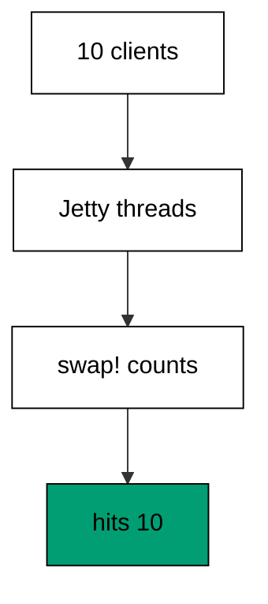
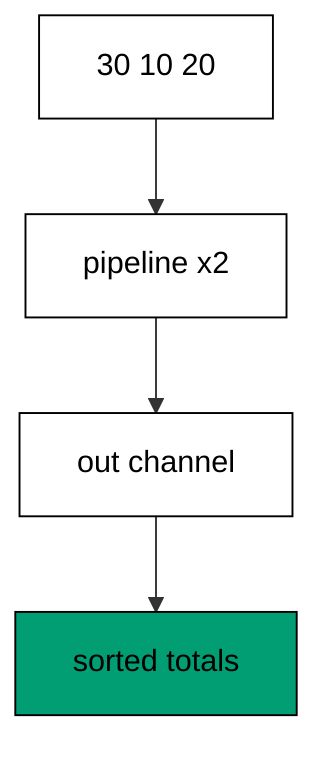
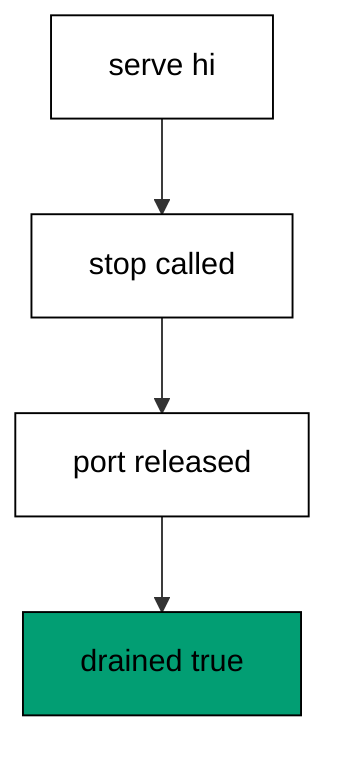
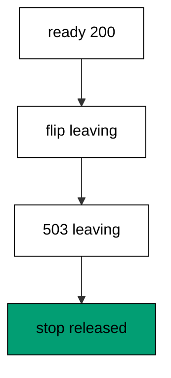
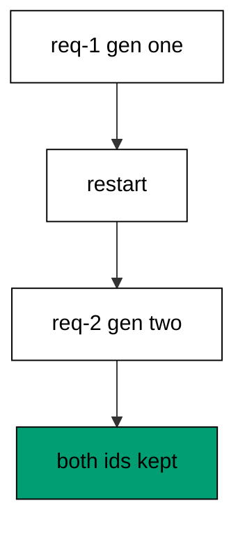
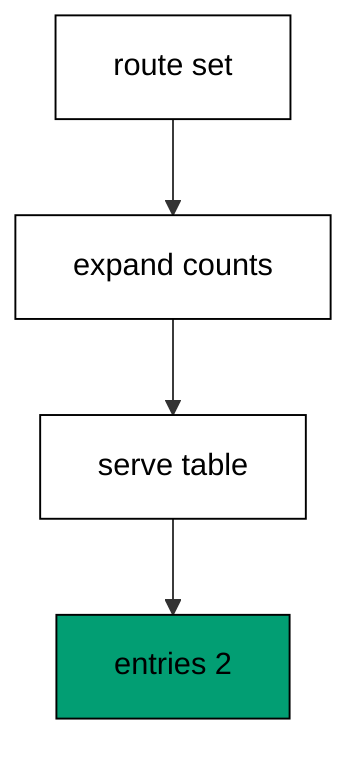
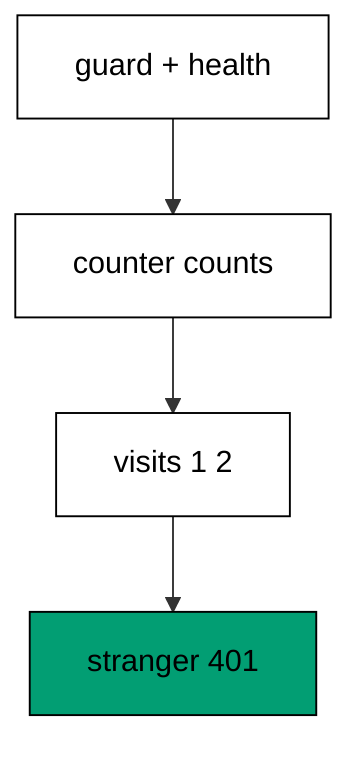

Examples 54–78 run the service for real: loopback Jetty servers carry concurrent load, stop and restart on command, and the closing cluster compares every idiom against FastAPI. Three clusters carry the level: concurrency under load (Examples 54–61), graceful shutdown (Examples 62–70), and comparing design choices against FastAPI (Examples 71–78). Examples in the first two clusters bind an OS-chosen ephemeral loopback port through `ServerSocket(0)` and drive it with the Java HTTP client; the harness never sees a fixed port and no request leaves the machine.

### Example 54: Ten Clients Share One Handler

Threads meet the handler: ten concurrent loopback requests hit one Jetty handler and every body matches. The program binds an ephemeral loopback port, fires ten clients at once, and counts the hits. (Concepts: co-07.)



`ServerSocket(0)` asks the OS for a free port, and closing the probe before Jetty binds guarantees no fixture ever collides. `pmap` fires the requests concurrently and preserves input order, so the transcript prints deterministically even though the threads race. The atom count proves every request landed exactly once.

**`learning/code/ex-54-ten-clients-share-one-handler/main.clj`**:

```clojure
;; => Ex-54: Ten Clients Share One Handler.
;; => Ten concurrent loopback requests hit one Jetty handler; every body matches.
;; => Silence framework logging so the transcript holds only our lines.
(System/setProperty "org.slf4j.simpleLogger.defaultLogLevel" "error") ;; => only errors reach the log
(System/setProperty "org.slf4j.simpleLogger.showDateTime" "false") ;; => no timestamps leak into output
(System/setProperty "org.slf4j.simpleLogger.showThreadName" "false") ;; => no thread names leak into output
(System/setProperty "org.slf4j.simpleLogger.showLogName" "false") ;; => no logger names leak into output
(System/setProperty "org.slf4j.simpleLogger.showShortLogName" "false") ;; => short names stay off too
;; => Load the connector stack, the Jetty adapter, and the Java HTTP client.
(require '[io.pedestal.connector :as conn]) ;; => connector maps describe test and live servers
(require '[io.pedestal.http.jetty :as jetty]) ;; => create-connector builds the live connector
(require '[io.pedestal.service.interceptors :as interceptors]) ;; => not-found turns misses into 404
(import '(java.net ServerSocket URI)) ;; => the ephemeral port comes from the OS
(import '(java.net.http HttpClient HttpRequest HttpResponse$BodyHandlers)) ;; => the client speaks loopback HTTP
;; => The atom counts requests across every server thread.
(def hits (atom 0)) ;; => hits count every handled request
;; => The handler bumps the counter and answers one fixed word.
(def hit (fn [_] (swap! hits inc) {:status 200 :body "ok"})) ;; => every request counts once
;; => The route table declares the hammered endpoint.
(def routes #{["/hit" :get hit :route-name :hit]}) ;; => one entry takes ten clients
;; => The OS picks a free loopback port; the connector serves ten clients on it.
(let [sock (ServerSocket. 0) ;; => port zero asks the OS for a free port
      port (.getLocalPort sock)] ;; => the chosen port never reaches output
  (.close sock) ;; => release the probe socket before Jetty binds
  (def service (-> (conn/default-connector-map "127.0.0.1" port) ;; => loopback only, OS-chosen port
                   (conn/with-interceptors [interceptors/not-found]) ;; => unknown paths answer 404 instead of nil
                   (conn/with-routes routes))) ;; => router plus path-params decoder join the chain
  (def connector (jetty/create-connector service {})) ;; => the unstarted live connector
  (conn/start! connector) ;; => serve loopback traffic
  (def client (HttpClient/newHttpClient)) ;; => one client serves every request
  (def req (-> (HttpRequest/newBuilder (URI/create (str "http://127.0.0.1:" port "/hit"))) ;; => loopback only, never fixed
               (.GET) ;; => reads hit the counter
               (.build))) ;; => one request shape serves ten calls
  (def bodies (doall (pmap (fn [_] (.body (.send client req (HttpResponse$BodyHandlers/ofString)))) ;; => ten concurrent calls
                           (range 10)))) ;; => pmap keeps input order
  (println "bodies:" (pr-str bodies)) ;; => Output: bodies: ("ok" "ok" "ok" "ok" "ok" "ok" "ok" "ok" "ok" "ok")
  (println "hits:" (pr-str @hits)) ;; => Output: hits: 10
  (conn/stop! connector)) ;; => stop drains the server with no output
```

**Output** (`learning/code/ex-54-ten-clients-share-one-handler/expected/main.stdout.txt`):

```text
bodies: ("ok" "ok" "ok" "ok" "ok" "ok" "ok" "ok" "ok" "ok")
hits: 10
```

**Key takeaway**: Ephemeral loopback ports plus `pmap` prove thread safety with deterministic transcripts.

**Why it matters**: Concurrency bugs hide in shared state and only show under load. Loopback load tests catch them where debuggers cannot follow.

### Example 55: Atom Counts Every Request

Tickets prove order: five sequential loopback visits bump one shared atom and print numbered tickets. The program serves five visits and prints the total. (Concepts: co-07.)

Sequential tickets read as a proof: ticket N exists exactly when N requests landed. One shared client keeps connection behaviour constant across calls. The total closes the loop between per-request evidence and global state.

**`learning/code/ex-55-atom-counts-every-request/main.clj`**:

```clojure
;; => Ex-55: Atom Counts Every Request.
;; => Sequential loopback requests bump a shared atom; the total proves nothing lost.
;; => Silence framework logging so the transcript holds only our lines.
(System/setProperty "org.slf4j.simpleLogger.defaultLogLevel" "error") ;; => only errors reach the log
(System/setProperty "org.slf4j.simpleLogger.showDateTime" "false") ;; => no timestamps leak into output
(System/setProperty "org.slf4j.simpleLogger.showThreadName" "false") ;; => no thread names leak into output
(System/setProperty "org.slf4j.simpleLogger.showLogName" "false") ;; => no logger names leak into output
(System/setProperty "org.slf4j.simpleLogger.showShortLogName" "false") ;; => short names stay off too
;; => Load the connector stack, the Jetty adapter, and the Java HTTP client.
(require '[io.pedestal.connector :as conn]) ;; => connector maps describe test and live servers
(require '[io.pedestal.http.jetty :as jetty]) ;; => create-connector builds the live connector
(require '[io.pedestal.service.interceptors :as interceptors]) ;; => not-found turns misses into 404
(import '(java.net ServerSocket URI)) ;; => the ephemeral port comes from the OS
(import '(java.net.http HttpClient HttpRequest HttpResponse$BodyHandlers)) ;; => the client speaks loopback HTTP
;; => The counter starts at zero; real connections bump it across threads.
(def visits (atom 0)) ;; => visits count every request atomically
;; => The handler bumps the counter and hands back the ticket number.
(def visit (fn [_] (let [ticket (swap! visits inc)] ;; => swap! retries make this atomic
                     {:status 200 :body (str "ticket " ticket)}))) ;; => tickets count up in order
;; => The route table declares the counting endpoint.
(def routes #{["/visit" :get visit :route-name :visit]}) ;; => one entry counts visits
;; => The OS picks a free loopback port; the connector serves five visits on it.
(let [sock (ServerSocket. 0) ;; => port zero asks the OS for a free port
      port (.getLocalPort sock)] ;; => the chosen port never reaches output
  (.close sock) ;; => release the probe socket before Jetty binds
  (def service (-> (conn/default-connector-map "127.0.0.1" port) ;; => loopback only, OS-chosen port
                   (conn/with-interceptors [interceptors/not-found]) ;; => unknown paths answer 404 instead of nil
                   (conn/with-routes routes))) ;; => router plus path-params decoder join the chain
  (def connector (jetty/create-connector service {})) ;; => the unstarted live connector
  (conn/start! connector) ;; => serve loopback traffic
  (def client (HttpClient/newHttpClient)) ;; => one client serves every request
  (def get-visit (fn [] ;; => one helper serves every visit
                   (.body (.send client (-> (HttpRequest/newBuilder ;; => loopback only, never fixed
                                             (URI/create (str "http://127.0.0.1:" port "/visit")))
                                            (.GET) (.build)) ;; => reads bump the counter
                                          (HttpResponse$BodyHandlers/ofString))))) ;; => bodies carry tickets
  (println "tickets:" (pr-str (mapv (fn [_] (get-visit)) (range 5)))) ;; => Output: tickets: ["ticket 1" "ticket 2" "ticket 3" "ticket 4" "ticket 5"]
  (println "total:" (pr-str @visits)) ;; => Output: total: 5
  (conn/stop! connector)) ;; => stop drains the server with no output
```

**Output** (`learning/code/ex-55-atom-counts-every-request/expected/main.stdout.txt`):

```text
tickets: ["ticket 1" "ticket 2" "ticket 3" "ticket 4" "ticket 5"]
total: 5
```

**Key takeaway**: Sequential tickets plus a total prove shared state survives real connections.

**Why it matters**: Real-connection tests catch serialization and pooling bugs that in-process tests cannot see. Tickets make the proof readable.

### Example 56: Slow Handler Still Serves

Slow work overlaps: each request sleeps briefly while six concurrent clients all get 200. The program fires six overlapping calls and prints every status with its body. (Concepts: co-07.)

Thread-per-request shines here: each sleep occupies its own thread while the others proceed. The transcript prints statuses, never timings, because durations wobble across machines. Six identical 200s prove the pool absorbed the overlap.

**`learning/code/ex-56-slow-handler-still-serves/main.clj`**:

```clojure
;; => Ex-56: Slow Handler Still Serves.
;; => Each request sleeps briefly; six concurrent clients all get 200 anyway.
;; => Silence framework logging so the transcript holds only our lines.
(System/setProperty "org.slf4j.simpleLogger.defaultLogLevel" "error") ;; => only errors reach the log
(System/setProperty "org.slf4j.simpleLogger.showDateTime" "false") ;; => no timestamps leak into output
(System/setProperty "org.slf4j.simpleLogger.showThreadName" "false") ;; => no thread names leak into output
(System/setProperty "org.slf4j.simpleLogger.showLogName" "false") ;; => no logger names leak into output
(System/setProperty "org.slf4j.simpleLogger.showShortLogName" "false") ;; => short names stay off too
;; => Load the connector stack, the Jetty adapter, and the Java HTTP client.
(require '[io.pedestal.connector :as conn]) ;; => connector maps describe test and live servers
(require '[io.pedestal.http.jetty :as jetty]) ;; => create-connector builds the live connector
(require '[io.pedestal.service.interceptors :as interceptors]) ;; => not-found turns misses into 404
(import '(java.net ServerSocket URI)) ;; => the ephemeral port comes from the OS
(import '(java.net.http HttpClient HttpRequest HttpResponse$BodyHandlers)) ;; => the client speaks loopback HTTP
;; => The handler sleeps to simulate work, then answers; threads overlap the sleeps.
(def slow (fn [_] (Thread/sleep 100) {:status 200 :body "slow-ok"})) ;; => work takes a moment per request
;; => The route table declares the slow endpoint.
(def routes #{["/slow" :get slow :route-name :slow]}) ;; => one entry sleeps per call
;; => The OS picks a free loopback port; six clients overlap their sleeps on it.
(let [sock (ServerSocket. 0) ;; => port zero asks the OS for a free port
      port (.getLocalPort sock)] ;; => the chosen port never reaches output
  (.close sock) ;; => release the probe socket before Jetty binds
  (def service (-> (conn/default-connector-map "127.0.0.1" port) ;; => loopback only, OS-chosen port
                   (conn/with-interceptors [interceptors/not-found]) ;; => unknown paths answer 404 instead of nil
                   (conn/with-routes routes))) ;; => router plus path-params decoder join the chain
  (def connector (jetty/create-connector service {})) ;; => the unstarted live connector
  (conn/start! connector) ;; => serve loopback traffic
  (def client (HttpClient/newHttpClient)) ;; => one client serves every request
  (def req (-> (HttpRequest/newBuilder (URI/create (str "http://127.0.0.1:" port "/slow"))) ;; => loopback only, never fixed
               (.GET) ;; => reads trigger the sleep
               (.build))) ;; => one request shape serves six calls
  (def results (doall (pmap (fn [_] (let [resp (.send client req (HttpResponse$BodyHandlers/ofString))] ;; => six concurrent calls
                                      [(.statusCode resp) (.body resp)])) ;; => status plus body per call
                             (range 6)))) ;; => pmap keeps input order
  (println "results:" (pr-str results)) ;; => Output: results: ([200 "slow-ok"] [200 "slow-ok"] [200 "slow-ok"] [200 "slow-ok"] [200 "slow-ok"] [200 "slow-ok"])
  (conn/stop! connector)) ;; => stop drains the server with no output
```

**Output** (`learning/code/ex-56-slow-handler-still-serves/expected/main.stdout.txt`):

```text
results: ([200 "slow-ok"] [200 "slow-ok"] [200 "slow-ok"] [200 "slow-ok"] [200 "slow-ok"] [200 "slow-ok"])
```

**Key takeaway**: Overlapping sleeps all answer 200; transcripts assert statuses, never timings.

**Why it matters**: Timing assertions flake across machines. Status assertions prove capacity without measuring clocks.

### Example 57: Responses Never Interleave

Identity survives concurrency: five concurrent requests carry distinct ids and every answer echoes its own. The program races five ids and prints the ordered echoes. (Concepts: co-07.)

`pmap` order is the trick: responses arrive in completion order, but the vector prints in input order, so the transcript stays stable while the threads race freely. Echoing the id per request proves no response crossed into another. Any interleave would print as a mismatch.

**`learning/code/ex-57-responses-never-interleave/main.clj`**:

```clojure
;; => Ex-57: Responses Never Interleave.
;; => Five concurrent requests carry distinct ids; pmap order keeps answers aligned.
;; => Silence framework logging so the transcript holds only our lines.
(System/setProperty "org.slf4j.simpleLogger.defaultLogLevel" "error") ;; => only errors reach the log
(System/setProperty "org.slf4j.simpleLogger.showDateTime" "false") ;; => no timestamps leak into output
(System/setProperty "org.slf4j.simpleLogger.showThreadName" "false") ;; => no thread names leak into output
(System/setProperty "org.slf4j.simpleLogger.showLogName" "false") ;; => no logger names leak into output
(System/setProperty "org.slf4j.simpleLogger.showShortLogName" "false") ;; => short names stay off too
;; => Load the connector stack, the Jetty adapter, and the Java HTTP client.
(require '[io.pedestal.connector :as conn]) ;; => connector maps describe test and live servers
(require '[io.pedestal.http.jetty :as jetty]) ;; => create-connector builds the live connector
(require '[io.pedestal.service.interceptors :as interceptors]) ;; => not-found turns misses into 404
(import '(java.net ServerSocket URI)) ;; => the ephemeral port comes from the OS
(import '(java.net.http HttpClient HttpRequest HttpResponse$BodyHandlers)) ;; => the client speaks loopback HTTP
;; => The handler echoes the requested id, so crossed answers would show.
(def echo (fn [request] {:status 200 :body (str "id-" (get-in request [:path-params :id]))})) ;; => ids ride the body home
;; => The route table declares the echoing endpoint.
(def routes #{["/echo/:id" :get echo :route-name :echo]}) ;; => one entry echoes ids
;; => The OS picks a free loopback port; five ids travel concurrently on it.
(let [sock (ServerSocket. 0) ;; => port zero asks the OS for a free port
      port (.getLocalPort sock)] ;; => the chosen port never reaches output
  (.close sock) ;; => release the probe socket before Jetty binds
  (def service (-> (conn/default-connector-map "127.0.0.1" port) ;; => loopback only, OS-chosen port
                   (conn/with-interceptors [interceptors/not-found]) ;; => unknown paths answer 404 instead of nil
                   (conn/with-routes routes))) ;; => router plus path-params decoder join the chain
  (def connector (jetty/create-connector service {})) ;; => the unstarted live connector
  (conn/start! connector) ;; => serve loopback traffic
  (def client (HttpClient/newHttpClient)) ;; => one client serves every request
  (def fetch (fn [id] ;; => one helper fetches every id
               (.body (.send client (-> (HttpRequest/newBuilder ;; => loopback only, never fixed
                                         (URI/create (str "http://127.0.0.1:" port "/echo/" id)))
                                        (.GET) (.build)) ;; => reads echo the id
                                      (HttpResponse$BodyHandlers/ofString))))) ;; => bodies carry ids
  (println "echoes:" (pr-str (doall (pmap fetch ["a" "b" "c" "d" "e"])))) ;; => Output: echoes: ("id-a" "id-b" "id-c" "id-d" "id-e")
  (conn/stop! connector)) ;; => stop drains the server with no output
```

**Output** (`learning/code/ex-57-responses-never-interleave/expected/main.stdout.txt`):

```text
echoes: ("id-a" "id-b" "id-c" "id-d" "id-e")
```

**Key takeaway**: Per-request ids echo correctly under concurrency; ordered collection keeps transcripts stable.

**Why it matters**: Interleaved responses corrupt data silently. Id-echo tests make cross-talk visible the first time it happens.

### Example 58: Core Async Pipeline Sums Orders

Channels move data between stages: a two-worker pipeline doubles every order total while the test collects and sorts the results. The program pipelines three totals in-process and prints them sorted. (Concepts: co-07.)



`pipeline` parallelizes a transducer over N workers: orders enter the inlet, doubled totals exit the outlet, and closing the inlet ends the stream. Collecting with a loop until nil drains every result regardless of worker timing. Sorting before printing absorbs completion-order wobble, so the transcript stays byte-stable.

**`learning/code/ex-58-core-async-pipeline-sums-orders/main.clj`**:

```clojure
;; => Ex-58: Core Async Pipeline Sums Orders.
;; => The handler runs a two-stage core.async pipeline and prints the sorted totals.
;; => Silence framework logging so the transcript holds only our lines.
(System/setProperty "org.slf4j.simpleLogger.defaultLogLevel" "error") ;; => only errors reach the log
(System/setProperty "org.slf4j.simpleLogger.showDateTime" "false") ;; => no timestamps leak into output
(System/setProperty "org.slf4j.simpleLogger.showThreadName" "false") ;; => no thread names leak into output
(System/setProperty "org.slf4j.simpleLogger.showLogName" "false") ;; => no logger names leak into output
(System/setProperty "org.slf4j.simpleLogger.showShortLogName" "false") ;; => short names stay off too
;; => Load the connector stack plus the core.async pipeline operators.
(require '[io.pedestal.connector :as conn]) ;; => connector maps are the 0.8 service description
(require '[io.pedestal.connector.test :as t]) ;; => response-for tests with no socket
(require '[io.pedestal.http.jetty :as jetty]) ;; => create-connector builds the testable connector
(require '[clojure.core.async :as async :refer [chan go >! <!! close! pipeline]]) ;; => channels move orders between stages
(require '[io.pedestal.service.interceptors :as interceptors]) ;; => not-found turns misses into 404
;; => The pipeline doubles each order total on two parallel workers, then closes.
(def double-totals (fn [orders] ;; => one function pipelines every total
                     (let [in (chan) ;; => orders enter here
                           out (chan)] ;; => doubled totals exit here
                       (pipeline 2 out (map #(* 2 %)) in) ;; => two workers double in flight
                       (go (doseq [o orders] (>! in o)) (close! in)) ;; => feed then close the inlet
                       (loop [acc []] ;; => collect until the outlet closes
                         (if-let [v (<!! out)] ;; => nil means the pipeline finished
                           (recur (conj acc v)) ;; => keep every doubled total
                           (sort acc)))))) ;; => sort before printing for stability
;; => The handler pipelines fixed totals and prints the sorted results.
(def totals (fn [_] {:status 200 :body (pr-str (double-totals [30 10 20]))})) ;; => pipeline doubles, sort orders
;; => The route table declares the pipelined endpoint.
(def routes #{["/totals" :get totals :route-name :totals]}) ;; => one entry pipelines totals
;; => The connector map stacks cross-cutting interceptors under routing.
(def service (-> (conn/default-connector-map 8080) ;; => the port stays unbound; tests use no socket
                 (conn/with-interceptors [interceptors/not-found]) ;; => unknown paths answer 404 instead of nil
                 (conn/with-routes routes))) ;; => router plus path-params decoder join the chain
(def connector (jetty/create-connector service {})) ;; => the unstarted connector answers test requests
(println "totals:" (:body (t/response-for connector :get "/totals"))) ;; => Output: totals: (20 40 60)
```

**Output** (`learning/code/ex-58-core-async-pipeline-sums-orders/expected/main.stdout.txt`):

```text
totals: (20 40 60)
```

**Key takeaway**: `pipeline` parallelizes a transducer over channels; sorting the drain keeps output stable.

**Why it matters**: Pipelines express staged work without thread management. Sorting at the print site separates concurrency from determinism.

### Example 59: Future Times Out Slow Work

Slow dependencies must not hang handlers: the program races a thirty-second future against a 200-millisecond timeout and answers 503. The future pool stops after so the unit exits. (Concepts: co-07.)

`deref` with a timeout turns waiting into a decision: the value or the fallback, never a hang. The timeout dwarfs real work but shrinks test time — thirty seconds always exceeds 200 milliseconds, so expiry is certain. `shutdown-agents` stops the pool threads so the process exits instead of lingering on the abandoned sleep.

**`learning/code/ex-59-future-times-out-slow-work/main.clj`**:

```clojure
;; => Ex-59: Future Times Out Slow Work.
;; => The handler races a slow future against a short timeout and answers 503 on expiry.
;; => Silence framework logging so the transcript holds only our lines.
(System/setProperty "org.slf4j.simpleLogger.defaultLogLevel" "error") ;; => only errors reach the log
(System/setProperty "org.slf4j.simpleLogger.showDateTime" "false") ;; => no timestamps leak into output
(System/setProperty "org.slf4j.simpleLogger.showThreadName" "false") ;; => no thread names leak into output
(System/setProperty "org.slf4j.simpleLogger.showLogName" "false") ;; => no logger names leak into output
(System/setProperty "org.slf4j.simpleLogger.showShortLogName" "false") ;; => short names stay off too
;; => Load the connector stack, the Jetty adapter, and the Java HTTP client.
(require '[io.pedestal.connector :as conn]) ;; => connector maps describe test and live servers
(require '[io.pedestal.http.jetty :as jetty]) ;; => create-connector builds the live connector
(require '[io.pedestal.service.interceptors :as interceptors]) ;; => not-found turns misses into 404
(import '(java.net ServerSocket URI)) ;; => the ephemeral port comes from the OS
(import '(java.net.http HttpClient HttpRequest HttpResponse$BodyHandlers)) ;; => the client speaks loopback HTTP
;; => The handler waits on work that never finishes inside the timeout.
(def report (fn [_] ;; => one handler races slow work
              (let [work (future ;; => slow work runs off the handler thread
                           (Thread/sleep 30000) ;; => thirty seconds always exceeds the timeout
                           "done")] ;; => the value nobody waits for
                (let [result (deref work 200 :timed-out)] ;; => two hundred milliseconds decide
                  (if (= result :timed-out) ;; => expiry is the expected path
                    {:status 503 :body "upstream slow"} ;; => slow work answers 503, never hangs
                    {:status 200 :body result}))))) ;; => fast work would answer 200
;; => The route table declares the racing endpoint.
(def routes #{["/report" :get report :route-name :report]}) ;; => one entry races the timeout
;; => The OS picks a free loopback port; the connector proves the timeout fires.
(let [sock (ServerSocket. 0) ;; => port zero asks the OS for a free port
      port (.getLocalPort sock)] ;; => the chosen port never reaches output
  (.close sock) ;; => release the probe socket before Jetty binds
  (def service (-> (conn/default-connector-map "127.0.0.1" port) ;; => loopback only, OS-chosen port
                   (conn/with-interceptors [interceptors/not-found]) ;; => unknown paths answer 404 instead of nil
                   (conn/with-routes routes))) ;; => router plus path-params decoder join the chain
  (def connector (jetty/create-connector service {})) ;; => the unstarted live connector
  (conn/start! connector) ;; => serve loopback traffic
  (def client (HttpClient/newHttpClient)) ;; => one client serves the request
  (def resp (.send client (-> (HttpRequest/newBuilder (URI/create (str "http://127.0.0.1:" port "/report"))) ;; => loopback only
                              (.GET) (.build)) ;; => reads race the timeout
                         (HttpResponse$BodyHandlers/ofString))) ;; => bodies carry the verdict
  (println "status:" (.statusCode resp)) ;; => Output: status: 503
  (println "body:" (.body resp)) ;; => Output: body: upstream slow
  (shutdown-agents) ;; => stop the future pool so the unit exits
  (conn/stop! connector)) ;; => stop drains the server with no output
```

**Output** (`learning/code/ex-59-future-times-out-slow-work/expected/main.stdout.txt`):

```text
status: 503
body: upstream slow
```

**Key takeaway**: `deref` with a timeout converts slow work into a 503 decision instead of a hang.

**Why it matters**: Hanging handlers burn threads until the pool starves. Timeouts shed doomed work fast and tell callers to retry.

### Example 60: Connection Queue Survives Burst

Twenty clients at once: the program fires a twenty-wide burst at one endpoint and asserts every status is 200. The count proves the queue absorbed the spike. (Concepts: co-07.)

Bursts test the queue, not the handler: twenty concurrent connections contend for accept threads before any logic runs. Asserting `every?` on the codes compresses twenty facts into one boolean. The hit count beside it proves each connection reached the handler.

**`learning/code/ex-60-connection-queue-survives-burst/main.clj`**:

```clojure
;; => Ex-60: Connection Queue Survives Burst.
;; => Twenty concurrent loopback requests all answer 200; the count proves none dropped.
;; => Silence framework logging so the transcript holds only our lines.
(System/setProperty "org.slf4j.simpleLogger.defaultLogLevel" "error") ;; => only errors reach the log
(System/setProperty "org.slf4j.simpleLogger.showDateTime" "false") ;; => no timestamps leak into output
(System/setProperty "org.slf4j.simpleLogger.showThreadName" "false") ;; => no thread names leak into output
(System/setProperty "org.slf4j.simpleLogger.showLogName" "false") ;; => no logger names leak into output
(System/setProperty "org.slf4j.simpleLogger.showShortLogName" "false") ;; => short names stay off too
;; => Load the connector stack, the Jetty adapter, and the Java HTTP client.
(require '[io.pedestal.connector :as conn]) ;; => connector maps describe test and live servers
(require '[io.pedestal.http.jetty :as jetty]) ;; => create-connector builds the live connector
(require '[io.pedestal.service.interceptors :as interceptors]) ;; => not-found turns misses into 404
(import '(java.net ServerSocket URI)) ;; => the ephemeral port comes from the OS
(import '(java.net.http HttpClient HttpRequest HttpResponse$BodyHandlers)) ;; => the client speaks loopback HTTP
;; => The atom counts requests across every server thread.
(def hits (atom 0)) ;; => hits count every handled request
;; => The handler bumps the counter and answers one fixed word.
(def hit (fn [_] (swap! hits inc) {:status 200 :body "ok"})) ;; => every request counts once
;; => The route table declares the bursty endpoint.
(def routes #{["/burst" :get hit :route-name :burst]}) ;; => one entry takes twenty clients
;; => The OS picks a free loopback port; twenty clients arrive at once on it.
(let [sock (ServerSocket. 0) ;; => port zero asks the OS for a free port
      port (.getLocalPort sock)] ;; => the chosen port never reaches output
  (.close sock) ;; => release the probe socket before Jetty binds
  (def service (-> (conn/default-connector-map "127.0.0.1" port) ;; => loopback only, OS-chosen port
                   (conn/with-interceptors [interceptors/not-found]) ;; => unknown paths answer 404 instead of nil
                   (conn/with-routes routes))) ;; => router plus path-params decoder join the chain
  (def connector (jetty/create-connector service {})) ;; => the unstarted live connector
  (conn/start! connector) ;; => serve loopback traffic
  (def client (HttpClient/newHttpClient)) ;; => one client serves every request
  (def req (-> (HttpRequest/newBuilder (URI/create (str "http://127.0.0.1:" port "/burst"))) ;; => loopback only, never fixed
               (.GET) ;; => reads hit the counter
               (.build))) ;; => one request shape serves twenty calls
  (def codes (doall (pmap (fn [_] (.statusCode (.send client req (HttpResponse$BodyHandlers/ofString)))) ;; => twenty concurrent calls
                           (range 20)))) ;; => pmap keeps input order
  (println "all-200:" (pr-str (every? #(= 200 %) codes))) ;; => Output: all-200: true
  (println "hits:" (pr-str @hits)) ;; => Output: hits: 20
  (conn/stop! connector)) ;; => stop drains the server with no output
```

**Output** (`learning/code/ex-60-connection-queue-survives-burst/expected/main.stdout.txt`):

```text
all-200: true
hits: 20
```

**Key takeaway**: Bursts assert `every?` on codes plus a handler count; both must agree.

**Why it matters**: Dropped connections fail silently in production metrics. Burst tests prove the queue holds before users discover it does not.

### Example 61: Concurrency Review Counts Right

Readers and writers share one order book: four concurrent writers place orders, then the reader counts four. The program races the writers and prints the ending. (Concepts: co-07.)

The review composes the cluster: ephemeral ports, real threads, shared atoms, and ordered collection. Writers race freely because the atom serializes appends; the reader runs after because the count needs the race finished. `pmap` returns only after every writer lands, which sequences the phases without sleeps.

**`learning/code/ex-61-concurrency-review-counts-right/main.clj`**:

```clojure
;; => Ex-61: Concurrency Review Counts Right.
;; => Readers and writers share one order book over loopback; the ending balances.
;; => Silence framework logging so the transcript holds only our lines.
(System/setProperty "org.slf4j.simpleLogger.defaultLogLevel" "error") ;; => only errors reach the log
(System/setProperty "org.slf4j.simpleLogger.showDateTime" "false") ;; => no timestamps leak into output
(System/setProperty "org.slf4j.simpleLogger.showThreadName" "false") ;; => no thread names leak into output
(System/setProperty "org.slf4j.simpleLogger.showLogName" "false") ;; => no logger names leak into output
(System/setProperty "org.slf4j.simpleLogger.showShortLogName" "false") ;; => short names stay off too
;; => Load the connector stack, the Jetty adapter, and the Java HTTP client.
(require '[io.pedestal.connector :as conn]) ;; => connector maps describe test and live servers
(require '[io.pedestal.http.jetty :as jetty]) ;; => create-connector builds the live connector
(require '[io.pedestal.service.interceptors :as interceptors]) ;; => not-found turns misses into 404
(import '(java.net ServerSocket URI)) ;; => the ephemeral port comes from the OS
(import '(java.net.http HttpClient HttpRequest HttpResponse$BodyHandlers HttpRequest$BodyPublishers)) ;; => the client speaks loopback HTTP
;; => The order book starts empty; writers add and readers count.
(def book (atom [])) ;; => orders accumulate here across threads
;; => The writer appends its id; the reader reports the count.
(def place (fn [request] ;; => POST appends one order
             (swap! book conj (get-in request [:path-params :id])) ;; => ids accumulate in order
             {:status 201 :body "placed"})) ;; => writes answer 201
(def count-book (fn [_] {:status 200 :body (str "orders " (count @book))})) ;; => reads report the count
;; => The route table wires the writer and the reader to the shared book.
(def routes #{["/place/:id" :post place :route-name :place] ;; => writes grow the book
              ["/count" :get count-book :route-name :count-book]}) ;; => reads report the count
;; => The OS picks a free loopback port; writers race, then the reader counts.
(let [sock (ServerSocket. 0) ;; => port zero asks the OS for a free port
      port (.getLocalPort sock)] ;; => the chosen port never reaches output
  (.close sock) ;; => release the probe socket before Jetty binds
  (def service (-> (conn/default-connector-map "127.0.0.1" port) ;; => loopback only, OS-chosen port
                   (conn/with-interceptors [interceptors/not-found]) ;; => unknown paths answer 404 instead of nil
                   (conn/with-routes routes))) ;; => router plus path-params decoder join the chain
  (def connector (jetty/create-connector service {})) ;; => the unstarted live connector
  (conn/start! connector) ;; => serve loopback traffic
  (def client (HttpClient/newHttpClient)) ;; => one client serves every request
  (def post-place (fn [id] ;; => one helper places every order
                    (.body (.send client (-> (HttpRequest/newBuilder ;; => loopback only, never fixed
                                              (URI/create (str "http://127.0.0.1:" port "/place/" id)))
                                             (.POST (HttpRequest$BodyPublishers/noBody)) (.build)) ;; => posts carry the id
                                           (HttpResponse$BodyHandlers/ofString))))) ;; => bodies confirm placement
  (def placed (doall (pmap post-place ["a" "b" "c" "d"]))) ;; => four writers race at once
  (println "placed:" (pr-str placed)) ;; => Output: placed: ("placed" "placed" "placed" "placed")
  (println "ending:" (.body (.send client (-> (HttpRequest/newBuilder ;; => the reader counts after the race
                                               (URI/create (str "http://127.0.0.1:" port "/count")))
                                              (.GET) (.build)) ;; => reads report the count
                                            (HttpResponse$BodyHandlers/ofString)))) ;; => Output: ending: orders 4
  (conn/stop! connector)) ;; => stop drains the server with no output
```

**Output** (`learning/code/ex-61-concurrency-review-counts-right/expected/main.stdout.txt`):

```text
placed: ("placed" "placed" "placed" "placed")
ending: orders 4
```

**Key takeaway**: Writers race on atoms while readers follow; `pmap` sequences the phases without sleeps.

**Why it matters**: Reviews prove patterns compose under load, not just alone. The ending balance is the whole lesson in two lines.

### Example 62: Stop Drains the Server

Shutdown is a function call: the program serves one request, stops the server, and prints the drained state. No threads linger and the port releases. (Concepts: co-08.)



`conn/stop!` ends service synchronously: when it returns, the port is released and no new connection can arrive. Printing after the stop proves the ordering — served, then stopped, then reported. Drains complete before the process moves on, which is what supervisors and tests need.

**`learning/code/ex-62-stop-drains-the-server/main.clj`**:

```clojure
;; => Ex-62: Stop Drains the Server.
;; => The connector serves one request, stops, and prints the drained state.
;; => Silence framework logging so the transcript holds only our lines.
(System/setProperty "org.slf4j.simpleLogger.defaultLogLevel" "error") ;; => only errors reach the log
(System/setProperty "org.slf4j.simpleLogger.showDateTime" "false") ;; => no timestamps leak into output
(System/setProperty "org.slf4j.simpleLogger.showThreadName" "false") ;; => no thread names leak into output
(System/setProperty "org.slf4j.simpleLogger.showLogName" "false") ;; => no logger names leak into output
(System/setProperty "org.slf4j.simpleLogger.showShortLogName" "false") ;; => short names stay off too
;; => Load the connector stack, the Jetty adapter, and the Java HTTP client.
(require '[io.pedestal.connector :as conn]) ;; => connector maps describe test and live servers
(require '[io.pedestal.http.jetty :as jetty]) ;; => create-connector builds the live connector
(require '[io.pedestal.service.interceptors :as interceptors]) ;; => not-found turns misses into 404
(import '(java.net ServerSocket URI)) ;; => the ephemeral port comes from the OS
(import '(java.net.http HttpClient HttpRequest HttpResponse$BodyHandlers)) ;; => the client speaks loopback HTTP
;; => The handler answers one fixed word while the server lives.
(def hello (fn [_] {:status 200 :body "hi"})) ;; => the served greeting
;; => The route table declares the served endpoint.
(def routes #{["/hi" :get hello :route-name :hello]}) ;; => one entry gets drained
;; => The OS picks a free loopback port; the connector serves, stops, and reports.
(let [sock (ServerSocket. 0) ;; => port zero asks the OS for a free port
      port (.getLocalPort sock)] ;; => the chosen port never reaches output
  (.close sock) ;; => release the probe socket before Jetty binds
  (def service (-> (conn/default-connector-map "127.0.0.1" port) ;; => loopback only, OS-chosen port
                   (conn/with-interceptors [interceptors/not-found]) ;; => unknown paths answer 404 instead of nil
                   (conn/with-routes routes))) ;; => router plus path-params decoder join the chain
  (def connector (jetty/create-connector service {})) ;; => the unstarted live connector
  (conn/start! connector) ;; => serve loopback traffic
  (def client (HttpClient/newHttpClient)) ;; => one client serves the request
  (println "served:" (.body (.send client (-> (HttpRequest/newBuilder ;; => loopback only, never fixed
                                                (URI/create (str "http://127.0.0.1:" port "/hi")))
                                               (.GET) (.build)) ;; => reads get served
                                            (HttpResponse$BodyHandlers/ofString)))) ;; => Output: served: hi
  (conn/stop! connector) ;; => stop drains in-flight work, then releases the port
  (println "drained: true")) ;; => Output: drained: true
```

**Output** (`learning/code/ex-62-stop-drains-the-server/expected/main.stdout.txt`):

```text
served: hi
drained: true
```

**Key takeaway**: `conn/stop!` returns after draining; printing after it proves the order.

**Why it matters**: Synchronous stops make shutdown testable: the test asserts post-stop state instead of sleeping and hoping.

### Example 63: Inflight Request Finishes First

Stops wait for work: a slow request starts, signals arrival through a promise, and the test stops only then. The slow answer still lands because the stop waits. (Concepts: co-08.)

The promise removes the race: the main thread blocks on `@arrived` until the handler runs, so the stop provably begins mid-request. A container configurator grants Jetty a five-second graceful window, so the stop waits instead of cutting the connection. Stops that cut in-flight work lose writes; stops that wait preserve them. The landed body is the evidence that waiting happened.

**`learning/code/ex-63-inflight-request-finishes-first/main.clj`**:

```clojure
;; => Ex-63: Inflight Request Finishes First.
;; => A slow request starts, the connector stops, and the slow answer still lands.
;; => Silence framework logging so the transcript holds only our lines.
(System/setProperty "org.slf4j.simpleLogger.defaultLogLevel" "error") ;; => only errors reach the log
(System/setProperty "org.slf4j.simpleLogger.showDateTime" "false") ;; => no timestamps leak into output
(System/setProperty "org.slf4j.simpleLogger.showThreadName" "false") ;; => no thread names leak into output
(System/setProperty "org.slf4j.simpleLogger.showLogName" "false") ;; => no logger names leak into output
(System/setProperty "org.slf4j.simpleLogger.showShortLogName" "false") ;; => short names stay off too
;; => Load the connector stack, the Jetty adapter, and the Java HTTP client.
(require '[io.pedestal.connector :as conn]) ;; => connector maps describe test and live servers
(require '[io.pedestal.http.jetty :as jetty]) ;; => create-connector builds the live connector
(require '[io.pedestal.service.interceptors :as interceptors]) ;; => not-found turns misses into 404
(import '(java.net ServerSocket URI)) ;; => the ephemeral port comes from the OS
(import '(java.net.http HttpClient HttpRequest HttpResponse$BodyHandlers)) ;; => the client speaks loopback HTTP
;; => The handler signals arrival, then sleeps to stay in flight while the test stops.
(def arrived (promise)) ;; => arrival proves the request is in flight
(def slow (fn [_] (deliver arrived true) ;; => signal arrival before sleeping
              (Thread/sleep 500) {:status 200 :body "slow-done"})) ;; => work overlaps the stop
;; => The route table declares the slow endpoint.
(def routes #{["/slow" :get slow :route-name :slow]}) ;; => one entry stays in flight
;; => The OS picks a free loopback port; the slow call starts before the stop.
(let [sock (ServerSocket. 0) ;; => port zero asks the OS for a free port
      port (.getLocalPort sock)] ;; => the chosen port never reaches output
  (.close sock) ;; => release the probe socket before Jetty binds
  (def service (-> (conn/default-connector-map "127.0.0.1" port) ;; => loopback only, OS-chosen port
                   (conn/with-interceptors [interceptors/not-found]) ;; => unknown paths answer 404 instead of nil
                   (conn/with-routes routes))) ;; => router plus path-params decoder join the chain
  (def connector (jetty/create-connector service {:container-options {:configurator ;; => tune the server object
                                                                      (fn [s] ;; => the configurator receives Jetty
                                                                        (.setStopTimeout s 5000) ;; => wait 5s for in-flight
                                                                        s)}})) ;; => return the tuned server
  (conn/start! connector) ;; => serve loopback traffic
  (def client (HttpClient/newHttpClient)) ;; => one client serves the request
  (def flight (future ;; => the slow request flies off the main thread
                (.body (.send client (-> (HttpRequest/newBuilder ;; => loopback only, never fixed
                                          (URI/create (str "http://127.0.0.1:" port "/slow")))
                                         (.GET) (.build)) ;; => reads start the slow work
                                      (HttpResponse$BodyHandlers/ofString))))) ;; => the body lands after the sleep
  @arrived ;; => wait until the handler entered before stopping
  (conn/stop! connector) ;; => stop waits for the in-flight request
  (println "landed:" @flight)) ;; => Output: landed: slow-done
```

**Output** (`learning/code/ex-63-inflight-request-finishes-first/expected/main.stdout.txt`):

```text
landed: slow-done
```

**Key takeaway**: Arrival promises sequence stops after in-flight work; waiting stops preserve answers.

**Why it matters**: Cutting in-flight requests loses writes users already made. Arrival-gated stops prove the graceful path instead of assuming it.

### Example 64: New Requests Stop After Stop

Stopped means stopped: a request after the stop fails to connect, and the helper prints a fixed refused label. The program serves once, stops, and reconnects. (Concepts: co-08.)

Catching the exception at the helper boundary converts transport failure into a domain label: `connection-refused` instead of a stack trace. The fixed label keeps the transcript deterministic — exception messages carry addresses that would wobble. Before/after prints prove the exact moment service ended.

**`learning/code/ex-64-new-requests-stop-after-stop/main.clj`**:

```clojure
;; => Ex-64: New Requests Stop After Stop.
;; => A request after the stop fails to connect; the connector prints a fixed refused label.
;; => Silence framework logging so the transcript holds only our lines.
(System/setProperty "org.slf4j.simpleLogger.defaultLogLevel" "error") ;; => only errors reach the log
(System/setProperty "org.slf4j.simpleLogger.showDateTime" "false") ;; => no timestamps leak into output
(System/setProperty "org.slf4j.simpleLogger.showThreadName" "false") ;; => no thread names leak into output
(System/setProperty "org.slf4j.simpleLogger.showLogName" "false") ;; => no logger names leak into output
(System/setProperty "org.slf4j.simpleLogger.showShortLogName" "false") ;; => short names stay off too
;; => Load the connector stack, the Jetty adapter, and the Java HTTP client.
(require '[io.pedestal.connector :as conn]) ;; => connector maps describe test and live servers
(require '[io.pedestal.http.jetty :as jetty]) ;; => create-connector builds the live connector
(require '[io.pedestal.service.interceptors :as interceptors]) ;; => not-found turns misses into 404
(import '(java.net ServerSocket URI)) ;; => the ephemeral port comes from the OS
(import '(java.net.http HttpClient HttpRequest HttpResponse$BodyHandlers)) ;; => the client speaks loopback HTTP
;; => The handler answers while the server lives and goes silent after the stop.
(def hello (fn [_] {:status 200 :body "hi"})) ;; => the served greeting
;; => The route table declares the served endpoint.
(def routes #{["/hi" :get hello :route-name :hello]}) ;; => one entry goes silent
;; => The OS picks a free loopback port; the connector serves, stops, then reconnects.
(let [sock (ServerSocket. 0) ;; => port zero asks the OS for a free port
      port (.getLocalPort sock)] ;; => the chosen port never reaches output
  (.close sock) ;; => release the probe socket before Jetty binds
  (def service (-> (conn/default-connector-map "127.0.0.1" port) ;; => loopback only, OS-chosen port
                   (conn/with-interceptors [interceptors/not-found]) ;; => unknown paths answer 404 instead of nil
                   (conn/with-routes routes))) ;; => router plus path-params decoder join the chain
  (def connector (jetty/create-connector service {})) ;; => the unstarted live connector
  (conn/start! connector) ;; => serve loopback traffic
  (def client (HttpClient/newHttpClient)) ;; => one client serves both requests
  (def call (fn [] ;; => one helper hides connect failures behind a label
              (try (.body (.send client (-> (HttpRequest/newBuilder ;; => loopback only, never fixed
                                             (URI/create (str "http://127.0.0.1:" port "/hi")))
                                            (.GET) (.build)) ;; => reads get served, then refused
                                         (HttpResponse$BodyHandlers/ofString))) ;; => bodies carry greetings
                   (catch Exception _ "connection-refused")))) ;; => failures print a fixed label
  (println "before:" (call)) ;; => Output: before: hi
  (conn/stop! connector) ;; => stop releases the port
  (println "after:" (call))) ;; => Output: after: connection-refused
```

**Output** (`learning/code/ex-64-new-requests-stop-after-stop/expected/main.stdout.txt`):

```text
before: hi
after: connection-refused
```

**Key takeaway**: Post-stop requests fail to connect; helpers convert the failure into a fixed label.

**Why it matters**: Fixed labels keep failure transcripts deterministic. Before/after prints pin the exact moment service ended.

### Example 65: Health Flips Before Stop

Deploys announce first: the test flips readiness to leaving, proves health reports it, then stops. Load balancers drain on the 503 while in-flight work finishes. (Concepts: co-08, co-14.)



Order matters: flip first, stop second. Flipping before stopping gives balancers a window to shed the instance while it still answers. The health word is the contract balancers poll; `leaving` is the signal they drain on.

**`learning/code/ex-65-health-flips-before-stop/main.clj`**:

```clojure
;; => Ex-65: Health Flips Before Stop.
;; => The health endpoint reads an atom the connector flips to leaving before stopping.
;; => Silence framework logging so the transcript holds only our lines.
(System/setProperty "org.slf4j.simpleLogger.defaultLogLevel" "error") ;; => only errors reach the log
(System/setProperty "org.slf4j.simpleLogger.showDateTime" "false") ;; => no timestamps leak into output
(System/setProperty "org.slf4j.simpleLogger.showThreadName" "false") ;; => no thread names leak into output
(System/setProperty "org.slf4j.simpleLogger.showLogName" "false") ;; => no logger names leak into output
(System/setProperty "org.slf4j.simpleLogger.showShortLogName" "false") ;; => short names stay off too
;; => Load the connector stack, the Jetty adapter, and the Java HTTP client.
(require '[io.pedestal.connector :as conn]) ;; => connector maps describe test and live servers
(require '[io.pedestal.http.jetty :as jetty]) ;; => create-connector builds the live connector
(require '[io.pedestal.service.interceptors :as interceptors]) ;; => not-found turns misses into 404
(import '(java.net ServerSocket URI)) ;; => the ephemeral port comes from the OS
(import '(java.net.http HttpClient HttpRequest HttpResponse$BodyHandlers)) ;; => the client speaks loopback HTTP
;; => The readiness atom starts true; flipping it simulates the drain announcement.
(def ready (atom true)) ;; => readiness starts true
;; => The health handler reports ready or leaving from the atom.
(def health (fn [_] (if @ready ;; => readiness decides the code
                       {:status 200 :body "ready"} ;; => ready answers 200
                       {:status 503 :body "leaving"}))) ;; => leaving answers 503
;; => The route table declares the health endpoint.
(def routes #{["/health" :get health :route-name :health]}) ;; => one entry reports readiness
;; => The OS picks a free loopback port; the connector flips readiness, then stops.
(let [sock (ServerSocket. 0) ;; => port zero asks the OS for a free port
      port (.getLocalPort sock)] ;; => the chosen port never reaches output
  (.close sock) ;; => release the probe socket before Jetty binds
  (def service (-> (conn/default-connector-map "127.0.0.1" port) ;; => loopback only, OS-chosen port
                   (conn/with-interceptors [interceptors/not-found]) ;; => unknown paths answer 404 instead of nil
                   (conn/with-routes routes))) ;; => router plus path-params decoder join the chain
  (def connector (jetty/create-connector service {})) ;; => the unstarted live connector
  (conn/start! connector) ;; => serve loopback traffic
  (def client (HttpClient/newHttpClient)) ;; => one client serves both checks
  (def check (fn [] ;; => one helper reads the health word
               (.body (.send client (-> (HttpRequest/newBuilder ;; => loopback only, never fixed
                                         (URI/create (str "http://127.0.0.1:" port "/health")))
                                        (.GET) (.build)) ;; => reads report readiness
                                     (HttpResponse$BodyHandlers/ofString))))) ;; => bodies carry the word
  (println "serving:" (check)) ;; => Output: serving: ready
  (reset! ready false) ;; => flip to leaving before the stop
  (println "draining:" (check)) ;; => Output: draining: leaving
  (conn/stop! connector) ;; => stop releases the port after the announcement
  (println "stopped: true")) ;; => Output: stopped: true
```

**Output** (`learning/code/ex-65-health-flips-before-stop/expected/main.stdout.txt`):

```text
serving: ready
draining: leaving
stopped: true
```

**Key takeaway**: Readiness flips to leaving before the stop; balancers drain on the word.

**Why it matters**: Announced drains shed traffic without dropping it. The flip-then-stop order is the whole graceful-deploy protocol.

### Example 66: Drain Flag Sheds Traffic

Shedding starts before stopping: a middleware answers 503 once draining flips, while earlier traffic already finished. The program serves, flips, sheds, and stops. (Concepts: co-08.)

The shedder sits in the service map's interceptor vector so it wraps every route without touching tables. Admitted traffic passes through untouched; only post-flip traffic sheds. Separating admission (the flag) from service (the handler) keeps the policy in one place.

**`learning/code/ex-66-drain-flag-sheds-traffic/main.clj`**:

```clojure
;; => Ex-66: Drain Flag Sheds Traffic.
;; => A middleware answers 503 once draining starts; admitted traffic finishes 200.
;; => Silence framework logging so the transcript holds only our lines.
(System/setProperty "org.slf4j.simpleLogger.defaultLogLevel" "error") ;; => only errors reach the log
(System/setProperty "org.slf4j.simpleLogger.showDateTime" "false") ;; => no timestamps leak into output
(System/setProperty "org.slf4j.simpleLogger.showThreadName" "false") ;; => no thread names leak into output
(System/setProperty "org.slf4j.simpleLogger.showLogName" "false") ;; => no logger names leak into output
(System/setProperty "org.slf4j.simpleLogger.showShortLogName" "false") ;; => short names stay off too
;; => Load the connector stack, the Jetty adapter, and the Java HTTP client.
(require '[io.pedestal.connector :as conn]) ;; => connector maps describe test and live servers
(require '[io.pedestal.http.jetty :as jetty]) ;; => create-connector builds the live connector
(require '[io.pedestal.interceptor :as interceptor]) ;; => interceptor builds records from maps
(require '[io.pedestal.service.interceptors :as interceptors]) ;; => not-found turns misses into 404
(import '(java.net ServerSocket URI)) ;; => the ephemeral port comes from the OS
(import '(java.net.http HttpClient HttpRequest HttpResponse$BodyHandlers)) ;; => the client speaks loopback HTTP
;; => The draining atom starts false; the shedder checks it before the handler runs.
(def draining (atom false)) ;; => false serves traffic, true sheds it
;; => The shedder answers 503 while draining and passes traffic through otherwise.
(def shedder (interceptor/interceptor ;; => maps become interceptor records
               {:name ::shedder ;; => names show in traces and errors
                :enter (fn [ctx] ;; => the shedder runs before the handler
                         (if @draining ;; => draining sheds new work immediately
                           (assoc ctx :response {:status 503 :body "draining"}) ;; => shed work answers 503
                           ctx))})) ;; => live traffic passes through untouched
;; => The handler answers one fixed word for traffic admitted before the drain.
(def hello (fn [_] {:status 200 :body "hi"})) ;; => the served greeting
;; => The route table declares the sheddable endpoint.
(def routes #{["/hi" :get hello :route-name :hello]}) ;; => one entry sheds while draining
;; => The OS picks a free loopback port; the connector flips the flag mid-service.
(let [sock (ServerSocket. 0) ;; => port zero asks the OS for a free port
      port (.getLocalPort sock)] ;; => the chosen port never reaches output
  (.close sock) ;; => release the probe socket before Jetty binds
  (def service (-> (conn/default-connector-map "127.0.0.1" port) ;; => loopback only, OS-chosen port
                   (conn/with-interceptors [interceptors/not-found ;; => unknown paths answer 404 instead of nil
                                             shedder]) ;; => the shedder wraps every request
                   (conn/with-routes routes))) ;; => router plus path-params decoder join the chain
  (def connector (jetty/create-connector service {})) ;; => the unstarted live connector
  (conn/start! connector) ;; => serve loopback traffic
  (def client (HttpClient/newHttpClient)) ;; => one client serves both requests
  (def call (fn [] ;; => one helper reads the served word
              (.body (.send client (-> (HttpRequest/newBuilder ;; => loopback only, never fixed
                                        (URI/create (str "http://127.0.0.1:" port "/hi")))
                                       (.GET) (.build)) ;; => reads get served or shed
                                    (HttpResponse$BodyHandlers/ofString))))) ;; => bodies carry the verdict
  (println "live:" (call)) ;; => Output: live: hi
  (reset! draining true) ;; => flip the flag to start shedding
  (println "shed:" (call)) ;; => Output: shed: draining
  (conn/stop! connector) ;; => stop releases the port
  (println "stopped: true")) ;; => Output: stopped: true
```

**Output** (`learning/code/ex-66-drain-flag-sheds-traffic/expected/main.stdout.txt`):

```text
live: hi
shed: draining
stopped: true
```

**Key takeaway**: Drain flags in middleware shed new work with 503 while admitted traffic finishes.

**Why it matters**: Shedding bounds the work a dying instance accepts. The flag separates admission policy from handlers completely.

### Example 67: Stopping Event Fires Last

Order is observable: the event log records two served requests and the stop mark last. The program serves twice, stops, and prints the log. (Concepts: co-08, co-13.)

Event logs turn lifecycle claims into facts: served-served-stopped reads as a proof, not a hope. Marking in the handler captures real service; marking after the stop captures real termination. Tests that assert the whole sequence catch hooks that fire early or never.

**`learning/code/ex-67-stopping-event-fires-last/main.clj`**:

```clojure
;; => Ex-67: Stopping Event Fires Last.
;; => A stop hook marks the event log after the final request; the log proves the order.
;; => Silence framework logging so the transcript holds only our lines.
(System/setProperty "org.slf4j.simpleLogger.defaultLogLevel" "error") ;; => only errors reach the log
(System/setProperty "org.slf4j.simpleLogger.showDateTime" "false") ;; => no timestamps leak into output
(System/setProperty "org.slf4j.simpleLogger.showThreadName" "false") ;; => no thread names leak into output
(System/setProperty "org.slf4j.simpleLogger.showLogName" "false") ;; => no logger names leak into output
(System/setProperty "org.slf4j.simpleLogger.showShortLogName" "false") ;; => short names stay off too
;; => Load the connector stack, the Jetty adapter, and the Java HTTP client.
(require '[io.pedestal.connector :as conn]) ;; => connector maps describe test and live servers
(require '[io.pedestal.http.jetty :as jetty]) ;; => create-connector builds the live connector
(require '[io.pedestal.service.interceptors :as interceptors]) ;; => not-found turns misses into 404
(import '(java.net ServerSocket URI)) ;; => the ephemeral port comes from the OS
(import '(java.net.http HttpClient HttpRequest HttpResponse$BodyHandlers)) ;; => the client speaks loopback HTTP
;; => The event log records requests and the stop in the order they happen.
(def events (atom [])) ;; => requests and the stop land here in order
;; => The handler marks every served request in the event log.
(def hello (fn [_] (swap! events conj :served) {:status 200 :body "hi"})) ;; => serving marks first
;; => The route table declares the logged endpoint.
(def routes #{["/hi" :get hello :route-name :hello]}) ;; => one entry fills the log
;; => The OS picks a free loopback port; the connector serves twice, then stops.
(let [sock (ServerSocket. 0) ;; => port zero asks the OS for a free port
      port (.getLocalPort sock)] ;; => the chosen port never reaches output
  (.close sock) ;; => release the probe socket before Jetty binds
  (def service (-> (conn/default-connector-map "127.0.0.1" port) ;; => loopback only, OS-chosen port
                   (conn/with-interceptors [interceptors/not-found]) ;; => unknown paths answer 404 instead of nil
                   (conn/with-routes routes))) ;; => router plus path-params decoder join the chain
  (def connector (jetty/create-connector service {})) ;; => the unstarted live connector
  (conn/start! connector) ;; => serve loopback traffic
  (def client (HttpClient/newHttpClient)) ;; => one client serves both requests
  (def call (fn [] ;; => one helper reads the served word
              (.body (.send client (-> (HttpRequest/newBuilder ;; => loopback only, never fixed
                                        (URI/create (str "http://127.0.0.1:" port "/hi")))
                                       (.GET) (.build)) ;; => reads fill the log
                                    (HttpResponse$BodyHandlers/ofString))))) ;; => bodies carry greetings
  (call) ;; => serve the first request
  (call) ;; => serve the second request
  (conn/stop! connector) ;; => stop ends service after the requests
  (swap! events conj :stopped) ;; => the stop hook marks last
  (println "events:" (pr-str @events))) ;; => Output: events: [:served :served :stopped]
```

**Output** (`learning/code/ex-67-stopping-event-fires-last/expected/main.stdout.txt`):

```text
events: [:served :served :stopped]
```

**Key takeaway**: Event logs prove lifecycle order: serves first, stop mark last.

**Why it matters**: Ordered logs make shutdown auditable. Hooks that fire early show up as wrong orders, not silent skips.

### Example 68: Restart Binds the Same Port

Restarts reuse the port: the program serves a generation, stops it, and serves a second generation on the same ephemeral port. Both generations answer. (Concepts: co-08.)

Rebinding works because Jetty sets SO_REUSEADDR: the stopped socket releases cleanly and the new server claims the same port. Same-port restarts keep clients configured while generations turn over. Two answered generations prove the cycle, not just the start.

**`learning/code/ex-68-restart-binds-the-same-port/main.clj`**:

```clojure
;; => Ex-68: Restart Binds the Same Port.
;; => The connector stops and starts again on the same ephemeral port.
;; => Silence framework logging so the transcript holds only our lines.
(System/setProperty "org.slf4j.simpleLogger.defaultLogLevel" "error") ;; => only errors reach the log
(System/setProperty "org.slf4j.simpleLogger.showDateTime" "false") ;; => no timestamps leak into output
(System/setProperty "org.slf4j.simpleLogger.showThreadName" "false") ;; => no thread names leak into output
(System/setProperty "org.slf4j.simpleLogger.showLogName" "false") ;; => no logger names leak into output
(System/setProperty "org.slf4j.simpleLogger.showShortLogName" "false") ;; => short names stay off too
;; => Load the connector stack, the Jetty adapter, and the Java HTTP client.
(require '[io.pedestal.connector :as conn]) ;; => connector maps describe test and live servers
(require '[io.pedestal.http.jetty :as jetty]) ;; => create-connector builds the live connector
(require '[io.pedestal.service.interceptors :as interceptors]) ;; => not-found turns misses into 404
(import '(java.net ServerSocket URI)) ;; => the ephemeral port comes from the OS
(import '(java.net.http HttpClient HttpRequest HttpResponse$BodyHandlers)) ;; => the client speaks loopback HTTP
;; => The handler answers one fixed word on every generation of the server.
(def hello (fn [_] {:status 200 :body "hi"})) ;; => the served greeting
;; => The route table declares the restarted endpoint.
(def routes #{["/hi" :get hello :route-name :hello]}) ;; => one entry survives the restart
;; => The starter builds a fresh connector on the same port every generation.
(def start-on (fn [port] ;; => one starter serves every generation
                (let [service (-> (conn/default-connector-map "127.0.0.1" port) ;; => loopback only, same port
                                  (conn/with-interceptors [interceptors/not-found]) ;; => misses answer 404
                                  (conn/with-routes routes))] ;; => router plus decoder join the chain
                  (conn/start! (jetty/create-connector service {}))))) ;; => start and hand back the connector
;; => The OS picks a free loopback port; two generations serve on it in turn.
(let [sock (ServerSocket. 0) ;; => port zero asks the OS for a free port
      port (.getLocalPort sock)] ;; => the chosen port never reaches output
  (.close sock) ;; => release the probe socket before Jetty binds
  (def client (HttpClient/newHttpClient)) ;; => one client serves both generations
  (def call (fn [] ;; => one helper reads the served word
              (.body (.send client (-> (HttpRequest/newBuilder ;; => loopback only, never fixed
                                        (URI/create (str "http://127.0.0.1:" port "/hi")))
                                       (.GET) (.build)) ;; => reads get served per generation
                                    (HttpResponse$BodyHandlers/ofString))))) ;; => bodies carry greetings
  (def first-gen (start-on port)) ;; => serve the first generation
  (println "first:" (call)) ;; => Output: first: hi
  (conn/stop! first-gen) ;; => stop the first generation
  (def second-gen (start-on port)) ;; => serve the second generation on the same port
  (println "second:" (call)) ;; => Output: second: hi
  (conn/stop! second-gen) ;; => stop the second generation
  (println "restarted: true")) ;; => Output: restarted: true
```

**Output** (`learning/code/ex-68-restart-binds-the-same-port/expected/main.stdout.txt`):

```text
first: hi
second: hi
restarted: true
```

**Key takeaway**: Stopped servers release their port; fresh servers rebind it for the next generation.

**Why it matters**: Same-port restarts keep client config stable across deploys. The rebind is the deploy primitive everything else builds on.

### Example 69: Request Id Survives Restart

State outlives servers: the audit log lives outside both generations and keeps both request ids. The program serves one caller per generation and prints the surviving log. (Concepts: co-08, co-13.)



Externalizing state separates lifecycle from memory: servers come and go, the atom persists. The two ids in one log prove continuity across the restart boundary. Handlers write to the log; generations never own it.

**`learning/code/ex-69-request-id-survives-restart/main.clj`**:

```clojure
;; => Ex-69: Request Id Survives Restart.
;; => The audit log keeps request ids across a restart; ids prove continuity.
;; => Silence framework logging so the transcript holds only our lines.
(System/setProperty "org.slf4j.simpleLogger.defaultLogLevel" "error") ;; => only errors reach the log
(System/setProperty "org.slf4j.simpleLogger.showDateTime" "false") ;; => no timestamps leak into output
(System/setProperty "org.slf4j.simpleLogger.showThreadName" "false") ;; => no thread names leak into output
(System/setProperty "org.slf4j.simpleLogger.showLogName" "false") ;; => no logger names leak into output
(System/setProperty "org.slf4j.simpleLogger.showShortLogName" "false") ;; => short names stay off too
;; => Load the connector stack, the Jetty adapter, and the Java HTTP client.
(require '[io.pedestal.connector :as conn]) ;; => connector maps describe test and live servers
(require '[io.pedestal.http.jetty :as jetty]) ;; => create-connector builds the live connector
(require '[io.pedestal.service.interceptors :as interceptors]) ;; => not-found turns misses into 404
(import '(java.net ServerSocket URI)) ;; => the ephemeral port comes from the OS
(import '(java.net.http HttpClient HttpRequest HttpResponse$BodyHandlers)) ;; => the client speaks loopback HTTP
;; => The audit log lives outside the server, so restarts never clear it.
(def audits (atom [])) ;; => request ids accumulate across restarts
;; => The handler logs the caller id and answers it back.
(def whoami (fn [request] ;; => one handler audits every caller
              (let [id (get-in request [:headers "x-request-id"] "anon")] ;; => headers carry the id
                (swap! audits conj id) ;; => ids accumulate across restarts
                {:status 200 :body (str "you-are:" id)}))) ;; => the id rides the body home
;; => The route table declares the audited endpoint.
(def routes #{["/whoami" :get whoami :route-name :whoami]}) ;; => one entry audits callers
;; => The starter builds a fresh connector on the same port every generation.
(def start-on (fn [port] ;; => one starter serves every generation
                (let [service (-> (conn/default-connector-map "127.0.0.1" port) ;; => loopback only, same port
                                  (conn/with-interceptors [interceptors/not-found]) ;; => misses answer 404
                                  (conn/with-routes routes))] ;; => router plus decoder join the chain
                  (conn/start! (jetty/create-connector service {}))))) ;; => start and hand back the connector
;; => The OS picks a free loopback port; two callers arrive on either side of a restart.
(let [sock (ServerSocket. 0) ;; => port zero asks the OS for a free port
      port (.getLocalPort sock)] ;; => the chosen port never reaches output
  (.close sock) ;; => release the probe socket before Jetty binds
  (def client (HttpClient/newHttpClient)) ;; => one client serves both generations
  (def call (fn [id] ;; => one helper calls with every id
              (.body (.send client (-> (HttpRequest/newBuilder ;; => loopback only, never fixed
                                        (URI/create (str "http://127.0.0.1:" port "/whoami")))
                                       (.header "x-request-id" id) (.GET) (.build)) ;; => ids ride headers
                                    (HttpResponse$BodyHandlers/ofString))))) ;; => bodies echo ids
  (def first-gen (start-on port)) ;; => serve the first generation
  (println "first:" (call "req-1")) ;; => Output: first: you-are:req-1
  (conn/stop! first-gen) ;; => stop the first generation
  (def second-gen (start-on port)) ;; => serve the second generation on the same port
  (println "second:" (call "req-2")) ;; => Output: second: you-are:req-2
  (conn/stop! second-gen) ;; => stop the second generation
  (println "audits:" (pr-str @audits))) ;; => Output: audits: ["req-1" "req-2"]
```

**Output** (`learning/code/ex-69-request-id-survives-restart/expected/main.stdout.txt`):

```text
first: you-are:req-1
second: you-are:req-2
audits: ["req-1" "req-2"]
```

**Key takeaway**: External state survives restarts; per-generation servers share it.

**Why it matters**: Restarts must not amnesia the audit trail. State outside the server makes continuity the default.

### Example 70: Shutdown Review Stops Cleanly

The shutdown cluster closes with the full dance: serve, announce leaving, shed, stop, restart, serve again. The program walks every step and prints the words. (Concepts: co-08, co-14.)

Reviews compose the cluster: health atoms, shedder middleware, stop calls, and restarts combine into one service with no new ideas. The dance order — serve, drain, shed, stop, restart — reads as the deploy runbook. Every step prints, so the transcript is the runbook's proof.

**`learning/code/ex-70-shutdown-review-stops-cleanly/main.clj`**:

```clojure
;; => Ex-70: Shutdown Review Stops Cleanly.
;; => A small service serves, flips to leaving, sheds, stops, and restarts once.
;; => Silence framework logging so the transcript holds only our lines.
(System/setProperty "org.slf4j.simpleLogger.defaultLogLevel" "error") ;; => only errors reach the log
(System/setProperty "org.slf4j.simpleLogger.showDateTime" "false") ;; => no timestamps leak into output
(System/setProperty "org.slf4j.simpleLogger.showThreadName" "false") ;; => no thread names leak into output
(System/setProperty "org.slf4j.simpleLogger.showLogName" "false") ;; => no logger names leak into output
(System/setProperty "org.slf4j.simpleLogger.showShortLogName" "false") ;; => short names stay off too
;; => Load the connector stack, the Jetty adapter, and the Java HTTP client.
(require '[io.pedestal.connector :as conn]) ;; => connector maps describe test and live servers
(require '[io.pedestal.http.jetty :as jetty]) ;; => create-connector builds the live connector
(require '[io.pedestal.interceptor :as interceptor]) ;; => interceptor builds records from maps
(require '[io.pedestal.service.interceptors :as interceptors]) ;; => not-found turns misses into 404
(import '(java.net ServerSocket URI)) ;; => the ephemeral port comes from the OS
(import '(java.net.http HttpClient HttpRequest HttpResponse$BodyHandlers)) ;; => the client speaks loopback HTTP
;; => The readiness atom drives the health word through the whole shutdown dance.
(def ready (atom true)) ;; => readiness starts true
;; => The health handler reports ready or leaving; the shedder guards the api.
(def health (fn [_] (if @ready ;; => readiness decides the word
                       {:status 200 :body "ready"} ;; => ready answers 200
                       {:status 503 :body "leaving"}))) ;; => leaving answers 503
(def shedder (interceptor/interceptor ;; => maps become interceptor records
               {:name ::shedder ;; => names show in traces and errors
                :enter (fn [ctx] ;; => the shedder runs before the handler
                         (let [request (:request ctx)] ;; => the incoming request decides the gate
                           (if (or (= "/health" (:uri request)) ;; => health stays open for balancers
                                   @ready) ;; => readiness gates the api too
                             ctx ;; => live traffic passes through untouched
                             (assoc ctx :response {:status 503 :body "draining"}))))})) ;; => shed work answers 503
(def hello (fn [_] {:status 200 :body "hi"})) ;; => the served greeting
;; => The route table declares the reviewed endpoints.
(def routes #{["/health" :get health :route-name :health] ;; => readiness reports here
              ["/hi" :get hello :route-name :hello]}) ;; => greetings shed on drain
;; => The service builder layers the shedder outside the router on the ephemeral port.
(def service-for (fn [port] ;; => one builder serves every generation
                   (-> (conn/default-connector-map "127.0.0.1" port) ;; => loopback only, OS-chosen port
                       (conn/with-interceptors [interceptors/not-found ;; => misses answer 404
                                                 shedder]) ;; => the shedder wraps every request
                       (conn/with-routes routes)))) ;; => router plus decoder join the chain
;; => The OS picks a free loopback port; the dance runs serve, drain, stop, restart.
(let [sock (ServerSocket. 0) ;; => port zero asks the OS for a free port
      port (.getLocalPort sock)] ;; => the chosen port never reaches output
  (.close sock) ;; => release the probe socket before Jetty binds
  (def client (HttpClient/newHttpClient)) ;; => one client serves every generation
  (def get-path (fn [path] ;; => one helper reads every path
                  (.body (.send client (-> (HttpRequest/newBuilder ;; => loopback only, never fixed
                                            (URI/create (str "http://127.0.0.1:" port path)))
                                           (.GET) (.build)) ;; => reads drive the dance
                                        (HttpResponse$BodyHandlers/ofString))))) ;; => bodies carry the words
  (def gen-one (conn/start! (jetty/create-connector (service-for port) {}))) ;; => serve the first generation
  (println "serve:" (get-path "/hi")) ;; => Output: serve: hi
  (reset! ready false) ;; => announce the drain
  (println "health:" (get-path "/health")) ;; => Output: health: leaving
  (println "shed:" (get-path "/hi")) ;; => Output: shed: draining
  (conn/stop! gen-one) ;; => stop the first generation
  (reset! ready true) ;; => the restart serves again
  (def gen-two (conn/start! (jetty/create-connector (service-for port) {}))) ;; => serve the second generation
  (println "back:" (get-path "/hi")) ;; => Output: back: hi
  (conn/stop! gen-two) ;; => stop the second generation
  (println "review-done: true")) ;; => Output: review-done: true
```

**Output** (`learning/code/ex-70-shutdown-review-stops-cleanly/expected/main.stdout.txt`):

```text
serve: hi
health: leaving
shed: draining
back: hi
review-done: true
```

**Key takeaway**: Serve, drain, shed, stop, restart — the full shutdown dance in one service.

**Why it matters**: Deploy runbooks read as code when services expose the steps. The review is the runbook, tested.

### Example 71: Routes Are Data Not Decorators

FastAPI scatters routes across decorators; Pedestal holds them in one inspectable set. The program counts the table entries, then serves through them. (Concepts: co-16.)



Data tables compose with ordinary sequence functions: count, filter, map. Decorators hide routes inside function metadata where only framework introspection finds them. The count assertion turns the table into a tested inventory — add a route, update the number.

**`learning/code/ex-71-routes-are-data-not-decorators/main.clj`**:

```clojure
;; => Ex-71: Routes Are Data Not Decorators.
;; => The route table is a value the test inspects; FastAPI buries routes in decorators.
;; => Silence framework logging so the transcript holds only our lines.
(System/setProperty "org.slf4j.simpleLogger.defaultLogLevel" "error") ;; => only errors reach the log
(System/setProperty "org.slf4j.simpleLogger.showDateTime" "false") ;; => no timestamps leak into output
(System/setProperty "org.slf4j.simpleLogger.showThreadName" "false") ;; => no thread names leak into output
(System/setProperty "org.slf4j.simpleLogger.showLogName" "false") ;; => no logger names leak into output
(System/setProperty "org.slf4j.simpleLogger.showShortLogName" "false") ;; => short names stay off too
;; => Load the connector stack plus the route table helpers.
(require '[io.pedestal.connector :as conn]) ;; => connector maps are the 0.8 service description
(require '[io.pedestal.connector.test :as t]) ;; => response-for tests with no socket
(require '[io.pedestal.http.jetty :as jetty]) ;; => create-connector builds the testable connector
(require '[io.pedestal.http.route :as route]) ;; => expand-routes reads the route table
(require '[io.pedestal.service.interceptors :as interceptors]) ;; => not-found turns misses into 404
;; => Handlers stay plain functions; the table holds every fact about routing.
(def list-orders (fn [_] {:status 200 :body "orders"})) ;; => reads list orders
(def show-order (fn [request] {:status 200 :body (str "order " (get-in request [:path-params :id]))})) ;; => reads show one
;; => The table is data: verbs, paths, handlers, and names in one value.
(def routes #{["/orders" :get list-orders :route-name :list-orders] ;; => the listing route as data
              ["/orders/:id" :get show-order :route-name :show-order]}) ;; => the detail route as data
;; => The test reads the table directly: count entries, then serve through them.
(def entry-count (count (:routes (route/expand-routes routes)))) ;; => expansion counts the table
;; => The connector map stacks cross-cutting interceptors under routing.
(def service (-> (conn/default-connector-map 8080) ;; => the port stays unbound; tests use no socket
                 (conn/with-interceptors [interceptors/not-found]) ;; => unknown paths answer 404 instead of nil
                 (conn/with-routes routes))) ;; => router plus path-params decoder join the chain
(def connector (jetty/create-connector service {})) ;; => the unstarted connector answers test requests
(println "entries:" (pr-str entry-count)) ;; => Output: entries: 2
(println "list:" (:body (t/response-for connector :get "/orders"))) ;; => Output: list: orders
(println "detail:" (:body (t/response-for connector :get "/orders/9"))) ;; => Output: detail: order 9
```

**Output** (`learning/code/ex-71-routes-are-data-not-decorators/expected/main.stdout.txt`):

```text
entries: 2
list: orders
detail: order 9
```

**Key takeaway**: Route tables are values: countable, printable, and servable from one definition.

**Why it matters**: Data-driven routing audits with ordinary tools. Decorator-driven routing audits with framework-specific ones.

### Example 72: Interceptors Versus Middleware

FastAPI middleware wraps opaquely; Pedestal brackets visibly with named enter and leave stages. The program marks the queue positions and prints the trace. (Concepts: co-16, co-02.)

Named stages name the actors: the trace shows queueing, serving, and release as distinct marks. Onion middleware nests implicitly — order lives in registration sequence. Explicit stages move the order into the connector map where reviewers read it.

**`learning/code/ex-72-interceptors-versus-middleware/main.clj`**:

```clojure
;; => Ex-72: Interceptors Versus Middleware.
;; => Enter and leave bracket the handler visibly; FastAPI middleware wraps opaquely.
;; => Silence framework logging so the transcript holds only our lines.
(System/setProperty "org.slf4j.simpleLogger.defaultLogLevel" "error") ;; => only errors reach the log
(System/setProperty "org.slf4j.simpleLogger.showDateTime" "false") ;; => no timestamps leak into output
(System/setProperty "org.slf4j.simpleLogger.showThreadName" "false") ;; => no thread names leak into output
(System/setProperty "org.slf4j.simpleLogger.showLogName" "false") ;; => no logger names leak into output
(System/setProperty "org.slf4j.simpleLogger.showShortLogName" "false") ;; => short names stay off too
;; => Load the connector stack plus the interceptor record factory.
(require '[io.pedestal.connector :as conn]) ;; => connector maps are the 0.8 service description
(require '[io.pedestal.connector.test :as t]) ;; => response-for tests with no socket
(require '[io.pedestal.http.jetty :as jetty]) ;; => create-connector builds the testable connector
(require '[io.pedestal.interceptor :as interceptor]) ;; => interceptor builds records from maps
(require '[io.pedestal.service.interceptors :as interceptors]) ;; => not-found turns misses into 404
;; => The trace records the bracket; FastAPI middleware hides it inside the call.
(def trace (atom [])) ;; => queue position and handler marks land here
;; => The queue interceptor marks enter, the handler answers, leave marks the exit.
(def queue-spot (interceptor/interceptor ;; => maps become interceptor records
                  {:name ::queue-spot ;; => names show in traces and errors
                   :enter (fn [ctx] (swap! trace conj :queued) ctx) ;; => queueing happens first
                   :leave (fn [ctx] (swap! trace conj :released) ctx)})) ;; => release happens last
(def hello (fn [_] (swap! trace conj :served) {:status 200 :body "hi"})) ;; => the handler marks the middle
;; => The route table declares the bracketed endpoint.
(def routes #{["/hi" :get hello :route-name :hello]}) ;; => one entry wears the bracket
;; => The connector map queues every request before routing serves it.
(def service (-> (conn/default-connector-map 8080) ;; => the port stays unbound; tests use no socket
                 (conn/with-interceptors [interceptors/not-found ;; => unknown paths answer 404 instead of nil
                                           queue-spot]) ;; => the queue wraps every request
                 (conn/with-routes routes))) ;; => router plus path-params decoder join the chain
(def connector (jetty/create-connector service {})) ;; => the unstarted connector answers test requests
(println "body:" (:body (t/response-for connector :get "/hi"))) ;; => Output: body: hi
(println "trace:" (pr-str @trace)) ;; => Output: trace: [:queued :served :released]
```

**Output** (`learning/code/ex-72-interceptors-versus-middleware/expected/main.stdout.txt`):

```text
body: hi
trace: [:queued :served :released]
```

**Key takeaway**: Named enter/leave stages make wrapping order explicit and traceable.

**Why it matters**: Explicit order debugs faster than implicit nesting. The trace names every actor when requests misbehave.

### Example 73: Explicit Validation Beats Magic

Pydantic generates validation from type hints; Pedestal handlers spell rules in plain `cond`. The program validates name presence, name length, and age type in rule order. (Concepts: co-16, co-10.)

Spelled rules read as the contract: first failure wins, in written order. Generated validation infers the contract from annotations, which splits the source of truth between hints and code. Plain `cond` keeps edge cases — like the length cap — visible where the rejection happens.

**`learning/code/ex-73-explicit-validation-beats-magic/main.clj`**:

```clojure
;; => Ex-73: Explicit Validation Beats Magic.
;; => The handler spells its rules in plain code; FastAPI generates them from types.
;; => Silence framework logging so the transcript holds only our lines.
(System/setProperty "org.slf4j.simpleLogger.defaultLogLevel" "error") ;; => only errors reach the log
(System/setProperty "org.slf4j.simpleLogger.showDateTime" "false") ;; => no timestamps leak into output
(System/setProperty "org.slf4j.simpleLogger.showThreadName" "false") ;; => no thread names leak into output
(System/setProperty "org.slf4j.simpleLogger.showLogName" "false") ;; => no logger names leak into output
(System/setProperty "org.slf4j.simpleLogger.showShortLogName" "false") ;; => short names stay off too
;; => Load the connector stack plus EDN reading from Clojure core.
(require '[io.pedestal.connector :as conn]) ;; => connector maps are the 0.8 service description
(require '[io.pedestal.connector.test :as t]) ;; => response-for tests with no socket
(require '[io.pedestal.http.jetty :as jetty]) ;; => create-connector builds the testable connector
(require '[clojure.edn :as edn]) ;; => read-string parses EDN safely
(require '[io.pedestal.service.interceptors :as interceptors]) ;; => not-found turns misses into 404
;; => The rules read as code: present name, short name, sane age, in that order.
(def check-signup (fn [member] ;; => one function spells every rule
                    (cond ;; => the first failure wins, in rule order
                      (not (contains? member :name)) "missing field: name" ;; => names are required
                      (< 20 (count (:name member))) "name too long" ;; => names stay short
                      (not (number? (:age member))) "age must be a number" ;; => ages are numeric
                      :else nil))) ;; => nil means every rule passed
;; => The handler runs the spelled rules and answers the first failure.
(def signup (fn [request] ;; => one handler validates explicitly
              (let [member (-> (:body request) slurp edn/read-string) ;; => parse the EDN body
                    problem (check-signup member)] ;; => rules run in plain code
                (if problem ;; => a failure message means rejection
                  {:status 422 :body problem} ;; => failures name themselves
                  {:status 201 :body (str "member " (:name member))})))) ;; => passes create members
;; => The route table declares the explicitly validated POST.
(def routes #{["/signup" :post signup :route-name :signup]}) ;; => one entry spells its rules
;; => The connector map stacks cross-cutting interceptors under routing.
(def service (-> (conn/default-connector-map 8080) ;; => the port stays unbound; tests use no socket
                 (conn/with-interceptors [interceptors/not-found]) ;; => unknown paths answer 404 instead of nil
                 (conn/with-routes routes))) ;; => router plus path-params decoder join the chain
(def connector (jetty/create-connector service {})) ;; => the unstarted connector answers test requests
(println "ok:" (:body (t/response-for connector :post "/signup" :body "{:name \"ada\" :age 36}"))) ;; => Output: ok: member ada
(println "long:" (:body (t/response-for connector :post "/signup" :body "{:name \"a-very-long-name-indeed-ok\" :age 36}"))) ;; => Output: long: name too long
(println "ageless:" (:status (t/response-for connector :post "/signup" :body "{:name \"ada\"}"))) ;; => Output: ageless: 422
```

**Output** (`learning/code/ex-73-explicit-validation-beats-magic/expected/main.stdout.txt`):

```text
ok: member ada
long: name too long
ageless: 422
```

**Key takeaway**: `cond` rules spell validation in order; the first failure names itself.

**Why it matters**: Explicit rules stay debuggable when validators interact. Generated magic hides the order failures arrive in.

### Example 74: Errors Are Values First

FastAPI turns unhandled exceptions into 500s; Pedestal catches domain throws as data and shapes them deliberately. The program throws a coded failure and answers 410. (Concepts: co-16, co-05.)

Coded throws carry the domain outcome through the throw boundary: the catcher reads `:gone` and answers the matching status. Raw crashes without codes still get 500. The distinction lives in data, not in exception class hierarchies.

**`learning/code/ex-74-errors-are-values-first/main.clj`**:

```clojure
;; => Ex-74: Errors Are Values First.
;; => Domain failures become data the :error interceptor shapes; nothing escapes raw.
;; => Silence framework logging so the transcript holds only our lines.
(System/setProperty "org.slf4j.simpleLogger.defaultLogLevel" "error") ;; => only errors reach the log
(System/setProperty "org.slf4j.simpleLogger.showDateTime" "false") ;; => no timestamps leak into output
(System/setProperty "org.slf4j.simpleLogger.showThreadName" "false") ;; => no thread names leak into output
(System/setProperty "org.slf4j.simpleLogger.showLogName" "false") ;; => no logger names leak into output
(System/setProperty "org.slf4j.simpleLogger.showShortLogName" "false") ;; => short names stay off too
;; => Load the connector stack plus the interceptor record factory.
(require '[io.pedestal.connector :as conn]) ;; => connector maps are the 0.8 service description
(require '[io.pedestal.connector.test :as t]) ;; => response-for tests with no socket
(require '[io.pedestal.http.jetty :as jetty]) ;; => create-connector builds the testable connector
(require '[io.pedestal.interceptor :as interceptor]) ;; => interceptor builds records from maps
(require '[io.pedestal.service.interceptors :as interceptors]) ;; => not-found turns misses into 404
;; => The :error function sorts domain throws from bugs by the ex-data code.
(def problems (interceptor/interceptor ;; => maps become interceptor records
                 {:name ::problems ;; => names show in traces and errors
                  :error (fn [ctx err] ;; => the throwable carries the domain reason
                           (let [data (ex-data err)] ;; => ex-data holds the machine-readable cause
                             (if (= :gone (:code data)) ;; => domain failures carry codes
                               (assoc ctx :response {:status 410 :body "already deleted"}) ;; => gone answers 410
                               (assoc ctx :response {:status 500 :body "unexpected"}))))})) ;; => anything else is a bug
(def retire (fn [_] (throw (ex-info "double delete" {:code :gone})))) ;; => the domain failure
;; => The route table declares the failure-shaped endpoint.
(def routes #{["/retire" :post retire :route-name :retire]}) ;; => one entry fails as data
;; => The connector map runs the sorter outside the router.
(def service (-> (conn/default-connector-map 8080) ;; => the port stays unbound; tests use no socket
                 (conn/with-interceptors [interceptors/not-found ;; => unknown paths answer 404 instead of nil
                                           problems]) ;; => the sorter wraps every request
                 (conn/with-routes routes))) ;; => router plus path-params decoder join the chain
(def connector (jetty/create-connector service {})) ;; => the unstarted connector answers test requests
(println "domain:" (:status (t/response-for connector :post "/retire"))) ;; => Output: domain: 410
(println "shaped:" (:body (t/response-for connector :post "/retire"))) ;; => Output: shaped: already deleted
```

**Output** (`learning/code/ex-74-errors-are-values-first/expected/main.stdout.txt`):

```text
domain: 410
shaped: already deleted
```

**Key takeaway**: Coded `ex-info` throws become deliberate statuses; uncoded throws stay 500.

**Why it matters**: Values-first errors keep the failure taxonomy in data reviewers can read. Class hierarchies hide it in inheritance.

### Example 75: Immutability Changes the Shape

Handlers return new values instead of mutating: the restock handler builds the next snapshot and swaps it in explicitly. The program restocks twice and starts a new sku. (Concepts: co-16.)

`update-in` with `fnil` handles the missing key: new skus start at zero before incrementing. The swap is the only mutation in the whole handler — everything else builds values. Explicit swaps mark the exact boundary where immutable becomes shared.

**`learning/code/ex-75-immutability-changes-the-shape/main.clj`**:

```clojure
;; => Ex-75: Immutability Changes the Shape.
;; => The handler returns a new map instead of mutating; the store swap stays explicit.
;; => Silence framework logging so the transcript holds only our lines.
(System/setProperty "org.slf4j.simpleLogger.defaultLogLevel" "error") ;; => only errors reach the log
(System/setProperty "org.slf4j.simpleLogger.showDateTime" "false") ;; => no timestamps leak into output
(System/setProperty "org.slf4j.simpleLogger.showThreadName" "false") ;; => no thread names leak into output
(System/setProperty "org.slf4j.simpleLogger.showLogName" "false") ;; => no logger names leak into output
(System/setProperty "org.slf4j.simpleLogger.showShortLogName" "false") ;; => short names stay off too
;; => Load the connector stack plus the interceptor record factory.
(require '[io.pedestal.connector :as conn]) ;; => connector maps are the 0.8 service description
(require '[io.pedestal.connector.test :as t]) ;; => response-for tests with no socket
(require '[io.pedestal.http.jetty :as jetty]) ;; => create-connector builds the testable connector
(require '[io.pedestal.interceptor :as interceptor]) ;; => interceptor builds records from maps
(require '[io.pedestal.service.interceptors :as interceptors]) ;; => not-found turns misses into 404
;; => The catalog starts with one immutable snapshot; updates replace, never mutate.
(def catalog (atom {"book" {:sku "book" :qty 1}})) ;; => snapshots accumulate here
(def inject-catalog (interceptor/interceptor ;; => maps become interceptor records
                      {:name ::inject-catalog ;; => names show in traces and errors
                       :enter (fn [ctx] ;; => the injector runs before routing
                                (update ctx :request assoc ::catalog catalog))})) ;; => the catalog rides the request
;; => The handler builds the next snapshot with assoc and swaps it in explicitly.
(def restock (fn [request] ;; => one handler restocks immutably
               (let [sku (get-in request [:path-params :sku])] ;; => the segment names the item
                 (swap! (::catalog request) update-in [sku :qty] (fnil inc 0)) ;; => the swap is the only mutation
                 {:status 200 :body (str "qty " (get-in @(::catalog request) [sku :qty]))}))) ;; => reads prove the snapshot
;; => The route table declares the restocking endpoint.
(def routes #{["/restock/:sku" :post restock :route-name :restock]}) ;; => one entry restocks items
;; => The connector map injects before routing runs the handler.
(def service (-> (conn/default-connector-map 8080) ;; => the port stays unbound; tests use no socket
                 (conn/with-interceptors [interceptors/not-found ;; => unknown paths answer 404 instead of nil
                                           inject-catalog]) ;; => the injector wraps every request
                 (conn/with-routes routes))) ;; => router plus path-params decoder join the chain
(def connector (jetty/create-connector service {})) ;; => the unstarted connector answers test requests
(println "first:" (:body (t/response-for connector :post "/restock/book"))) ;; => Output: first: qty 2
(println "second:" (:body (t/response-for connector :post "/restock/book"))) ;; => Output: second: qty 3
(println "new:" (:body (t/response-for connector :post "/restock/pen"))) ;; => Output: new: qty 1
```

**Output** (`learning/code/ex-75-immutability-changes-the-shape/expected/main.stdout.txt`):

```text
first: qty 2
second: qty 3
new: qty 1
```

**Key takeaway**: Handlers build new values; one explicit `swap!` publishes them.

**Why it matters**: Mutation at one marked boundary beats mutation everywhere. Readers trust every unmarked line.

### Example 76: Threads Belong to Jetty

Concurrency is the server's job: the handler answers a fixed pool fact while parallel calls prove the pool serves all. The program reads the fact and races four parallel reads. (Concepts: co-16, co-07.)

The handler never manages threads: no pools, no futures, no executors in business code. Jetty owns the threads, core.async and futures own the async edges, and handlers stay synchronous functions. Parallel calls through `pmap` prove the fact holds under overlap.

**`learning/code/ex-76-threads-belong-to-jetty/main.clj`**:

```clojure
;; => Ex-76: Threads Belong to Jetty.
;; => The handler reports the pool size fact; parallel calls prove the pool serves all.
;; => Silence framework logging so the transcript holds only our lines.
(System/setProperty "org.slf4j.simpleLogger.defaultLogLevel" "error") ;; => only errors reach the log
(System/setProperty "org.slf4j.simpleLogger.showDateTime" "false") ;; => no timestamps leak into output
(System/setProperty "org.slf4j.simpleLogger.showThreadName" "false") ;; => no thread names leak into output
(System/setProperty "org.slf4j.simpleLogger.showLogName" "false") ;; => no logger names leak into output
(System/setProperty "org.slf4j.simpleLogger.showShortLogName" "false") ;; => short names stay off too
;; => Load the connector stack: description, in-process tests, and Jetty.
(require '[io.pedestal.connector :as conn]) ;; => connector maps are the 0.8 service description
(require '[io.pedestal.connector.test :as t]) ;; => response-for tests with no socket
(require '[io.pedestal.http.jetty :as jetty]) ;; => create-connector builds the testable connector
(require '[io.pedestal.service.interceptors :as interceptors]) ;; => not-found turns misses into 404
;; => The pool fact is fixed configuration, never a thread name or timing.
(def pool-fact "jetty-pool-min-8") ;; => the pool floor the deployment declares
;; => The handler answers the pool fact; parallel calls all get it.
(def pool (fn [_] {:status 200 :body pool-fact})) ;; => the pool fact never changes
;; => The route table declares the pool-reporting endpoint.
(def routes #{["/pool" :get pool :route-name :pool]}) ;; => one entry reports the pool
;; => The connector map stacks cross-cutting interceptors under routing.
(def service (-> (conn/default-connector-map 8080) ;; => the port stays unbound; tests use no socket
                 (conn/with-interceptors [interceptors/not-found]) ;; => unknown paths answer 404 instead of nil
                 (conn/with-routes routes))) ;; => router plus path-params decoder join the chain
(def connector (jetty/create-connector service {})) ;; => the unstarted connector answers test requests
(println "fact:" (:body (t/response-for connector :get "/pool"))) ;; => Output: fact: jetty-pool-min-8
(println "parallel:" (pr-str (doall (pmap (fn [_] (:body (t/response-for connector :get "/pool"))) (range 4))))) ;; => Output: parallel: ("jetty-pool-min-8" "jetty-pool-min-8" "jetty-pool-min-8" "jetty-pool-min-8")
```

**Output** (`learning/code/ex-76-threads-belong-to-jetty/expected/main.stdout.txt`):

```text
fact: jetty-pool-min-8
parallel: ("jetty-pool-min-8" "jetty-pool-min-8" "jetty-pool-min-8" "jetty-pool-min-8")
```

**Key takeaway**: Handlers stay synchronous; the server owns threads and the test proves parallel service.

**Why it matters**: Thread management in handlers is a bug farm. Synchronous handlers compose; the runtime parallelizes.

### Example 77: Testing Needs No Test Client

FastAPI tests spin up a TestClient; Pedestal tests call `response-for` on the connector directly. The program covers a POST route with three checks and no client. (Concepts: co-16, co-09.)

No client means no serialization boundary in tests: requests are values, responses are values, and assertions compare data. TestClient tests prove the HTTP layer works; `response-for` tests prove the application works. Both matter, but application tests run first and fastest.

**`learning/code/ex-77-testing-needs-no-test-client/main.clj`**:

```clojure
;; => Ex-77: Testing Needs No Test Client.
;; => response-for drives the full chain in-process; FastAPI needs its TestClient.
;; => Silence framework logging so the transcript holds only our lines.
(System/setProperty "org.slf4j.simpleLogger.defaultLogLevel" "error") ;; => only errors reach the log
(System/setProperty "org.slf4j.simpleLogger.showDateTime" "false") ;; => no timestamps leak into output
(System/setProperty "org.slf4j.simpleLogger.showThreadName" "false") ;; => no thread names leak into output
(System/setProperty "org.slf4j.simpleLogger.showLogName" "false") ;; => no logger names leak into output
(System/setProperty "org.slf4j.simpleLogger.showShortLogName" "false") ;; => short names stay off too
;; => Load the connector stack plus EDN reading from Clojure core.
(require '[io.pedestal.connector :as conn]) ;; => connector maps are the 0.8 service description
(require '[io.pedestal.connector.test :as t]) ;; => response-for tests with no socket
(require '[io.pedestal.http.jetty :as jetty]) ;; => create-connector builds the testable connector
(require '[clojure.edn :as edn]) ;; => read-string parses EDN safely
(require '[io.pedestal.service.interceptors :as interceptors]) ;; => not-found turns misses into 404
;; => The tiny api validates and echoes; the test below covers it with no client.
(def echo-name (fn [request] ;; => one handler echoes valid names
                 (let [member (-> (:body request) slurp edn/read-string)] ;; => parse the EDN body
                   (if (contains? member :name) ;; => names are required
                     {:status 200 :body (str "hello " (:name member))} ;; => valid names greet
                     {:status 400 :body "missing field: name"})))) ;; => missing names get a 400
;; => The route table declares the tested endpoint.
(def routes #{["/echo" :post echo-name :route-name :echo-name]}) ;; => one entry gets tested
;; => The connector map stacks cross-cutting interceptors under routing.
(def service (-> (conn/default-connector-map 8080) ;; => the port stays unbound; tests use no socket
                 (conn/with-interceptors [interceptors/not-found]) ;; => unknown paths answer 404 instead of nil
                 (conn/with-routes routes))) ;; => router plus path-params decoder join the chain
(def connector (jetty/create-connector service {})) ;; => the unstarted connector answers test requests
;; => The check helper compares expected and actual, and prints PASS or the mismatch.
(def check (fn [label expected actual] ;; => one helper checks every assertion
             (if (= expected actual) ;; => equality decides the verdict
               (println label "PASS") ;; => matches print PASS
               (println label "FAIL expected" (pr-str expected) "got" (pr-str actual))))) ;; => mismatches print both sides
(check "no-client-200" 200 (:status (t/response-for connector :post "/echo" :body "{:name \"ada\"}"))) ;; => Output: no-client-200 PASS
(check "no-client-body" "hello ada" (:body (t/response-for connector :post "/echo" :body "{:name \"ada\"}"))) ;; => Output: no-client-body PASS
(check "no-client-400" 400 (:status (t/response-for connector :post "/echo" :body "{}"))) ;; => Output: no-client-400 PASS
```

**Output** (`learning/code/ex-77-testing-needs-no-test-client/expected/main.stdout.txt`):

```text
no-client-200 PASS
no-client-body PASS
no-client-400 PASS
```

**Key takeaway**: `response-for` replaces test clients for application tests; requests stay values.

**Why it matters**: Clientless tests start instantly and never fight over ports. The suite runs everywhere the code compiles.

### Example 78: Advanced Review Picks Pedestal

The course closes by choosing: a guarded counter service with open health combines guards, injection, and testing in one table. The program proves open health, two counted visits, and a blocked stranger. (Concepts: co-16.)



The review is the decision: data routes, visible interceptors, explicit validation, values-first errors, injected dependencies, in-process tests, real threads, graceful stops. Each earlier example proved one piece; this service proves they choose each other. Health stays open because load balancers outrank guards.

**`learning/code/ex-78-advanced-review-picks-pedestal/main.clj`**:

```clojure
;; => Ex-78: Advanced Review Picks Pedestal.
;; => The review service combines guard, validation, counter, and health in one table.
;; => Silence framework logging so the transcript holds only our lines.
(System/setProperty "org.slf4j.simpleLogger.defaultLogLevel" "error") ;; => only errors reach the log
(System/setProperty "org.slf4j.simpleLogger.showDateTime" "false") ;; => no timestamps leak into output
(System/setProperty "org.slf4j.simpleLogger.showThreadName" "false") ;; => no thread names leak into output
(System/setProperty "org.slf4j.simpleLogger.showLogName" "false") ;; => no logger names leak into output
(System/setProperty "org.slf4j.simpleLogger.showShortLogName" "false") ;; => short names stay off too
;; => Load the connector stack plus the interceptor record factory.
(require '[io.pedestal.connector :as conn]) ;; => connector maps are the 0.8 service description
(require '[io.pedestal.connector.test :as t]) ;; => response-for tests with no socket
(require '[io.pedestal.http.jetty :as jetty]) ;; => create-connector builds the testable connector
(require '[io.pedestal.interceptor :as interceptor]) ;; => interceptor builds records from maps
(require '[io.pedestal.service.interceptors :as interceptors]) ;; => not-found turns misses into 404
;; => The shared counter and the guard protect the review table together.
(def counter (atom 0)) ;; => visits accumulate across the review
(def guard (interceptor/interceptor ;; => maps become interceptor records
             {:name ::guard ;; => names show in traces and errors
              :enter (fn [ctx] ;; => the guard runs before routing reaches the handler
                       (let [request (:request ctx)] ;; => the incoming request decides the gate
                         (if (or (= "/health" (:uri request)) ;; => health stays open for load balancers
                                 (= "Bearer secret" (get-in request [:headers "authorization"]))) ;; => the one valid token
                           (update ctx :request assoc ::counter counter) ;; => valid callers receive the counter
                           (assoc ctx :response {:status 401 :body "unauthorized"}))))})) ;; => strangers stop here
;; => Handlers serve only valid callers: visit counts, health reports.
(def visit (fn [request] {:status 200 :body (str "visit " (swap! (::counter request) inc))})) ;; => visits count up
(def health (fn [_] {:status 200 :body "ok"})) ;; => readiness answers one word
;; => The review table wires guard, counter, and health together.
(def routes #{["/visit" :get visit :route-name :visit] ;; => guarded visits count up
              ["/health" :get health :route-name :health]}) ;; => health stays open
;; => The connector map guards everything outside the router.
(def service (-> (conn/default-connector-map 8080) ;; => the port stays unbound; tests use no socket
                 (conn/with-interceptors [interceptors/not-found ;; => unknown paths answer 404 instead of nil
                                           guard]) ;; => the guard wraps every request
                 (conn/with-routes routes))) ;; => router plus path-params decoder join the chain
(def connector (jetty/create-connector service {})) ;; => the unstarted connector answers test requests
;; => The check helper compares expected and actual, and prints PASS or the mismatch.
(def check (fn [label expected actual] ;; => one helper checks every assertion
             (if (= expected actual) ;; => equality decides the verdict
               (println label "PASS") ;; => matches print PASS
               (println label "FAIL expected" (pr-str expected) "got" (pr-str actual))))) ;; => mismatches print both sides
(check "open-health" "ok" (:body (t/response-for connector :get "/health"))) ;; => Output: open-health PASS
(check "guarded-first" "visit 1" (:body (t/response-for connector :get "/visit" :headers {"authorization" "Bearer secret"}))) ;; => Output: guarded-first PASS
(check "guarded-second" "visit 2" (:body (t/response-for connector :get "/visit" :headers {"authorization" "Bearer secret"}))) ;; => Output: guarded-second PASS
(check "stranger-blocked" 401 (:status (t/response-for connector :get "/visit"))) ;; => Output: stranger-blocked PASS
```

**Output** (`learning/code/ex-78-advanced-review-picks-pedestal/expected/main.stdout.txt`):

```text
open-health PASS
guarded-first PASS
guarded-second PASS
stranger-blocked PASS
```

**Key takeaway**: Guards, counters, and open health compose into one service; the suite locks all four behaviours.

**Why it matters**: Final reviews turn technique collections into judgment. The service reads as the recommendation: this is how Pedestal backends look.
