Examples 1–25 build the habits every later example assumes: declaring routes, reading requests, and shaping responses. Three clusters carry the level: routes and handlers (Examples 1–8), request parsing and validation (Examples 9–17), and response shaping and status codes (Examples 18–25). Every program runs in-process through `io.pedestal.connector.test/response-for` unless the text says otherwise, so no example opens a socket; later levels keep the same harness and add loopback servers only where real threads teach the lesson.

### Example 1: Hello Route Returns a Greeting

A route is one table entry that pairs a path with a handler, and this example runs the smallest real service: one `GET` route with a path parameter. The program builds a connector map, answers one in-process request, and proves an unknown path returns 404. (Concepts: co-01.)

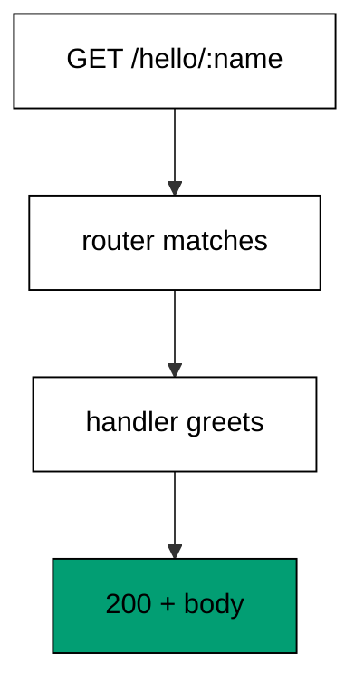

Pedestal 0.8 describes a service as a connector map: the port stays unbound for tests while `with-routes` installs the router and the path-params decoder. The `not-found` interceptor sits outside the router so misses become 404 responses instead of nils, which would crash the test chain. `jetty/create-connector` builds an unstarted connector, and `response-for` drives a full request through every interceptor with no socket, so the transcript is pure framework behaviour.

**`learning/code/ex-01-hello-route-returns-a-greeting/main.clj`**:

```clojure
;; => Ex-1: Hello Route Returns a Greeting.
;; => One route answers with a greeting; an unknown path answers 404.
;; => Silence framework logging so the transcript holds only our lines.
(System/setProperty "org.slf4j.simpleLogger.defaultLogLevel" "error") ;; => only errors reach the log
(System/setProperty "org.slf4j.simpleLogger.showDateTime" "false") ;; => no timestamps leak into output
(System/setProperty "org.slf4j.simpleLogger.showThreadName" "false") ;; => no thread names leak into output
(System/setProperty "org.slf4j.simpleLogger.showLogName" "false") ;; => no logger names leak into output
(System/setProperty "org.slf4j.simpleLogger.showShortLogName" "false") ;; => short names stay off too
;; => Load the connector stack: description, in-process tests, and Jetty.
(require '[io.pedestal.connector :as conn]) ;; => connector maps are the 0.8 service description
(require '[io.pedestal.connector.test :as t]) ;; => response-for tests with no socket
(require '[io.pedestal.http.jetty :as jetty]) ;; => create-connector builds the testable connector
(require '[io.pedestal.service.interceptors :as interceptors]) ;; => not-found turns misses into 404
;; => The handler reads the path parameter the router decoded.
(def greet (fn [request] ;; => one handler answers every greeting
             {:status 200 :body (str "hello " (get-in request [:path-params :name]))})) ;; => the param names the guest
;; => The route table is data: path, verb, handler, and name.
(def routes #{["/hello/:name" :get greet :route-name :hello]}) ;; => :name captures one path segment
;; => The connector map stacks cross-cutting interceptors under routing.
(def service (-> (conn/default-connector-map 8080) ;; => the port stays unbound; tests use no socket
                 (conn/with-interceptors [interceptors/not-found]) ;; => unknown paths answer 404 instead of nil
                 (conn/with-routes routes))) ;; => router plus path-params decoder join the chain
(def connector (jetty/create-connector service {})) ;; => the unstarted connector answers test requests
(println "body:" (:body (t/response-for connector :get "/hello/pedestal"))) ;; => Output: body: hello pedestal
(println "missing:" (:status (t/response-for connector :get "/missing"))) ;; => Output: missing: 404
```

**Output** (`learning/code/ex-01-hello-route-returns-a-greeting/expected/main.stdout.txt`):

```text
body: hello pedestal
missing: 404
```

**Key takeaway**: One table entry maps a verb plus a path to a handler, and `response-for` exercises it with no server running.

**Why it matters**: In-process tests run in milliseconds and never fight over ports, so the whole suite stays fast enough to run on every save. Teams that test through the real chain catch routing mistakes before deploy instead of after.

### Example 2: Two Methods Share One Path

One path serves many verbs, and the router picks the handler by method: `GET` reads the collection while `POST` appends to it. The program serves both verbs in-process and prints each status with its body. (Concepts: co-01.)

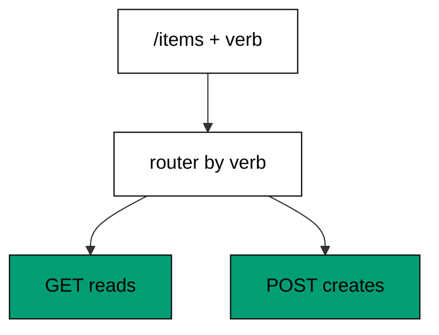

REST puts the noun in the path and the action in the verb, so one `/items` entry reads and another creates. Each table entry carries its own route name, which keeps link generation and logging distinct even when paths collide. The test calls both verbs and asserts the codes differ: reads answer 200, writes answer 201.

**`learning/code/ex-02-two-methods-share-one-path/main.clj`**:

```clojure
;; => Ex-2: Two Methods Share One Path.
;; => GET reads the collection while POST appends to it; the verb picks the handler.
;; => Silence framework logging so the transcript holds only our lines.
(System/setProperty "org.slf4j.simpleLogger.defaultLogLevel" "error") ;; => only errors reach the log
(System/setProperty "org.slf4j.simpleLogger.showDateTime" "false") ;; => no timestamps leak into output
(System/setProperty "org.slf4j.simpleLogger.showThreadName" "false") ;; => no thread names leak into output
(System/setProperty "org.slf4j.simpleLogger.showLogName" "false") ;; => no logger names leak into output
(System/setProperty "org.slf4j.simpleLogger.showShortLogName" "false") ;; => short names stay off too
;; => Load the connector stack: description, in-process tests, and Jetty.
(require '[io.pedestal.connector :as conn]) ;; => connector maps are the 0.8 service description
(require '[io.pedestal.connector.test :as t]) ;; => response-for tests with no socket
(require '[io.pedestal.http.jetty :as jetty]) ;; => create-connector builds the testable connector
(require '[io.pedestal.service.interceptors :as interceptors]) ;; => not-found turns misses into 404
;; => Two handlers share one path; the router dispatches on the verb.
(def list-items (fn [_] ;; => GET reads the whole collection
                  {:status 200 :body "item-1,item-2"})) ;; => the collection prints comma-separated
(def create-item (fn [_] ;; => POST appends one member
                   {:status 201 :body "created:item-3"})) ;; => 201 names the new member
;; => The route table holds two entries for the same path.
(def routes #{["/items" :get list-items :route-name :list-items] ;; => reads answer 200
              ["/items" :post create-item :route-name :create-item]}) ;; => writes answer 201
;; => The connector map stacks cross-cutting interceptors under routing.
(def service (-> (conn/default-connector-map 8080) ;; => the port stays unbound; tests use no socket
                 (conn/with-interceptors [interceptors/not-found]) ;; => unknown paths answer 404 instead of nil
                 (conn/with-routes routes))) ;; => router plus path-params decoder join the chain
(def connector (jetty/create-connector service {})) ;; => the unstarted connector answers test requests
(println "get:" (:status (t/response-for connector :get "/items"))) ;; => Output: get: 200
(println "get-body:" (:body (t/response-for connector :get "/items"))) ;; => Output: get-body: item-1,item-2
(println "post:" (:status (t/response-for connector :post "/items"))) ;; => Output: post: 201
(println "post-body:" (:body (t/response-for connector :post "/items"))) ;; => Output: post-body: created:item-3
```

**Output** (`learning/code/ex-02-two-methods-share-one-path/expected/main.stdout.txt`):

```text
get: 200
get-body: item-1,item-2
post: 201
post-body: created:item-3
```

**Key takeaway**: The verb is part of the route, so one path hosts a read handler and a write handler side by side.

**Why it matters**: Verb-based dispatch keeps URLs noun-shaped and cacheable while actions stay explicit. Mixing them into separate paths forks the API surface for no benefit.

### Example 3: Path Parameter Names a Resource

Dynamic segments capture values out of the path: `/users/42` binds `42` to `:id` and the handler reads it from `:path-params`. The program fetches two ids and proves the bare prefix misses. (Concepts: co-01, co-03.)

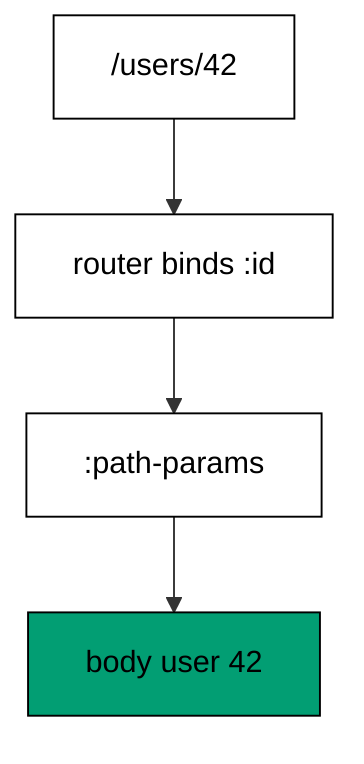

Path parameters name the resource the request acts on, which makes URLs addressable and logs greppable. The router decodes the segment before the handler runs, so handlers read a plain map instead of parsing strings. Anything the table does not declare, like the bare `/users` prefix, falls through to the 404 interceptor.

**`learning/code/ex-03-path-parameter-names-a-resource/main.clj`**:

```clojure
;; => Ex-3: Path Parameter Names a Resource.
;; => The :id segment arrives decoded in :path-params; the handler echoes it back.
;; => Silence framework logging so the transcript holds only our lines.
(System/setProperty "org.slf4j.simpleLogger.defaultLogLevel" "error") ;; => only errors reach the log
(System/setProperty "org.slf4j.simpleLogger.showDateTime" "false") ;; => no timestamps leak into output
(System/setProperty "org.slf4j.simpleLogger.showThreadName" "false") ;; => no thread names leak into output
(System/setProperty "org.slf4j.simpleLogger.showLogName" "false") ;; => no logger names leak into output
(System/setProperty "org.slf4j.simpleLogger.showShortLogName" "false") ;; => short names stay off too
;; => Load the connector stack: description, in-process tests, and Jetty.
(require '[io.pedestal.connector :as conn]) ;; => connector maps are the 0.8 service description
(require '[io.pedestal.connector.test :as t]) ;; => response-for tests with no socket
(require '[io.pedestal.http.jetty :as jetty]) ;; => create-connector builds the testable connector
(require '[io.pedestal.service.interceptors :as interceptors]) ;; => not-found turns misses into 404
;; => The handler reads the decoded segment straight from the request.
(def show-user (fn [request] ;; => one handler serves every user id
                 {:status 200 :body (str "user " (get-in request [:path-params :id]))})) ;; => :id holds the segment
;; => The route table captures the segment into :id.
(def routes #{["/users/:id" :get show-user :route-name :show-user]}) ;; => :id captures one segment
;; => The connector map stacks cross-cutting interceptors under routing.
(def service (-> (conn/default-connector-map 8080) ;; => the port stays unbound; tests use no socket
                 (conn/with-interceptors [interceptors/not-found]) ;; => unknown paths answer 404 instead of nil
                 (conn/with-routes routes))) ;; => router plus path-params decoder join the chain
(def connector (jetty/create-connector service {})) ;; => the unstarted connector answers test requests
(println "user-42:" (:body (t/response-for connector :get "/users/42"))) ;; => Output: user-42: user 42
(println "user-7:" (:body (t/response-for connector :get "/users/7"))) ;; => Output: user-7: user 7
(println "bare-users:" (:status (t/response-for connector :get "/users"))) ;; => Output: bare-users: 404
```

**Output** (`learning/code/ex-03-path-parameter-names-a-resource/expected/main.stdout.txt`):

```text
user-42: user 42
user-7: user 7
bare-users: 404
```

**Key takeaway**: Colon segments bind path values into `:path-params`, and handlers read them with plain map access.

**Why it matters**: Addressable URLs make every resource linkable, cacheable, and log-friendly. Query strings carry options; path segments name things.

### Example 4: Query String Carries Options

Options ride the query string: `/search?q=pedestal&limit=5` decodes into `:query-params` with keyword keys and string values. The program searches with options and without, proving defaults fill the gaps. (Concepts: co-01, co-03.)

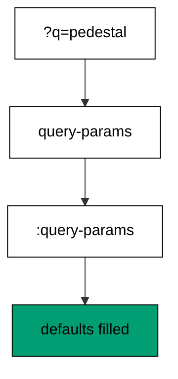

The `query-params` interceptor runs before routing and assoc's the decoded map into the request, so handlers never touch raw query strings. Missing keys get defaults at the read site with plain `get`, which keeps optionality visible instead of hiding it in middleware config. Percent-encoding and plus signs decode the standard Ring way.

**`learning/code/ex-04-query-string-carries-options/main.clj`**:

```clojure
;; => Ex-4: Query String Carries Options.
;; => The query-params interceptor decodes ?q= and ?limit= into :query-params.
;; => Silence framework logging so the transcript holds only our lines.
(System/setProperty "org.slf4j.simpleLogger.defaultLogLevel" "error") ;; => only errors reach the log
(System/setProperty "org.slf4j.simpleLogger.showDateTime" "false") ;; => no timestamps leak into output
(System/setProperty "org.slf4j.simpleLogger.showThreadName" "false") ;; => no thread names leak into output
(System/setProperty "org.slf4j.simpleLogger.showLogName" "false") ;; => no logger names leak into output
(System/setProperty "org.slf4j.simpleLogger.showShortLogName" "false") ;; => short names stay off too
;; => Load the connector stack plus the route namespace for query decoding.
(require '[io.pedestal.connector :as conn]) ;; => connector maps are the 0.8 service description
(require '[io.pedestal.connector.test :as t]) ;; => response-for tests with no socket
(require '[io.pedestal.http.jetty :as jetty]) ;; => create-connector builds the testable connector
(require '[io.pedestal.http.route :as route]) ;; => query-params decodes the query string
(require '[io.pedestal.service.interceptors :as interceptors]) ;; => not-found turns misses into 404
;; => The handler reads decoded options with keyword keys and string values.
(def search (fn [request] ;; => one handler serves every search
              (let [params (:query-params request)] ;; => decoded map, never the raw string
                {:status 200 :body (str "q=" (get params :q "none") ;; => missing q falls back to none
                                        " limit=" (get params :limit "10"))}))) ;; => missing limit falls back to 10
;; => The route table needs no query declaration; the interceptor does the work.
(def routes #{["/search" :get search :route-name :search]}) ;; => one entry serves every query
;; => The connector map decodes queries before routing runs the handler.
(def service (-> (conn/default-connector-map 8080) ;; => the port stays unbound; tests use no socket
                 (conn/with-interceptors [interceptors/not-found ;; => unknown paths answer 404 instead of nil
                                           route/query-params]) ;; => query string becomes :query-params
                 (conn/with-routes routes))) ;; => router plus path-params decoder join the chain
(def connector (jetty/create-connector service {})) ;; => the unstarted connector answers test requests
(println "full:" (:body (t/response-for connector :get "/search?q=pedestal&limit=5"))) ;; => Output: full: q=pedestal limit=5
(println "defaults:" (:body (t/response-for connector :get "/search"))) ;; => Output: defaults: q=none limit=10
```

**Output** (`learning/code/ex-04-query-string-carries-options/expected/main.stdout.txt`):

```text
full: q=pedestal limit=5
defaults: q=none limit=10
```

**Key takeaway**: The query-params interceptor turns the query string into a keyword map; handlers read options with defaults.

**Why it matters**: Options in the URL stay bookmarkable and log-visible, unlike bodies. Defaults at the read site document what omitted means right where it matters.

### Example 5: Named Routes Build URLs

Handlers should never hardcode paths, so named routes render links: the linker builds `/orders/42` from `:show-order` and its params. The program renders two links and follows one. (Concepts: co-01, co-11.)

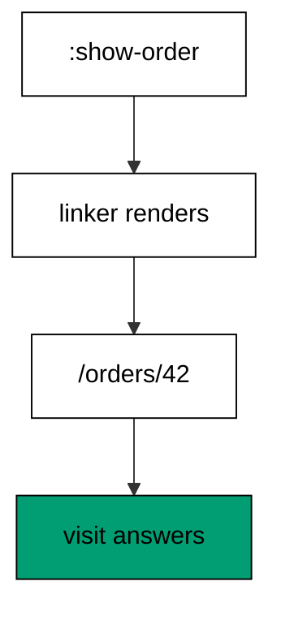

`url-for-routes` compiles the expanded table into a link function once, and every call fills path params by name. Renaming a path updates every link because no string is ever concatenated by hand. Links rendered from the same table the router serves cannot drift from it.

**`learning/code/ex-05-named-routes-build-urls/main.clj`**:

```clojure
;; => Ex-5: Named Routes Build URLs.
;; => url-for-routes renders a path from a route name and params; no string building.
;; => Silence framework logging so the transcript holds only our lines.
(System/setProperty "org.slf4j.simpleLogger.defaultLogLevel" "error") ;; => only errors reach the log
(System/setProperty "org.slf4j.simpleLogger.showDateTime" "false") ;; => no timestamps leak into output
(System/setProperty "org.slf4j.simpleLogger.showThreadName" "false") ;; => no thread names leak into output
(System/setProperty "org.slf4j.simpleLogger.showLogName" "false") ;; => no logger names leak into output
(System/setProperty "org.slf4j.simpleLogger.showShortLogName" "false") ;; => short names stay off too
;; => Load the connector stack plus the route namespace for link generation.
(require '[io.pedestal.connector :as conn]) ;; => connector maps are the 0.8 service description
(require '[io.pedestal.connector.test :as t]) ;; => response-for tests with no socket
(require '[io.pedestal.http.jetty :as jetty]) ;; => create-connector builds the testable connector
(require '[io.pedestal.http.route :as route]) ;; => url-for-routes renders links from names
(require '[io.pedestal.service.interceptors :as interceptors]) ;; => not-found turns misses into 404
;; => The handler answers one order; the linker below points at it by name.
(def show-order (fn [request] ;; => one handler serves every order id
                  {:status 200 :body (str "order " (get-in request [:path-params :id]))})) ;; => :id holds the segment
;; => Two named routes share the table the linker reads.
(def routes #{["/orders/:id" :get show-order :route-name :show-order] ;; => the link target
              ["/orders" :get (fn [_] {:status 200 :body "orders"}) :route-name :list-orders]}) ;; => the index page
;; => The linker renders paths from names, so renames update every link.
(def link (route/url-for-routes (route/expand-routes routes))) ;; => one linker covers the table
;; => The connector map stacks cross-cutting interceptors under routing.
(def service (-> (conn/default-connector-map 8080) ;; => the port stays unbound; tests use no socket
                 (conn/with-interceptors [interceptors/not-found]) ;; => unknown paths answer 404 instead of nil
                 (conn/with-routes routes))) ;; => router plus path-params decoder join the chain
(def connector (jetty/create-connector service {})) ;; => the unstarted connector answers test requests
(println "link:" (link :show-order :params {:id "42"})) ;; => Output: link: /orders/42
(println "index:" (link :list-orders)) ;; => Output: index: /orders
(println "visit:" (:body (t/response-for connector :get "/orders/42"))) ;; => Output: visit: order 42
```

**Output** (`learning/code/ex-05-named-routes-build-urls/expected/main.stdout.txt`):

```text
link: /orders/42
index: /orders
visit: order 42
```

**Key takeaway**: Route names plus params render correct paths, so links follow renames automatically.

**Why it matters**: Hand-built URL strings rot when paths change; generated links cannot disagree with the table. Location headers and API responses stay correct by construction.

### Example 6: Wildcard Serves Nested Paths

One route can serve a whole tree: a `/*path` segment swallows every remaining segment including slashes. The program fetches a deep file and a shallow one, then proves outside paths miss. (Concepts: co-01, co-11.)

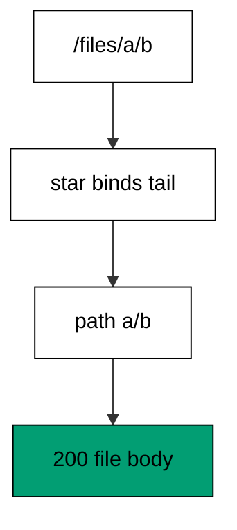

Wildcards trade precision for coverage: static assets, nested docs, and versioned prefixes collapse into one entry. The captured tail keeps its slashes so handlers can split it back into segments. Everything outside the prefix still misses, which keeps the blast radius of a greedy route visible.

**`learning/code/ex-06-wildcard-serves-nested-paths/main.clj`**:

```clojure
;; => Ex-6: Wildcard Serves Nested Paths.
;; => A /*path segment captures slashes, so one route serves a whole file tree.
;; => Silence framework logging so the transcript holds only our lines.
(System/setProperty "org.slf4j.simpleLogger.defaultLogLevel" "error") ;; => only errors reach the log
(System/setProperty "org.slf4j.simpleLogger.showDateTime" "false") ;; => no timestamps leak into output
(System/setProperty "org.slf4j.simpleLogger.showThreadName" "false") ;; => no thread names leak into output
(System/setProperty "org.slf4j.simpleLogger.showLogName" "false") ;; => no logger names leak into output
(System/setProperty "org.slf4j.simpleLogger.showShortLogName" "false") ;; => short names stay off too
;; => Load the connector stack: description, in-process tests, and Jetty.
(require '[io.pedestal.connector :as conn]) ;; => connector maps are the 0.8 service description
(require '[io.pedestal.connector.test :as t]) ;; => response-for tests with no socket
(require '[io.pedestal.http.jetty :as jetty]) ;; => create-connector builds the testable connector
(require '[io.pedestal.service.interceptors :as interceptors]) ;; => not-found turns misses into 404
;; => The handler echoes the captured tail, slashes included.
(def serve-file (fn [request] ;; => one handler serves the whole tree
                  {:status 200 :body (str "file:" (get-in request [:path-params :path]))})) ;; => :path keeps slashes
;; => The star makes :path swallow every remaining segment.
(def routes #{["/files/*path" :get serve-file :route-name :serve-file]}) ;; => one entry covers the tree
;; => The connector map stacks cross-cutting interceptors under routing.
(def service (-> (conn/default-connector-map 8080) ;; => the port stays unbound; tests use no socket
                 (conn/with-interceptors [interceptors/not-found]) ;; => unknown paths answer 404 instead of nil
                 (conn/with-routes routes))) ;; => router plus path-params decoder join the chain
(def connector (jetty/create-connector service {})) ;; => the unstarted connector answers test requests
(println "deep:" (:body (t/response-for connector :get "/files/docs/guide/intro.md"))) ;; => Output: deep: file:docs/guide/intro.md
(println "shallow:" (:body (t/response-for connector :get "/files/readme.txt"))) ;; => Output: shallow: file:readme.txt
(println "outside:" (:status (t/response-for connector :get "/other/readme.txt"))) ;; => Output: outside: 404
```

**Output** (`learning/code/ex-06-wildcard-serves-nested-paths/expected/main.stdout.txt`):

```text
deep: file:docs/guide/intro.md
shallow: file:readme.txt
outside: 404
```

**Key takeaway**: Star segments capture slash-containing tails, so one entry serves arbitrarily deep trees.

**Why it matters**: Greedy routes collapse whole subtrees into one handler, but only inside their prefix. Reach for them for files and nested docs, and prefer exact segments for resources.

### Example 7: Handler Constrains Numeric Ids

Pedestal matches path shapes, not value rules, so the handler enforces the constraint: digits read the record while words get a 400. The program fetches a numeric id and two bad ones. (Concepts: co-10.)

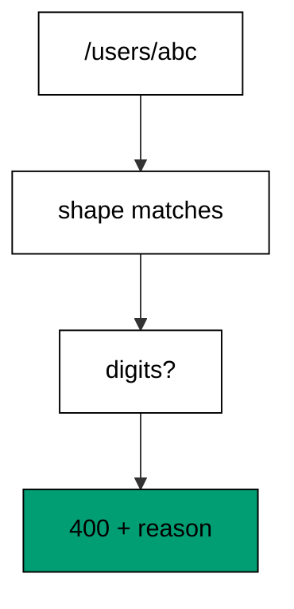

Keeping value rules in the handler has a payoff: the rejection carries a message naming the bad value, which no router-level constraint can produce. The regex gate reads as one line and fails closed on anything non-numeric. Malformed input becomes a 400 with a reason, never a 500 from a parse throw.

**`learning/code/ex-07-handler-constrains-numeric-ids/main.clj`**:

```clojure
;; => Ex-7: Handler Constrains Numeric Ids.
;; => Pedestal matches path shapes; value rules live in the handler, which rejects words with 400.
;; => Silence framework logging so the transcript holds only our lines.
(System/setProperty "org.slf4j.simpleLogger.defaultLogLevel" "error") ;; => only errors reach the log
(System/setProperty "org.slf4j.simpleLogger.showDateTime" "false") ;; => no timestamps leak into output
(System/setProperty "org.slf4j.simpleLogger.showThreadName" "false") ;; => no thread names leak into output
(System/setProperty "org.slf4j.simpleLogger.showLogName" "false") ;; => no logger names leak into output
(System/setProperty "org.slf4j.simpleLogger.showShortLogName" "false") ;; => short names stay off too
;; => Load the connector stack: description, in-process tests, and Jetty.
(require '[io.pedestal.connector :as conn]) ;; => connector maps are the 0.8 service description
(require '[io.pedestal.connector.test :as t]) ;; => response-for tests with no socket
(require '[io.pedestal.http.jetty :as jetty]) ;; => create-connector builds the testable connector
(require '[io.pedestal.service.interceptors :as interceptors]) ;; => not-found turns misses into 404
;; => The handler accepts digits and rejects everything else with a 400.
(def show-user (fn [request] ;; => one handler guards every id
                 (let [id (get-in request [:path-params :id])] ;; => the raw segment, still a string
                   (if (re-matches #"[0-9]+" id) ;; => digits pass, words fail
                     {:status 200 :body (str "user " id)} ;; => numeric ids read the record
                     {:status 400 :body (str "id must be numeric: " id)})))) ;; => words get a 400, not a 500
;; => The route captures the segment; the handler constrains its value.
(def routes #{["/users/:id" :get show-user :route-name :show-user]}) ;; => shape matches, value checked inside
;; => The connector map stacks cross-cutting interceptors under routing.
(def service (-> (conn/default-connector-map 8080) ;; => the port stays unbound; tests use no socket
                 (conn/with-interceptors [interceptors/not-found]) ;; => unknown paths answer 404 instead of nil
                 (conn/with-routes routes))) ;; => router plus path-params decoder join the chain
(def connector (jetty/create-connector service {})) ;; => the unstarted connector answers test requests
(println "numeric:" (:body (t/response-for connector :get "/users/42"))) ;; => Output: numeric: user 42
(println "word-status:" (:status (t/response-for connector :get "/users/abc"))) ;; => Output: word-status: 400
(println "word-body:" (:body (t/response-for connector :get "/users/abc"))) ;; => Output: word-body: id must be numeric: abc
```

**Output** (`learning/code/ex-07-handler-constrains-numeric-ids/expected/main.stdout.txt`):

```text
numeric: user 42
word-status: 400
word-body: id must be numeric: abc
```

**Key takeaway**: Routers match shapes; handlers enforce value rules and answer 400 with the reason.

**Why it matters**: A 400 with a reason tells the caller exactly what to fix, while a 500 blames the server for client input. Fail closed on shape, explain on value.

### Example 8: Verb Table Covers Seven Verbs

One resource speaks seven verbs, each with its own entry: reads, writes, replaces, merges, deletes, plus `HEAD` and `OPTIONS`. The program calls five verbs and prints the answers plus the `HEAD` status. (Concepts: co-01.)

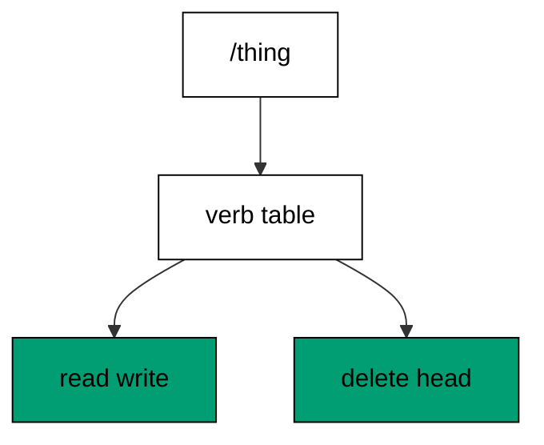

Listing every verb the resource speaks turns the table into living documentation: reviewers see the full protocol in one set. `HEAD` mirrors `GET` headers without a body, and `OPTIONS` names the allowed verbs for CORS preflights and API explorers. Verbs the table omits miss with 404, which proves the table is the whole protocol.

**`learning/code/ex-08-verb-table-covers-seven-verbs/main.clj`**:

```clojure
;; => Ex-8: Verb Table Covers Seven Verbs.
;; => One resource answers GET, POST, PUT, PATCH, DELETE, HEAD, and OPTIONS distinctly.
;; => Silence framework logging so the transcript holds only our lines.
(System/setProperty "org.slf4j.simpleLogger.defaultLogLevel" "error") ;; => only errors reach the log
(System/setProperty "org.slf4j.simpleLogger.showDateTime" "false") ;; => no timestamps leak into output
(System/setProperty "org.slf4j.simpleLogger.showThreadName" "false") ;; => no thread names leak into output
(System/setProperty "org.slf4j.simpleLogger.showLogName" "false") ;; => no logger names leak into output
(System/setProperty "org.slf4j.simpleLogger.showShortLogName" "false") ;; => short names stay off too
;; => Load the connector stack: description, in-process tests, and Jetty.
(require '[io.pedestal.connector :as conn]) ;; => connector maps are the 0.8 service description
(require '[io.pedestal.connector.test :as t]) ;; => response-for tests with no socket
(require '[io.pedestal.http.jetty :as jetty]) ;; => create-connector builds the testable connector
(require '[io.pedestal.service.interceptors :as interceptors]) ;; => not-found turns misses into 404
;; => One tiny handler per verb keeps the table readable.
(def answer (fn [word] ;; => one factory builds every verb handler
              (fn [_] {:status 200 :body word}))) ;; => each verb answers its own word
;; => The table spells every verb the resource speaks.
(def routes #{["/thing" :get (answer "got") :route-name :thing-get] ;; => reads answer got
              ["/thing" :post (answer "posted") :route-name :thing-post] ;; => creates answer posted
              ["/thing" :put (answer "put") :route-name :thing-put] ;; => replaces answer put
              ["/thing" :patch (answer "patched") :route-name :thing-patch] ;; => merges answer patched
              ["/thing" :delete (answer "deleted") :route-name :thing-delete] ;; => removes answer deleted
              ["/thing" :head (answer "got") :route-name :thing-head] ;; => HEAD mirrors GET headers
              ["/thing" :options (answer "allowed") :route-name :thing-options]}) ;; => OPTIONS names the verbs
;; => The connector map stacks cross-cutting interceptors under routing.
(def service (-> (conn/default-connector-map 8080) ;; => the port stays unbound; tests use no socket
                 (conn/with-interceptors [interceptors/not-found]) ;; => unknown verbs answer 404 instead of nil
                 (conn/with-routes routes))) ;; => router plus path-params decoder join the chain
(def connector (jetty/create-connector service {})) ;; => the unstarted connector answers test requests
(println "verbs:" (pr-str (mapv #(:body (t/response-for connector % "/thing")) [:get :post :put :patch :delete]))) ;; => Output: verbs: ["got" "posted" "put" "patched" "deleted"]
(println "head:" (:status (t/response-for connector :head "/thing"))) ;; => Output: head: 200
(println "options:" (:body (t/response-for connector :options "/thing"))) ;; => Output: options: allowed
```

**Output** (`learning/code/ex-08-verb-table-covers-seven-verbs/expected/main.stdout.txt`):

```text
verbs: ["got" "posted" "put" "patched" "deleted"]
head: 200
options: allowed
```

**Key takeaway**: Every verb the resource speaks gets its own named entry; omitted verbs miss with 404.

**Why it matters**: An explicit verb table is a contract reviewers can audit. Implicit verb handling hides supported operations until callers discover them by accident.

### Example 9: Query Params Arrive Decoded

Encoding stays out of handlers: `%26` becomes `&`, plus signs become spaces, and the decoded map prints with sorted keys. The program echoes a tricky query and an empty one. (Concepts: co-03.)

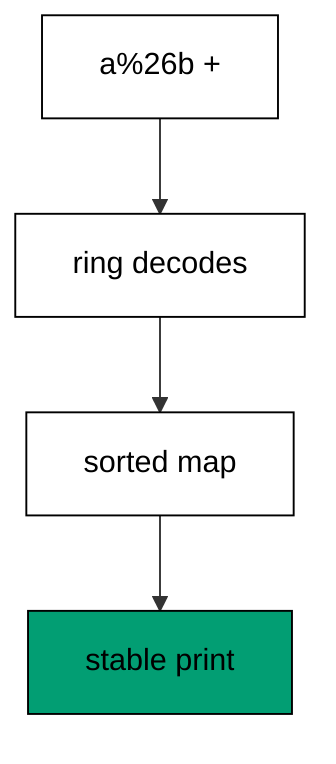

Printing with `into (sorted-map)` makes the transcript order-independent: map iteration order never leaks into output. Tests that print raw maps flake when key order shifts across runs or JVM versions; sorted keys print the same bytes every time. Determinism is a test design choice, not luck.

**`learning/code/ex-09-query-params-arrive-decoded/main.clj`**:

```clojure
;; => Ex-9: Query Params Arrive Decoded.
;; => Percent-encoding and plus signs decode; repeated keys keep the last value.
;; => Silence framework logging so the transcript holds only our lines.
(System/setProperty "org.slf4j.simpleLogger.defaultLogLevel" "error") ;; => only errors reach the log
(System/setProperty "org.slf4j.simpleLogger.showDateTime" "false") ;; => no timestamps leak into output
(System/setProperty "org.slf4j.simpleLogger.showThreadName" "false") ;; => no thread names leak into output
(System/setProperty "org.slf4j.simpleLogger.showLogName" "false") ;; => no logger names leak into output
(System/setProperty "org.slf4j.simpleLogger.showShortLogName" "false") ;; => short names stay off too
;; => Load the connector stack plus the route namespace for query decoding.
(require '[io.pedestal.connector :as conn]) ;; => connector maps are the 0.8 service description
(require '[io.pedestal.connector.test :as t]) ;; => response-for tests with no socket
(require '[io.pedestal.http.jetty :as jetty]) ;; => create-connector builds the testable connector
(require '[io.pedestal.http.route :as route]) ;; => query-params decodes the query string
(require '[io.pedestal.service.interceptors :as interceptors]) ;; => not-found turns misses into 404
;; => The handler prints the decoded map with sorted keys for stability.
(def echo-params (fn [request] ;; => one handler mirrors the query back
                   {:status 200 :body (pr-str (into (sorted-map) (:query-params request)))})) ;; => sorted keys print stable
;; => The route table needs no query declaration; the interceptor does the work.
(def routes #{["/echo" :get echo-params :route-name :echo-params]}) ;; => one entry mirrors every query
;; => The connector map decodes queries before routing runs the handler.
(def service (-> (conn/default-connector-map 8080) ;; => the port stays unbound; tests use no socket
                 (conn/with-interceptors [interceptors/not-found ;; => unknown paths answer 404 instead of nil
                                           route/query-params]) ;; => query string becomes :query-params
                 (conn/with-routes routes))) ;; => router plus path-params decoder join the chain
(def connector (jetty/create-connector service {})) ;; => the unstarted connector answers test requests
(println "decoded:" (:body (t/response-for connector :get "/echo?name=ada+lovelace&tag=a%26b"))) ;; => Output: decoded: {:name "ada lovelace", :tag "a&b"}
(println "empty:" (:body (t/response-for connector :get "/echo"))) ;; => Output: empty: {}
```

**Output** (`learning/code/ex-09-query-params-arrive-decoded/expected/main.stdout.txt`):

```text
decoded: {:name "ada lovelace", :tag "a&b"}
empty: {}
```

**Key takeaway**: Sorted maps print decoded queries in stable order, so transcripts never flake.

**Why it matters**: Nondeterministic test output trains teams to ignore failures. Sorting at the print site costs one call and buys byte-stable transcripts forever.

### Example 10: Form Body Reads Fields

HTML forms post urlencoded bodies, and the handler splits them into a field map itself. The program submits a signup form and proves `GET` on the form target misses. (Concepts: co-03.)

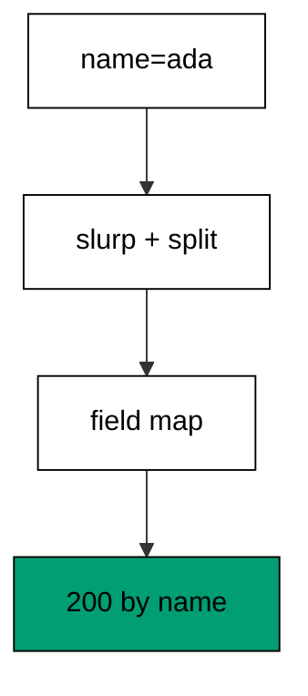

Reading the body explicitly shows what form parsing does: slurp the stream, split on `&`, split each pair on the first `=`. Small services can own this in ten lines; larger ones graduate to the `body-params` interceptor. Either way the handler reads fields by name, never positions.

**`learning/code/ex-10-form-body-reads-fields/main.clj`**:

```clojure
;; => Ex-10: Form Body Reads Fields.
;; => A urlencoded POST body parses into fields the handler reads by name.
;; => Silence framework logging so the transcript holds only our lines.
(System/setProperty "org.slf4j.simpleLogger.defaultLogLevel" "error") ;; => only errors reach the log
(System/setProperty "org.slf4j.simpleLogger.showDateTime" "false") ;; => no timestamps leak into output
(System/setProperty "org.slf4j.simpleLogger.showThreadName" "false") ;; => no thread names leak into output
(System/setProperty "org.slf4j.simpleLogger.showLogName" "false") ;; => no logger names leak into output
(System/setProperty "org.slf4j.simpleLogger.showShortLogName" "false") ;; => short names stay off too
;; => Load the connector stack: description, in-process tests, and Jetty.
(require '[io.pedestal.connector :as conn]) ;; => connector maps are the 0.8 service description
(require '[io.pedestal.connector.test :as t]) ;; => response-for tests with no socket
(require '[io.pedestal.http.jetty :as jetty]) ;; => create-connector builds the testable connector
(require '[io.pedestal.service.interceptors :as interceptors]) ;; => not-found turns misses into 404
(require '[clojure.string :as str]) ;; => split parses the urlencoded pairs
;; => The handler slurps the raw body and splits fields itself, explicitly.
(def signup (fn [request] ;; => one handler reads the signup form
              (let [pairs (-> (:body request) ;; => the body arrives as a stream
                              slurp ;; => read the urlencoded string
                              (str/split #"&")) ;; => split into key=value pairs
                    fields (into {} (map #(str/split % #"=" 2) pairs))] ;; => map names to values
                {:status 200 :body (str "name=" (get fields "name") " plan=" (get fields "plan"))}))) ;; => fields by name
;; => The route table declares the POST the form submits to.
(def routes #{["/signup" :post signup :route-name :signup]}) ;; => one entry reads the form
;; => The connector map stacks cross-cutting interceptors under routing.
(def service (-> (conn/default-connector-map 8080) ;; => the port stays unbound; tests use no socket
                 (conn/with-interceptors [interceptors/not-found]) ;; => unknown paths answer 404 instead of nil
                 (conn/with-routes routes))) ;; => router plus path-params decoder join the chain
(def connector (jetty/create-connector service {})) ;; => the unstarted connector answers test requests
(println "signup:" (:body (t/response-for connector :post "/signup" :body "name=ada&plan=team"))) ;; => Output: signup: name=ada plan=team
(println "get-rejected:" (:status (t/response-for connector :get "/signup"))) ;; => Output: get-rejected: 404
```

**Output** (`learning/code/ex-10-form-body-reads-fields/expected/main.stdout.txt`):

```text
signup: name=ada plan=team
get-rejected: 404
```

**Key takeaway**: Form bodies are streams the handler slurps and splits; only the declared verb serves them.

**Why it matters**: Knowing the parsing steps by heart makes `body-params` a convenience instead of magic. When parsing breaks, the owner reads the ten lines instead of guessing.

### Example 11: Edn Body Becomes Data

EDN is Clojure's native wire format: the handler slurps the body and `read-string`s it into data with types intact. The program creates two orders and prints each status. (Concepts: co-03, co-15.)

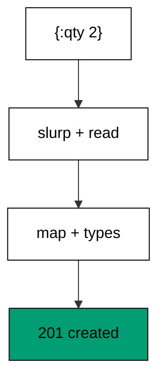

`clojure.edn/read-string` parses the safe EDN subset without evaluating code, unlike `read`. Numbers arrive as numbers and keywords as keywords, so handlers skip the stringly-typed conversions JSON forces. The `Content-Type` header documents the format; the test sends it to prove headers ride along.

**`learning/code/ex-11-edn-body-becomes-data/main.clj`**:

```clojure
;; => Ex-11: Edn Body Becomes Data.
;; => The handler slurps the body and reads EDN into Clojure data with clojure.edn.
;; => Silence framework logging so the transcript holds only our lines.
(System/setProperty "org.slf4j.simpleLogger.defaultLogLevel" "error") ;; => only errors reach the log
(System/setProperty "org.slf4j.simpleLogger.showDateTime" "false") ;; => no timestamps leak into output
(System/setProperty "org.slf4j.simpleLogger.showThreadName" "false") ;; => no thread names leak into output
(System/setProperty "org.slf4j.simpleLogger.showLogName" "false") ;; => no logger names leak into output
(System/setProperty "org.slf4j.simpleLogger.showShortLogName" "false") ;; => short names stay off too
;; => Load the connector stack plus EDN reading from Clojure core.
(require '[io.pedestal.connector :as conn]) ;; => connector maps are the 0.8 service description
(require '[io.pedestal.connector.test :as t]) ;; => response-for tests with no socket
(require '[io.pedestal.http.jetty :as jetty]) ;; => create-connector builds the testable connector
(require '[clojure.edn :as edn]) ;; => read-string parses EDN safely
(require '[io.pedestal.service.interceptors :as interceptors]) ;; => not-found turns misses into 404
;; => The handler parses the body into a map, then reads typed values from it.
(def create-order (fn [request] ;; => one handler creates orders from EDN
                    (let [order (-> (:body request) ;; => the body arrives as a stream
                                    slurp ;; => read the EDN text
                                    edn/read-string)] ;; => parse into Clojure data
                      {:status 201 :body (str "order sku=" (:sku order) ;; => keywords address fields
                                              " qty=" (:qty order))}))) ;; => values keep their types
;; => The route table declares the POST that carries EDN.
(def routes #{["/orders" :post create-order :route-name :create-order]}) ;; => one entry parses EDN
;; => The connector map stacks cross-cutting interceptors under routing.
(def service (-> (conn/default-connector-map 8080) ;; => the port stays unbound; tests use no socket
                 (conn/with-interceptors [interceptors/not-found]) ;; => unknown paths answer 404 instead of nil
                 (conn/with-routes routes))) ;; => router plus path-params decoder join the chain
(def connector (jetty/create-connector service {})) ;; => the unstarted connector answers test requests
(println "created:" (:body (t/response-for connector :post "/orders" :headers {"Content-Type" "application/edn"} :body "{:sku \"book\" :qty 2}"))) ;; => Output: created: order sku=book qty=2
(println "status:" (:status (t/response-for connector :post "/orders" :headers {"Content-Type" "application/edn"} :body "{:sku \"pen\" :qty 5}"))) ;; => Output: status: 201
```

**Output** (`learning/code/ex-11-edn-body-becomes-data/expected/main.stdout.txt`):

```text
created: order sku=book qty=2
status: 201
```

**Key takeaway**: EDN bodies parse into typed Clojure data with one slurp plus `read-string`.

**Why it matters**: Type-preserving formats delete whole classes of conversion bugs between services. EDN between Clojure services keeps numbers numeric end to end.

### Example 12: Headers Guide the Handler

Headers carry request metadata: the handler reads `x-request-id` by string name and echoes it in both body and response. The program calls with an id and without. (Concepts: co-03.)


Header names are case-insensitive on the wire but arrive lowercased in the Ring map, so handlers always read lowercase strings. Echoing the request id back lets callers correlate their logs with server logs across service boundaries. The anonymous fallback keeps the endpoint usable without the header.

**`learning/code/ex-12-headers-guide-the-handler/main.clj`**:

```clojure
;; => Ex-12: Headers Guide the Handler.
;; => The handler reads request headers by string name and echoes the request id back.
;; => Silence framework logging so the transcript holds only our lines.
(System/setProperty "org.slf4j.simpleLogger.defaultLogLevel" "error") ;; => only errors reach the log
(System/setProperty "org.slf4j.simpleLogger.showDateTime" "false") ;; => no timestamps leak into output
(System/setProperty "org.slf4j.simpleLogger.showThreadName" "false") ;; => no thread names leak into output
(System/setProperty "org.slf4j.simpleLogger.showLogName" "false") ;; => no logger names leak into output
(System/setProperty "org.slf4j.simpleLogger.showShortLogName" "false") ;; => short names stay off too
;; => Load the connector stack: description, in-process tests, and Jetty.
(require '[io.pedestal.connector :as conn]) ;; => connector maps are the 0.8 service description
(require '[io.pedestal.connector.test :as t]) ;; => response-for tests with no socket
(require '[io.pedestal.http.jetty :as jetty]) ;; => create-connector builds the testable connector
(require '[io.pedestal.service.interceptors :as interceptors]) ;; => not-found turns misses into 404
;; => The handler answers with the caller's id, or anonymous when absent.
(def whoami (fn [request] ;; => one handler reports the caller
               (let [id (get-in request [:headers "x-request-id"] "anonymous")] ;; => headers use string names
                 {:status 200 :body (str "you-are:" id) ;; => the id rides the body home
                  :headers {"x-request-id" id}}))) ;; => the id echoes in a response header
;; => The route table declares the identity endpoint.
(def routes #{["/whoami" :get whoami :route-name :whoami]}) ;; => one entry reports the caller
;; => The connector map stacks cross-cutting interceptors under routing.
(def service (-> (conn/default-connector-map 8080) ;; => the port stays unbound; tests use no socket
                 (conn/with-interceptors [interceptors/not-found]) ;; => unknown paths answer 404 instead of nil
                 (conn/with-routes routes))) ;; => router plus path-params decoder join the chain
(def connector (jetty/create-connector service {})) ;; => the unstarted connector answers test requests
(println "with-id:" (:body (t/response-for connector :get "/whoami" :headers {"x-request-id" "req-1"}))) ;; => Output: with-id: you-are:req-1
(println "echoed:" (get (:headers (t/response-for connector :get "/whoami" :headers {"x-request-id" "req-1"})) "x-request-id")) ;; => Output: echoed: req-1
(println "anon:" (:body (t/response-for connector :get "/whoami"))) ;; => Output: anon: you-are:anonymous
```

**Output** (`learning/code/ex-12-headers-guide-the-handler/expected/main.stdout.txt`):

```text
with-id: you-are:req-1
echoed: req-1
anon: you-are:anonymous
```

**Key takeaway**: Headers arrive as lowercase string keys; handlers read them with defaults and echo ids back.

**Why it matters**: Request ids stitch distributed traces together across services. Echoing them costs one header and pays back every debugging session.

### Example 13: Missing Field Rejects with 400

Presence comes before meaning: the handler checks for the name field before reading anything else and answers 400 naming it when absent. The program creates one valid user and rejects one bad body. (Concepts: co-10.)

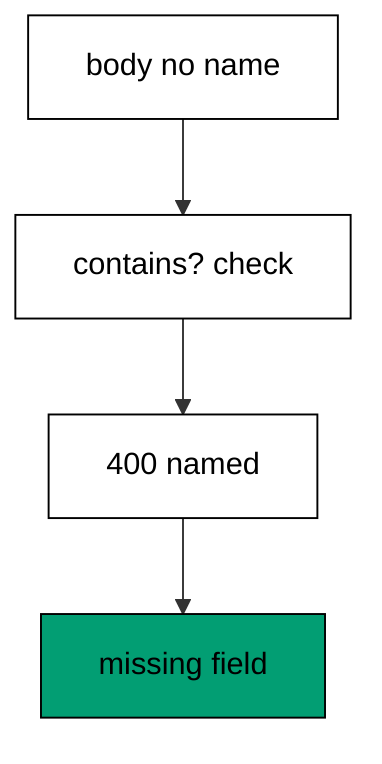

`contains?` distinguishes a missing key from a present-but-nil one, which matters when null is a legal value. Naming the missing field in the 400 body turns the error into a fix instruction. Presence checks run first because every later rule assumes the field exists.

**`learning/code/ex-13-missing-field-rejects-with-400/main.clj`**:

```clojure
;; => Ex-13: Missing Field Rejects with 400.
;; => The handler requires a name field and answers 400 naming it when absent.
;; => Silence framework logging so the transcript holds only our lines.
(System/setProperty "org.slf4j.simpleLogger.defaultLogLevel" "error") ;; => only errors reach the log
(System/setProperty "org.slf4j.simpleLogger.showDateTime" "false") ;; => no timestamps leak into output
(System/setProperty "org.slf4j.simpleLogger.showThreadName" "false") ;; => no thread names leak into output
(System/setProperty "org.slf4j.simpleLogger.showLogName" "false") ;; => no logger names leak into output
(System/setProperty "org.slf4j.simpleLogger.showShortLogName" "false") ;; => short names stay off too
;; => Load the connector stack plus EDN reading from Clojure core.
(require '[io.pedestal.connector :as conn]) ;; => connector maps are the 0.8 service description
(require '[io.pedestal.connector.test :as t]) ;; => response-for tests with no socket
(require '[io.pedestal.http.jetty :as jetty]) ;; => create-connector builds the testable connector
(require '[clojure.edn :as edn]) ;; => read-string parses EDN safely
(require '[io.pedestal.service.interceptors :as interceptors]) ;; => not-found turns misses into 404
;; => The handler validates presence before touching any other field.
(def create-user (fn [request] ;; => one handler guards user creation
                   (let [user (-> (:body request) ;; => the body arrives as a stream
                                  slurp ;; => read the EDN text
                                  edn/read-string)] ;; => parse into Clojure data
                     (if (contains? user :name) ;; => presence is the first gate
                       {:status 201 :body (str "user " (:name user))} ;; => present names create users
                       {:status 400 :body "missing field: name"})))) ;; => absent names get a named 400
;; => The route table declares the guarded POST.
(def routes #{["/users" :post create-user :route-name :create-user]}) ;; => one entry validates first
;; => The connector map stacks cross-cutting interceptors under routing.
(def service (-> (conn/default-connector-map 8080) ;; => the port stays unbound; tests use no socket
                 (conn/with-interceptors [interceptors/not-found]) ;; => unknown paths answer 404 instead of nil
                 (conn/with-routes routes))) ;; => router plus path-params decoder join the chain
(def connector (jetty/create-connector service {})) ;; => the unstarted connector answers test requests
(println "ok:" (:body (t/response-for connector :post "/users" :body "{:name \"ada\"}"))) ;; => Output: ok: user ada
(println "rejected:" (:status (t/response-for connector :post "/users" :body "{:plan \"team\"}"))) ;; => Output: rejected: 400
(println "why:" (:body (t/response-for connector :post "/users" :body "{:plan \"team\"}"))) ;; => Output: why: missing field: name
```

**Output** (`learning/code/ex-13-missing-field-rejects-with-400/expected/main.stdout.txt`):

```text
ok: user ada
rejected: 400
why: missing field: name
```

**Key takeaway**: Validate presence first with `contains?`; absent fields get a named 400.

**Why it matters**: Fail-fast presence checks keep later rules simple: they can assume the field exists. Named errors turn rejections into instructions.

### Example 14: Wrong Type Rejects with 422

Presence is not enough: the handler checks that `qty` is a positive number and answers 422 with the offending value. The program sends a valid quantity, a word, and a negative. (Concepts: co-10, co-15.)

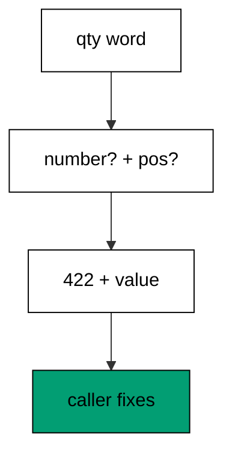

400 means the request is malformed; 422 means it parses but the values make no sense. Echoing the bad value with `pr-str` shows its type, so `"many"` reads as a string problem and `-1` as a range problem. Type checks sit in the handler because they describe the domain, not the transport.

**`learning/code/ex-14-wrong-type-rejects-with-422/main.clj`**:

```clojure
;; => Ex-14: Wrong Type Rejects with 422.
;; => The handler checks that qty is a positive number, else answers 422 with the reason.
;; => Silence framework logging so the transcript holds only our lines.
(System/setProperty "org.slf4j.simpleLogger.defaultLogLevel" "error") ;; => only errors reach the log
(System/setProperty "org.slf4j.simpleLogger.showDateTime" "false") ;; => no timestamps leak into output
(System/setProperty "org.slf4j.simpleLogger.showThreadName" "false") ;; => no thread names leak into output
(System/setProperty "org.slf4j.simpleLogger.showLogName" "false") ;; => no logger names leak into output
(System/setProperty "org.slf4j.simpleLogger.showShortLogName" "false") ;; => short names stay off too
;; => Load the connector stack plus EDN reading from Clojure core.
(require '[io.pedestal.connector :as conn]) ;; => connector maps are the 0.8 service description
(require '[io.pedestal.connector.test :as t]) ;; => response-for tests with no socket
(require '[io.pedestal.http.jetty :as jetty]) ;; => create-connector builds the testable connector
(require '[clojure.edn :as edn]) ;; => read-string parses EDN safely
(require '[io.pedestal.service.interceptors :as interceptors]) ;; => not-found turns misses into 404
;; => The handler validates the type before computing with the value.
(def add-line (fn [request] ;; => one handler guards line quantities
                (let [line (-> (:body request) ;; => the body arrives as a stream
                               slurp ;; => read the EDN text
                               edn/read-string) ;; => parse into Clojure data
                      qty (:qty line)] ;; => the value under test
                  (if (and (number? qty) (pos? qty)) ;; => numbers above zero pass
                    {:status 201 :body (str "qty " qty)} ;; => valid quantities create lines
                    {:status 422 :body (str "qty must be a positive number: " (pr-str qty))})))) ;; => anything else gets 422
;; => The route table declares the guarded POST.
(def routes #{["/lines" :post add-line :route-name :add-line]}) ;; => one entry checks types
;; => The connector map stacks cross-cutting interceptors under routing.
(def service (-> (conn/default-connector-map 8080) ;; => the port stays unbound; tests use no socket
                 (conn/with-interceptors [interceptors/not-found]) ;; => unknown paths answer 404 instead of nil
                 (conn/with-routes routes))) ;; => router plus path-params decoder join the chain
(def connector (jetty/create-connector service {})) ;; => the unstarted connector answers test requests
(println "ok:" (:body (t/response-for connector :post "/lines" :body "{:qty 3}"))) ;; => Output: ok: qty 3
(println "word:" (:body (t/response-for connector :post "/lines" :body "{:qty \"many\"}"))) ;; => Output: word: qty must be a positive number: "many"
(println "word-status:" (:status (t/response-for connector :post "/lines" :body "{:qty \"many\"}"))) ;; => Output: word-status: 422
(println "negative:" (:body (t/response-for connector :post "/lines" :body "{:qty -1}"))) ;; => Output: negative: qty must be a positive number: -1
```

**Output** (`learning/code/ex-14-wrong-type-rejects-with-422/expected/main.stdout.txt`):

```text
ok: qty 3
word: qty must be a positive number: "many"
word-status: 422
negative: qty must be a positive number: -1
```

**Key takeaway**: Type and range rules answer 422 with the bad value echoed, so callers see the type mistake.

**Why it matters**: 400 versus 422 tells the caller whether the shape or the meaning broke. Precise codes route fixes to the right layer without reading server logs.

### Example 15: Extra Fields Are Ignored

Clients send more than the API needs; the handler allowlists known keys with `select-keys` and drops the rest. The program posts a body with a smuggled admin flag and one without. (Concepts: co-10.)

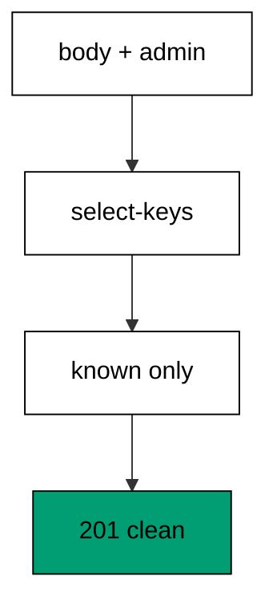

Allowlists fail closed on new fields: a client typo becomes a missing field instead of a stored surprise, and mass-assignment attacks bounce off the handler. Denylists fail open because every new field is trusted until someone remembers to block it. The one-line `select-keys` is the whole policy.

**`learning/code/ex-15-extra-fields-are-ignored/main.clj`**:

```clojure
;; => Ex-15: Extra Fields Are Ignored.
;; => The handler picks an allowlist from the body, so unknown fields never leak through.
;; => Silence framework logging so the transcript holds only our lines.
(System/setProperty "org.slf4j.simpleLogger.defaultLogLevel" "error") ;; => only errors reach the log
(System/setProperty "org.slf4j.simpleLogger.showDateTime" "false") ;; => no timestamps leak into output
(System/setProperty "org.slf4j.simpleLogger.showThreadName" "false") ;; => no thread names leak into output
(System/setProperty "org.slf4j.simpleLogger.showLogName" "false") ;; => no logger names leak into output
(System/setProperty "org.slf4j.simpleLogger.showShortLogName" "false") ;; => short names stay off too
;; => Load the connector stack plus EDN reading from Clojure core.
(require '[io.pedestal.connector :as conn]) ;; => connector maps are the 0.8 service description
(require '[io.pedestal.connector.test :as t]) ;; => response-for tests with no socket
(require '[io.pedestal.http.jetty :as jetty]) ;; => create-connector builds the testable connector
(require '[clojure.edn :as edn]) ;; => read-string parses EDN safely
(require '[io.pedestal.service.interceptors :as interceptors]) ;; => not-found turns misses into 404
;; => The handler selects known keys and drops the rest before responding.
(def register (fn [request] ;; => one handler allowlists registration fields
                (let [member (-> (:body request) ;; => the body arrives as a stream
                                 slurp ;; => read the EDN text
                                 edn/read-string ;; => parse into Clojure data
                                 (select-keys [:name :plan]))] ;; => the allowlist drops everything else
                  {:status 201 :body (pr-str member)}))) ;; => only known fields print
;; => The route table declares the allowlisted POST.
(def routes #{["/register" :post register :route-name :register]}) ;; => one entry drops extras
;; => The connector map stacks cross-cutting interceptors under routing.
(def service (-> (conn/default-connector-map 8080) ;; => the port stays unbound; tests use no socket
                 (conn/with-interceptors [interceptors/not-found]) ;; => unknown paths answer 404 instead of nil
                 (conn/with-routes routes))) ;; => router plus path-params decoder join the chain
(def connector (jetty/create-connector service {})) ;; => the unstarted connector answers test requests
(println "clean:" (:body (t/response-for connector :post "/register" :body "{:name \"ada\" :plan \"team\" :admin true}"))) ;; => Output: clean: {:name "ada", :plan "team"}
(println "minimal:" (:body (t/response-for connector :post "/register" :body "{:name \"grace\"}"))) ;; => Output: minimal: {:name "grace"}
```

**Output** (`learning/code/ex-15-extra-fields-are-ignored/expected/main.stdout.txt`):

```text
clean: {:name "ada", :plan "team"}
minimal: {:name "grace"}
```

**Key takeaway**: `select-keys` allowlists the body, so unknown fields never reach storage.

**Why it matters**: Mass assignment turns extra fields into privileges. Allowlists make the handler the authority on what clients may set.

### Example 16: Path Id Must Be Numeric

Path segments arrive as strings, so the handler parses the order id with a guarded reader that returns nil on letters. The program fetches a numeric order and two bad ones. (Concepts: co-10, co-03.)

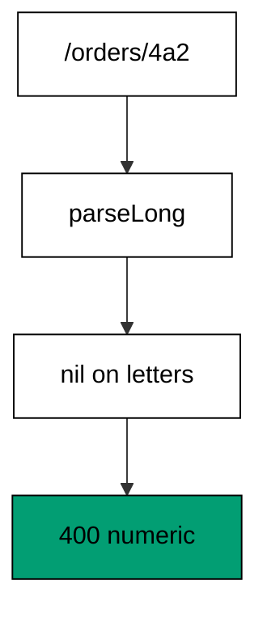

The guarded parser wraps `Long/parseLong` in a try and returns nil instead of throwing, so the handler branches on a value instead of catching exceptions. Nil-punning keeps the happy path flat: numbers flow through, letters fall into the 400 branch. Parse throws never escape because parsing never throws.

**`learning/code/ex-16-path-id-must-be-numeric/main.clj`**:

```clojure
;; => Ex-16: Path Id Must Be Numeric.
;; => The handler parses the path id to a number and answers 400 when letters arrive.
;; => Silence framework logging so the transcript holds only our lines.
(System/setProperty "org.slf4j.simpleLogger.defaultLogLevel" "error") ;; => only errors reach the log
(System/setProperty "org.slf4j.simpleLogger.showDateTime" "false") ;; => no timestamps leak into output
(System/setProperty "org.slf4j.simpleLogger.showThreadName" "false") ;; => no thread names leak into output
(System/setProperty "org.slf4j.simpleLogger.showLogName" "false") ;; => no logger names leak into output
(System/setProperty "org.slf4j.simpleLogger.showShortLogName" "false") ;; => short names stay off too
;; => Load the connector stack: description, in-process tests, and Jetty.
(require '[io.pedestal.connector :as conn]) ;; => connector maps are the 0.8 service description
(require '[io.pedestal.connector.test :as t]) ;; => response-for tests with no socket
(require '[io.pedestal.http.jetty :as jetty]) ;; => create-connector builds the testable connector
(require '[io.pedestal.service.interceptors :as interceptors]) ;; => not-found turns misses into 404
;; => The handler parses with a guarded reader that returns nil on letters.
(def parse-id (fn [text] ;; => one parser guards every numeric id
                (try (Long/parseLong text) ;; => digits parse to numbers
                     (catch NumberFormatException _ nil)))) ;; => letters parse to nil, never throw
;; => The handler branches on the parse result, never on a raw string.
(def show-order (fn [request] ;; => one handler serves numeric orders
                  (let [id (parse-id (get-in request [:path-params :id]))] ;; => nil means letters arrived
                    (if id ;; => numbers pass the gate
                      {:status 200 :body (str "order " id)} ;; => numbers read the record
                      {:status 400 :body "order id must be numeric"})))) ;; => letters get a 400
;; => The route table captures the segment; the handler types it.
(def routes #{["/orders/:id" :get show-order :route-name :show-order]}) ;; => shape matches, type checked inside
;; => The connector map stacks cross-cutting interceptors under routing.
(def service (-> (conn/default-connector-map 8080) ;; => the port stays unbound; tests use no socket
                 (conn/with-interceptors [interceptors/not-found]) ;; => unknown paths answer 404 instead of nil
                 (conn/with-routes routes))) ;; => router plus path-params decoder join the chain
(def connector (jetty/create-connector service {})) ;; => the unstarted connector answers test requests
(println "numeric:" (:body (t/response-for connector :get "/orders/42"))) ;; => Output: numeric: order 42
(println "letters:" (:status (t/response-for connector :get "/orders/abc"))) ;; => Output: letters: 400
(println "mixed:" (:status (t/response-for connector :get "/orders/4a2"))) ;; => Output: mixed: 400
```

**Output** (`learning/code/ex-16-path-id-must-be-numeric/expected/main.stdout.txt`):

```text
numeric: order 42
letters: 400
mixed: 400
```

**Key takeaway**: Guarded parsers return nil on bad input, so handlers branch on values instead of catching throws.

**Why it matters**: Exceptions for expected input shapes turn validation into control flow. Nil-punning keeps the 400 branch visible and the 500 branch honest.

### Example 17: Validation Errors Collect All

One round trip should fix everything: the checker runs every rule and stacks all failures into one vector for a single 422. The program sends a valid member, a fully broken one, and a partly broken one. (Concepts: co-10.)

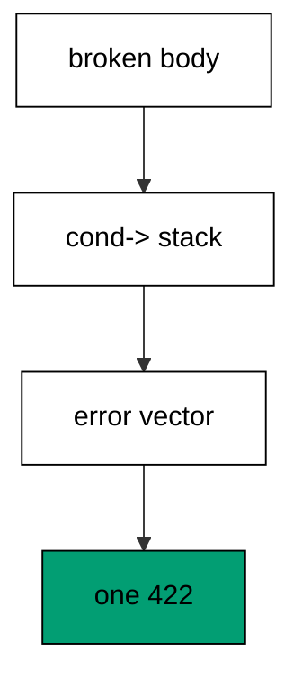

`cond->` threads the error vector through independent rules, so each rule decides alone and failures accumulate. Early returns report one problem per round trip and train callers to fix by guessing. Collecting costs one vector and returns the whole truth at once.

**`learning/code/ex-17-validation-errors-collect-all/main.clj`**:

```clojure
;; => Ex-17: Validation Errors Collect All.
;; => The handler gathers every broken field into one vector and answers a single 422.
;; => Silence framework logging so the transcript holds only our lines.
(System/setProperty "org.slf4j.simpleLogger.defaultLogLevel" "error") ;; => only errors reach the log
(System/setProperty "org.slf4j.simpleLogger.showDateTime" "false") ;; => no timestamps leak into output
(System/setProperty "org.slf4j.simpleLogger.showThreadName" "false") ;; => no thread names leak into output
(System/setProperty "org.slf4j.simpleLogger.showLogName" "false") ;; => no logger names leak into output
(System/setProperty "org.slf4j.simpleLogger.showShortLogName" "false") ;; => short names stay off too
;; => Load the connector stack plus EDN reading from Clojure core.
(require '[io.pedestal.connector :as conn]) ;; => connector maps are the 0.8 service description
(require '[io.pedestal.connector.test :as t]) ;; => response-for tests with no socket
(require '[io.pedestal.http.jetty :as jetty]) ;; => create-connector builds the testable connector
(require '[clojure.edn :as edn]) ;; => read-string parses EDN safely
(require '[io.pedestal.service.interceptors :as interceptors]) ;; => not-found turns misses into 404
;; => Each rule returns an error string or nil; cond-> stacks the failures.
(def check-member (fn [member] ;; => one checker runs every rule
                    (cond-> [] ;; => start with no errors
                      (not (contains? member :name)) (conj "missing field: name") ;; => names are required
                      (not (number? (:age member))) (conj "age must be a number") ;; => ages are numeric
                      (and (number? (:age member)) (neg? (:age member))) (conj "age must not be negative")))) ;; => ages stay positive
;; => The handler answers 201 when the vector stays empty, else one 422.
(def create-member (fn [request] ;; => one handler collects before creating
                     (let [member (-> (:body request) ;; => the body arrives as a stream
                                      slurp ;; => read the EDN text
                                      edn/read-string) ;; => parse into Clojure data
                           errors (check-member member)] ;; => every rule runs, every failure kept
                       (if (empty? errors) ;; => no failures means a valid member
                         {:status 201 :body (str "member " (:name member))} ;; => valid members create
                         {:status 422 :body (pr-str errors)})))) ;; => all failures print at once
;; => The route table declares the collecting POST.
(def routes #{["/members" :post create-member :route-name :create-member]}) ;; => one entry reports everything
;; => The connector map stacks cross-cutting interceptors under routing.
(def service (-> (conn/default-connector-map 8080) ;; => the port stays unbound; tests use no socket
                 (conn/with-interceptors [interceptors/not-found]) ;; => unknown paths answer 404 instead of nil
                 (conn/with-routes routes))) ;; => router plus path-params decoder join the chain
(def connector (jetty/create-connector service {})) ;; => the unstarted connector answers test requests
(println "valid:" (:body (t/response-for connector :post "/members" :body "{:name \"ada\" :age 36}"))) ;; => Output: valid: member ada
(println "all-broken:" (:body (t/response-for connector :post "/members" :body "{:age -1}"))) ;; => Output: all-broken: ["missing field: name" "age must not be negative"]
(println "one-broken:" (:body (t/response-for connector :post "/members" :body "{:name \"grace\" :age \"old\"}"))) ;; => Output: one-broken: ["age must be a number"]
```

**Output** (`learning/code/ex-17-validation-errors-collect-all/expected/main.stdout.txt`):

```text
valid: member ada
all-broken: ["missing field: name" "age must not be negative"]
one-broken: ["age must be a number"]
```

**Key takeaway**: `cond->` stacks independent rule failures into one vector for a single 422.

**Why it matters**: One round trip per problem punishes API users for the server's impatience. Collecting respects their time and shrinks integration cycles.

### Example 18: Status Code Says What Happened

Codes are the first thing clients read: 200 reads, 201 creates, 204 deletes with no body, and misses get 404. The program drives all four and prints the code table. (Concepts: co-04.)

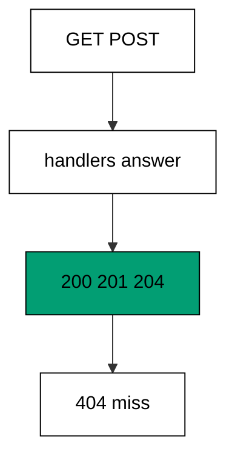

Nil bodies stay nil through the test chain; `response-for` does not invent empty strings. The 204 handler returns `:body nil` explicitly, which documents the no-content contract in code instead of relying on framework defaults. Every code in the table is asserted, so the table cannot drift from the handlers.

**`learning/code/ex-18-status-code-says-what-happened/main.clj`**:

```clojure
;; => Ex-18: Status Code Says What Happened.
;; => One resource answers the full code table: 200 reads, 201 creates, 204 deletes, 404 misses.
;; => Silence framework logging so the transcript holds only our lines.
(System/setProperty "org.slf4j.simpleLogger.defaultLogLevel" "error") ;; => only errors reach the log
(System/setProperty "org.slf4j.simpleLogger.showDateTime" "false") ;; => no timestamps leak into output
(System/setProperty "org.slf4j.simpleLogger.showThreadName" "false") ;; => no thread names leak into output
(System/setProperty "org.slf4j.simpleLogger.showLogName" "false") ;; => no logger names leak into output
(System/setProperty "org.slf4j.simpleLogger.showShortLogName" "false") ;; => short names stay off too
;; => Load the connector stack: description, in-process tests, and Jetty.
(require '[io.pedestal.connector :as conn]) ;; => connector maps are the 0.8 service description
(require '[io.pedestal.connector.test :as t]) ;; => response-for tests with no socket
(require '[io.pedestal.http.jetty :as jetty]) ;; => create-connector builds the testable connector
(require '[io.pedestal.service.interceptors :as interceptors]) ;; => not-found turns misses into 404
;; => Each handler answers its own code; the table below wires them by verb.
(def read-thing (fn [_] {:status 200 :body "here"})) ;; => reads answer 200 with a body
(def make-thing (fn [_] {:status 201 :body "made"})) ;; => creates answer 201 with a body
(def drop-thing (fn [_] {:status 204 :body nil})) ;; => deletes answer 204 with no body
;; => The table spells every code the resource speaks.
(def routes #{["/thing" :get read-thing :route-name :read-thing] ;; => reads answer 200
              ["/thing" :post make-thing :route-name :make-thing] ;; => creates answer 201
              ["/thing" :delete drop-thing :route-name :drop-thing]}) ;; => deletes answer 204
;; => The connector map stacks cross-cutting interceptors under routing.
(def service (-> (conn/default-connector-map 8080) ;; => the port stays unbound; tests use no socket
                 (conn/with-interceptors [interceptors/not-found]) ;; => unknown paths answer 404 instead of nil
                 (conn/with-routes routes))) ;; => router plus path-params decoder join the chain
(def connector (jetty/create-connector service {})) ;; => the unstarted connector answers test requests
(println "codes:" (pr-str (mapv #(:status (t/response-for connector % "/thing")) [:get :post :delete]))) ;; => Output: codes: [200 201 204]
(println "miss:" (:status (t/response-for connector :get "/nothing"))) ;; => Output: miss: 404
(println "empty-body:" (pr-str (:body (t/response-for connector :delete "/thing")))) ;; => Output: empty-body: nil
```

**Output** (`learning/code/ex-18-status-code-says-what-happened/expected/main.stdout.txt`):

```text
codes: [200 201 204]
miss: 404
empty-body: nil
```

**Key takeaway**: Status codes name the outcome class; 204 deletes carry explicitly nil bodies.

**Why it matters**: Clients branch on codes before reading bodies. Consistent codes let generic HTTP tooling — caches, retries, load balancers — do its job.

### Example 19: Created Points at Location

Creates answer where the new resource lives: 201 plus a `Location` header rendered from the named route. The program creates, reads the header, and follows it. (Concepts: co-04.)

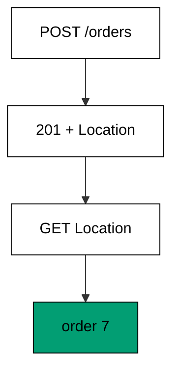

Rendering `Location` from the route name instead of a string template keeps creates correct when paths change. The test follows its own header, which proves the location is a live route and not a dead string. Header-plus-body keeps the confirmation human-readable while staying machine-followable.

**`learning/code/ex-19-created-points-at-location/main.clj`**:

```clojure
;; => Ex-19: Created Points at Location.
;; => The POST answers 201 with a Location header naming the new resource.
;; => Silence framework logging so the transcript holds only our lines.
(System/setProperty "org.slf4j.simpleLogger.defaultLogLevel" "error") ;; => only errors reach the log
(System/setProperty "org.slf4j.simpleLogger.showDateTime" "false") ;; => no timestamps leak into output
(System/setProperty "org.slf4j.simpleLogger.showThreadName" "false") ;; => no thread names leak into output
(System/setProperty "org.slf4j.simpleLogger.showLogName" "false") ;; => no logger names leak into output
(System/setProperty "org.slf4j.simpleLogger.showShortLogName" "false") ;; => short names stay off too
;; => Load the connector stack plus the route namespace for link generation.
(require '[io.pedestal.connector :as conn]) ;; => connector maps are the 0.8 service description
(require '[io.pedestal.connector.test :as t]) ;; => response-for tests with no socket
(require '[io.pedestal.http.jetty :as jetty]) ;; => create-connector builds the testable connector
(require '[io.pedestal.http.route :as route]) ;; => url-for-routes renders links from names
(require '[io.pedestal.service.interceptors :as interceptors]) ;; => not-found turns misses into 404
;; => The routes table names the new member so the linker can point at it.
(def routes #{["/orders/:id" :get (fn [r] {:status 200 :body (str "order " (get-in r [:path-params :id]))}) :route-name :show-order] ;; => the link target
              ["/orders" :post (fn [_] {:status 201 ;; => creates answer 201
                                        :headers {"Location" ((route/url-for-routes (route/expand-routes routes)) :show-order :params {:id "7"})} ;; => Location names the member
                                        :body "created"}) :route-name :create-order]}) ;; => the body stays short
;; => The connector map stacks cross-cutting interceptors under routing.
(def service (-> (conn/default-connector-map 8080) ;; => the port stays unbound; tests use no socket
                 (conn/with-interceptors [interceptors/not-found]) ;; => unknown paths answer 404 instead of nil
                 (conn/with-routes routes))) ;; => router plus path-params decoder join the chain
(def connector (jetty/create-connector service {})) ;; => the unstarted connector answers test requests
(println "status:" (:status (t/response-for connector :post "/orders"))) ;; => Output: status: 201
(println "location:" (get (:headers (t/response-for connector :post "/orders")) "Location")) ;; => Output: location: /orders/7
(println "follow:" (:body (t/response-for connector :get "/orders/7"))) ;; => Output: follow: order 7
```

**Output** (`learning/code/ex-19-created-points-at-location/expected/main.stdout.txt`):

```text
status: 201
location: /orders/7
follow: order 7
```

**Key takeaway**: Creates answer 201 with a generated `Location` header that the test follows.

**Why it matters**: Clients should never construct member URLs themselves. The server knows where things live; `Location` tells them.

### Example 20: Empty Body Means No Content

Deletes answer 204 with nothing to say: the handler removes the member and returns a nil body. The program deletes twice and prints the emptied store. (Concepts: co-04.)

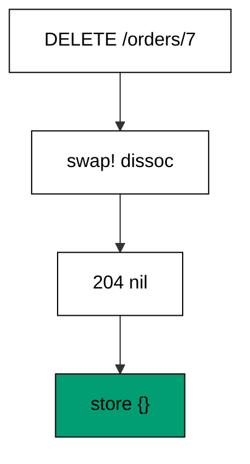

Deleting twice stays safe because `dissoc` on a missing key changes nothing: the handler is idempotent by construction. The store printout proves the effect while the 204 proves the protocol. State plus status together make deletes testable without reading the database separately.

**`learning/code/ex-20-empty-body-means-no-content/main.clj`**:

```clojure
;; => Ex-20: Empty Body Means No Content.
;; => The DELETE answers 204 with a nil body; the test sees an empty string.
;; => Silence framework logging so the transcript holds only our lines.
(System/setProperty "org.slf4j.simpleLogger.defaultLogLevel" "error") ;; => only errors reach the log
(System/setProperty "org.slf4j.simpleLogger.showDateTime" "false") ;; => no timestamps leak into output
(System/setProperty "org.slf4j.simpleLogger.showThreadName" "false") ;; => no thread names leak into output
(System/setProperty "org.slf4j.simpleLogger.showLogName" "false") ;; => no logger names leak into output
(System/setProperty "org.slf4j.simpleLogger.showShortLogName" "false") ;; => short names stay off too
;; => Load the connector stack: description, in-process tests, and Jetty.
(require '[io.pedestal.connector :as conn]) ;; => connector maps are the 0.8 service description
(require '[io.pedestal.connector.test :as t]) ;; => response-for tests with no socket
(require '[io.pedestal.http.jetty :as jetty]) ;; => create-connector builds the testable connector
(require '[io.pedestal.service.interceptors :as interceptors]) ;; => not-found turns misses into 404
;; => The atom pretends to be the database the DELETE empties.
(def store (atom {"7" "order-7"})) ;; => one member lives in the store
;; => The handler removes the member and answers 204 with nothing to say.
(def drop-order (fn [request] ;; => one handler deletes by id
                  (swap! store dissoc (get-in request [:path-params :id])) ;; => removal is the whole effect
                  {:status 204 :body nil})) ;; => 204 carries no body by definition
;; => The route table declares the deleting entry.
(def routes #{["/orders/:id" :delete drop-order :route-name :drop-order]}) ;; => deletes answer 204
;; => The connector map stacks cross-cutting interceptors under routing.
(def service (-> (conn/default-connector-map 8080) ;; => the port stays unbound; tests use no socket
                 (conn/with-interceptors [interceptors/not-found]) ;; => unknown paths answer 404 instead of nil
                 (conn/with-routes routes))) ;; => router plus path-params decoder join the chain
(def connector (jetty/create-connector service {})) ;; => the unstarted connector answers test requests
(println "status:" (:status (t/response-for connector :delete "/orders/7"))) ;; => Output: status: 204
(println "body:" (pr-str (:body (t/response-for connector :delete "/orders/7")))) ;; => Output: body: nil
(println "store:" (pr-str @store)) ;; => Output: store: {}
```

**Output** (`learning/code/ex-20-empty-body-means-no-content/expected/main.stdout.txt`):

```text
status: 204
body: nil
store: {}
```

**Key takeaway**: Deletes answer 204 with nil bodies; idempotent handlers make repeat deletes safe.

**Why it matters**: Retried deletes must not error: networks retry, clients double-click. Idempotence turns repeats into no-ops.

### Example 21: Content Type Names the Format

The handler declares its format explicitly: text for prose, EDN for data. The program reads both endpoints and prints each body with its type. (Concepts: co-04, co-12.)

```mermaid
flowchart TD
    accTitle: Example 21 types named
    accDescr: Each format declares itself.
    A["/note.txt"] --> B["text/plain"]
    A --> C["/note"]
    C --> D["application/edn"]

    classDef ok fill:#029E73,stroke:#000000,color:#000000
    classDef default fill:#FFFFFF,stroke:#000000,color:#000000
    class D ok
```

Explicit content types let intermediaries — caches, proxies, browsers — handle bodies without sniffing. The extension-named route (`.txt`) is a convention for humans; the header is the contract for machines. Both ride the same handler pattern, so adding a format means adding an entry.

**`learning/code/ex-21-content-type-names-the-format/main.clj`**:

```clojure
;; => Ex-21: Content Type Names the Format.
;; => The handler sets Content-Type explicitly; the test reads it back per format.
;; => Silence framework logging so the transcript holds only our lines.
(System/setProperty "org.slf4j.simpleLogger.defaultLogLevel" "error") ;; => only errors reach the log
(System/setProperty "org.slf4j.simpleLogger.showDateTime" "false") ;; => no timestamps leak into output
(System/setProperty "org.slf4j.simpleLogger.showThreadName" "false") ;; => no thread names leak into output
(System/setProperty "org.slf4j.simpleLogger.showLogName" "false") ;; => no logger names leak into output
(System/setProperty "org.slf4j.simpleLogger.showShortLogName" "false") ;; => short names stay off too
;; => Load the connector stack: description, in-process tests, and Jetty.
(require '[io.pedestal.connector :as conn]) ;; => connector maps are the 0.8 service description
(require '[io.pedestal.connector.test :as t]) ;; => response-for tests with no socket
(require '[io.pedestal.http.jetty :as jetty]) ;; => create-connector builds the testable connector
(require '[io.pedestal.service.interceptors :as interceptors]) ;; => not-found turns misses into 404
;; => Each handler names its own format; defaults never decide for us.
(def as-text (fn [_] {:status 200 :headers {"Content-Type" "text/plain"} :body "plain words"})) ;; => text names itself
(def as-edn (fn [_] {:status 200 :headers {"Content-Type" "application/edn"} :body "{:a 1}"})) ;; => edn names itself
;; => The route table serves the same fact in two formats.
(def routes #{["/note.txt" :get as-text :route-name :as-text] ;; => text lives at .txt
              ["/note" :get as-edn :route-name :as-edn]}) ;; => edn lives at the bare path
;; => The connector map stacks cross-cutting interceptors under routing.
(def service (-> (conn/default-connector-map 8080) ;; => the port stays unbound; tests use no socket
                 (conn/with-interceptors [interceptors/not-found]) ;; => unknown paths answer 404 instead of nil
                 (conn/with-routes routes))) ;; => router plus path-params decoder join the chain
(def connector (jetty/create-connector service {})) ;; => the unstarted connector answers test requests
(println "text-type:" (get (:headers (t/response-for connector :get "/note.txt")) "Content-Type")) ;; => Output: text-type: text/plain
(println "text-body:" (:body (t/response-for connector :get "/note.txt"))) ;; => Output: text-body: plain words
(println "edn-type:" (get (:headers (t/response-for connector :get "/note")) "Content-Type")) ;; => Output: edn-type: application/edn
(println "edn-body:" (:body (t/response-for connector :get "/note"))) ;; => Output: edn-body: {:a 1}
```

**Output** (`learning/code/ex-21-content-type-names-the-format/expected/main.stdout.txt`):

```text
text-type: text/plain
text-body: plain words
edn-type: application/edn
edn-body: {:a 1}
```

**Key takeaway**: Handlers set `Content-Type` explicitly per format; tests assert the header, not just the body.

**Why it matters**: Bodies without types force sniffing, and sniffing misfires. Named types let every hop handle the payload correctly.

### Example 22: Edn Response Round Trips

Data out should parse back: the handler prints a profile with `pr-str`, and the test reads it back with `edn/read-string`. The program prints the raw body, the name, the roles, and the type. (Concepts: co-04, co-12, co-15.)

```mermaid
flowchart TD
    accTitle: Example 22 EDN round trip
    accDescr: Print then parse back.
    A["profile map"] --> B["pr-str body"]
    B --> C["read-string"]
    C --> D["name + roles"]

    classDef ok fill:#029E73,stroke:#000000,color:#000000
    classDef default fill:#FFFFFF,stroke:#000000,color:#000000
    class D ok
```

Round-trip tests prove the wire format holds real data, not just pretty strings. Reading the body back with the same EDN reader production uses closes the loop: writer and reader agree by test, not by hope. Vectors and nested maps survive the trip untouched.

**`learning/code/ex-22-edn-response-round-trips/main.clj`**:

```clojure
;; => Ex-22: Edn Response Round Trips.
;; => The handler prints Clojure data with pr-str; the test reads it back with edn.
;; => Silence framework logging so the transcript holds only our lines.
(System/setProperty "org.slf4j.simpleLogger.defaultLogLevel" "error") ;; => only errors reach the log
(System/setProperty "org.slf4j.simpleLogger.showDateTime" "false") ;; => no timestamps leak into output
(System/setProperty "org.slf4j.simpleLogger.showThreadName" "false") ;; => no thread names leak into output
(System/setProperty "org.slf4j.simpleLogger.showLogName" "false") ;; => no logger names leak into output
(System/setProperty "org.slf4j.simpleLogger.showShortLogName" "false") ;; => short names stay off too
;; => Load the connector stack plus EDN reading from Clojure core.
(require '[io.pedestal.connector :as conn]) ;; => connector maps are the 0.8 service description
(require '[io.pedestal.connector.test :as t]) ;; => response-for tests with no socket
(require '[io.pedestal.http.jetty :as jetty]) ;; => create-connector builds the testable connector
(require '[clojure.edn :as edn]) ;; => read-string parses the response back
(require '[io.pedestal.service.interceptors :as interceptors]) ;; => not-found turns misses into 404
;; => The handler serves data with an explicit EDN content type.
(def show-profile (fn [_] ;; => one handler serves the profile
                    {:status 200 :headers {"Content-Type" "application/edn"} :body (pr-str {:name "ada" :roles [:admin :user]})})) ;; => pr-str writes EDN
;; => The route table declares the data endpoint.
(def routes #{["/profile" :get show-profile :route-name :show-profile]}) ;; => one entry serves data
;; => The connector map stacks cross-cutting interceptors under routing.
(def service (-> (conn/default-connector-map 8080) ;; => the port stays unbound; tests use no socket
                 (conn/with-interceptors [interceptors/not-found]) ;; => unknown paths answer 404 instead of nil
                 (conn/with-routes routes))) ;; => router plus path-params decoder join the chain
(def connector (jetty/create-connector service {})) ;; => the unstarted connector answers test requests
(println "raw:" (:body (t/response-for connector :get "/profile"))) ;; => Output: raw: {:name "ada", :roles [:admin :user]}
(println "name:" (:name (edn/read-string (:body (t/response-for connector :get "/profile"))))) ;; => Output: name: ada
(println "roles:" (pr-str (:roles (edn/read-string (:body (t/response-for connector :get "/profile")))))) ;; => Output: roles: [:admin :user]
(println "type:" (get (:headers (t/response-for connector :get "/profile")) "Content-Type")) ;; => Output: type: application/edn
```

**Output** (`learning/code/ex-22-edn-response-round-trips/expected/main.stdout.txt`):

```text
raw: {:name "ada", :roles [:admin :user]}
name: ada
roles: [:admin :user]
type: application/edn
```

**Key takeaway**: `pr-str` writes EDN responses; tests read them back to prove the format holds.

**Why it matters**: Serialization that never round-trips in tests breaks in production. The read-back is the contract proof.

### Example 23: Json Response Is a String

JSON has no printer in the lock set, so the handler builds the object string by hand with `pr-str` on strings and bare numbers. The program prints the JSON and its type. (Concepts: co-04, co-12.)

```mermaid
flowchart TD
    accTitle: Example 23 JSON by hand
    accDescr: Hand-built JSON stays exact.
    A["member map"] --> B["pr-str strings"]
    B --> C["bare numbers"]
    C --> D["exact JSON"]

    classDef ok fill:#029E73,stroke:#000000,color:#000000
    classDef default fill:#FFFFFF,stroke:#000000,color:#000000
    class D ok
```

Hand-building suits tiny fixed shapes: one helper, no dependency, byte-exact output the test matches character for character. `pr-str` on strings handles quoting and escaping correctly, which is the part humans get wrong. Larger payloads deserve a real JSON library; this shape stays honest about where that line sits.

**`learning/code/ex-23-json-response-is-a-string/main.clj`**:

```clojure
;; => Ex-23: Json Response Is a String.
;; => The handler builds JSON by hand with pr-str on strings; the test matches it exactly.
;; => Silence framework logging so the transcript holds only our lines.
(System/setProperty "org.slf4j.simpleLogger.defaultLogLevel" "error") ;; => only errors reach the log
(System/setProperty "org.slf4j.simpleLogger.showDateTime" "false") ;; => no timestamps leak into output
(System/setProperty "org.slf4j.simpleLogger.showThreadName" "false") ;; => no thread names leak into output
(System/setProperty "org.slf4j.simpleLogger.showLogName" "false") ;; => no logger names leak into output
(System/setProperty "org.slf4j.simpleLogger.showShortLogName" "false") ;; => short names stay off too
;; => Load the connector stack: description, in-process tests, and Jetty.
(require '[io.pedestal.connector :as conn]) ;; => connector maps are the 0.8 service description
(require '[io.pedestal.connector.test :as t]) ;; => response-for tests with no socket
(require '[io.pedestal.http.jetty :as jetty]) ;; => create-connector builds the testable connector
(require '[io.pedestal.service.interceptors :as interceptors]) ;; => not-found turns misses into 404
;; => One helper renders a member map as a JSON object string.
(def ->json (fn [member] ;; => one helper renders every member
              (str "{\"name\":" (pr-str (:name member)) ;; => pr-str quotes the string
                   ",\"age\":" (:age member) "}"))) ;; => numbers print bare
;; => The handler serves the JSON string with the JSON content type.
(def show-member (fn [_] ;; => one handler serves one member
                   {:status 200 :headers {"Content-Type" "application/json"} :body (->json {:name "ada" :age 36})})) ;; => hand-built JSON
;; => The route table declares the JSON endpoint.
(def routes #{["/member" :get show-member :route-name :show-member]}) ;; => one entry serves JSON
;; => The connector map stacks cross-cutting interceptors under routing.
(def service (-> (conn/default-connector-map 8080) ;; => the port stays unbound; tests use no socket
                 (conn/with-interceptors [interceptors/not-found]) ;; => unknown paths answer 404 instead of nil
                 (conn/with-routes routes))) ;; => router plus path-params decoder join the chain
(def connector (jetty/create-connector service {})) ;; => the unstarted connector answers test requests
(println "json:" (:body (t/response-for connector :get "/member"))) ;; => Output: json: {"name":"ada","age":36}
(println "type:" (get (:headers (t/response-for connector :get "/member")) "Content-Type")) ;; => Output: type: application/json
```

**Output** (`learning/code/ex-23-json-response-is-a-string/expected/main.stdout.txt`):

```text
json: {"name":"ada","age":36}
type: application/json
```

**Key takeaway**: Small JSON shapes build by hand with `pr-str` quoting; the test matches bytes exactly.

**Why it matters**: Exact-match tests catch stray spaces and reordered keys. When payloads outgrow hand-building, the tests say so by getting painful to write.

### Example 24: Custom Header Carries Metadata

Bodies hold pages, headers hold facts about the whole: the handler serves one page and reports the total in `X-Total-Count`. The program prints the header and the page. (Concepts: co-04.)

```mermaid
flowchart TD
    accTitle: Example 24 header totals
    accDescr: Page in body, total in header.
    A["GET /orders"] --> B["page take 2"]
    B --> C["count header"]
    C --> D["total 3"]

    classDef ok fill:#029E73,stroke:#000000,color:#000000
    classDef default fill:#FFFFFF,stroke:#000000,color:#000000
    class D ok
```

Custom headers extend the protocol without touching bodies: pagination totals, rate-limit budgets, and deprecation warnings all ride headers. `X-` prefixed names mark them as application metadata, distinct from standard semantics. Clients read the body for data and the headers for navigation.

**`learning/code/ex-24-custom-header-carries-metadata/main.clj`**:

```clojure
;; => Ex-24: Custom Header Carries Metadata.
;; => The handler reports the total in X-Total-Count while the body holds one page.
;; => Silence framework logging so the transcript holds only our lines.
(System/setProperty "org.slf4j.simpleLogger.defaultLogLevel" "error") ;; => only errors reach the log
(System/setProperty "org.slf4j.simpleLogger.showDateTime" "false") ;; => no timestamps leak into output
(System/setProperty "org.slf4j.simpleLogger.showThreadName" "false") ;; => no thread names leak into output
(System/setProperty "org.slf4j.simpleLogger.showLogName" "false") ;; => no logger names leak into output
(System/setProperty "org.slf4j.simpleLogger.showShortLogName" "false") ;; => short names stay off too
;; => Load the connector stack: description, in-process tests, and Jetty.
(require '[io.pedestal.connector :as conn]) ;; => connector maps are the 0.8 service description
(require '[io.pedestal.connector.test :as t]) ;; => response-for tests with no socket
(require '[io.pedestal.http.jetty :as jetty]) ;; => create-connector builds the testable connector
(require '[io.pedestal.service.interceptors :as interceptors]) ;; => not-found turns misses into 404
;; => The atom pretends to be the database the page reads from.
(def store (atom ["o-1" "o-2" "o-3"])) ;; => three orders live in the store
;; => The handler serves the first page and reports the full total in a header.
(def list-orders (fn [_] ;; => one handler pages the orders
                   {:status 200 :headers {"X-Total-Count" (str (count @store))} ;; => the total rides a header
                    :body (pr-str (take 2 @store))})) ;; => the body holds one page
;; => The route table declares the paged endpoint.
(def routes #{["/orders" :get list-orders :route-name :list-orders]}) ;; => one entry pages orders
;; => The connector map stacks cross-cutting interceptors under routing.
(def service (-> (conn/default-connector-map 8080) ;; => the port stays unbound; tests use no socket
                 (conn/with-interceptors [interceptors/not-found]) ;; => unknown paths answer 404 instead of nil
                 (conn/with-routes routes))) ;; => router plus path-params decoder join the chain
(def connector (jetty/create-connector service {})) ;; => the unstarted connector answers test requests
(println "total:" (get (:headers (t/response-for connector :get "/orders")) "X-Total-Count")) ;; => Output: total: 3
(println "page:" (:body (t/response-for connector :get "/orders"))) ;; => Output: page: ("o-1" "o-2")
```

**Output** (`learning/code/ex-24-custom-header-carries-metadata/expected/main.stdout.txt`):

```text
total: 3
page: ("o-1" "o-2")
```

**Key takeaway**: Custom headers carry collection metadata while bodies hold pages.

**Why it matters**: Totals in headers keep bodies shaped like data, not envelopes. Clients page without parsing wrappers.

### Example 25: Beginner Review Greets Users

The beginner level closes with a small member service: create validates, greet reads stored members, misses get 404, and health answers. The program walks the whole flow. (Concepts: co-01, co-03, co-04, co-10, co-14.)

```mermaid
flowchart TD
    accTitle: Example 25 review flow
    accDescr: Create, greet, miss, health.
    A["POST member"] --> B["201 stored"]
    B --> C["greet 200"]
    C --> D["health ok"]

    classDef ok fill:#029E73,stroke:#000000,color:#000000
    classDef default fill:#FFFFFF,stroke:#000000,color:#000000
    class D ok
```

Reviews compose instead of introducing: every technique here appeared earlier, wired into one service. Creation validates before storing, greeting reads before answering, health reports readiness, and the miss path proves routing still guards unknown names. The store lives in an atom because persistence is a later course's subject.

**`learning/code/ex-25-beginner-review-greets-users/main.clj`**:

```clojure
;; => Ex-25: Beginner Review Greets Users.
;; => A tiny member service combines routing, path params, validation, and a health check.
;; => Silence framework logging so the transcript holds only our lines.
(System/setProperty "org.slf4j.simpleLogger.defaultLogLevel" "error") ;; => only errors reach the log
(System/setProperty "org.slf4j.simpleLogger.showDateTime" "false") ;; => no timestamps leak into output
(System/setProperty "org.slf4j.simpleLogger.showThreadName" "false") ;; => no thread names leak into output
(System/setProperty "org.slf4j.simpleLogger.showLogName" "false") ;; => no logger names leak into output
(System/setProperty "org.slf4j.simpleLogger.showShortLogName" "false") ;; => short names stay off too
;; => Load the connector stack plus EDN reading from Clojure core.
(require '[io.pedestal.connector :as conn]) ;; => connector maps are the 0.8 service description
(require '[io.pedestal.connector.test :as t]) ;; => response-for tests with no socket
(require '[io.pedestal.http.jetty :as jetty]) ;; => create-connector builds the testable connector
(require '[clojure.edn :as edn]) ;; => read-string parses EDN safely
(require '[io.pedestal.service.interceptors :as interceptors]) ;; => not-found turns misses into 404
;; => The atom pretends to be the database every handler shares.
(def store (atom {})) ;; => members accumulate here across requests
;; => Handlers validate, store, greet, and report readiness.
(def create-member (fn [request] ;; => POST validates before storing
                     (let [member (-> (:body request) slurp edn/read-string)] ;; => parse the EDN body
                       (if (contains? member :name) ;; => names are required
                         (do (swap! store assoc (:name member) member) ;; => store under the name
                             {:status 201 :body (str "member " (:name member))}) ;; => creates answer 201
                         {:status 400 :body "missing field: name"})))) ;; => absent names get a 400
(def greet-member (fn [request] ;; => GET greets stored members
                    (let [name (get-in request [:path-params :name])] ;; => the segment names the member
                      (if (contains? @store name) ;; => stored names greet
                        {:status 200 :body (str "hello " name)} ;; => members get greeted
                        {:status 404 :body (str "no member " name)})))) ;; => strangers get a 404
(def health (fn [_] {:status 200 :body "ok"})) ;; => readiness answers one word
;; => The table wires four entries: create, greet, health, and the miss path.
(def routes #{["/members" :post create-member :route-name :create-member] ;; => validates and stores
              ["/members/:name" :get greet-member :route-name :greet-member] ;; => greets stored members
              ["/health" :get health :route-name :health]}) ;; => readiness for load balancers
;; => The connector map stacks cross-cutting interceptors under routing.
(def service (-> (conn/default-connector-map 8080) ;; => the port stays unbound; tests use no socket
                 (conn/with-interceptors [interceptors/not-found]) ;; => unknown paths answer 404 instead of nil
                 (conn/with-routes routes))) ;; => router plus path-params decoder join the chain
(def connector (jetty/create-connector service {})) ;; => the unstarted connector answers test requests
(println "create:" (:body (t/response-for connector :post "/members" :body "{:name \"ada\"}"))) ;; => Output: create: member ada
(println "greet:" (:body (t/response-for connector :get "/members/ada"))) ;; => Output: greet: hello ada
(println "stranger:" (:status (t/response-for connector :get "/members/grace"))) ;; => Output: stranger: 404
(println "health:" (:body (t/response-for connector :get "/health"))) ;; => Output: health: ok
```

**Output** (`learning/code/ex-25-beginner-review-greets-users/expected/main.stdout.txt`):

```text
create: member ada
greet: hello ada
stranger: 404
health: ok
```

**Key takeaway**: Routing, params, validation, and health compose into one small service with no new ideas.

**Why it matters**: Composition is the test: techniques that only work alone are trivia. The review proves the pieces fit before the intermediate level adds weight.
