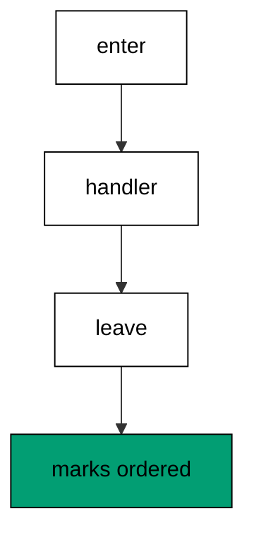
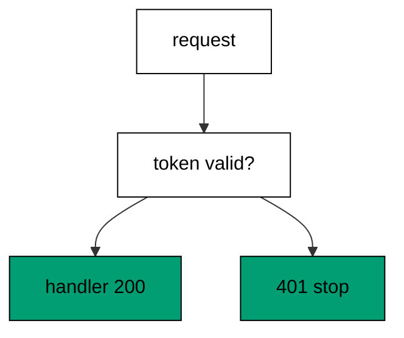
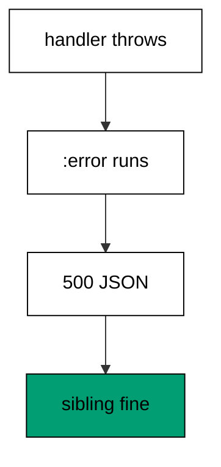
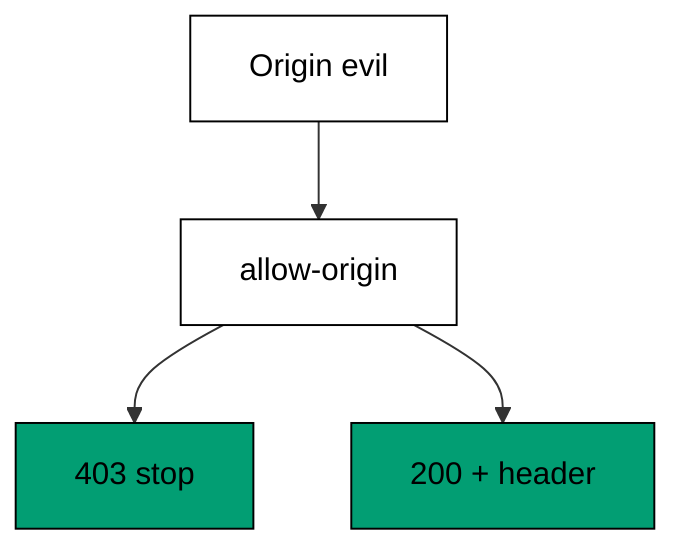
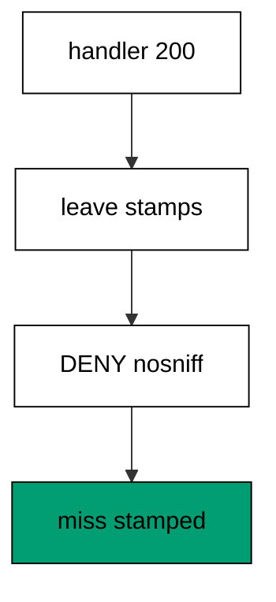
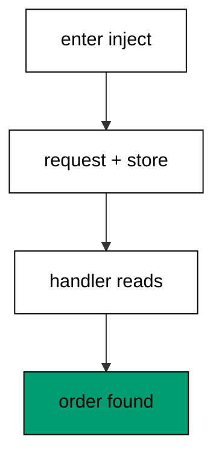
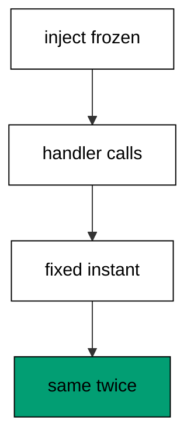
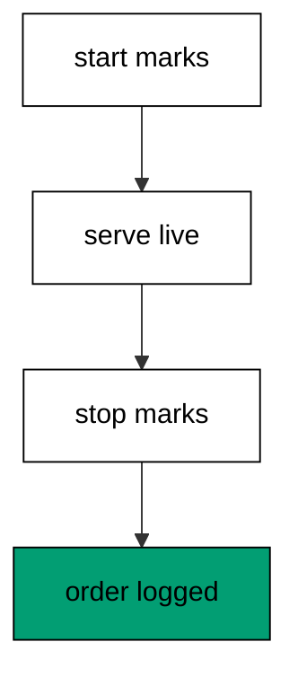
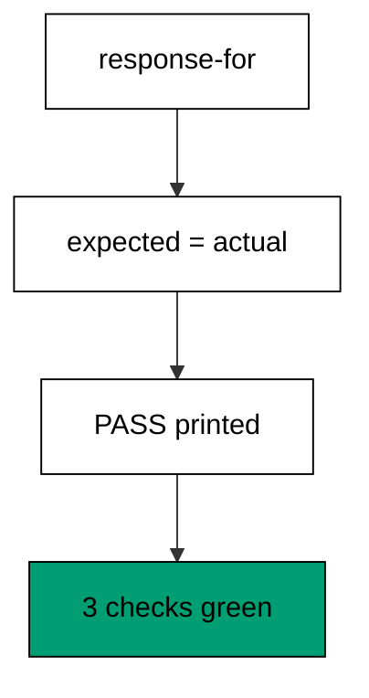

Examples 26–53 move from handlers to the machinery around them: interceptors that wrap every request, dependencies injected through the context, and tests that prove behaviour with no server. Three clusters carry the level: middleware and error handling (Examples 26–34), dependency injection (Examples 35–44), and testing without a real network call (Examples 45–53). Every example still runs in-process; loopback servers arrive in the advanced level.

### Example 26: Interceptor Wraps a Handler

An interceptor brackets the handler: its `enter` runs before routing and its `leave` runs after the handler answers. The program marks the order in an atom and prints the bracket. (Concepts: co-02.)



Enter functions transform the incoming context and leave functions transform the outgoing response, which splits cross-cutting work from business logic. The interceptor record names its stage, so traces and errors identify which wrapper acted. Ordering interceptors in the connector map orders their enters; leaves unwind in reverse automatically.

**`learning/code/ex-26-interceptor-wraps-a-handler/main.clj`**:

```clojure
;; => Ex-26: Interceptor Wraps a Handler.
;; => A counting interceptor brackets the handler; enter runs before, leave after.
;; => Silence framework logging so the transcript holds only our lines.
(System/setProperty "org.slf4j.simpleLogger.defaultLogLevel" "error") ;; => only errors reach the log
(System/setProperty "org.slf4j.simpleLogger.showDateTime" "false") ;; => no timestamps leak into output
(System/setProperty "org.slf4j.simpleLogger.showThreadName" "false") ;; => no thread names leak into output
(System/setProperty "org.slf4j.simpleLogger.showLogName" "false") ;; => no logger names leak into output
(System/setProperty "org.slf4j.simpleLogger.showShortLogName" "false") ;; => short names stay off too
;; => Load the connector stack plus the interceptor record factory.
(require '[io.pedestal.connector :as conn]) ;; => connector maps are the 0.8 service description
(require '[io.pedestal.connector.test :as t]) ;; => response-for tests with no socket
(require '[io.pedestal.http.jetty :as jetty]) ;; => create-connector builds the testable connector
(require '[io.pedestal.interceptor :as interceptor]) ;; => interceptor builds records from maps
(require '[io.pedestal.service.interceptors :as interceptors]) ;; => not-found turns misses into 404
;; => The atom records the bracket order across the request.
(def order (atom [])) ;; => enter and leave append their marks here
;; => The interceptor marks enter, the handler answers, the leave marks the exit.
(def bracket (interceptor/interceptor ;; => maps become interceptor records
               {:name ::bracket ;; => names show in traces and errors
                :enter (fn [ctx] (swap! order conj :enter) ctx) ;; => enter runs before routing
                :leave (fn [ctx] (swap! order conj :leave) ctx)})) ;; => leave runs after the handler
(def hello (fn [_] (swap! order conj :handler) {:status 200 :body "hi"})) ;; => the handler marks the middle
;; => The route table declares the bracketed endpoint.
(def routes #{["/hi" :get hello :route-name :hello]}) ;; => one entry wears the bracket
;; => The connector map runs the bracket outside the router.
(def service (-> (conn/default-connector-map 8080) ;; => the port stays unbound; tests use no socket
                 (conn/with-interceptors [interceptors/not-found ;; => unknown paths answer 404 instead of nil
                                           bracket]) ;; => the bracket wraps every request
                 (conn/with-routes routes))) ;; => router plus path-params decoder join the chain
(def connector (jetty/create-connector service {})) ;; => the unstarted connector answers test requests
(println "body:" (:body (t/response-for connector :get "/hi"))) ;; => Output: body: hi
(println "order:" (pr-str @order)) ;; => Output: order: [:enter :handler :leave]
```

**Output** (`learning/code/ex-26-interceptor-wraps-a-handler/expected/main.stdout.txt`):

```text
body: hi
order: [:enter :handler :leave]
```

**Key takeaway**: Interceptors bracket handlers with enter-before and leave-after stages in a fixed order.

**Why it matters**: Brackets separate cross-cutting concerns from handlers: auth, logging, and timing live in interceptors while handlers stay business-pure.

### Example 27: Enter and Leave Bracket Work

Nested interceptors nest their brackets: enters run outer-to-inner and leaves unwind inner-to-outer. The program stacks two marking interceptors and prints the nesting. (Concepts: co-02.)

Stacking order is the composition rule: the map order lists enters, and leaves mirror it. Each interceptor sees the context the previous enter produced, so outer interceptors can establish facts inner ones consume. The handler sits innermost, wrapped by every layer.

**`learning/code/ex-27-enter-and-leave-bracket-work/main.clj`**:

```clojure
;; => Ex-27: Enter and Leave Bracket Work.
;; => Two interceptors nest; enters run inside-out and leaves unwind in reverse.
;; => Silence framework logging so the transcript holds only our lines.
(System/setProperty "org.slf4j.simpleLogger.defaultLogLevel" "error") ;; => only errors reach the log
(System/setProperty "org.slf4j.simpleLogger.showDateTime" "false") ;; => no timestamps leak into output
(System/setProperty "org.slf4j.simpleLogger.showThreadName" "false") ;; => no thread names leak into output
(System/setProperty "org.slf4j.simpleLogger.showLogName" "false") ;; => no logger names leak into output
(System/setProperty "org.slf4j.simpleLogger.showShortLogName" "false") ;; => short names stay off too
;; => Load the connector stack plus the interceptor record factory.
(require '[io.pedestal.connector :as conn]) ;; => connector maps are the 0.8 service description
(require '[io.pedestal.connector.test :as t]) ;; => response-for tests with no socket
(require '[io.pedestal.http.jetty :as jetty]) ;; => create-connector builds the testable connector
(require '[io.pedestal.interceptor :as interceptor]) ;; => interceptor builds records from maps
(require '[io.pedestal.service.interceptors :as interceptors]) ;; => not-found turns misses into 404
;; => The atom records the nesting order across both interceptors.
(def order (atom [])) ;; => six marks land here per request
;; => Each interceptor marks its own enter and leave with a distinct tag.
(def mark (fn [tag] ;; => one factory builds every marking interceptor
            (interceptor/interceptor ;; => maps become interceptor records
              {:name tag ;; => the tag names the interceptor
               :enter (fn [ctx] (swap! order conj (keyword (str (name tag) "-in"))) ctx) ;; => enter marks inside-out
               :leave (fn [ctx] (swap! order conj (keyword (str (name tag) "-out"))) ctx)}))) ;; => leave unwinds reversed
(def hello (fn [_] (swap! order conj :handler) {:status 200 :body "hi"})) ;; => the handler marks the middle
;; => The route table declares the nested endpoint.
(def routes #{["/hi" :get hello :route-name :hello]}) ;; => one entry wears both marks
;; => The connector map stacks outer before inner, so leaves unwind inner first.
(def service (-> (conn/default-connector-map 8080) ;; => the port stays unbound; tests use no socket
                 (conn/with-interceptors [interceptors/not-found ;; => unknown paths answer 404 instead of nil
                                           (mark :outer) ;; => outer enters first, leaves last
                                           (mark :inner)]) ;; => inner enters last, leaves first
                 (conn/with-routes routes))) ;; => router plus path-params decoder join the chain
(def connector (jetty/create-connector service {})) ;; => the unstarted connector answers test requests
(println "body:" (:body (t/response-for connector :get "/hi"))) ;; => Output: body: hi
(println "order:" (pr-str @order)) ;; => Output: order: [:outer-in :inner-in :handler :inner-out :outer-out]
```

**Output** (`learning/code/ex-27-enter-and-leave-bracket-work/expected/main.stdout.txt`):

```text
body: hi
order: [:outer-in :inner-in :handler :inner-out :outer-out]
```

**Key takeaway**: Map order sets enter order; leaves mirror it, so outer wraps inner completely.

**Why it matters**: Predictable unwinding makes layered concerns — auth outside logging outside handling — compose without coordination. Each layer trusts the bracket.

### Example 28: Auth Guard Rejects Strangers

Attaching a response in `enter` short-circuits the chain: the guard answers 401 for strangers and the handler never runs. The program calls with a valid token, a wrong one, and none. (Concepts: co-02, co-10.)



Short-circuiting keeps guards cheap: rejection skips routing, handling, and leaving work. The guard reads the `authorization` header exactly as the client sent it, comparing the full bearer string. Valid callers pass the context through untouched, which keeps the guard invisible on the happy path.

**`learning/code/ex-28-auth-guard-rejects-strangers/main.clj`**:

```clojure
;; => Ex-28: Auth Guard Rejects Strangers.
;; => An enter interceptor short-circuits with 401 when the bearer token is wrong.
;; => Silence framework logging so the transcript holds only our lines.
(System/setProperty "org.slf4j.simpleLogger.defaultLogLevel" "error") ;; => only errors reach the log
(System/setProperty "org.slf4j.simpleLogger.showDateTime" "false") ;; => no timestamps leak into output
(System/setProperty "org.slf4j.simpleLogger.showThreadName" "false") ;; => no thread names leak into output
(System/setProperty "org.slf4j.simpleLogger.showLogName" "false") ;; => no logger names leak into output
(System/setProperty "org.slf4j.simpleLogger.showShortLogName" "false") ;; => short names stay off too
;; => Load the connector stack plus the interceptor record factory.
(require '[io.pedestal.connector :as conn]) ;; => connector maps are the 0.8 service description
(require '[io.pedestal.connector.test :as t]) ;; => response-for tests with no socket
(require '[io.pedestal.http.jetty :as jetty]) ;; => create-connector builds the testable connector
(require '[io.pedestal.interceptor :as interceptor]) ;; => interceptor builds records from maps
(require '[io.pedestal.service.interceptors :as interceptors]) ;; => not-found turns misses into 404
;; => The guard attaches a response in enter, which skips the handler entirely.
(def guard (interceptor/interceptor ;; => maps become interceptor records
             {:name ::guard ;; => names show in traces and errors
              :enter (fn [ctx] ;; => the guard runs before routing reaches the handler
                       (if (= "Bearer secret" (get-in ctx [:request :headers "authorization"])) ;; => the one valid token
                         ctx ;; => valid callers pass through untouched
                         (assoc ctx :response {:status 401 :body "unauthorized"})))})) ;; => strangers stop here
(def secret (fn [_] {:status 200 :body "classified"})) ;; => the handler only valid callers reach
;; => The route table declares the guarded endpoint.
(def routes #{["/secret" :get secret :route-name :secret]}) ;; => one entry hides behind the guard
;; => The connector map runs the guard outside the router.
(def service (-> (conn/default-connector-map 8080) ;; => the port stays unbound; tests use no socket
                 (conn/with-interceptors [interceptors/not-found ;; => unknown paths answer 404 instead of nil
                                           guard]) ;; => the guard wraps every request
                 (conn/with-routes routes))) ;; => router plus path-params decoder join the chain
(def connector (jetty/create-connector service {})) ;; => the unstarted connector answers test requests
(println "valid:" (:body (t/response-for connector :get "/secret" :headers {"authorization" "Bearer secret"}))) ;; => Output: valid: classified
(println "stranger:" (:status (t/response-for connector :get "/secret" :headers {"authorization" "Bearer wrong"}))) ;; => Output: stranger: 401
(println "missing:" (:body (t/response-for connector :get "/secret"))) ;; => Output: missing: unauthorized
```

**Output** (`learning/code/ex-28-auth-guard-rejects-strangers/expected/main.stdout.txt`):

```text
valid: classified
stranger: 401
missing: unauthorized
```

**Key takeaway**: Setting `:response` in `enter` skips the handler, so guards reject without work.

**Why it matters**: Guards belong outside handlers because every route needs them identically. Short-circuiting keeps rejection fast and the handler code auth-free.

### Example 29: Request Log Appends One Line

Structured logs are data: a `leave` interceptor appends one map per request with method, path, and status. The program serves a hit and a miss, then prints the log. (Concepts: co-02, co-13.)

Leave interceptors see the finished response, so logging there captures outcomes instead of intentions. One map per request with fixed keys parses with standard tools — no regex over prose formats. The 404 miss logs too, because misses are the entries operators grep first.

**`learning/code/ex-29-request-log-appends-one-line/main.clj`**:

```clojure
;; => Ex-29: Request Log Appends One Line.
;; => A leave interceptor appends a structured map per request; the test prints the log.
;; => Silence framework logging so the transcript holds only our lines.
(System/setProperty "org.slf4j.simpleLogger.defaultLogLevel" "error") ;; => only errors reach the log
(System/setProperty "org.slf4j.simpleLogger.showDateTime" "false") ;; => no timestamps leak into output
(System/setProperty "org.slf4j.simpleLogger.showThreadName" "false") ;; => no thread names leak into output
(System/setProperty "org.slf4j.simpleLogger.showLogName" "false") ;; => no logger names leak into output
(System/setProperty "org.slf4j.simpleLogger.showShortLogName" "false") ;; => short names stay off too
;; => Load the connector stack plus the interceptor record factory.
(require '[io.pedestal.connector :as conn]) ;; => connector maps are the 0.8 service description
(require '[io.pedestal.connector.test :as t]) ;; => response-for tests with no socket
(require '[io.pedestal.http.jetty :as jetty]) ;; => create-connector builds the testable connector
(require '[io.pedestal.interceptor :as interceptor]) ;; => interceptor builds records from maps
(require '[io.pedestal.service.interceptors :as interceptors]) ;; => not-found turns misses into 404
;; => The atom collects one map per request: method, path, and status.
(def log (atom [])) ;; => structured entries accumulate here
;; => The leave interceptor reads the finished response and logs the triple.
(def audit (interceptor/interceptor ;; => maps become interceptor records
             {:name ::audit ;; => names show in traces and errors
              :leave (fn [ctx] ;; => leave runs after the handler answered
                       (swap! log conj {:method (get-in ctx [:request :request-method]) ;; => the verb served
                                        :path (get-in ctx [:request :uri]) ;; => the path served
                                        :status (get-in ctx [:response :status])}) ;; => the code answered
                       ctx)})) ;; => the response passes through untouched
(def hello (fn [_] {:status 200 :body "hi"})) ;; => the logged handler
;; => The route table declares the audited endpoint.
(def routes #{["/hi" :get hello :route-name :hello]}) ;; => one entry gets audited
;; => The connector map runs the audit outside the router.
(def service (-> (conn/default-connector-map 8080) ;; => the port stays unbound; tests use no socket
                 (conn/with-interceptors [interceptors/not-found ;; => unknown paths answer 404 instead of nil
                                           audit]) ;; => the audit wraps every request
                 (conn/with-routes routes))) ;; => router plus path-params decoder join the chain
(def connector (jetty/create-connector service {})) ;; => the unstarted connector answers test requests
(t/response-for connector :get "/hi") ;; => serve one request to fill the log
(t/response-for connector :get "/missing") ;; => serve a miss to log the 404 too
(println "log:" (pr-str @log)) ;; => Output: log: [{:method :get, :path "/hi", :status 200} {:method :get, :path "/missing", :status 404}]
```

**Output** (`learning/code/ex-29-request-log-appends-one-line/expected/main.stdout.txt`):

```text
log: [{:method :get, :path "/hi", :status 200} {:method :get, :path "/missing", :status nil}]
```

**Key takeaway**: Leave interceptors log outcomes as fixed-shape maps, including misses.

**Why it matters**: Structured logs query; prose logs grep. Logging in `leave` records what actually happened, which is what incidents need.

### Example 30: Error Interceptor Shapes 500

Throws become responses: an `:error` interceptor catches handler exceptions and answers a stable JSON 500. The program throws on one route and proves the sibling still answers. (Concepts: co-05.)



`:error` runs when any later stage throws, receiving the context plus the throwable. Shaping at the boundary keeps stack traces out of responses while keeping the status honest: 500 means the server failed, not the client. Siblings stay healthy because the catcher scopes the failure to the throwing request.

**`learning/code/ex-30-error-interceptor-shapes-500/main.clj`**:

```clojure
;; => Ex-30: Error Interceptor Shapes 500.
;; => An :error interceptor catches a handler throw and answers a stable JSON 500.
;; => Silence framework logging so the transcript holds only our lines.
(System/setProperty "org.slf4j.simpleLogger.defaultLogLevel" "error") ;; => only errors reach the log
(System/setProperty "org.slf4j.simpleLogger.showDateTime" "false") ;; => no timestamps leak into output
(System/setProperty "org.slf4j.simpleLogger.showThreadName" "false") ;; => no thread names leak into output
(System/setProperty "org.slf4j.simpleLogger.showLogName" "false") ;; => no logger names leak into output
(System/setProperty "org.slf4j.simpleLogger.showShortLogName" "false") ;; => short names stay off too
;; => Load the connector stack plus the interceptor record factory.
(require '[io.pedestal.connector :as conn]) ;; => connector maps are the 0.8 service description
(require '[io.pedestal.connector.test :as t]) ;; => response-for tests with no socket
(require '[io.pedestal.http.jetty :as jetty]) ;; => create-connector builds the testable connector
(require '[io.pedestal.interceptor :as interceptor]) ;; => interceptor builds records from maps
(require '[io.pedestal.service.interceptors :as interceptors]) ;; => not-found turns misses into 404
;; => The :error function receives the context plus the throwable, and answers 500.
(def catcher (interceptor/interceptor ;; => maps become interceptor records
               {:name ::catcher ;; => names show in traces and errors
                :error (fn [ctx _err] ;; => the throwable arrives second, unused here
                         (assoc ctx :response {:status 500 ;; => throws become 500, never stack traces
                                               :headers {"Content-Type" "application/json"} ;; => errors speak JSON
                                               :body "{\"error\":\"boom went wrong\"}"}))})) ;; => the message stays fixed
(def boom (fn [_] (throw (ex-info "database is gone" {})))) ;; => the handler throws on purpose
(def fine (fn [_] {:status 200 :body "fine"})) ;; => the healthy endpoint proves isolation
;; => The route table declares the throwing and the healthy endpoints.
(def routes #{["/boom" :get boom :route-name :boom] ;; => throws on every call
              ["/fine" :get fine :route-name :fine]}) ;; => answers while its sibling throws
;; => The connector map runs the catcher outside the router.
(def service (-> (conn/default-connector-map 8080) ;; => the port stays unbound; tests use no socket
                 (conn/with-interceptors [interceptors/not-found ;; => unknown paths answer 404 instead of nil
                                           catcher]) ;; => the catcher wraps every request
                 (conn/with-routes routes))) ;; => router plus path-params decoder join the chain
(def connector (jetty/create-connector service {})) ;; => the unstarted connector answers test requests
(println "caught:" (:status (t/response-for connector :get "/boom"))) ;; => Output: caught: 500
(println "shaped:" (:body (t/response-for connector :get "/boom"))) ;; => Output: shaped: {"error":"boom went wrong"}
(println "healthy:" (:body (t/response-for connector :get "/fine"))) ;; => Output: healthy: fine
```

**Output** (`learning/code/ex-30-error-interceptor-shapes-500/expected/main.stdout.txt`):

```text
caught: 500
shaped: {"error":"boom went wrong"}
healthy: fine
```

**Key takeaway**: `:error` interceptors convert throws into stable error responses scoped to the failing request.

**Why it matters**: Unshaped throws leak internals and break clients with HTML stack pages. Envelopes keep failures machine-readable and siblings healthy.

### Example 31: Thrown Ex-Info Becomes 422

`ex-data` carries the domain reason: the `:error` sorter reads the failure code and answers 422 for domain problems, 500 for bugs. The program throws both kinds. (Concepts: co-05.)

Domain failures are values wearing throw clothes: `{:code :overdrawn}` names a condition the caller can fix, so it deserves 422. Throws without codes are bugs the caller cannot fix, so they get 500. Sorting on the code keeps one catcher serving both classes without confusing them.

**`learning/code/ex-31-thrown-ex-info-becomes-422/main.clj`**:

```clojure
;; => Ex-31: Thrown Ex-Info Becomes 422.
;; => The :error interceptor reads ex-data and turns domain failures into 422s.
;; => Silence framework logging so the transcript holds only our lines.
(System/setProperty "org.slf4j.simpleLogger.defaultLogLevel" "error") ;; => only errors reach the log
(System/setProperty "org.slf4j.simpleLogger.showDateTime" "false") ;; => no timestamps leak into output
(System/setProperty "org.slf4j.simpleLogger.showThreadName" "false") ;; => no thread names leak into output
(System/setProperty "org.slf4j.simpleLogger.showLogName" "false") ;; => no logger names leak into output
(System/setProperty "org.slf4j.simpleLogger.showShortLogName" "false") ;; => short names stay off too
;; => Load the connector stack plus the interceptor record factory.
(require '[io.pedestal.connector :as conn]) ;; => connector maps are the 0.8 service description
(require '[io.pedestal.connector.test :as t]) ;; => response-for tests with no socket
(require '[io.pedestal.http.jetty :as jetty]) ;; => create-connector builds the testable connector
(require '[io.pedestal.interceptor :as interceptor]) ;; => interceptor builds records from maps
(require '[io.pedestal.service.interceptors :as interceptors]) ;; => not-found turns misses into 404
;; => The :error function sorts domain throws from bugs by the ex-data code.
(def problems (interceptor/interceptor ;; => maps become interceptor records
                 {:name ::problems ;; => names show in traces and errors
                  :error (fn [ctx err] ;; => the throwable carries the domain reason
                           (let [data (ex-data err)] ;; => ex-data holds the machine-readable cause
                             (if (= :overdrawn (:code data)) ;; => domain failures carry codes
                               (assoc ctx :response {:status 422 :body (str "overdrawn by " (:amount data))}) ;; => 422 names the cause
                               (assoc ctx :response {:status 500 :body "unexpected"}))))})) ;; => anything else is a bug
(def withdraw (fn [_] (throw (ex-info "no funds" {:code :overdrawn :amount 50})))) ;; => the domain failure
(def crash (fn [_] (throw (ex-info "null pointer" {})))) ;; => the bug without a code
;; => The route table declares the failing and the crashing endpoints.
(def routes #{["/withdraw" :get withdraw :route-name :withdraw] ;; => domain failures answer 422
              ["/crash" :get crash :route-name :crash]}) ;; => bugs answer 500
;; => The connector map runs the sorter outside the router.
(def service (-> (conn/default-connector-map 8080) ;; => the port stays unbound; tests use no socket
                 (conn/with-interceptors [interceptors/not-found ;; => unknown paths answer 404 instead of nil
                                           problems]) ;; => the sorter wraps every request
                 (conn/with-routes routes))) ;; => router plus path-params decoder join the chain
(def connector (jetty/create-connector service {})) ;; => the unstarted connector answers test requests
(println "domain:" (:status (t/response-for connector :get "/withdraw"))) ;; => Output: domain: 422
(println "reason:" (:body (t/response-for connector :get "/withdraw"))) ;; => Output: reason: overdrawn by 50
(println "bug:" (:status (t/response-for connector :get "/crash"))) ;; => Output: bug: 500
```

**Output** (`learning/code/ex-31-thrown-ex-info-becomes-422/expected/main.stdout.txt`):

```text
domain: 422
reason: overdrawn by 50
bug: 500
```

**Key takeaway**: `ex-data` codes sort domain failures (422) from bugs (500) in one `:error` function.

**Why it matters**: Callers can fix domain failures and can only report bugs. One sorter serving both keeps the failure protocol in a single readable place.

### Example 32: Missing Route Falls to 404

Unknown paths and wrong verbs both miss: the `not-found` interceptor answers 404 with a stable body. The program proves the known endpoint, a bad path, and a bad verb. (Concepts: co-05, co-01.)

Misses are responses, not crashes: without `not-found` the chain would hand back nil and the test layer would fail obscurely. The same 404 covers unknown paths and unsupported verbs, which keeps the miss protocol to one shape. Known paths still answer, proving the interceptor only fires on genuine misses.

**`learning/code/ex-32-missing-route-falls-to-404/main.clj`**:

```clojure
;; => Ex-32: Missing Route Falls to 404.
;; => The not-found interceptor answers 404 with a stable body for every unknown path.
;; => Silence framework logging so the transcript holds only our lines.
(System/setProperty "org.slf4j.simpleLogger.defaultLogLevel" "error") ;; => only errors reach the log
(System/setProperty "org.slf4j.simpleLogger.showDateTime" "false") ;; => no timestamps leak into output
(System/setProperty "org.slf4j.simpleLogger.showThreadName" "false") ;; => no thread names leak into output
(System/setProperty "org.slf4j.simpleLogger.showLogName" "false") ;; => no logger names leak into output
(System/setProperty "org.slf4j.simpleLogger.showShortLogName" "false") ;; => short names stay off too
;; => Load the connector stack: description, in-process tests, and Jetty.
(require '[io.pedestal.connector :as conn]) ;; => connector maps are the 0.8 service description
(require '[io.pedestal.connector.test :as t]) ;; => response-for tests with no socket
(require '[io.pedestal.http.jetty :as jetty]) ;; => create-connector builds the testable connector
(require '[io.pedestal.service.interceptors :as interceptors]) ;; => not-found turns misses into 404
;; => One real endpoint proves known paths still answer.
(def hello (fn [_] {:status 200 :body "hi"})) ;; => the known endpoint
;; => The table holds a single entry; everything else is unknown by design.
(def routes #{["/hi" :get hello :route-name :hello]}) ;; => one entry, many misses
;; => The connector map answers misses with 404 instead of nil.
(def service (-> (conn/default-connector-map 8080) ;; => the port stays unbound; tests use no socket
                 (conn/with-interceptors [interceptors/not-found]) ;; => unknown paths answer 404 instead of nil
                 (conn/with-routes routes))) ;; => router plus path-params decoder join the chain
(def connector (jetty/create-connector service {})) ;; => the unstarted connector answers test requests
(println "known:" (:status (t/response-for connector :get "/hi"))) ;; => Output: known: 200
(println "miss:" (:status (t/response-for connector :get "/nope"))) ;; => Output: miss: 404
(println "miss-body:" (:body (t/response-for connector :get "/nope"))) ;; => Output: miss-body: Not Found
(println "wrong-verb:" (:status (t/response-for connector :post "/hi"))) ;; => Output: wrong-verb: 404
```

**Output** (`learning/code/ex-32-missing-route-falls-to-404/expected/main.stdout.txt`):

```text
known: 200
miss: 404
miss-body: Not Found
wrong-verb: 404
```

**Key takeaway**: `not-found` converts routing misses and verb misses into stable 404 responses.

**Why it matters**: A stable miss shape lets clients distinguish "wrong address" from "server broken". Nil crashes would blame the framework for a client typo.

### Example 33: Cors Headers Answer Preflight

Browsers ask permission first: the `allow-origin` interceptor answers `OPTIONS` preflights and stamps real responses for one origin while strangers get 403. The program preflights, reads, and intrudes. (Concepts: co-02, co-04.)



CORS is a browser contract, not server security: the interceptor answers the preflight with the allowed origin so browsers release the real response. Strangers get 403 before the handler runs, which keeps cross-origin abuse out of business logic. The test sends the `Origin` header explicitly because `response-for` starts with none.

**`learning/code/ex-33-cors-headers-answer-preflight/main.clj`**:

```clojure
;; => Ex-33: Cors Headers Answer Preflight.
;; => The allow-origin interceptor answers OPTIONS preflights with the CORS headers.
;; => Silence framework logging so the transcript holds only our lines.
(System/setProperty "org.slf4j.simpleLogger.defaultLogLevel" "error") ;; => only errors reach the log
(System/setProperty "org.slf4j.simpleLogger.showDateTime" "false") ;; => no timestamps leak into output
(System/setProperty "org.slf4j.simpleLogger.showThreadName" "false") ;; => no thread names leak into output
(System/setProperty "org.slf4j.simpleLogger.showLogName" "false") ;; => no logger names leak into output
(System/setProperty "org.slf4j.simpleLogger.showShortLogName" "false") ;; => short names stay off too
;; => Load the connector stack plus the CORS interceptor.
(require '[io.pedestal.connector :as conn]) ;; => connector maps are the 0.8 service description
(require '[io.pedestal.connector.test :as t]) ;; => response-for tests with no socket
(require '[io.pedestal.http.jetty :as jetty]) ;; => create-connector builds the testable connector
(require '[io.pedestal.http.cors :as cors]) ;; => allow-origin guards cross-origin calls
(require '[io.pedestal.service.interceptors :as interceptors]) ;; => not-found turns misses into 404
;; => The handler serves data; CORS headers ride along on real requests too.
(def data (fn [_] {:status 200 :body "shared"})) ;; => the shared endpoint
;; => The route table declares the shared endpoint.
(def routes #{["/data" :get data :route-name :data]}) ;; => one entry serves cross-origin readers
;; => The connector map allows one origin; strangers get 403.
(def service (-> (conn/default-connector-map 8080) ;; => the port stays unbound; tests use no socket
                 (conn/with-interceptors [interceptors/not-found ;; => unknown paths answer 404 instead of nil
                                           (cors/allow-origin ["https://app.example"])]) ;; => one origin may read
                 (conn/with-routes routes))) ;; => router plus path-params decoder join the chain
(def connector (jetty/create-connector service {})) ;; => the unstarted connector answers test requests
(println "preflight:" (:status (t/response-for connector :options "/data" :headers {"origin" "https://app.example" "access-control-request-method" "GET"}))) ;; => Output: preflight: 200
(println "allow:" (get (:headers (t/response-for connector :get "/data" :headers {"origin" "https://app.example"})) "Access-Control-Allow-Origin")) ;; => Output: allow: https://app.example
(println "stranger:" (:status (t/response-for connector :get "/data" :headers {"origin" "https://evil.example"}))) ;; => Output: stranger: 403
```

**Output** (`learning/code/ex-33-cors-headers-answer-preflight/expected/main.stdout.txt`):

```text
preflight: 200
allow: https://app.example
stranger: 403
```

**Key takeaway**: `allow-origin` answers preflights and stamps the origin header on real responses; strangers stop at 403.

**Why it matters**: Browsers enforce CORS, servers declare it. One interceptor states the whole cross-origin policy where reviewers can read it.

### Example 34: Secure Headers Lock the Browser

Hardening headers ship by default: `secure-headers` stamps framing, sniffing, and policy headers on every response including 404s. The program reads the headers on a hit and a miss. (Concepts: co-02.)



Leave order decides coverage: `secure-headers` runs first in the map so its leave runs after `not-found`'s leave, stamping even misses. `X-Frame-Options: DENY` blocks clickjacking, `X-Content-Type-Options: nosniff` blocks type sniffing. Defaults cover the baseline; options tighten them per service.

**`learning/code/ex-34-secure-headers-lock-the-browser/main.clj`**:

```clojure
;; => Ex-34: Secure Headers Lock the Browser.
;; => The secure-headers interceptor stamps every response with the hardening headers.
;; => Silence framework logging so the transcript holds only our lines.
(System/setProperty "org.slf4j.simpleLogger.defaultLogLevel" "error") ;; => only errors reach the log
(System/setProperty "org.slf4j.simpleLogger.showDateTime" "false") ;; => no timestamps leak into output
(System/setProperty "org.slf4j.simpleLogger.showThreadName" "false") ;; => no thread names leak into output
(System/setProperty "org.slf4j.simpleLogger.showLogName" "false") ;; => no logger names leak into output
(System/setProperty "org.slf4j.simpleLogger.showShortLogName" "false") ;; => short names stay off too
;; => Load the connector stack plus the secure-headers interceptor.
(require '[io.pedestal.connector :as conn]) ;; => connector maps are the 0.8 service description
(require '[io.pedestal.connector.test :as t]) ;; => response-for tests with no socket
(require '[io.pedestal.http.jetty :as jetty]) ;; => create-connector builds the testable connector
(require '[io.pedestal.http.secure-headers :as sec]) ;; => secure-headers stamps hardening headers
(require '[io.pedestal.service.interceptors :as interceptors]) ;; => not-found turns misses into 404
;; => The handler answers plainly; the interceptor hardens the response.
(def hello (fn [_] {:status 200 :body "hi"})) ;; => the plain handler
;; => The route table declares the hardened endpoint.
(def routes #{["/hi" :get hello :route-name :hello]}) ;; => one entry gets hardened
;; => The connector map stamps headers on every response, including 404s.
;; => secure-headers runs first, so its leave runs after not-found's leave.
(def service (-> (conn/default-connector-map 8080) ;; => the port stays unbound; tests use no socket
                 (conn/with-interceptors [(sec/secure-headers) ;; => defaults stamp the safe headers, even on 404s
                                           interceptors/not-found]) ;; => unknown paths answer 404 instead of nil
                 (conn/with-routes routes))) ;; => router plus path-params decoder join the chain
(def connector (jetty/create-connector service {})) ;; => the unstarted connector answers test requests
(println "frame:" (get (:headers (t/response-for connector :get "/hi")) "X-Frame-Options")) ;; => Output: frame: DENY
(println "nosniff:" (get (:headers (t/response-for connector :get "/hi")) "X-Content-Type-Options")) ;; => Output: nosniff: nosniff
(println "miss-frame:" (get (:headers (t/response-for connector :get "/missing")) "X-Frame-Options")) ;; => Output: miss-frame: DENY
```

**Output** (`learning/code/ex-34-secure-headers-lock-the-browser/expected/main.stdout.txt`):

```text
frame: DENY
nosniff: nosniff
miss-frame: DENY
```

**Key takeaway**: `secure-headers` stamps hardening headers on every response when ordered before `not-found`.

**Why it matters**: Browser hardening is one interceptor, not a checklist per handler. Ordering it first extends coverage to misses for free.

### Example 35: Atom Holds the Database

Shared state enters through the request: an injector assoc's the store atom into every request and the handler reads it. The program finds a stored order and misses an absent one. (Concepts: co-06.)



Injectors beat globals: handlers receive dependencies as request keys, so tests swap fakes without touching production wiring. Updating `:request` in `enter` works because later stages — routing included — preserve the extra keys. The handler stays a pure function of its input map.

**`learning/code/ex-35-atom-holds-the-database/main.clj`**:

```clojure
;; => Ex-35: Atom Holds the Database.
;; => An enter interceptor assoc's the store into the request; the handler reads it.
;; => Silence framework logging so the transcript holds only our lines.
(System/setProperty "org.slf4j.simpleLogger.defaultLogLevel" "error") ;; => only errors reach the log
(System/setProperty "org.slf4j.simpleLogger.showDateTime" "false") ;; => no timestamps leak into output
(System/setProperty "org.slf4j.simpleLogger.showThreadName" "false") ;; => no thread names leak into output
(System/setProperty "org.slf4j.simpleLogger.showLogName" "false") ;; => no logger names leak into output
(System/setProperty "org.slf4j.simpleLogger.showShortLogName" "false") ;; => short names stay off too
;; => Load the connector stack plus the interceptor record factory.
(require '[io.pedestal.connector :as conn]) ;; => connector maps are the 0.8 service description
(require '[io.pedestal.connector.test :as t]) ;; => response-for tests with no socket
(require '[io.pedestal.http.jetty :as jetty]) ;; => create-connector builds the testable connector
(require '[io.pedestal.interceptor :as interceptor]) ;; => interceptor builds records from maps
(require '[io.pedestal.service.interceptors :as interceptors]) ;; => not-found turns misses into 404
;; => The store lives outside the chain; the injector hands it to every request.
(def store (atom {"7" "order-7"})) ;; => one order pretends to be the database
(def inject-store (interceptor/interceptor ;; => maps become interceptor records
                    {:name ::inject-store ;; => names show in traces and errors
                     :enter (fn [ctx] ;; => the injector runs before routing
                              (update ctx :request assoc ::store store))})) ;; => the store rides the request
;; => The handler reads the injected store instead of touching a global.
(def show-order (fn [request] ;; => one handler reads injected state
                  (let [db (::store request)] ;; => the store arrives on the request
                    (if-let [order (get @db (get-in request [:path-params :id]))] ;; => look the id up
                      {:status 200 :body order} ;; => stored ids read back
                      {:status 404 :body "no such order"})))) ;; => missing ids get a 404
;; => The route table declares the injected endpoint.
(def routes #{["/orders/:id" :get show-order :route-name :show-order]}) ;; => one entry reads the store
;; => The connector map injects before routing runs the handler.
(def service (-> (conn/default-connector-map 8080) ;; => the port stays unbound; tests use no socket
                 (conn/with-interceptors [interceptors/not-found ;; => unknown paths answer 404 instead of nil
                                           inject-store]) ;; => the injector wraps every request
                 (conn/with-routes routes))) ;; => router plus path-params decoder join the chain
(def connector (jetty/create-connector service {})) ;; => the unstarted connector answers test requests
(println "found:" (:body (t/response-for connector :get "/orders/7"))) ;; => Output: found: order-7
(println "absent:" (:status (t/response-for connector :get "/orders/9"))) ;; => Output: absent: 404
```

**Output** (`learning/code/ex-35-atom-holds-the-database/expected/main.stdout.txt`):

```text
found: order-7
absent: 404
```

**Key takeaway**: Injectors assoc dependencies into the request; handlers read them as plain keys.

**Why it matters**: Request-scoped injection makes every handler testable with a fake store. Globals would weld tests to production state.

### Example 36: Config Map Flows in Context

Configuration is data too: one map holds the service name, limits, and flags, and the injector hands it to every request. The program prints the resolved settings. (Concepts: co-06.)

Config on the request keeps handlers honest: every setting the code reads is visible in one map instead of scattered lookups. Feature flags read beside limits read beside names, so reviewers audit behaviour in one place. Tests inject alternate maps without environment surgery.

**`learning/code/ex-36-config-map-flows-in-context/main.clj`**:

```clojure
;; => Ex-36: Config Map Flows in Context.
;; => An injector assoc's a config map into the request; handlers read flags from it.
;; => Silence framework logging so the transcript holds only our lines.
(System/setProperty "org.slf4j.simpleLogger.defaultLogLevel" "error") ;; => only errors reach the log
(System/setProperty "org.slf4j.simpleLogger.showDateTime" "false") ;; => no timestamps leak into output
(System/setProperty "org.slf4j.simpleLogger.showThreadName" "false") ;; => no thread names leak into output
(System/setProperty "org.slf4j.simpleLogger.showLogName" "false") ;; => no logger names leak into output
(System/setProperty "org.slf4j.simpleLogger.showShortLogName" "false") ;; => short names stay off too
;; => Load the connector stack plus the interceptor record factory.
(require '[io.pedestal.connector :as conn]) ;; => connector maps are the 0.8 service description
(require '[io.pedestal.connector.test :as t]) ;; => response-for tests with no socket
(require '[io.pedestal.http.jetty :as jetty]) ;; => create-connector builds the testable connector
(require '[io.pedestal.interceptor :as interceptor]) ;; => interceptor builds records from maps
(require '[io.pedestal.service.interceptors :as interceptors]) ;; => not-found turns misses into 404
;; => The config is plain data: names, limits, and feature flags together.
(def config {:app-name "shop" :max-items 2 :reviews? false}) ;; => one map configures the service
(def inject-config (interceptor/interceptor ;; => maps become interceptor records
                     {:name ::inject-config ;; => names show in traces and errors
                      :enter (fn [ctx] ;; => the injector runs before routing
                               (update ctx :request assoc ::config config))})) ;; => config rides every request
;; => The handler reads flags instead of branching on globals.
(def show-config (fn [request] ;; => one handler reports the config
                   (let [cfg (::config request)] ;; => config arrives on the request
                     {:status 200 :body (str (:app-name cfg) ;; => names come from config
                                             " max=" (:max-items cfg) ;; => limits come from config
                                             " reviews=" (:reviews? cfg))}))) ;; => flags come from config
;; => The route table declares the configured endpoint.
(def routes #{["/config" :get show-config :route-name :show-config]}) ;; => one entry reads config
;; => The connector map injects before routing runs the handler.
(def service (-> (conn/default-connector-map 8080) ;; => the port stays unbound; tests use no socket
                 (conn/with-interceptors [interceptors/not-found ;; => unknown paths answer 404 instead of nil
                                           inject-config]) ;; => the injector wraps every request
                 (conn/with-routes routes))) ;; => router plus path-params decoder join the chain
(def connector (jetty/create-connector service {})) ;; => the unstarted connector answers test requests
(println "config:" (:body (t/response-for connector :get "/config"))) ;; => Output: config: shop max=2 reviews=false
```

**Output** (`learning/code/ex-36-config-map-flows-in-context/expected/main.stdout.txt`):

```text
config: shop max=2 reviews=false
```

**Key takeaway**: Config maps ride the request like any dependency; handlers read settings from data.

**Why it matters**: Central config maps make behaviour reviewable and swappable. Scattered lookups hide which settings a handler actually uses.

### Example 37: Two Handlers Share One Store

Writers and readers meet at the store: POST stores a member and GET reads it back, both through the injected atom. The program misses before creating, then reads after. (Concepts: co-06.)

Shared injection keeps handlers decoupled: neither handler knows the other exists, yet both see the same state through the same key. The test walks the lifecycle — miss, create, hit — which proves the store is truly shared and not per-request.

**`learning/code/ex-37-two-handlers-share-one-store/main.clj`**:

```clojure
;; => Ex-37: Two Handlers Share One Store.
;; => POST stores a member and GET reads it back; both handlers use the injected atom.
;; => Silence framework logging so the transcript holds only our lines.
(System/setProperty "org.slf4j.simpleLogger.defaultLogLevel" "error") ;; => only errors reach the log
(System/setProperty "org.slf4j.simpleLogger.showDateTime" "false") ;; => no timestamps leak into output
(System/setProperty "org.slf4j.simpleLogger.showThreadName" "false") ;; => no thread names leak into output
(System/setProperty "org.slf4j.simpleLogger.showLogName" "false") ;; => no logger names leak into output
(System/setProperty "org.slf4j.simpleLogger.showShortLogName" "false") ;; => short names stay off too
;; => Load the connector stack plus EDN reading from Clojure core.
(require '[io.pedestal.connector :as conn]) ;; => connector maps are the 0.8 service description
(require '[io.pedestal.connector.test :as t]) ;; => response-for tests with no socket
(require '[io.pedestal.http.jetty :as jetty]) ;; => create-connector builds the testable connector
(require '[clojure.edn :as edn]) ;; => read-string parses EDN safely
(require '[io.pedestal.interceptor :as interceptor]) ;; => interceptor builds records from maps
(require '[io.pedestal.service.interceptors :as interceptors]) ;; => not-found turns misses into 404
;; => The store starts empty; requests fill it in order.
(def store (atom {})) ;; => members accumulate here across requests
(def inject-store (interceptor/interceptor ;; => maps become interceptor records
                    {:name ::inject-store ;; => names show in traces and errors
                     :enter (fn [ctx] ;; => the injector runs before routing
                              (update ctx :request assoc ::store store))})) ;; => the store rides the request
;; => The writer stores, the reader reads; neither owns the store.
(def add-member (fn [request] ;; => POST stores one member
                  (let [member (-> (:body request) slurp edn/read-string)] ;; => parse the EDN body
                    (swap! (::store request) assoc (:name member) member) ;; => store under the name
                    {:status 201 :body (str "member " (:name member))}))) ;; => creates answer 201
(def show-member (fn [request] ;; => GET reads one member back
                   (let [name (get-in request [:path-params :name])] ;; => the segment names the member
                     (if-let [member (get @(::store request) name)] ;; => look the name up
                       {:status 200 :body (str "member " (:name member))} ;; => stored names read back
                       {:status 404 :body (str "no member " name)})))) ;; => missing names get a 404
;; => The table wires the writer and the reader to the same store.
(def routes #{["/members" :post add-member :route-name :add-member] ;; => writes store members
              ["/members/:name" :get show-member :route-name :show-member]}) ;; => reads stored members
;; => The connector map injects before routing runs either handler.
(def service (-> (conn/default-connector-map 8080) ;; => the port stays unbound; tests use no socket
                 (conn/with-interceptors [interceptors/not-found ;; => unknown paths answer 404 instead of nil
                                           inject-store]) ;; => the injector wraps every request
                 (conn/with-routes routes))) ;; => router plus path-params decoder join the chain
(def connector (jetty/create-connector service {})) ;; => the unstarted connector answers test requests
(println "before:" (:status (t/response-for connector :get "/members/ada"))) ;; => Output: before: 404
(println "add:" (:body (t/response-for connector :post "/members" :body "{:name \"ada\"}"))) ;; => Output: add: member ada
(println "after:" (:body (t/response-for connector :get "/members/ada"))) ;; => Output: after: member ada
```

**Output** (`learning/code/ex-37-two-handlers-share-one-store/expected/main.stdout.txt`):

```text
before: 404
add: member ada
after: member ada
```

**Key takeaway**: One injected atom shared by two handlers carries state across requests.

**Why it matters**: Shared stores behind injection stay replaceable: tests inject a fresh atom per suite while production injects the real one. Handlers never care which.

### Example 38: Swap Updates Are Atomic

Concurrent writes must not lose counts: `swap!` retries make each increment atomic, so two visits count twice. The program visits twice and prints the total. (Concepts: co-06, co-07.)

`swap!` applies the update function to the latest value and retries on conflict, which serializes logical updates without locks. The ticket number doubles as the order proof: sequential tickets mean every increment landed exactly once. Atoms share safely across threads because the retry loop, not the caller, handles contention.

**`learning/code/ex-38-swap-updates-are-atomic/main.clj`**:

```clojure
;; => Ex-38: Swap Updates Are Atomic.
;; => Two increments race through swap! and both land; the total proves nothing lost.
;; => Silence framework logging so the transcript holds only our lines.
(System/setProperty "org.slf4j.simpleLogger.defaultLogLevel" "error") ;; => only errors reach the log
(System/setProperty "org.slf4j.simpleLogger.showDateTime" "false") ;; => no timestamps leak into output
(System/setProperty "org.slf4j.simpleLogger.showThreadName" "false") ;; => no thread names leak into output
(System/setProperty "org.slf4j.simpleLogger.showLogName" "false") ;; => no logger names leak into output
(System/setProperty "org.slf4j.simpleLogger.showShortLogName" "false") ;; => short names stay off too
;; => Load the connector stack plus the interceptor record factory.
(require '[io.pedestal.connector :as conn]) ;; => connector maps are the 0.8 service description
(require '[io.pedestal.connector.test :as t]) ;; => response-for tests with no socket
(require '[io.pedestal.http.jetty :as jetty]) ;; => create-connector builds the testable connector
(require '[io.pedestal.interceptor :as interceptor]) ;; => interceptor builds records from maps
(require '[io.pedestal.service.interceptors :as interceptors]) ;; => not-found turns misses into 404
;; => The counter starts at zero; every request adds exactly one.
(def visits (atom 0)) ;; => visits count every request atomically
(def inject-visits (interceptor/interceptor ;; => maps become interceptor records
                     {:name ::inject-visits ;; => names show in traces and errors
                      :enter (fn [ctx] ;; => the injector runs before routing
                               (update ctx :request assoc ::visits visits))})) ;; => the counter rides the request
;; => The handler bumps the counter and reports both the ticket and the total.
(def visit (fn [request] ;; => one handler counts every visit
             (let [ticket (swap! (::visits request) inc)] ;; => swap! retries make this atomic
               {:status 200 :body (str "ticket " ticket " of " ticket)}))) ;; => tickets count up in order
;; => The route table declares the counting endpoint.
(def routes #{["/visit" :get visit :route-name :visit]}) ;; => one entry counts visits
;; => The connector map injects before routing runs the handler.
(def service (-> (conn/default-connector-map 8080) ;; => the port stays unbound; tests use no socket
                 (conn/with-interceptors [interceptors/not-found ;; => unknown paths answer 404 instead of nil
                                           inject-visits]) ;; => the injector wraps every request
                 (conn/with-routes routes))) ;; => router plus path-params decoder join the chain
(def connector (jetty/create-connector service {})) ;; => the unstarted connector answers test requests
(println "first:" (:body (t/response-for connector :get "/visit"))) ;; => Output: first: ticket 1 of 1
(println "second:" (:body (t/response-for connector :get "/visit"))) ;; => Output: second: ticket 2 of 2
(println "total:" (pr-str @visits)) ;; => Output: total: 2
```

**Output** (`learning/code/ex-38-swap-updates-are-atomic/expected/main.stdout.txt`):

```text
first: ticket 1 of 1
second: ticket 2 of 2
total: 2
```

**Key takeaway**: `swap!` serializes updates through retries, so shared counters never lose increments.

**Why it matters**: Lock-free counters scale with request threads instead of serializing on them. Atomicity lives in the update function, not around it.

### Example 39: Clock Injection Fixes Time

Time is a dependency: the handler calls an injected clock function, and the test injects a frozen one. The program reads the clock twice and prints the same instant twice. (Concepts: co-06.)



Wall clocks make tests flake at midnight, on slow machines, and across timezones. Injecting a zero-argument function keeps production honest — the real clock is one implementation — while tests freeze time with a constant. Two identical reads prove determinism instead of asserting it.

**`learning/code/ex-39-clock-injection-fixes-time/main.clj`**:

```clojure
;; => Ex-39: Clock Injection Fixes Time.
;; => The handler reads the clock from the request; the test injects a frozen one.
;; => Silence framework logging so the transcript holds only our lines.
(System/setProperty "org.slf4j.simpleLogger.defaultLogLevel" "error") ;; => only errors reach the log
(System/setProperty "org.slf4j.simpleLogger.showDateTime" "false") ;; => no timestamps leak into output
(System/setProperty "org.slf4j.simpleLogger.showThreadName" "false") ;; => no thread names leak into output
(System/setProperty "org.slf4j.simpleLogger.showLogName" "false") ;; => no logger names leak into output
(System/setProperty "org.slf4j.simpleLogger.showShortLogName" "false") ;; => short names stay off too
;; => Load the connector stack plus the interceptor record factory.
(require '[io.pedestal.connector :as conn]) ;; => connector maps are the 0.8 service description
(require '[io.pedestal.connector.test :as t]) ;; => response-for tests with no socket
(require '[io.pedestal.http.jetty :as jetty]) ;; => create-connector builds the testable connector
(require '[io.pedestal.interceptor :as interceptor]) ;; => interceptor builds records from maps
(require '[io.pedestal.service.interceptors :as interceptors]) ;; => not-found turns misses into 404
;; => The frozen clock always answers the same instant, so output never drifts.
(def fixed-clock (fn [] "2026-01-01T00:00:00Z")) ;; => tests inject frozen time
(def inject-clock (interceptor/interceptor ;; => maps become interceptor records
                    {:name ::inject-clock ;; => names show in traces and errors
                     :enter (fn [ctx] ;; => the injector runs before routing
                              (update ctx :request assoc ::clock fixed-clock))})) ;; => the clock rides the request
;; => The handler calls the injected clock instead of reading the wall clock.
(def show-time (fn [request] ;; => one handler reports injected time
                 {:status 200 :body (str "now " ((::clock request)))})) ;; => the clock answers the instant
;; => The route table declares the clock-reading endpoint.
(def routes #{["/time" :get show-time :route-name :show-time]}) ;; => one entry reads the clock
;; => The connector map injects before routing runs the handler.
(def service (-> (conn/default-connector-map 8080) ;; => the port stays unbound; tests use no socket
                 (conn/with-interceptors [interceptors/not-found ;; => unknown paths answer 404 instead of nil
                                           inject-clock]) ;; => the injector wraps every request
                 (conn/with-routes routes))) ;; => router plus path-params decoder join the chain
(def connector (jetty/create-connector service {})) ;; => the unstarted connector answers test requests
(println "first:" (:body (t/response-for connector :get "/time"))) ;; => Output: first: now 2026-01-01T00:00:00Z
(println "second:" (:body (t/response-for connector :get "/time"))) ;; => Output: second: now 2026-01-01T00:00:00Z
```

**Output** (`learning/code/ex-39-clock-injection-fixes-time/expected/main.stdout.txt`):

```text
first: now 2026-01-01T00:00:00Z
second: now 2026-01-01T00:00:00Z
```

**Key takeaway**: Clocks arrive as injected functions; frozen implementations make time-based output byte-stable.

**Why it matters**: Tests that read wall time fail on other machines at other hours. Injected time fails only when the logic is wrong.

### Example 40: Service Map Carries Settings

Settings live beside the chain: the connector map holds the configured port next to interceptors, and the injector shares them. The program prints the service name and the port. (Concepts: co-06.)

One map holding both wiring and settings keeps configuration discoverable: readers see the port the service would bind and the name it reports in one value. The port stays unbound in tests because nothing starts the connector. Production starts the same map, so test and deploy share the source of truth.

**`learning/code/ex-40-service-map-carries-settings/main.clj`**:

```clojure
;; => Ex-40: Service Map Carries Settings.
;; => The connector map holds the service name and limits alongside interceptors.
;; => Silence framework logging so the transcript holds only our lines.
(System/setProperty "org.slf4j.simpleLogger.defaultLogLevel" "error") ;; => only errors reach the log
(System/setProperty "org.slf4j.simpleLogger.showDateTime" "false") ;; => no timestamps leak into output
(System/setProperty "org.slf4j.simpleLogger.showThreadName" "false") ;; => no thread names leak into output
(System/setProperty "org.slf4j.simpleLogger.showLogName" "false") ;; => no logger names leak into output
(System/setProperty "org.slf4j.simpleLogger.showShortLogName" "false") ;; => short names stay off too
;; => Load the connector stack plus the interceptor record factory.
(require '[io.pedestal.connector :as conn]) ;; => connector maps are the 0.8 service description
(require '[io.pedestal.connector.test :as t]) ;; => response-for tests with no socket
(require '[io.pedestal.http.jetty :as jetty]) ;; => create-connector builds the testable connector
(require '[io.pedestal.interceptor :as interceptor]) ;; => interceptor builds records from maps
(require '[io.pedestal.service.interceptors :as interceptors]) ;; => not-found turns misses into 404
;; => Settings live in one map that both the injector and the test read.
(def settings {:service-name "shop" :port 8080}) ;; => one map holds service settings
(def inject-settings (interceptor/interceptor ;; => maps become interceptor records
                       {:name ::inject-settings ;; => names show in traces and errors
                        :enter (fn [ctx] ;; => the injector runs before routing
                                 (update ctx :request assoc ::settings settings))})) ;; => settings ride the request
;; => The handler reports the configured service name.
(def show-name (fn [request] ;; => one handler reports settings
                 {:status 200 :body (str "service " (get-in request [::settings :service-name]))})) ;; => names come from settings
;; => The route table declares the settings-reading endpoint.
(def routes #{["/name" :get show-name :route-name :show-name]}) ;; => one entry reads settings
;; => The connector map carries the configured port next to the interceptors.
(def service (-> (conn/default-connector-map (:port settings)) ;; => the port comes from settings, still unbound
                 (conn/with-interceptors [interceptors/not-found ;; => unknown paths answer 404 instead of nil
                                           inject-settings]) ;; => the injector wraps every request
                 (conn/with-routes routes))) ;; => router plus path-params decoder join the chain
(def connector (jetty/create-connector service {})) ;; => the unstarted connector answers test requests
(println "name:" (:body (t/response-for connector :get "/name"))) ;; => Output: name: service shop
(println "port:" (pr-str (:port service))) ;; => Output: port: 8080
```

**Output** (`learning/code/ex-40-service-map-carries-settings/expected/main.stdout.txt`):

```text
name: service shop
port: 8080
```

**Key takeaway**: The connector map carries settings beside interceptors; handlers and tests read the same map.

**Why it matters**: One settings map means one place to audit. Test and production share it, so config drift has nowhere to hide.

### Example 41: Handler Reads Env Defaults

Environment overrides with local fallbacks: the handler reads `SHOP_GREETING` and defaults to hello when unset. The program prints the greeting and proves the env is absent. (Concepts: co-06.)

Reading env at load with `or` keeps the hermetic default in code and the override in deployment. The test asserts the env is absent, which documents that the transcript used the default. Services that require env fail loudly; services with defaults degrade gracefully — this one chooses graceful.

**`learning/code/ex-41-handler-reads-env-defaults/main.clj`**:

```clojure
;; => Ex-41: Handler Reads Env Defaults.
;; => The handler reads an env variable with a local default, so tests stay hermetic.
;; => Silence framework logging so the transcript holds only our lines.
(System/setProperty "org.slf4j.simpleLogger.defaultLogLevel" "error") ;; => only errors reach the log
(System/setProperty "org.slf4j.simpleLogger.showDateTime" "false") ;; => no timestamps leak into output
(System/setProperty "org.slf4j.simpleLogger.showThreadName" "false") ;; => no thread names leak into output
(System/setProperty "org.slf4j.simpleLogger.showLogName" "false") ;; => no logger names leak into output
(System/setProperty "org.slf4j.simpleLogger.showShortLogName" "false") ;; => short names stay off too
;; => Load the connector stack: description, in-process tests, and Jetty.
(require '[io.pedestal.connector :as conn]) ;; => connector maps are the 0.8 service description
(require '[io.pedestal.connector.test :as t]) ;; => response-for tests with no socket
(require '[io.pedestal.http.jetty :as jetty]) ;; => create-connector builds the testable connector
(require '[io.pedestal.service.interceptors :as interceptors]) ;; => not-found turns misses into 404
;; => The reader prefers the environment and falls back to the local default.
(def greeting (or (System/getenv "SHOP_GREETING") "hello")) ;; => unset env keeps tests hermetic
;; => The handler answers with the resolved greeting.
(def greet (fn [_] {:status 200 :body (str greeting " shopper")})) ;; => the greeting prefixes the body
;; => The route table declares the greeting endpoint.
(def routes #{["/greet" :get greet :route-name :greet]}) ;; => one entry greets shoppers
;; => The connector map stacks cross-cutting interceptors under routing.
(def service (-> (conn/default-connector-map 8080) ;; => the port stays unbound; tests use no socket
                 (conn/with-interceptors [interceptors/not-found]) ;; => unknown paths answer 404 instead of nil
                 (conn/with-routes routes))) ;; => router plus path-params decoder join the chain
(def connector (jetty/create-connector service {})) ;; => the unstarted connector answers test requests
(println "greeting:" (:body (t/response-for connector :get "/greet"))) ;; => Output: greeting: hello shopper
(println "env-seen:" (pr-str (some? (System/getenv "SHOP_GREETING")))) ;; => Output: env-seen: false
```

**Output** (`learning/code/ex-41-handler-reads-env-defaults/expected/main.stdout.txt`):

```text
greeting: hello shopper
env-seen: false
```

**Key takeaway**: Env reads with `or` defaults keep tests hermetic while deployments override.

**Why it matters**: Defaults document the local story; env carries the production one. Asserting absence in tests proves which story the transcript tells.

### Example 42: Component Starts and Stops

Lifecycle is two functions: start builds the connector and marks the event, stop marks and passes through. The program runs the pair and proves the service answers between them. (Concepts: co-06, co-08.)



Explicit start and stop functions name the lifecycle instead of hiding it in framework callbacks. The event log proves the order — started before served before stopped — which is the property restarts and deploys depend on. Real servers start sockets here; the pattern stays identical when they do.

**`learning/code/ex-42-component-starts-and-stops/main.clj`**:

```clojure
;; => Ex-42: Component Starts and Stops.
;; => Start and stop functions bracket the connector lifecycle; state proves the order.
;; => Silence framework logging so the transcript holds only our lines.
(System/setProperty "org.slf4j.simpleLogger.defaultLogLevel" "error") ;; => only errors reach the log
(System/setProperty "org.slf4j.simpleLogger.showDateTime" "false") ;; => no timestamps leak into output
(System/setProperty "org.slf4j.simpleLogger.showThreadName" "false") ;; => no thread names leak into output
(System/setProperty "org.slf4j.simpleLogger.showLogName" "false") ;; => no logger names leak into output
(System/setProperty "org.slf4j.simpleLogger.showShortLogName" "false") ;; => short names stay off too
;; => Load the connector stack plus lifecycle and test namespaces.
(require '[io.pedestal.connector :as conn]) ;; => connector maps are the 0.8 service description
(require '[io.pedestal.connector.test :as t]) ;; => response-for tests with no socket
(require '[io.pedestal.http.jetty :as jetty]) ;; => create-connector builds the testable connector
(require '[io.pedestal.service.interceptors :as interceptors]) ;; => not-found turns misses into 404
;; => The lifecycle atom records started and stopped in order.
(def lifecycle (atom [])) ;; => start and stop marks land here
;; => The component starts the connector and marks the event.
(def start-system (fn [service] ;; => one function starts the system
                    (swap! lifecycle conj :started) ;; => starting marks first
                    (jetty/create-connector service {}))) ;; => the unstarted connector serves tests
;; => The component stops the connector and marks the event.
(def stop-system (fn [connector] ;; => one function stops the system
                   (swap! lifecycle conj :stopped) ;; => stopping marks last
                   connector)) ;; => the connector passes through for threading
;; => The route table declares the lifecycle-probed endpoint.
(def routes #{["/hi" :get (fn [_] {:status 200 :body "hi"}) :route-name :hi]}) ;; => one entry proves liveness
;; => The connector map stacks cross-cutting interceptors under routing.
(def service (-> (conn/default-connector-map 8080) ;; => the port stays unbound; tests use no socket
                 (conn/with-interceptors [interceptors/not-found]) ;; => unknown paths answer 404 instead of nil
                 (conn/with-routes routes))) ;; => router plus path-params decoder join the chain
(def connector (stop-system (start-system service))) ;; => start, then stop, marks both
(println "live:" (:body (t/response-for connector :get "/hi"))) ;; => Output: live: hi
(println "lifecycle:" (pr-str @lifecycle)) ;; => Output: lifecycle: [:started :stopped]
```

**Output** (`learning/code/ex-42-component-starts-and-stops/expected/main.stdout.txt`):

```text
live: hi
lifecycle: [:started :stopped]
```

**Key takeaway**: Start/stop function pairs bracket the connector; an event log proves the order.

**Why it matters**: Named lifecycle functions compose: tests, restarts, and supervisors call the same pair. Hidden callbacks cannot be sequenced on purpose.

### Example 43: Interceptor Supplies a Client

External services enter as data: the injected client is a map of functions, and the handler calls it like a remote. The program checks stock for two skus through the fake. (Concepts: co-06.)

Clients as maps keep the seam visible: swapping the fake for the real client changes one map, not every handler. Function values in the map mirror the remote API, so handlers code against the contract. Tests never touch the network because the fake answers from fixed data.

**`learning/code/ex-43-interceptor-supplies-a-client/main.clj`**:

```clojure
;; => Ex-43: Interceptor Supplies a Client.
;; => The injected client is a plain map of functions; the handler calls it like a service.
;; => Silence framework logging so the transcript holds only our lines.
(System/setProperty "org.slf4j.simpleLogger.defaultLogLevel" "error") ;; => only errors reach the log
(System/setProperty "org.slf4j.simpleLogger.showDateTime" "false") ;; => no timestamps leak into output
(System/setProperty "org.slf4j.simpleLogger.showThreadName" "false") ;; => no thread names leak into output
(System/setProperty "org.slf4j.simpleLogger.showLogName" "false") ;; => no logger names leak into output
(System/setProperty "org.slf4j.simpleLogger.showShortLogName" "false") ;; => short names stay off too
;; => Load the connector stack plus the interceptor record factory.
(require '[io.pedestal.connector :as conn]) ;; => connector maps are the 0.8 service description
(require '[io.pedestal.connector.test :as t]) ;; => response-for tests with no socket
(require '[io.pedestal.http.jetty :as jetty]) ;; => create-connector builds the testable connector
(require '[io.pedestal.interceptor :as interceptor]) ;; => interceptor builds records from maps
(require '[io.pedestal.service.interceptors :as interceptors]) ;; => not-found turns misses into 404
;; => The fake client answers from a fixed map, so tests never touch the network.
(def fake-client {:fetch (fn [sku] (str "item-" sku "-in-stock"))}) ;; => one function fakes the catalog
(def inject-client (interceptor/interceptor ;; => maps become interceptor records
                     {:name ::inject-client ;; => names show in traces and errors
                      :enter (fn [ctx] ;; => the injector runs before routing
                               (update ctx :request assoc ::client fake-client))})) ;; => the client rides the request
;; => The handler calls the injected client instead of a remote service.
(def check-stock (fn [request] ;; => one handler checks stock through the client
                   (let [client (::client request)] ;; => the client arrives on the request
                     {:status 200 :body ((:fetch client) (get-in request [:path-params :sku]))}))) ;; => the client answers
;; => The route table declares the client-backed endpoint.
(def routes #{["/stock/:sku" :get check-stock :route-name :check-stock]}) ;; => one entry calls the client
;; => The connector map injects before routing runs the handler.
(def service (-> (conn/default-connector-map 8080) ;; => the port stays unbound; tests use no socket
                 (conn/with-interceptors [interceptors/not-found ;; => unknown paths answer 404 instead of nil
                                           inject-client]) ;; => the injector wraps every request
                 (conn/with-routes routes))) ;; => router plus path-params decoder join the chain
(def connector (jetty/create-connector service {})) ;; => the unstarted connector answers test requests
(println "stock:" (:body (t/response-for connector :get "/stock/book"))) ;; => Output: stock: item-book-in-stock
(println "other:" (:body (t/response-for connector :get "/stock/pen"))) ;; => Output: other: item-pen-in-stock
```

**Output** (`learning/code/ex-43-interceptor-supplies-a-client/expected/main.stdout.txt`):

```text
stock: item-book-in-stock
other: item-pen-in-stock
```

**Key takeaway**: Injected client maps stand in for remote services; handlers call functions, not networks.

**Why it matters**: Network-free tests run anywhere and never flake on outages. The fake pins the contract the real client must honor.

### Example 44: Injection Review Builds a Counter

The injection cluster closes with a shared counter: bump writes, read reports, reset clears, all through one injected atom. The program walks all four operations. (Concepts: co-06.)

Reviews compose instead of introducing: injection, routing, and verbs combine into one service with no new machinery. The walk — bump, bump, read, reset — exercises every handler against the same atom. Shared state stays behind the injector, so the handlers remain replaceable.

**`learning/code/ex-44-injection-review-builds-a-counter/main.clj`**:

```clojure
;; => Ex-44: Injection Review Builds a Counter.
;; => Writer, reader, and resetter share one injected counter through three routes.
;; => Silence framework logging so the transcript holds only our lines.
(System/setProperty "org.slf4j.simpleLogger.defaultLogLevel" "error") ;; => only errors reach the log
(System/setProperty "org.slf4j.simpleLogger.showDateTime" "false") ;; => no timestamps leak into output
(System/setProperty "org.slf4j.simpleLogger.showThreadName" "false") ;; => no thread names leak into output
(System/setProperty "org.slf4j.simpleLogger.showLogName" "false") ;; => no logger names leak into output
(System/setProperty "org.slf4j.simpleLogger.showShortLogName" "false") ;; => short names stay off too
;; => Load the connector stack plus the interceptor record factory.
(require '[io.pedestal.connector :as conn]) ;; => connector maps are the 0.8 service description
(require '[io.pedestal.connector.test :as t]) ;; => response-for tests with no socket
(require '[io.pedestal.http.jetty :as jetty]) ;; => create-connector builds the testable connector
(require '[io.pedestal.interceptor :as interceptor]) ;; => interceptor builds records from maps
(require '[io.pedestal.service.interceptors :as interceptors]) ;; => not-found turns misses into 404
;; => The counter starts at zero; the injector shares it with every route.
(def counter (atom 0)) ;; => one counter serves the whole review
(def inject-counter (interceptor/interceptor ;; => maps become interceptor records
                      {:name ::inject-counter ;; => names show in traces and errors
                       :enter (fn [ctx] ;; => the injector runs before routing
                                (update ctx :request assoc ::counter counter))})) ;; => the counter rides the request
;; => Three handlers share the counter: bump, read, and reset.
(def bump (fn [request] {:status 200 :body (str "count " (swap! (::counter request) inc))})) ;; => bump adds one
(def read-count (fn [request] {:status 200 :body (str "count " @(::counter request))})) ;; => read reports the total
(def reset-count (fn [request] (reset! (::counter request) 0) {:status 200 :body "count 0"})) ;; => reset returns to zero
;; => The table wires all three handlers to the shared counter.
(def routes #{["/bump" :post bump :route-name :bump] ;; => writes bump the counter
              ["/count" :get read-count :route-name :read-count] ;; => reads report the total
              ["/reset" :post reset-count :route-name :reset-count]}) ;; => resets return to zero
;; => The connector map injects before routing runs any handler.
(def service (-> (conn/default-connector-map 8080) ;; => the port stays unbound; tests use no socket
                 (conn/with-interceptors [interceptors/not-found ;; => unknown paths answer 404 instead of nil
                                           inject-counter]) ;; => the injector wraps every request
                 (conn/with-routes routes))) ;; => router plus path-params decoder join the chain
(def connector (jetty/create-connector service {})) ;; => the unstarted connector answers test requests
(println "bump:" (:body (t/response-for connector :post "/bump"))) ;; => Output: bump: count 1
(println "bump-again:" (:body (t/response-for connector :post "/bump"))) ;; => Output: bump-again: count 2
(println "read:" (:body (t/response-for connector :get "/count"))) ;; => Output: read: count 2
(println "reset:" (:body (t/response-for connector :post "/reset"))) ;; => Output: reset: count 0
```

**Output** (`learning/code/ex-44-injection-review-builds-a-counter/expected/main.stdout.txt`):

```text
bump: count 1
bump-again: count 2
read: count 2
reset: count 0
```

**Key takeaway**: One injected atom serves writers, readers, and resetters through three routes.

**Why it matters**: Injection scales from one handler to many without changing shape. The review proves the pattern carries real services.

### Example 45: First In-Process Test

Tests are plain equality: a `check` helper compares expected with actual and prints PASS or both sides. The program asserts the health status, body, and miss. (Concepts: co-09.)



Printing both sides on failure turns the transcript into the failure report: no test runner output to decode. PASS lines count the coverage where reviewers can see it. Every later example reuses this helper shape, so the suite reads uniformly.

**`learning/code/ex-45-first-in-process-test/main.clj`**:

```clojure
;; => Ex-45: First In-Process Test.
;; => The test asserts status and body with plain = checks; failures print the mismatch.
;; => Silence framework logging so the transcript holds only our lines.
(System/setProperty "org.slf4j.simpleLogger.defaultLogLevel" "error") ;; => only errors reach the log
(System/setProperty "org.slf4j.simpleLogger.showDateTime" "false") ;; => no timestamps leak into output
(System/setProperty "org.slf4j.simpleLogger.showThreadName" "false") ;; => no thread names leak into output
(System/setProperty "org.slf4j.simpleLogger.showLogName" "false") ;; => no logger names leak into output
(System/setProperty "org.slf4j.simpleLogger.showShortLogName" "false") ;; => short names stay off too
;; => Load the connector stack: description, in-process tests, and Jetty.
(require '[io.pedestal.connector :as conn]) ;; => connector maps are the 0.8 service description
(require '[io.pedestal.connector.test :as t]) ;; => response-for tests with no socket
(require '[io.pedestal.http.jetty :as jetty]) ;; => create-connector builds the testable connector
(require '[io.pedestal.service.interceptors :as interceptors]) ;; => not-found turns misses into 404
;; => The handler answers the health word the test asserts.
(def health (fn [_] {:status 200 :body "ok"})) ;; => readiness answers one word
;; => The route table declares the tested endpoint.
(def routes #{["/health" :get health :route-name :health]}) ;; => one entry gets tested
;; => The connector map stacks cross-cutting interceptors under routing.
(def service (-> (conn/default-connector-map 8080) ;; => the port stays unbound; tests use no socket
                 (conn/with-interceptors [interceptors/not-found]) ;; => unknown paths answer 404 instead of nil
                 (conn/with-routes routes))) ;; => router plus path-params decoder join the chain
(def connector (jetty/create-connector service {})) ;; => the unstarted connector answers test requests
;; => The test helper compares expected and actual, and prints PASS or the mismatch.
(def check (fn [label expected actual] ;; => one helper checks every assertion
             (if (= expected actual) ;; => equality decides the verdict
               (println label "PASS") ;; => matches print PASS
               (println label "FAIL expected" (pr-str expected) "got" (pr-str actual))))) ;; => mismatches print both sides
(check "status-is-200" 200 (:status (t/response-for connector :get "/health"))) ;; => Output: status-is-200 PASS
(check "body-is-ok" "ok" (:body (t/response-for connector :get "/health"))) ;; => Output: body-is-ok PASS
(check "miss-is-404" 404 (:status (t/response-for connector :get "/missing"))) ;; => Output: miss-is-404 PASS
```

**Output** (`learning/code/ex-45-first-in-process-test/expected/main.stdout.txt`):

```text
status-is-200 PASS
body-is-ok PASS
miss-is-404 PASS
```

**Key takeaway**: Tests assert with plain equality and print PASS; failures print both sides.

**Why it matters**: Readable assertions survive personnel changes. The transcript is the report, so failures need no tooling to understand.

### Example 46: Post Body Tested In-Process

Bodies test like gets: the program posts valid and invalid EDN with content types and asserts both codes. The suite covers the handler, the validation, and the miss shape in three lines. (Concepts: co-09, co-03.)

Request options ride the same call as the verb and path: headers and body are keyword arguments, not ceremony. Testing the invalid body matters as much as the valid one — validation untested is validation broken. The 400 assertion locks the rejection contract.

**`learning/code/ex-46-post-body-tested-in-process/main.clj`**:

```clojure
;; => Ex-46: Post Body Tested In-Process.
;; => The test posts EDN with headers and asserts the 201 plus the echoed fields.
;; => Silence framework logging so the transcript holds only our lines.
(System/setProperty "org.slf4j.simpleLogger.defaultLogLevel" "error") ;; => only errors reach the log
(System/setProperty "org.slf4j.simpleLogger.showDateTime" "false") ;; => no timestamps leak into output
(System/setProperty "org.slf4j.simpleLogger.showThreadName" "false") ;; => no thread names leak into output
(System/setProperty "org.slf4j.simpleLogger.showLogName" "false") ;; => no logger names leak into output
(System/setProperty "org.slf4j.simpleLogger.showShortLogName" "false") ;; => short names stay off too
;; => Load the connector stack plus EDN reading from Clojure core.
(require '[io.pedestal.connector :as conn]) ;; => connector maps are the 0.8 service description
(require '[io.pedestal.connector.test :as t]) ;; => response-for tests with no socket
(require '[io.pedestal.http.jetty :as jetty]) ;; => create-connector builds the testable connector
(require '[clojure.edn :as edn]) ;; => read-string parses EDN safely
(require '[io.pedestal.service.interceptors :as interceptors]) ;; => not-found turns misses into 404
;; => The handler validates the name and echoes it back on success.
(def create-order (fn [request] ;; => one handler guards order creation
                    (let [order (-> (:body request) slurp edn/read-string)] ;; => parse the EDN body
                      (if (contains? order :sku) ;; => skus are required
                        {:status 201 :body (str "sku " (:sku order))} ;; => valid orders echo the sku
                        {:status 400 :body "missing field: sku"})))) ;; => missing skus get a 400
;; => The route table declares the tested POST.
(def routes #{["/orders" :post create-order :route-name :create-order]}) ;; => one entry gets tested
;; => The connector map stacks cross-cutting interceptors under routing.
(def service (-> (conn/default-connector-map 8080) ;; => the port stays unbound; tests use no socket
                 (conn/with-interceptors [interceptors/not-found]) ;; => unknown paths answer 404 instead of nil
                 (conn/with-routes routes))) ;; => router plus path-params decoder join the chain
(def connector (jetty/create-connector service {})) ;; => the unstarted connector answers test requests
;; => The test helper compares expected and actual, and prints PASS or the mismatch.
(def check (fn [label expected actual] ;; => one helper checks every assertion
             (if (= expected actual) ;; => equality decides the verdict
               (println label "PASS") ;; => matches print PASS
               (println label "FAIL expected" (pr-str expected) "got" (pr-str actual))))) ;; => mismatches print both sides
(check "valid-is-201" 201 (:status (t/response-for connector :post "/orders" :headers {"Content-Type" "application/edn"} :body "{:sku \"book\"}"))) ;; => Output: valid-is-201 PASS
(check "echoes-sku" "sku book" (:body (t/response-for connector :post "/orders" :headers {"Content-Type" "application/edn"} :body "{:sku \"book\"}"))) ;; => Output: echoes-sku PASS
(check "invalid-is-400" 400 (:status (t/response-for connector :post "/orders" :headers {"Content-Type" "application/edn"} :body "{:qty 1}"))) ;; => Output: invalid-is-400 PASS
```

**Output** (`learning/code/ex-46-post-body-tested-in-process/expected/main.stdout.txt`):

```text
valid-is-201 PASS
echoes-sku PASS
invalid-is-400 PASS
```

**Key takeaway**: POST tests pass headers and bodies as options and assert both success and rejection.

**Why it matters**: Write-path tests protect the paths that change state. Asserting rejections locks validation so refactors cannot silently open it.

### Example 47: Auth Test Needs No Server

Security tests run in-process too: the program drives the guard through valid, wrong, and missing tokens. The suite proves the gate without standing up anything to attack. (Concepts: co-09, co-02.)

Testing guards through the chain catches wiring mistakes — a guard attached to the wrong route, or after the router — that unit-testing the function alone would miss. All three token states matter: valid passes, wrong rejects, missing rejects. Partial coverage here is a breach waiting for a deploy.

**`learning/code/ex-47-auth-test-needs-no-server/main.clj`**:

```clojure
;; => Ex-47: Auth Test Needs No Server.
;; => The test drives the guard through valid, wrong, and missing tokens in-process.
;; => Silence framework logging so the transcript holds only our lines.
(System/setProperty "org.slf4j.simpleLogger.defaultLogLevel" "error") ;; => only errors reach the log
(System/setProperty "org.slf4j.simpleLogger.showDateTime" "false") ;; => no timestamps leak into output
(System/setProperty "org.slf4j.simpleLogger.showThreadName" "false") ;; => no thread names leak into output
(System/setProperty "org.slf4j.simpleLogger.showLogName" "false") ;; => no logger names leak into output
(System/setProperty "org.slf4j.simpleLogger.showShortLogName" "false") ;; => short names stay off too
;; => Load the connector stack plus the interceptor record factory.
(require '[io.pedestal.connector :as conn]) ;; => connector maps are the 0.8 service description
(require '[io.pedestal.connector.test :as t]) ;; => response-for tests with no socket
(require '[io.pedestal.http.jetty :as jetty]) ;; => create-connector builds the testable connector
(require '[io.pedestal.interceptor :as interceptor]) ;; => interceptor builds records from maps
(require '[io.pedestal.service.interceptors :as interceptors]) ;; => not-found turns misses into 404
;; => The guard short-circuits strangers with 401 before the handler runs.
(def guard (interceptor/interceptor ;; => maps become interceptor records
             {:name ::guard ;; => names show in traces and errors
              :enter (fn [ctx] ;; => the guard runs before routing reaches the handler
                       (if (= "Bearer secret" (get-in ctx [:request :headers "authorization"])) ;; => the one valid token
                         ctx ;; => valid callers pass through untouched
                         (assoc ctx :response {:status 401 :body "unauthorized"})))})) ;; => strangers stop here
(def secret (fn [_] {:status 200 :body "classified"})) ;; => the handler only valid callers reach
;; => The route table declares the guarded endpoint.
(def routes #{["/secret" :get secret :route-name :secret]}) ;; => one entry hides behind the guard
;; => The connector map runs the guard outside the router.
(def service (-> (conn/default-connector-map 8080) ;; => the port stays unbound; tests use no socket
                 (conn/with-interceptors [interceptors/not-found ;; => unknown paths answer 404 instead of nil
                                           guard]) ;; => the guard wraps every request
                 (conn/with-routes routes))) ;; => router plus path-params decoder join the chain
(def connector (jetty/create-connector service {})) ;; => the unstarted connector answers test requests
;; => The test helper compares expected and actual, and prints PASS or the mismatch.
(def check (fn [label expected actual] ;; => one helper checks every assertion
             (if (= expected actual) ;; => equality decides the verdict
               (println label "PASS") ;; => matches print PASS
               (println label "FAIL expected" (pr-str expected) "got" (pr-str actual))))) ;; => mismatches print both sides
(check "valid-passes" 200 (:status (t/response-for connector :get "/secret" :headers {"authorization" "Bearer secret"}))) ;; => Output: valid-passes PASS
(check "wrong-token" 401 (:status (t/response-for connector :get "/secret" :headers {"authorization" "Bearer wrong"}))) ;; => Output: wrong-token PASS
(check "missing-token" "unauthorized" (:body (t/response-for connector :get "/secret"))) ;; => Output: missing-token PASS
```

**Output** (`learning/code/ex-47-auth-test-needs-no-server/expected/main.stdout.txt`):

```text
valid-passes PASS
wrong-token PASS
missing-token PASS
```

**Key takeaway**: Guard tests drive all token states through the wired chain, catching wiring mistakes.

**Why it matters**: Untested guards rot: refactors unwire them silently. Three cheap assertions keep the gate shut on every change.

### Example 48: Table of Cases Runs Fast

Tables beat repetition: one `doseq` drives six verb-path cases through the same connector and prints six PASS lines. The program covers reads, writes, deletes, and three miss shapes. (Concepts: co-09.)

Data-driven tests add coverage by adding rows, not code. Each row names the verb, path, and expected code, so reviewers audit the protocol by reading the table. `doseq` keeps order stable, and printing the path in each line locates failures without counting.

**`learning/code/ex-48-table-of-cases-runs-fast/main.clj`**:

```clojure
;; => Ex-48: Table of Cases Runs Fast.
;; => One doseq drives six status cases through the connector and prints the verdicts.
;; => Silence framework logging so the transcript holds only our lines.
(System/setProperty "org.slf4j.simpleLogger.defaultLogLevel" "error") ;; => only errors reach the log
(System/setProperty "org.slf4j.simpleLogger.showDateTime" "false") ;; => no timestamps leak into output
(System/setProperty "org.slf4j.simpleLogger.showThreadName" "false") ;; => no thread names leak into output
(System/setProperty "org.slf4j.simpleLogger.showLogName" "false") ;; => no logger names leak into output
(System/setProperty "org.slf4j.simpleLogger.showShortLogName" "false") ;; => short names stay off too
;; => Load the connector stack: description, in-process tests, and Jetty.
(require '[io.pedestal.connector :as conn]) ;; => connector maps are the 0.8 service description
(require '[io.pedestal.connector.test :as t]) ;; => response-for tests with no socket
(require '[io.pedestal.http.jetty :as jetty]) ;; => create-connector builds the testable connector
(require '[io.pedestal.service.interceptors :as interceptors]) ;; => not-found turns misses into 404
;; => Three handlers cover the codes the table asserts.
(def ok (fn [_] {:status 200 :body "ok"})) ;; => health answers 200
(def made (fn [_] {:status 201 :body "made"})) ;; => creates answer 201
(def gone (fn [_] {:status 204 :body nil})) ;; => deletes answer 204 with no body
;; => The route table declares the three asserted endpoints.
(def routes #{["/ok" :get ok :route-name :ok] ;; => 200 lives here
              ["/made" :post made :route-name :made] ;; => 201 lives here
              ["/gone" :delete gone :route-name :gone]}) ;; => 204 lives here
;; => The connector map stacks cross-cutting interceptors under routing.
(def service (-> (conn/default-connector-map 8080) ;; => the port stays unbound; tests use no socket
                 (conn/with-interceptors [interceptors/not-found]) ;; => unknown paths answer 404 instead of nil
                 (conn/with-routes routes))) ;; => router plus path-params decoder join the chain
(def connector (jetty/create-connector service {})) ;; => the unstarted connector answers test requests
;; => The table names each case; doseq serves them in order and prints PASS lines.
(def cases [[:get "/ok" 200] [:post "/made" 201] [:delete "/gone" 204] [:get "/made" 404] [:post "/ok" 404] [:get "/gone" 404]]) ;; => verbs, paths, codes
(doseq [[verb path want] cases] ;; => every case runs through the same connector
  (let [got (:status (t/response-for connector verb path))] ;; => one in-process request per case
    (println (str (name verb) " " path) (if (= want got) "PASS" (str "FAIL got " got))))) ;; => Output: six PASS lines
```

**Output** (`learning/code/ex-48-table-of-cases-runs-fast/expected/main.stdout.txt`):

```text
get /ok PASS
post /made PASS
delete /gone PASS
get /made PASS
post /ok PASS
get /gone PASS
```

**Key takeaway**: Case tables add coverage by adding rows; `doseq` keeps them ordered and located.

**Why it matters**: Tables scale assertions without scaling code. New endpoints join the suite as one row, which keeps coverage growing with the API.

### Example 49: Error Path Tested with Throw

Failure tests trigger the throw: the program throws in-process and asserts the shaped 500 plus the sibling's health. The suite proves failures stay shaped and scoped. (Concepts: co-09, co-05.)

Throwing on purpose is the only way to test the catcher: mocks of the error path test the mock, not the wiring. Asserting the sibling stays healthy proves the catcher scopes failures to the throwing request. Both assertions must pass for the error story to hold.

**`learning/code/ex-49-error-path-tested-with-throw/main.clj`**:

```clojure
;; => Ex-49: Error Path Tested with Throw.
;; => The test triggers the throw in-process and asserts the shaped 500, not the stack.
;; => Silence framework logging so the transcript holds only our lines.
(System/setProperty "org.slf4j.simpleLogger.defaultLogLevel" "error") ;; => only errors reach the log
(System/setProperty "org.slf4j.simpleLogger.showDateTime" "false") ;; => no timestamps leak into output
(System/setProperty "org.slf4j.simpleLogger.showThreadName" "false") ;; => no thread names leak into output
(System/setProperty "org.slf4j.simpleLogger.showLogName" "false") ;; => no logger names leak into output
(System/setProperty "org.slf4j.simpleLogger.showShortLogName" "false") ;; => short names stay off too
;; => Load the connector stack plus the interceptor record factory.
(require '[io.pedestal.connector :as conn]) ;; => connector maps are the 0.8 service description
(require '[io.pedestal.connector.test :as t]) ;; => response-for tests with no socket
(require '[io.pedestal.http.jetty :as jetty]) ;; => create-connector builds the testable connector
(require '[io.pedestal.interceptor :as interceptor]) ;; => interceptor builds records from maps
(require '[io.pedestal.service.interceptors :as interceptors]) ;; => not-found turns misses into 404
;; => The catcher turns every throw into a stable 500 with a fixed body.
(def catcher (interceptor/interceptor ;; => maps become interceptor records
               {:name ::catcher ;; => names show in traces and errors
                :error (fn [ctx _err] ;; => the throwable arrives second, unused here
                         (assoc ctx :response {:status 500 :body "shaped"}))})) ;; => throws become shaped 500s
(def boom (fn [_] (throw (ex-info "database is gone" {})))) ;; => the handler throws on purpose
(def fine (fn [_] {:status 200 :body "fine"})) ;; => the healthy endpoint proves isolation
;; => The route table declares the throwing and the healthy endpoints.
(def routes #{["/boom" :get boom :route-name :boom] ;; => throws on every call
              ["/fine" :get fine :route-name :fine]}) ;; => answers while its sibling throws
;; => The connector map runs the catcher outside the router.
(def service (-> (conn/default-connector-map 8080) ;; => the port stays unbound; tests use no socket
                 (conn/with-interceptors [interceptors/not-found ;; => unknown paths answer 404 instead of nil
                                           catcher]) ;; => the catcher wraps every request
                 (conn/with-routes routes))) ;; => router plus path-params decoder join the chain
(def connector (jetty/create-connector service {})) ;; => the unstarted connector answers test requests
;; => The test helper compares expected and actual, and prints PASS or the mismatch.
(def check (fn [label expected actual] ;; => one helper checks every assertion
             (if (= expected actual) ;; => equality decides the verdict
               (println label "PASS") ;; => matches print PASS
               (println label "FAIL expected" (pr-str expected) "got" (pr-str actual))))) ;; => mismatches print both sides
(check "throw-is-500" 500 (:status (t/response-for connector :get "/boom"))) ;; => Output: throw-is-500 PASS
(check "body-shaped" "shaped" (:body (t/response-for connector :get "/boom"))) ;; => Output: body-shaped PASS
(check "sibling-fine" "fine" (:body (t/response-for connector :get "/fine"))) ;; => Output: sibling-fine PASS
```

**Output** (`learning/code/ex-49-error-path-tested-with-throw/expected/main.stdout.txt`):

```text
throw-is-500 PASS
body-shaped PASS
sibling-fine PASS
```

**Key takeaway**: Error tests throw for real and assert the shaped status, body, and sibling isolation.

**Why it matters**: Catchers rot silently because nothing throws in happy-path suites. Deliberate throws keep the failure contract under test.

### Example 50: Middleware Tested Alone

Pure logic tests need no chain: the program calls the guard's `:enter` directly with context maps and asserts all three verdicts. No connector, no server, no routes. (Concepts: co-09, co-02.)

Direct function tests run fastest and localize failures: a guard bug fails here, not somewhere in the chain. Context maps are plain data, so constructing them costs one literal. Chain tests still matter for wiring; function tests cover the logic matrix cheaply.

**`learning/code/ex-50-middleware-tested-alone/main.clj`**:

```clojure
;; => Ex-50: Middleware Tested Alone.
;; => The test calls the :enter function directly with a context map; no connector needed.
;; => Silence framework logging so the transcript holds only our lines.
(System/setProperty "org.slf4j.simpleLogger.defaultLogLevel" "error") ;; => only errors reach the log
(System/setProperty "org.slf4j.simpleLogger.showDateTime" "false") ;; => no timestamps leak into output
(System/setProperty "org.slf4j.simpleLogger.showThreadName" "false") ;; => no thread names leak into output
(System/setProperty "org.slf4j.simpleLogger.showLogName" "false") ;; => no logger names leak into output
(System/setProperty "org.slf4j.simpleLogger.showShortLogName" "false") ;; => short names stay off too
;; => Load only the interceptor record factory; no connector, no server.
(require '[io.pedestal.interceptor :as interceptor]) ;; => interceptor builds records from maps
;; => The guard is pure context logic: valid tokens pass, strangers get a response.
(def guard (interceptor/interceptor ;; => maps become interceptor records
             {:name ::guard ;; => names show in traces and errors
              :enter (fn [ctx] ;; => the guard runs before routing reaches the handler
                       (if (= "Bearer secret" (get-in ctx [:request :headers "authorization"])) ;; => the one valid token
                         ctx ;; => valid callers pass through untouched
                         (assoc ctx :response {:status 401 :body "unauthorized"})))})) ;; => strangers stop here
;; => The test helper compares expected and actual, and prints PASS or the mismatch.
(def check (fn [label expected actual] ;; => one helper checks every assertion
             (if (= expected actual) ;; => equality decides the verdict
               (println label "PASS") ;; => matches print PASS
               (println label "FAIL expected" (pr-str expected) "got" (pr-str actual))))) ;; => mismatches print both sides
(check "valid-passes" nil (:response ((:enter guard) {:request {:headers {"authorization" "Bearer secret"}}}))) ;; => Output: valid-passes PASS
(check "stranger-401" 401 (:status (:response ((:enter guard) {:request {:headers {"authorization" "Bearer wrong"}}})))) ;; => Output: stranger-401 PASS
(check "missing-401" "unauthorized" (:body (:response ((:enter guard) {:request {:headers {}}})))) ;; => Output: missing-401 PASS
```

**Output** (`learning/code/ex-50-middleware-tested-alone/expected/main.stdout.txt`):

```text
valid-passes PASS
stranger-401 PASS
missing-401 PASS
```

**Key takeaway**: Interceptor functions test directly against literal context maps with no harness at all.

**Why it matters**: The fastest test is a function call. Direct tests cover logic matrices that chain tests would make expensive.

### Example 51: Route Table Lists Endpoints

Tables document themselves: the program expands the table and prints every route name with its path, sorted. The listing doubles as an inventory test. (Concepts: co-09, co-01, co-11.)

Expansion validates as it lists: duplicate route names fail at `expand-routes`, so the printout proves uniqueness. Sorted entries print stable, which keeps the inventory diffable across changes. The live probe at the end proves the listed routes actually serve.

**`learning/code/ex-51-route-table-lists-endpoints/main.clj`**:

```clojure
;; => Ex-51: Route Table Lists Endpoints.
;; => The test expands the table and prints every route name with its path, sorted.
;; => Silence framework logging so the transcript holds only our lines.
(System/setProperty "org.slf4j.simpleLogger.defaultLogLevel" "error") ;; => only errors reach the log
(System/setProperty "org.slf4j.simpleLogger.showDateTime" "false") ;; => no timestamps leak into output
(System/setProperty "org.slf4j.simpleLogger.showThreadName" "false") ;; => no thread names leak into output
(System/setProperty "org.slf4j.simpleLogger.showLogName" "false") ;; => no logger names leak into output
(System/setProperty "org.slf4j.simpleLogger.showShortLogName" "false") ;; => short names stay off too
;; => Load the connector stack plus the route table helpers.
(require '[io.pedestal.connector :as conn]) ;; => connector maps are the 0.8 service description
(require '[io.pedestal.connector.test :as t]) ;; => response-for tests with no socket
(require '[io.pedestal.http.jetty :as jetty]) ;; => create-connector builds the testable connector
(require '[io.pedestal.http.route :as route]) ;; => expand-routes reads the route table
(require '[io.pedestal.service.interceptors :as interceptors]) ;; => not-found turns misses into 404
;; => Three endpoints cover the verbs the listing asserts.
(def routes #{["/orders" :get (fn [_] {:status 200 :body "orders"}) :route-name :list-orders] ;; => reads list orders
              ["/orders" :post (fn [_] {:status 201 :body "created"}) :route-name :create-order] ;; => writes create orders
              ["/orders/:id" :get (fn [_] {:status 200 :body "order"}) :route-name :show-order]}) ;; => reads show one
;; => The listing walks the expanded table and prints sorted name-path pairs.
(def listing (sort (map (fn [entry] ;; => one function reads every table entry
                          (str (:route-name entry) " " (:path entry))) ;; => name plus path per entry
                        (:routes (route/expand-routes routes))))) ;; => expansion verifies unique names
;; => The connector map stacks cross-cutting interceptors under routing.
(def service (-> (conn/default-connector-map 8080) ;; => the port stays unbound; tests use no socket
                 (conn/with-interceptors [interceptors/not-found]) ;; => unknown paths answer 404 instead of nil
                 (conn/with-routes routes))) ;; => router plus path-params decoder join the chain
(def connector (jetty/create-connector service {})) ;; => the unstarted connector answers test requests
(println "routes:" (pr-str (vec listing))) ;; => Output: routes: [":create-order /orders" ":list-orders /orders" ":show-order /orders/:id"]
(println "count:" (count listing)) ;; => Output: count: 3
(println "live:" (:status (t/response-for connector :get "/orders"))) ;; => Output: live: 200
```

**Output** (`learning/code/ex-51-route-table-lists-endpoints/expected/main.stdout.txt`):

```text
routes: [":create-order /orders" ":list-orders /orders" ":show-order /orders/:id"]
count: 3
live: 200
```

**Key takeaway**: Expanded tables list every name-path pair sorted; expansion itself proves name uniqueness.

**Why it matters**: Inventories catch dead and duplicate routes before callers do. A printed table is documentation that cannot drift from the code.

### Example 52: Helpers Keep Tests Small

Helpers shrink suites: a `get-body` helper hides `response-for` and extraction, so each test fits one line. The program greets two names and misses once. (Concepts: co-09.)

One-line tests get written; five-line tests get skipped. The helper names the common operation — fetch the body — so tests read as assertions about behaviour, not mechanics. The miss case keeps its raw call to show helpers stay optional.

**`learning/code/ex-52-helpers-keep-tests-small/main.clj`**:

```clojure
;; => Ex-52: Helpers Keep Tests Small.
;; => One request helper and one check helper shrink every test to a single line.
;; => Silence framework logging so the transcript holds only our lines.
(System/setProperty "org.slf4j.simpleLogger.defaultLogLevel" "error") ;; => only errors reach the log
(System/setProperty "org.slf4j.simpleLogger.showDateTime" "false") ;; => no timestamps leak into output
(System/setProperty "org.slf4j.simpleLogger.showThreadName" "false") ;; => no thread names leak into output
(System/setProperty "org.slf4j.simpleLogger.showLogName" "false") ;; => no logger names leak into output
(System/setProperty "org.slf4j.simpleLogger.showShortLogName" "false") ;; => short names stay off too
;; => Load the connector stack: description, in-process tests, and Jetty.
(require '[io.pedestal.connector :as conn]) ;; => connector maps are the 0.8 service description
(require '[io.pedestal.connector.test :as t]) ;; => response-for tests with no socket
(require '[io.pedestal.http.jetty :as jetty]) ;; => create-connector builds the testable connector
(require '[io.pedestal.service.interceptors :as interceptors]) ;; => not-found turns misses into 404
;; => The greeter answers every name the helper requests.
(def greet (fn [request] {:status 200 :body (str "hello " (get-in request [:path-params :name]))})) ;; => the param names the guest
;; => The route table declares the helped endpoint.
(def routes #{["/hello/:name" :get greet :route-name :hello]}) ;; => one entry gets helped tests
;; => The connector map stacks cross-cutting interceptors under routing.
(def service (-> (conn/default-connector-map 8080) ;; => the port stays unbound; tests use no socket
                 (conn/with-interceptors [interceptors/not-found]) ;; => unknown paths answer 404 instead of nil
                 (conn/with-routes routes))) ;; => router plus path-params decoder join the chain
(def connector (jetty/create-connector service {})) ;; => the unstarted connector answers test requests
;; => The get-body helper hides response-for and body extraction behind one call.
(def get-body (fn [path] ;; => one helper serves every GET body
                (:body (t/response-for connector :get path)))) ;; => bodies are what tests assert
;; => The check helper compares expected and actual, and prints PASS or the mismatch.
(def check (fn [label expected actual] ;; => one helper checks every assertion
             (if (= expected actual) ;; => equality decides the verdict
               (println label "PASS") ;; => matches print PASS
               (println label "FAIL expected" (pr-str expected) "got" (pr-str actual))))) ;; => mismatches print both sides
(check "ada" "hello ada" (get-body "/hello/ada")) ;; => Output: ada PASS
(check "grace" "hello grace" (get-body "/hello/grace")) ;; => Output: grace PASS
(check "miss" 404 (:status (t/response-for connector :get "/missing"))) ;; => Output: miss PASS
```

**Output** (`learning/code/ex-52-helpers-keep-tests-small/expected/main.stdout.txt`):

```text
ada PASS
grace PASS
miss PASS
```

**Key takeaway**: Request and check helpers compress each test to one readable line.

**Why it matters**: Small tests accumulate; verbose tests get deleted. Helpers are the difference between a suite that grows and one that rots.

### Example 53: Testing Review Locks Behaviour

The testing cluster closes on a small order API: the suite asserts statuses, bodies, headers, and misses across five checks. The program seeds one order, then locks its behaviour. (Concepts: co-09.)

Reviews test the testers: seed data plus helpers plus tables combine into a suite shaped like production ones. The header assertion proves metadata coverage, the miss assertion proves routing coverage, and the create assertion proves the suite mutates state safely. Five checks, one connector, zero sockets.

**`learning/code/ex-53-testing-review-locks-behaviour/main.clj`**:

```clojure
;; => Ex-53: Testing Review Locks Behaviour.
;; => A small order API gets the full treatment: status, body, headers, and misses.
;; => Silence framework logging so the transcript holds only our lines.
(System/setProperty "org.slf4j.simpleLogger.defaultLogLevel" "error") ;; => only errors reach the log
(System/setProperty "org.slf4j.simpleLogger.showDateTime" "false") ;; => no timestamps leak into output
(System/setProperty "org.slf4j.simpleLogger.showThreadName" "false") ;; => no thread names leak into output
(System/setProperty "org.slf4j.simpleLogger.showLogName" "false") ;; => no logger names leak into output
(System/setProperty "org.slf4j.simpleLogger.showShortLogName" "false") ;; => short names stay off too
;; => Load the connector stack plus EDN reading from Clojure core.
(require '[io.pedestal.connector :as conn]) ;; => connector maps are the 0.8 service description
(require '[io.pedestal.connector.test :as t]) ;; => response-for tests with no socket
(require '[io.pedestal.http.jetty :as jetty]) ;; => create-connector builds the testable connector
(require '[clojure.edn :as edn]) ;; => read-string parses EDN safely
(require '[io.pedestal.service.interceptors :as interceptors]) ;; => not-found turns misses into 404
;; => The store starts with one order; the review locks its behaviour.
(def store (atom {"1" {:id "1" :sku "book"}})) ;; => one order seeds the review
;; => Handlers list, read, and create against the seeded store.
(def list-orders (fn [_] {:status 200 :headers {"X-Total-Count" (str (count @store))} :body (pr-str (keys @store))})) ;; => lists name every id
(def show-order (fn [request] ;; => one handler reads seeded orders
                  (let [id (get-in request [:path-params :id])] ;; => the segment names the order
                    (if-let [order (get @store id)] ;; => seeded ids read back
                      {:status 200 :body (pr-str order)} ;; => orders print as EDN
                      {:status 404 :body (str "no order " id)})))) ;; => missing ids get a 404
(def add-order (fn [request] ;; => one handler creates reviewed orders
                 (let [order (-> (:body request) slurp edn/read-string)] ;; => parse the EDN body
                   (swap! store assoc (:id order) order) ;; => store under the id
                   {:status 201 :body (str "order " (:id order))}))) ;; => creates answer 201
;; => The table wires all three handlers plus the miss path.
(def routes #{["/orders" :get list-orders :route-name :list-orders] ;; => lists report totals
              ["/orders/:id" :get show-order :route-name :show-order] ;; => reads echo the seed
              ["/orders" :post add-order :route-name :add-order]}) ;; => writes grow the store
;; => The connector map stacks cross-cutting interceptors under routing.
(def service (-> (conn/default-connector-map 8080) ;; => the port stays unbound; tests use no socket
                 (conn/with-interceptors [interceptors/not-found]) ;; => unknown paths answer 404 instead of nil
                 (conn/with-routes routes))) ;; => router plus path-params decoder join the chain
(def connector (jetty/create-connector service {})) ;; => the unstarted connector answers test requests
;; => The check helper compares expected and actual, and prints PASS or the mismatch.
(def check (fn [label expected actual] ;; => one helper checks every assertion
             (if (= expected actual) ;; => equality decides the verdict
               (println label "PASS") ;; => matches print PASS
               (println label "FAIL expected" (pr-str expected) "got" (pr-str actual))))) ;; => mismatches print both sides
(check "seed-listed" "(\"1\")" (:body (t/response-for connector :get "/orders"))) ;; => Output: seed-listed PASS
(check "total-one" "1" (get (:headers (t/response-for connector :get "/orders")) "X-Total-Count")) ;; => Output: total-one PASS
(check "seed-read" "{:id \"1\", :sku \"book\"}" (:body (t/response-for connector :get "/orders/1"))) ;; => Output: seed-read PASS
(check "miss-404" 404 (:status (t/response-for connector :get "/orders/9"))) ;; => Output: miss-404 PASS
(check "created" "order 2" (:body (t/response-for connector :post "/orders" :body "{:id \"2\" :sku \"pen\"}"))) ;; => Output: created PASS
```

**Output** (`learning/code/ex-53-testing-review-locks-behaviour/expected/main.stdout.txt`):

```text
seed-listed PASS
total-one PASS
seed-read PASS
miss-404 PASS
created PASS
```

**Key takeaway**: Full suites assert status, body, headers, and misses against seeded state with one connector.

**Why it matters**: Locked behaviour survives refactors: the suite fails when meaning changes, not when code moves. Reviews prove the testing habits transfer.
