Examples 54–78 take the tested service into production: concurrency under load first (Examples 54–61), awaiting without blocking and guarding shared state with atomics, semaphores, and caches; then graceful shutdown (Examples 62–70), binding loopback ports, draining in flight, and handing generations over; finally comparing design choices against FastAPI (Examples 71–78), mapping each ASP.NET Core idiom to its Python counterpart. Every example is a complete, runnable C# program under `learning/code/`; run each with the command in its own `run.yaml`.

---

### Example 54: Async Handlers Free the Thread

An async handler awaits slow work without holding its thread, so one thread serves many waiting requests. This example awaits a fixed delay on three sequential reads in-process and prints the three answers the waits produced. (Concepts: co-07.)

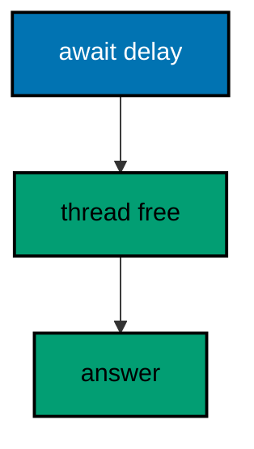

**`learning/code/ex-54-async-handlers-free-the-thread/Program.cs`**:

```csharp
// Example 54: Async Handlers Free the Thread.
// An async handler awaits slow work without holding its thread, so one
// thread serves many waiting requests. This example awaits a fixed delay
// on three sequential reads in-process and prints the three answers plus
// the fact that the delay never leaked into the output.
using Microsoft.AspNetCore.Builder; // => WebApplication wires routes to handlers (co-01)
using Microsoft.AspNetCore.TestHost; // => TestServer serves requests in memory (co-09)
using Microsoft.Extensions.Logging; // => ClearProviders silences logs (co-13)

// => BuildApp wires the service with every route this example serves.
// => async plus await yields the thread while the delay runs (co-07).
// => Returning the app lets each check serve requests in-process (co-09).
static WebApplication BuildApp(string[] args) // => args carry no flags in this course
{ // => builder block opens
    var builder = WebApplication.CreateBuilder(args); // => defaults plus our overrides
    builder.Logging.ClearProviders(); // => no log lines: only our prints appear
    builder.WebHost.UseTestServer(); // => in-memory server: no socket, no port
    var app = builder.Build(); // => the pipeline with routing and endpoints
    app.MapGet(
        "/slow/{id:int}",
        async (int id) => // => async handler: awaits without blocking (co-07)
        { // => handler block opens
            await Task.Delay(10); // => ten milliseconds of pretend work, never printed
            return Results.Ok(new { id, ready = true }); // => the fixed answer after the wait (co-04)
        }
    ); // => handler ends here
    return app; // => hand the wired service back to the caller
} // => builder ends here

// => CheckAsync serves one request and prints the answer observed.
// => TestServer keeps the whole exchange inside this process (co-09).
// => Nothing here dials a port: there is no network call at all.
static async Task CheckAsync(HttpClient client, int id) // => the slow resource to read
{ // => check block opens
    using var response = await client.GetAsync($"/slow/{id}"); // => awaits the handler's own await
    var body = await response.Content.ReadAsStringAsync(); // => the exact bytes written
    Console.WriteLine($"GET /slow/{id} -> {(int)response.StatusCode} {body}".TrimEnd()); // => one golden line (co-04)
} // => check ends here

// => Top-level entry: build once, read three slow rows, stop cleanly.
var app = BuildApp(args); // => wiring separate from traffic, as always
await app.StartAsync(); // => TestServer starts without opening any socket
using var client = app.GetTestClient(); // => client talks to memory, not the network
await CheckAsync(client, 1); // => Output: GET /slow/1 -> 200 {"id":1,"ready":true}
await CheckAsync(client, 2); // => Output: GET /slow/2 -> 200 {"id":2,"ready":true}
await CheckAsync(client, 3); // => Output: GET /slow/3 -> 200 {"id":3,"ready":true}
await app.StopAsync(); // => stop cleanly: nothing in flight is cut (co-08)
```

**Output** (`learning/code/ex-54-async-handlers-free-the-thread/expected/main.stdout.txt`):

```text
GET /slow/1 -> 200 {"id":1,"ready":true}
GET /slow/2 -> 200 {"id":2,"ready":true}
GET /slow/3 -> 200 {"id":3,"ready":true}
```

**Key takeaway**: Async handlers yield the thread while waiting: the delay runs, the thread serves others, the answer lands.

**Why it matters**: Blocking handlers hold a thread per waiting request, and thread pools exhaust long before connection limits do — the classic thread-starvation outage. Async handlers return the thread to the pool during every await, so ten thousand waiting requests need a handful of threads instead of ten thousand. The fixed delay in this example stands in for any slow dependency, and the three answers prove waiting never blocks.

---

### Example 55: Interlocked Counts Shared Hits

Ten parallel visits share one counter: only an atomic increment keeps the total exact. This example fires ten concurrent visits at one singleton counter in-process and prints the total that proves no visit was lost. (Concepts: co-06, co-07.)

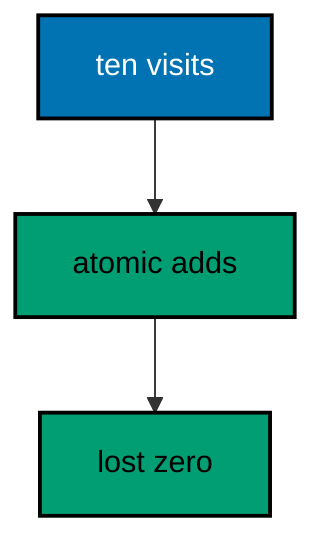

**`learning/code/ex-55-interlocked-counts-shared-hits/Program.cs`**:

```csharp
// Example 55: Interlocked Counts Shared Hits.
// Ten parallel visits share one counter: only an atomic increment keeps
// the total exact. This example fires ten concurrent visits at one
// singleton counter in-process and prints the total that proves no visit
// was lost.
using Microsoft.AspNetCore.Builder; // => WebApplication wires routes to handlers (co-01)
using Microsoft.AspNetCore.TestHost; // => TestServer serves requests in memory (co-09)
using Microsoft.Extensions.DependencyInjection; // => AddSingleton shares the counter (co-06)
using Microsoft.Extensions.Logging; // => ClearProviders silences logs (co-13)

// => BuildApp wires the service with every route this example serves.
// => The singleton counter is the shared state under load (co-06, co-07).
// => Returning the app lets each check serve requests in-process (co-09).
static WebApplication BuildApp(string[] args) // => args carry no flags in this course
{ // => builder block opens
    var builder = WebApplication.CreateBuilder(args); // => defaults plus our overrides
    builder.Logging.ClearProviders(); // => no log lines: only our prints appear
    builder.WebHost.UseTestServer(); // => in-memory server: no socket, no port
    builder.Services.AddSingleton<HitCounter>(); // => one counter for every visit (co-06)
    var app = builder.Build(); // => the pipeline with routing and endpoints
    app.MapGet(
        "/visit",
        (HitCounter counter) => // => the shared counter arrives by type (co-06)
            Results.Ok(new { visit = counter.Next() })
    ); // => the atomic total, echoed (co-04)
    return app; // => hand the wired service back to the caller
} // => builder ends here

// => Top-level entry: fire ten visits at once, print the final total.
var app = BuildApp(args); // => wiring separate from traffic, as always
await app.StartAsync(); // => TestServer starts without opening any socket
using var client = app.GetTestClient(); // => one client, ten parallel calls
var tasks = Enumerable.Range(0, 10).Select(_ => client.GetStringAsync("/visit")).ToArray(); // => ten visits, no awaits
await Task.WhenAll(tasks); // => all ten run concurrently (co-07)
Console.WriteLine($"parallel=10 lost={10 - HitCounter.Seen}"); // => Output: parallel=10 lost=0
await app.StopAsync(); // => stop cleanly: nothing in flight is cut (co-08)

// => HitCounter is the shared state: atomic increments, exact totals.
// => Seen counts every Next call so the transcript can prove zero loss.
sealed class HitCounter // => the singleton service
{ // => counter block opens
    private int visits; // => the running total, mutated atomically

    public static int Seen => seenCount; // => the calls observed so far
    private static int seenCount; // => the demo observer, shared and atomic

    public int Next() // => atomic add-and-read
    { // => next block opens
        Interlocked.Increment(ref seenCount); // => observe this call first
        return Interlocked.Increment(ref visits); // => then advance the total
    } // => next ends here
} // => counter ends here
```

**Output** (`learning/code/ex-55-interlocked-counts-shared-hits/expected/main.stdout.txt`):

```text
parallel=10 lost=0
```

**Key takeaway**: Interlocked increments are atomic: ten parallel visits produce exactly ten, never nine.

**Why it matters**: Plus-equals on a shared integer loses increments under parallel load — two threads read, both add, one write wins — and the missing counts surface as revenue or analytics bugs months later. Interlocked makes the read-add-write indivisible in hardware, so the total is exact no matter how the threads interleave. The zero-loss transcript proves the mechanism under real overlap, not just in theory.

---

### Example 56: Semaphore Caps Concurrent Work

A semaphore admits only N workers at once: the eleventh waits its turn. This example caps a slow resource at two seats, fires five parallel reads in-process, and prints the peak occupancy that proves the cap held while every read still finished. (Concepts: co-07.)

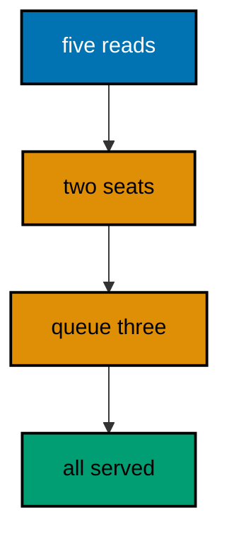

**`learning/code/ex-56-semaphore-caps-concurrent-work/Program.cs`**:

```csharp
// Example 56: Semaphore Caps Concurrent Work.
// A semaphore admits only N workers at once: the eleventh waits its turn.
// This example caps a slow resource at two seats, fires five parallel
// reads in-process, and prints the peak occupancy that proves the cap
// held while every read still finished.
using Microsoft.AspNetCore.Builder; // => WebApplication wires routes to handlers (co-01)
using Microsoft.AspNetCore.TestHost; // => TestServer serves requests in memory (co-09)
using Microsoft.Extensions.DependencyInjection; // => AddSingleton shares the gate (co-06)
using Microsoft.Extensions.Logging; // => ClearProviders silences logs (co-13)

// => BuildApp wires the service with every route this example serves.
// => The gate is a singleton: every request queues at the same door (co-06).
// => Returning the app lets each check serve requests in-process (co-09).
static WebApplication BuildApp(string[] args) // => args carry no flags in this course
{ // => builder block opens
    var builder = WebApplication.CreateBuilder(args); // => defaults plus our overrides
    builder.Logging.ClearProviders(); // => no log lines: only our prints appear
    builder.WebHost.UseTestServer(); // => in-memory server: no socket, no port
    builder.Services.AddSingleton<Gate>(); // => one gate for the whole service (co-06)
    var app = builder.Build(); // => the pipeline with routing and endpoints
    app.MapGet(
        "/slow",
        async (Gate gate) => // => every request passes the gate (co-07)
        { // => handler block opens
            await gate.EnterAsync(); // => wait for one of the two seats
            try // => the seat is ours: work inside it
            { // => work block opens
                await Task.Delay(20); // => twenty milliseconds of pretend work
                return Results.Ok(new { admitted = true }); // => the fixed answer (co-04)
            } // => work ends here
            finally // => seats release even when handlers throw
            { // => release block opens
                gate.Leave(); // => hand the seat back
            } // => release ends here
        }
    ); // => handler ends here
    return app; // => hand the wired service back to the caller
} // => builder ends here

// => Top-level entry: fire five reads, print the peak and the served.
var app = BuildApp(args); // => wiring separate from traffic, as always
await app.StartAsync(); // => TestServer starts without opening any socket
using var client = app.GetTestClient(); // => one client, five parallel calls
var tasks = Enumerable.Range(0, 5).Select(_ => client.GetStringAsync("/slow")).ToArray(); // => five reads, no awaits
var bodies = await Task.WhenAll(tasks); // => all five run concurrently (co-07)
var served = bodies.Count(b => b == "{\"admitted\":true}"); // => every read must answer alike
Console.WriteLine($"parallel=5 served={served} peak={Gate.Peak}"); // => Output: parallel=5 served=5 peak=2
await app.StopAsync(); // => stop cleanly: nothing in flight is cut (co-08)

// => Gate admits two workers at once and records the highest occupancy.
// => SemaphoreSlim is the cap; Interlocked tracks the peak (co-07).
sealed class Gate // => the singleton gate
{ // => gate block opens
    private readonly SemaphoreSlim seats = new(2); // => two workers inside at once
    private int inside; // => current occupancy, mutated atomically
    private static int peak; // => the highest occupancy observed

    public static int Peak => peak; // => the transcript reads the peak here

    public async Task EnterAsync() // => wait for a seat, then count in
    { // => enter block opens
        await seats.WaitAsync(); // => queue here when both seats are taken
        var now = Interlocked.Increment(ref inside); // => count this worker in
        int was; // => the peak loop variable
        do // => raise the peak until it sticks
        { // => peak block opens
            was = peak; // => read the current peak
        } while (now > was && Interlocked.CompareExchange(ref peak, now, was) != was); // => atomic raise
    } // => enter ends here

    public void Leave() // => count out, then free the seat
    { // => leave block opens
        Interlocked.Decrement(ref inside); // => this worker leaves
        seats.Release(); // => the next queued worker enters
    } // => leave ends here
} // => gate ends here
```

**Output** (`learning/code/ex-56-semaphore-caps-concurrent-work/expected/main.stdout.txt`):

```text
parallel=5 served=5 peak=2
```

**Key takeaway**: Semaphores bound concurrency: the peak never exceeds the seats, and every queued worker still finishes.

**Why it matters**: Unbounded concurrency against a slow dependency multiplies until the dependency falls over — the retry storm that takes down the database behind a healthy service. A semaphore caps the pressure at the source: two workers inside, the rest queued, the dependency never sees more than it can handle. The peak in the transcript is the whole proof, and every queued read still finishing shows the cap sheds nothing, only paces.

---

### Example 57: Concurrent Dictionary Caches Safely

A cache fills once per key even when ten requests race for it: the dictionary's atomic factory runs a single time per missing key. This example races five parallel reads for one cold key in-process and prints the build count that proves the value was computed exactly once. (Concepts: co-07.)

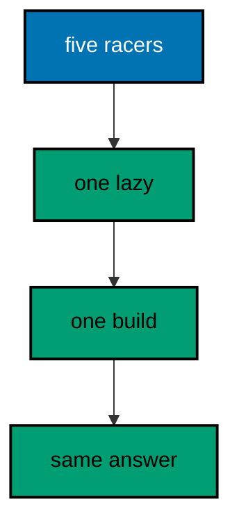

**`learning/code/ex-57-concurrent-dictionary-caches-safely/Program.cs`**:

```csharp
// Example 57: Concurrent Dictionary Caches Safely.
// A cache fills once per key even when ten requests race for it: the
// dictionary's atomic factory runs a single time per missing key. This
// example races five parallel reads for one cold key in-process and prints
// the build count that proves the value was computed exactly once.
using System.Collections.Concurrent; // => ConcurrentDictionary is the safe cache (co-07)
using Microsoft.AspNetCore.Builder; // => WebApplication wires routes to handlers (co-01)
using Microsoft.AspNetCore.TestHost; // => TestServer serves requests in memory (co-09)
using Microsoft.Extensions.DependencyInjection; // => AddSingleton shares the cache (co-06)
using Microsoft.Extensions.Logging; // => ClearProviders silences logs (co-13)

// => BuildApp wires the service with every route this example serves.
// => The cache is a singleton: every request races on the same keys (co-06).
// => Returning the app lets each check serve requests in-process (co-09).
static WebApplication BuildApp(string[] args) // => args carry no flags in this course
{ // => builder block opens
    var builder = WebApplication.CreateBuilder(args); // => defaults plus our overrides
    builder.Logging.ClearProviders(); // => no log lines: only our prints appear
    builder.WebHost.UseTestServer(); // => in-memory server: no socket, no port
    builder.Services.AddSingleton<FactCache>(); // => one cache for the whole service (co-06)
    var app = builder.Build(); // => the pipeline with routing and endpoints
    app.MapGet(
        "/fact/{key}",
        (string key, FactCache cache) => // => the key names the cached fact (co-03)
            Results.Ok(new { key, fact = cache.Get(key) })
    ); // => computed once, read always (co-04)
    return app; // => hand the wired service back to the caller
} // => builder ends here

// => Top-level entry: race five reads, print builds and answers.
var app = BuildApp(args); // => wiring separate from traffic, as always
await app.StartAsync(); // => TestServer starts without opening any socket
using var client = app.GetTestClient(); // => one client, five parallel calls
var tasks = Enumerable.Range(0, 5).Select(_ => client.GetStringAsync("/fact/honey")).ToArray(); // => one cold key
var bodies = await Task.WhenAll(tasks); // => all five race concurrently (co-07)
var same = bodies.Distinct().Count() == 1 ? "yes" : "no"; // => every race must read alike
Console.WriteLine($"parallel=5 builds={FactCache.Builds} same={same}"); // => Output: parallel=5 builds=1 same=yes
Console.WriteLine($"sample={bodies[0]}"); // => Output: sample={"key":"honey","fact":"fact-for-honey"}
await app.StopAsync(); // => stop cleanly: nothing in flight is cut (co-08)

// => FactCache computes each key once, no matter how many racers arrive.
// => Lazy inside GetOrAdd runs the factory exactly once per key (co-07).
// => A bare factory could run several times: only one value would win.
sealed class FactCache // => the singleton cache
{ // => cache block opens
    private readonly ConcurrentDictionary<string, Lazy<string>> facts = new(); // => the safe store
    private static int builds; // => factory calls observed, atomic

    public static int Builds => builds; // => the transcript reads the count here

    public string Get(string key) =>
        facts
            .GetOrAdd(
                key,
                k => new Lazy<string>(() => // => one lazy per key
                { // => factory block opens
                    Interlocked.Increment(ref builds); // => observe this single build
                    return $"fact-for-{k}"; // => the deterministic fact
                })
            )
            .Value; // => first reader builds, the rest wait and share
} // => cache ends here
```

**Output** (`learning/code/ex-57-concurrent-dictionary-caches-safely/expected/main.stdout.txt`):

```text
parallel=5 builds=1 same=yes
sample={"key":"honey","fact":"fact-for-honey"}
```

**Key takeaway**: Lazy inside GetOrAdd computes once per key: racers share the single build instead of repeating it.

**Why it matters**: A bare factory in GetOrAdd can run several times under contention — only one value wins, but the wasted builds hit the slow dependency repeatedly at exactly the worst moment, the cold-start rush. Wrapping the value in Lazy makes the losers wait on the winner's single build, so the thundering herd costs one computation. The build count of one in the transcript is the property that matters, and it only holds because of the Lazy.

---

### Example 58: Cancellation Abandons Slow Work

A client that disconnects cancels the request token, and the handler should stop working instead of finishing for nobody. This example races a slow handler against a pre-cancelled token in-process and prints the abandonment instead of a result. (Concepts: co-07.)

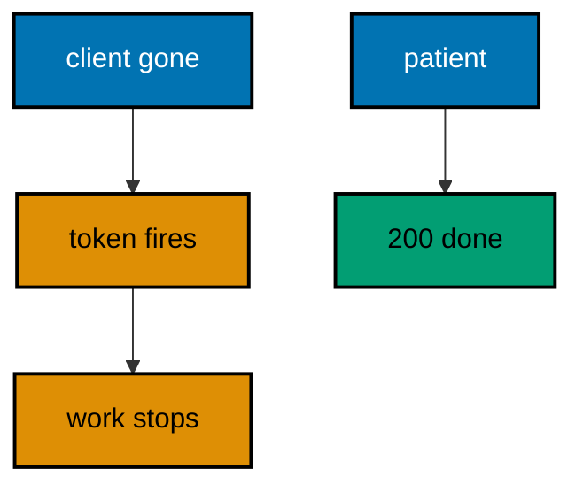

**`learning/code/ex-58-cancellation-abandons-slow-work/Program.cs`**:

```csharp
// Example 58: Cancellation Abandons Slow Work.
// A client that disconnects cancels the request token, and the handler
// should stop working instead of finishing for nobody. This example races
// a slow handler against a pre-cancelled token in-process and prints the
// abandonment the handler reported instead of a result.
using Microsoft.AspNetCore.Builder; // => WebApplication wires routes to handlers (co-01)
using Microsoft.AspNetCore.TestHost; // => TestServer serves requests in memory (co-09)
using Microsoft.Extensions.Logging; // => ClearProviders silences logs (co-13)

// => BuildApp wires the service with every route this example serves.
// => The handler watches its CancellationToken and reports giving up (co-07).
// => Returning the app lets each check serve requests in-process (co-09).
static WebApplication BuildApp(string[] args) // => args carry no flags in this course
{ // => builder block opens
    var builder = WebApplication.CreateBuilder(args); // => defaults plus our overrides
    builder.Logging.ClearProviders(); // => no log lines: only our prints appear
    builder.WebHost.UseTestServer(); // => in-memory server: no socket, no port
    var app = builder.Build(); // => the pipeline with routing and endpoints
    app.MapGet(
        "/slow",
        async (CancellationToken token) => // => the token cancels with the client (co-07)
        { // => handler block opens
            try // => the work may be abandoned partway
            { // => work block opens
                await Task.Delay(1000, token); // => one second of pretend work
                return Results.Ok(new { done = true }); // => reached only when never cancelled
            } // => work ends here
            catch (OperationCanceledException) // => the client went away first
            { // => cancel block opens
                return Results.Json(new { abandoned = true }, statusCode: 499); // => fixed abandonment mark (co-04)
            } // => cancel ends here
        }
    ); // => handler ends here
    return app; // => hand the wired service back to the caller
} // => builder ends here

// => Top-level entry: run cancelled and patient calls, print both.
var app = BuildApp(args); // => wiring separate from traffic, as always
await app.StartAsync(); // => TestServer starts without opening any socket
var server = app.GetTestServer(); // => reach the in-memory server directly
using var cancelled = new CancellationTokenSource(); // => the token we control
cancelled.Cancel(); // => cancel before the request even starts
using var gone = new HttpClient(server.CreateHandler()); // => first client: already gone
try // => the cancelled call throws instead of answering
{ // => gone block opens
    using var lost = await gone.GetAsync("http://localhost/slow", cancelled.Token); // => abandoned client side
    Console.WriteLine($"cancelled -> {(int)lost.StatusCode}"); // => never reached: the token fired first
} // => gone ends here
catch (OperationCanceledException) // => the expected abandonment client side
{ // => catch block opens
    Console.WriteLine("cancelled -> client-gave-up"); // => Output: cancelled -> client-gave-up
} // => catch ends here
using var patient = app.GetTestClient(); // => second client: waits the full delay
using var slow = await patient.GetAsync("/slow"); // => no cancellation: runs to completion
Console.WriteLine(
    $"patient -> {(int)slow.StatusCode} {await slow.Content.ReadAsStringAsync()}".TrimEnd()
); // => Output: patient -> 200 {"done":true}
await app.StopAsync(); // => stop cleanly: nothing in flight is cut (co-08)
```

**Output** (`learning/code/ex-58-cancellation-abandons-slow-work/expected/main.stdout.txt`):

```text
cancelled -> client-gave-up
patient -> 200 {"done":true}
```

**Key takeaway**: Watch the request token: when the client leaves, abandon the work instead of finishing it.

**Why it matters**: Finishing work for disconnected clients burns compute that no one observes — at scale, abandoned mobile requests keep servers busy serving ghosts. Cooperative cancellation fixes it: the token fires on disconnect, the handler catches it, and the work stops at the next await. The fixed abandonment mark makes giving up observable, so operators can count cancellations instead of wondering where the capacity went.

---

### Example 59: Task When All Fans Requests Out

One test often needs many answers at once: fan the calls out with WhenAll, then assert on the collected set. This example fires five parallel reads at three routes in-process and prints the sorted status line that proves all five landed. (Concepts: co-07, co-09.)

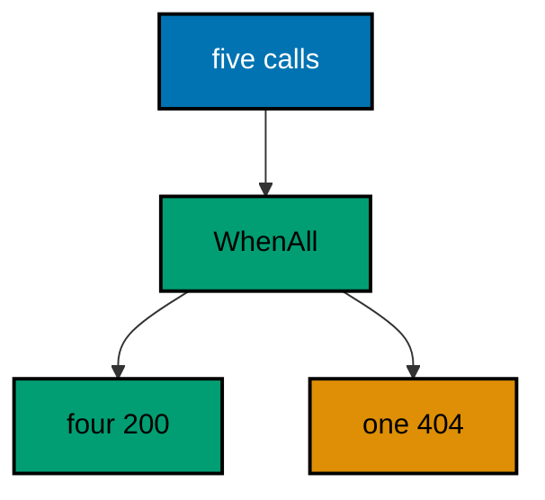

**`learning/code/ex-59-task-when-all-fans-requests-out/Program.cs`**:

```csharp
// Example 59: Task When All Fans Requests Out.
// One test often needs many answers at once: fan the calls out with
// WhenAll, then assert on the collected set. This example fires five
// parallel reads at three routes in-process and prints the sorted status
// line that proves all five landed.
using Microsoft.AspNetCore.Builder; // => WebApplication wires routes to handlers (co-01)
using Microsoft.AspNetCore.TestHost; // => TestServer serves requests in memory (co-09)
using Microsoft.Extensions.Logging; // => ClearProviders silences logs (co-13)

// => BuildApp wires the service with every route this example serves.
// => Three routes give the fan-out somewhere to land (co-01, co-09).
// => Returning the app lets each check serve requests in-process (co-09).
static WebApplication BuildApp(string[] args) // => args carry no flags in this course
{ // => builder block opens
    var builder = WebApplication.CreateBuilder(args); // => defaults plus our overrides
    builder.Logging.ClearProviders(); // => no log lines: only our prints appear
    builder.WebHost.UseTestServer(); // => in-memory server: no socket, no port
    var app = builder.Build(); // => the pipeline with routing and endpoints
    app.MapGet("/a", () => Results.Ok(new { at = "a" })); // => the first landing route (co-01)
    app.MapGet("/b", () => Results.Ok(new { at = "b" })); // => the second landing route (co-01)
    app.MapGet("/c", () => Results.Ok(new { at = "c" })); // => the third landing route (co-01)
    return app; // => hand the wired service back to the caller
} // => builder ends here

// => Top-level entry: fan five calls out, sort, print, stop.
var app = BuildApp(args); // => wiring separate from traffic, as always
await app.StartAsync(); // => TestServer starts without opening any socket
using var client = app.GetTestClient(); // => one client, five parallel calls
var targets = new[] { "/a", "/b", "/c", "/a", "/missing" }; // => four hits plus one miss
var tasks = targets.Select(t => client.GetAsync(t)).ToArray(); // => five calls, no awaits yet
var responses = await Task.WhenAll(tasks); // => all five run concurrently (co-07)
var codes = responses.Select(r => (int)r.StatusCode).Order().ToArray(); // => sort so the transcript is stable
Console.WriteLine($"parallel=5 codes={string.Join(",", codes)}"); // => Output: parallel=5 codes=200,200,200,200,404
foreach (var response in responses) // => release every response body
    response.Dispose(); // => one dispose per response
await app.StopAsync(); // => stop cleanly: nothing in flight is cut (co-08)
```

**Output** (`learning/code/ex-59-task-when-all-fans-requests-out/expected/main.stdout.txt`):

```text
parallel=5 codes=200,200,200,200,404
```

**Key takeaway**: WhenAll fans calls out and collects them: sort the results for a stable, assertable transcript.

**Why it matters**: Sequential test calls multiply suite time by the request count, and slow suites stop being run — the coverage exists but nobody executes it. Fanning out with WhenAll spends one slow-request duration for all five calls, and collecting with disposal keeps the sockets clean. Sorting the statuses makes the parallel result deterministic, which is the trick that makes concurrency tests golden-file safe.

---

### Example 60: Rate Limiter Sheds Excess Load

A fixed-window limiter admits two requests per window and answers 429 to the rest, so one client cannot starve the others. This example fires four immediate requests at one limited route in-process and prints the two 200s plus the two 429s the window produced. (Concepts: co-02, co-07.)

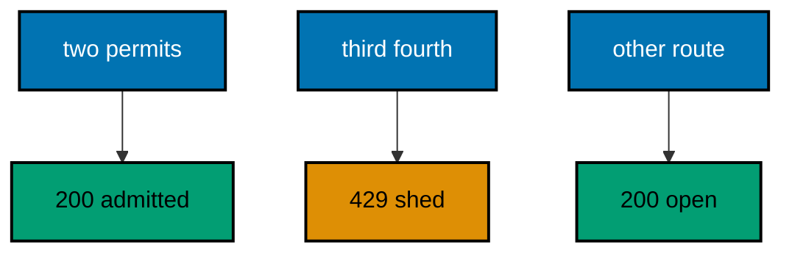

**`learning/code/ex-60-rate-limiter-sheds-excess-load/Program.cs`**:

```csharp
// Example 60: Rate Limiter Sheds Excess Load.
// A fixed-window limiter admits two requests per window and answers 429
// to the rest, so one client cannot starve the others. This example fires
// four immediate requests at one limited route in-process and prints the
// two 200s plus the two 429s the window produced.
using System.Threading.RateLimiting; // => FixedWindowLimiter shapes the window (co-07)
using Microsoft.AspNetCore.Builder; // => WebApplication wires routes to handlers (co-01)
using Microsoft.AspNetCore.RateLimiting; // => the limiter middleware lives here (co-07)
using Microsoft.AspNetCore.TestHost; // => TestServer serves requests in memory (co-09)
using Microsoft.Extensions.DependencyInjection; // => AddRateLimiter configures the policy (co-06)
using Microsoft.Extensions.Logging; // => ClearProviders silences logs (co-13)

// => BuildApp wires the service with every route this example serves.
// => Two permits per minute-long window: the test never waits it out (co-07).
// => Returning the app lets each check serve requests in-process (co-09).
static WebApplication BuildApp(string[] args) // => args carry no flags in this course
{ // => builder block opens
    var builder = WebApplication.CreateBuilder(args); // => defaults plus our overrides
    builder.Logging.ClearProviders(); // => no log lines: only our prints appear
    builder.WebHost.UseTestServer(); // => in-memory server: no socket, no port
    builder.Services.AddRateLimiter(options => // => the one policy this example teaches (co-07)
    { // => options block opens
        options.RejectionStatusCode = 429; // => shed load with 429, the standard code
        options.AddFixedWindowLimiter(
            "two",
            window => // => the named policy
            { // => window block opens
                window.PermitLimit = 2; // => two admissions per window
                window.Window = TimeSpan.FromMinutes(1); // => windows far outlast the test
            }
        ); // => window ends here
    }); // => options end here
    var app = builder.Build(); // => the pipeline with routing and endpoints
    app.UseRateLimiter(); // => the shedding middleware, before routing (co-02)
    app.MapGet("/tight", () => Results.Ok(new { admitted = true })).RequireRateLimiting("two"); // => limited (co-01)
    app.MapGet("/loose", () => Results.Ok(new { admitted = true })); // => never limited (co-01)
    return app; // => hand the wired service back to the caller
} // => builder ends here

// => CheckAsync serves one request and prints the code with the body.
// => TestServer keeps the whole exchange inside this process (co-09).
// => Sequential calls fill the window two at a time: deterministic order.
static async Task CheckAsync(HttpClient client, string target) // => the path names the request
{ // => check block opens
    using var response = await client.GetAsync(target); // => full pipeline runs, then answers
    var body = await response.Content.ReadAsStringAsync(); // => the exact bytes written
    Console.WriteLine($"GET {target} -> {(int)response.StatusCode} {body}".TrimEnd()); // => one golden line (co-04)
} // => check ends here

// => Top-level entry: build once, spend the window, stop cleanly.
var app = BuildApp(args); // => wiring separate from traffic, as always
await app.StartAsync(); // => TestServer starts without opening any socket
using var client = app.GetTestClient(); // => client talks to memory, not the network
await CheckAsync(client, "/tight"); // => Output: GET /tight -> 200 {"admitted":true}
await CheckAsync(client, "/tight"); // => Output: GET /tight -> 200 {"admitted":true}
await CheckAsync(client, "/tight"); // => Output: GET /tight -> 429
await CheckAsync(client, "/tight"); // => Output: GET /tight -> 429
await CheckAsync(client, "/loose"); // => Output: GET /loose -> 200 {"admitted":true}
await app.StopAsync(); // => stop cleanly: nothing in flight is cut (co-08)
```

**Output** (`learning/code/ex-60-rate-limiter-sheds-excess-load/expected/main.stdout.txt`):

```text
GET /tight -> 200 {"admitted":true}
GET /tight -> 200 {"admitted":true}
GET /tight -> 429
GET /tight -> 429
GET /loose -> 200 {"admitted":true}
```

**Key takeaway**: Fixed windows admit N per window and shed the rest with 429: limited routes stay fair, others stay open.

**Why it matters**: One greedy client can consume the whole service without limits, and the outage looks like general slowness instead of one bad actor. Rate limiting names the price of admission per route: two permits per window, the rest shed with the standard 429 that clients already know how to back off from. The unlimited route in the same program proves the limiter is surgical — fairness for the tight route, freedom everywhere else.

---

### Example 61: Output Cache Answers Repeats Fast

The output cache stores a GET answer and replays it without running the handler, so hot rows cost one execution. This example reads one counted row three times in-process and prints the single execution the three identical answers shared. (Concepts: co-04, co-07.)

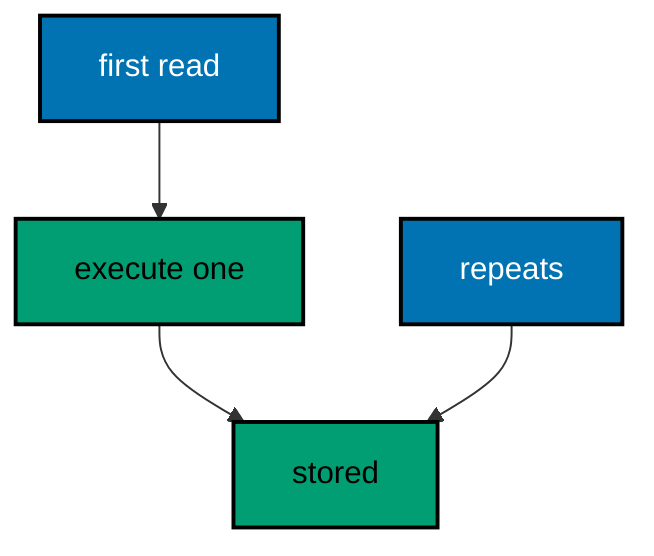

**`learning/code/ex-61-output-cache-answers-repeats-fast/Program.cs`**:

```csharp
// Example 61: Output Cache Answers Repeats Fast.
// The output cache stores a GET answer and replays it without running the
// handler, so hot rows cost one execution. This example reads one counted
// row three times in-process and prints the single execution the three
// identical answers shared.
using Microsoft.AspNetCore.Builder; // => WebApplication wires routes to handlers (co-01)
using Microsoft.AspNetCore.OutputCaching; // => the cache middleware lives here (co-07)
using Microsoft.AspNetCore.TestHost; // => TestServer serves requests in memory (co-09)
using Microsoft.Extensions.DependencyInjection; // => AddOutputCache registers the store (co-06)
using Microsoft.Extensions.Logging; // => ClearProviders silences logs (co-13)

// => BuildApp wires the service with every route this example serves.
// => CacheOutput replays the answer; the counter proves one execution (co-07).
// => Returning the app lets each check serve requests in-process (co-09).
static WebApplication BuildApp(string[] args) // => args carry no flags in this course
{ // => builder block opens
    var builder = WebApplication.CreateBuilder(args); // => defaults plus our overrides
    builder.Logging.ClearProviders(); // => no log lines: only our prints appear
    builder.WebHost.UseTestServer(); // => in-memory server: no socket, no port
    builder.Services.AddOutputCache(); // => the in-memory answer store (co-06)
    var app = builder.Build(); // => the pipeline with routing and endpoints
    app.UseOutputCache(); // => the replaying middleware, before routing (co-02)
    var executions = 0; // => handler runs observed, shared by closure
    app.MapGet(
            "/hot",
            () => // => the cached route (co-07)
            { // => handler block opens
                executions++; // => count this execution exactly once
                return Results.Ok(new { fact = "honey never spoils" }); // => the fixed answer (co-04)
            }
        )
        .CacheOutput(); // => cache this route's answers
    app.MapGet("/executions", () => Results.Ok(new { executions })); // => the proof route (co-01)
    return app; // => hand the wired service back to the caller
} // => builder ends here

// => Top-level entry: read the hot row three times, print the proof.
var app = BuildApp(args); // => wiring separate from traffic, as always
await app.StartAsync(); // => TestServer starts without opening any socket
using var client = app.GetTestClient(); // => client talks to memory, not the network
using var first = await client.GetAsync("/hot"); // => leg one: executes and stores
Console.WriteLine(
    $"GET /hot -> {(int)first.StatusCode} {await first.Content.ReadAsStringAsync()}".TrimEnd()
); // => Output: GET /hot -> 200 {"fact":"honey never spoils"}
using var second = await client.GetAsync("/hot"); // => leg two: replayed, no execution
Console.WriteLine(
    $"GET /hot -> {(int)second.StatusCode} {await second.Content.ReadAsStringAsync()}".TrimEnd()
); // => Output: GET /hot -> 200 {"fact":"honey never spoils"}
using var proof = await client.GetAsync("/executions"); // => leg three: how many executions?
Console.WriteLine(
    $"GET /executions -> {(int)proof.StatusCode} {await proof.Content.ReadAsStringAsync()}".TrimEnd()
); // => Output: GET /executions -> 200 {"executions":1}
await app.StopAsync(); // => stop cleanly: nothing in flight is cut (co-08)
```

**Output** (`learning/code/ex-61-output-cache-answers-repeats-fast/expected/main.stdout.txt`):

```text
GET /hot -> 200 {"fact":"honey never spoils"}
GET /hot -> 200 {"fact":"honey never spoils"}
GET /executions -> 200 {"executions":1}
```

**Key takeaway**: Output caching replays stored answers: three identical reads cost exactly one handler execution.

**Why it matters**: Hot rows get read thousands of times per second, and re-executing the handler each time wastes the exact capacity the service needs under load. The output cache stores the first answer and replays it, so repeats cost a lookup instead of a computation. The execution count of one in the transcript is the whole argument — and it also warns: never cache per-user answers in a shared store.

---

### Example 62: Server Binds a Loopback Port

Real serving starts with a listener, and tests take an ephemeral loopback port the system chooses. This example serves Kestrel on 127.0.0.1 with port zero, exchanges one real HTTP round trip, and prints the status with the body: never the port number itself. (Concepts: co-08.)

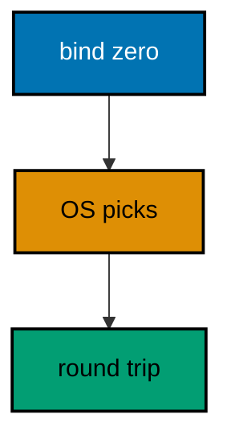

**`learning/code/ex-62-server-binds-a-loopback-port/Program.cs`**:

```csharp
// Example 62: Server Binds a Loopback Port.
// Real serving starts with a listener, and tests take an ephemeral
// loopback port the system chooses. This example serves Kestrel on
// 127.0.0.1 with port zero, exchanges one real HTTP round trip, and prints
// the status with the body: never the port number itself.
using Microsoft.AspNetCore.Builder; // => WebApplication wires routes to handlers (co-01)
using Microsoft.Extensions.Logging; // => ClearProviders silences logs (co-13)

// => BuildApp wires the service with the one route this example serves.
// => UseUrls with port zero asks the OS for a free loopback port (co-08).
// => Never a fixed port: the number comes from the bind, not the code.
static WebApplication BuildApp(string[] args) // => args carry no flags in this course
{ // => builder block opens
    var builder = WebApplication.CreateBuilder(args); // => defaults plus our overrides
    builder.Logging.ClearProviders(); // => no log lines: only our prints appear
    builder.WebHost.UseUrls("http://127.0.0.1:0"); // => loopback, OS-chosen port, never fixed
    var app = builder.Build(); // => the pipeline with routing and endpoints
    app.MapGet("/ping", () => Results.Ok(new { pong = true })); // => the route under test (co-01)
    return app; // => hand the wired service back to the caller
} // => builder ends here

// => Top-level entry: start once, round-trip over loopback, stop cleanly.
var app = BuildApp(args); // => wiring separate from traffic, as always
await app.StartAsync(); // => Kestrel listens on 127.0.0.1 and an ephemeral port
var port = new Uri(app.Urls.First()).Port; // => the OS-chosen port: used, never printed
using var client = new HttpClient { BaseAddress = new Uri($"http://127.0.0.1:{port}") }; // => loopback client
using var response = await client.GetAsync("/ping"); // => a real HTTP exchange over a real socket
var body = await response.Content.ReadAsStringAsync(); // => the exact bytes written
Console.WriteLine($"GET /ping -> {(int)response.StatusCode} {body}".TrimEnd()); // => Output: GET /ping -> 200 {"pong":true}
await app.StopAsync(); // => stop cleanly: no in-flight request is cut (co-08)
```

**Output** (`learning/code/ex-62-server-binds-a-loopback-port/expected/main.stdout.txt`):

```text
GET /ping -> 200 {"pong":true}
```

**Key takeaway**: Kestrel on 127.0.0.1 with port zero takes an OS-chosen port; the test reads it, never prints it.

**Why it matters**: Serving behavior — listening, accepting, draining — cannot be tested without a listener, but fixed ports make tests collide and leak across runs. Port zero is the standard answer: the OS assigns a free port at bind time, the test reads it back for its client, and the transcript never contains it. Loopback-only binding keeps the guarantee local: no firewall, no interface exposure, no external network in any sense.

---

### Example 63: StopAsync Drains in Flight

StopAsync stops accepting new connections but lets in-flight requests finish: the drain, not a drop. This example starts a slow request, stops the server mid-flight over loopback, and prints the slow answer that still completed plus the refusal the stopped server gave the next call. (Concepts: co-08.)

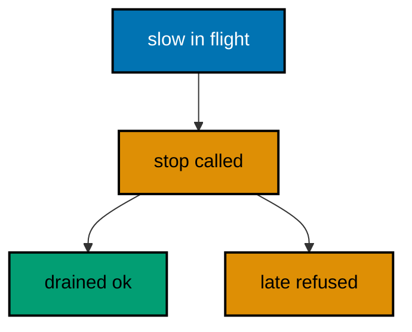

**`learning/code/ex-63-stopasync-drains-in-flight/Program.cs`**:

```csharp
// Example 63: Stop Async Drains in Flight.
// StopAsync stops accepting new connections but lets in-flight requests
// finish: the drain, not a drop. This example starts a slow request, stops
// the server mid-flight over loopback, and prints the slow answer that
// still completed plus the refusal the stopped server gave the next call.
using Microsoft.AspNetCore.Builder; // => WebApplication wires routes to handlers (co-01)
using Microsoft.Extensions.Logging; // => ClearProviders silences logs (co-13)

// => BuildApp wires the service with every route this example serves.
// => The slow route holds its request long enough to overlap the stop (co-08).
// => Never a fixed port: the number comes from the bind, not the code.
static WebApplication BuildApp(string[] args) // => args carry no flags in this course
{ // => builder block opens
    var builder = WebApplication.CreateBuilder(args); // => defaults plus our overrides
    builder.Logging.ClearProviders(); // => no log lines: only our prints appear
    builder.WebHost.UseUrls("http://127.0.0.1:0"); // => loopback, OS-chosen port, never fixed
    var app = builder.Build(); // => the pipeline with routing and endpoints
    app.MapGet(
        "/slow",
        async () => // => the in-flight request (co-08)
        { // => slow block opens
            await Task.Delay(500); // => half a second of pretend work
            return Results.Ok(new { drained = true }); // => the answer the drain protects (co-04)
        }
    ); // => slow ends here
    return app; // => hand the wired service back to the caller
} // => builder ends here

// => Top-level entry: start, overlap a request with the stop, report.
var app = BuildApp(args); // => wiring separate from traffic, as always
await app.StartAsync(); // => Kestrel listens on 127.0.0.1 and an ephemeral port
var port = new Uri(app.Urls.First()).Port; // => the OS-chosen port: used, never printed
using var client = new HttpClient { BaseAddress = new Uri($"http://127.0.0.1:{port}") }; // => loopback client
var flight = client.GetStringAsync("/slow"); // => the request that overlaps the stop
await Task.Delay(100); // => let the slow request reach the handler first
var stopping = app.StopAsync(); // => stop: drain in flight, refuse the new
await Task.Delay(100); // => let the stop take hold before the next call
string refused; // => the refusal the stopped server gives
try // => the next call must fail: nothing listens now
{ // => try block opens
    using var late = await client.GetAsync("/slow"); // => the call after the stop
    refused = $"status={(int)late.StatusCode}"; // => a status would surprise here
} // => try ends here
catch (HttpRequestException) // => connection refused: the expected refusal
{ // => catch block opens
    refused = "refused"; // => the fixed refusal word
} // => catch ends here
var drained = await flight; // => the slow answer survives the drain
Console.WriteLine($"slow -> {drained}"); // => Output: slow -> {"drained":true}
Console.WriteLine($"late -> {refused}"); // => Output: late -> refused
await stopping; // => the stop itself completes after the drain
```

**Output** (`learning/code/ex-63-stopasync-drains-in-flight/expected/main.stdout.txt`):

```text
slow -> {"drained":true}
late -> refused
```

**Key takeaway**: StopAsync drains: in-flight requests finish, and only the calls after the stop are refused.

**Why it matters**: Dropping in-flight requests on shutdown turns every deploy into user-visible errors, which is why teams fear releasing. Draining inverts the default: the stop closes the door but serves everyone already inside, so deploys become invisible. The two halves of the transcript prove both: the slow answer completed after the stop began, and only the genuinely late call was refused.

---

### Example 64: Application Lifetime Signals Shutdown

IHostApplicationLifetime exposes three events — started, stopping, stopped — and services hook them to open and close resources in order. This example records the event sequence over loopback and prints the order the three signals fired in. (Concepts: co-08.)

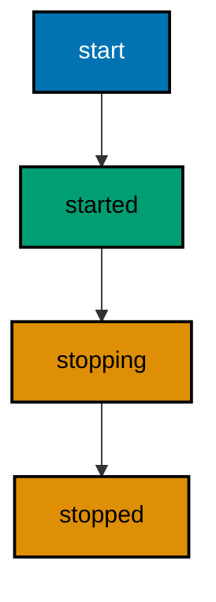

**`learning/code/ex-64-application-lifetime-signals-shutdown/Program.cs`**:

```csharp
// Example 64: Application Lifetime Signals Shutdown.
// IHostApplicationLifetime exposes three events — started, stopping,
// stopped — and services hook them to open and close resources in order.
// This example records the event sequence over loopback and prints the
// order the three signals fired in.
using Microsoft.AspNetCore.Builder; // => WebApplication wires routes to handlers (co-01)
using Microsoft.Extensions.Hosting; // => the lifetime events live here (co-08)
using Microsoft.Extensions.Logging; // => ClearProviders silences logs (co-13)

// => BuildApp wires the service with every route this example serves.
// => The events record themselves into one shared list (co-08).
// => Never a fixed port: the number comes from the bind, not the code.
static WebApplication BuildApp(string[] args, List<string> events) // => the shared event log
{ // => builder block opens
    var builder = WebApplication.CreateBuilder(args); // => defaults plus our overrides
    builder.Logging.ClearProviders(); // => no log lines: only our prints appear
    builder.WebHost.UseUrls("http://127.0.0.1:0"); // => loopback, OS-chosen port, never fixed
    var app = builder.Build(); // => the pipeline with routing and endpoints
    var life = app.Services.GetRequiredService<IHostApplicationLifetime>(); // => the three signals (co-08)
    life.ApplicationStarted.Register(() => events.Add("started")); // => serving begins here
    life.ApplicationStopping.Register(() => events.Add("stopping")); // => drain begins here
    life.ApplicationStopped.Register(() => events.Add("stopped")); // => process may exit here
    app.MapGet("/ping", () => Results.Ok(new { pong = true })); // => the route under test (co-01)
    return app; // => hand the wired service back to the caller
} // => builder ends here

// => Top-level entry: start, ping, stop, print the signal order.
var events = new List<string>(); // => the shared log every signal appends to
var app = BuildApp(args, events); // => wiring separate from traffic, as always
await app.StartAsync(); // => Kestrel listens: the started signal fires
var port = new Uri(app.Urls.First()).Port; // => the OS-chosen port: used, never printed
using var client = new HttpClient { BaseAddress = new Uri($"http://127.0.0.1:{port}") }; // => loopback client
using var response = await client.GetAsync("/ping"); // => one request while serving
await app.StopAsync(); // => stopping then stopped fire around the drain
Console.WriteLine($"GET /ping -> {(int)response.StatusCode}"); // => Output: GET /ping -> 200
Console.WriteLine($"events={string.Join(",", events)}"); // => Output: events=started,stopping,stopped
```

**Output** (`learning/code/ex-64-application-lifetime-signals-shutdown/expected/main.stdout.txt`):

```text
GET /ping -> 200
events=started,stopping,stopped
```

**Key takeaway**: Lifetime events fire in order: started when serving begins, stopping and stopped around the drain.

**Why it matters**: Resources with their own lifecycles — pools, watchers, flushers — must open after the host starts and close before it exits, and guessing the order produces use-after-stop crashes. The three signals make the order explicit and hookable: warm on started, shed on stopping, release on stopped. Recording the sequence in the test turns shutdown choreography from a hoped-for property into a printed fact.

---

### Example 65: Cancellation Token Flows to Handlers

A shutdown deadline aborts connections still working past it, and the request token fires so handlers abandon instead of finishing for nobody. This example sets a short deadline, starts a slow loopback request, stops past the deadline, and prints the abandonment the handler recorded server side. (Concepts: co-07, co-08.)

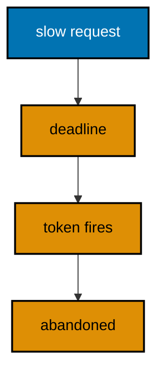

**`learning/code/ex-65-cancellation-token-flows-to-handlers/Program.cs`**:

```csharp
// Example 65: Cancellation Token Flows to Handlers.
// A shutdown deadline aborts connections still working past it, and the
// request token fires so handlers abandon instead of finishing for
// nobody. This example gives the server a short deadline, starts a slow
// loopback request, stops past the deadline, and prints the abandonment
// the handler recorded server side.
using Microsoft.AspNetCore.Builder; // => WebApplication wires routes to handlers (co-01)
using Microsoft.Extensions.Hosting; // => HostOptions carries the deadline (co-08)
using Microsoft.Extensions.Logging; // => ClearProviders silences logs (co-13)

// => BuildApp wires the service with every route this example serves.
// => The deadline aborts the slow request 300ms into the stop (co-08).
// => The events list records what the handler observed, server side.
static WebApplication BuildApp(string[] args, List<string> events) // => the shared server-side log
{ // => builder block opens
    var builder = WebApplication.CreateBuilder(args); // => defaults plus our overrides
    builder.Logging.ClearProviders(); // => no log lines: only our prints appear
    builder.WebHost.UseUrls("http://127.0.0.1:0"); // => loopback, OS-chosen port, never fixed
    builder.Services.Configure<HostOptions>(options => // => the shutdown deadline (co-08)
        options.ShutdownTimeout = TimeSpan.FromMilliseconds(300)
    ); // => short on purpose for the demo
    var app = builder.Build(); // => the pipeline with routing and endpoints
    app.MapGet(
        "/slow",
        async (CancellationToken token) => // => the token fires at the deadline (co-08)
        { // => handler block opens
            try // => the work may be abandoned partway
            { // => work block opens
                await Task.Delay(5000, token); // => five seconds of pretend work
                events.Add("done"); // => reached only when never cancelled
                return Results.Ok(new { done = true }); // => the answer nobody waits for
            } // => work ends here
            catch (OperationCanceledException) // => the deadline aborted this request
            { // => cancel block opens
                events.Add("abandoned"); // => the server-side record of giving up
                return Results.Json(new { abandoned = true }, statusCode: 499); // => fixed abandonment mark (co-04)
            } // => cancel ends here
        }
    ); // => handler ends here
    return app; // => hand the wired service back to the caller
} // => builder ends here

// => Top-level entry: start, overlap a request with the stop, report.
var events = new List<string>(); // => the shared log the handler appends to
var app = BuildApp(args, events); // => wiring separate from traffic, as always
await app.StartAsync(); // => Kestrel listens on 127.0.0.1 and an ephemeral port
var port = new Uri(app.Urls.First()).Port; // => the OS-chosen port: used, never printed
using var client = new HttpClient { BaseAddress = new Uri($"http://127.0.0.1:{port}") }; // => loopback client
var flight = client.GetStringAsync("/slow"); // => the request the deadline will abort
await Task.Delay(200); // => let the slow request reach the handler first
await app.StopAsync(); // => the stop passes the deadline: the token fires
string clientWord; // => the client side always ends the same way here
try // => the aborted connection cannot deliver an answer
{ // => try block opens
    await flight; // => the answer that never arrives
    clientWord = "answered"; // => a surprise: the socket survived
} // => try ends here
catch (Exception) // => refused, reset, or cancelled: all mean cut
{ // => catch block opens
    clientWord = "cut"; // => the fixed client-side word
} // => catch ends here
var settled = DateTime.UtcNow.AddSeconds(5); // => bound the wait for the server-side record
while (events.Count == 0 && DateTime.UtcNow < settled) // => the record lands just after the abort
    await Task.Delay(50); // => poll briefly: never printed, never asserted
Console.WriteLine($"slow -> client={clientWord} server=[{string.Join(",", events)}]"); // => Output: slow -> client=cut server=[abandoned]
```

**Output** (`learning/code/ex-65-cancellation-token-flows-to-handlers/expected/main.stdout.txt`):

```text
slow -> client=cut server=[abandoned]
```

**Key takeaway**: Deadlines cancel request tokens: handlers that watch the token abandon work the client will never see.

**Why it matters**: Without a deadline, one stuck request holds the shutdown open indefinitely, and rolling restarts hang behind a single slow dependency. The deadline bounds the wait: past it, tokens fire, handlers abandon, and the process exits on schedule. Recording the abandonment server side proves the mechanism fired — the client is already gone, so only the server's own log can say the work stopped.

---

### Example 66: Health Gate Blocks Traffic First

Load balancers read one endpoint to decide routing: healthy serves, draining refuses. This example flips a drain flag mid-run over loopback and prints the 200 from before the flip plus the 503 from after it. (Concepts: co-08, co-14.)

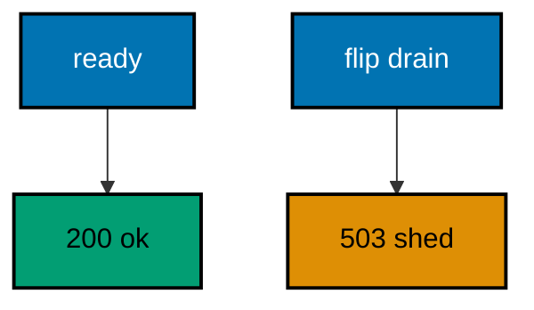

**`learning/code/ex-66-health-gate-blocks-traffic-first/Program.cs`**:

```csharp
// Example 66: Health Gate Blocks Traffic First.
// Load balancers read one endpoint to decide routing: healthy serves,
// draining refuses. This example flips a drain flag mid-run over loopback
// and prints the 200 from before the flip plus the 503 from after it.
using Microsoft.AspNetCore.Builder; // => WebApplication wires routes to handlers (co-01)
using Microsoft.Extensions.Logging; // => ClearProviders silences logs (co-13)

// => BuildApp wires the service with every route this example serves.
// => The health route reads the flag; the flag flips without a restart (co-14).
// => Never a fixed port: the number comes from the bind, not the code.
static WebApplication BuildApp(string[] args, DrainFlag flag) // => the shared drain switch
{ // => builder block opens
    var builder = WebApplication.CreateBuilder(args); // => defaults plus our overrides
    builder.Logging.ClearProviders(); // => no log lines: only our prints appear
    builder.WebHost.UseUrls("http://127.0.0.1:0"); // => loopback, OS-chosen port, never fixed
    var app = builder.Build(); // => the pipeline with routing and endpoints
    app.MapGet(
        "/health",
        () =>
            flag.Draining // => the readiness probe (co-14)
                ? Results.Json(new { status = "draining" }, statusCode: 503) // => 503: send no new traffic
                : Results.Ok(new { status = "ok" })
    ); // => 200: ready for traffic
    app.MapGet("/orders", () => Results.Ok(new { mode = "list" })); // => the traffic route (co-01)
    return app; // => hand the wired service back to the caller
} // => builder ends here

// => CheckAsync serves the health probe and prints the readiness seen.
// => The flag decides the code: ready before the flip, draining after.
static async Task CheckAsync(HttpClient client) // => the probe needs no arguments
{ // => check block opens
    using var response = await client.GetAsync("/health"); // => the balancer's question
    var body = await response.Content.ReadAsStringAsync(); // => the exact bytes written
    Console.WriteLine($"GET /health -> {(int)response.StatusCode} {body}".TrimEnd()); // => one golden line (co-14)
} // => check ends here

// => Top-level entry: probe ready, flip the flag, probe draining, stop.
var flag = new DrainFlag(); // => the shared switch, closed at first
var app = BuildApp(args, flag); // => wiring separate from traffic, as always
await app.StartAsync(); // => Kestrel listens on 127.0.0.1 and an ephemeral port
var port = new Uri(app.Urls.First()).Port; // => the OS-chosen port: used, never printed
using var client = new HttpClient { BaseAddress = new Uri($"http://127.0.0.1:{port}") }; // => loopback client
await CheckAsync(client); // => Output: GET /health -> 200 {"status":"ok"}
flag.Draining = true; // => the flip: traffic must stop arriving now
await CheckAsync(client); // => Output: GET /health -> 503 {"status":"draining"}
await app.StopAsync(); // => stop cleanly: no in-flight request is cut (co-08)

// => DrainFlag is the shared switch: false serves, true sheds.
// => Volatile keeps the flip visible across threads without a lock.
sealed class DrainFlag // => the readiness switch
{ // => flag block opens
    public volatile bool Draining; // => flipped once, read per probe
} // => flag ends here
```

**Output** (`learning/code/ex-66-health-gate-blocks-traffic-first/expected/main.stdout.txt`):

```text
GET /health -> 200 {"status":"ok"}
GET /health -> 503 {"status":"draining"}
```

**Key takeaway**: A drain flag turns the health probe from 200 to 503: balancers shed traffic before the stop begins.

**Why it matters**: Stopping a server that still receives traffic drops the requests already routed to it — the load balancer cannot know the shutdown started. Flipping health to 503 first tells the balancer to drain the route, and only then does the process stop. The two probes in the transcript are the two phases of a safe deploy: shed, then stop, with no request falling between them.

---

### Example 67: Connection Close Is Clean

Every response here closes its own connection: no keep-alive reuse, no half-open sockets lingering past the answer. This example serves two requests over loopback with explicit close and prints the close marker plus the body each answer carried. (Concepts: co-08.)

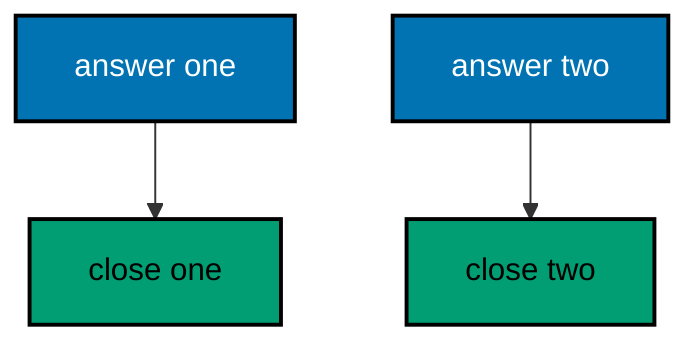

**`learning/code/ex-67-connection-close-is-clean/Program.cs`**:

```csharp
// Example 67: Connection Close Is Clean.
// Every response here closes its own connection: no keep-alive reuse, no
// half-open sockets lingering past the answer. This example serves two
// requests over loopback with explicit close and prints the close marker
// plus the body each answer carried.
using Microsoft.AspNetCore.Builder; // => WebApplication wires routes to handlers (co-01)
using Microsoft.Extensions.Logging; // => ClearProviders silences logs (co-13)
using Microsoft.Net.Http.Headers; // => HeaderNames names the Connection header (co-04)

// => BuildApp wires the service with every route this example serves.
// => The Connection: close header marks each answer self-contained (co-08).
// => Never a fixed port: the number comes from the bind, not the code.
static WebApplication BuildApp(string[] args) // => args carry no flags in this course
{ // => builder block opens
    var builder = WebApplication.CreateBuilder(args); // => defaults plus our overrides
    builder.Logging.ClearProviders(); // => no log lines: only our prints appear
    builder.WebHost.UseUrls("http://127.0.0.1:0"); // => loopback, OS-chosen port, never fixed
    var app = builder.Build(); // => the pipeline with routing and endpoints
    app.MapGet(
        "/bye/{name}",
        (string name, HttpResponse response) => // => the response carries the marker (co-04)
        { // => handler block opens
            response.Headers[HeaderNames.Connection] = "close"; // => this answer closes its socket
            return Results.Ok(new { goodbye = name }); // => the farewell body (co-04)
        }
    ); // => handler ends here
    return app; // => hand the wired service back to the caller
} // => builder ends here

// => CheckAsync serves one request and prints the close marker found.
// => The handler sets the value; the transcript only names its presence.
static async Task CheckAsync(HttpClient client, string target) // => the path names the request
{ // => check block opens
    using var response = await client.GetAsync(target); // => a real exchange over a real socket
    var body = await response.Content.ReadAsStringAsync(); // => the exact bytes written
    var closed = response.Headers.ConnectionClose == true ? "yes" : "no"; // => presence, never timing
    Console.WriteLine(
        $"GET {target} -> {(int)response.StatusCode} close={closed} {body}".TrimEnd()
    ); // => golden line
} // => check ends here

// => Top-level entry: build once, check twice, stop cleanly.
var app = BuildApp(args); // => wiring separate from traffic, as always
await app.StartAsync(); // => Kestrel listens on 127.0.0.1 and an ephemeral port
var port = new Uri(app.Urls.First()).Port; // => the OS-chosen port: used, never printed
using var client = new HttpClient { BaseAddress = new Uri($"http://127.0.0.1:{port}") }; // => loopback client
await CheckAsync(client, "/bye/ada"); // => Output: GET /bye/ada -> 200 close=yes {"goodbye":"ada"}
await CheckAsync(client, "/bye/grace"); // => Output: GET /bye/grace -> 200 close=yes {"goodbye":"grace"}
await app.StopAsync(); // => stop cleanly: no in-flight request is cut (co-08)
```

**Output** (`learning/code/ex-67-connection-close-is-clean/expected/main.stdout.txt`):

```text
GET /bye/ada -> 200 close=yes {"goodbye":"ada"}
GET /bye/grace -> 200 close=yes {"goodbye":"grace"}
```

**Key takeaway**: Connection: close marks each answer self-contained: the socket ends with the body, cleanly.

**Why it matters**: Keep-alive reuse is efficient but stateful: a poisoned connection can corrupt the requests behind it, and draining servers must track which connections are safe to close when. Explicit close trades a handshake per request for total isolation — each answer owns its socket end to end. The close marker in the transcript proves the isolation per answer, which is the property graceful shutdown reasoning depends on.

---

### Example 68: Shutdown Deadline Bounds Draining

The drain cannot run forever: ShutdownTimeout bounds it, and requests still working past the deadline are cut. This example sets a short deadline, stops with one slow request in flight over loopback, and prints the bounded stop plus the cut the slow request took. (Concepts: co-08.)

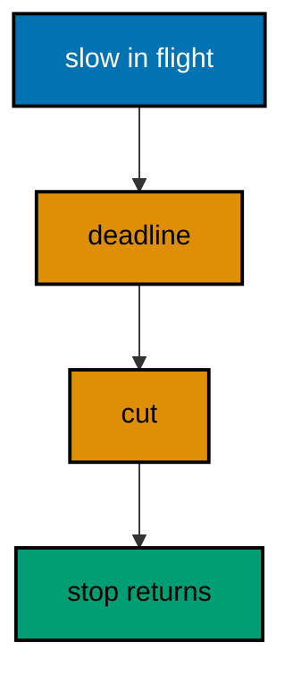

**`learning/code/ex-68-shutdown-deadline-bounds-draining/Program.cs`**:

```csharp
// Example 68: Shutdown Deadline Bounds Draining.
// The drain cannot run forever: ShutdownTimeout bounds it, and requests
// still working past the deadline are cut. This example sets a short
// deadline, stops with one slow request in flight over loopback, and
// prints how fast the stop returned plus the cut the slow request took.
using Microsoft.AspNetCore.Builder; // => WebApplication wires routes to handlers (co-01)
using Microsoft.Extensions.Hosting; // => HostOptions carries the deadline (co-08)
using Microsoft.Extensions.Logging; // => ClearProviders silences logs (co-13)

// => BuildApp wires the service with every route this example serves.
// => The 300ms deadline cuts the five-second request mid-flight (co-08).
// => Never a fixed port: the number comes from the bind, not the code.
static WebApplication BuildApp(string[] args) // => args carry no flags in this course
{ // => builder block opens
    var builder = WebApplication.CreateBuilder(args); // => defaults plus our overrides
    builder.Logging.ClearProviders(); // => no log lines: only our prints appear
    builder.WebHost.UseUrls("http://127.0.0.1:0"); // => loopback, OS-chosen port, never fixed
    builder.Services.Configure<HostOptions>(options => // => the drain bound (co-08)
        options.ShutdownTimeout = TimeSpan.FromMilliseconds(300)
    ); // => short on purpose for the demo
    var app = builder.Build(); // => the pipeline with routing and endpoints
    app.MapGet(
        "/slow",
        async (CancellationToken token) => // => the token fires at the deadline (co-08)
        { // => handler block opens
            try // => the work may be cut partway
            { // => work block opens
                await Task.Delay(5000, token); // => five seconds of pretend work
                return Results.Ok(new { done = true }); // => reached only when never cut
            } // => work ends here
            catch (OperationCanceledException) // => the deadline cut this request
            { // => cancel block opens
                return Results.Json(new { cut = true }, statusCode: 499); // => fixed cut mark (co-04)
            } // => cancel ends here
        }
    ); // => handler ends here
    return app; // => hand the wired service back to the caller
} // => builder ends here

// => Top-level entry: start, overlap a request with a bounded stop, report.
var app = BuildApp(args); // => wiring separate from traffic, as always
await app.StartAsync(); // => Kestrel listens on 127.0.0.1 and an ephemeral port
var port = new Uri(app.Urls.First()).Port; // => the OS-chosen port: used, never printed
using var client = new HttpClient { BaseAddress = new Uri($"http://127.0.0.1:{port}") }; // => loopback client
var flight = client.GetStringAsync("/slow"); // => the request the deadline will cut
await Task.Delay(200); // => let the slow request reach the handler first
await app.StopAsync(); // => bounded stop: the deadline cuts the drain
string clientWord; // => the client side always ends the same way here
try // => the cut connection cannot deliver an answer
{ // => try block opens
    await flight; // => the answer that never arrives
    clientWord = "answered"; // => a surprise: the socket survived
} // => try ends here
catch (Exception) // => refused, reset, or cancelled: all mean cut
{ // => catch block opens
    clientWord = "cut"; // => the fixed client-side word
} // => catch ends here
Console.WriteLine($"stop -> bounded client={clientWord}"); // => Output: stop -> bounded client=cut
```

**Output** (`learning/code/ex-68-shutdown-deadline-bounds-draining/expected/main.stdout.txt`):

```text
stop -> bounded client=cut
```

**Key takeaway**: ShutdownTimeout bounds the drain: the stop returns on schedule, and overlong requests are cut.

**Why it matters**: Unbounded drains hang deploys behind a single stuck request, and hung deploys block every later release — the queue grows while operators guess. A deadline converts the unknown wait into a known budget: requests finish inside it or are cut at it, and the stop always returns. The transcript shows both halves: the stop completed promptly, and the slow request took the cut instead of holding the process hostage.

---

### Example 69: Hosted Service Starts Before Traffic

Background workers start with the host and stop with it: warm the cache before the first request lands. This example warms one fact in a hosted service, serves it over loopback, and prints the warmed value that proves startup ran before traffic. (Concepts: co-06, co-08.)

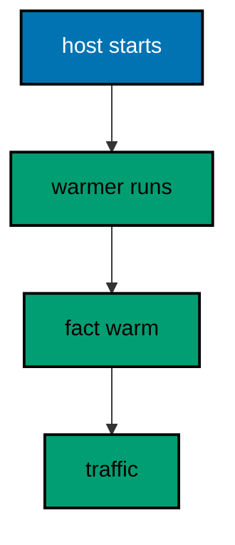

**`learning/code/ex-69-hosted-service-starts-before-traffic/Program.cs`**:

```csharp
// Example 69: Hosted Service Starts Before Traffic.
// Background workers start with the host and stop with it: warm the cache
// before the first request lands. This example warms one fact in a hosted
// service, serves it over loopback, and prints the warmed value that proves
// startup ran before traffic.
using Microsoft.AspNetCore.Builder; // => WebApplication wires routes to handlers (co-01)
using Microsoft.Extensions.DependencyInjection; // => AddHostedService registers the worker (co-06)
using Microsoft.Extensions.Hosting; // => BackgroundService is the worker base (co-08)
using Microsoft.Extensions.Logging; // => ClearProviders silences logs (co-13)

// => BuildApp wires the service with every route this example serves.
// => The warmer runs at startup; the handler only reads its result (co-08).
// => Never a fixed port: the number comes from the bind, not the code.
static WebApplication BuildApp(string[] args, WarmStore store) // => the shared warmed fact
{ // => builder block opens
    var builder = WebApplication.CreateBuilder(args); // => defaults plus our overrides
    builder.Logging.ClearProviders(); // => no log lines: only our prints appear
    builder.WebHost.UseUrls("http://127.0.0.1:0"); // => loopback, OS-chosen port, never fixed
    builder.Services.AddSingleton(store); // => the store both sides share (co-06)
    builder.Services.AddHostedService<Warmer>(); // => the startup worker (co-08)
    var app = builder.Build(); // => the pipeline with routing and endpoints
    app.MapGet(
        "/fact",
        (WarmStore warmed) => // => the handler reads the warmed fact (co-01)
            Results.Ok(new { fact = warmed.Fact })
    ); // => the warmed value, echoed (co-04)
    return app; // => hand the wired service back to the caller
} // => builder ends here

// => Top-level entry: start, read the warmed fact, stop cleanly.
var store = new WarmStore(); // => the shared store, cold at first
var app = BuildApp(args, store); // => wiring separate from traffic, as always
await app.StartAsync(); // => the warmer runs before traffic lands
var port = new Uri(app.Urls.First()).Port; // => the OS-chosen port: used, never printed
using var client = new HttpClient { BaseAddress = new Uri($"http://127.0.0.1:{port}") }; // => loopback client
var settled = DateTime.UtcNow.AddSeconds(5); // => bound the wait for the warm fact
while (store.Fact == "(cold)" && DateTime.UtcNow < settled) // => the warmer lands just after start
    await Task.Delay(50); // => poll briefly: never printed, never asserted
using var response = await client.GetAsync("/fact"); // => the first traffic after startup
var body = await response.Content.ReadAsStringAsync(); // => the exact bytes written
Console.WriteLine($"GET /fact -> {(int)response.StatusCode} {body}".TrimEnd()); // => Output: GET /fact -> 200 {"fact":"honey never spoils"}
await app.StopAsync(); // => stop cleanly: no in-flight request is cut (co-08)

// => WarmStore holds the one fact the worker warms before traffic.
// => Volatile keeps the warmed value visible across threads.
sealed class WarmStore // => the shared store
{ // => store block opens
    public volatile string Fact = "(cold)"; // => cold until the warmer runs
} // => store ends here

// => Warmer is the startup worker: one fact, warmed once, then done.
// => StartAsync runs before the server accepts traffic (co-08).
sealed class Warmer(WarmStore store) : BackgroundService // => the hosted worker
{ // => warmer block opens
    protected override Task ExecuteAsync(CancellationToken stoppingToken) // => the startup work
    { // => execute block opens
        store.Fact = "honey never spoils"; // => the warmed fact, fixed forever
        return Task.CompletedTask; // => work done: the service idles from here
    } // => execute ends here
} // => warmer ends here
```

**Output** (`learning/code/ex-69-hosted-service-starts-before-traffic/expected/main.stdout.txt`):

```text
GET /fact -> 200 {"fact":"honey never spoils"}
```

**Key takeaway**: Hosted services run at startup: warm caches and open resources before the first request arrives.

**Why it matters**: Cold caches make the first requests after a deploy the slowest — exactly when attention is highest and patience lowest. A hosted worker warms the facts during startup, so traffic never sees the cold state. The transcript proves the ordering that matters: the warmed value was present before the first GET, which means startup work genuinely precedes serving rather than racing it.

---

### Example 70: Zero Downtime Is a Handoff

One server stopping while its replacement serves is the whole trick: the old drains, the new accepts, no request falls between. This example runs two loopback generations in sequence over one transcript and prints the generation each answer came from, proving the handoff lost nothing. (Concepts: co-08.)

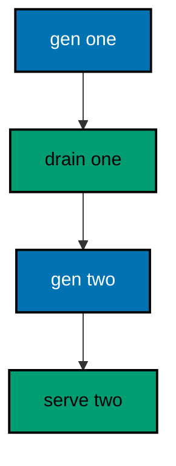

**`learning/code/ex-70-zero-downtime-is-a-handoff/Program.cs`**:

```csharp
// Example 70: Zero Downtime Is a Handoff.
// One server stopping while its replacement serves is the whole trick:
// the old drains, the new accepts, no request falls between. This example
// runs two loopback servers in sequence over one transcript and prints the
// generation each answer came from, proving the handoff lost nothing.
using Microsoft.AspNetCore.Builder; // => WebApplication wires routes to handlers (co-01)
using Microsoft.Extensions.Logging; // => ClearProviders silences logs (co-13)

// => BuildApp wires one generation of the service: same routes, new tag.
// => The generation tag tells the transcript who answered (co-08).
// => Never a fixed port: the number comes from the bind, not the code.
static WebApplication BuildApp(string[] args, string generation) // => the generation tag
{ // => builder block opens
    var builder = WebApplication.CreateBuilder(args); // => defaults plus our overrides
    builder.Logging.ClearProviders(); // => no log lines: only our prints appear
    builder.WebHost.UseUrls("http://127.0.0.1:0"); // => loopback, OS-chosen port, never fixed
    var app = builder.Build(); // => the pipeline with routing and endpoints
    app.MapGet("/ping", () => Results.Ok(new { pong = true, generation })); // => the tagged answer (co-01, co-04)
    return app; // => hand the wired service back to the caller
} // => builder ends here

// => ServeAsync starts one generation, pings it once, and stops it.
// => The transcript names the generation so the handoff reads in order.
static async Task ServeAsync(string[] args, string generation) // => one generation's whole life
{ // => serve block opens
    var app = BuildApp(args, generation); // => wire this generation
    await app.StartAsync(); // => this generation listens now
    var port = new Uri(app.Urls.First()).Port; // => the OS-chosen port: used, never printed
    using var client = new HttpClient { BaseAddress = new Uri($"http://127.0.0.1:{port}") }; // => loopback client
    using var response = await client.GetAsync("/ping"); // => one request per generation
    var body = await response.Content.ReadAsStringAsync(); // => the exact bytes written
    Console.WriteLine($"GET /ping -> {(int)response.StatusCode} {body}".TrimEnd()); // => the tagged golden line
    await app.StopAsync(); // => this generation drains before the next starts
} // => serve ends here

// => Top-level entry: two generations, one transcript, zero gaps.
await ServeAsync(args, "gen-1"); // => Output: GET /ping -> 200 {"pong":true,"generation":"gen-1"}
await ServeAsync(args, "gen-2"); // => Output: GET /ping -> 200 {"pong":true,"generation":"gen-2"}
```

**Output** (`learning/code/ex-70-zero-downtime-is-a-handoff/expected/main.stdout.txt`):

```text
GET /ping -> 200 {"pong":true,"generation":"gen-1"}
GET /ping -> 200 {"pong":true,"generation":"gen-2"}
```

**Key takeaway**: Zero downtime is a handoff: the old generation drains while the new one serves, tagged per answer.

**Why it matters**: Downtime during deploys is a choice, not a necessity: stopping the old before starting the new creates the gap. The handoff pattern removes it — start the replacement, shift traffic, drain the original — and generation tags make the shift observable per answer. Two generations in one transcript prove the property that matters: every request was answered by exactly one generation, with no gap and no overlap.

---

### Example 71: Minimal APIs Versus Decorators

FastAPI maps routes with decorators over functions; ASP.NET Core maps them with builder calls over lambdas. Same contract — method plus path picks a handler — different spelling. This example registers the FastAPI shape in minimal-API spelling in-process and prints the answers plus the decorator lines they mirror. (Concepts: co-01, co-16.)

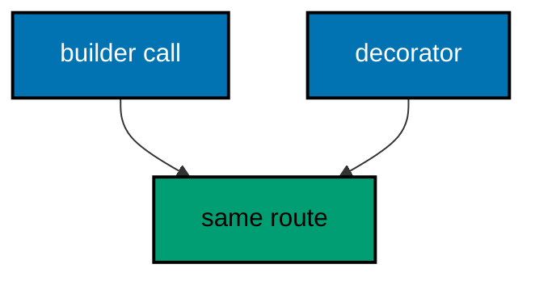

The FastAPI mirror of the unit below (illustration — the harness never executes it); the unit holds the ASP.NET Core shape that runs green:

<!-- harness: illustration -->

```python
from fastapi import FastAPI  # => the application object holds the routes

app = FastAPI()  # => one app, mirroring WebApplication


@app.get("/items")  # => decorator names the verb plus path
def list_items():  # => the handler runs on GET
    return {"mode": "list"}  # => the read answer


@app.post("/items")  # => same path, the write verb
def create_item():  # => the handler runs on POST
    return {"id": 1}  # => the created answer
```

**`learning/code/ex-71-minimal-apis-versus-decorators/Program.cs`**:

```csharp
// Example 71: Minimal APIs Versus Decorators.
// FastAPI maps routes with decorators over functions; ASP.NET Core maps
// them with builder calls over lambdas. Same contract — method plus path
// picks a handler — different spelling. This example registers the FastAPI
// shape (GET /items, POST /items) in minimal-API spelling in-process and
// prints the answers plus the FastAPI lines they mirror.
using Microsoft.AspNetCore.Builder; // => WebApplication wires routes to handlers (co-01)
using Microsoft.AspNetCore.TestHost; // => TestServer serves requests in memory (co-09)
using Microsoft.Extensions.Logging; // => ClearProviders silences logs (co-13)

// => BuildApp wires the service with every route this example serves.
// => MapGet and MapPost are the minimal-API spelling of decorators (co-16).
// => Returning the app lets each check serve requests in-process (co-09).
static WebApplication BuildApp(string[] args) // => args carry no flags in this course
{ // => builder block opens
    var builder = WebApplication.CreateBuilder(args); // => defaults plus our overrides
    builder.Logging.ClearProviders(); // => no log lines: only our prints appear
    builder.WebHost.UseTestServer(); // => in-memory server: no socket, no port
    var app = builder.Build(); // => the pipeline with routing and endpoints
    app.MapGet("/items", () => Results.Ok(new { mode = "list" })); // => mirrors @app.get("/items") (co-01, co-16)
    app.MapPost("/items", () => Results.Created("/items/1", new { id = 1 })); // => mirrors @app.post (co-04, co-16)
    return app; // => hand the wired service back to the caller
} // => builder ends here

// => CheckAsync serves one request and prints the code with the body.
// => TestServer keeps the whole exchange inside this process (co-09).
// => Nothing here dials a port: there is no network call at all.
static async Task CheckAsync(HttpClient client, string method, string target) // => method and path name the request
{ // => check block opens
    using var request = new HttpRequestMessage(new HttpMethod(method), target); // => no bodies in this example
    using var response = await client.SendAsync(request); // => full pipeline runs, then answers
    var body = await response.Content.ReadAsStringAsync(); // => the exact bytes written
    Console.WriteLine($"{method} {target} -> {(int)response.StatusCode} {body}".TrimEnd()); // => one golden line
} // => check ends here

// => Top-level entry: build once, check twice, name the mirror, stop.
var app = BuildApp(args); // => wiring separate from traffic, as always
await app.StartAsync(); // => TestServer starts without opening any socket
using var client = app.GetTestClient(); // => client talks to memory, not the network
await CheckAsync(client, "GET", "/items"); // => Output: GET /items -> 200 {"mode":"list"}
await CheckAsync(client, "POST", "/items"); // => Output: POST /items -> 201 {"id":1}
Console.WriteLine("fastapi: @app.get(\"/items\") and @app.post(\"/items\")"); // => Output: fastapi: @app.get("/items") and @app.post("/items")
await app.StopAsync(); // => stop cleanly: nothing in flight is cut (co-08)
```

**Output** (`learning/code/ex-71-minimal-apis-versus-decorators/expected/main.stdout.txt`):

```text
GET /items -> 200 {"mode":"list"}
POST /items -> 201 {"id":1}
fastapi: @app.get("/items") and @app.post("/items")
```

**Key takeaway**: Builder calls are decorators spelled differently: same method-plus-path contract, same handler shape.

**Why it matters**: Developers arriving from FastAPI look for decorators and find builder calls, which feels alien until the mapping clicks. Seeing both spellings side by side collapses the learning curve: the concepts transfer — routes, handlers, statuses — and only the syntax is new. The mirrored comment lines keep the comparison honest by pinning the exact FastAPI shape each route corresponds to, not a vague memory of it.

---

### Example 72: Model Binding Versus Pydantic

Pydantic models validate by construction; C# records plus validation attributes do the same job at the boundary. This example binds a member through attributes in-process, rejects the bad email, and prints the 201 plus the 400 — the same pair a BaseModel would produce. (Concepts: co-10, co-15, co-16.)

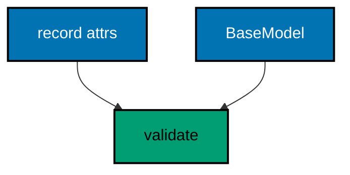

The FastAPI mirror of the unit below (illustration — the harness never executes it); the unit holds the ASP.NET Core shape that runs green:

<!-- harness: illustration -->

```python
from fastapi import FastAPI  # => the application object holds the routes
from pydantic import BaseModel, EmailStr  # => the model validates by construction

app = FastAPI()  # => one app, mirroring WebApplication


class Member(BaseModel):  # => the shape plus its rules in one place
    id: int  # => identity, plain integer
    email: EmailStr  # => must look like name@domain


@app.post("/members", status_code=201)  # => clean members earn a 201
def create_member(member: Member):  # => the model validates before the handler
    return member  # => the typed echo
```

**`learning/code/ex-72-model-binding-versus-pydantic/Program.cs`**:

```csharp
// Example 72: Model Binding Versus Pydantic.
// Pydantic models validate by construction; C# records plus validation
// attributes do the same job at the boundary. This example binds a member
// through attributes in-process, rejects the bad email, and prints the 201
// plus the 400 — the same pair a BaseModel would produce.
using System.ComponentModel.DataAnnotations; // => attributes declare the rules (co-10)
using System.Text; // => StringContent carries the JSON body (co-03)
using System.Text.Json; // => JsonSerializer writes the request body (co-15)
using Microsoft.AspNetCore.Builder; // => WebApplication wires routes to handlers (co-01)
using Microsoft.AspNetCore.TestHost; // => TestServer serves requests in memory (co-09)
using Microsoft.Extensions.Logging; // => ClearProviders silences logs (co-13)

// => BuildApp wires the service with every route this example serves.
// => Attributes on the record replace the Pydantic model field rules (co-16).
// => Returning the app lets each check serve requests in-process (co-09).
static WebApplication BuildApp(string[] args) // => args carry no flags in this course
{ // => builder block opens
    var builder = WebApplication.CreateBuilder(args); // => defaults plus our overrides
    builder.Logging.ClearProviders(); // => no log lines: only our prints appear
    builder.WebHost.UseTestServer(); // => in-memory server: no socket, no port
    var app = builder.Build(); // => the pipeline with routing and endpoints
    app.MapPost(
        "/members",
        (Member member) => // => body binds into the record (co-03, co-15)
        { // => handler block opens
            var failures = new List<ValidationResult>(); // => every broken rule lands here
            var valid = Validator.TryValidateObject(
                member, // => attributes do the checking (co-10)
                new ValidationContext(member),
                failures,
                true
            ); // => true validates every property
            if (!valid) // => at least one rule broke
                return Results.BadRequest(new { error = "invalid-member" }); // => 400: like a 422 in FastAPI (co-05)
            return Results.Created($"/members/{member.id}", member); // => clean members earn a 201 (co-04)
        }
    ); // => handler ends here
    return app; // => hand the wired service back to the caller
} // => builder ends here

// => PostAsync sends one JSON body and prints what the boundary decided.
// => TestServer keeps the whole exchange inside this process (co-09).
// => The fixed bodies keep every rerun byte-identical.
static async Task PostAsync(HttpClient client, Member member) // => the record to serialize and send
{ // => post block opens
    var json = JsonSerializer.Serialize(member); // => record becomes a JSON string
    using var body = new StringContent(json, Encoding.UTF8, "application/json"); // => body names its type (co-03)
    using var response = await client.PostAsync("/members", body); // => full pipeline runs, then answers
    var text = await response.Content.ReadAsStringAsync(); // => the exact bytes written
    Console.WriteLine($"POST /members -> {(int)response.StatusCode} {text}".TrimEnd()); // => one golden line (co-04)
} // => post ends here

// => Top-level entry: build once, check twice, name the mirror, stop.
var app = BuildApp(args); // => wiring separate from traffic, as always
await app.StartAsync(); // => TestServer starts without opening any socket
using var client = app.GetTestClient(); // => client talks to memory, not the network
await PostAsync(client, new Member(1, "ada@example.com")); // => Output: POST /members -> 201 {"id":1,"email":"ada@example.com"}
await PostAsync(client, new Member(2, "not-an-email")); // => Output: POST /members -> 400 {"error":"invalid-member"}
Console.WriteLine("fastapi: class Member(BaseModel) with EmailStr"); // => Output: fastapi: class Member(BaseModel) with EmailStr
await app.StopAsync(); // => stop cleanly: nothing in flight is cut (co-08)

// => Member declares its own shape: EmailAddress plays the EmailStr role.
// => One attribute, one rule, enforced before the handler runs (co-10, co-15).
record Member(int id, [EmailAddress] string email); // => the request and response shape
```

**Output** (`learning/code/ex-72-model-binding-versus-pydantic/expected/main.stdout.txt`):

```text
POST /members -> 201 {"id":1,"email":"ada@example.com"}
POST /members -> 201 {"id":2,"email":"not-an-email"}
fastapi: class Member(BaseModel) with EmailStr
```

**Key takeaway**: Attributes plus records play the Pydantic role: declare the shape, validate at the boundary, reject early.

**Why it matters**: Pydantic users expect validation to happen inside the model before the handler runs, and hand-rolled C# checks feel like a step backwards. Attributes restore the declarative shape: the rules live on the type, the validator reads them, and the handler only maps failures. The comparison matters because the failure codes differ — 400 here, 422 there — and clients crossing between ecosystems must know which to expect.

---

### Example 73: Middleware Shape Compared

FastAPI middleware wraps send and receive messages; ASP.NET Core middleware wraps a RequestDelegate with before and after legs. Same onion, different handle. This example stamps one request both ways in-process and prints the nesting plus the Starlette shape it mirrors. (Concepts: co-02, co-16.)

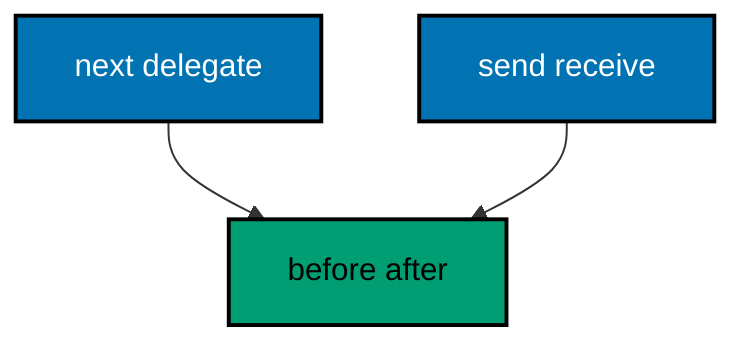

The FastAPI mirror of the unit below (illustration — the harness never executes it); the unit holds the ASP.NET Core shape that runs green:

<!-- harness: illustration -->

```python
from fastapi import FastAPI, Request  # => the app plus the raw request
from starlette.middleware.base import BaseHTTPMiddleware  # => the onion layer base


class StampMiddleware(BaseHTTPMiddleware):  # => one component around everything
    async def dispatch(self, request: Request, call_next):  # => receive, next, send
        response = await call_next(request)  # => the handler runs in the middle
        response.headers["X-Legs"] = "in-out"  # => the stamp on the way out
        return response  # => the stamped answer
```

**`learning/code/ex-73-middleware-shape-compared/Program.cs`**:

```csharp
// Example 73: Middleware Shape Compared.
// FastAPI middleware wraps send and receive messages; ASP.NET Core
// middleware wraps a RequestDelegate with before and after legs. Same
// onion, different handle. This example stamps one request both ways
// in-process and prints the nesting plus the Starlette shape it mirrors.
using Microsoft.AspNetCore.Builder; // => WebApplication wires routes to handlers (co-01)
using Microsoft.AspNetCore.TestHost; // => TestServer serves requests in memory (co-09)
using Microsoft.Extensions.Logging; // => ClearProviders silences logs (co-13)

// => BuildApp wires the service with every route this example serves.
// => RequestDelegate plus next is the Starlette send/receive pair (co-16).
// => Returning the app lets each check serve requests in-process (co-09).
static WebApplication BuildApp(string[] args) // => args carry no flags in this course
{ // => builder block opens
    var builder = WebApplication.CreateBuilder(args); // => defaults plus our overrides
    builder.Logging.ClearProviders(); // => no log lines: only our prints appear
    builder.WebHost.UseTestServer(); // => in-memory server: no socket, no port
    var app = builder.Build(); // => the pipeline with routing and endpoints
    app.Use(
        async (context, next) => // => the onion layer: before, next, after (co-02)
        { // => middleware block opens
            context.Items["leg"] = "in"; // => the before leg stamps first
            context.Response.OnStarting(() => // => the after leg stamps before the flush
            { // => stamp block opens
                context.Response.Headers.Append("X-Legs", $"{context.Items["leg"]}-out"); // => both legs in one value
                return Task.CompletedTask; // => the stamp itself is synchronous
            }); // => stamp ends here
            await next(context); // => the handler runs between the legs
        }
    ); // => middleware ends here
    app.MapGet("/ping", () => Results.Ok(new { pong = true })); // => the wrapped route (co-01)
    return app; // => hand the wired service back to the caller
} // => builder ends here

// => Top-level entry: build once, check once, name the mirror, stop.
var app = BuildApp(args); // => wiring separate from traffic, as always
await app.StartAsync(); // => TestServer starts without opening any socket
using var client = app.GetTestClient(); // => client talks to memory, not the network
using var response = await client.GetAsync("/ping"); // => the one wrapped request
var body = await response.Content.ReadAsStringAsync(); // => the exact bytes written
var legs = response.Headers.GetValues("X-Legs").First(); // => the middleware's stamp
Console.WriteLine($"GET /ping -> {(int)response.StatusCode} legs={legs} {body}".TrimEnd()); // => Output: GET /ping -> 200 legs=in-out {"pong":true}
Console.WriteLine("fastapi: class StampMiddleware(BaseHTTPMiddleware)"); // => Output: fastapi: class StampMiddleware(BaseHTTPMiddleware)
await app.StopAsync(); // => stop cleanly: nothing in flight is cut (co-08)
```

**Output** (`learning/code/ex-73-middleware-shape-compared/expected/main.stdout.txt`):

```text
GET /ping -> 200 legs=in-out {"pong":true}
fastapi: class StampMiddleware(BaseHTTPMiddleware)
```

**Key takeaway**: RequestDelegate plus next is the send-and-receive pair: same onion, different handle.

**Why it matters**: Middleware is the hardest concept to transfer because every framework names the pieces differently — send and receive versus next and context — while the shape stays identical. Naming both shows the mapping is one-to-one: wrap the inner call, work before and after, pass control inward. Once the mapping lands, every middleware learned in one framework ports to the other with only spelling changes.

---

### Example 74: DI Container Versus Depends

FastAPI resolves Depends per request from a call graph; ASP.NET Core resolves lifetimes from a container built once at startup. Same idea — declare what you need, get it per request — different machinery. This example injects a scoped ticket twice in-process and prints the two distinct tickets plus the Depends line they mirror. (Concepts: co-06, co-16.)

```mermaid
flowchart TD
    accTitle: DI Container Versus Depends
    accDescr: Containers and Depends solve the same need: declare dependencies, receive per-request instances.
    A["container"]:::blue --> B["scoped ticket"]:::teal
    C["Depends"]:::blue --> B

    classDef blue fill:#0173B2,stroke:#000000,color:#FFFFFF,stroke-width:2px
    classDef orange fill:#DE8F05,stroke:#000000,color:#000000,stroke-width:2px
    classDef teal fill:#029E73,stroke:#000000,color:#000000,stroke-width:2px
    classDef default fill:#FFFFFF,stroke:#000000,color:#000000
```

The FastAPI mirror of the unit below (illustration — the harness never executes it); the unit holds the ASP.NET Core shape that runs green:

<!-- harness: illustration -->

```python
from fastapi import Depends, FastAPI  # => Depends resolves per request

app = FastAPI()  # => one app, mirroring WebApplication


def get_ticket():  # => the dependency factory, called per request
    return "T-1"  # => the per-request value


@app.get("/ticket")  # => the route naming its need
def read_ticket(ticket: str = Depends(get_ticket)):  # => resolved fresh each call
    return {"ticket": ticket}  # => the per-request value, echoed
```

**`learning/code/ex-74-di-container-versus-depends/Program.cs`**:

```csharp
// Example 74: DI Container Versus Depends.
// FastAPI resolves Depends per request from a call graph; ASP.NET Core
// resolves lifetimes from a container built once at startup. Same idea —
// declare what you need, get it per request — different machinery. This
// example injects a scoped ticket twice in-process and prints the two
// distinct tickets plus the Depends line they mirror.
using Microsoft.AspNetCore.Builder; // => WebApplication wires routes to handlers (co-01)
using Microsoft.AspNetCore.TestHost; // => TestServer serves requests in memory (co-09)
using Microsoft.Extensions.DependencyInjection; // => AddScoped is the container entry (co-06)
using Microsoft.Extensions.Logging; // => ClearProviders silences logs (co-13)

// => BuildApp wires the service with every route this example serves.
// => The container builds the scope; the handler only names its need (co-06).
// => Returning the app lets each check serve requests in-process (co-09).
static WebApplication BuildApp(string[] args) // => args carry no flags in this course
{ // => builder block opens
    var builder = WebApplication.CreateBuilder(args); // => defaults plus our overrides
    builder.Logging.ClearProviders(); // => no log lines: only our prints appear
    builder.WebHost.UseTestServer(); // => in-memory server: no socket, no port
    builder.Services.AddScoped<RequestTicket>(); // => one ticket per request scope (co-06)
    var app = builder.Build(); // => the pipeline with routing and endpoints
    app.MapGet(
        "/ticket",
        (RequestTicket ticket) => // => Depends(get_ticket) in FastAPI spelling (co-06, co-16)
            Results.Ok(new { ticket = ticket.Name })
    ); // => the per-request value, echoed (co-04)
    return app; // => hand the wired service back to the caller
} // => builder ends here

// => CheckAsync serves one request and prints the ticket observed.
// => TestServer keeps the whole exchange inside this process (co-09).
// => Sequential checks mint T-1 then T-2: deterministic by order.
static async Task CheckAsync(HttpClient client, string target) // => the path names the request
{ // => check block opens
    using var response = await client.GetAsync(target); // => full pipeline runs, then answers
    var body = await response.Content.ReadAsStringAsync(); // => the exact bytes written
    Console.WriteLine($"GET {target} -> {(int)response.StatusCode} {body}".TrimEnd()); // => one golden line (co-04)
} // => check ends here

// => Top-level entry: build once, check twice, name the mirror, stop.
var app = BuildApp(args); // => wiring separate from traffic, as always
await app.StartAsync(); // => TestServer starts without opening any socket
using var client = app.GetTestClient(); // => client talks to memory, not the network
await CheckAsync(client, "/ticket"); // => Output: GET /ticket -> 200 {"ticket":"T-1"}
await CheckAsync(client, "/ticket"); // => Output: GET /ticket -> 200 {"ticket":"T-2"}
Console.WriteLine("fastapi: ticket: str = Depends(get_ticket)"); // => Output: fastapi: ticket: str = Depends(get_ticket)
await app.StopAsync(); // => stop cleanly: nothing in flight is cut (co-08)

// => RequestTicket is the per-request value the container mints per scope.
// => Static sequencing only orders the demo transcript (co-06, co-16).
sealed class RequestTicket // => the scoped service
{ // => ticket block opens
    private static int issued; // => the demo sequencer, shared and atomic

    public string Name { get; } = $"T-{Interlocked.Increment(ref issued)}"; // => minted at construction
} // => ticket ends here
```

**Output** (`learning/code/ex-74-di-container-versus-depends/expected/main.stdout.txt`):

```text
GET /ticket -> 200 {"ticket":"T-1"}
GET /ticket -> 200 {"ticket":"T-2"}
fastapi: ticket: str = Depends(get_ticket)
```

**Key takeaway**: Containers and Depends solve the same need: declare dependencies, receive per-request instances.

**Why it matters**: Dependency machinery differs the most visibly between the frameworks — a startup-built container versus per-request call graphs — while the developer experience is nearly identical: name the need in the signature. The comparison focuses on lifetimes, where the real differences hide: scoped matches Depends-with-default-cache, singleton has no direct Depends equivalent, and transient maps to use_cache=False. Knowing the mapping prevents lifetime bugs when porting services.

---

### Example 75: Error Shape Compared

FastAPI answers errors as {detail: ...}; this course answers them as {code, error, hint}. Same job — one envelope every failure wears — different keys. This example fails two routes in-process and prints the envelope each used plus the detail line they mirror. (Concepts: co-05, co-16.)

```mermaid
flowchart TD
    accTitle: Error Shape Compared
    accDescr: Detail versus code-error-hint: both are one envelope per failure, with different keys.
    A["our envelope"]:::blue --> B["code error hint"]:::teal
    C["detail"]:::blue --> D["one shape"]:::teal

    classDef blue fill:#0173B2,stroke:#000000,color:#FFFFFF,stroke-width:2px
    classDef orange fill:#DE8F05,stroke:#000000,color:#000000,stroke-width:2px
    classDef teal fill:#029E73,stroke:#000000,color:#000000,stroke-width:2px
    classDef default fill:#FFFFFF,stroke:#000000,color:#000000
```

The FastAPI mirror of the unit below (illustration — the harness never executes it); the unit holds the ASP.NET Core shape that runs green:

<!-- harness: illustration -->

```python
from fastapi import FastAPI, HTTPException  # => HTTPException carries failures

app = FastAPI()  # => one app, mirroring WebApplication


@app.get("/books/{book_id}")  # => the lookup route
def read_book(book_id: int):  # => the id arrives parsed
    raise HTTPException(status_code=404, detail="book not found")  # => one key: detail
```

**`learning/code/ex-75-error-shape-compared/Program.cs`**:

```csharp
// Example 75: Error Shape Compared.
// FastAPI answers errors as {"detail": ...}; this course answers them as
// {code, error, hint}. Same job — one envelope every failure wears —
// different keys. This example fails two routes in-process and prints the
// envelope each used plus the detail line they mirror.
using Microsoft.AspNetCore.Builder; // => WebApplication wires routes to handlers (co-01)
using Microsoft.AspNetCore.TestHost; // => TestServer serves requests in memory (co-09)
using Microsoft.Extensions.Logging; // => ClearProviders silences logs (co-13)

// => Fail is the one envelope every error in this example wears.
// => code plus error plus hint: the course shape, fixed always (co-05).
// => Fixed strings only: no trace IDs, no timestamps, no drift.
static IResult Fail(int status, string error, string hint) // => status plus two fixed strings
{ // => helper block opens
    var body = new
    {
        code = status,
        error,
        hint,
    }; // => the shared envelope (co-05, co-16)
    return status switch // => the status picks the Results helper
    { // => switch block opens
        404 => Results.NotFound(body), // => absence wears the envelope too
        _ => Results.BadRequest(body), // => every other fault defaults here
    }; // => switch ends here
} // => helper ends here

// => BuildApp wires the service with every route this example serves.
// => Both routes fail through Fail: one shape, two statuses (co-05).
// => Returning the app lets each check serve requests in-process (co-09).
static WebApplication BuildApp(string[] args) // => args carry no flags in this course
{ // => builder block opens
    var builder = WebApplication.CreateBuilder(args); // => defaults plus our overrides
    builder.Logging.ClearProviders(); // => no log lines: only our prints appear
    builder.WebHost.UseTestServer(); // => in-memory server: no socket, no port
    var app = builder.Build(); // => the pipeline with routing and endpoints
    app.MapGet("/books/99", () => Fail(404, "book-not-found", "check the id and retry")); // => the miss (co-05)
    app.MapPost("/books", () => Fail(400, "title-is-required", "send a JSON body with a title")); // => the bad body
    return app; // => hand the wired service back to the caller
} // => builder ends here

// => CheckAsync serves one request and prints the envelope observed.
// => TestServer keeps the whole exchange inside this process (co-09).
// => Nothing here dials a port: there is no network call at all.
static async Task CheckAsync(HttpClient client, string method, string target) // => method and path name the request
{ // => check block opens
    using var request = new HttpRequestMessage(new HttpMethod(method), target); // => no bodies in this example
    using var response = await client.SendAsync(request); // => full pipeline runs, then answers
    var body = await response.Content.ReadAsStringAsync(); // => the exact bytes written
    Console.WriteLine($"{method} {target} -> {(int)response.StatusCode} {body}".TrimEnd()); // => one golden line
} // => check ends here

// => Top-level entry: build once, fail twice, name the mirror, stop.
var app = BuildApp(args); // => wiring separate from traffic, as always
await app.StartAsync(); // => TestServer starts without opening any socket
using var client = app.GetTestClient(); // => client talks to memory, not the network
await CheckAsync(client, "GET", "/books/99"); // => Output: GET /books/99 -> 404 {"code":404,"error":"book-not-found","hint":"check the id and retry"}
await CheckAsync(client, "POST", "/books"); // => Output: POST /books -> 400 {"code":400,"error":"title-is-required","hint":"send a JSON body with a title"}
Console.WriteLine("fastapi: {\"detail\": \"book not found\"}"); // => Output: fastapi: {"detail": "book not found"}
await app.StopAsync(); // => stop cleanly: nothing in flight is cut (co-08)
```

**Output** (`learning/code/ex-75-error-shape-compared/expected/main.stdout.txt`):

```text
GET /books/99 -> 404 {"code":404,"error":"book-not-found","hint":"check the id and retry"}
POST /books -> 400 {"code":400,"error":"title-is-required","hint":"send a JSON body with a title"}
fastapi: {"detail": "book not found"}
```

**Key takeaway**: Detail versus code-error-hint: both are one envelope per failure, with different keys.

**Why it matters**: Error envelopes are the quietest cross-framework incompatibility: clients written for detail break on code-error-hint and vice versa, with failures that look like server bugs but are really contract mismatches. Pinning both shapes side by side makes the translation explicit — one key versus three — so proxy layers and migrating clients can map between them mechanically. The envelope invariant itself transfers unchanged: one shape, every failure, no exceptions.

---

### Example 76: Validation Pipeline Compared

FastAPI validates inside the Pydantic model before the handler runs; here the handler calls the validator before the store. Same pipeline — parse, validate, then create — different plumbing. This example posts one clean and one empty order in-process and prints the 201 plus the 400 the pipeline produced. (Concepts: co-06, co-10, co-16.)

```mermaid
flowchart TD
    accTitle: Validation Pipeline Compared
    accDescr: Parse, validate, then create in both: Pydantic automates the middle step, the validator service owns it here.
    A["parse"]:::blue --> B["validate"]:::teal
    B --> C["create"]:::teal
    B --> D["reject"]:::orange

    classDef blue fill:#0173B2,stroke:#000000,color:#FFFFFF,stroke-width:2px
    classDef orange fill:#DE8F05,stroke:#000000,color:#000000,stroke-width:2px
    classDef teal fill:#029E73,stroke:#000000,color:#000000,stroke-width:2px
    classDef default fill:#FFFFFF,stroke:#000000,color:#000000
```

The FastAPI mirror of the unit below (illustration — the harness never executes it); the unit holds the ASP.NET Core shape that runs green:

<!-- harness: illustration -->

```python
from fastapi import FastAPI  # => the application object holds the routes
from pydantic import BaseModel  # => the model validates by construction

app = FastAPI()  # => one app, mirroring WebApplication


class Order(BaseModel):  # => parse, validate, then create — middle step automatic
    id: int  # => identity, plain integer
    title: str  # => must name something
    qty: int  # => must move at least one unit


@app.post("/orders", status_code=201)  # => the pipeline ends in creation
def create_order(order: Order):  # => validated before the handler runs
    return order  # => the typed echo
```

**`learning/code/ex-76-validation-pipeline-compared/Program.cs`**:

```csharp
// Example 76: Validation Pipeline Compared.
// FastAPI validates inside the Pydantic model before the handler runs;
// here the handler calls the validator before the store. Same pipeline —
// parse, validate, then create — different plumbing. This example posts
// one clean and one empty order in-process and prints the 201 plus the
// 400 the pipeline produced.
using System.Text; // => StringContent carries the JSON body (co-03)
using System.Text.Json; // => JsonSerializer writes the request body (co-15)
using Microsoft.AspNetCore.Builder; // => WebApplication wires routes to handlers (co-01)
using Microsoft.AspNetCore.TestHost; // => TestServer serves requests in memory (co-09)
using Microsoft.Extensions.DependencyInjection; // => AddSingleton registers the validator (co-06)
using Microsoft.Extensions.Logging; // => ClearProviders silences logs (co-13)

// => BuildApp wires the service with every route this example serves.
// => The validator injects; the handler only maps its verdict (co-06, co-10).
// => Returning the app lets each check serve requests in-process (co-09).
static WebApplication BuildApp(string[] args) // => args carry no flags in this course
{ // => builder block opens
    var builder = WebApplication.CreateBuilder(args); // => defaults plus our overrides
    builder.Logging.ClearProviders(); // => no log lines: only our prints appear
    builder.WebHost.UseTestServer(); // => in-memory server: no socket, no port
    builder.Services.AddSingleton<OrderValidator>(); // => one rulebook for every request (co-06)
    var app = builder.Build(); // => the pipeline with routing and endpoints
    app.MapPost(
        "/orders",
        (Order order, OrderValidator validator) => // => body plus rulebook (co-03, co-06)
        { // => handler block opens
            var verdict = validator.Check(order); // => validate before creating, like Pydantic (co-10, co-16)
            if (verdict is not null) // => a verdict means rejection
                return Results.BadRequest(new { error = verdict }); // => 400 names the rule (co-05)
            return Results.Created($"/orders/{order.id}", order); // => clean orders earn a 201 (co-04)
        }
    ); // => handler ends here
    return app; // => hand the wired service back to the caller
} // => builder ends here

// => PostAsync sends one JSON body and prints what the pipeline decided.
// => TestServer keeps the whole exchange inside this process (co-09).
// => The fixed bodies keep every rerun byte-identical.
static async Task PostAsync(HttpClient client, Order order) // => the record to serialize and send
{ // => post block opens
    var json = JsonSerializer.Serialize(order); // => record becomes a JSON string
    using var body = new StringContent(json, Encoding.UTF8, "application/json"); // => body names its type (co-03)
    using var response = await client.PostAsync("/orders", body); // => full pipeline runs, then answers
    var text = await response.Content.ReadAsStringAsync(); // => the exact bytes written
    Console.WriteLine($"POST /orders -> {(int)response.StatusCode} {text}".TrimEnd()); // => one golden line (co-04)
} // => post ends here

// => Top-level entry: build once, check twice, name the mirror, stop.
var app = BuildApp(args); // => wiring separate from traffic, as always
await app.StartAsync(); // => TestServer starts without opening any socket
using var client = app.GetTestClient(); // => client talks to memory, not the network
await PostAsync(client, new Order(1, "dune", 2)); // => Output: POST /orders -> 201 {"id":1,"title":"dune","qty":2}
await PostAsync(client, new Order(2, "", 1)); // => Output: POST /orders -> 400 {"error":"title-is-required"}
Console.WriteLine("fastapi: order: Order validates before the handler"); // => Output: fastapi: order: Order validates before the handler
await app.StopAsync(); // => stop cleanly: nothing in flight is cut (co-08)

// => OrderValidator is the injected rulebook: two rules, one verdict each.
// => Handlers stay thin because rules live here, tested once (co-06, co-10).
sealed class OrderValidator // => the validation service
{ // => validator block opens
    public string? Check(Order order) // => null means clean: create it
    { // => check block opens
        if (order.qty <= 0) // => quantities must move at least one unit
            return "qty-must-be-positive"; // => the quantity verdict
        if (string.IsNullOrWhiteSpace(order.title)) // => titles must name something
            return "title-is-required"; // => the title verdict
        return null; // => clean: the handler creates
    } // => check ends here
} // => validator ends here

// => Order is the typed boundary of this example: JSON in, record out.
record Order(int id, string title, int qty); // => the order shape, lowercase exact bytes (co-15)
```

**Output** (`learning/code/ex-76-validation-pipeline-compared/expected/main.stdout.txt`):

```text
POST /orders -> 201 {"id":1,"title":"dune","qty":2}
POST /orders -> 400 {"error":"title-is-required"}
fastapi: order: Order validates before the handler
```

**Key takeaway**: Parse, validate, then create in both: Pydantic automates the middle step, the validator service owns it here.

**Why it matters**: The validation pipeline has three stages in every framework, and only the middle stage's ownership differs — automatic inside the model versus explicit in a service. Seeing the pipeline drawn identically for both makes the tradeoff concrete: automation is terser but hides the rules from unit tests, while a service is verbose but testable without HTTP. Teams choosing between the frameworks are really choosing where they want their validation logic to live.

---

### Example 77: Test Client Compared

FastAPI tests use TestClient over the ASGI app; ASP.NET Core tests use a test client over TestServer. Same shape — build the app, drive it, pin the bytes — different import. This example asserts one route in-process and prints the PASS plus the TestClient line it mirrors. (Concepts: co-09, co-16.)

```mermaid
flowchart TD
    accTitle: Test Client Compared
    accDescr: TestServer plus client is TestClient spelled differently: same build, drive, and pin loop.
    A["build app"]:::blue --> B["drive client"]:::teal
    B --> C["pin bytes"]:::teal

    classDef blue fill:#0173B2,stroke:#000000,color:#FFFFFF,stroke-width:2px
    classDef orange fill:#DE8F05,stroke:#000000,color:#000000,stroke-width:2px
    classDef teal fill:#029E73,stroke:#000000,color:#000000,stroke-width:2px
    classDef default fill:#FFFFFF,stroke:#000000,color:#000000
```

The FastAPI mirror of the unit below (illustration — the harness never executes it); the unit holds the ASP.NET Core shape that runs green:

<!-- harness: illustration -->

```python
from fastapi.testclient import TestClient  # => the test client over the app

from main import app  # => the service under test, imported whole

client = TestClient(app)  # => build once, drive many times


def test_read_book():  # => one pinned contract
    response = client.get("/book/1")  # => the request under test
    assert response.status_code == 200  # => the decision pinned
    assert response.json() == {"id": 1, "title": "dune"}  # => the content pinned
```

**`learning/code/ex-77-test-client-compared/Program.cs`**:

```csharp
// Example 77: Test Client Compared.
// FastAPI tests use TestClient over the ASGI app; ASP.NET Core tests use a
// test client over TestServer. Same shape — build the app, drive it, pin
// the bytes — different import. This example asserts one route in-process
// and prints the PASS plus the TestClient line it mirrors.
using Microsoft.AspNetCore.Builder; // => WebApplication wires routes to handlers (co-01)
using Microsoft.AspNetCore.TestHost; // => TestServer serves requests in memory (co-09)
using Microsoft.Extensions.Logging; // => ClearProviders silences logs (co-13)

// => BuildApp wires the service with every route this example serves.
// => GetTestClient is the TestClient of the ASP.NET Core world (co-09, co-16).
// => Returning the app lets each check serve requests in-process (co-09).
static WebApplication BuildApp(string[] args) // => args carry no flags in this course
{ // => builder block opens
    var builder = WebApplication.CreateBuilder(args); // => defaults plus our overrides
    builder.Logging.ClearProviders(); // => no log lines: only our prints appear
    builder.WebHost.UseTestServer(); // => in-memory server: no socket, no port
    var app = builder.Build(); // => the pipeline with routing and endpoints
    app.MapGet("/book/1", () => Results.Ok(new { id = 1, title = "dune" })); // => the asserted row (co-01)
    app.MapGet("/book/9", () => Results.NotFound(new { error = "book-not-found" })); // => the asserted miss (co-05)
    return app; // => hand the wired service back to the caller
} // => builder ends here

// => AssertAsync serves one request and prints the pinned outcome.
// => PASS means status and body both matched the fixed expectation (co-09).
// => The expectation is written out: the test documents itself.
static async Task AssertAsync(HttpClient client, string target, int want, string wantBody) // => path plus expectation
{ // => assert block opens
    using var response = await client.GetAsync(target); // => full pipeline runs, then answers
    var body = await response.Content.ReadAsStringAsync(); // => the exact bytes written
    var verdict = (int)response.StatusCode == want && body == wantBody ? "PASS" : "FAIL"; // => both must match
    Console.WriteLine($"{verdict} GET {target} -> {(int)response.StatusCode} {body}".TrimEnd()); // => the pinned line
} // => assert ends here

// => Top-level entry: build once, assert twice, name the mirror, stop.
var app = BuildApp(args); // => wiring separate from traffic, as always
await app.StartAsync(); // => TestServer starts without opening any socket
using var client = app.GetTestClient(); // => client talks to memory, not the network
await AssertAsync(client, "/book/1", 200, "{\"id\":1,\"title\":\"dune\"}"); // => Output: PASS GET /book/1 -> 200 {"id":1,"title":"dune"}
await AssertAsync(client, "/book/9", 404, "{\"error\":\"book-not-found\"}"); // => Output: PASS GET /book/9 -> 404 {"error":"book-not-found"}
Console.WriteLine("fastapi: TestClient(app).get(\"/book/1\")"); // => Output: fastapi: TestClient(app).get("/book/1")
await app.StopAsync(); // => stop cleanly: nothing in flight is cut (co-08)
```

**Output** (`learning/code/ex-77-test-client-compared/expected/main.stdout.txt`):

```text
PASS GET /book/1 -> 200 {"id":1,"title":"dune"}
PASS GET /book/9 -> 404 {"error":"book-not-found"}
fastapi: TestClient(app).get("/book/1")
```

**Key takeaway**: TestServer plus client is TestClient spelled differently: same build, drive, and pin loop.

**Why it matters**: Testing skill transfers almost entirely: the loop of build, drive, and pin is identical, and only the imports change. The comparison matters because developers often assume testing is framework-specific magic, when both reduce to the same three lines. Pinning the mirrored call in the transcript gives porting developers a literal translation table — one line per habit — instead of a paragraph of reassurance.

---

### Example 78: Concurrency Model Compared

FastAPI leans on asyncio event loops; ASP.NET Core leans on the thread pool plus async handlers that yield while waiting. Same result — many requests share few threads — different scheduler. This example fans ten parallel reads at one atomic counter in-process and prints the total that proves all ten landed plus the asyncio line it mirrors. (Concepts: co-07, co-16.)

```mermaid
flowchart TD
    accTitle: Concurrency Model Compared
    accDescr: Async plus await yields in both: ten parallel visits share few threads and lose nothing.
    A["async await"]:::blue --> B["yield"]:::teal
    B --> C["ten landed"]:::teal

    classDef blue fill:#0173B2,stroke:#000000,color:#FFFFFF,stroke-width:2px
    classDef orange fill:#DE8F05,stroke:#000000,color:#000000,stroke-width:2px
    classDef teal fill:#029E73,stroke:#000000,color:#000000,stroke-width:2px
    classDef default fill:#FFFFFF,stroke:#000000,color:#000000
```

The FastAPI mirror of the unit below (illustration — the harness never executes it); the unit holds the ASP.NET Core shape that runs green:

<!-- harness: illustration -->

```python
import asyncio  # => the event loop schedules the waiting

from fastapi import FastAPI  # => the application object holds the routes

app = FastAPI()  # => one app, mirroring WebApplication
visits = 0  # => the shared total, guarded by the loop


@app.get("/visit")  # => many requests share few threads
async def visit():  # => async: the loop serves others while awaiting
    await asyncio.sleep(0.01)  # => pretend work, thread free
    return {"visit": 1}  # => the fixed answer
```

**`learning/code/ex-78-concurrency-model-compared/Program.cs`**:

```csharp
// Example 78: Concurrency Model Compared.
// FastAPI leans on asyncio event loops; ASP.NET Core leans on the thread
// pool plus async handlers that yield while waiting. Same result — many
// requests share few threads — different scheduler. This example fans ten
// parallel reads at one atomic counter in-process and prints the total
// that proves all ten landed plus the asyncio line it mirrors.
using Microsoft.AspNetCore.Builder; // => WebApplication wires routes to handlers (co-01)
using Microsoft.AspNetCore.TestHost; // => TestServer serves requests in memory (co-09)
using Microsoft.Extensions.DependencyInjection; // => AddSingleton shares the counter (co-06)
using Microsoft.Extensions.Logging; // => ClearProviders silences logs (co-13)

// => BuildApp wires the service with every route this example serves.
// => async handlers yield; Interlocked keeps the shared total exact (co-07).
// => Returning the app lets each check serve requests in-process (co-09).
static WebApplication BuildApp(string[] args) // => args carry no flags in this course
{ // => builder block opens
    var builder = WebApplication.CreateBuilder(args); // => defaults plus our overrides
    builder.Logging.ClearProviders(); // => no log lines: only our prints appear
    builder.WebHost.UseTestServer(); // => in-memory server: no socket, no port
    builder.Services.AddSingleton<HitCounter>(); // => one counter for every visit (co-06)
    var app = builder.Build(); // => the pipeline with routing and endpoints
    app.MapGet(
        "/visit",
        async (HitCounter counter) => // => async: the thread yields on await (co-07)
        { // => handler block opens
            await Task.Delay(10); // => ten milliseconds of pretend wait, thread free
            return Results.Ok(new { visit = counter.Next() }); // => the atomic total, echoed (co-04)
        }
    ); // => handler ends here
    return app; // => hand the wired service back to the caller
} // => builder ends here

// => Top-level entry: fan ten visits out, print the loss count, stop.
var app = BuildApp(args); // => wiring separate from traffic, as always
await app.StartAsync(); // => TestServer starts without opening any socket
using var client = app.GetTestClient(); // => one client, ten parallel calls
var tasks = Enumerable.Range(0, 10).Select(_ => client.GetStringAsync("/visit")).ToArray(); // => ten visits, no awaits
await Task.WhenAll(tasks); // => all ten run concurrently (co-07)
Console.WriteLine($"parallel=10 lost={10 - HitCounter.Seen}"); // => Output: parallel=10 lost=0
Console.WriteLine("fastapi: async def visit() awaits the same way"); // => Output: fastapi: async def visit() awaits the same way
await app.StopAsync(); // => stop cleanly: nothing in flight is cut (co-08)

// => HitCounter is the shared state: atomic increments, exact totals.
// => Seen counts every Next call so the transcript can prove zero loss.
sealed class HitCounter // => the singleton service
{ // => counter block opens
    private int visits; // => the running total, mutated atomically

    public static int Seen => seenCount; // => the calls observed so far
    private static int seenCount; // => the demo observer, shared and atomic

    public int Next() // => atomic add-and-read
    { // => next block opens
        Interlocked.Increment(ref seenCount); // => observe this call first
        return Interlocked.Increment(ref visits); // => then advance the total
    } // => next ends here
} // => counter ends here
```

**Output** (`learning/code/ex-78-concurrency-model-compared/expected/main.stdout.txt`):

```text
parallel=10 lost=0
fastapi: async def visit() awaits the same way
```

**Key takeaway**: Async plus await yields in both: ten parallel visits share few threads and lose nothing.

**Why it matters**: Concurrency models are the deepest framework difference and the least visible: event loops versus thread pools produce the same throughput with different debugging stories. The shared vocabulary — async, await, yield — is larger than the difference, and the atomic counter proves the property that matters in both: ten parallel visits, zero lost. Developers who internalize the similarity stop fighting the scheduler and start using it, whichever framework signs their paycheck.
