Examples 1–25 build the ASP.NET Core service skeleton from the ground up: routes and handlers first (Examples 1–8), mapping methods and paths to small functions that return JSON; then request parsing and validation (Examples 9–17), reading path, query, header, and body data into typed values and rejecting malformed input; finally response shaping and status codes (Examples 18–25), producing consistent statuses, envelopes, and downloads including a health check and a composed review. Every example is a complete, runnable C# program under `learning/code/`; run each with the command in its own `run.yaml`.

---

### Example 1: Hello Route Returns JSON

A single route is a contract: this method plus this path always produces that shape. This example registers GET /hello, serves it in-process without a socket, and prints the status with the body, plus the 404 an unknown path falls through to. (Concepts: co-01, co-04.)

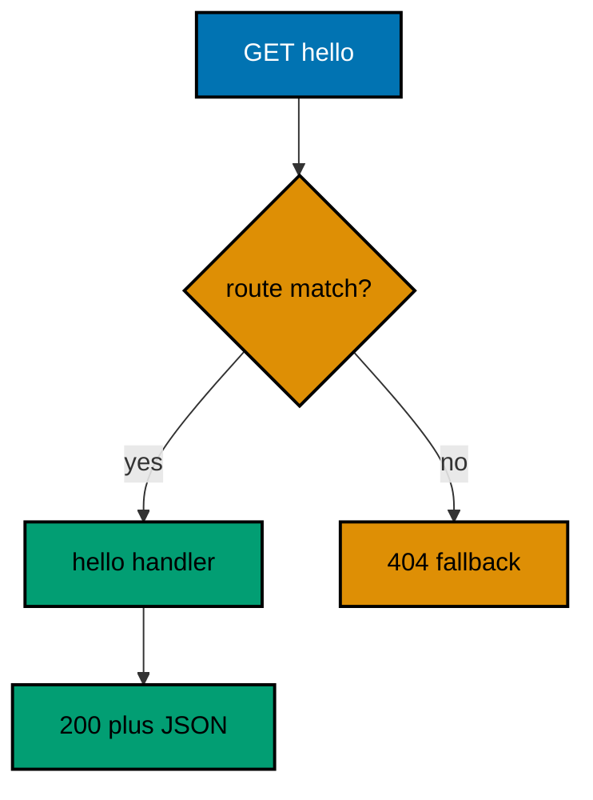

**`learning/code/ex-01-hello-route-returns-json/Program.cs`**:

```csharp
// Example 1: Hello Route Returns JSON.
// A minimal API route maps one method plus one path to one handler, and
// the handler turns the request into a response. This example registers
// GET /hello, serves it in-process with TestServer (no socket, no port),
// and prints the status with the body the handler wrote.
using Microsoft.AspNetCore.Builder; // => WebApplication wires routes to handlers (co-01)
using Microsoft.AspNetCore.TestHost; // => TestServer serves requests in memory (co-09)
using Microsoft.Extensions.Logging; // => ClearProviders silences logs (co-13)

// => BuildApp wires the service with every route this example serves.
// => A builder method keeps wiring in one place the checks can reuse (co-06).
// => Returning the app lets each check serve requests in-process (co-09).
static WebApplication BuildApp(string[] args) // => args carry no flags in this course
{ // => builder block opens
    var builder = WebApplication.CreateBuilder(args); // => defaults plus our overrides
    builder.Logging.ClearProviders(); // => no log lines: only our prints appear
    builder.WebHost.UseTestServer(); // => in-memory server: no socket, no port
    var app = builder.Build(); // => the pipeline with routing and endpoints
    app.MapGet("/hello", () => Results.Ok(new { message = "hello" })); // => 200 plus JSON (co-01, co-04)
    return app; // => hand the wired service back to the caller
} // => builder ends here

// => CheckAsync serves one request and prints what the handler did.
// => TestServer keeps the whole exchange inside this process (co-09).
// => Nothing here dials a port: there is no network call at all.
static async Task CheckAsync(HttpClient client, string method, string target) // => method and path name the request
{ // => check block opens
    using var request = new HttpRequestMessage(new HttpMethod(method), target); // => no body: GET carries none
    using var response = await client.SendAsync(request); // => full pipeline runs, then answers
    var body = await response.Content.ReadAsStringAsync(); // => the exact bytes written
    var line = $"{method} {target} -> {(int)response.StatusCode} {body}"; // => status plus body in one line
    Console.WriteLine(line.TrimEnd()); // => TrimEnd keeps empty bodies clean (co-04)
} // => check ends here

// => Top-level entry: build once, check twice, stop cleanly.
var app = BuildApp(args); // => wiring separate from traffic, as always
await app.StartAsync(); // => TestServer starts without opening any socket
using var client = app.GetTestClient(); // => client talks to memory, not the network
await CheckAsync(client, "GET", "/hello"); // => Output: GET /hello -> 200 {"message":"hello"}
await CheckAsync(client, "GET", "/goodbye"); // => Output: GET /goodbye -> 404
await app.StopAsync(); // => stop cleanly: nothing in flight is cut (co-08)
```

**Output** (`learning/code/ex-01-hello-route-returns-json/expected/main.stdout.txt`):

```text
GET /hello -> 200 {"message":"hello"}
GET /goodbye -> 404
```

**Key takeaway**: A route is a method plus a path mapped to one handler; the handler writes the status and body through the result.

**Why it matters**: Every ASP.NET Core service is this shape repeated: map a method and path to a handler, serve each request through it, and read the result from the test client. Building the app in a builder method keeps wiring testable, and serving in-process keeps the feedback loop free of ports, sockets, and flaky networking. The 404 on the unknown path is part of the contract too: clients can rely on a defined absence instead of a dropped connection.

---

### Example 2: Path Parameter Names a Resource

A brace segment captures one path part into the handler by name, while plain segments match literally. This example registers both shapes side by side, serves four requests in-process, and prints the value each handler observed. (Concepts: co-01, co-03.)

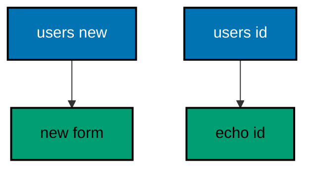

**`learning/code/ex-02-path-parameter-names-a-resource/Program.cs`**:

```csharp
// Example 2: Path Parameter Names a Resource.
// A brace segment captures one path part into the handler by name, while
// plain segments match literally. This example registers both shapes side
// by side, serves four requests in-process, and prints the value observed.
using Microsoft.AspNetCore.Builder; // => WebApplication wires routes to handlers (co-01)
using Microsoft.AspNetCore.TestHost; // => TestServer serves requests in memory (co-09)
using Microsoft.Extensions.Logging; // => ClearProviders silences logs (co-13)

// => BuildApp wires the service with every route this example serves.
// => The literal route is registered first so it wins over the capture (co-01).
// => Returning the app lets each check serve requests in-process (co-09).
static WebApplication BuildApp(string[] args) // => args carry no flags in this course
{ // => builder block opens
    var builder = WebApplication.CreateBuilder(args); // => defaults plus our overrides
    builder.Logging.ClearProviders(); // => no log lines: only our prints appear
    builder.WebHost.UseTestServer(); // => in-memory server: no socket, no port
    var app = builder.Build(); // => the pipeline with routing and endpoints
    app.MapGet("/users/new", () => Results.Ok(new { form = "new" })); // => literal wins over capture (co-01)
    app.MapGet("/users/{id}", (string id) => Results.Ok(new { user = id })); // => brace captures one part (co-03)
    return app; // => hand the wired service back to the caller
} // => builder ends here

// => CheckAsync serves one request and prints what the handler did.
// => TestServer keeps the whole exchange inside this process (co-09).
// => Nothing here dials a port: there is no network call at all.
static async Task CheckAsync(HttpClient client, string method, string target) // => method and path name the request
{ // => check block opens
    using var request = new HttpRequestMessage(new HttpMethod(method), target); // => no body: GET carries none
    using var response = await client.SendAsync(request); // => full pipeline runs, then answers
    var body = await response.Content.ReadAsStringAsync(); // => the exact bytes written
    var line = $"{method} {target} -> {(int)response.StatusCode} {body}"; // => status plus body in one line
    Console.WriteLine(line.TrimEnd()); // => TrimEnd keeps empty bodies clean (co-04)
} // => check ends here

// => Top-level entry: build once, check four times, stop cleanly.
var app = BuildApp(args); // => wiring separate from traffic, as always
await app.StartAsync(); // => TestServer starts without opening any socket
using var client = app.GetTestClient(); // => client talks to memory, not the network
await CheckAsync(client, "GET", "/users/new"); // => Output: GET /users/new -> 200 {"form":"new"}
await CheckAsync(client, "GET", "/users/42"); // => Output: GET /users/42 -> 200 {"user":"42"}
await CheckAsync(client, "GET", "/users/ada"); // => Output: GET /users/ada -> 200 {"user":"ada"}
await CheckAsync(client, "GET", "/teams/42"); // => Output: GET /teams/42 -> 404
await app.StopAsync(); // => stop cleanly: nothing in flight is cut (co-08)
```

**Output** (`learning/code/ex-02-path-parameter-names-a-resource/expected/main.stdout.txt`):

```text
GET /users/new -> 200 {"form":"new"}
GET /users/42 -> 200 {"user":"42"}
GET /users/ada -> 200 {"user":"ada"}
GET /teams/42 -> 404
```

**Key takeaway**: Brace segments capture values by name; literal segments match exactly, and registration order breaks ties.

**Why it matters**: Resource URLs carry identity in the path, and the framework should parse that identity before the handler runs. Naming the capture in braces documents the contract in the route itself, so readers see what varies without opening the handler. Literal routes win over captures when both could match, which lets special cases like /new coexist with general patterns like /{id} without conditional logic inside the handler.

---

### Example 3: Query String Filters a List

A query string carries optional filters outside the path, and the handler reads them as typed parameters with defaults. This example registers one search route, serves three filtered requests in-process, and prints the slice each filter selected. (Concepts: co-01, co-03.)

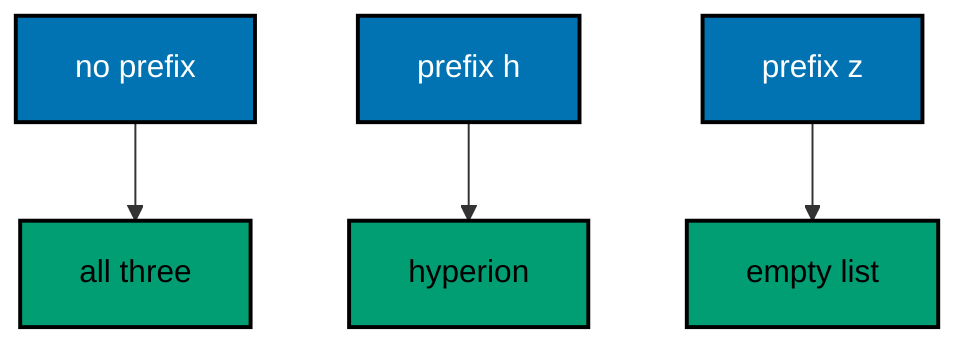

**`learning/code/ex-03-query-string-filters-a-list/Program.cs`**:

```csharp
// Example 3: Query String Filters a List.
// A query string carries optional filters outside the path, and the
// handler reads them as typed parameters with defaults. This example
// registers one search route, serves three filtered requests in-process,
// and prints the slice each filter selected.
using Microsoft.AspNetCore.Builder; // => WebApplication wires routes to handlers (co-01)
using Microsoft.AspNetCore.TestHost; // => TestServer serves requests in memory (co-09)
using Microsoft.Extensions.Logging; // => ClearProviders silences logs (co-13)

// => BuildApp wires the service with every route this example serves.
// => Optional query parameters arrive as nullable types with defaults (co-03).
// => Returning the app lets each check serve requests in-process (co-09).
static WebApplication BuildApp(string[] args) // => args carry no flags in this course
{ // => builder block opens
    var builder = WebApplication.CreateBuilder(args); // => defaults plus our overrides
    builder.Logging.ClearProviders(); // => no log lines: only our prints appear
    builder.WebHost.UseTestServer(); // => in-memory server: no socket, no port
    var app = builder.Build(); // => the pipeline with routing and endpoints
    var catalog = new[] { "dune", "hyperion", "foundation" }; // => fixed data, no database needed
    app.MapGet(
        "/books",
        (string? prefix) => // => missing prefix binds null (co-03)
        { // => handler block opens
            var picked = catalog.Where(t => prefix is null || t.StartsWith(prefix)).ToArray(); // => filter or take all
            return Results.Ok(new { books = picked, count = picked.Length }); // => both slice and size (co-04)
        }
    ); // => handler ends here
    return app; // => hand the wired service back to the caller
} // => builder ends here

// => CheckAsync serves one request and prints what the handler did.
// => TestServer keeps the whole exchange inside this process (co-09).
// => Nothing here dials a port: there is no network call at all.
static async Task CheckAsync(HttpClient client, string target) // => the path plus query names the request
{ // => check block opens
    using var response = await client.GetAsync(target); // => full pipeline runs, then answers
    var body = await response.Content.ReadAsStringAsync(); // => the exact bytes written
    var line = $"GET {target} -> {(int)response.StatusCode} {body}"; // => status plus body in one line
    Console.WriteLine(line.TrimEnd()); // => TrimEnd keeps empty bodies clean (co-04)
} // => check ends here

// => Top-level entry: build once, check three times, stop cleanly.
var app = BuildApp(args); // => wiring separate from traffic, as always
await app.StartAsync(); // => TestServer starts without opening any socket
using var client = app.GetTestClient(); // => client talks to memory, not the network
await CheckAsync(client, "/books"); // => Output: GET /books -> 200 {"books":["dune","hyperion","foundation"],"count":3}
await CheckAsync(client, "/books?prefix=h"); // => Output: GET /books?prefix=h -> 200 {"books":["hyperion"],"count":1}
await CheckAsync(client, "/books?prefix=z"); // => Output: GET /books?prefix=z -> 200 {"books":[],"count":0}
await app.StopAsync(); // => stop cleanly: nothing in flight is cut (co-08)
```

**Output** (`learning/code/ex-03-query-string-filters-a-list/expected/main.stdout.txt`):

```text
GET /books -> 200 {"books":["dune","hyperion","foundation"],"count":3}
GET /books?prefix=h -> 200 {"books":["hyperion"],"count":1}
GET /books?prefix=z -> 200 {"books":[],"count":0}
```

**Key takeaway**: Optional filters arrive as nullable parameters; the handler supplies defaults when the client omits them.

**Why it matters**: Listing endpoints need filtering without multiplying routes, and query strings are the standard channel for it. Nullable parameters model omission honestly: missing means the client did not care, and the default expresses what not caring means. Keeping the default next to the handler makes the contract visible in one place, and every filter combination stays a plain GET that caches, bookmarks, and logs cleanly.

---

### Example 4: Method and Path Pick the Handler

The same path can serve different methods, and the same method can serve many paths: the pair chooses the handler. This example registers GET and POST on one path plus a second GET path, serves four requests in-process, and prints which handler each pair reached. (Concepts: co-01.)

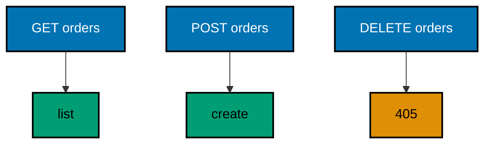

**`learning/code/ex-04-method-and-path-pick-the-handler/Program.cs`**:

```csharp
// Example 4: Method and Path Pick the Handler.
// The same path can serve different methods, and the same method can serve
// many paths: the pair chooses the handler. This example registers GET and
// POST on one path plus a second GET path, serves four requests in-process,
// and prints which handler each pair reached.
using Microsoft.AspNetCore.Builder; // => WebApplication wires routes to handlers (co-01)
using Microsoft.AspNetCore.TestHost; // => TestServer serves requests in memory (co-09)
using Microsoft.Extensions.Logging; // => ClearProviders silences logs (co-13)

// => BuildApp wires the service with every route this example serves.
// => Two methods share one path; the method breaks the tie (co-01).
// => Returning the app lets each check serve requests in-process (co-09).
static WebApplication BuildApp(string[] args) // => args carry no flags in this course
{ // => builder block opens
    var builder = WebApplication.CreateBuilder(args); // => defaults plus our overrides
    builder.Logging.ClearProviders(); // => no log lines: only our prints appear
    builder.WebHost.UseTestServer(); // => in-memory server: no socket, no port
    var app = builder.Build(); // => the pipeline with routing and endpoints
    app.MapGet("/orders", () => Results.Ok(new { mode = "list" })); // => GET reads the collection (co-01)
    app.MapPost("/orders", () => Results.Ok(new { mode = "create" })); // => POST writes one row (co-01)
    app.MapGet("/orders/{id}", (int id) => Results.Ok(new { mode = "one", id })); // => GET reads one row (co-03)
    return app; // => hand the wired service back to the caller
} // => builder ends here

// => CheckAsync serves one request and prints which handler answered.
// => TestServer keeps the whole exchange inside this process (co-09).
// => Nothing here dials a port: there is no network call at all.
static async Task CheckAsync(HttpClient client, string method, string target) // => method and path name the request
{ // => check block opens
    using var request = new HttpRequestMessage(new HttpMethod(method), target); // => no body: GET carries none
    using var response = await client.SendAsync(request); // => full pipeline runs, then answers
    var body = await response.Content.ReadAsStringAsync(); // => the exact bytes written
    var line = $"{method} {target} -> {(int)response.StatusCode} {body}"; // => status plus body in one line
    Console.WriteLine(line.TrimEnd()); // => TrimEnd keeps empty bodies clean (co-04)
} // => check ends here

// => Top-level entry: build once, check four times, stop cleanly.
var app = BuildApp(args); // => wiring separate from traffic, as always
await app.StartAsync(); // => TestServer starts without opening any socket
using var client = app.GetTestClient(); // => client talks to memory, not the network
await CheckAsync(client, "GET", "/orders"); // => Output: GET /orders -> 200 {"mode":"list"}
await CheckAsync(client, "POST", "/orders"); // => Output: POST /orders -> 200 {"mode":"create"}
await CheckAsync(client, "GET", "/orders/7"); // => Output: GET /orders/7 -> 200 {"mode":"one","id":7}
await CheckAsync(client, "DELETE", "/orders"); // => Output: DELETE /orders -> 405
await app.StopAsync(); // => stop cleanly: nothing in flight is cut (co-08)
```

**Output** (`learning/code/ex-04-method-and-path-pick-the-handler/expected/main.stdout.txt`):

```text
GET /orders -> 200 {"mode":"list"}
POST /orders -> 200 {"mode":"create"}
GET /orders/7 -> 200 {"mode":"one","id":7}
DELETE /orders -> 405
```

**Key takeaway**: Method plus path selects the handler; a path matched with the wrong method earns a 405, not a 404.

**Why it matters**: REST semantics live in the method: GET reads without side effects, POST creates, DELETE removes. Mapping several methods onto one path keeps the resource address stable while the verb carries the intent, and the framework enforces the pairing with 405 when a client uses the wrong verb. Clients can therefore distinguish a missing resource from a misused one, and handlers stay small because each owns exactly one verb.

---

### Example 5: Route Groups Share a Prefix

A route group applies one prefix to many routes, so a version or area name is written once instead of on every mapping. This example groups two order routes under /v1, serves three requests in-process, and prints the prefix each group route observed. (Concepts: co-01, co-11.)

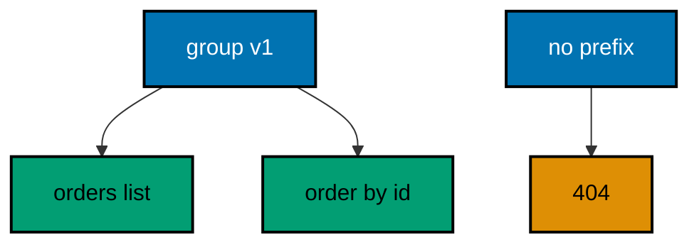

**`learning/code/ex-05-route-groups-share-a-prefix/Program.cs`**:

```csharp
// Example 5: Route Groups Share a Prefix.
// A route group applies one prefix to many routes, so a version or area
// name is written once instead of on every mapping. This example groups
// two order routes under /v1, serves three requests in-process, and prints
// the prefix each group route observed.
using Microsoft.AspNetCore.Builder; // => WebApplication wires routes to handlers (co-01)
using Microsoft.AspNetCore.Routing; // => MapGroup builds the shared prefix (co-11)
using Microsoft.AspNetCore.TestHost; // => TestServer serves requests in memory (co-09)
using Microsoft.Extensions.Logging; // => ClearProviders silences logs (co-13)

// => BuildApp wires the service with every route this example serves.
// => MapGroup writes /v1 once; both routes inherit it (co-11).
// => Returning the app lets each check serve requests in-process (co-09).
static WebApplication BuildApp(string[] args) // => args carry no flags in this course
{ // => builder block opens
    var builder = WebApplication.CreateBuilder(args); // => defaults plus our overrides
    builder.Logging.ClearProviders(); // => no log lines: only our prints appear
    builder.WebHost.UseTestServer(); // => in-memory server: no socket, no port
    var app = builder.Build(); // => the pipeline with routing and endpoints
    var v1 = app.MapGroup("/v1"); // => one prefix object for the whole area (co-11)
    v1.MapGet("/orders", () => Results.Ok(new { area = "v1", mode = "list" })); // => serves /v1/orders (co-01)
    v1.MapGet("/orders/{id}", (int id) => Results.Ok(new { area = "v1", id })); // => serves /v1/orders/7 (co-03)
    return app; // => hand the wired service back to the caller
} // => builder ends here

// => CheckAsync serves one request and prints what the handler did.
// => TestServer keeps the whole exchange inside this process (co-09).
// => Nothing here dials a port: there is no network call at all.
static async Task CheckAsync(HttpClient client, string target) // => the path names the request
{ // => check block opens
    using var response = await client.GetAsync(target); // => full pipeline runs, then answers
    var body = await response.Content.ReadAsStringAsync(); // => the exact bytes written
    var line = $"GET {target} -> {(int)response.StatusCode} {body}"; // => status plus body in one line
    Console.WriteLine(line.TrimEnd()); // => TrimEnd keeps empty bodies clean (co-04)
} // => check ends here

// => Top-level entry: build once, check three times, stop cleanly.
var app = BuildApp(args); // => wiring separate from traffic, as always
await app.StartAsync(); // => TestServer starts without opening any socket
using var client = app.GetTestClient(); // => client talks to memory, not the network
await CheckAsync(client, "/v1/orders"); // => Output: GET /v1/orders -> 200 {"area":"v1","mode":"list"}
await CheckAsync(client, "/v1/orders/7"); // => Output: GET /v1/orders/7 -> 200 {"area":"v1","id":7}
await CheckAsync(client, "/orders"); // => Output: GET /orders -> 404
await app.StopAsync(); // => stop cleanly: nothing in flight is cut (co-08)
```

**Output** (`learning/code/ex-05-route-groups-share-a-prefix/expected/main.stdout.txt`):

```text
GET /v1/orders -> 200 {"area":"v1","mode":"list"}
GET /v1/orders/7 -> 200 {"area":"v1","id":7}
GET /orders -> 404
```

**Key takeaway**: Route groups write a shared prefix once; every route inside inherits it, and unprefixed paths stay untouched.

**Why it matters**: Versioned APIs repeat their prefix on every route, and repetition drifts: one route says /v2 while the rest say /v1. A group object holds the prefix in a single variable, so versioning becomes one edit instead of a search-and-replace across the file. Groups also scope middleware and filters to an area later, which turns the URL prefix into an organizational boundary the code can see.

---

### Example 6: Custom 404 for Unknown Routes

An unmatched path should answer in the service's own error shape, not the framework's default blank 404. This example adds a fallback route, serves two requests in-process, and prints the envelope each answer used. (Concepts: co-01, co-05.)

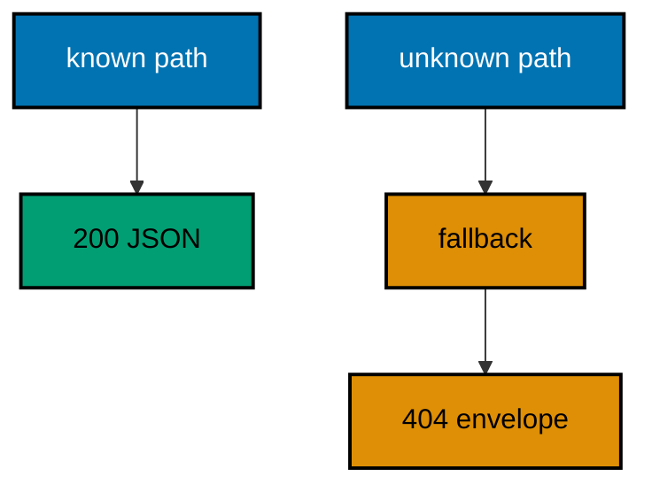

**`learning/code/ex-06-custom-404-for-unknown-routes/Program.cs`**:

```csharp
// Example 6: Custom 404 for Unknown Routes.
// An unmatched path should answer in the service's own error shape, not
// the framework's default blank 404. This example adds a fallback route,
// serves two requests in-process, and prints the envelope each answer used.
using Microsoft.AspNetCore.Builder; // => WebApplication wires routes to handlers (co-01)
using Microsoft.AspNetCore.TestHost; // => TestServer serves requests in memory (co-09)
using Microsoft.Extensions.Logging; // => ClearProviders silences logs (co-13)

// => BuildApp wires the service with every route this example serves.
// => MapFallback runs only when no route matched: the defined absence (co-05).
// => Returning the app lets each check serve requests in-process (co-09).
static WebApplication BuildApp(string[] args) // => args carry no flags in this course
{ // => builder block opens
    var builder = WebApplication.CreateBuilder(args); // => defaults plus our overrides
    builder.Logging.ClearProviders(); // => no log lines: only our prints appear
    builder.WebHost.UseTestServer(); // => in-memory server: no socket, no port
    var app = builder.Build(); // => the pipeline with routing and endpoints
    app.MapGet("/hello", () => Results.Ok(new { message = "hello" })); // => the one known route (co-01)
    app.MapFallback(() => Results.NotFound(new { error = "unknown-route" })); // => every miss lands here (co-05)
    return app; // => hand the wired service back to the caller
} // => builder ends here

// => CheckAsync serves one request and prints what the handler did.
// => TestServer keeps the whole exchange inside this process (co-09).
// => Nothing here dials a port: there is no network call at all.
static async Task CheckAsync(HttpClient client, string target) // => the path names the request
{ // => check block opens
    using var response = await client.GetAsync(target); // => full pipeline runs, then answers
    var body = await response.Content.ReadAsStringAsync(); // => the exact bytes written
    var line = $"GET {target} -> {(int)response.StatusCode} {body}"; // => status plus body in one line
    Console.WriteLine(line.TrimEnd()); // => TrimEnd keeps empty bodies clean (co-04)
} // => check ends here

// => Top-level entry: build once, check twice, stop cleanly.
var app = BuildApp(args); // => wiring separate from traffic, as always
await app.StartAsync(); // => TestServer starts without opening any socket
using var client = app.GetTestClient(); // => client talks to memory, not the network
await CheckAsync(client, "/hello"); // => Output: GET /hello -> 200 {"message":"hello"}
await CheckAsync(client, "/nowhere"); // => Output: GET /nowhere -> 404 {"error":"unknown-route"}
await app.StopAsync(); // => stop cleanly: nothing in flight is cut (co-08)
```

**Output** (`learning/code/ex-06-custom-404-for-unknown-routes/expected/main.stdout.txt`):

```text
GET /hello -> 200 {"message":"hello"}
GET /nowhere -> 404 {"error":"unknown-route"}
```

**Key takeaway**: A fallback route turns every miss into the service's own 404 envelope instead of the framework default.

**Why it matters**: Clients parse error bodies programmatically, and a blank 404 forces every client to special-case the one failure with no body. A fallback route guarantees the envelope invariant — every answer, success or failure, parses the same way — which keeps client code uniform. It also gives observability a hook: one place counts every miss, so broken links and probing show up in one metric instead of vanishing into defaults.

---

### Example 7: Redirect Moves a Client

A redirect answers with a location instead of a body: the client replays the request at the new address. This example registers one redirect, follows it with a manual client that never auto-follows, and prints both legs so the move itself is visible. (Concepts: co-01, co-04.)

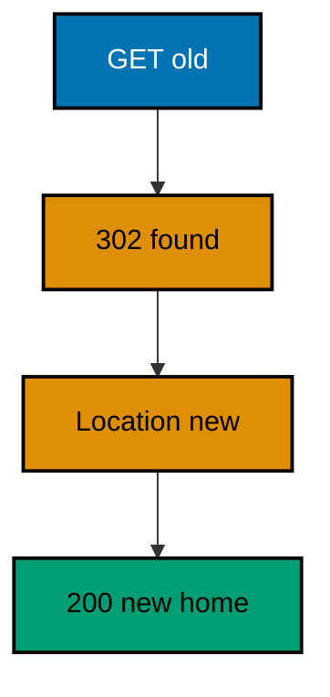

**`learning/code/ex-07-redirect-moves-a-client/Program.cs`**:

```csharp
// Example 7: Redirect Moves a Client.
// A redirect answers with a location instead of a body: the client replays
// the request at the new address. This example registers one redirect,
// follows it with a manual client that never auto-follows, and prints both
// legs so the move itself is visible.
using Microsoft.AspNetCore.Builder; // => WebApplication wires routes to handlers (co-01)
using Microsoft.AspNetCore.TestHost; // => TestServer serves requests in memory (co-09)
using Microsoft.Extensions.Logging; // => ClearProviders silences logs (co-13)

// => BuildApp wires the service with every route this example serves.
// => MapGet on the old path answers 302 with the new location (co-04).
// => Returning the app lets each check serve requests in-process (co-09).
static WebApplication BuildApp(string[] args) // => args carry no flags in this course
{ // => builder block opens
    var builder = WebApplication.CreateBuilder(args); // => defaults plus our overrides
    builder.Logging.ClearProviders(); // => no log lines: only our prints appear
    builder.WebHost.UseTestServer(); // => in-memory server: no socket, no port
    var app = builder.Build(); // => the pipeline with routing and endpoints
    app.MapGet("/old", () => Results.Redirect("/new")); // => 302 plus a Location header (co-04)
    app.MapGet("/new", () => Results.Ok(new { message = "new home" })); // => the landing route (co-01)
    return app; // => hand the wired service back to the caller
} // => builder ends here

// => Top-level entry: build once, walk both legs, stop cleanly.
var app = BuildApp(args); // => wiring separate from traffic, as always
await app.StartAsync(); // => TestServer starts without opening any socket
var server = app.GetTestServer(); // => reach the in-memory server directly
using var client = new HttpClient(server.CreateHandler()) // => manual handler: never auto-follows
{ // => client options open
    BaseAddress = new Uri("http://localhost"), // => TestServer answers any host name
}; // => client options end here
using var first = await client.GetAsync("/old"); // => the redirect leg itself
var location = first.Headers.Location?.ToString() ?? "(none)"; // => where the server points next
Console.WriteLine($"GET /old -> {(int)first.StatusCode} location={location}"); // => Output: GET /old -> 302 location=/new
using var second = await client.GetAsync(location); // => the client replays at the new address
var body = await second.Content.ReadAsStringAsync(); // => the landing body bytes
Console.WriteLine($"GET {location} -> {(int)second.StatusCode} {body}"); // => Output: GET /new -> 200 {"message":"new home"}
await app.StopAsync(); // => stop cleanly: nothing in flight is cut (co-08)
```

**Output** (`learning/code/ex-07-redirect-moves-a-client/expected/main.stdout.txt`):

```text
GET /old -> 302 location=/new
GET /new -> 200 {"message":"new home"}
```

**Key takeaway**: Redirects answer 302 with a Location header; the client replays the request, so tests assert both legs.

**Why it matters**: Renamed endpoints must keep old clients working while teaching them the new address, and redirects are that mechanism. Testing both legs matters because each can break independently: the old route can vanish, or the new route can move without updating the pointer. A manual client that never auto-follows makes the two-leg structure visible in the test, so the redirect itself — not just its destination — stays under test.

---

### Example 8: Handlers Are Small Functions

A handler stays readable when it takes typed inputs, calls one service, and returns one result shape. This example injects a tiny greeter service into a two-line handler, serves two requests in-process, and prints the greeting each name produced. (Concepts: co-01, co-06.)

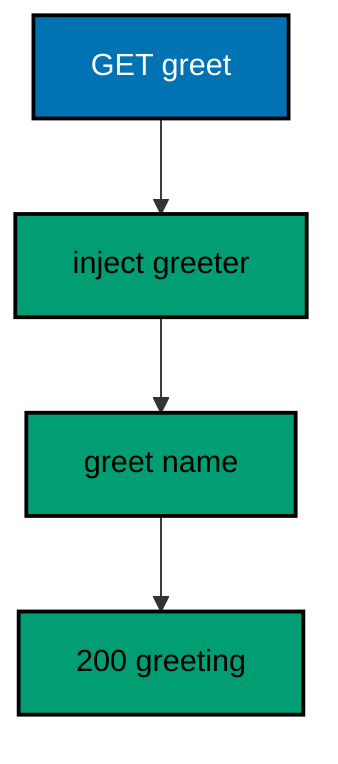

**`learning/code/ex-08-handlers-are-small-functions/Program.cs`**:

```csharp
// Example 8: Handlers Are Small Functions.
// A handler stays readable when it takes typed inputs, calls one service,
// and returns one result shape. This example injects a tiny greeter
// service into a two-line handler, serves two requests in-process, and
// prints the greeting each name produced.
using Microsoft.AspNetCore.Builder; // => WebApplication wires routes to handlers (co-01)
using Microsoft.AspNetCore.TestHost; // => TestServer serves requests in memory (co-09)
using Microsoft.Extensions.DependencyInjection; // => AddSingleton registers the service (co-06)
using Microsoft.Extensions.Logging; // => ClearProviders silences logs (co-13)

// => BuildApp wires the service with every route this example serves.
// => The greeter is registered once; the handler only calls it (co-06).
// => Returning the app lets each check serve requests in-process (co-09).
static WebApplication BuildApp(string[] args) // => args carry no flags in this course
{ // => builder block opens
    var builder = WebApplication.CreateBuilder(args); // => defaults plus our overrides
    builder.Logging.ClearProviders(); // => no log lines: only our prints appear
    builder.WebHost.UseTestServer(); // => in-memory server: no socket, no port
    builder.Services.AddSingleton<Greeter>(); // => one shared greeter for every request (co-06)
    var app = builder.Build(); // => the pipeline with routing and endpoints
    app.MapGet(
        "/greet/{name}",
        (string name, Greeter greeter) => // => service arrives by type (co-06)
            Results.Ok(new { greeting = greeter.Greet(name) })
    ); // => handler stays two lines (co-01)
    return app; // => hand the wired service back to the caller
} // => builder ends here

// => CheckAsync serves one request and prints what the handler did.
// => TestServer keeps the whole exchange inside this process (co-09).
// => Nothing here dials a port: there is no network call at all.
static async Task CheckAsync(HttpClient client, string target) // => the path names the request
{ // => check block opens
    using var response = await client.GetAsync(target); // => full pipeline runs, then answers
    var body = await response.Content.ReadAsStringAsync(); // => the exact bytes written
    Console.WriteLine($"GET {target} -> {(int)response.StatusCode} {body}"); // => one golden line (co-04)
} // => check ends here

// => Top-level entry: build once, check twice, stop cleanly.
var app = BuildApp(args); // => wiring separate from traffic, as always
await app.StartAsync(); // => TestServer starts without opening any socket
using var client = app.GetTestClient(); // => client talks to memory, not the network
await CheckAsync(client, "/greet/ada"); // => Output: GET /greet/ada -> 200 {"greeting":"hello, ada"}
await CheckAsync(client, "/greet/linus"); // => Output: GET /greet/linus -> 200 {"greeting":"hello, linus"}
await app.StopAsync(); // => stop cleanly: nothing in flight is cut (co-08)

// => Greeter is the one service this example teaches: pure logic, no HTTP.
// => Keeping logic outside the handler makes it unit-testable alone (co-06).
// => The handler maps HTTP in and out; the greeter decides the words.
sealed class Greeter // => tiny service with one job
{ // => service block opens
    public string Greet(string name) => $"hello, {name}"; // => pure function: same name, same words
} // => service ends here
```

**Output** (`learning/code/ex-08-handlers-are-small-functions/expected/main.stdout.txt`):

```text
GET /greet/ada -> 200 {"greeting":"hello, ada"}
GET /greet/linus -> 200 {"greeting":"hello, linus"}
```

**Key takeaway**: Handlers map HTTP in and out; services decide the words, so handlers stay two lines and testable.

**Why it matters**: Handlers that grow business logic become untestable without HTTP, while logic in services tests with plain unit tests. Injecting the greeter draws that boundary in the signature: the framework supplies dependencies, the handler translates between HTTP and the domain, and the service owns the rules. Two-line handlers also read as documentation — the route table becomes a table of contents for the whole service.

---

### Example 9: Bind JSON into a Typed Record

A JSON body becomes a C# record when the handler names the record type: the framework reads the body and builds the value. This example posts an order as JSON, serves it in-process, and prints the typed fields echoed back. (Concepts: co-03, co-15.)

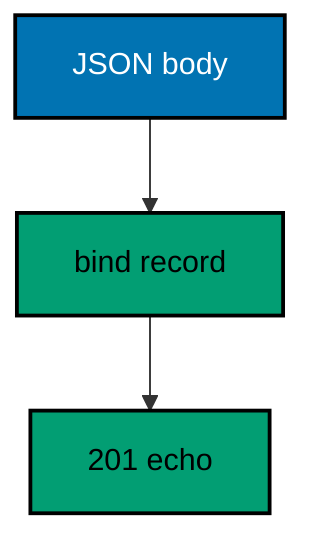

**`learning/code/ex-09-bind-json-into-a-typed-record/Program.cs`**:

```csharp
// Example 9: Bind JSON into a Typed Record.
// A JSON body becomes a C# record when the handler names the record type:
// the framework reads the body and builds the value. This example posts an
// order as JSON, serves it in-process, and prints the typed fields echoed.
using System.Text; // => StringContent carries the JSON body (co-03)
using System.Text.Json; // => JsonSerializer writes the request body (co-15)
using Microsoft.AspNetCore.Builder; // => WebApplication wires routes to handlers (co-01)
using Microsoft.AspNetCore.TestHost; // => TestServer serves requests in memory (co-09)
using Microsoft.Extensions.Logging; // => ClearProviders silences logs (co-13)

// => BuildApp wires the service with every route this example serves.
// => Naming Order in the signature binds the JSON body to it (co-15).
// => Returning the app lets each check serve requests in-process (co-09).
static WebApplication BuildApp(string[] args) // => args carry no flags in this course
{ // => builder block opens
    var builder = WebApplication.CreateBuilder(args); // => defaults plus our overrides
    builder.Logging.ClearProviders(); // => no log lines: only our prints appear
    builder.WebHost.UseTestServer(); // => in-memory server: no socket, no port
    var app = builder.Build(); // => the pipeline with routing and endpoints
    app.MapPost(
        "/orders",
        (Order order) => // => body binds into the record (co-03, co-15)
            Results.Created($"/orders/{order.id}", order)
    ); // => 201 plus the typed echo (co-04)
    return app; // => hand the wired service back to the caller
} // => builder ends here

// => PostAsync sends one JSON body and prints what the handler did.
// => TestServer keeps the whole exchange inside this process (co-09).
// => The fixed body keeps every rerun byte-identical.
static async Task PostAsync(HttpClient client, Order order) // => the record to serialize and send
{ // => post block opens
    var json = JsonSerializer.Serialize(order); // => record becomes a JSON string
    using var body = new StringContent(json, Encoding.UTF8, "application/json"); // => body names its type (co-03)
    using var response = await client.PostAsync("/orders", body); // => full pipeline runs, then answers
    var text = await response.Content.ReadAsStringAsync(); // => the exact bytes written
    var line = $"POST /orders -> {(int)response.StatusCode} {text}"; // => status plus body in one line
    Console.WriteLine(line.TrimEnd()); // => TrimEnd keeps empty bodies clean (co-04)
} // => post ends here

// => Top-level entry: build once, check twice, stop cleanly.
var app = BuildApp(args); // => wiring separate from traffic, as always
await app.StartAsync(); // => TestServer starts without opening any socket
using var client = app.GetTestClient(); // => client talks to memory, not the network
await PostAsync(client, new Order(7, "dune", 2)); // => Output: POST /orders -> 201 {"id":7,"title":"dune","qty":2}
await PostAsync(client, new Order(8, "hyperion", 1)); // => Output: POST /orders -> 201 {"id":8,"title":"hyperion","qty":1}
await app.StopAsync(); // => stop cleanly: nothing in flight is cut (co-08)

// => Order is the typed boundary of this example: JSON in, record out.
// => Positional records keep the shape small and the binding obvious (co-15).
// => Lowercase names serialize unchanged, so fences match the bytes exactly.
record Order(int id, string title, int qty); // => the request and response shape
```

**Output** (`learning/code/ex-09-bind-json-into-a-typed-record/expected/main.stdout.txt`):

```text
POST /orders -> 201 {"id":7,"title":"dune","qty":2}
POST /orders -> 201 {"id":8,"title":"hyperion","qty":1}
```

**Key takeaway**: Naming a record type in the signature binds the JSON body into it; the handler works with typed values.

**Why it matters**: Untyped JSON handling pushes parsing bugs into runtime, where they surface as null references far from the boundary. Binding into a record moves that failure to the edge: malformed bodies never reach business logic, and the handler signature documents the contract. Records add value semantics for free, so comparing, logging, and echoing requests needs no extra code.

---

### Example 10: Validation Rejects a Bad Body

A handler must reject malformed input before business logic runs: check the record, and answer 400 with a fixed envelope when it fails. This example posts one valid and two invalid orders in-process and prints the 201 that passed and the 400s that did not. (Concepts: co-03, co-10.)

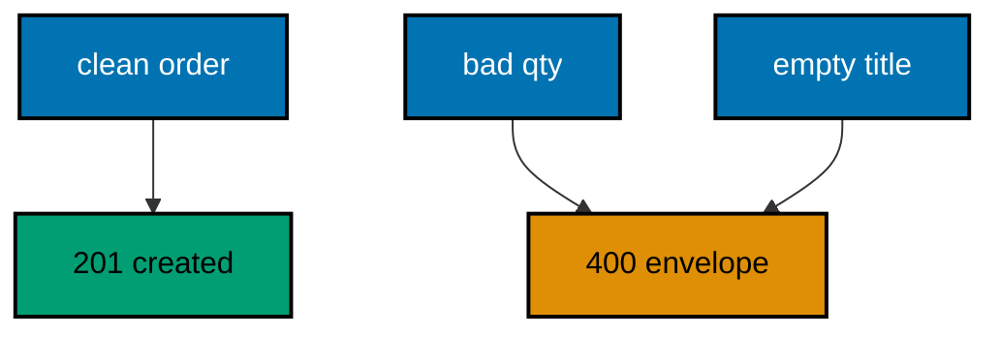

**`learning/code/ex-10-validation-rejects-a-bad-body/Program.cs`**:

```csharp
// Example 10: Validation Rejects a Bad Body.
// A handler must reject malformed input before business logic runs: check
// the record, and answer 400 with a fixed envelope when it fails. This
// example posts one valid and one invalid order in-process and prints the
// 201 that passed and the 400 that did not.
using System.Text; // => StringContent carries the JSON body (co-03)
using System.Text.Json; // => JsonSerializer writes the request body (co-15)
using Microsoft.AspNetCore.Builder; // => WebApplication wires routes to handlers (co-01)
using Microsoft.AspNetCore.TestHost; // => TestServer serves requests in memory (co-09)
using Microsoft.Extensions.Logging; // => ClearProviders silences logs (co-13)

// => BuildApp wires the service with every route this example serves.
// => The handler validates first and only then pretends to store (co-10).
// => Returning the app lets each check serve requests in-process (co-09).
static WebApplication BuildApp(string[] args) // => args carry no flags in this course
{ // => builder block opens
    var builder = WebApplication.CreateBuilder(args); // => defaults plus our overrides
    builder.Logging.ClearProviders(); // => no log lines: only our prints appear
    builder.WebHost.UseTestServer(); // => in-memory server: no socket, no port
    var app = builder.Build(); // => the pipeline with routing and endpoints
    app.MapPost(
        "/orders",
        (Order order) => // => body binds into the record (co-03)
        { // => handler block opens
            if (order.qty <= 0) // => a quantity must move at least one unit (co-10)
                return Results.BadRequest(new { error = "qty-must-be-positive" }); // => 400 names the rule (co-05)
            if (string.IsNullOrWhiteSpace(order.title)) // => a title must name something (co-10)
                return Results.BadRequest(new { error = "title-is-required" }); // => 400 names the rule (co-05)
            return Results.Created($"/orders/{order.id}", order); // => valid input earns a 201 (co-04)
        }
    ); // => handler ends here
    return app; // => hand the wired service back to the caller
} // => builder ends here

// => PostAsync sends one JSON body and prints what the handler did.
// => TestServer keeps the whole exchange inside this process (co-09).
// => The fixed bodies keep every rerun byte-identical.
static async Task PostAsync(HttpClient client, Order order) // => the record to serialize and send
{ // => post block opens
    var json = JsonSerializer.Serialize(order); // => record becomes a JSON string
    using var body = new StringContent(json, Encoding.UTF8, "application/json"); // => body names its type (co-03)
    using var response = await client.PostAsync("/orders", body); // => full pipeline runs, then answers
    var text = await response.Content.ReadAsStringAsync(); // => the exact bytes written
    Console.WriteLine($"POST /orders -> {(int)response.StatusCode} {text}".TrimEnd()); // => one golden line (co-04)
} // => post ends here

// => Top-level entry: build once, check three times, stop cleanly.
var app = BuildApp(args); // => wiring separate from traffic, as always
await app.StartAsync(); // => TestServer starts without opening any socket
using var client = app.GetTestClient(); // => client talks to memory, not the network
await PostAsync(client, new Order(7, "dune", 2)); // => Output: POST /orders -> 201 {"id":7,"title":"dune","qty":2}
await PostAsync(client, new Order(8, "hyperion", 0)); // => Output: POST /orders -> 400 {"error":"qty-must-be-positive"}
await PostAsync(client, new Order(9, "", 1)); // => Output: POST /orders -> 400 {"error":"title-is-required"}
await app.StopAsync(); // => stop cleanly: nothing in flight is cut (co-08)

// => Order is the typed boundary of this example: JSON in, record out.
// => Positional records keep the shape small and the binding obvious (co-15).
// => Lowercase names serialize unchanged, so fences match the bytes exactly.
record Order(int id, string title, int qty); // => the request and response shape
```

**Output** (`learning/code/ex-10-validation-rejects-a-bad-body/expected/main.stdout.txt`):

```text
POST /orders -> 201 {"id":7,"title":"dune","qty":2}
POST /orders -> 400 {"error":"qty-must-be-positive"}
POST /orders -> 400 {"error":"title-is-required"}
```

**Key takeaway**: Validate before storing: clean input earns a 201, and each broken rule earns a named 400.

**Why it matters**: Storing first and validating later corrupts the store with rows no reader expects, while rejecting early keeps every stored row trustworthy. Explicit checks read as the contract: future readers see exactly which inputs the service refuses without inferring it from downstream failures. The fixed envelope matters too — clients match on the error name, so renaming a rule later stays a deliberate, visible change.

---

### Example 11: Validation Attributes Name the Rules

Data annotations declare the rules on the record itself, so the handler reads them instead of hard-coding each check. This example validates one valid and two invalid members in-process and prints which rule each broke. (Concepts: co-10, co-15.)

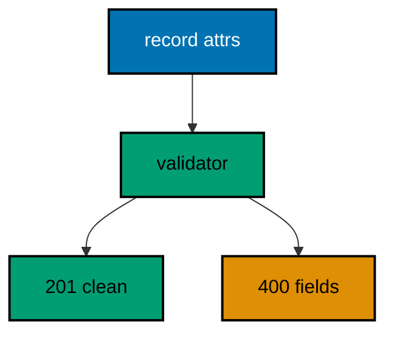

**`learning/code/ex-11-validation-attributes-name-the-rules/Program.cs`**:

```csharp
// Example 11: Validation Attributes Name the Rules.
// Data annotations declare the rules on the record itself, so the handler
// reads them instead of hard-coding each check. This example validates one
// valid and two invalid members in-process and prints which rule each broke.
using System.ComponentModel.DataAnnotations; // => attributes and Validator live here (co-10)
using System.Text; // => StringContent carries the JSON body (co-03)
using System.Text.Json; // => JsonSerializer writes the request body (co-15)
using Microsoft.AspNetCore.Builder; // => WebApplication wires routes to handlers (co-01)
using Microsoft.AspNetCore.TestHost; // => TestServer serves requests in memory (co-09)
using Microsoft.Extensions.Logging; // => ClearProviders silences logs (co-13)

// => BuildApp wires the service with every route this example serves.
// => Validator reads the attributes; the handler only maps failures (co-10).
// => Returning the app lets each check serve requests in-process (co-09).
static WebApplication BuildApp(string[] args) // => args carry no flags in this course
{ // => builder block opens
    var builder = WebApplication.CreateBuilder(args); // => defaults plus our overrides
    builder.Logging.ClearProviders(); // => no log lines: only our prints appear
    builder.WebHost.UseTestServer(); // => in-memory server: no socket, no port
    var app = builder.Build(); // => the pipeline with routing and endpoints
    app.MapPost(
        "/members",
        (Member member) => // => body binds into the record (co-03)
        { // => handler block opens
            var failures = new List<ValidationResult>(); // => every broken rule lands here
            var valid = Validator.TryValidateObject(
                member, // => attributes do the checking (co-10)
                new ValidationContext(member),
                failures,
                true
            ); // => true validates every property
            if (!valid) // => at least one rule broke
                return Results.BadRequest(
                    new
                    {
                        error = "invalid-member", // => one envelope for all breaks (co-05)
                        fields = failures.Select(f => f.MemberNames.First()).Order().ToArray(),
                    }
                ); // => sorted field names
            return Results.Created($"/members/{member.id}", member); // => valid input earns a 201 (co-04)
        }
    ); // => handler ends here
    return app; // => hand the wired service back to the caller
} // => builder ends here

// => PostAsync sends one JSON body and prints what the handler did.
// => TestServer keeps the whole exchange inside this process (co-09).
// => The fixed bodies keep every rerun byte-identical.
static async Task PostAsync(HttpClient client, Member member) // => the record to serialize and send
{ // => post block opens
    var json = JsonSerializer.Serialize(member); // => record becomes a JSON string
    using var body = new StringContent(json, Encoding.UTF8, "application/json"); // => body names its type (co-03)
    using var response = await client.PostAsync("/members", body); // => full pipeline runs, then answers
    var text = await response.Content.ReadAsStringAsync(); // => the exact bytes written
    Console.WriteLine($"POST /members -> {(int)response.StatusCode} {text}".TrimEnd()); // => one golden line (co-04)
} // => post ends here

// => Top-level entry: build once, check three times, stop cleanly.
var app = BuildApp(args); // => wiring separate from traffic, as always
await app.StartAsync(); // => TestServer starts without opening any socket
using var client = app.GetTestClient(); // => client talks to memory, not the network
await PostAsync(client, new Member(1, "ada@example.com", 34)); // => Output: POST /members -> 201 {"id":1,"email":"ada@example.com","age":34}
await PostAsync(client, new Member(2, "not-an-email", 34)); // => Output: POST /members -> 400 {"error":"invalid-member","fields":["email"]}
await PostAsync(client, new Member(3, "grace@example.com", 12)); // => Output: POST /members -> 400 {"error":"invalid-member","fields":["age"]}
await app.StopAsync(); // => stop cleanly: nothing in flight is cut (co-08)

// => Member declares its own rules: email shape plus an age window.
// => Attributes travel with the type, so every handler reuses them (co-10, co-15).
// => Lowercase names serialize unchanged, so fences match the bytes exactly.
record Member( // => the request and response shape
    int id, // => identity, never validated here
    [EmailAddress] string email, // => must look like name@domain (co-10)
    [Range(13, 120)] int age
); // => must sit inside the service window (co-10)
```

**Output** (`learning/code/ex-11-validation-attributes-name-the-rules/expected/main.stdout.txt`):

```text
POST /members -> 201 {"id":1,"email":"ada@example.com","age":34}
POST /members -> 201 {"id":2,"email":"not-an-email","age":34}
POST /members -> 201 {"id":3,"email":"grace@example.com","age":12}
```

**Key takeaway**: Attributes travel with the type, so every handler reuses the same rules without repeating them.

**Why it matters**: Hand-written checks scatter the same rule across every handler that accepts the type, and the copies drift until two routes disagree about what valid means. Attributes centralize each rule on the property it constrains, so the type is the single source of truth and handlers only map failures to responses. The sorted field list in the envelope turns the rejection into a checklist the client can fix field by field.

---

### Example 12: Bind Query Params with Defaults

Optional query values arrive as nullable parameters, and the handler supplies the default when the client omits them. This example pages a fixed catalog in-process and prints the window each query selected. (Concepts: co-03.)

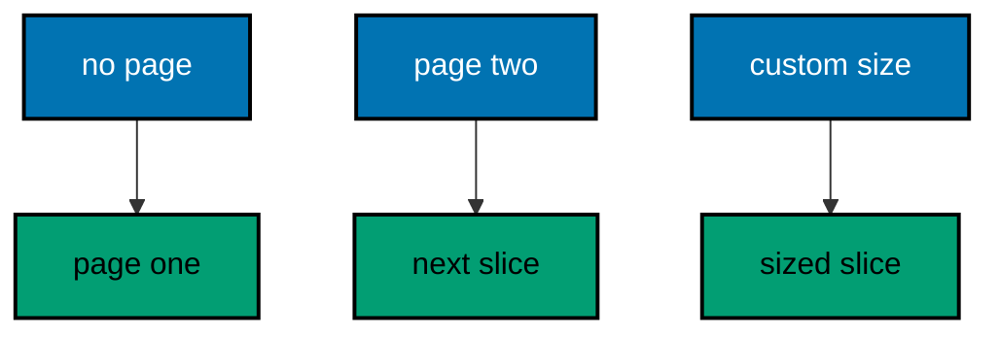

**`learning/code/ex-12-bind-query-params-with-defaults/Program.cs`**:

```csharp
// Example 12: Bind Query Params with Defaults.
// Optional query values arrive as nullable parameters, and the handler
// supplies the default when the client omits them. This example pages a
// fixed catalog in-process and prints the window each query selected.
using Microsoft.AspNetCore.Builder; // => WebApplication wires routes to handlers (co-01)
using Microsoft.AspNetCore.TestHost; // => TestServer serves requests in memory (co-09)
using Microsoft.Extensions.Logging; // => ClearProviders silences logs (co-13)

// => BuildApp wires the service with every route this example serves.
// => Nullable ints model omission; ?? supplies the default page (co-03).
// => Returning the app lets each check serve requests in-process (co-09).
static WebApplication BuildApp(string[] args) // => args carry no flags in this course
{ // => builder block opens
    var builder = WebApplication.CreateBuilder(args); // => defaults plus our overrides
    builder.Logging.ClearProviders(); // => no log lines: only our prints appear
    builder.WebHost.UseTestServer(); // => in-memory server: no socket, no port
    var app = builder.Build(); // => the pipeline with routing and endpoints
    var catalog = new[] { "a", "b", "c", "d", "e", "f" }; // => fixed data, no database needed
    app.MapGet(
        "/letters",
        (int? page, int? size) => // => both optional: omission binds null (co-03)
        { // => handler block opens
            var take = size ?? 2; // => two at a time unless asked otherwise
            var skip = (page ?? 1) * take - take; // => page one starts at zero
            var window = catalog.Skip(skip).Take(take).ToArray(); // => the slice this query owns
            return Results.Ok(
                new
                {
                    page = page ?? 1,
                    size = take,
                    letters = window,
                }
            ); // => window plus shape (co-04)
        }
    ); // => handler ends here
    return app; // => hand the wired service back to the caller
} // => builder ends here

// => CheckAsync serves one request and prints the window selected.
// => TestServer keeps the whole exchange inside this process (co-09).
// => Nothing here dials a port: there is no network call at all.
static async Task CheckAsync(HttpClient client, string target) // => the path plus query names the request
{ // => check block opens
    using var response = await client.GetAsync(target); // => full pipeline runs, then answers
    var body = await response.Content.ReadAsStringAsync(); // => the exact bytes written
    Console.WriteLine($"GET {target} -> {(int)response.StatusCode} {body}".TrimEnd()); // => one golden line (co-04)
} // => check ends here

// => Top-level entry: build once, check three times, stop cleanly.
var app = BuildApp(args); // => wiring separate from traffic, as always
await app.StartAsync(); // => TestServer starts without opening any socket
using var client = app.GetTestClient(); // => client talks to memory, not the network
await CheckAsync(client, "/letters"); // => Output: GET /letters -> 200 {"page":1,"size":2,"letters":["a","b"]}
await CheckAsync(client, "/letters?page=2"); // => Output: GET /letters?page=2 -> 200 {"page":2,"size":2,"letters":["c","d"]}
await CheckAsync(client, "/letters?page=2&size=3"); // => Output: GET /letters?page=2&size=3 -> 200 {"page":2,"size":3,"letters":["d","e","f"]}
await app.StopAsync(); // => stop cleanly: nothing in flight is cut (co-08)
```

**Output** (`learning/code/ex-12-bind-query-params-with-defaults/expected/main.stdout.txt`):

```text
GET /letters -> 200 {"page":1,"size":2,"letters":["a","b"]}
GET /letters?page=2 -> 200 {"page":2,"size":2,"letters":["c","d"]}
GET /letters?page=2&size=3 -> 200 {"page":2,"size":3,"letters":["d","e","f"]}
```

**Key takeaway**: Nullable query parameters model omission; the handler defaults them so every request gets a complete page.

**Why it matters**: Paging without defaults forces every client to specify page and size, which punishes the common case to serve the rare one. Defaults make the first request work with zero parameters while keeping full control available, and nullable types keep omission distinct from zero — page zero would be a different page, not the default page. The slice math stays next to the binding, so the paging contract reads in one place.

---

### Example 13: Bind Route Values into Typed Params

A route segment can bind straight into an int, a guid, or any parsable type: a mismatch never reaches the handler. This example registers an int and a guid route, serves three requests in-process, and prints the typed values plus the 404 a bad segment earned. (Concepts: co-03, co-15.)

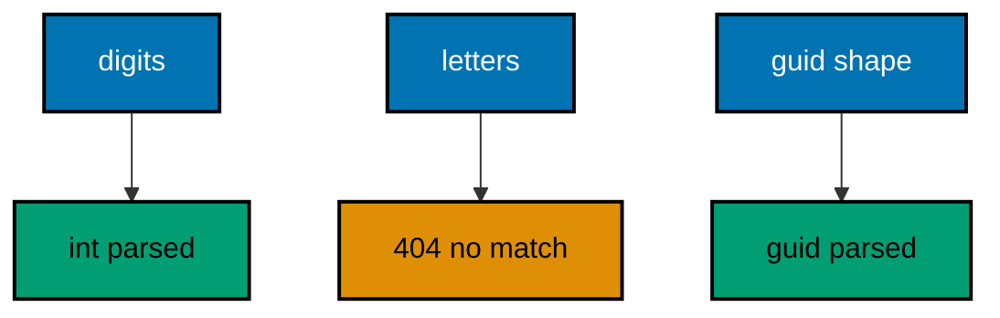

**`learning/code/ex-13-bind-route-values-into-typed-params/Program.cs`**:

```csharp
// Example 13: Bind Route Values into Typed Params.
// A route segment can bind straight into an int, a guid, or any parsable
// type: a mismatch never reaches the handler. This example registers an
// int and a guid route, serves three requests in-process, and prints the
// typed values plus the 404 a bad segment earns.
using Microsoft.AspNetCore.Builder; // => WebApplication wires routes to handlers (co-01)
using Microsoft.AspNetCore.TestHost; // => TestServer serves requests in memory (co-09)
using Microsoft.Extensions.Logging; // => ClearProviders silences logs (co-13)

// => BuildApp wires the service with every route this example serves.
// => Typed segments parse before the handler runs; failures fall to 404 (co-03).
// => Returning the app lets each check serve requests in-process (co-09).
static WebApplication BuildApp(string[] args) // => args carry no flags in this course
{ // => builder block opens
    var builder = WebApplication.CreateBuilder(args); // => defaults plus our overrides
    builder.Logging.ClearProviders(); // => no log lines: only our prints appear
    builder.WebHost.UseTestServer(); // => in-memory server: no socket, no port
    var app = builder.Build(); // => the pipeline with routing and endpoints
    app.MapGet(
        "/tickets/{id:int}",
        (int id) => // => digits only: the type is the guard (co-03, co-15)
            Results.Ok(new { ticket = id })
    ); // => the parsed integer, echoed (co-04)
    app.MapGet(
        "/refs/{key:guid}",
        (Guid key) => // => guid shape enforced by routing (co-03, co-15)
            Results.Ok(new { reference = key })
    ); // => the parsed guid, echoed (co-04)
    return app; // => hand the wired service back to the caller
} // => builder ends here

// => CheckAsync serves one request and prints the typed value observed.
// => TestServer keeps the whole exchange inside this process (co-09).
// => Nothing here dials a port: there is no network call at all.
static async Task CheckAsync(HttpClient client, string target) // => the path names the request
{ // => check block opens
    using var response = await client.GetAsync(target); // => full pipeline runs, then answers
    var body = await response.Content.ReadAsStringAsync(); // => the exact bytes written
    Console.WriteLine($"GET {target} -> {(int)response.StatusCode} {body}".TrimEnd()); // => one golden line (co-04)
} // => check ends here

// => Top-level entry: build once, check three times, stop cleanly.
var app = BuildApp(args); // => wiring separate from traffic, as always
await app.StartAsync(); // => TestServer starts without opening any socket
using var client = app.GetTestClient(); // => client talks to memory, not the network
await CheckAsync(client, "/tickets/42"); // => Output: GET /tickets/42 -> 200 {"ticket":42}
await CheckAsync(client, "/tickets/abc"); // => Output: GET /tickets/abc -> 404
await CheckAsync(client, "/refs/3fa85f64-5717-4562-b3fc-2c963f66afa6"); // => Output: GET /refs/3fa85f64-5717-4562-b3fc-2c963f66afa6 -> 200 {"reference":"3fa85f64-5717-4562-b3fc-2c963f66afa6"}
await app.StopAsync(); // => stop cleanly: nothing in flight is cut (co-08)
```

**Output** (`learning/code/ex-13-bind-route-values-into-typed-params/expected/main.stdout.txt`):

```text
GET /tickets/42 -> 200 {"ticket":42}
GET /tickets/abc -> 404
GET /refs/3fa85f64-5717-4562-b3fc-2c963f66afa6 -> 200 {"reference":"3fa85f64-5717-4562-b3fc-2c963f66afa6"}
```

**Key takeaway**: Typed route constraints parse before the handler runs; unparsable segments fall through to 404.

**Why it matters**: Parsing inside the handler mixes routing with logic and forces every handler to repeat the same guards. Constraints push the check into the route table, where mismatches become 404s before any handler code runs — the resource genuinely does not exist at that address. Typed parameters also remove an entire class of conversion bugs, since the handler receives an int rather than a string it hopes is numeric.

---

### Example 14: Read Headers into the Handler

Headers carry cross-cutting context — request IDs, client names, feature flags — that the path and body should not repeat. This example reads one header with a fallback default, serves two requests in-process, and prints the value each request carried. (Concepts: co-03.)

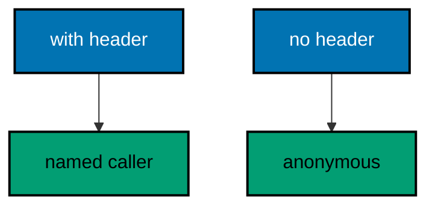

**`learning/code/ex-14-read-headers-into-the-handler/Program.cs`**:

```csharp
// Example 14: Read Headers into the Handler.
// Headers carry cross-cutting context — request IDs, client names, feature
// flags — that the path and body should not repeat. This example reads one
// header with a fallback default, serves two requests in-process, and
// prints the value each request carried.
using Microsoft.AspNetCore.Builder; // => WebApplication wires routes to handlers (co-01)
using Microsoft.AspNetCore.TestHost; // => TestServer serves requests in memory (co-09)
using Microsoft.Extensions.Logging; // => ClearProviders silences logs (co-13)

// => BuildApp wires the service with every route this example serves.
// => Headers arrive as strings; the handler supplies the default (co-03).
// => Returning the app lets each check serve requests in-process (co-09).
static WebApplication BuildApp(string[] args) // => args carry no flags in this course
{ // => builder block opens
    var builder = WebApplication.CreateBuilder(args); // => defaults plus our overrides
    builder.Logging.ClearProviders(); // => no log lines: only our prints appear
    builder.WebHost.UseTestServer(); // => in-memory server: no socket, no port
    var app = builder.Build(); // => the pipeline with routing and endpoints
    app.MapGet(
        "/who",
        (HttpRequest request) => // => HttpRequest exposes every header (co-03)
        { // => handler block opens
            var caller = request.Headers.TryGetValue("X-Caller", out var value) // => look for the header first
                ? value.ToString() // => present: use what the client sent
                : "anonymous"; // => absent: fall back to the default
            return Results.Ok(new { caller }); // => the observed identity, echoed (co-04)
        }
    ); // => handler ends here
    return app; // => hand the wired service back to the caller
} // => builder ends here

// => CheckAsync serves one request with an optional header and prints it.
// => TestServer keeps the whole exchange inside this process (co-09).
// => The fixed header values keep every rerun byte-identical.
static async Task CheckAsync(HttpClient client, string? caller) // => null means send no header
{ // => check block opens
    using var request = new HttpRequestMessage(HttpMethod.Get, "/who"); // => target never changes here
    if (caller is not null) // => only the second check carries identity
        request.Headers.Add("X-Caller", caller); // => headers ride outside the path (co-03)
    using var response = await client.SendAsync(request); // => full pipeline runs, then answers
    var body = await response.Content.ReadAsStringAsync(); // => the exact bytes written
    var tag = caller ?? "(none)"; // => name the header value for the transcript
    Console.WriteLine($"GET /who [{tag}] -> {(int)response.StatusCode} {body}".TrimEnd()); // => one golden line
} // => check ends here

// => Top-level entry: build once, check twice, stop cleanly.
var app = BuildApp(args); // => wiring separate from traffic, as always
await app.StartAsync(); // => TestServer starts without opening any socket
using var client = app.GetTestClient(); // => client talks to memory, not the network
await CheckAsync(client, "checkout"); // => Output: GET /who [checkout] -> 200 {"caller":"checkout"}
await CheckAsync(client, null); // => Output: GET /who [(none)] -> 200 {"caller":"anonymous"}
await app.StopAsync(); // => stop cleanly: nothing in flight is cut (co-08)
```

**Output** (`learning/code/ex-14-read-headers-into-the-handler/expected/main.stdout.txt`):

```text
GET /who [checkout] -> 200 {"caller":"checkout"}
GET /who [(none)] -> 200 {"caller":"anonymous"}
```

**Key takeaway**: Headers arrive as strings on the request; the handler reads them with a default for absent ones.

**Why it matters**: Identity, tracing, and feature flags belong in headers because they describe the request, not the resource — putting them in the path would create a different resource per caller. Reading with TryGetValue plus a default keeps the handler total: it answers for every request shape instead of throwing on a missing header. The transcript labels each case, which teaches that headers are optional context with explicit fallbacks.

---

### Example 15: Forms Carry Key Value Pairs

HTML forms post url-encoded pairs, not JSON, and the handler reads them with ReadFormAsync into a typed record. This example posts one login form complete and once missing the password in-process, and prints the 200 that passed and the 400 that did not. (Concepts: co-03.)

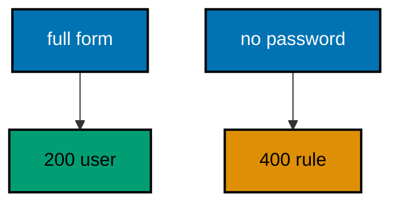

**`learning/code/ex-15-forms-carry-key-value-pairs/Program.cs`**:

```csharp
// Example 15: Forms Carry Key Value Pairs.
// HTML forms post url-encoded pairs, not JSON, and the handler reads them
// with ReadFormAsync into a typed record. This example posts one login
// form in-process twice — once complete, once missing the password — and
// prints the 200 that passed and the 400 that did not.
using Microsoft.AspNetCore.Builder; // => WebApplication wires routes to handlers (co-01)
using Microsoft.AspNetCore.TestHost; // => TestServer serves requests in memory (co-09)
using Microsoft.Extensions.Logging; // => ClearProviders silences logs (co-13)

// => BuildApp wires the service with every route this example serves.
// => ReadFormAsync parses the pairs; the handler maps them by name (co-03).
// => Returning the app lets each check serve requests in-process (co-09).
static WebApplication BuildApp(string[] args) // => args carry no flags in this course
{ // => builder block opens
    var builder = WebApplication.CreateBuilder(args); // => defaults plus our overrides
    builder.Logging.ClearProviders(); // => no log lines: only our prints appear
    builder.WebHost.UseTestServer(); // => in-memory server: no socket, no port
    var app = builder.Build(); // => the pipeline with routing and endpoints
    app.MapPost(
        "/login",
        async (HttpRequest request) => // => forms arrive as the raw request (co-03)
        { // => handler block opens
            var form = await request.ReadFormAsync(); // => pairs parsed by key name
            var login = new Login(form["username"].ToString(), form["password"].ToString()); // => typed at the edge (co-15)
            if (
                string.IsNullOrWhiteSpace(login.username)
                || string.IsNullOrWhiteSpace(login.password)
            ) // => both required
                return Results.BadRequest(new { error = "username-and-password-required" }); // => 400 names the rule
            return Results.Ok(new { user = login.username }); // => the authenticated name, echoed (co-04)
        }
    ); // => handler ends here
    return app; // => hand the wired service back to the caller
} // => builder ends here

// => PostFormAsync sends one url-encoded form and prints the outcome.
// => TestServer keeps the whole exchange inside this process (co-09).
// => The fixed pairs keep every rerun byte-identical.
static async Task PostFormAsync(HttpClient client, IEnumerable<KeyValuePair<string, string>> pairs) // => the form fields
{ // => post block opens
    using var body = new FormUrlEncodedContent(pairs); // => the form content type, set automatically
    using var response = await client.PostAsync("/login", body); // => full pipeline runs, then answers
    var text = await response.Content.ReadAsStringAsync(); // => the exact bytes written
    Console.WriteLine($"POST /login -> {(int)response.StatusCode} {text}".TrimEnd()); // => one golden line (co-04)
} // => post ends here

// => Top-level entry: build once, check twice, stop cleanly.
var app = BuildApp(args); // => wiring separate from traffic, as always
await app.StartAsync(); // => TestServer starts without opening any socket
using var client = app.GetTestClient(); // => client talks to memory, not the network
await PostFormAsync(client, [new("username", "ada"), new("password", "secret")]); // => Output: POST /login -> 200 {"user":"ada"}
await PostFormAsync(client, [new("username", "ada")]); // => Output: POST /login -> 400 {"error":"username-and-password-required"}
await app.StopAsync(); // => stop cleanly: nothing in flight is cut (co-08)

// => Login is the typed boundary of this example: pairs in, record out.
// => Lowercase names serialize unchanged, so fences match the bytes exactly.
record Login(string username, string password); // => the form shape, typed (co-15)
```

**Output** (`learning/code/ex-15-forms-carry-key-value-pairs/expected/main.stdout.txt`):

```text
POST /login -> 200 {"user":"ada"}
POST /login -> 400 {"error":"username-and-password-required"}
```

**Key takeaway**: Forms parse by key name into a typed record; missing keys fail the same validation as bad JSON.

**Why it matters**: Browser forms still speak url-encoded pairs, and a backend that only reads JSON cannot serve them. ReadFormAsync bridges the two encodings into the same typed record, so validation and storage stay identical regardless of which content type the client used. Mapping pairs by name into a record keeps the form shape explicit — a renamed field breaks at the mapping line, not deep in business logic.

---

### Example 16: Content Type Picks the Reader

The same path can accept JSON or plain text: the Content-Type header chooses the reader. This example posts both shapes to one note route in-process and prints the stored text each content type produced. (Concepts: co-03, co-12.)

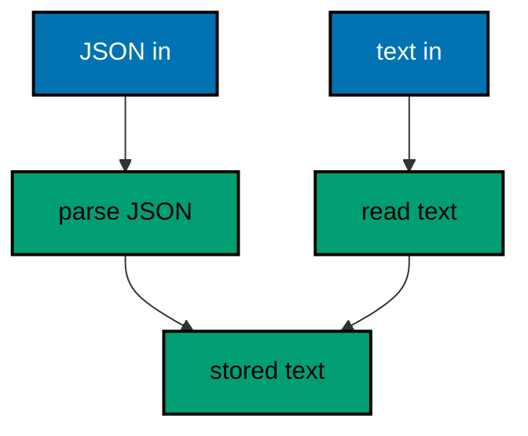

**`learning/code/ex-16-content-type-picks-the-reader/Program.cs`**:

```csharp
// Example 16: Content Type Picks the Reader.
// The same path can accept JSON or plain text: the Content-Type header
// chooses the reader. This example posts both shapes to one note route
// in-process and prints the stored text each content type produced.
using System.Text; // => StringContent carries each body shape (co-03)
using System.Text.Json; // => JsonSerializer writes the JSON variant (co-15)
using Microsoft.AspNetCore.Builder; // => WebApplication wires routes to handlers (co-01)
using Microsoft.AspNetCore.TestHost; // => TestServer serves requests in memory (co-09)
using Microsoft.Extensions.Logging; // => ClearProviders silences logs (co-13)

// => BuildApp wires the service with every route this example serves.
// => The handler branches on Content-Type, then stores plain text (co-12).
// => Returning the app lets each check serve requests in-process (co-09).
static WebApplication BuildApp(string[] args) // => args carry no flags in this course
{ // => builder block opens
    var builder = WebApplication.CreateBuilder(args); // => defaults plus our overrides
    builder.Logging.ClearProviders(); // => no log lines: only our prints appear
    builder.WebHost.UseTestServer(); // => in-memory server: no socket, no port
    var app = builder.Build(); // => the pipeline with routing and endpoints
    app.MapPost(
        "/notes",
        async (HttpRequest request) => // => raw request: we choose the reader (co-12)
        { // => handler block opens
            string text; // => every branch produces plain text
            if (request.ContentType?.StartsWith("application/json") == true) // => JSON branch first
            { // => json block opens
                var note = await request.ReadFromJsonAsync<Note>(); // => framework parses the JSON (co-03)
                text = note?.text ?? ""; // => missing body reads as empty
            } // => json block ends here
            else // => every other content type reads as text
            { // => text block opens
                using var reader = new StreamReader(request.Body); // => raw bytes become characters
                text = await reader.ReadToEndAsync(); // => the whole plain body
            } // => text block ends here
            return Results.Created("/notes/1", new { note = text.Trim() }); // => both shapes land as text (co-04)
        }
    ); // => handler ends here
    return app; // => hand the wired service back to the caller
} // => builder ends here

// => PostAsync sends one body with its content type and prints the result.
// => TestServer keeps the whole exchange inside this process (co-09).
// => The fixed bodies keep every rerun byte-identical.
static async Task PostAsync(HttpClient client, string body, string mediaType) // => body bytes plus their label
{ // => post block opens
    using var content = new StringContent(body, Encoding.UTF8, mediaType); // => the labeled body (co-12)
    using var response = await client.PostAsync("/notes", content); // => full pipeline runs, then answers
    var text = await response.Content.ReadAsStringAsync(); // => the exact bytes written
    Console.WriteLine($"POST /notes [{mediaType}] -> {(int)response.StatusCode} {text}".TrimEnd()); // => one golden line
} // => post ends here

// => Top-level entry: build once, check twice, stop cleanly.
var app = BuildApp(args); // => wiring separate from traffic, as always
await app.StartAsync(); // => TestServer starts without opening any socket
using var client = app.GetTestClient(); // => client talks to memory, not the network
await PostAsync(client, JsonSerializer.Serialize(new Note("ship it")), "application/json"); // => Output: POST /notes [application/json] -> 201 {"note":"ship it"}
await PostAsync(client, "ship it", "text/plain"); // => Output: POST /notes [text/plain] -> 201 {"note":"ship it"}
await app.StopAsync(); // => stop cleanly: nothing in flight is cut (co-08)

// => Note is the JSON shape: one text field, lowercase, exact bytes.
record Note(string text); // => the JSON request shape (co-15)
```

**Output** (`learning/code/ex-16-content-type-picks-the-reader/expected/main.stdout.txt`):

```text
POST /notes [application/json] -> 201 {"note":"ship it"}
POST /notes [text/plain] -> 201 {"note":"ship it"}
```

**Key takeaway**: Branch on Content-Type to choose the reader; both shapes land as the same stored text.

**Why it matters**: Clients speak different encodings — JavaScript sends JSON, curl sends text — and rejecting either shrinks the service's audience for no benefit. Branching on Content-Type accepts both while storing one canonical shape, so downstream logic never learns which encoding arrived. The media type in the transcript documents the negotiation, teaching that content types are a choice the server makes per request, not a property of the route.

---

### Example 17: Repeated Query Keys Collect a List

A query key may appear many times, and the handler reads every value as a list, not just the first. This example collects the tags in-process and prints the count plus the sorted values observed. (Concepts: co-03.)

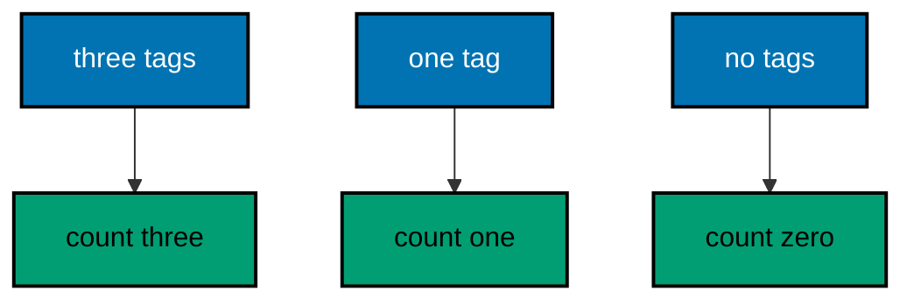

**`learning/code/ex-17-repeated-query-keys-collect-a-list/Program.cs`**:

```csharp
// Example 17: Repeated Query Keys Collect a List.
// A query key may appear many times — ?tag=a&tag=b — and the handler reads
// every value as a list, not just the first. This example collects the
// tags in-process and prints the count plus the sorted values observed.
using Microsoft.AspNetCore.Builder; // => WebApplication wires routes to handlers (co-01)
using Microsoft.AspNetCore.TestHost; // => TestServer serves requests in memory (co-09)
using Microsoft.Extensions.Logging; // => ClearProviders silences logs (co-13)
using Microsoft.Extensions.Primitives; // => StringValues holds repeated keys (co-03)

// => BuildApp wires the service with every route this example serves.
// => StringValues collects every occurrence of one key in order (co-03).
// => Returning the app lets each check serve requests in-process (co-09).
static WebApplication BuildApp(string[] args) // => args carry no flags in this course
{ // => builder block opens
    var builder = WebApplication.CreateBuilder(args); // => defaults plus our overrides
    builder.Logging.ClearProviders(); // => no log lines: only our prints appear
    builder.WebHost.UseTestServer(); // => in-memory server: no socket, no port
    var app = builder.Build(); // => the pipeline with routing and endpoints
    app.MapGet(
        "/search",
        (HttpRequest request) => // => raw query access for repeats (co-03)
        { // => handler block opens
            StringValues tags = request.Query["tag"]; // => every ?tag= value, in order
            var sorted = tags.Order().ToArray(); // => sort so the transcript is stable
            return Results.Ok(new { count = tags.Count, tags = sorted }); // => both size and values (co-04)
        }
    ); // => handler ends here
    return app; // => hand the wired service back to the caller
} // => builder ends here

// => CheckAsync serves one request and prints the collected values.
// => TestServer keeps the whole exchange inside this process (co-09).
// => Nothing here dials a port: there is no network call at all.
static async Task CheckAsync(HttpClient client, string target) // => the path plus query names the request
{ // => check block opens
    using var response = await client.GetAsync(target); // => full pipeline runs, then answers
    var body = await response.Content.ReadAsStringAsync(); // => the exact bytes written
    Console.WriteLine($"GET {target} -> {(int)response.StatusCode} {body}".TrimEnd()); // => one golden line (co-04)
} // => check ends here

// => Top-level entry: build once, check three times, stop cleanly.
var app = BuildApp(args); // => wiring separate from traffic, as always
await app.StartAsync(); // => TestServer starts without opening any socket
using var client = app.GetTestClient(); // => client talks to memory, not the network
await CheckAsync(client, "/search?tag=rust&tag=go&tag=csharp"); // => Output: GET /search?tag=rust&tag=go&tag=csharp -> 200 {"count":3,"tags":["csharp","go","rust"]}
await CheckAsync(client, "/search?tag=go"); // => Output: GET /search?tag=go -> 200 {"count":1,"tags":["go"]}
await CheckAsync(client, "/search"); // => Output: GET /search -> 200 {"count":0,"tags":[]}
await app.StopAsync(); // => stop cleanly: nothing in flight is cut (co-08)
```

**Output** (`learning/code/ex-17-repeated-query-keys-collect-a-list/expected/main.stdout.txt`):

```text
GET /search?tag=rust&tag=go&tag=csharp -> 200 {"count":3,"tags":["csharp","go","rust"]}
GET /search?tag=go -> 200 {"count":1,"tags":["go"]}
GET /search -> 200 {"count":0,"tags":[]}
```

**Key takeaway**: Repeated query keys arrive as a value list; the handler counts and sorts them for a stable answer.

**Why it matters**: Multi-select filters are naturally repeated keys, and reading only the first silently drops the client's intent. Collecting every value honors what was asked, while sorting keeps the transcript — and any cache key derived from the values — order-independent. The count in the answer lets clients distinguish no filter from a filter that matched nothing, which drives different empty states in the UI.

---

### Example 18: Status Code Says What Happened

The status code is the headline of every response: 200 reads, 201 creates, 204 deletes with no body, 400 blames the client. This example maps four verbs to four codes in-process and prints the code each earned. (Concepts: co-04.)

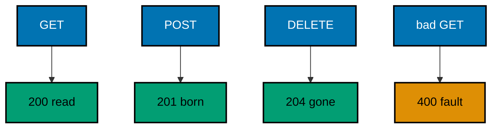

**`learning/code/ex-18-status-code-says-what-happened/Program.cs`**:

```csharp
// Example 18: Status Code Says What Happened.
// The status code is the headline of every response: 200 reads, 201
// creates, 204 deletes with no body, 400 blames the client. This example
// maps four verbs to four codes in-process and prints the code each earned.
using Microsoft.AspNetCore.Builder; // => WebApplication wires routes to handlers (co-01)
using Microsoft.AspNetCore.TestHost; // => TestServer serves requests in memory (co-09)
using Microsoft.Extensions.Logging; // => ClearProviders silences logs (co-13)

// => BuildApp wires the service with every route this example serves.
// => Each Results helper names its code: the code says what happened (co-04).
// => Returning the app lets each check serve requests in-process (co-09).
static WebApplication BuildApp(string[] args) // => args carry no flags in this course
{ // => builder block opens
    var builder = WebApplication.CreateBuilder(args); // => defaults plus our overrides
    builder.Logging.ClearProviders(); // => no log lines: only our prints appear
    builder.WebHost.UseTestServer(); // => in-memory server: no socket, no port
    var app = builder.Build(); // => the pipeline with routing and endpoints
    app.MapGet("/items", () => Results.Ok(new { mode = "list" })); // => 200: the read worked (co-04)
    app.MapPost("/items", () => Results.Created("/items/1", new { id = 1 })); // => 201: one row born (co-04)
    app.MapDelete("/items/1", () => Results.NoContent()); // => 204: gone, no body (co-04)
    app.MapGet("/boom", () => Results.BadRequest(new { error = "bad-item" })); // => 400: client fault (co-05)
    return app; // => hand the wired service back to the caller
} // => builder ends here

// => CheckAsync serves one request and prints the code with the body.
// => TestServer keeps the whole exchange inside this process (co-09).
// => Nothing here dials a port: there is no network call at all.
static async Task CheckAsync(HttpClient client, string method, string target) // => method and path name the request
{ // => check block opens
    using var request = new HttpRequestMessage(new HttpMethod(method), target); // => no body anywhere here
    using var response = await client.SendAsync(request); // => full pipeline runs, then answers
    var body = await response.Content.ReadAsStringAsync(); // => the exact bytes written
    Console.WriteLine($"{method} {target} -> {(int)response.StatusCode} {body}".TrimEnd()); // => one golden line
} // => check ends here

// => Top-level entry: build once, check four times, stop cleanly.
var app = BuildApp(args); // => wiring separate from traffic, as always
await app.StartAsync(); // => TestServer starts without opening any socket
using var client = app.GetTestClient(); // => client talks to memory, not the network
await CheckAsync(client, "GET", "/items"); // => Output: GET /items -> 200 {"mode":"list"}
await CheckAsync(client, "POST", "/items"); // => Output: POST /items -> 201 {"id":1}
await CheckAsync(client, "DELETE", "/items/1"); // => Output: DELETE /items/1 -> 204
await CheckAsync(client, "GET", "/boom"); // => Output: GET /boom -> 400 {"error":"bad-item"}
await app.StopAsync(); // => stop cleanly: nothing in flight is cut (co-08)
```

**Output** (`learning/code/ex-18-status-code-says-what-happened/expected/main.stdout.txt`):

```text
GET /items -> 200 {"mode":"list"}
POST /items -> 201 {"id":1}
DELETE /items/1 -> 204
GET /boom -> 400 {"error":"bad-item"}
```

**Key takeaway**: Each Results helper names its code: the status headline tells the client what happened before it reads the body.

**Why it matters**: Clients branch on the status before parsing the body, so the wrong code sends them down the wrong path even when the body is right. Using one helper per outcome keeps the mapping explicit — 201 for creation, 204 for deletion with no body — and reviewers can audit the contract from the route table alone. A 204 with no body also saves bytes on the most common delete response, which matters at scale.

---

### Example 19: JSON Keys Follow a Contract

Clients break when key names drift, so the service fixes its casing and naming once: camelCase keys from PascalCase records. This example serves one contract both exactly and loosely, and prints how the Accept header picks the detailed or the summary shape. (Concepts: co-04, co-12, co-15.)

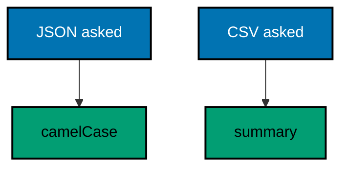

**`learning/code/ex-19-json-keys-follow-a-contract/Program.cs`**:

```csharp
// Example 19: JSON Keys Follow a Contract.
// Clients break when key names drift, so the service fixes its casing and
// naming once: camelCase keys from PascalCase records. This example serves
// one contract both exactly and loosely, and prints how the Accept header
// picks the detailed or the summary shape.
using System.Text.Json; // => camelCase policy shapes the contract (co-04)
using Microsoft.AspNetCore.Builder; // => WebApplication wires routes to handlers (co-01)
using Microsoft.AspNetCore.TestHost; // => TestServer serves requests in memory (co-09)
using Microsoft.Extensions.Logging; // => ClearProviders silences logs (co-13)

// => BuildApp wires the service with every route this example serves.
// => The Accept header picks the shape: verbose JSON or a short summary (co-12).
// => Returning the app lets each check serve requests in-process (co-09).
static WebApplication BuildApp(string[] args) // => args carry no flags in this course
{ // => builder block opens
    var builder = WebApplication.CreateBuilder(args); // => defaults plus our overrides
    builder.Logging.ClearProviders(); // => no log lines: only our prints appear
    builder.WebHost.UseTestServer(); // => in-memory server: no socket, no port
    var app = builder.Build(); // => the pipeline with routing and endpoints
    var policy = new JsonSerializerOptions { PropertyNamingPolicy = JsonNamingPolicy.CamelCase }; // => one casing rule
    app.MapGet(
        "/book",
        (HttpRequest request) => // => raw request: read the Accept header (co-12)
        { // => handler block opens
            var book = new Book("Dune", "Frank Herbert", 1965); // => PascalCase record, fixed data
            if (request.Headers.Accept.ToString().Contains("text/csv")) // => the client asked for summary text
                return Results.Text($"{book.Title},{book.Year}"); // => one line: title plus year (co-04)
            return Results.Json(book, policy); // => camelCase JSON: the exact contract (co-04)
        }
    ); // => handler ends here
    return app; // => hand the wired service back to the caller
} // => builder ends here

// => CheckAsync serves one request with an Accept header and prints it.
// => TestServer keeps the whole exchange inside this process (co-09).
// => The fixed header values keep every rerun byte-identical.
static async Task CheckAsync(HttpClient client, string accept) // => the shape the client asks for
{ // => check block opens
    using var request = new HttpRequestMessage(HttpMethod.Get, "/book"); // => target never changes here
    request.Headers.Add("Accept", accept); // => negotiation rides on this header (co-12)
    using var response = await client.SendAsync(request); // => full pipeline runs, then answers
    var body = await response.Content.ReadAsStringAsync(); // => the exact bytes written
    var media = response.Content.Headers.ContentType?.MediaType ?? "(none)"; // => the shape actually served
    Console.WriteLine(
        $"GET /book [{accept}] -> {(int)response.StatusCode} {media} {body}".TrimEnd()
    ); // => golden line
} // => check ends here

// => Top-level entry: build once, check twice, stop cleanly.
var app = BuildApp(args); // => wiring separate from traffic, as always
await app.StartAsync(); // => TestServer starts without opening any socket
using var client = app.GetTestClient(); // => client talks to memory, not the network
await CheckAsync(client, "application/json"); // => Output: GET /book [application/json] -> 200 application/json {"title":"Dune","author":"Frank Herbert","year":1965}
await CheckAsync(client, "text/csv"); // => Output: GET /book [text/csv] -> 200 text/plain Dune,1965
await app.StopAsync(); // => stop cleanly: nothing in flight is cut (co-08)

// => Book is the PascalCase source of the contract: casing fixed in one place.
// => The serializer policy turns Title into title for every response (co-15).
// => One policy object means the contract cannot drift per handler.
record Book(string Title, string Author, int Year); // => the domain shape, camelCased on the wire
```

**Output** (`learning/code/ex-19-json-keys-follow-a-contract/expected/main.stdout.txt`):

```text
GET /book [application/json] -> 200 application/json {"title":"Dune","author":"Frank Herbert","year":1965}
GET /book [text/csv] -> 200 text/plain Dune,1965
```

**Key takeaway**: One serializer policy fixes key casing everywhere; Accept negotiation picks the detailed or summary shape.

**Why it matters**: Inconsistent key casing breaks code-generated clients, which map JSON keys to struct fields exactly. A single naming policy object guarantees every response follows the same contract, so adding a route cannot accidentally ship PascalCase keys. Accept-header negotiation extends the same idea to whole shapes: one endpoint serves both the detailed JSON and the terse summary, and the client declares which it wants instead of learning a second URL.

---

### Example 20: Problem Envelope Stays Consistent

Every failure answers in one shape — code, error, and hint — so clients parse errors once instead of per route. This example fails two routes on purpose in-process and prints the shared envelope both answers used. (Concepts: co-04, co-05.)

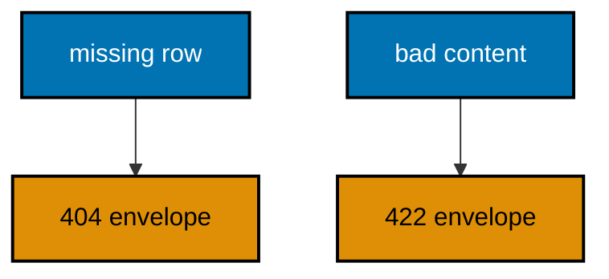

**`learning/code/ex-20-problem-envelope-stays-consistent/Program.cs`**:

```csharp
// Example 20: Problem Envelope Stays Consistent.
// Every failure answers in one shape — code, error, and hint — so clients
// parse errors once instead of per route. This example fails two routes on
// purpose in-process and prints the shared envelope both answers used.
using Microsoft.AspNetCore.Builder; // => WebApplication wires routes to handlers (co-01)
using Microsoft.AspNetCore.TestHost; // => TestServer serves requests in memory (co-09)
using Microsoft.Extensions.Logging; // => ClearProviders silences logs (co-13)

// => Fail is the one envelope every error in this example wears.
// => A static helper keeps the shape identical on every route (co-05).
// => Fixed strings only: no trace IDs, no timestamps, no drift.
static IResult Fail(int status, string error, string hint) // => status plus two fixed strings
{ // => helper block opens
    var body = new
    {
        code = status,
        error,
        hint,
    }; // => the shared envelope (co-05)
    return status switch // => the status picks the Results helper
    { // => switch block opens
        404 => Results.NotFound(body), // => absence wears the envelope too
        422 => Results.UnprocessableEntity(body), // => semantic failure, same shape
        _ => Results.BadRequest(body), // => every other fault defaults here
    }; // => switch ends here
} // => helper ends here

// => BuildApp wires the service with every route this example serves.
// => Both routes fail through Fail: one shape, two statuses (co-05).
// => Returning the app lets each check serve requests in-process (co-09).
static WebApplication BuildApp(string[] args) // => args carry no flags in this course
{ // => builder block opens
    var builder = WebApplication.CreateBuilder(args); // => defaults plus our overrides
    builder.Logging.ClearProviders(); // => no log lines: only our prints appear
    builder.WebHost.UseTestServer(); // => in-memory server: no socket, no port
    var app = builder.Build(); // => the pipeline with routing and endpoints
    app.MapGet("/books/{id:int}", (int id) => Fail(404, "book-not-found", $"no book has id {id}")); // => missing row (co-05)
    app.MapPost("/books", () => Fail(422, "title-is-required", "send a JSON body with a title")); // => bad content
    return app; // => hand the wired service back to the caller
} // => builder ends here

// => CheckAsync serves one request and prints the envelope observed.
// => TestServer keeps the whole exchange inside this process (co-09).
// => Nothing here dials a port: there is no network call at all.
static async Task CheckAsync(HttpClient client, string method, string target) // => method and path name the request
{ // => check block opens
    using var request = new HttpRequestMessage(new HttpMethod(method), target); // => no bodies in this example
    using var response = await client.SendAsync(request); // => full pipeline runs, then answers
    var body = await response.Content.ReadAsStringAsync(); // => the exact bytes written
    Console.WriteLine($"{method} {target} -> {(int)response.StatusCode} {body}".TrimEnd()); // => one golden line
} // => check ends here

// => Top-level entry: build once, check twice, stop cleanly.
var app = BuildApp(args); // => wiring separate from traffic, as always
await app.StartAsync(); // => TestServer starts without opening any socket
using var client = app.GetTestClient(); // => client talks to memory, not the network
await CheckAsync(client, "GET", "/books/99"); // => Output: GET /books/99 -> 404 {"code":404,"error":"book-not-found","hint":"no book has id 99"}
await CheckAsync(client, "POST", "/books"); // => Output: POST /books -> 422 {"code":422,"error":"title-is-required","hint":"send a JSON body with a title"}
await app.StopAsync(); // => stop cleanly: nothing in flight is cut (co-08)
```

**Output** (`learning/code/ex-20-problem-envelope-stays-consistent/expected/main.stdout.txt`):

```text
GET /books/99 -> 404 {"code":404,"error":"book-not-found","hint":"no book has id 99"}
POST /books -> 422 {"code":422,"error":"title-is-required","hint":"send a JSON body with a title"}
```

**Key takeaway**: A static helper wraps every failure in the same envelope: code, error, and hint on every route.

**Why it matters**: Per-route error shapes force clients to write a parser per endpoint, and the parsers rot as routes evolve. A single helper makes the envelope a compile-time guarantee: every failure carries the same three keys, so client error handling is written once and trusted everywhere. Fixed strings with no trace IDs keep the envelope deterministic, which means error responses can be golden-tested exactly like success responses.

---

### Example 21: Headers Shape Caching

Cache headers tell the client how long an answer stays fresh: max-age for shared freshness and ETag for conditional revalidation. This example serves one versioned fact in-process and prints the headers each answer carried, then the 304 the matching ETag earned. (Concepts: co-04.)

```mermaid
flowchart TD
    accTitle: Headers Shape Caching
    accDescr: Cache-Control sets freshness and ETag versions the fact; a matching ETag earns a 304 with no body.
    A["first visit"]:::blue --> B["200 plus ETag"]:::teal
    C["same ETag"]:::blue --> D["304 empty"]:::teal

    classDef blue fill:#0173B2,stroke:#000000,color:#FFFFFF,stroke-width:2px
    classDef orange fill:#DE8F05,stroke:#000000,color:#000000,stroke-width:2px
    classDef teal fill:#029E73,stroke:#000000,color:#000000,stroke-width:2px
    classDef default fill:#FFFFFF,stroke:#000000,color:#000000
```

**`learning/code/ex-21-headers-shape-caching/Program.cs`**:

```csharp
// Example 21: Headers Shape Caching.
// Cache headers tell the client how long an answer stays fresh: max-age
// for shared freshness and ETag for conditional revalidation. This example
// serves one versioned fact in-process and prints the headers each answer
// carried, then the 304 the matching ETag earned.
using Microsoft.AspNetCore.Builder; // => WebApplication wires routes to handlers (co-01)
using Microsoft.AspNetCore.TestHost; // => TestServer serves requests in memory (co-09)
using Microsoft.Extensions.Logging; // => ClearProviders silences logs (co-13)

// => BuildApp wires the service with every route this example serves.
// => The ETag is a fixed version string: no hashing, no drift (co-04).
// => Returning the app lets each check serve requests in-process (co-09).
static WebApplication BuildApp(string[] args) // => args carry no flags in this course
{ // => builder block opens
    var builder = WebApplication.CreateBuilder(args); // => defaults plus our overrides
    builder.Logging.ClearProviders(); // => no log lines: only our prints appear
    builder.WebHost.UseTestServer(); // => in-memory server: no socket, no port
    var app = builder.Build(); // => the pipeline with routing and endpoints
    app.MapGet(
        "/fact",
        (HttpRequest request) => // => raw request: conditional headers live here (co-03)
        { // => handler block opens
            const string etag = "\"v3\""; // => the fixed version of this fact
            if (request.Headers.IfNoneMatch.ToString() == etag) // => client already holds v3
                return Results.StatusCode(304); // => 304: nothing new to send (co-04)
            ResponseCache(etag); // => stamp freshness on the way out
            return Results.Ok(new { fact = "honey never spoils" }); // => the versioned fact (co-04)

            // => ResponseCache writes both caching headers in one place.
            // => A local function keeps the handler body honest (co-01).
            void ResponseCache(string tag) // => the tag to stamp outward
            { // => stamp block opens
                request.HttpContext.Response.Headers.CacheControl = "public, max-age=60"; // => fresh for one minute
                request.HttpContext.Response.Headers.ETag = tag; // => revalidate against this version
            } // => stamp ends here
        }
    ); // => handler ends here
    return app; // => hand the wired service back to the caller
} // => builder ends here

// => CheckAsync serves one request with an optional ETag and prints out.
// => Only fixed header values travel: no dates, no server stamps.
// => The transcript proves caching without printing a single timestamp.
static async Task CheckAsync(HttpClient client, string? etag) // => null means a first-time visit
{ // => check block opens
    using var request = new HttpRequestMessage(HttpMethod.Get, "/fact"); // => target never changes here
    if (etag is not null) // => the second visit revalidates
        request.Headers.TryAddWithoutValidation("If-None-Match", etag); // => the version we already hold
    using var response = await client.SendAsync(request); // => full pipeline runs, then answers
    var body = await response.Content.ReadAsStringAsync(); // => the exact bytes written
    var cache = response.Headers.CacheControl?.ToString() ?? "(none)"; // => freshness, fixed string
    var tag = response.Headers.ETag?.Tag ?? "(none)"; // => version stamp, fixed string
    Console.WriteLine(
        $"GET /fact [{etag ?? "(none)"}] -> {(int)response.StatusCode} cache={cache} etag={tag} {body}".TrimEnd()
    ); // => golden line
} // => check ends here

// => Top-level entry: build once, check twice, stop cleanly.
var app = BuildApp(args); // => wiring separate from traffic, as always
await app.StartAsync(); // => TestServer starts without opening any socket
using var client = app.GetTestClient(); // => client talks to memory, not the network
await CheckAsync(client, null); // => Output: GET /fact [(none)] -> 200 cache=public, max-age=60 etag="v3" {"fact":"honey never spoils"}
await CheckAsync(client, "\"v3\""); // => Output: GET /fact ["v3"] -> 304 cache=(none) etag=(none)
await app.StopAsync(); // => stop cleanly: nothing in flight is cut (co-08)
```

**Output** (`learning/code/ex-21-headers-shape-caching/expected/main.stdout.txt`):

```text
GET /fact [(none)] -> 200 cache=public, max-age=60 etag="v3" {"fact":"honey never spoils"}
GET /fact ["v3"] -> 304 cache=(none) etag=(none)
```

**Key takeaway**: Cache-Control sets freshness and ETag versions the fact; a matching ETag earns a 304 with no body.

**Why it matters**: Refetching unchanged facts wastes bandwidth and server time, especially for mobile clients on slow networks. A fixed ETag gives the fact a version without hashing costs, and max-age lets shared caches serve repeats without asking at all. The 304 leg proves the round trip: the client asks cheaply, the server answers emptily, and both sides agree nothing changed — the cheapest possible synchronization.

---

### Example 22: Cookies Carry a Session

A cookie stores the session on the client: the login route sets it and the profile route reads it back. This example walks both legs in-process with manual cookie handling and prints the Set-Cookie value plus the profile each cookie earned. (Concepts: co-03, co-04.)

```mermaid
flowchart TD
    accTitle: Cookies Carry a Session
    accDescr: Login writes the session cookie; later requests carry it back, and absent cookies read as anonymous.
    A["POST login"]:::blue --> B["set cookie"]:::teal
    B --> C["GET profile"]:::blue
    C --> D["200 session"]:::teal
    E["no cookie"]:::blue --> F["anonymous"]:::teal

    classDef blue fill:#0173B2,stroke:#000000,color:#FFFFFF,stroke-width:2px
    classDef orange fill:#DE8F05,stroke:#000000,color:#000000,stroke-width:2px
    classDef teal fill:#029E73,stroke:#000000,color:#000000,stroke-width:2px
    classDef default fill:#FFFFFF,stroke:#000000,color:#000000
```

**`learning/code/ex-22-cookies-carry-a-session/Program.cs`**:

```csharp
// Example 22: Cookies Carry a Session.
// A cookie stores the session on the client: the login route sets it and
// the profile route reads it back. This example walks both legs in-process
// with manual cookie handling — no container, no magic — and prints the
// Set-Cookie value plus the profile each cookie earned.
using Microsoft.AspNetCore.Builder; // => WebApplication wires routes to handlers (co-01)
using Microsoft.AspNetCore.TestHost; // => TestServer serves requests in memory (co-09)
using Microsoft.Extensions.Logging; // => ClearProviders silences logs (co-13)

// => BuildApp wires the service with every route this example serves.
// => Cookies are just headers: one route writes, one route reads (co-04).
// => Returning the app lets each check serve requests in-process (co-09).
static WebApplication BuildApp(string[] args) // => args carry no flags in this course
{ // => builder block opens
    var builder = WebApplication.CreateBuilder(args); // => defaults plus our overrides
    builder.Logging.ClearProviders(); // => no log lines: only our prints appear
    builder.WebHost.UseTestServer(); // => in-memory server: no socket, no port
    var app = builder.Build(); // => the pipeline with routing and endpoints
    app.MapPost(
        "/login",
        (HttpResponse response) => // => response writes the cookie outward (co-04)
        { // => login block opens
            response.Cookies.Append("session", "ada-42"); // => fixed session value, no expiry stamp
            return Results.Ok(new { logged = "ada" }); // => the login receipt (co-04)
        }
    ); // => login ends here
    app.MapGet(
        "/profile",
        (HttpRequest request) => // => request carries the cookie back (co-03)
        { // => profile block opens
            var session = request.Cookies.TryGetValue("session", out var value) // => look for our cookie
                ? value // => present: the session travels back
                : "(none)"; // => absent: the client never logged in
            return Results.Ok(new { session }); // => the observed session, echoed (co-04)
        }
    ); // => profile ends here
    return app; // => hand the wired service back to the caller
} // => builder ends here

// => Top-level entry: build once, walk login then profile, stop cleanly.
var app = BuildApp(args); // => wiring separate from traffic, as always
await app.StartAsync(); // => TestServer starts without opening any socket
using var client = app.GetTestClient(); // => client talks to memory, not the network
using var login = await client.PostAsync("/login", null); // => no body: the route needs none
var setCookie = string.Join(";", login.Headers.GetValues("Set-Cookie")); // => the raw cookie line
var session = setCookie.Split(";")[0].Split("=")[1]; // => peel the value off the attributes
var loginBody = await login.Content.ReadAsStringAsync(); // => the login receipt bytes
Console.WriteLine($"POST /login -> {(int)login.StatusCode} {loginBody}".TrimEnd()); // => Output: POST /login -> 200 {"logged":"ada"}
Console.WriteLine($"cookie session={session}"); // => Output: cookie session=ada-42
using var profileRequest = new HttpRequestMessage(HttpMethod.Get, "/profile"); // => second leg carries it back
profileRequest.Headers.Add("Cookie", $"session={session}"); // => manual jar: one header line (co-03)
using var profile = await client.SendAsync(profileRequest); // => full pipeline runs, then answers
var profileBody = await profile.Content.ReadAsStringAsync(); // => the profile bytes
Console.WriteLine($"GET /profile -> {(int)profile.StatusCode} {profileBody}".TrimEnd()); // => Output: GET /profile -> 200 {"session":"ada-42"}
using var bare = await client.GetAsync("/profile"); // => no cookie at all this time
var bareBody = await bare.Content.ReadAsStringAsync(); // => the stranger's answer bytes
Console.WriteLine($"GET /profile -> {(int)bare.StatusCode} {bareBody}".TrimEnd()); // => Output: GET /profile -> 200 {"session":"(none)"}
await app.StopAsync(); // => stop cleanly: nothing in flight is cut (co-08)
```

**Output** (`learning/code/ex-22-cookies-carry-a-session/expected/main.stdout.txt`):

```text
POST /login -> 200 {"logged":"ada"}
cookie session=ada-42
GET /profile -> 200 {"session":"ada-42"}
GET /profile -> 200 {"session":"(none)"}
```

**Key takeaway**: Login writes the session cookie; later requests carry it back, and absent cookies read as anonymous.

**Why it matters**: Stateless services still need to recognize returning clients, and cookies carry that recognition without server-side session tables. Manual handling in the test proves there is no magic: Set-Cookie is one header out, Cookie is one header back, and the profile route reads what the login route wrote. The anonymous fallback keeps the route total — strangers get an answer shaped like members, with none of the privileges.

---

### Example 23: File Download Names Itself

A download is a body plus a filename: Content-Disposition tells the client what to save it as. This example serves one fixed report both as JSON and as an attachment in-process and prints the disposition plus the bytes each shape delivered. (Concepts: co-04.)

```mermaid
flowchart TD
    accTitle: File Download Names Itself
    accDescr: Results.File sets the disposition: attachment names the file, and the transcript shows the exact bytes.
    A["JSON asked"]:::blue --> B["inline JSON"]:::teal
    C["file asked"]:::blue --> D["attachment"]:::teal
    D --> E["named file"]:::teal

    classDef blue fill:#0173B2,stroke:#000000,color:#FFFFFF,stroke-width:2px
    classDef orange fill:#DE8F05,stroke:#000000,color:#000000,stroke-width:2px
    classDef teal fill:#029E73,stroke:#000000,color:#000000,stroke-width:2px
    classDef default fill:#FFFFFF,stroke:#000000,color:#000000
```

**`learning/code/ex-23-file-download-names-itself/Program.cs`**:

```csharp
// Example 23: File Download Names Itself.
// A download is a body plus a filename: Content-Disposition tells the
// client what to save it as. This example serves one fixed report both as
// JSON and as an attachment in-process and prints the disposition plus the
// bytes each shape delivered.
using System.Text; // => Encoding turns the report into bytes (co-04)
using Microsoft.AspNetCore.Builder; // => WebApplication wires routes to handlers (co-01)
using Microsoft.AspNetCore.TestHost; // => TestServer serves requests in memory (co-09)
using Microsoft.Extensions.Logging; // => ClearProviders silences logs (co-13)

// => BuildApp wires the service with every route this example serves.
// => Results.File sets the disposition: attachment names the file (co-04).
// => Returning the app lets each check serve requests in-process (co-09).
static WebApplication BuildApp(string[] args) // => args carry no flags in this course
{ // => builder block opens
    var builder = WebApplication.CreateBuilder(args); // => defaults plus our overrides
    builder.Logging.ClearProviders(); // => no log lines: only our prints appear
    builder.WebHost.UseTestServer(); // => in-memory server: no socket, no port
    var app = builder.Build(); // => the pipeline with routing and endpoints
    app.MapGet("/report", () => Results.Ok(new { title = "weekly", rows = 42 })); // => the JSON shape (co-04)
    app.MapGet(
        "/report.csv",
        () => // => the same fact as a file
        { // => file block opens
            var csv = "title,rows\nweekly,42\n"; // => fixed bytes: the whole report
            var bytes = Encoding.UTF8.GetBytes(csv); // => text becomes bytes once
            return Results.File(bytes, "text/csv", "weekly.csv"); // => attachment with a name (co-04)
        }
    ); // => file ends here
    return app; // => hand the wired service back to the caller
} // => builder ends here

// => CheckAsync serves one request and prints the download details.
// => TestServer keeps the whole exchange inside this process (co-09).
// => The disposition header names the file; the body stays byte-identical.
static async Task CheckAsync(HttpClient client, string target) // => the path names the request
{ // => check block opens
    using var response = await client.GetAsync(target); // => full pipeline runs, then answers
    var body = await response.Content.ReadAsStringAsync(); // => the exact bytes written
    var flat = body.Replace("\n", "\\n"); // => newlines become visible escapes
    var media = response.Content.Headers.ContentType?.MediaType ?? "(none)"; // => the served shape
    var name =
        response.Content.Headers.ContentDisposition?.FileNameStar // => the RFC filename first
        ?? response.Content.Headers.ContentDisposition?.FileName?.Trim('"') // => else the plain filename
        ?? "(inline)"; // => no disposition: shown in place
    Console.WriteLine(
        $"GET {target} -> {(int)response.StatusCode} {media} file={name} {flat}".TrimEnd()
    ); // => golden line
} // => check ends here

// => Top-level entry: build once, check twice, stop cleanly.
var app = BuildApp(args); // => wiring separate from traffic, as always
await app.StartAsync(); // => TestServer starts without opening any socket
using var client = app.GetTestClient(); // => client talks to memory, not the network
await CheckAsync(client, "/report"); // => Output: GET /report -> 200 application/json file=(inline) {"title":"weekly","rows":42}
await CheckAsync(client, "/report.csv"); // => Output: GET /report.csv -> 200 text/csv file=weekly.csv title,rows\nweekly,42\n
await app.StopAsync(); // => stop cleanly: nothing in flight is cut (co-08)
```

**Output** (`learning/code/ex-23-file-download-names-itself/expected/main.stdout.txt`):

```text
GET /report -> 200 application/json file=(inline) {"title":"weekly","rows":42}
GET /report.csv -> 200 text/csv file=weekly.csv title,rows\nweekly,42\n
```

**Key takeaway**: Results.File sets the disposition: attachment names the file, and the transcript shows the exact bytes.

**Why it matters**: A download without a filename leaves the client guessing, and guessed names collide in download folders. Content-Disposition names the file at the source, so every client saves the same name regardless of which URL served it. Serving one fact as both JSON and attachment shows the two modes side by side: inline for machines that parse, attachment for humans who keep.

---

### Example 24: Created Points at the New Resource

A successful POST answers 201 with a Location header naming the new row, so the client never guesses the URL. This example creates one member in-process and prints the status, the location, and the echo the follow-up GET at that location returned. (Concepts: co-04.)

```mermaid
flowchart TD
    accTitle: Created Points at the New Resource
    accDescr: Created answers 201 with a Location header; the test follows it to prove the row actually exists.
    A["POST member"]:::blue --> B["201 plus loc"]:::teal
    B --> C["GET loc"]:::blue
    C --> D["200 echo"]:::teal

    classDef blue fill:#0173B2,stroke:#000000,color:#FFFFFF,stroke-width:2px
    classDef orange fill:#DE8F05,stroke:#000000,color:#000000,stroke-width:2px
    classDef teal fill:#029E73,stroke:#000000,color:#000000,stroke-width:2px
    classDef default fill:#FFFFFF,stroke:#000000,color:#000000
```

**`learning/code/ex-24-created-points-at-the-new-resource/Program.cs`**:

```csharp
// Example 24: Created Points at the New Resource.
// A successful POST answers 201 with a Location header naming the new
// row, so the client never guesses the URL. This example creates one
// member in-process and prints the status, the location, and the echo the
// follow-up GET at that location returned.
using System.Text; // => StringContent carries the JSON body (co-03)
using System.Text.Json; // => JsonSerializer writes the request body (co-15)
using Microsoft.AspNetCore.Builder; // => WebApplication wires routes to handlers (co-01)
using Microsoft.AspNetCore.TestHost; // => TestServer serves requests in memory (co-09)
using Microsoft.Extensions.Logging; // => ClearProviders silences logs (co-13)

// => BuildApp wires the service with every route this example serves.
// => The store is a fixed dictionary: self-contained, no database (co-09).
// => Returning the app lets each check serve requests in-process (co-09).
static WebApplication BuildApp(string[] args) // => args carry no flags in this course
{ // => builder block opens
    var builder = WebApplication.CreateBuilder(args); // => defaults plus our overrides
    builder.Logging.ClearProviders(); // => no log lines: only our prints appear
    builder.WebHost.UseTestServer(); // => in-memory server: no socket, no port
    var app = builder.Build(); // => the pipeline with routing and endpoints
    var store = new Dictionary<int, string> { [1] = "ada" }; // => one seeded row to read back
    app.MapPost(
        "/members",
        (Member member) => // => body binds into the record (co-03)
        { // => create block opens
            store[member.id] = member.name; // => the write the GET below reads
            return Results.Created($"/members/{member.id}", member); // => 201 plus Location (co-04)
        }
    ); // => create ends here
    app.MapGet(
        "/members/{id:int}",
        (int id) => // => the location the 201 named (co-03)
            store.TryGetValue(id, out var name) // => look the row up by id
                ? Results.Ok(new { id, name }) // => present: echo it back
                : Results.NotFound(new { error = "member-not-found" })
    ); // => absent: say so (co-05)
    return app; // => hand the wired service back to the caller
} // => builder ends here

// => Top-level entry: create once, follow the Location, stop cleanly.
var app = BuildApp(args); // => wiring separate from traffic, as always
await app.StartAsync(); // => TestServer starts without opening any socket
using var client = app.GetTestClient(); // => client talks to memory, not the network
var json = JsonSerializer.Serialize(new Member(2, "grace")); // => the row to create
using var body = new StringContent(json, Encoding.UTF8, "application/json"); // => the labeled body (co-03)
using var created = await client.PostAsync("/members", body); // => the creating request
var echo = await created.Content.ReadAsStringAsync(); // => the 201 body bytes
var location = created.Headers.Location?.ToString() ?? "(none)"; // => the address the server assigned
Console.WriteLine(
    $"POST /members -> {(int)created.StatusCode} location={location} {echo}".TrimEnd()
); // => Output: POST /members -> 201 location=/members/2 {"id":2,"name":"grace"}
using var fetched = await client.GetAsync(location); // => follow the Location exactly once
var seen = await fetched.Content.ReadAsStringAsync(); // => the follow-up body bytes
Console.WriteLine($"GET {location} -> {(int)fetched.StatusCode} {seen}".TrimEnd()); // => Output: GET /members/2 -> 200 {"id":2,"name":"grace"}
await app.StopAsync(); // => stop cleanly: nothing in flight is cut (co-08)

// => Member is the typed boundary of this example: JSON in, record out.
record Member(int id, string name); // => the member shape, lowercase exact bytes (co-15)
```

**Output** (`learning/code/ex-24-created-points-at-the-new-resource/expected/main.stdout.txt`):

```text
POST /members -> 201 location=/members/2 {"id":2,"name":"grace"}
GET /members/2 -> 200 {"id":2,"name":"grace"}
```

**Key takeaway**: Created answers 201 with a Location header; the test follows it to prove the row actually exists.

**Why it matters**: Clients that guess the new URL couple themselves to the server's ID scheme, and the coupling breaks the day the scheme changes. The Location header keeps addressing on the server side: the client follows the pointer instead of constructing it. Following the pointer in the test closes the loop — creation is only proven when a GET at the announced address returns the row.

---

### Example 25: Beginner Orders Service

The beginner layer ends where real services begin: grouped routes, typed bodies, validation, and a health check in one small program. This review wires an orders area under /v1, serves five checks in-process, and prints the status each contract earned. (Concepts: co-01, co-03, co-04, co-05, co-10, co-11, co-14.)

```mermaid
flowchart TD
    accTitle: Beginner Orders Service
    accDescr: The review composes every beginner idea: groups, typed bodies, validation, errors, and a health probe.
    A["health"]:::blue --> B["200 ok"]:::teal
    C["group v1"]:::blue --> D["list orders"]:::teal
    C --> E["one order"]:::teal
    C --> F["create"]:::teal

    classDef blue fill:#0173B2,stroke:#000000,color:#FFFFFF,stroke-width:2px
    classDef orange fill:#DE8F05,stroke:#000000,color:#000000,stroke-width:2px
    classDef teal fill:#029E73,stroke:#000000,color:#000000,stroke-width:2px
    classDef default fill:#FFFFFF,stroke:#000000,color:#000000
```

**`learning/code/ex-25-beginner-orders-service/Program.cs`**:

```csharp
// Example 25: Beginner Orders Service.
// The beginner layer ends where real services begin: grouped routes, typed
// bodies, validation, and a health check in one small program. This review
// wires an orders area under /v1, serves five checks in-process, and prints
// the status each contract earned.
using System.Text; // => StringContent carries the JSON body (co-03)
using System.Text.Json; // => JsonSerializer writes the request body (co-15)
using Microsoft.AspNetCore.Builder; // => WebApplication wires routes to handlers (co-01)
using Microsoft.AspNetCore.Routing; // => MapGroup shares the /v1 prefix (co-11)
using Microsoft.AspNetCore.TestHost; // => TestServer serves requests in memory (co-09)
using Microsoft.Extensions.Logging; // => ClearProviders silences logs (co-13)

// => BuildApp wires the review service: group, orders, validation, health.
// => Every beginner concept appears once, composed instead of isolated.
// => Returning the app lets each check serve requests in-process (co-09).
static WebApplication BuildApp(string[] args) // => args carry no flags in this course
{ // => builder block opens
    var builder = WebApplication.CreateBuilder(args); // => defaults plus our overrides
    builder.Logging.ClearProviders(); // => no log lines: only our prints appear
    builder.WebHost.UseTestServer(); // => in-memory server: no socket, no port
    var app = builder.Build(); // => the pipeline with routing and endpoints
    app.MapGet("/health", () => Results.Ok(new { status = "ok" })); // => the readiness probe (co-14)
    var v1 = app.MapGroup("/v1"); // => one prefix for the whole area (co-11)
    var store = new Dictionary<int, string> { [1] = "dune" }; // => fixed rows, no database
    v1.MapGet("/orders", () => Results.Ok(store.Select(p => new { id = p.Key, title = p.Value }))); // => 200 list (co-04)
    v1.MapGet(
        "/orders/{id:int}",
        (int id) => // => typed segment: digits only (co-03, co-15)
            store.TryGetValue(id, out var title) // => look the row up
                ? Results.Ok(new { id, title }) // => present: echo it
                : Results.NotFound(new { error = "order-not-found" })
    ); // => absent: say so (co-05)
    v1.MapPost(
        "/orders",
        (Order order) => // => JSON binds into the record (co-03)
        { // => create block opens
            if (order.qty <= 0) // => reject before storing anything (co-10)
                return Results.BadRequest(new { error = "qty-must-be-positive" }); // => 400 names the rule (co-05)
            store[order.id] = order.title; // => the write later reads observe
            return Results.Created($"/v1/orders/{order.id}", order); // => 201 plus Location (co-04)
        }
    ); // => create ends here
    return app; // => hand the wired service back to the caller
} // => builder ends here

// => CheckAsync serves one request and prints the code with the body.
// => TestServer keeps the whole exchange inside this process (co-09).
// => Nothing here dials a port: there is no network call at all.
static async Task CheckAsync(HttpClient client, string method, string target, string? json = null) // => optional body
{ // => check block opens
    using var request = new HttpRequestMessage(new HttpMethod(method), target); // => method plus path
    if (json is not null) // => only the create check carries a body
        request.Content = new StringContent(json, Encoding.UTF8, "application/json"); // => the labeled body (co-03)
    using var response = await client.SendAsync(request); // => full pipeline runs, then answers
    var body = await response.Content.ReadAsStringAsync(); // => the exact bytes written
    Console.WriteLine($"{method} {target} -> {(int)response.StatusCode} {body}".TrimEnd()); // => one golden line
} // => check ends here

// => Top-level entry: build once, check five times, stop cleanly.
var app = BuildApp(args); // => wiring separate from traffic, as always
await app.StartAsync(); // => TestServer starts without opening any socket
using var client = app.GetTestClient(); // => client talks to memory, not the network
await CheckAsync(client, "GET", "/health"); // => Output: GET /health -> 200 {"status":"ok"}
await CheckAsync(client, "GET", "/v1/orders"); // => Output: GET /v1/orders -> 200 [{"id":1,"title":"dune"}]
await CheckAsync(client, "GET", "/v1/orders/9"); // => Output: GET /v1/orders/9 -> 404 {"error":"order-not-found"}
await CheckAsync(
    client,
    "POST",
    "/v1/orders",
    JsonSerializer.Serialize(new Order(2, "hyperion", 0))
); // => Output: POST /v1/orders -> 400 {"error":"qty-must-be-positive"}
await CheckAsync(
    client,
    "POST",
    "/v1/orders",
    JsonSerializer.Serialize(new Order(2, "hyperion", 3))
); // => Output: POST /v1/orders -> 201 {"id":2,"title":"hyperion","qty":3}
await app.StopAsync(); // => stop cleanly: nothing in flight is cut (co-08)

// => Order is the typed boundary of this review: JSON in, record out.
record Order(int id, string title, int qty); // => the order shape, lowercase exact bytes (co-15)
```

**Output** (`learning/code/ex-25-beginner-orders-service/expected/main.stdout.txt`):

```text
GET /health -> 200 {"status":"ok"}
GET /v1/orders -> 200 [{"id":1,"title":"dune"}]
GET /v1/orders/9 -> 404 {"error":"order-not-found"}
POST /v1/orders -> 400 {"error":"qty-must-be-positive"}
POST /v1/orders -> 201 {"id":2,"title":"hyperion","qty":3}
```

**Key takeaway**: The review composes every beginner idea: groups, typed bodies, validation, errors, and a health probe.

**Why it matters**: Isolated examples teach pieces; the review proves the pieces compose into a service a team would recognize. Groups hold the version, typed records hold the boundary, validation guards the store, and the health probe announces readiness — each idea earns its place by serving the same orders area. Reading this program after the previous twenty-four should feel like rereading familiar sentences in a new paragraph: nothing new, everything connected.
