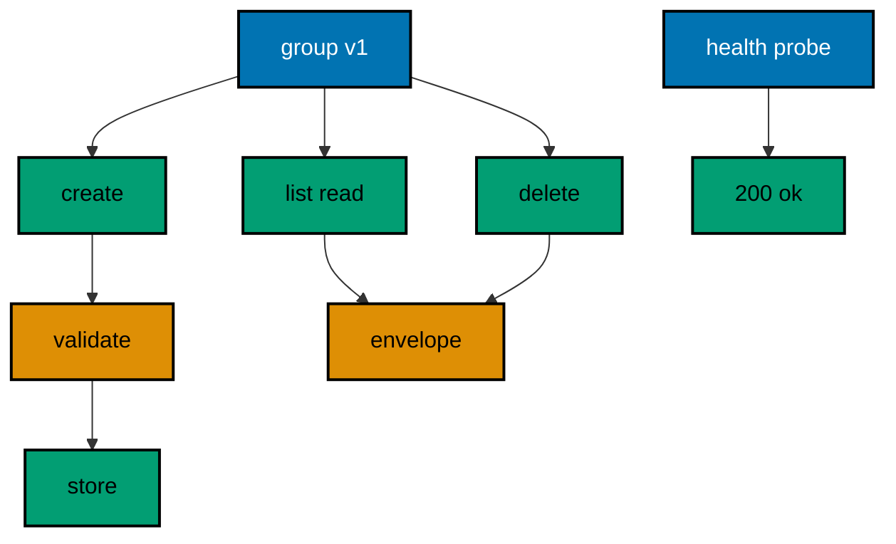

The capstone composes the whole course into one order-tracking HTTP service: five routes under a versioned prefix, request validation at the boundary, one structured error envelope, a health-check probe, and an eleven-leg in-process suite that proves the service behaves. Where the examples isolate one idea each so you can see it clearly, the capstone wires the layers together so the seams are load-bearing: the group holds the version, the store holds the rows, the validator guards the writes, and the transcript proves the whole chain ran.

## Why this exists -- the big idea

**The problem before the solution**: course examples prove each ASP.NET Core technique in isolation — one route, one middleware, one service each. Real services stack the techniques: validation runs before the store write, the store backs both reads and deletes, the error envelope covers every failure, and the health probe announces readiness while traffic keeps flowing. The capstone wires the layers together so the composition itself is under test.

**Keep this if you forget everything else**: validate at the boundary, store behind a service, and answer every failure in one envelope — the rest is routes.

## What you will build

A single `Program.cs` that serves an order-tracking service with five routes. `GET /health` answers the readiness probe with `{"status":"ok"}`. `GET /v1/orders` lists every stored order as a JSON array, empty at first. `GET /v1/orders/{id}` reads one order by its integer id or answers the 404 envelope when the row is absent. `POST /v1/orders` validates the JSON body — title required, quantity at least one — stores clean orders, and answers 201 with a Location header pointing at the new row, or the 400 envelope naming the broken rule. `DELETE /v1/orders/{id}` removes the row and answers 204 with no body, or the 404 envelope when there was nothing to remove. The store is a singleton dictionary injected into every handler, so all five routes share the same memory exactly the way a production service shares its database connection.

## How the pieces compose

The route group writes `/v1` once so the version cannot drift between routes. The `OrderStore` singleton is the only stateful object: handlers never touch a static, they receive the store by type, which keeps every handler testable and every lifetime honest. The `Validate` function is the boundary rulebook shared by the create route — null means clean, a string means rejection — mirroring the validation-service examples from the intermediate layer without the ceremony a one-route rulebook does not need. The `Fail` helper is the error envelope factory both failure sites share, so the 400s and 404s parse identically and clients write one error parser. The health probe stands outside the group on purpose: load balancers probe `/health` without knowing the API version, which is the same separation the shutdown examples teach.

## The suite

The eleven-leg suite runs one client through the whole service in order: probe ready, list the empty store, create two clean orders, watch both invalid bodies rejected with their named rules and hints, read one row back, miss one row with the envelope, delete the row, delete it again to prove the second delete is a 404 and not a silent success, then list the store to prove exactly one row survived. Each leg prints one golden line with the method, the path, the status, and the body, so the transcript reads as the service contract: what was asked, what was decided, and what was stored. The suite runs in-process through TestServer with no socket and no port, exactly like the course examples, so it executes in seconds and reruns byte-identically.

## How to run it

Run the capstone the same way you ran every example: the harness command in `learning/capstone/code/run.yaml` restores the locked package offline, builds the program, and asserts the eleven-line transcript in `expected/main.stdout.txt`. Read the transcript first and predict each line from the routes before running; a line you cannot predict is a composition you have not understood yet. Then break it deliberately: remove the validation call and watch two legs turn red, swap the store registration and watch the suite prove the seam, change the envelope and count how many legs fail. Each break teaches which layer owns which leg, and the fix is always one focused edit because the composition kept the seams clean.

## Stretch goals

Add a sixth route `PUT /v1/orders/{id}` that replaces a row or answers the 404 envelope, reusing `Validate` and `Fail` unchanged — the composition should absorb it without new helpers. Add a request-logging middleware that stamps one fixed line per request into a list, then assert the suite produced exactly eleven lines: the capstone's own observability. Swap the dictionary store for a failing validator that rejects every write, rebuild the app with the fake registered instead, and watch the suite's create legs turn red while the reads stay green — the test-services swap from the intermediate layer, applied to the service you now own.

## The program

The diagram below shows the service shape: one group, one store, validation at the boundary, and the envelope on every failure.



The eleven output lines each prove one leg: the empty list proves the store starts clean, the two 201s prove the creates, the two 400s prove the rules with their hints, the read and the miss prove the lookup both ways, the 204 and the second-delete 404 prove deletion is honest, and the final list proves exactly one row survived. Any missing line names its broken leg exactly. Rerun the unit and diff: identical bytes, because fixed inputs, one locked package, and in-process serving leave no room for variance.

**`learning/capstone/code/Program.cs`**:

```csharp
// Capstone: Order-Tracking HTTP Service.
// Five routes, one store, validation at the boundary, one error envelope,
// and a health probe: the whole course composed into a service a team
// would recognize. The in-process suite walks creation, reads, deletion,
// and every failure, printing the contract each leg earned.
using System.Text; // => StringContent carries the JSON bodies (co-03)
using System.Text.Json; // => JsonSerializer writes the request bodies (co-15)
using Microsoft.AspNetCore.Builder; // => WebApplication wires the service (co-01)
using Microsoft.AspNetCore.Routing; // => MapGroup shares the /v1 prefix (co-11)
using Microsoft.AspNetCore.TestHost; // => TestServer serves requests in memory (co-09)
using Microsoft.Extensions.DependencyInjection; // => AddSingleton shares the store (co-06)
using Microsoft.Extensions.Logging; // => ClearProviders silences logs (co-13)

// => Fail is the one envelope every failure in this service wears.
// => code plus error plus hint: the course shape, fixed always (co-05).
static IResult Fail(int status, string error, string hint) // => status plus two fixed strings
{ // => helper block opens
    var body = new
    {
        code = status,
        error,
        hint,
    }; // => the shared envelope (co-05)
    return status switch // => the status picks the Results helper
    { // => switch block opens
        404 => Results.NotFound(body), // => absence wears the envelope too
        _ => Results.BadRequest(body), // => every other fault defaults here
    }; // => switch ends here
} // => helper ends here

// => Validate is the boundary rulebook: null means clean, string means reject.
// => One function, every rule, tested through the same suite (co-10).
static string? Validate(Order order) // => the order to judge
{ // => validate block opens
    if (string.IsNullOrWhiteSpace(order.title)) // => titles must name something
        return "title-is-required"; // => the title verdict
    if (order.qty <= 0) // => quantities must move at least one unit
        return "qty-must-be-positive"; // => the quantity verdict
    return null; // => clean: the service creates
} // => validate ends here

// => BuildApp wires the capstone service: health, group, orders, errors.
// => Every course idea appears once, composed instead of isolated.
// => Returning the app lets the suite serve requests in-process (co-09).
static WebApplication BuildApp(string[] args) // => args carry no flags in this course
{ // => builder block opens
    var builder = WebApplication.CreateBuilder(args); // => defaults plus our overrides
    builder.Logging.ClearProviders(); // => no log lines: only our prints appear
    builder.WebHost.UseTestServer(); // => in-memory server: no socket, no port
    builder.Services.AddSingleton<OrderStore>(); // => one store shared by all routes (co-06)
    var app = builder.Build(); // => the pipeline with routing and endpoints
    app.MapGet("/health", () => Results.Ok(new { status = "ok" })); // => the readiness probe (co-14)
    var v1 = app.MapGroup("/v1"); // => one prefix for the whole area (co-11)
    v1.MapGet(
        "/orders",
        (OrderStore store) => // => the list route (co-01, co-06)
            Results.Ok(
                store
                    .All()
                    .Select(p => new
                    {
                        id = p.Key,
                        title = p.Value.title,
                        qty = p.Value.qty,
                    })
            )
    ); // => every row
    v1.MapGet(
        "/orders/{id:int}",
        (int id, OrderStore store) => // => the read route (co-03, co-15)
            store.Find(id) is { } row // => present or not
                ? Results.Ok(
                    new
                    {
                        id,
                        title = row.title,
                        qty = row.qty,
                    }
                ) // => present: echo the row (co-04)
                : Fail(404, "order-not-found", $"no order has id {id}")
    ); // => absent: the envelope (co-05)
    v1.MapPost(
        "/orders",
        (Order order, OrderStore store) => // => the create route (co-03, co-06)
        { // => create block opens
            var verdict = Validate(order); // => validate before storing anything (co-10)
            if (verdict is not null) // => a verdict means rejection
                return Fail(
                    400,
                    verdict,
                    verdict == "title-is-required" // => the envelope names the rule (co-05)
                        ? "send a JSON body with a title"
                        : "send a quantity of at least one"
                ); // => the hint per rule
            store.Save(order); // => the write later reads observe
            return Results.Created($"/v1/orders/{order.id}", order); // => 201 plus Location (co-04)
        }
    ); // => create ends here
    v1.MapDelete(
        "/orders/{id:int}",
        (int id, OrderStore store) => // => the delete route (co-03, co-06)
            store.Remove(id) // => true when a row was there
                ? Results.NoContent() // => 204: gone, no body (co-04)
                : Fail(404, "order-not-found", $"no order has id {id}")
    ); // => absent: the envelope (co-05)
    return app; // => hand the wired service back to the caller
} // => builder ends here

// => CheckAsync serves one request with an optional body and prints it.
// => TestServer keeps the whole exchange inside this process (co-09).
// => The fixed inputs keep every rerun byte-identical.
static async Task CheckAsync(HttpClient client, string method, string target, string? json = null) // => optional body
{ // => check block opens
    using var request = new HttpRequestMessage(new HttpMethod(method), target); // => method plus path first
    if (json is not null) // => only the create checks carry one
        request.Content = new StringContent(json, Encoding.UTF8, "application/json"); // => the labeled body (co-03)
    using var response = await client.SendAsync(request); // => full pipeline runs, then answers
    var text = await response.Content.ReadAsStringAsync(); // => the exact bytes written
    Console.WriteLine($"{method} {target} -> {(int)response.StatusCode} {text}".TrimEnd()); // => one golden line
} // => check ends here

// => Top-level entry: one client walks the whole service, then stops.
var app = BuildApp(args); // => wiring separate from traffic, as always
await app.StartAsync(); // => TestServer starts without opening any socket
using var client = app.GetTestClient(); // => one client for the whole suite
await CheckAsync(client, "GET", "/health"); // => Output: GET /health -> 200 {"status":"ok"}
await CheckAsync(client, "GET", "/v1/orders"); // => Output: GET /v1/orders -> 200 []
await CheckAsync(client, "POST", "/v1/orders", JsonSerializer.Serialize(new Order(1, "dune", 2))); // => Output: POST /v1/orders -> 201 {"id":1,"title":"dune","qty":2}
await CheckAsync(
    client,
    "POST",
    "/v1/orders",
    JsonSerializer.Serialize(new Order(2, "hyperion", 1))
); // => Output: POST /v1/orders -> 201 {"id":2,"title":"hyperion","qty":1}
await CheckAsync(client, "POST", "/v1/orders", JsonSerializer.Serialize(new Order(3, "", 1))); // => Output: POST /v1/orders -> 400 {"code":400,"error":"title-is-required","hint":"send a JSON body with a title"}
await CheckAsync(
    client,
    "POST",
    "/v1/orders",
    JsonSerializer.Serialize(new Order(4, "foundation", 0))
); // => Output: POST /v1/orders -> 400 {"code":400,"error":"qty-must-be-positive","hint":"send a quantity of at least one"}
await CheckAsync(client, "GET", "/v1/orders/1"); // => Output: GET /v1/orders/1 -> 200 {"id":1,"title":"dune","qty":2}
await CheckAsync(client, "GET", "/v1/orders/9"); // => Output: GET /v1/orders/9 -> 404 {"code":404,"error":"order-not-found","hint":"no order has id 9"}
await CheckAsync(client, "DELETE", "/v1/orders/1"); // => Output: DELETE /v1/orders/1 -> 204
await CheckAsync(client, "DELETE", "/v1/orders/1"); // => Output: DELETE /v1/orders/1 -> 404 {"code":404,"error":"order-not-found","hint":"no order has id 1"}
await CheckAsync(client, "GET", "/v1/orders"); // => Output: GET /v1/orders -> 200 [{"id":2,"title":"hyperion","qty":1}]
await app.StopAsync(); // => stop cleanly: nothing in flight is cut (co-08)

// => Order is the typed boundary of this service: JSON in, record out.
record Order(int id, string title, int qty); // => the order shape, lowercase exact bytes (co-15)

// => OrderStore is the injected repository: empty at start, filled by the suite.
// => Every row the transcript shows arrived through the create route.
sealed class OrderStore // => the singleton repository
{ // => store block opens
    private readonly Dictionary<int, (string title, int qty)> rows = []; // => the empty map, filled by POSTs

    public IEnumerable<KeyValuePair<int, (string title, int qty)>> All() =>
        rows.OrderBy(p => p.Key); // => sorted list

    public (string title, int qty)? Find(int id) => rows.TryGetValue(id, out var row) ? row : null; // => null absent

    public void Save(Order order) => rows[order.id] = (order.title, order.qty); // => upsert by id

    public bool Remove(int id) => rows.Remove(id); // => true when a row was there
} // => store ends here
```

**Output** (`learning/capstone/code/expected/main/main.stdout.txt`):

```text
GET /health -> 200 {"status":"ok"}
GET /v1/orders -> 200 []
POST /v1/orders -> 201 {"id":1,"title":"dune","qty":2}
POST /v1/orders -> 201 {"id":2,"title":"hyperion","qty":1}
POST /v1/orders -> 400 {"code":400,"error":"title-is-required","hint":"send a JSON body with a title"}
POST /v1/orders -> 400 {"code":400,"error":"qty-must-be-positive","hint":"send a quantity of at least one"}
GET /v1/orders/1 -> 200 {"id":1,"title":"dune","qty":2}
GET /v1/orders/9 -> 404 {"code":404,"error":"order-not-found","hint":"no order has id 9"}
DELETE /v1/orders/1 -> 204
DELETE /v1/orders/1 -> 404 {"code":404,"error":"order-not-found","hint":"no order has id 1"}
GET /v1/orders -> 200 [{"id":2,"title":"hyperion","qty":1}]
```
