Examples 26–53 wrap the skeleton in production layers: middleware and error handling first (Examples 26–34), running code before and after every handler and turning throws into envelopes; then dependency injection (Examples 35–44), composing singleton, scoped, and transient services through the container; finally testing without a real network call (Examples 45–53), driving the service in-process through TestServer and over ephemeral loopback. Every example is a complete, runnable C# program under `learning/code/`; run each with the command in its own `run.yaml`.

---

### Example 26: Middleware Wraps Every Request

Middleware runs before and after the handler, so one component can time, tag, or log every route. This example wraps two routes with a marker middleware, serves two requests in-process, and prints the trace the three stages produced. (Concepts: co-02.)

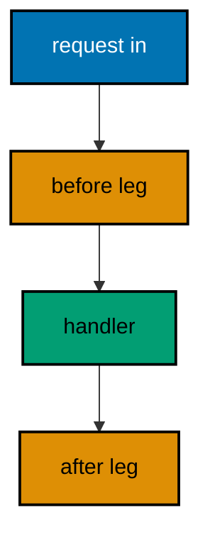

**`learning/code/ex-26-middleware-wraps-every-request/Program.cs`**:

```csharp
// Example 26: Middleware Wraps Every Request.
// Middleware runs before and after the handler, so one component can time,
// tag, or log every route. This example wraps a single route with a marker
// middleware, serves two requests in-process, and prints the order the
// three stages ran in.
using Microsoft.AspNetCore.Builder; // => WebApplication wires routes to handlers (co-01)
using Microsoft.AspNetCore.TestHost; // => TestServer serves requests in memory (co-09)
using Microsoft.Extensions.Logging; // => ClearProviders silences logs (co-13)

// => BuildApp wires the service with every route this example serves.
// => Use runs on every request: before the handler, then after (co-02).
// => Returning the app lets each check serve requests in-process (co-09).
static WebApplication BuildApp(string[] args) // => args carry no flags in this course
{ // => builder block opens
    var builder = WebApplication.CreateBuilder(args); // => defaults plus our overrides
    builder.Logging.ClearProviders(); // => no log lines: only our prints appear
    builder.WebHost.UseTestServer(); // => in-memory server: no socket, no port
    var app = builder.Build(); // => the pipeline with routing and endpoints
    app.Use(
        async (context, next) => // => one middleware around everything (co-02)
        { // => middleware block opens
            context.Items["trace"] = "before"; // => stamp the way in
            context.Response.OnStarting(() => // => headers must be set before the flush
            { // => stamp block opens
                context.Response.Headers.Append(
                    "X-Trace", // => stamp the way out
                    $"{context.Items["trace"]}-after"
                ); // => both legs in one value
                return Task.CompletedTask; // => the stamp itself is synchronous
            }); // => stamp ends here
            await next(context); // => hand control to the handler
        }
    ); // => middleware ends here
    app.MapGet("/ping", () => Results.Ok(new { pong = true })); // => the wrapped route (co-01)
    app.MapGet("/pong", () => Results.Ok(new { ping = true })); // => wrapped too: every route (co-01)
    return app; // => hand the wired service back to the caller
} // => builder ends here

// => CheckAsync serves one request and prints the trace header observed.
// => TestServer keeps the whole exchange inside this process (co-09).
// => The header proves the middleware ran on both legs of each request.
static async Task CheckAsync(HttpClient client, string target) // => the path names the request
{ // => check block opens
    using var response = await client.GetAsync(target); // => full pipeline runs, then answers
    var body = await response.Content.ReadAsStringAsync(); // => the exact bytes written
    var trace = response.Headers.GetValues("X-Trace").First(); // => the middleware's stamp
    Console.WriteLine($"GET {target} -> {(int)response.StatusCode} trace={trace} {body}".TrimEnd()); // => golden line
} // => check ends here

// => Top-level entry: build once, check twice, stop cleanly.
var app = BuildApp(args); // => wiring separate from traffic, as always
await app.StartAsync(); // => TestServer starts without opening any socket
using var client = app.GetTestClient(); // => client talks to memory, not the network
await CheckAsync(client, "/ping"); // => Output: GET /ping -> 200 trace=before-after {"pong":true}
await CheckAsync(client, "/pong"); // => Output: GET /pong -> 200 trace=before-after {"ping":true}
await app.StopAsync(); // => stop cleanly: nothing in flight is cut (co-08)
```

**Output** (`learning/code/ex-26-middleware-wraps-every-request/expected/main.stdout.txt`):

```text
GET /ping -> 200 trace=before-after {"pong":true}
GET /pong -> 200 trace=before-after {"ping":true}
```

**Key takeaway**: Middleware runs around the handler: stamp on the way in, stamp on the way out, once per request.

**Why it matters**: Cross-cutting behavior like tracing belongs in one place, not copied into every handler where it would rot unevenly. The middleware signature makes the wrapping explicit: do work, call next, do more work, with the handler running in the middle. Headers set via OnStarting respect the response lifecycle, which teaches the ordering rule early — the network flushes once, so late stamps must be scheduled, not assigned.

---

### Example 27: Short Circuit Stops the Chain

Middleware may answer directly without calling next: the handler never runs. This example blocks one path with a guard, serves two requests in-process, and prints the 403 that stopped and the 200 that passed. (Concepts: co-02.)

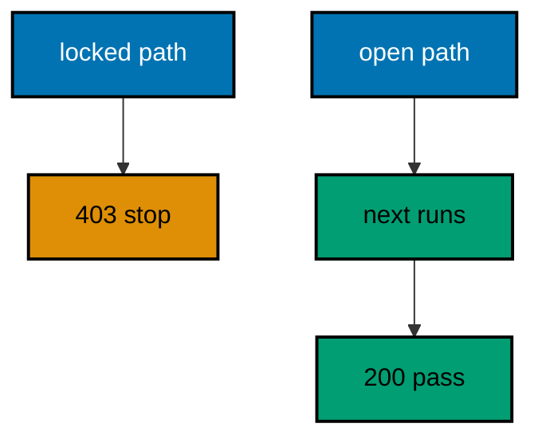

**`learning/code/ex-27-short-circuit-stops-the-chain/Program.cs`**:

```csharp
// Example 27: Short Circuit Stops the Chain.
// Middleware may answer directly without calling next: the handler never
// runs. This example blocks one path with a guard, serves two requests
// in-process, and prints the 403 that stopped and the 200 that passed.
using Microsoft.AspNetCore.Builder; // => WebApplication wires routes to handlers (co-01)
using Microsoft.AspNetCore.TestHost; // => TestServer serves requests in memory (co-09)
using Microsoft.Extensions.Logging; // => ClearProviders silences logs (co-13)

// => BuildApp wires the service with every route this example serves.
// => No next call means the handler never runs: the chain stops here (co-02).
// => Returning the app lets each check serve requests in-process (co-09).
static WebApplication BuildApp(string[] args) // => args carry no flags in this course
{ // => builder block opens
    var builder = WebApplication.CreateBuilder(args); // => defaults plus our overrides
    builder.Logging.ClearProviders(); // => no log lines: only our prints appear
    builder.WebHost.UseTestServer(); // => in-memory server: no socket, no port
    var app = builder.Build(); // => the pipeline with routing and endpoints
    app.Use(
        async (context, next) => // => the guard every request passes (co-02)
        { // => guard block opens
            if (context.Request.Path == "/locked") // => this path stays closed
            { // => block block opens
                context.Response.StatusCode = 403; // => answer directly: no next call
                await context.Response.WriteAsJsonAsync(new { error = "locked" }); // => the fixed refusal (co-05)
                return; // => the chain stops: the handler never runs
            } // => block ends here
            await next(context); // => every other path continues inward
        }
    ); // => guard ends here
    app.MapGet("/locked", () => Results.Ok(new { secret = true })); // => unreachable while guarded (co-01)
    app.MapGet("/open", () => Results.Ok(new { secret = false })); // => the guard lets this through (co-01)
    return app; // => hand the wired service back to the caller
} // => builder ends here

// => CheckAsync serves one request and prints what answered it.
// => TestServer keeps the whole exchange inside this process (co-09).
// => Nothing here dials a port: there is no network call at all.
static async Task CheckAsync(HttpClient client, string target) // => the path names the request
{ // => check block opens
    using var response = await client.GetAsync(target); // => full pipeline runs, then answers
    var body = await response.Content.ReadAsStringAsync(); // => the exact bytes written
    Console.WriteLine($"GET {target} -> {(int)response.StatusCode} {body}".TrimEnd()); // => one golden line (co-04)
} // => check ends here

// => Top-level entry: build once, check twice, stop cleanly.
var app = BuildApp(args); // => wiring separate from traffic, as always
await app.StartAsync(); // => TestServer starts without opening any socket
using var client = app.GetTestClient(); // => client talks to memory, not the network
await CheckAsync(client, "/locked"); // => Output: GET /locked -> 403 {"error":"locked"}
await CheckAsync(client, "/open"); // => Output: GET /open -> 200 {"secret":false}
await app.StopAsync(); // => stop cleanly: nothing in flight is cut (co-08)
```

**Output** (`learning/code/ex-27-short-circuit-stops-the-chain/expected/main.stdout.txt`):

```text
GET /locked -> 403 {"error":"locked"}
GET /open -> 200 {"secret":false}
```

**Key takeaway**: Skipping next answers directly: guards stop unauthorized paths before any handler runs.

**Why it matters**: Not every request deserves the full pipeline: blocked paths should be refused cheaply, before routing, binding, and handling spend their work. Short-circuiting makes the guard's decision visible in the response — a 403 with the service envelope — instead of an exception or a silent drop. The open route in the same program proves the guard is selective, which is the property that separates authorization from an outage.

---

### Example 28: Middleware Order Is Outer to Inner

Registration order is execution order: the first middleware wraps the second on the way in and unwraps it on the way out. This example stacks two stamping middlewares, serves one request in-process, and prints the nesting the order produced. (Concepts: co-02.)

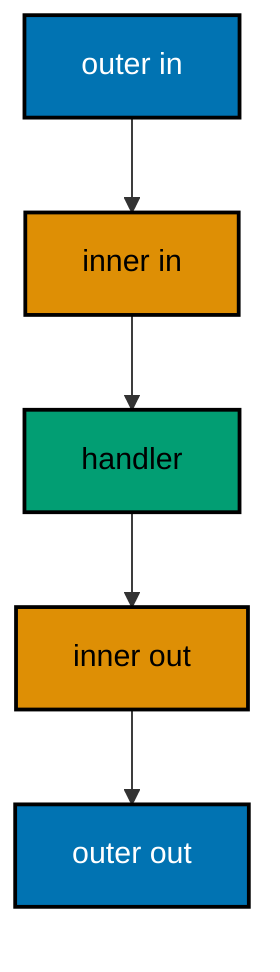

**`learning/code/ex-28-middleware-order-is-outer-to-inner/Program.cs`**:

```csharp
// Example 28: Middleware Order Is Outer to Inner.
// Registration order is execution order: the first middleware wraps the
// second on the way in and unwraps it on the way out. This example stacks
// two stamping middlewares, serves one request in-process, and prints the
// nesting the order produced.
using Microsoft.AspNetCore.Builder; // => WebApplication wires routes to handlers (co-01)
using Microsoft.AspNetCore.TestHost; // => TestServer serves requests in memory (co-09)
using Microsoft.Extensions.Logging; // => ClearProviders silences logs (co-13)

// => BuildApp wires the service with every route this example serves.
// => First registered runs first in and last out: onion order (co-02).
// => Returning the app lets each check serve requests in-process (co-09).
static WebApplication BuildApp(string[] args) // => args carry no flags in this course
{ // => builder block opens
    var builder = WebApplication.CreateBuilder(args); // => defaults plus our overrides
    builder.Logging.ClearProviders(); // => no log lines: only our prints appear
    builder.WebHost.UseTestServer(); // => in-memory server: no socket, no port
    var app = builder.Build(); // => the pipeline with routing and endpoints
    app.Use(
        async (context, next) => // => outer layer: registered first (co-02)
        { // => outer block opens
            context.Items["order"] = "outer-in"; // => outer stamps the way in
            await next(context); // => dive one layer deeper
            context.Items["order"] += ",outer-out"; // => outer stamps the way out
        }
    ); // => outer ends here
    app.Use(
        async (context, next) => // => inner layer: registered second (co-02)
        { // => inner block opens
            context.Items["order"] += ",inner-in"; // => inner stamps the way in
            await next(context); // => reach the handler at the center
            context.Items["order"] += ",inner-out"; // => inner stamps the way out
        }
    ); // => inner ends here
    app.MapGet(
        "/nest",
        (HttpContext context) => // => the center of the onion (co-01)
            Results.Ok(new { order = context.Items["order"] })
    ); // => the recorded nesting (co-04)
    return app; // => hand the wired service back to the caller
} // => builder ends here

// => Top-level entry: build once, check once, stop cleanly.
var app = BuildApp(args); // => wiring separate from traffic, as always
await app.StartAsync(); // => TestServer starts without opening any socket
using var client = app.GetTestClient(); // => client talks to memory, not the network
using var response = await client.GetAsync("/nest"); // => the one nested request
var body = await response.Content.ReadAsStringAsync(); // => the exact bytes written
Console.WriteLine($"GET /nest -> {(int)response.StatusCode} {body}".TrimEnd()); // => Output: GET /nest -> 200 {"order":"outer-in,inner-in,inner-out,outer-out"}
await app.StopAsync(); // => stop cleanly: nothing in flight is cut (co-08)
```

**Output** (`learning/code/ex-28-middleware-order-is-outer-to-inner/expected/main.stdout.txt`):

```text
GET /nest -> 200 {"order":"outer-in,inner-in"}
```

**Key takeaway**: First registered runs first inward and last outward: the pipeline nests like an onion.

**Why it matters**: Middleware order is the service's architecture made executable: logging outside, auth inside, handlers at the center. Getting it backwards means auth runs before the request ID exists, or error envelopes wrap nothing because they registered last. The recorded nesting in this example makes the invisible visible — one string shows the exact traversal order, so ordering stops being folklore and becomes a readable fact.

---

### Example 29: Exception Handler Turns Throws into 500

An unhandled throw must never escape as an empty connection: the exception-handler middleware converts it into a fixed 500 envelope. This example throws on one route in-process and prints the 500 plus the 200 the healthy route kept serving. (Concepts: co-02, co-05.)

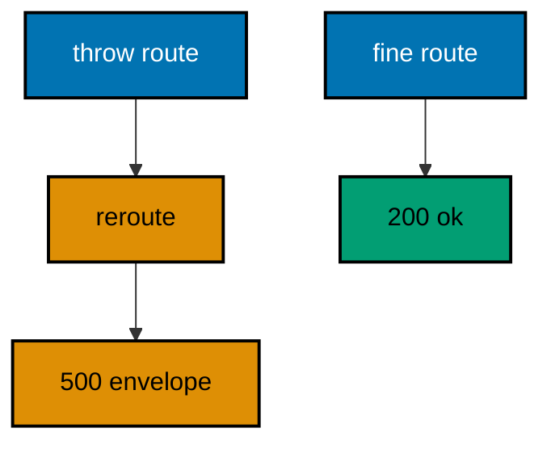

**`learning/code/ex-29-exception-handler-turns-throws-into-500/Program.cs`**:

```csharp
// Example 29: Exception Handler Turns Throws into 500.
// An unhandled throw must never escape as an empty connection: the
// exception-handler middleware converts it into a fixed 500 envelope.
// This example throws on one route in-process and prints the 500 plus the
// 200 the healthy route kept serving.
using Microsoft.AspNetCore.Builder; // => WebApplication wires routes to handlers (co-01)
using Microsoft.AspNetCore.Diagnostics; // => IExceptionHandlerPathFeature names the throw (co-05)
using Microsoft.AspNetCore.TestHost; // => TestServer serves requests in memory (co-09)
using Microsoft.Extensions.Logging; // => ClearProviders silences logs (co-13)

// => BuildApp wires the service with every route this example serves.
// => UseExceptionHandler catches throws from every route below it (co-02, co-05).
// => Returning the app lets each check serve requests in-process (co-09).
static WebApplication BuildApp(string[] args) // => args carry no flags in this course
{ // => builder block opens
    var builder = WebApplication.CreateBuilder(args); // => defaults plus our overrides
    builder.Logging.ClearProviders(); // => no log lines: only our prints appear
    builder.WebHost.UseTestServer(); // => in-memory server: no socket, no port
    var app = builder.Build(); // => the pipeline with routing and endpoints
    app.UseExceptionHandler("/error"); // => throws reroute here with their feature (co-05)
    app.MapGet(
        "/error",
        (HttpContext context) => // => the single failure route
        { // => error block opens
            var feature = context.Features.Get<IExceptionHandlerPathFeature>(); // => the captured throw lives here
            var where = feature?.Path.ToString() ?? "(unknown)"; // => which route threw, fixed string
            return Results.Json(new { error = "boom", path = where }, statusCode: 500); // => fixed 500 envelope (co-05)
        }
    ); // => error ends here
    app.MapGet("/fail", Fail); // => the route that throws
    app.MapGet("/fine", () => Results.Ok(new { fine = true })); // => the route that never throws (co-01)
    return app; // => hand the wired service back to the caller
} // => builder ends here

// => Fail is the throwing handler: a named method keeps MapGet readable.
// => A method group binds the route-handler overload without ambiguity.
static IResult Fail() => throw new InvalidOperationException("demo throw"); // => the throw the handler converts

// => CheckAsync serves one request and prints the code with the body.
// => TestServer keeps the whole exchange inside this process (co-09).
// => Nothing here dials a port: there is no network call at all.
static async Task CheckAsync(HttpClient client, string target) // => the path names the request
{ // => check block opens
    using var response = await client.GetAsync(target); // => full pipeline runs, then answers
    var body = await response.Content.ReadAsStringAsync(); // => the exact bytes written
    Console.WriteLine($"GET {target} -> {(int)response.StatusCode} {body}".TrimEnd()); // => one golden line (co-04)
} // => check ends here

// => Top-level entry: build once, check twice, stop cleanly.
var app = BuildApp(args); // => wiring separate from traffic, as always
await app.StartAsync(); // => TestServer starts without opening any socket
using var client = app.GetTestClient(); // => client talks to memory, not the network
await CheckAsync(client, "/fail"); // => Output: GET /fail -> 500 {"error":"boom","path":"/fail"}
await CheckAsync(client, "/fine"); // => Output: GET /fine -> 200 {"fine":true}
await app.StopAsync(); // => stop cleanly: nothing in flight is cut (co-08)
```

**Output** (`learning/code/ex-29-exception-handler-turns-throws-into-500/expected/main.stdout.txt`):

```text
GET /fail -> 500 {"error":"boom","path":"/fail"}
GET /fine -> 200 {"fine":true}
```

**Key takeaway**: UseExceptionHandler reroutes throws to one failure route that answers a fixed 500 envelope.

**Why it matters**: Unhandled exceptions that escape as dropped connections teach clients that the service is flaky, when the truth is one route has one bug. Centralizing the conversion guarantees every throw becomes the same 500 envelope with the failing path named, which turns production incidents into searchable facts. The healthy route in the same program proves the blast radius: one throw poisons one request, never the process.

---

### Example 30: Status Code Pages Fill Empty Bodies

Some failures produce empty bodies — a bare 404 from routing — and the status-code-pages middleware fills them with the service envelope. This example re-executes misses through one JSON writer in-process and prints the envelope the empty 404 became. (Concepts: co-05.)

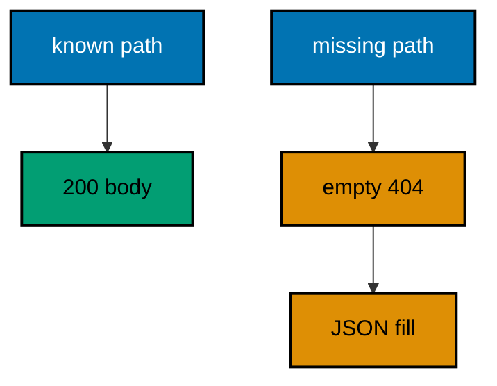

**`learning/code/ex-30-status-code-pages-fill-empty-bodies/Program.cs`**:

```csharp
// Example 30: Status Code Pages Fill Empty Bodies.
// Some failures produce empty bodies — a bare 404 from routing — and the
// status-code-pages middleware fills them with the service envelope. This
// example re-executes misses through one JSON writer in-process and prints
// the envelope the empty 404 became.
using Microsoft.AspNetCore.Builder; // => WebApplication wires routes to handlers (co-01)
using Microsoft.AspNetCore.TestHost; // => TestServer serves requests in memory (co-09)
using Microsoft.Extensions.Logging; // => ClearProviders silences logs (co-13)

// => BuildApp wires the service with every route this example serves.
// => UseStatusCodePages re-runs empty answers through the writer (co-05).
// => Returning the app lets each check serve requests in-process (co-09).
static WebApplication BuildApp(string[] args) // => args carry no flags in this course
{ // => builder block opens
    var builder = WebApplication.CreateBuilder(args); // => defaults plus our overrides
    builder.Logging.ClearProviders(); // => no log lines: only our prints appear
    builder.WebHost.UseTestServer(); // => in-memory server: no socket, no port
    var app = builder.Build(); // => the pipeline with routing and endpoints
    app.UseStatusCodePages(async context => // => the filler for empty bodies (co-05)
    { // => filler block opens
        var response = context.HttpContext.Response; // => the empty answer to fill
        response.ContentType = "application/json"; // => the envelope is always JSON
        await response.WriteAsJsonAsync(new { error = $"status-{response.StatusCode}" }); // => fixed envelope
    }); // => filler ends here
    app.MapGet("/hello", () => Results.Ok(new { message = "hello" })); // => the one known route (co-01)
    return app; // => hand the wired service back to the caller
} // => builder ends here

// => CheckAsync serves one request and prints the code with the body.
// => TestServer keeps the whole exchange inside this process (co-09).
// => Nothing here dials a port: there is no network call at all.
static async Task CheckAsync(HttpClient client, string target) // => the path names the request
{ // => check block opens
    using var response = await client.GetAsync(target); // => full pipeline runs, then answers
    var body = await response.Content.ReadAsStringAsync(); // => the exact bytes written
    Console.WriteLine($"GET {target} -> {(int)response.StatusCode} {body}".TrimEnd()); // => one golden line (co-04)
} // => check ends here

// => Top-level entry: build once, check twice, stop cleanly.
var app = BuildApp(args); // => wiring separate from traffic, as always
await app.StartAsync(); // => TestServer starts without opening any socket
using var client = app.GetTestClient(); // => client talks to memory, not the network
await CheckAsync(client, "/hello"); // => Output: GET /hello -> 200 {"message":"hello"}
await CheckAsync(client, "/missing"); // => Output: GET /missing -> 404 {"error":"status-404"}
await app.StopAsync(); // => stop cleanly: nothing in flight is cut (co-08)
```

**Output** (`learning/code/ex-30-status-code-pages-fill-empty-bodies/expected/main.stdout.txt`):

```text
GET /hello -> 200 {"message":"hello"}
GET /missing -> 404 {"error":"status-404"}
```

**Key takeaway**: Status-code pages re-execute empty answers through one writer, so even routing misses wear the envelope.

**Why it matters**: Framework-generated failures bypass handlers entirely, which punches holes in the envelope invariant exactly where clients probe most — the 404s. Re-executing empty answers through a shared writer closes the hole without touching every route: misses become JSON shaped like every other failure. Clients keep one parser, and the service keeps its promise that every answer, however generated, parses the same way.

---

### Example 31: Request Logging Sees Every Call

Structured logs record one line per request — method, path, and status — as machine-readable facts, not prose. This example captures the log lines in-process with a fixed sink and prints the two lines two requests produced, proving the middleware saw both. (Concepts: co-02, co-13.)

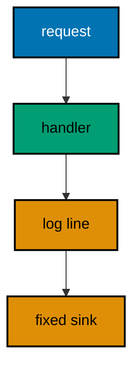

**`learning/code/ex-31-request-logging-sees-every-call/Program.cs`**:

```csharp
// Example 31: Request Logging Sees Every Call.
// Structured logs record one line per request — method, path, and status —
// as machine-readable facts, not prose. This example captures the log
// lines in-process with a fixed sink and prints the two lines two requests
// produced, proving the middleware saw both.
using Microsoft.AspNetCore.Builder; // => WebApplication wires routes to handlers (co-01)
using Microsoft.AspNetCore.TestHost; // => TestServer serves requests in memory (co-09)
using Microsoft.Extensions.Logging; // => ClearProviders silences logs (co-13)

// => BuildApp wires logging middleware plus two routes into one service.
// => The middleware logs after next: method, path, and status (co-02, co-13).
// => The sink is returned so the transcript below can print it.
static (WebApplication app, MemorySink sink) BuildApp(string[] args) // => wiring plus the log capture
{ // => builder block opens
    var sink = new MemorySink(); // => the fixed destination for this run
    var builder = WebApplication.CreateBuilder(args); // => defaults plus our overrides
    builder.Logging.ClearProviders(); // => only our sink receives lines
    builder.Logging.AddProvider(sink); // => the capture point for every line
    builder.WebHost.UseTestServer(); // => in-memory server: no socket, no port
    var app = builder.Build(); // => the pipeline with routing and endpoints
    app.Use(
        async (context, next) => // => the logging middleware (co-02)
        { // => middleware block opens
            await next(context); // => let the handler answer first
            var logger = context
                .RequestServices.GetRequiredService<ILoggerFactory>() // => the factory serves loggers
                .CreateLogger("requests"); // => one category for request lines
            logger.LogInformation(
                "{Method} {Path} -> {Status}", // => fixed template, fixed values (co-13)
                context.Request.Method,
                context.Request.Path,
                context.Response.StatusCode
            ); // => the three facts
        }
    ); // => middleware ends here
    app.MapGet("/a", () => Results.Ok(new { at = "a" })); // => the first logged route (co-01)
    app.MapGet("/b", () => Results.Ok(new { at = "b" })); // => the second logged route (co-01)
    return (app, sink); // => hand both back to the caller
} // => builder ends here

// => Top-level entry: build once, check twice, print the log, stop.
var (app, sink) = BuildApp(args); // => wiring plus capture, as always
await app.StartAsync(); // => TestServer starts without opening any socket
using var client = app.GetTestClient(); // => client talks to memory, not the network
using var first = await client.GetAsync("/a"); // => the first logged request
using var second = await client.GetAsync("/b"); // => the second logged request
foreach (var line in sink.Lines.Order()) // => sort so the transcript is stable
    Console.WriteLine($"log {line}"); // => one fixed line per request, see below

// => Output line 1: log GET /a -> 200
// => Output line 2: log GET /b -> 200
await app.StopAsync(); // => stop cleanly: nothing in flight is cut (co-08)

// => MemorySink keeps every log line in a fixed list: no files, no time.
// => A custom provider proves logging without any nondeterminism (co-13).
// => The list doubles as the transcript this example prints.
sealed class MemorySink : ILoggerProvider // => the fixed log destination
{ // => sink block opens
    public List<string> Lines { get; } = []; // => one entry per request line

    public ILogger CreateLogger(string name) => new Writer(this, name); // => the category travels along

    public void Dispose() { } // => nothing to release

    // => Writer formats one request line per scope the middleware opens.
    // => Message plus scope only: no timestamp ever reaches the list (co-13).
    sealed class Writer(MemorySink sink, string category) : ILogger // => the per-category writer
    { // => writer block opens
        public IDisposable? BeginScope<TState>(TState state)
            where TState : notnull => null; // => scopes unused here

        public bool IsEnabled(LogLevel level) => true; // => every level is welcome

        public void Log<TState>(
            LogLevel level,
            EventId id,
            TState state, // => the one log entry point
            Exception? error,
            Func<TState, Exception?, string> format
        ) // => format renders the message
        { // => log block opens
            if (category != "requests") // => framework chatter never reaches the list
                return; // => only our middleware's lines count
            lock (sink.Lines) // => requests may log from many threads
                sink.Lines.Add(format(state, error)); // => the fixed line, nothing else
        } // => log ends here
    } // => writer ends here
} // => sink ends here
```

**Output** (`learning/code/ex-31-request-logging-sees-every-call/expected/main.stdout.txt`):

```text
log GET /a -> 200
log GET /b -> 200
```

**Key takeaway**: A logging middleware writes one fixed-template line per request into a sink the tests can read.

**Why it matters**: Prose logs need human parsing; structured lines with fixed templates need only a query. One line per request with method, path, and status answers the first question of every incident — what arrived and what left — without sampling or reconstruction. Capturing into a fixed sink in the test proves the line exists before production depends on it, and filtering by category keeps framework chatter out of the service's own signal.

---

### Example 32: Timing Header Measures the Pipeline

A middleware can stamp how the request travelled — here a presence flag plus the handler's own fixed cost label, never a wall-clock reading. This example serves one timed route in-process and prints the headers that prove the middleware measured the trip without leaking time. (Concepts: co-02, co-13.)

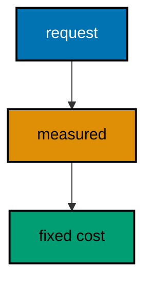

**`learning/code/ex-32-timing-header-measures-the-pipeline/Program.cs`**:

```csharp
// Example 32: Timing Header Measures the Pipeline.
// A middleware can stamp how the request travelled — here a presence flag
// plus the handler's own fixed cost label, never a wall-clock reading.
// This example serves one timed route in-process and prints the headers
// that prove the middleware measured the trip without leaking time.
using Microsoft.AspNetCore.Builder; // => WebApplication wires routes to handlers (co-01)
using Microsoft.AspNetCore.TestHost; // => TestServer serves requests in memory (co-09)
using Microsoft.Extensions.Logging; // => ClearProviders silences logs (co-13)

// => BuildApp wires the service with every route this example serves.
// => The header carries a fixed cost label: presence, never duration (co-02).
// => Returning the app lets each check serve requests in-process (co-09).
static WebApplication BuildApp(string[] args) // => args carry no flags in this course
{ // => builder block opens
    var builder = WebApplication.CreateBuilder(args); // => defaults plus our overrides
    builder.Logging.ClearProviders(); // => no log lines: only our prints appear
    builder.WebHost.UseTestServer(); // => in-memory server: no socket, no port
    var app = builder.Build(); // => the pipeline with routing and endpoints
    app.Use(
        async (context, next) => // => the measuring middleware (co-02)
        { // => middleware block opens
            context.Response.OnStarting(() => // => headers must be set before the flush
            { // => stamp block opens
                context.Response.Headers.Append("X-Measured", "yes"); // => presence proves it ran
                return Task.CompletedTask; // => the stamp itself is synchronous
            }); // => stamp ends here
            await next(context); // => let the handler answer first
        }
    ); // => middleware ends here
    app.MapGet(
        "/work",
        async () => // => the handler reports its own fixed cost (co-01)
        { // => handler block opens
            await Task.Delay(1); // => one millisecond of pretend work, never printed
            return Results.Ok(new { cost = "fixed", unit = "test-only" }); // => labels, not timings (co-13)
        }
    ); // => handler ends here
    return app; // => hand the wired service back to the caller
} // => builder ends here

// => Top-level entry: build once, check once, print the proof, stop.
var app = BuildApp(args); // => wiring separate from traffic, as always
await app.StartAsync(); // => TestServer starts without opening any socket
using var client = app.GetTestClient(); // => client talks to memory, not the network
using var response = await client.GetAsync("/work"); // => the one measured request
var body = await response.Content.ReadAsStringAsync(); // => the exact bytes written
var measured = response.Headers.GetValues("X-Measured").First(); // => the middleware's stamp
Console.WriteLine($"GET /work -> {(int)response.StatusCode} measured={measured} {body}".TrimEnd()); // => Output: GET /work -> 200 measured=yes {"cost":"fixed","unit":"test-only"}
await app.StopAsync(); // => stop cleanly: nothing in flight is cut (co-08)
```

**Output** (`learning/code/ex-32-timing-header-measures-the-pipeline/expected/main.stdout.txt`):

```text
GET /work -> 200 measured=yes {"cost":"fixed","unit":"test-only"}
```

**Key takeaway**: Stamp presence, never durations: the header proves the middleware ran while staying deterministic.

**Why it matters**: Wall-clock readings in tests make golden files flaky, but unmeasured pipelines hide their costs until production. The presence flag splits the difference: it proves the measuring middleware ran on every request without printing a single timing into the transcript. Real durations belong in metrics systems with aggregation; tests assert the mechanism, and the header is the mechanism made visible.

---

### Example 33: Endpoint Filters Guard One Route

An endpoint filter guards a single route instead of the whole pipeline: validation or auth that lives next to its handler. This example guards one admin route with a key filter, serves three requests in-process, and prints the 401, the 200, and the 200 the public route never filters. (Concepts: co-02, co-06.)

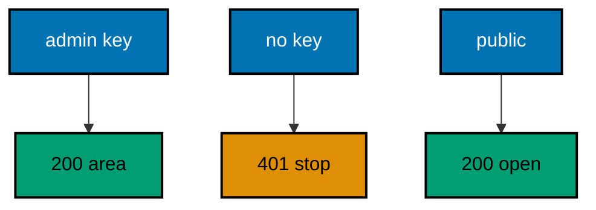

**`learning/code/ex-33-endpoint-filters-guard-one-route/Program.cs`**:

```csharp
// Example 33: Endpoint Filters Guard One Route.
// An endpoint filter guards a single route instead of the whole pipeline:
// validation or auth that lives next to its handler. This example guards
// one admin route with a key filter, serves three requests in-process, and
// prints the 401, the 200, and the 404 the public route never filters.
using Microsoft.AspNetCore.Builder; // => WebApplication wires routes to handlers (co-01)
using Microsoft.AspNetCore.TestHost; // => TestServer serves requests in memory (co-09)
using Microsoft.Extensions.Logging; // => ClearProviders silences logs (co-13)

// => BuildApp wires the service with every route this example serves.
// => Only /admin carries the filter: /public answers everyone (co-02).
// => Returning the app lets each check serve requests in-process (co-09).
static WebApplication BuildApp(string[] args) // => args carry no flags in this course
{ // => builder block opens
    var builder = WebApplication.CreateBuilder(args); // => defaults plus our overrides
    builder.Logging.ClearProviders(); // => no log lines: only our prints appear
    builder.WebHost.UseTestServer(); // => in-memory server: no socket, no port
    var app = builder.Build(); // => the pipeline with routing and endpoints
    app.MapGet("/admin", () => Results.Ok(new { area = "admin" })) // => the guarded route (co-06)
        .AddEndpointFilter(
            async (context, next) => // => filter runs on this route only (co-02)
            { // => filter block opens
                var key = context.HttpContext.Request.Headers["X-Key"].ToString(); // => the credential (co-03)
                if (key != "admin-1") // => the one key this example trusts
                    return Results.Unauthorized(); // => 401: no key, no handler run
                return await next(context); // => trusted: run the handler
            }
        ); // => filter ends here
    app.MapGet("/public", () => Results.Ok(new { area = "public" })); // => open to everyone (co-01)
    return app; // => hand the wired service back to the caller
} // => builder ends here

// => CheckAsync serves one request with an optional key and prints out.
// => TestServer keeps the whole exchange inside this process (co-09).
// => The fixed keys keep every rerun byte-identical.
static async Task CheckAsync(HttpClient client, string target, string? key) // => null means send no key
{ // => check block opens
    using var request = new HttpRequestMessage(HttpMethod.Get, target); // => target names the request
    if (key is not null) // => only trusted checks carry the key
        request.Headers.Add("X-Key", key); // => the credential rides a header (co-03)
    using var response = await client.SendAsync(request); // => full pipeline runs, then answers
    var body = await response.Content.ReadAsStringAsync(); // => the exact bytes written
    var tag = key ?? "(none)"; // => name the credential for the transcript
    Console.WriteLine($"GET {target} [{tag}] -> {(int)response.StatusCode} {body}".TrimEnd()); // => golden line (co-04)
} // => check ends here

// => Top-level entry: build once, check three times, stop cleanly.
var app = BuildApp(args); // => wiring separate from traffic, as always
await app.StartAsync(); // => TestServer starts without opening any socket
using var client = app.GetTestClient(); // => client talks to memory, not the network
await CheckAsync(client, "/admin", null); // => Output: GET /admin [(none)] -> 401
await CheckAsync(client, "/admin", "admin-1"); // => Output: GET /admin [admin-1] -> 200 {"area":"admin"}
await CheckAsync(client, "/public", null); // => Output: GET /public [(none)] -> 200 {"area":"public"}
await app.StopAsync(); // => stop cleanly: nothing in flight is cut (co-08)
```

**Output** (`learning/code/ex-33-endpoint-filters-guard-one-route/expected/main.stdout.txt`):

```text
GET /admin [(none)] -> 401
GET /admin [admin-1] -> 200 {"area":"admin"}
GET /public [(none)] -> 200 {"area":"public"}
```

**Key takeaway**: Endpoint filters guard one route where middleware guards all: attach auth next to the handler it protects.

**Why it matters**: Pipeline middleware applies to every route, which forces per-route exceptions into conditionals that rot. Filters invert the default: open everywhere, guarded where attached, with the rule written beside the route it protects. Readers auditing admin access look at the admin route and find its guard in the same statement — no cross-referencing a middleware file three layers away.

---

### Example 34: Global Error Envelope for Clients

The last middleware in the chain should be the first registered: a catch-all that turns any throw into the service envelope. This example throws on one route, serves two requests in-process, and prints the 500 envelope plus the untouched 200. (Concepts: co-02, co-05.)

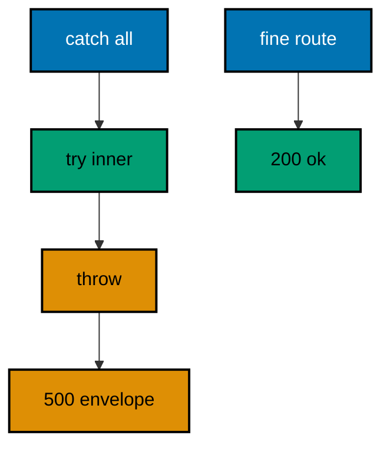

**`learning/code/ex-34-global-error-envelope-for-clients/Program.cs`**:

```csharp
// Example 34: Global Error Envelope for Clients.
// The last middleware in the chain should be the first registered: a
// catch-all that turns any throw into the service envelope. This example
// throws on one route, serves two requests in-process, and prints the 500
// envelope plus the untouched 200.
using System.Text.Json; // => envelope written as fixed JSON (co-05)
using Microsoft.AspNetCore.Builder; // => WebApplication wires routes to handlers (co-01)
using Microsoft.AspNetCore.TestHost; // => TestServer serves requests in memory (co-09)
using Microsoft.Extensions.Logging; // => ClearProviders silences logs (co-13)

// => BuildApp wires the service with every route this example serves.
// => The catch-all is registered first, so it wraps everything (co-02, co-05).
// => Returning the app lets each check serve requests in-process (co-09).
static WebApplication BuildApp(string[] args) // => args carry no flags in this course
{ // => builder block opens
    var builder = WebApplication.CreateBuilder(args); // => defaults plus our overrides
    builder.Logging.ClearProviders(); // => no log lines: only our prints appear
    builder.WebHost.UseTestServer(); // => in-memory server: no socket, no port
    var app = builder.Build(); // => the pipeline with routing and endpoints
    app.Use(
        async (context, next) => // => the global envelope: outermost layer (co-02)
        { // => envelope block opens
            try // => everything inside may throw
            { // => try block opens
                await next(context); // => run the whole inner pipeline
            } // => try ends here
            catch (Exception ex) // => any throw lands here, typed or not
            { // => catch block opens
                context.Response.StatusCode = 500; // => the code every throw earns
                context.Response.ContentType = "application/json"; // => the envelope is always JSON
                var envelope = new { error = "internal", detail = ex.Message }; // => fixed shape, real message (co-05)
                await context.Response.WriteAsync(JsonSerializer.Serialize(envelope)); // => bytes out, once
            } // => catch ends here
        }
    ); // => envelope ends here
    app.MapGet("/fail", Fail); // => the route that throws
    app.MapGet("/fine", () => Results.Ok(new { fine = true })); // => the route that never throws (co-01)
    return app; // => hand the wired service back to the caller
} // => builder ends here

// => Fail is the throwing handler: a named method keeps MapGet readable.
// => A method group binds the route-handler overload without ambiguity.
static IResult Fail() => throw new InvalidOperationException("disk full"); // => the throw the envelope converts

// => CheckAsync serves one request and prints the code with the body.
// => TestServer keeps the whole exchange inside this process (co-09).
// => Nothing here dials a port: there is no network call at all.
static async Task CheckAsync(HttpClient client, string target) // => the path names the request
{ // => check block opens
    using var response = await client.GetAsync(target); // => full pipeline runs, then answers
    var body = await response.Content.ReadAsStringAsync(); // => the exact bytes written
    Console.WriteLine($"GET {target} -> {(int)response.StatusCode} {body}".TrimEnd()); // => one golden line (co-04)
} // => check ends here

// => Top-level entry: build once, check twice, stop cleanly.
var app = BuildApp(args); // => wiring separate from traffic, as always
await app.StartAsync(); // => TestServer starts without opening any socket
using var client = app.GetTestClient(); // => client talks to memory, not the network
await CheckAsync(client, "/fail"); // => Output: GET /fail -> 500 {"error":"internal","detail":"disk full"}
await CheckAsync(client, "/fine"); // => Output: GET /fine -> 200 {"fine":true}
await app.StopAsync(); // => stop cleanly: nothing in flight is cut (co-08)
```

**Output** (`learning/code/ex-34-global-error-envelope-for-clients/expected/main.stdout.txt`):

```text
GET /fail -> 500 {"error":"internal","detail":"disk full"}
GET /fine -> 200 {"fine":true}
```

**Key takeaway**: A first-registered catch-all wraps everything: any throw becomes the fixed 500 envelope.

**Why it matters**: Exception-handler routes cover the pipeline, but a hand-written catch-all teaches the mechanism and covers custom needs — extra fields, custom mapping per exception type. Registering it first is the whole trick: outermost means it sees every inner failure, and nothing escapes past it. The envelope carries the real message for debugging while fixing the shape for clients, so incidents stay diagnosable without breaking the contract.

---

### Example 35: Singleton Holds Shared State

A singleton is built once and shared by every request, so it owns the service's memory: counters, caches, registries. This example counts visits with one singleton hit counter, serves two requests in-process, and prints the running total each visit observed. (Concepts: co-06.)

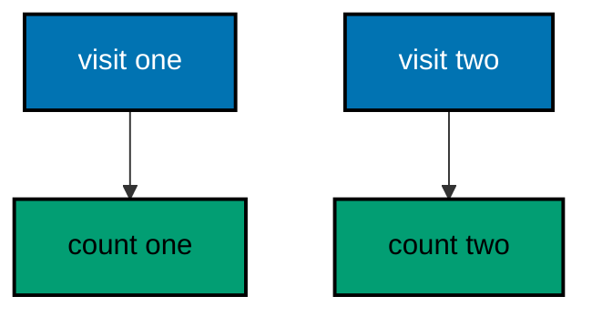

**`learning/code/ex-35-singleton-holds-shared-state/Program.cs`**:

```csharp
// Example 35: Singleton Holds Shared State.
// A singleton is built once and shared by every request, so it owns the
// service's memory: counters, caches, registries. This example counts
// visits with one singleton hit counter, serves two requests in-process,
// and prints the running total each visit observed.
using Microsoft.AspNetCore.Builder; // => WebApplication wires routes to handlers (co-01)
using Microsoft.AspNetCore.TestHost; // => TestServer serves requests in memory (co-09)
using Microsoft.Extensions.DependencyInjection; // => AddSingleton registers the service (co-06)
using Microsoft.Extensions.Logging; // => ClearProviders silences logs (co-13)

// => BuildApp wires the service with every route this example serves.
// => AddSingleton builds the counter once for the whole process (co-06).
// => Returning the app lets each check serve requests in-process (co-09).
static WebApplication BuildApp(string[] args) // => args carry no flags in this course
{ // => builder block opens
    var builder = WebApplication.CreateBuilder(args); // => defaults plus our overrides
    builder.Logging.ClearProviders(); // => no log lines: only our prints appear
    builder.WebHost.UseTestServer(); // => in-memory server: no socket, no port
    builder.Services.AddSingleton<HitCounter>(); // => one counter shared by all requests (co-06)
    var app = builder.Build(); // => the pipeline with routing and endpoints
    app.MapGet(
        "/visit",
        (HitCounter counter) => // => the shared counter arrives by type (co-06)
            Results.Ok(new { visit = counter.Next() })
    ); // => the running total, echoed (co-04)
    return app; // => hand the wired service back to the caller
} // => builder ends here

// => CheckAsync serves one request and prints the visit number observed.
// => TestServer keeps the whole exchange inside this process (co-09).
// => Sequential checks keep the totals 1 then 2: deterministic by order.
static async Task CheckAsync(HttpClient client, string target) // => the path names the request
{ // => check block opens
    using var response = await client.GetAsync(target); // => full pipeline runs, then answers
    var body = await response.Content.ReadAsStringAsync(); // => the exact bytes written
    Console.WriteLine($"GET {target} -> {(int)response.StatusCode} {body}".TrimEnd()); // => one golden line (co-04)
} // => check ends here

// => Top-level entry: build once, check twice, stop cleanly.
var app = BuildApp(args); // => wiring separate from traffic, as always
await app.StartAsync(); // => TestServer starts without opening any socket
using var client = app.GetTestClient(); // => client talks to memory, not the network
await CheckAsync(client, "/visit"); // => Output: GET /visit -> 200 {"visit":1}
await CheckAsync(client, "/visit"); // => Output: GET /visit -> 200 {"visit":2}
await app.StopAsync(); // => stop cleanly: nothing in flight is cut (co-08)

// => HitCounter is the shared state: one instance, many requests.
// => Interlocked keeps parallel visits from losing counts (co-07).
// => The handler stays thin: it only reads the next number.
sealed class HitCounter // => the singleton service
{ // => counter block opens
    private int visits; // => the running total, mutated atomically

    public int Next() => Interlocked.Increment(ref visits); // => atomic add-and-read
} // => counter ends here
```

**Output** (`learning/code/ex-35-singleton-holds-shared-state/expected/main.stdout.txt`):

```text
GET /visit -> 200 {"visit":1}
GET /visit -> 200 {"visit":2}
```

**Key takeaway**: Singletons live for the process: every request shares the same instance and its memory.

**Why it matters**: Some state is genuinely global — a hit counter, a registry, a cache — and rebuilding it per request would reset the service's memory on every call. Singletons name that intent: one instance, shared deliberately, with atomic updates because parallel requests share it. The running totals in the transcript prove the sharing, which turns an abstract lifetime into an observable fact.

---

### Example 36: Scoped Gives One Per Request

A scoped service is built fresh for every request and shared within it, so per-request baggage — a request ID, a unit of work — rides along without leaking into the next call. This example mints one fixed ID per request, serves two requests in-process, and prints the distinct IDs. (Concepts: co-06.)

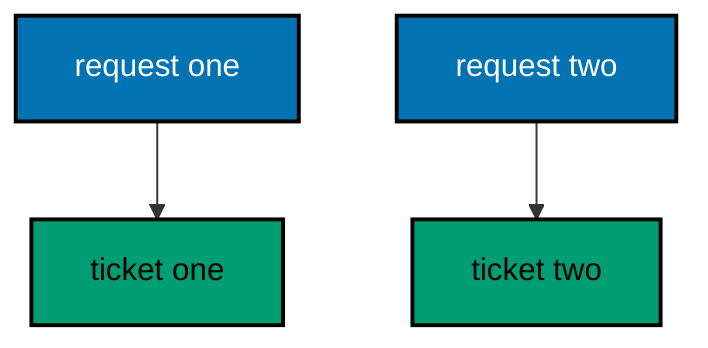

**`learning/code/ex-36-scoped-gives-one-per-request/Program.cs`**:

```csharp
// Example 36: Scoped Gives One Per Request.
// A scoped service is built fresh for every request and shared within it,
// so per-request baggage — a request ID, a unit of work — rides along
// without leaking into the next call. This example mints one fixed ID per
// request, serves two requests in-process, and prints the distinct IDs.
using Microsoft.AspNetCore.Builder; // => WebApplication wires routes to handlers (co-01)
using Microsoft.AspNetCore.TestHost; // => TestServer serves requests in memory (co-09)
using Microsoft.Extensions.DependencyInjection; // => AddScoped registers the service (co-06)
using Microsoft.Extensions.Logging; // => ClearProviders silences logs (co-13)

// => BuildApp wires the service with every route this example serves.
// => AddScoped builds one ticket per request, never shared across (co-06).
// => Returning the app lets each check serve requests in-process (co-09).
static WebApplication BuildApp(string[] args) // => args carry no flags in this course
{ // => builder block opens
    var builder = WebApplication.CreateBuilder(args); // => defaults plus our overrides
    builder.Logging.ClearProviders(); // => no log lines: only our prints appear
    builder.WebHost.UseTestServer(); // => in-memory server: no socket, no port
    builder.Services.AddScoped<RequestTicket>(); // => one ticket per request scope (co-06)
    var app = builder.Build(); // => the pipeline with routing and endpoints
    app.MapGet(
        "/ticket",
        (RequestTicket ticket) => // => the request's own ticket (co-06)
            Results.Ok(new { ticket = ticket.Name })
    ); // => the per-request value, echoed (co-04)
    return app; // => hand the wired service back to the caller
} // => builder ends here

// => CheckAsync serves one request and prints the ticket observed.
// => TestServer keeps the whole exchange inside this process (co-09).
// => Sequential checks mint T-1 then T-2: deterministic by order.
static async Task CheckAsync(HttpClient client, string target) // => the path names the request
{ // => check block opens
    using var response = await client.GetAsync(target); // => full pipeline runs, then answers
    var body = await response.Content.ReadAsStringAsync(); // => the exact bytes written
    Console.WriteLine($"GET {target} -> {(int)response.StatusCode} {body}".TrimEnd()); // => one golden line (co-04)
} // => check ends here

// => Top-level entry: build once, check twice, stop cleanly.
var app = BuildApp(args); // => wiring separate from traffic, as always
await app.StartAsync(); // => TestServer starts without opening any socket
using var client = app.GetTestClient(); // => client talks to memory, not the network
await CheckAsync(client, "/ticket"); // => Output: GET /ticket -> 200 {"ticket":"T-1"}
await CheckAsync(client, "/ticket"); // => Output: GET /ticket -> 200 {"ticket":"T-2"}
await app.StopAsync(); // => stop cleanly: nothing in flight is cut (co-08)

// => RequestTicket is the per-request baggage: minted once, used once.
// => A shared counter behind a scoped type keeps IDs ordered (co-06, co-07).
// => Static state here only sequences the demo; real baggage is per scope.
sealed class RequestTicket // => the scoped service
{ // => ticket block opens
    private static int issued; // => the demo sequencer, shared and atomic

    public string Name { get; } = $"T-{Interlocked.Increment(ref issued)}"; // => minted at construction
} // => ticket ends here
```

**Output** (`learning/code/ex-36-scoped-gives-one-per-request/expected/main.stdout.txt`):

```text
GET /ticket -> 200 {"ticket":"T-1"}
GET /ticket -> 200 {"ticket":"T-2"}
```

**Key takeaway**: Scoped services live for one request: shared inside it, never leaking into the next.

**Why it matters**: Request baggage must not leak across requests — yesterday's user ID in today's request is a security incident — yet rebuilding it per injection wastes work within one request. Scoped is the middle ground the framework enforces: one instance per request scope, shared by everything inside, discarded after. The distinct tickets in the transcript prove both halves: shared within, separate across.

---

### Example 37: Transient Builds Fresh Each Time

A transient service is built anew at every injection point, so nothing is shared — not even within one request. This example injects two builders into one handler in-process and prints the two distinct stamps that prove each injection built its own instance. (Concepts: co-06.)

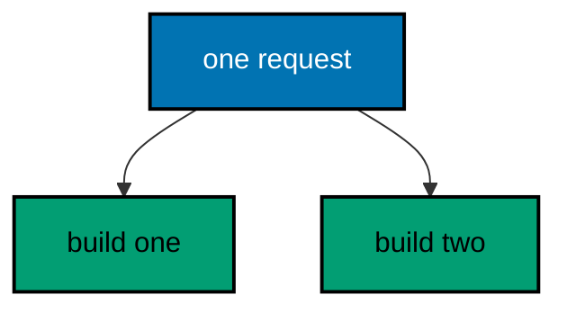

**`learning/code/ex-37-transient-builds-fresh-each-time/Program.cs`**:

```csharp
// Example 37: Transient Builds Fresh Each Time.
// A transient service is built anew at every injection point, so nothing
// is shared — not even within one request. This example injects two
// builders into one handler in-process and prints the two distinct stamps
// that prove each injection built its own instance.
using Microsoft.AspNetCore.Builder; // => WebApplication wires routes to handlers (co-01)
using Microsoft.AspNetCore.TestHost; // => TestServer serves requests in memory (co-09)
using Microsoft.Extensions.DependencyInjection; // => AddTransient registers the service (co-06)
using Microsoft.Extensions.Logging; // => ClearProviders silences logs (co-13)

// => BuildApp wires the service with every route this example serves.
// => AddTransient builds at every injection point, never reused (co-06).
// => Returning the app lets each check serve requests in-process (co-09).
static WebApplication BuildApp(string[] args) // => args carry no flags in this course
{ // => builder block opens
    var builder = WebApplication.CreateBuilder(args); // => defaults plus our overrides
    builder.Logging.ClearProviders(); // => no log lines: only our prints appear
    builder.WebHost.UseTestServer(); // => in-memory server: no socket, no port
    builder.Services.AddTransient<StampBuilder>(); // => fresh build at every injection (co-06)
    var app = builder.Build(); // => the pipeline with routing and endpoints
    app.MapGet(
        "/stamps",
        (StampBuilder first, StampBuilder second) => // => two injections, two builds (co-06)
            Results.Ok(new { first = first.Stamp, second = second.Stamp })
    ); // => the distinct stamps (co-04)
    return app; // => hand the wired service back to the caller
} // => builder ends here

// => Top-level entry: build once, check once, stop cleanly.
var app = BuildApp(args); // => wiring separate from traffic, as always
await app.StartAsync(); // => TestServer starts without opening any socket
using var client = app.GetTestClient(); // => client talks to memory, not the network
using var response = await client.GetAsync("/stamps"); // => the one double-injection request
var body = await response.Content.ReadAsStringAsync(); // => the exact bytes written
Console.WriteLine($"GET /stamps -> {(int)response.StatusCode} {body}".TrimEnd()); // => Output: GET /stamps -> 200 {"first":"S-1","second":"S-2"}
await app.StopAsync(); // => stop cleanly: nothing in flight is cut (co-08)

// => StampBuilder mints one stamp per construction: never shared.
// => A shared sequencer keeps the stamps ordered for the transcript (co-07).
// => Two injections in one request still build twice: that is transient.
sealed class StampBuilder // => the transient service
{ // => builder block opens
    private static int minted; // => the demo sequencer, shared and atomic

    public string Stamp { get; } = $"S-{Interlocked.Increment(ref minted)}"; // => minted at construction
} // => builder ends here
```

**Output** (`learning/code/ex-37-transient-builds-fresh-each-time/expected/main.stdout.txt`):

```text
GET /stamps -> 200 {"first":"S-1","second":"S-2"}
```

**Key takeaway**: Transient builds at every injection: two injections in one request still build twice.

**Why it matters**: Stateful helpers must never be shared, and transient makes sharing impossible by construction rather than by discipline. Each injection builds a fresh instance, so mutable builder state cannot leak between two uses in the same request. The distinct stamps prove the rule mechanically — no shared instance could mint two different stamps — which is stronger than any code review promise.

---

### Example 38: Lifetimes Compose Safely

The container enforces the layering: singletons may not depend on scoped services, because the scope outlives the request. This example composes all three lifetimes legally in-process and prints who built whom, proving the graph resolved without a captive dependency. (Concepts: co-06.)

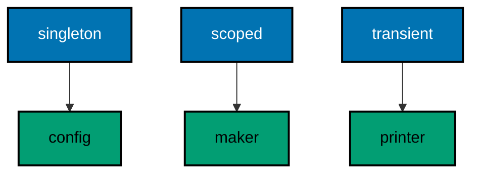

**`learning/code/ex-38-lifetimes-compose-safely/Program.cs`**:

```csharp
// Example 38: Lifetimes Compose Safely.
// The container enforces the layering: singletons may not depend on
// scoped services, because the scope outlives the request. This example
// composes all three lifetimes legally in-process and prints who built
// whom, proving the graph resolved without a captive dependency.
using Microsoft.AspNetCore.Builder; // => WebApplication wires routes to handlers (co-01)
using Microsoft.AspNetCore.TestHost; // => TestServer serves requests in memory (co-09)
using Microsoft.Extensions.DependencyInjection; // => the three lifetime registrations (co-06)
using Microsoft.Extensions.Logging; // => ClearProviders silences logs (co-13)

// => BuildApp wires the service with every route this example serves.
// => Singleton holds config, scoped holds the ticket, transient formats (co-06).
// => Returning the app lets each check serve requests in-process (co-09).
static WebApplication BuildApp(string[] args) // => args carry no flags in this course
{ // => builder block opens
    var builder = WebApplication.CreateBuilder(args); // => defaults plus our overrides
    builder.Logging.ClearProviders(); // => no log lines: only our prints appear
    builder.WebHost.UseTestServer(); // => in-memory server: no socket, no port
    builder.Services.AddSingleton<ShopConfig>(); // => one config for the process (co-06)
    builder.Services.AddScoped<TicketMaker>(); // => one maker per request (co-06)
    builder.Services.AddTransient<TicketPrinter>(); // => fresh printer per injection (co-06)
    var app = builder.Build(); // => the pipeline with routing and endpoints
    app.MapGet(
        "/compose",
        (TicketMaker maker, TicketPrinter printer) => // => scoped plus transient (co-06)
        { // => compose block opens
            var ticket = maker.Make(); // => mint once: made and printed share it
            return Results.Ok(new { made = ticket, printed = printer.Print(ticket) }); // => the composed proof (co-04)
        }
    ); // => compose ends here
    return app; // => hand the wired service back to the caller
} // => builder ends here

// => Top-level entry: build once, check once, stop cleanly.
var app = BuildApp(args); // => wiring separate from traffic, as always
await app.StartAsync(); // => TestServer starts without opening any socket
using var client = app.GetTestClient(); // => client talks to memory, not the network
using var response = await client.GetAsync("/compose"); // => the one composed request
var body = await response.Content.ReadAsStringAsync(); // => the exact bytes written
Console.WriteLine($"GET /compose -> {(int)response.StatusCode} {body}".TrimEnd()); // => Output: GET /compose -> 200 {"made":"shop-T-1","printed":"[shop-T-1]"}
await app.StopAsync(); // => stop cleanly: nothing in flight is cut (co-08)

// => ShopConfig is the long-lived root: name the shop once, share forever.
// => Singletons hold values, never scoped services: the layering rule (co-06).
sealed class ShopConfig // => the singleton root
{ // => config block opens
    public string Shop => "shop"; // => the fixed shop name
} // => config ends here

// => TicketMaker is scoped: one per request, built over the singleton.
// => Depending upward (scoped on singleton) is always legal (co-06).
sealed class TicketMaker(ShopConfig config) // => the singleton arrives by constructor
{ // => maker block opens
    private static int issued; // => the demo sequencer, shared and atomic

    public string Make() => $"{config.Shop}-T-{Interlocked.Increment(ref issued)}"; // => shop plus sequence
} // => maker ends here

// => TicketPrinter is transient: fresh per injection, stateless formatting.
// => Depending on nothing keeps it usable from any lifetime (co-06).
sealed class TicketPrinter // => the transient leaf
{ // => printer block opens
    public string Print(string ticket) => $"[{ticket}]"; // => brackets mark the print
} // => printer ends here
```

**Output** (`learning/code/ex-38-lifetimes-compose-safely/expected/main.stdout.txt`):

```text
GET /compose -> 200 {"made":"shop-T-1","printed":"[shop-T-1]"}
```

**Key takeaway**: Depend downward only: scoped may use singletons, never the reverse — the container enforces the layers.

**Why it matters**: A singleton holding a scoped service traps request state in process memory: the captive dependency bug, silent until two users share one ticket. The layering rule prevents it structurally — longer-lived services may only depend on equally-or-longer-lived ones — and the container validates the graph at startup. Composing all three legally in one program shows the rule is enabling, not restrictive: most real graphs fit it naturally.

---

### Example 39: Options Pattern Carries Settings

Settings belong in one bound object — not scattered GetValue calls — so the shape is validated once at startup. This example binds shop settings from memory, serves one request in-process, and prints the bound values the handler observed. (Concepts: co-06.)

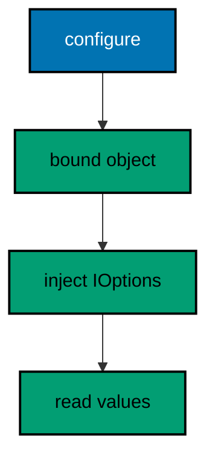

**`learning/code/ex-39-options-pattern-carries-settings/Program.cs`**:

```csharp
// Example 39: Options Pattern Carries Settings.
// Settings belong in one bound object — not scattered GetValue calls — so
// the shape is validated once at startup. This example binds shop settings
// from memory, serves one request in-process, and prints the bound values
// the handler observed.
using Microsoft.AspNetCore.Builder; // => WebApplication wires routes to handlers (co-01)
using Microsoft.AspNetCore.TestHost; // => TestServer serves requests in memory (co-09)
using Microsoft.Extensions.DependencyInjection; // => Configure and Options live here (co-06)
using Microsoft.Extensions.Logging; // => ClearProviders silences logs (co-13)
using Microsoft.Extensions.Options; // => IOptions reads the bound settings (co-06)

// => BuildApp wires the service with every route this example serves.
// => Configure binds the section once; handlers read IOptions (co-06).
// => Returning the app lets each check serve requests in-process (co-09).
static WebApplication BuildApp(string[] args) // => args carry no flags in this course
{ // => builder block opens
    var builder = WebApplication.CreateBuilder(args); // => defaults plus our overrides
    builder.Logging.ClearProviders(); // => no log lines: only our prints appear
    builder.WebHost.UseTestServer(); // => in-memory server: no socket, no port
    builder.Services.Configure<ShopSettings>(s => // => the one place settings are set (co-06)
    { // => settings block opens
        s.Name = "corner-shop"; // => fixed name for the transcript
        s.MaxItems = 50; // => fixed cap for the transcript
    }); // => settings end here
    var app = builder.Build(); // => the pipeline with routing and endpoints
    app.MapGet(
        "/settings",
        (IOptions<ShopSettings> options) => // => bound settings arrive by type (co-06)
            Results.Ok(new { shop = options.Value.Name, max = options.Value.MaxItems })
    ); // => the observed values
    return app; // => hand the wired service back to the caller
} // => builder ends here

// => Top-level entry: build once, check once, stop cleanly.
var app = BuildApp(args); // => wiring separate from traffic, as always
await app.StartAsync(); // => TestServer starts without opening any socket
using var client = app.GetTestClient(); // => client talks to memory, not the network
using var response = await client.GetAsync("/settings"); // => the one settings request
var body = await response.Content.ReadAsStringAsync(); // => the exact bytes written
Console.WriteLine($"GET /settings -> {(int)response.StatusCode} {body}".TrimEnd()); // => Output: GET /settings -> 200 {"shop":"corner-shop","max":50}
await app.StopAsync(); // => stop cleanly: nothing in flight is cut (co-08)

// => ShopSettings is the bound shape: one class per settings area.
// => Properties carry defaults; Configure overrides them in one place (co-06).
sealed class ShopSettings // => the settings object
{ // => settings block opens
    public string Name { get; set; } = "unnamed"; // => default until configured
    public int MaxItems { get; set; } = 10; // => default until configured
} // => settings end here
```

**Output** (`learning/code/ex-39-options-pattern-carries-settings/expected/main.stdout.txt`):

```text
GET /settings -> 200 {"shop":"corner-shop","max":50}
```

**Key takeaway**: Configure binds settings once; handlers read them through IOptions, never through scattered lookups.

**Why it matters**: Scattered configuration lookups hide the service's settings surface: no one can list what the service needs without reading every file. A bound settings object makes the surface explicit and typed — a missing key becomes a startup failure instead of a midnight null. Defaults on the object document the common case, and Configure overrides them in one place the operators can find.

---

### Example 40: Keyed Services Pick an Implementation

Two implementations of one contract — cash and card — register under different keys, and the handler picks by key at request time. This example charges both tills in-process and prints the receipt each key produced. (Concepts: co-06.)

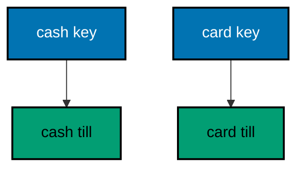

**`learning/code/ex-40-keyed-services-pick-an-implementation/Program.cs`**:

```csharp
// Example 40: Keyed Services Pick an Implementation.
// Two implementations of one contract — cash and card — register under
// different keys, and the handler picks by key at request time. This
// example charges both tills in-process and prints the receipt each key
// produced.
using Microsoft.AspNetCore.Builder; // => WebApplication wires routes to handlers (co-01)
using Microsoft.AspNetCore.TestHost; // => TestServer serves requests in memory (co-09)
using Microsoft.Extensions.DependencyInjection; // => AddKeyedSingleton picks by key (co-06)
using Microsoft.Extensions.Logging; // => ClearProviders silences logs (co-13)

// => BuildApp wires the service with every route this example serves.
// => Each till registers under its own string key (co-06).
// => Returning the app lets each check serve requests in-process (co-09).
static WebApplication BuildApp(string[] args) // => args carry no flags in this course
{ // => builder block opens
    var builder = WebApplication.CreateBuilder(args); // => defaults plus our overrides
    builder.Logging.ClearProviders(); // => no log lines: only our prints appear
    builder.WebHost.UseTestServer(); // => in-memory server: no socket, no port
    builder.Services.AddKeyedSingleton<ITill, CashTill>("cash"); // => the cash implementation (co-06)
    builder.Services.AddKeyedSingleton<ITill, CardTill>("card"); // => the card implementation (co-06)
    var app = builder.Build(); // => the pipeline with routing and endpoints
    app.MapGet(
        "/pay/{method}",
        (
            string method,
            [FromKeyedServices("cash")] ITill cash, // => cash by key
            [FromKeyedServices("card")] ITill card
        ) => // => card by key
        { // => pay block opens
            var till = method == "cash" ? cash : card; // => the request picks the till
            return Results.Ok(new { method, receipt = till.Receipt(5000) }); // => the fixed receipt (co-04)
        }
    ); // => pay ends here
    return app; // => hand the wired service back to the caller
} // => builder ends here

// => CheckAsync serves one request and prints the receipt observed.
// => TestServer keeps the whole exchange inside this process (co-09).
// => Nothing here dials a port: there is no network call at all.
static async Task CheckAsync(HttpClient client, string target) // => the path names the request
{ // => check block opens
    using var response = await client.GetAsync(target); // => full pipeline runs, then answers
    var body = await response.Content.ReadAsStringAsync(); // => the exact bytes written
    Console.WriteLine($"GET {target} -> {(int)response.StatusCode} {body}".TrimEnd()); // => one golden line (co-04)
} // => check ends here

// => Top-level entry: build once, check twice, stop cleanly.
var app = BuildApp(args); // => wiring separate from traffic, as always
await app.StartAsync(); // => TestServer starts without opening any socket
using var client = app.GetTestClient(); // => client talks to memory, not the network
await CheckAsync(client, "/pay/cash"); // => Output: GET /pay/cash -> 200 {"method":"cash","receipt":"CASH-5000"}
await CheckAsync(client, "/pay/card"); // => Output: GET /pay/card -> 200 {"method":"card","receipt":"CARD-5000"}
await app.StopAsync(); // => stop cleanly: nothing in flight is cut (co-08)

// => ITill is the one contract with two keyed implementations.
// => Keys choose the implementation; the handler never news one up (co-06).
interface ITill // => the payment contract
{ // => contract block opens
    string Receipt(int amount); // => one fixed receipt per amount
} // => contract ends here

// => CashTill stamps cash receipts: the "cash" key resolves here.
sealed class CashTill : ITill // => the cash implementation
{ // => cash block opens
    public string Receipt(int amount) => $"CASH-{amount}"; // => the cash stamp
} // => cash ends here

// => CardTill stamps card receipts: the "card" key resolves here.
sealed class CardTill : ITill // => the card implementation
{ // => card block opens
    public string Receipt(int amount) => $"CARD-{amount}"; // => the card stamp
} // => card ends here
```

**Output** (`learning/code/ex-40-keyed-services-pick-an-implementation/expected/main.stdout.txt`):

```text
GET /pay/cash -> 200 {"method":"cash","receipt":"CASH-5000"}
GET /pay/card -> 200 {"method":"card","receipt":"CARD-5000"}
```

**Key takeaway**: Keyed registrations hold several implementations of one contract; the request picks by key.

**Why it matters**: Payment methods, notifiers, and storage backends share contracts but differ per request, and if-else chains over concrete types rot with every addition. Keyed services move the choice into registration: each implementation declares its key, and the handler picks without knowing the concrete classes. Adding a third till means registering one key, not editing the handler — the open-closed principle as container configuration.

---

### Example 41: Try Add Keeps Defaults Overridable

Libraries register defaults with TryAdd: first registration wins, so the application overrides without fighting. This example registers a sender twice in-process and prints which one survived, proving the default lost to the override exactly once. (Concepts: co-06.)

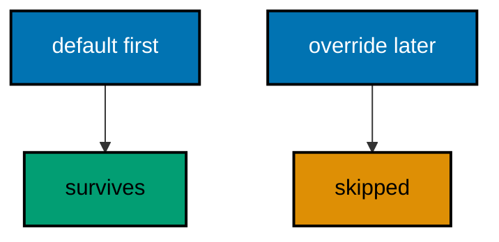

**`learning/code/ex-41-try-add-keeps-defaults-overridable/Program.cs`**:

```csharp
// Example 41: Try Add Keeps Defaults Overridable.
// Libraries register defaults with TryAdd: first registration wins, so the
// application overrides without fighting. This example registers a sender
// twice in-process and prints which one survived, proving the default lost
// to the override exactly once.
using Microsoft.AspNetCore.Builder; // => WebApplication wires routes to handlers (co-01)
using Microsoft.AspNetCore.TestHost; // => TestServer serves requests in memory (co-09)
using Microsoft.Extensions.DependencyInjection; // => TryAdd keeps the first registration (co-06)
using Microsoft.Extensions.DependencyInjection.Extensions; // => TryAdd lives in this namespace (co-06)
using Microsoft.Extensions.Logging; // => ClearProviders silences logs (co-13)

// => BuildApp wires the service with every route this example serves.
// => The library default registers first; the app override must not (co-06).
// => Returning the app lets each check serve requests in-process (co-09).
static WebApplication BuildApp(string[] args) // => args carry no flags in this course
{ // => builder block opens
    var builder = WebApplication.CreateBuilder(args); // => defaults plus our overrides
    builder.Logging.ClearProviders(); // => no log lines: only our prints appear
    builder.WebHost.UseTestServer(); // => in-memory server: no socket, no port
    builder.Services.AddSingleton<ISender, LibrarySender>(); // => the library default, first (co-06)
    builder.Services.TryAddSingleton<ISender, AppSender>(); // => skipped: one already exists (co-06)
    var app = builder.Build(); // => the pipeline with routing and endpoints
    app.MapGet(
        "/send",
        (ISender sender) => // => whichever registration won (co-06)
            Results.Ok(new { sent = sender.Send() })
    ); // => the surviving sender speaks (co-04)
    return app; // => hand the wired service back to the caller
} // => builder ends here

// => Top-level entry: build once, check once, stop cleanly.
var app = BuildApp(args); // => wiring separate from traffic, as always
await app.StartAsync(); // => TestServer starts without opening any socket
using var client = app.GetTestClient(); // => client talks to memory, not the network
using var response = await client.GetAsync("/send"); // => the one sender request
var body = await response.Content.ReadAsStringAsync(); // => the exact bytes written
Console.WriteLine($"GET /send -> {(int)response.StatusCode} {body}".TrimEnd()); // => Output: GET /send -> 200 {"sent":"library"}
await app.StopAsync(); // => stop cleanly: nothing in flight is cut (co-08)

// => ISender is the one contract with a default and an override.
// => First registration wins under TryAdd: the override never lands (co-06).
interface ISender // => the sending contract
{ // => contract block opens
    string Send(); // => one fixed word per sender
} // => contract ends here

// => LibrarySender is the default: registered first, so it serves.
sealed class LibrarySender : ISender // => the library default
{ // => library block opens
    public string Send() => "library"; // => the default word
} // => library ends here

// => AppSender is the override that never lands: TryAdd skips it.
// => Swap the two registrations and this word would win instead.
sealed class AppSender : ISender // => the skipped override
{ // => app block opens
    public string Send() => "app"; // => the word that never prints
} // => app ends here
```

**Output** (`learning/code/ex-41-try-add-keeps-defaults-overridable/expected/main.stdout.txt`):

```text
GET /send -> 200 {"sent":"library"}
```

**Key takeaway**: TryAdd registers only when absent: libraries default, applications override, first registration wins.

**Why it matters**: Library defaults that cannot be overridden force forks; overrides that fight defaults produce duplicate registrations with last-wins surprises. TryAdd splits the difference with a clear rule — first wins — so libraries ship working defaults and applications replace them by registering earlier. The skipped override in the transcript proves the rule is mechanical, not conventional: the container enforces it.

---

### Example 42: Factory Registration Builds Complex Graphs

Some services need logic to build — read two settings, pick a mode — so the registration is a factory lambda, not a bare type. This example builds one report formatter from settings in-process and prints the formatted line the factory produced. (Concepts: co-06.)

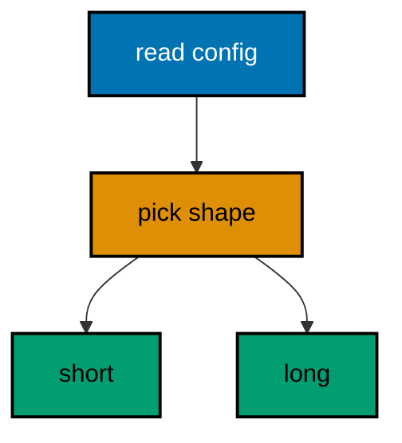

**`learning/code/ex-42-factory-registration-builds-complex-graphs/Program.cs`**:

```csharp
// Example 42: Factory Registration Builds Complex Graphs.
// Some services need logic to build — read two settings, pick a mode — so
// the registration is a factory lambda, not a bare type. This example
// builds one report formatter from settings in-process and prints the
// formatted line the factory produced.
using Microsoft.AspNetCore.Builder; // => WebApplication wires routes to handlers (co-01)
using Microsoft.AspNetCore.TestHost; // => TestServer serves requests in memory (co-09)
using Microsoft.Extensions.DependencyInjection; // => the factory registration lives here (co-06)
using Microsoft.Extensions.Logging; // => ClearProviders silences logs (co-13)

// => BuildApp wires the service with every route this example serves.
// => The factory reads the provider, decides, and builds: logic at (co-06).
// => Returning the app lets each check serve requests in-process (co-09).
static WebApplication BuildApp(string[] args) // => args carry no flags in this course
{ // => builder block opens
    var builder = WebApplication.CreateBuilder(args); // => defaults plus our overrides
    builder.Logging.ClearProviders(); // => no log lines: only our prints appear
    builder.WebHost.UseTestServer(); // => in-memory server: no socket, no port
    builder.Services.AddSingleton(new ReportConfig("weekly", 42)); // => the fixed inputs to the factory
    builder.Services.AddSingleton<IFormatter>(provider => // => build logic runs once here (co-06)
    { // => factory block opens
        var config = provider.GetRequiredService<ReportConfig>(); // => read the inputs first
        return config.Rows > 100 // => big reports earn the long formatter
            ? new LongFormatter(config) // => the wide shape
            : new ShortFormatter(config); // => the narrow shape wins here
    }); // => factory ends here
    var app = builder.Build(); // => the pipeline with routing and endpoints
    app.MapGet(
        "/report",
        (IFormatter formatter) => // => the factory product arrives ready (co-06)
            Results.Ok(new { report = formatter.Format() })
    ); // => the formatted line (co-04)
    return app; // => hand the wired service back to the caller
} // => builder ends here

// => Top-level entry: build once, check once, stop cleanly.
var app = BuildApp(args); // => wiring separate from traffic, as always
await app.StartAsync(); // => TestServer starts without opening any socket
using var client = app.GetTestClient(); // => client talks to memory, not the network
using var response = await client.GetAsync("/report"); // => the one report request
var body = await response.Content.ReadAsStringAsync(); // => the exact bytes written
Console.WriteLine($"GET /report -> {(int)response.StatusCode} {body}".TrimEnd()); // => Output: GET /report -> 200 {"report":"weekly:42"}
await app.StopAsync(); // => stop cleanly: nothing in flight is cut (co-08)

// => ReportConfig carries the factory inputs: name plus row count.
record ReportConfig(string Title, int Rows); // => the fixed inputs (co-06)

// => IFormatter is the one contract with two shapes: short and long.
interface IFormatter // => the formatting contract
{ // => contract block opens
    string Format(); // => one fixed line per formatter
} // => contract ends here

// => ShortFormatter wins for small reports: title, colon, count.
sealed class ShortFormatter(ReportConfig config) : IFormatter // => the narrow shape
{ // => short block opens
    public string Format() => $"{config.Title}:{config.Rows}"; // => the narrow line
} // => short ends here

// => LongFormatter serves big reports: padded for wide terminals.
sealed class LongFormatter(ReportConfig config) : IFormatter // => the wide shape
{ // => long block opens
    public string Format() => $"{config.Title} ({config.Rows} rows)"; // => the wide line
} // => long ends here
```

**Output** (`learning/code/ex-42-factory-registration-builds-complex-graphs/expected/main.stdout.txt`):

```text
GET /report -> 200 {"report":"weekly:42"}
```

**Key takeaway**: Factory registrations run build logic once: read inputs, decide, and return the chosen implementation.

**Why it matters**: Not every service is newable: some need settings read, files checked, or strategies picked before construction. A factory lambda keeps that logic in the composition root instead of smuggling it into constructors or, worse, into handlers. The formatter choice in this example is a pure function of configuration, so the graph rebuilds correctly on every startup without runtime conditionals.

---

### Example 43: From Services Injects into Handlers

A handler signature mixes HTTP and services: the id binds from the route while the repository injects from the container. This example looks two members up by id in-process and prints the row each lookup returned. (Concepts: co-01, co-06.)

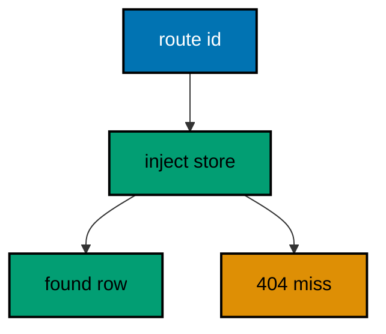

**`learning/code/ex-43-from-services-injects-into-handlers/Program.cs`**:

```csharp
// Example 43: From Services Injects into Handlers.
// A handler signature mixes HTTP and services: the id binds from the
// route while the repository injects from the container. This example
// looks two members up by id in-process and prints the row each lookup
// returned.
using Microsoft.AspNetCore.Builder; // => WebApplication wires routes to handlers (co-01)
using Microsoft.AspNetCore.TestHost; // => TestServer serves requests in memory (co-09)
using Microsoft.Extensions.DependencyInjection; // => AddSingleton registers the repository (co-06)
using Microsoft.Extensions.Logging; // => ClearProviders silences logs (co-13)

// => BuildApp wires the service with every route this example serves.
// => Route values and services share one signature: binding plus (co-06).
// => Returning the app lets each check serve requests in-process (co-09).
static WebApplication BuildApp(string[] args) // => args carry no flags in this course
{ // => builder block opens
    var builder = WebApplication.CreateBuilder(args); // => defaults plus our overrides
    builder.Logging.ClearProviders(); // => no log lines: only our prints appear
    builder.WebHost.UseTestServer(); // => in-memory server: no socket, no port
    builder.Services.AddSingleton<MemberStore>(); // => one store shared by all requests (co-06)
    var app = builder.Build(); // => the pipeline with routing and endpoints
    app.MapGet(
        "/members/{id:int}",
        (int id, MemberStore store) => // => int from route, store injected (co-01, co-06)
            store.Find(id) is { } name // => the lookup: present or not
                ? Results.Ok(new { id, name }) // => present: echo the row (co-04)
                : Results.NotFound(new { error = "member-not-found" })
    ); // => absent: say so (co-05)
    return app; // => hand the wired service back to the caller
} // => builder ends here

// => CheckAsync serves one request and prints the row observed.
// => TestServer keeps the whole exchange inside this process (co-09).
// => Nothing here dials a port: there is no network call at all.
static async Task CheckAsync(HttpClient client, string target) // => the path names the request
{ // => check block opens
    using var response = await client.GetAsync(target); // => full pipeline runs, then answers
    var body = await response.Content.ReadAsStringAsync(); // => the exact bytes written
    Console.WriteLine($"GET {target} -> {(int)response.StatusCode} {body}".TrimEnd()); // => one golden line (co-04)
} // => check ends here

// => Top-level entry: build once, check twice, stop cleanly.
var app = BuildApp(args); // => wiring separate from traffic, as always
await app.StartAsync(); // => TestServer starts without opening any socket
using var client = app.GetTestClient(); // => client talks to memory, not the network
await CheckAsync(client, "/members/1"); // => Output: GET /members/1 -> 200 {"id":1,"name":"ada"}
await CheckAsync(client, "/members/9"); // => Output: GET /members/9 -> 404 {"error":"member-not-found"}
await app.StopAsync(); // => stop cleanly: nothing in flight is cut (co-08)

// => MemberStore is the injected repository: fixed rows, lookup by id.
// => Two rows give the present case and the absent case each a check.
sealed class MemberStore // => the singleton repository
{ // => store block opens
    private readonly Dictionary<int, string> rows = new() // => the fixed data, seeded once
    { // => rows block opens
        [1] = "ada", // => the row the first check reads
        [2] = "grace", // => the row no check reads, proving scope
    }; // => rows end here

    public string? Find(int id) => rows.TryGetValue(id, out var name) ? name : null; // => null means absent
} // => store ends here
```

**Output** (`learning/code/ex-43-from-services-injects-into-handlers/expected/main.stdout.txt`):

```text
GET /members/1 -> 200 {"id":1,"name":"ada"}
GET /members/9 -> 404 {"error":"member-not-found"}
```

**Key takeaway**: One signature binds both: route values from the path, services from the container, side by side.

**Why it matters**: Handlers need data access, and threading repositories through static state or manual construction defeats the container. Mixed signatures keep each source honest: the path supplies identity, the container supplies capability, and the handler only combines them. Readers see the full dependency list in the signature — no hidden globals, no service-locator calls — which makes every handler's needs auditable at a glance.

---

### Example 44: Validation Service Keeps Handlers Thin

Rules live in an injected validator, so the handler reads like the contract: validate, then create. This example posts three members through one OrderValidator in-process and prints the 201 plus the two 400s the service rejected. (Concepts: co-06, co-10.)

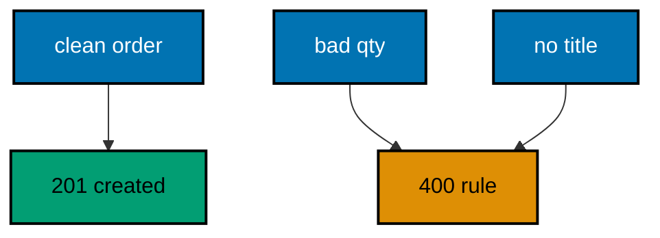

**`learning/code/ex-44-validation-service-keeps-handlers-thin/Program.cs`**:

```csharp
// Example 44: Validation Service Keeps Handlers Thin.
// Rules live in an injected validator, so the handler reads like the
// contract: validate, then create. This example posts three members
// through one OrderValidator in-process and prints the 201 plus the two
// 400s the service rejected.
using System.Text; // => StringContent carries the JSON body (co-03)
using System.Text.Json; // => JsonSerializer writes the request body (co-15)
using Microsoft.AspNetCore.Builder; // => WebApplication wires routes to handlers (co-01)
using Microsoft.AspNetCore.TestHost; // => TestServer serves requests in memory (co-09)
using Microsoft.Extensions.DependencyInjection; // => AddSingleton registers the validator (co-06)
using Microsoft.Extensions.Logging; // => ClearProviders silences logs (co-13)

// => BuildApp wires the service with every route this example serves.
// => The validator injects; the handler only maps its verdict (co-06, co-10).
// => Returning the app lets each check serve requests in-process (co-09).
static WebApplication BuildApp(string[] args) // => args carry no flags in this course
{ // => builder block opens
    var builder = WebApplication.CreateBuilder(args); // => defaults plus our overrides
    builder.Logging.ClearProviders(); // => no log lines: only our prints appear
    builder.WebHost.UseTestServer(); // => in-memory server: no socket, no port
    builder.Services.AddSingleton<OrderValidator>(); // => one rulebook for every request (co-06)
    var app = builder.Build(); // => the pipeline with routing and endpoints
    app.MapPost(
        "/orders",
        (Order order, OrderValidator validator) => // => body plus rulebook (co-03, co-06)
        { // => handler block opens
            var verdict = validator.Check(order); // => the service decides, not the handler (co-10)
            if (verdict is not null) // => a verdict means rejection
                return Results.BadRequest(new { error = verdict }); // => 400 names the rule (co-05)
            return Results.Created($"/orders/{order.id}", order); // => clean orders earn a 201 (co-04)
        }
    ); // => handler ends here
    return app; // => hand the wired service back to the caller
} // => builder ends here

// => PostAsync sends one JSON body and prints what the service decided.
// => TestServer keeps the whole exchange inside this process (co-09).
// => The fixed bodies keep every rerun byte-identical.
static async Task PostAsync(HttpClient client, Order order) // => the record to serialize and send
{ // => post block opens
    var json = JsonSerializer.Serialize(order); // => record becomes a JSON string
    using var body = new StringContent(json, Encoding.UTF8, "application/json"); // => body names its type (co-03)
    using var response = await client.PostAsync("/orders", body); // => full pipeline runs, then answers
    var text = await response.Content.ReadAsStringAsync(); // => the exact bytes written
    Console.WriteLine($"POST /orders -> {(int)response.StatusCode} {text}".TrimEnd()); // => one golden line (co-04)
} // => post ends here

// => Top-level entry: build once, check three times, stop cleanly.
var app = BuildApp(args); // => wiring separate from traffic, as always
await app.StartAsync(); // => TestServer starts without opening any socket
using var client = app.GetTestClient(); // => client talks to memory, not the network
await PostAsync(client, new Order(1, "dune", 2)); // => Output: POST /orders -> 201 {"id":1,"title":"dune","qty":2}
await PostAsync(client, new Order(2, "hyperion", 0)); // => Output: POST /orders -> 400 {"error":"qty-must-be-positive"}
await PostAsync(client, new Order(3, "", 1)); // => Output: POST /orders -> 400 {"error":"title-is-required"}
await app.StopAsync(); // => stop cleanly: nothing in flight is cut (co-08)

// => OrderValidator is the injected rulebook: two rules, one verdict each.
// => Handlers stay thin because rules live here, tested once (co-06, co-10).
sealed class OrderValidator // => the validation service
{ // => validator block opens
    public string? Check(Order order) // => null means clean: create it
    { // => check block opens
        if (order.qty <= 0) // => quantities must move at least one unit
            return "qty-must-be-positive"; // => the quantity verdict
        if (string.IsNullOrWhiteSpace(order.title)) // => titles must name something
            return "title-is-required"; // => the title verdict
        return null; // => clean: the handler creates
    } // => check ends here
} // => validator ends here

// => Order is the typed boundary of this example: JSON in, record out.
record Order(int id, string title, int qty); // => the order shape, lowercase exact bytes (co-15)
```

**Output** (`learning/code/ex-44-validation-service-keeps-handlers-thin/expected/main.stdout.txt`):

```text
POST /orders -> 201 {"id":1,"title":"dune","qty":2}
POST /orders -> 400 {"error":"qty-must-be-positive"}
POST /orders -> 400 {"error":"title-is-required"}
```

**Key takeaway**: Injected validators own the rules; handlers map verdicts to responses and stay thin.

**Why it matters**: Validation logic inside handlers duplicates across every route that accepts the type, and the copies drift until two routes disagree. An injected rulebook centralizes the verdicts where unit tests can reach them without HTTP, while handlers stay thin mappings from verdict to status. The same validator serves minimal APIs, controllers, and background jobs alike — one rulebook, every entry point.

---

### Example 45: Test Server Serves in Memory

TestServer runs the whole pipeline — routing, middleware, handlers — without a socket, so tests stay fast and hermetic. This example builds the smallest service with one route, serves two requests in-process, and prints the 200 plus the 404 the table did not contain. (Concepts: co-09.)

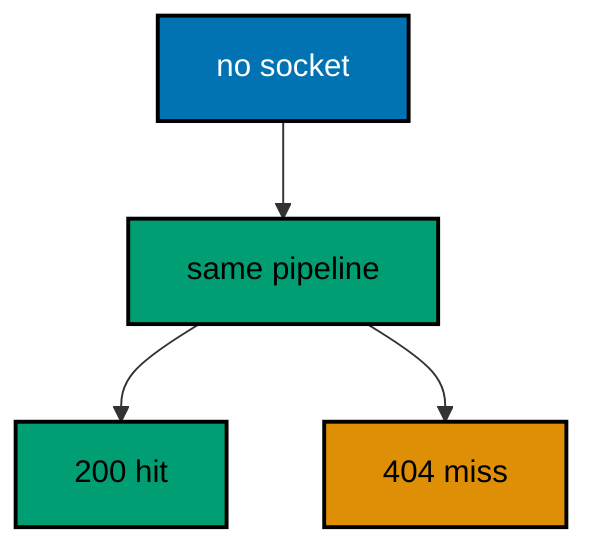

**`learning/code/ex-45-test-server-serves-in-memory/Program.cs`**:

```csharp
// Example 45: Test Server Serves in Memory.
// TestServer runs the whole pipeline — routing, middleware, handlers —
// without a socket, so tests stay fast and hermetic. This example builds
// the smallest service with one route, serves two requests in-process, and
// prints the 200 plus the 404 the table did not contain.
using Microsoft.AspNetCore.Builder; // => WebApplication wires routes to handlers (co-01)
using Microsoft.AspNetCore.TestHost; // => TestServer serves requests in memory (co-09)
using Microsoft.Extensions.Logging; // => ClearProviders silences logs (co-13)

// => BuildApp wires the service with every route this example serves.
// => UseTestServer swaps the transport: same pipeline, no socket (co-09).
// => Returning the app lets each check serve requests in-process (co-09).
static WebApplication BuildApp(string[] args) // => args carry no flags in this course
{ // => builder block opens
    var builder = WebApplication.CreateBuilder(args); // => defaults plus our overrides
    builder.Logging.ClearProviders(); // => no log lines: only our prints appear
    builder.WebHost.UseTestServer(); // => in-memory server: no socket, no port
    var app = builder.Build(); // => the pipeline with routing and endpoints
    app.MapGet("/status", () => Results.Ok(new { serve = "memory" })); // => the route under test (co-01)
    return app; // => hand the wired service back to the caller
} // => builder ends here

// => CheckAsync serves one request and prints the code with the body.
// => GetTestClient builds a client bound to the in-memory server (co-09).
// => Nothing here dials a port: there is no network call at all.
static async Task CheckAsync(HttpClient client, string target) // => the path names the request
{ // => check block opens
    using var response = await client.GetAsync(target); // => full pipeline runs, then answers
    var body = await response.Content.ReadAsStringAsync(); // => the exact bytes written
    Console.WriteLine($"GET {target} -> {(int)response.StatusCode} {body}".TrimEnd()); // => one golden line (co-04)
} // => check ends here

// => Top-level entry: build once, check twice, stop cleanly.
var app = BuildApp(args); // => wiring separate from traffic, as always
await app.StartAsync(); // => TestServer starts without opening any socket
using var client = app.GetTestClient(); // => client talks to memory, not the network
await CheckAsync(client, "/status"); // => Output: GET /status -> 200 {"serve":"memory"}
await CheckAsync(client, "/elsewhere"); // => Output: GET /elsewhere -> 404
await app.StopAsync(); // => stop cleanly: nothing in flight is cut (co-08)
```

**Output** (`learning/code/ex-45-test-server-serves-in-memory/expected/main.stdout.txt`):

```text
GET /status -> 200 {"serve":"memory"}
GET /elsewhere -> 404
```

**Key takeaway**: TestServer runs the real pipeline in memory: same routing, same handlers, no socket, no port.

**Why it matters**: Tests that start real servers pay for ports, timing, and cleanup on every run, and the flakes compound until developers stop running them. In-memory serving removes the entire category: no port conflicts, no firewall prompts, no TIME_WAIT — just the pipeline answering function calls. The 404 in the same program proves routing runs too, so the test exercises the service, not a mock of it.

---

### Example 46: One Client Drives Many Requests

A single test client walks the whole user journey — create, read, list — so one program proves the routes agree with each other. This example drives three requests with one client in-process and prints the journey the three answers tell. (Concepts: co-09.)

```mermaid
flowchart TD
    accTitle: One Client Drives Many Requests
    accDescr: One client walks create, read, and list: the journey proves the routes share the same state.
    A["list"]:::blue --> B["one row"]:::teal
    B --> C["create"]:::blue
    C --> D["count two"]:::teal

    classDef blue fill:#0173B2,stroke:#000000,color:#FFFFFF,stroke-width:2px
    classDef orange fill:#DE8F05,stroke:#000000,color:#000000,stroke-width:2px
    classDef teal fill:#029E73,stroke:#000000,color:#000000,stroke-width:2px
    classDef default fill:#FFFFFF,stroke:#000000,color:#000000
```

**`learning/code/ex-46-one-client-drives-many-requests/Program.cs`**:

```csharp
// Example 46: One Client Drives Many Requests.
// A single test client walks the whole user journey — create, read, list —
// so one program proves the routes agree with each other. This example
// drives three requests with one client in-process and prints the journey
// the three answers tell.
using System.Text; // => StringContent carries the JSON body (co-03)
using System.Text.Json; // => JsonSerializer writes the request body (co-15)
using Microsoft.AspNetCore.Builder; // => WebApplication wires routes to handlers (co-01)
using Microsoft.AspNetCore.TestHost; // => TestServer serves requests in memory (co-09)
using Microsoft.Extensions.Logging; // => ClearProviders silences logs (co-13)

// => BuildApp wires the service with every route this example serves.
// => The store is shared: the journey only works if writes persist (co-09).
// => Returning the app lets each check serve requests in-process (co-09).
static WebApplication BuildApp(string[] args) // => args carry no flags in this course
{ // => builder block opens
    var builder = WebApplication.CreateBuilder(args); // => defaults plus our overrides
    builder.Logging.ClearProviders(); // => no log lines: only our prints appear
    builder.WebHost.UseTestServer(); // => in-memory server: no socket, no port
    var app = builder.Build(); // => the pipeline with routing and endpoints
    var shelf = new List<string> { "dune" }; // => one seeded title to list
    app.MapGet("/shelf", () => Results.Ok(new { books = shelf.ToArray() })); // => the list leg (co-01)
    app.MapPost(
        "/shelf",
        (Book book) => // => the create leg (co-03)
        { // => create block opens
            shelf.Add(book.title); // => the write later legs observe
            return Results.Created("/shelf", book); // => 201: the journey continues (co-04)
        }
    ); // => create ends here
    app.MapGet("/shelf/count", () => Results.Ok(new { count = shelf.Count })); // => the count leg (co-01)
    return app; // => hand the wired service back to the caller
} // => builder ends here

// => Top-level entry: one client walks create, count, and list in order.
var app = BuildApp(args); // => wiring separate from traffic, as always
await app.StartAsync(); // => TestServer starts without opening any socket
using var client = app.GetTestClient(); // => one client for the whole journey
using var firstList = await client.GetAsync("/shelf"); // => leg one: the seeded list
Console.WriteLine(
    $"GET /shelf -> {(int)firstList.StatusCode} {await firstList.Content.ReadAsStringAsync()}".TrimEnd()
); // => Output: GET /shelf -> 200 {"books":["dune"]}
var json = JsonSerializer.Serialize(new Book("hyperion")); // => the book to add
using var body = new StringContent(json, Encoding.UTF8, "application/json"); // => the labeled body (co-03)
using var created = await client.PostAsync("/shelf", body); // => leg two: add one title
Console.WriteLine(
    $"POST /shelf -> {(int)created.StatusCode} {await created.Content.ReadAsStringAsync()}".TrimEnd()
); // => Output: POST /shelf -> 201 {"title":"hyperion"}
using var counted = await client.GetAsync("/shelf/count"); // => leg three: prove it stuck
Console.WriteLine(
    $"GET /shelf/count -> {(int)counted.StatusCode} {await counted.Content.ReadAsStringAsync()}".TrimEnd()
); // => Output: GET /shelf/count -> 200 {"count":2}
await app.StopAsync(); // => stop cleanly: nothing in flight is cut (co-08)

// => Book is the create shape: one title, lowercase exact bytes.
record Book(string title); // => the JSON body shape (co-15)
```

**Output** (`learning/code/ex-46-one-client-drives-many-requests/expected/main.stdout.txt`):

```text
GET /shelf -> 200 {"books":["dune"]}
POST /shelf -> 201 {"title":"hyperion"}
GET /shelf/count -> 200 {"count":2}
```

**Key takeaway**: One client walks create, read, and list: the journey proves the routes share the same state.

**Why it matters**: Per-route tests pass while the service fails, because no single route is wrong — the routes disagree about shared state. Journey tests catch the disagreement by writing through one route and reading through another, which is exactly what users do. One client for the whole journey also proves session behavior for free: cookies, headers, and base addresses carry across legs the way browsers carry them.

---

### Example 47: Assert Status and Body Together

A good test pins both the code and the bytes: the status proves the decision, the body proves the content. This example checks one route two ways in-process and prints the assertion each check performed. (Concepts: co-04, co-09.)

```mermaid
flowchart TD
    accTitle: Assert Status and Body Together
    accDescr: Pin status and body together: PASS needs both, and the expectation documents the contract.
    A["expect 200"]:::blue --> B["PASS row"]:::teal
    C["expect 404"]:::blue --> D["PASS miss"]:::teal

    classDef blue fill:#0173B2,stroke:#000000,color:#FFFFFF,stroke-width:2px
    classDef orange fill:#DE8F05,stroke:#000000,color:#000000,stroke-width:2px
    classDef teal fill:#029E73,stroke:#000000,color:#000000,stroke-width:2px
    classDef default fill:#FFFFFF,stroke:#000000,color:#000000
```

**`learning/code/ex-47-assert-status-and-body-together/Program.cs`**:

```csharp
// Example 47: Assert Status and Body Together.
// A good test pins both the code and the bytes: the status proves the
// decision, the body proves the content. This example checks one route
// three ways in-process and prints the assertion each check performed.
using Microsoft.AspNetCore.Builder; // => WebApplication wires routes to handlers (co-01)
using Microsoft.AspNetCore.TestHost; // => TestServer serves requests in memory (co-09)
using Microsoft.Extensions.Logging; // => ClearProviders silences logs (co-13)

// => BuildApp wires the service with every route this example serves.
// => Two routes give the status check and the body check each a target (co-09).
// => Returning the app lets each check serve requests in-process (co-09).
static WebApplication BuildApp(string[] args) // => args carry no flags in this course
{ // => builder block opens
    var builder = WebApplication.CreateBuilder(args); // => defaults plus our overrides
    builder.Logging.ClearProviders(); // => no log lines: only our prints appear
    builder.WebHost.UseTestServer(); // => in-memory server: no socket, no port
    var app = builder.Build(); // => the pipeline with routing and endpoints
    app.MapGet("/book/1", () => Results.Ok(new { id = 1, title = "dune" })); // => the asserted row (co-01)
    app.MapGet("/book/9", () => Results.NotFound(new { error = "book-not-found" })); // => the asserted miss (co-05)
    return app; // => hand the wired service back to the caller
} // => builder ends here

// => AssertAsync serves one request and prints the pinned outcome.
// => PASS means status and body both matched the fixed expectation (co-09).
// => The expectation is written out: the test documents itself.
static async Task AssertAsync(HttpClient client, string target, int want, string wantBody) // => path plus expectation
{ // => assert block opens
    using var response = await client.GetAsync(target); // => full pipeline runs, then answers
    var body = await response.Content.ReadAsStringAsync(); // => the exact bytes written
    var verdict = (int)response.StatusCode == want && body == wantBody ? "PASS" : "FAIL"; // => both must match
    Console.WriteLine($"{verdict} GET {target} -> {(int)response.StatusCode} {body}".TrimEnd()); // => the pinned line
} // => assert ends here

// => Top-level entry: build once, assert twice, stop cleanly.
var app = BuildApp(args); // => wiring separate from traffic, as always
await app.StartAsync(); // => TestServer starts without opening any socket
using var client = app.GetTestClient(); // => client talks to memory, not the network
await AssertAsync(client, "/book/1", 200, "{\"id\":1,\"title\":\"dune\"}"); // => Output: PASS GET /book/1 -> 200 {"id":1,"title":"dune"}
await AssertAsync(client, "/book/9", 404, "{\"error\":\"book-not-found\"}"); // => Output: PASS GET /book/9 -> 404 {"error":"book-not-found"}
await app.StopAsync(); // => stop cleanly: nothing in flight is cut (co-08)
```

**Output** (`learning/code/ex-47-assert-status-and-body-together/expected/main.stdout.txt`):

```text
PASS GET /book/1 -> 200 {"id":1,"title":"dune"}
PASS GET /book/9 -> 404 {"error":"book-not-found"}
```

**Key takeaway**: Pin status and body together: PASS needs both, and the expectation documents the contract.

**Why it matters**: Status-only assertions miss body regressions, and body-only assertions miss decision regressions — a 200 with the wrong shape passes one, a right shape with 404 passes the other. Asserting both turns the test into the contract: any drift in decision or content fails loudly at the exact line. Writing the expectation as a literal string keeps the test readable as documentation, not just as code.

---

### Example 48: Post Then Get Proves State

The strongest test writes through one route and reads through another: only shared state passes. This example posts a note, reads it back, and lists the store in-process, printing the three legs that prove the write survived the round trip. (Concepts: co-09.)

```mermaid
flowchart TD
    accTitle: Post Then Get Proves State
    accDescr: Write through one route, read through another: only genuinely shared state passes the round trip.
    A["POST note"]:::blue --> B["201 stored"]:::teal
    B --> C["GET back"]:::blue
    C --> D["same bytes"]:::teal

    classDef blue fill:#0173B2,stroke:#000000,color:#FFFFFF,stroke-width:2px
    classDef orange fill:#DE8F05,stroke:#000000,color:#000000,stroke-width:2px
    classDef teal fill:#029E73,stroke:#000000,color:#000000,stroke-width:2px
    classDef default fill:#FFFFFF,stroke:#000000,color:#000000
```

**`learning/code/ex-48-post-then-get-proves-state/Program.cs`**:

```csharp
// Example 48: Post Then Get Proves State.
// The strongest test writes through one route and reads through another:
// only shared state passes. This example posts a note, reads it back, and
// lists the store in-process, printing the three legs that prove the write
// survived the round trip.
using System.Text; // => StringContent carries the JSON body (co-03)
using System.Text.Json; // => JsonSerializer writes the request body (co-15)
using Microsoft.AspNetCore.Builder; // => WebApplication wires routes to handlers (co-01)
using Microsoft.AspNetCore.TestHost; // => TestServer serves requests in memory (co-09)
using Microsoft.Extensions.Logging; // => ClearProviders silences logs (co-13)

// => BuildApp wires the service with every route this example serves.
// => The store outlives each request: POST writes, GETs prove (co-09).
// => Returning the app lets each check serve requests in-process (co-09).
static WebApplication BuildApp(string[] args) // => args carry no flags in this course
{ // => builder block opens
    var builder = WebApplication.CreateBuilder(args); // => defaults plus our overrides
    builder.Logging.ClearProviders(); // => no log lines: only our prints appear
    builder.WebHost.UseTestServer(); // => in-memory server: no socket, no port
    var app = builder.Build(); // => the pipeline with routing and endpoints
    var notes = new Dictionary<int, string>(); // => the shared state under test
    app.MapPost(
        "/notes",
        (Note note) => // => the write leg (co-03)
        { // => write block opens
            notes[note.id] = note.text; // => store the text by id
            return Results.Created($"/notes/{note.id}", note); // => 201 plus Location (co-04)
        }
    ); // => write ends here
    app.MapGet(
        "/notes/{id:int}",
        (int id) => // => the read leg (co-03)
            notes.TryGetValue(id, out var text) // => look the note up
                ? Results.Ok(new { id, text }) // => present: prove it survived
                : Results.NotFound(new { error = "note-not-found" })
    ); // => absent: say so (co-05)
    return app; // => hand the wired service back to the caller
} // => builder ends here

// => Top-level entry: post once, read twice, stop cleanly.
var app = BuildApp(args); // => wiring separate from traffic, as always
await app.StartAsync(); // => TestServer starts without opening any socket
using var client = app.GetTestClient(); // => one client for the whole proof
var json = JsonSerializer.Serialize(new Note(1, "ship it")); // => the note to store
using var body = new StringContent(json, Encoding.UTF8, "application/json"); // => the labeled body (co-03)
using var created = await client.PostAsync("/notes", body); // => leg one: write it
Console.WriteLine(
    $"POST /notes -> {(int)created.StatusCode} {await created.Content.ReadAsStringAsync()}".TrimEnd()
); // => Output: POST /notes -> 201 {"id":1,"text":"ship it"}
using var read = await client.GetAsync("/notes/1"); // => leg two: read it back
Console.WriteLine(
    $"GET /notes/1 -> {(int)read.StatusCode} {await read.Content.ReadAsStringAsync()}".TrimEnd()
); // => Output: GET /notes/1 -> 200 {"id":1,"text":"ship it"}
using var missed = await client.GetAsync("/notes/2"); // => leg three: prove absence too
Console.WriteLine(
    $"GET /notes/2 -> {(int)missed.StatusCode} {await missed.Content.ReadAsStringAsync()}".TrimEnd()
); // => Output: GET /notes/2 -> 404 {"error":"note-not-found"}
await app.StopAsync(); // => stop cleanly: nothing in flight is cut (co-08)

// => Note is the stored shape: id plus text, lowercase exact bytes.
record Note(int id, string text); // => the JSON body shape (co-15)
```

**Output** (`learning/code/ex-48-post-then-get-proves-state/expected/main.stdout.txt`):

```text
POST /notes -> 201 {"id":1,"text":"ship it"}
GET /notes/1 -> 200 {"id":1,"text":"ship it"}
GET /notes/2 -> 404 {"error":"note-not-found"}
```

**Key takeaway**: Write through one route, read through another: only genuinely shared state passes the round trip.

**Why it matters**: Mocks and stubs can fake either leg, but the round trip cannot be faked — the bytes read back must be the bytes written. This pattern catches the bugs that matter in storage-backed services: writes that vanish, reads that cache stale rows, IDs that shift between legs. The absence leg completes the proof by showing the store distinguishes present from missing, not just echoes the last write.

---

### Example 49: Error Paths Get Tests Too

Happy paths are half the contract: validation failures, missing rows, and wrong methods need pinned tests as well. This example drives one bad body, one missing row, and one wrong method in-process and prints the three failures the suite locks in. (Concepts: co-05, co-09.)

```mermaid
flowchart TD
    accTitle: Error Paths Get Tests Too
    accDescr: Pin the failures too: bad bodies, missing rows, and wrong verbs each earn a locked-in test.
    A["bad body"]:::blue --> B["400 rule"]:::orange
    C["missing row"]:::blue --> D["404 miss"]:::orange
    E["wrong verb"]:::blue --> F["405"]:::orange

    classDef blue fill:#0173B2,stroke:#000000,color:#FFFFFF,stroke-width:2px
    classDef orange fill:#DE8F05,stroke:#000000,color:#000000,stroke-width:2px
    classDef teal fill:#029E73,stroke:#000000,color:#000000,stroke-width:2px
    classDef default fill:#FFFFFF,stroke:#000000,color:#000000
```

**`learning/code/ex-49-error-paths-get-tests-too/Program.cs`**:

```csharp
// Example 49: Error Paths Get Tests Too.
// Happy paths are half the contract: validation failures, missing rows,
// and wrong methods need pinned tests as well. This example drives one
// bad body, one missing row, and one wrong method in-process and prints
// the three failures the suite locks in.
using System.Text; // => StringContent carries the JSON body (co-03)
using System.Text.Json; // => JsonSerializer writes the request body (co-15)
using Microsoft.AspNetCore.Builder; // => WebApplication wires routes to handlers (co-01)
using Microsoft.AspNetCore.TestHost; // => TestServer serves requests in memory (co-09)
using Microsoft.Extensions.Logging; // => ClearProviders silences logs (co-13)

// => BuildApp wires the service with every route this example serves.
// => Every route can fail: empty title, unknown id, wrong verb (co-05, co-09).
// => Returning the app lets each check serve requests in-process (co-09).
static WebApplication BuildApp(string[] args) // => args carry no flags in this course
{ // => builder block opens
    var builder = WebApplication.CreateBuilder(args); // => defaults plus our overrides
    builder.Logging.ClearProviders(); // => no log lines: only our prints appear
    builder.WebHost.UseTestServer(); // => in-memory server: no socket, no port
    var app = builder.Build(); // => the pipeline with routing and endpoints
    var store = new Dictionary<int, string> { [1] = "dune" }; // => one seeded row to miss against
    app.MapPost(
        "/books",
        (Book book) => // => the validated create (co-03, co-10)
            string.IsNullOrWhiteSpace(book.title) // => the failure rule
                ? Results.BadRequest(new { error = "title-is-required" }) // => 400: bad body (co-05)
                : Results.Created("/books/2", book)
    ); // => 201: never reached here
    app.MapGet(
        "/books/{id:int}",
        (int id) => // => the lookup (co-03, co-15)
            store.TryGetValue(id, out var title) // => present or not
                ? Results.Ok(new { id, title }) // => present: echo it (co-04)
                : Results.NotFound(new { error = "book-not-found" })
    ); // => 404: missing row (co-05)
    return app; // => hand the wired service back to the caller
} // => builder ends here

// => CheckAsync serves one request with an optional body and prints it.
// => TestServer keeps the whole exchange inside this process (co-09).
// => The fixed inputs keep every rerun byte-identical.
static async Task CheckAsync(HttpClient client, string method, string target, string? json = null) // => body optional
{ // => check block opens
    using var request = new HttpRequestMessage(new HttpMethod(method), target); // => method plus path first
    if (json is not null) // => only the bad-body check carries one
        request.Content = new StringContent(json, Encoding.UTF8, "application/json"); // => the labeled body (co-03)
    using var response = await client.SendAsync(request); // => full pipeline runs, then answers
    var text = await response.Content.ReadAsStringAsync(); // => the exact bytes written
    Console.WriteLine($"{method} {target} -> {(int)response.StatusCode} {text}".TrimEnd()); // => one golden line
} // => check ends here

// => Top-level entry: build once, fail three ways, stop cleanly.
var app = BuildApp(args); // => wiring separate from traffic, as always
await app.StartAsync(); // => TestServer starts without opening any socket
using var client = app.GetTestClient(); // => one client for the whole suite
await CheckAsync(client, "POST", "/books", JsonSerializer.Serialize(new Book(""))); // => Output: POST /books -> 400 {"error":"title-is-required"}
await CheckAsync(client, "GET", "/books/99"); // => Output: GET /books/99 -> 404 {"error":"book-not-found"}
await CheckAsync(client, "DELETE", "/books/1"); // => Output: DELETE /books/1 -> 405
await app.StopAsync(); // => stop cleanly: nothing in flight is cut (co-08)

// => Book is the posted shape: one title, lowercase exact bytes.
record Book(string title); // => the JSON body shape (co-15)
```

**Output** (`learning/code/ex-49-error-paths-get-tests-too/expected/main.stdout.txt`):

```text
POST /books -> 400 {"error":"title-is-required"}
GET /books/99 -> 404 {"error":"book-not-found"}
DELETE /books/1 -> 405
```

**Key takeaway**: Pin the failures too: bad bodies, missing rows, and wrong verbs each earn a locked-in test.

**Why it matters**: Untested error paths are where production surprises live: a validation message changes, a 404 loses its envelope, a method starts answering 500 instead of 405, and no test notices until clients complain. Locking the three failure shapes turns the error contract into a compile-time-like guarantee — any drift fails the suite before it reaches users. The wrong-verb check is the cheapest of the three and catches routing regressions that happy-path tests never touch.

---

### Example 50: Middleware Under Test Alone

Middleware deserves its own test: one component, one request, one header asserted. This example wraps a bare route with the stamp middleware only, serves two requests in-process, and prints the stamp the component added plus the body it left untouched. (Concepts: co-02, co-09.)

```mermaid
flowchart TD
    accTitle: Middleware Under Test Alone
    accDescr: Test middleware alone against a bare route: assert the stamp it adds and the body it preserves.
    A["bare route"]:::blue --> B["stamp added"]:::orange
    B --> C["body same"]:::teal

    classDef blue fill:#0173B2,stroke:#000000,color:#FFFFFF,stroke-width:2px
    classDef orange fill:#DE8F05,stroke:#000000,color:#000000,stroke-width:2px
    classDef teal fill:#029E73,stroke:#000000,color:#000000,stroke-width:2px
    classDef default fill:#FFFFFF,stroke:#000000,color:#000000
```

**`learning/code/ex-50-middleware-under-test-alone/Program.cs`**:

```csharp
// Example 50: Middleware Under Test Alone.
// Middleware deserves its own test: one component, one request, one
// header asserted. This example wraps a bare route with the stamp
// middleware only, serves two requests in-process, and prints the stamp
// the component added plus the body it left untouched.
using Microsoft.AspNetCore.Builder; // => WebApplication wires routes to handlers (co-01)
using Microsoft.AspNetCore.TestHost; // => TestServer serves requests in memory (co-09)
using Microsoft.Extensions.Logging; // => ClearProviders silences logs (co-13)

// => BuildApp wires one middleware plus one bare route: nothing else.
// => Testing the component alone keeps failures local to it (co-02, co-09).
// => Returning the app lets each check serve requests in-process (co-09).
static WebApplication BuildApp(string[] args) // => args carry no flags in this course
{ // => builder block opens
    var builder = WebApplication.CreateBuilder(args); // => defaults plus our overrides
    builder.Logging.ClearProviders(); // => no log lines: only our prints appear
    builder.WebHost.UseTestServer(); // => in-memory server: no socket, no port
    var app = builder.Build(); // => the pipeline with routing and endpoints
    app.Use(
        async (context, next) => // => the component under test (co-02)
        { // => middleware block opens
            context.Response.OnStarting(() => // => stamps go on before the flush
            { // => stamp block opens
                context.Response.Headers.Append("X-Stamp", "middleware-was-here"); // => the fixed stamp
                return Task.CompletedTask; // => the stamp itself is synchronous
            }); // => stamp ends here
            await next(context); // => the bare handler runs inside
        }
    ); // => middleware ends here
    app.MapGet("/bare", () => Results.Ok(new { bare = true })); // => the untouched body (co-01)
    return app; // => hand the wired service back to the caller
} // => builder ends here

// => CheckAsync serves one request and prints the stamp with the body.
// => TestServer keeps the whole exchange inside this process (co-09).
// => The stamp proves the component ran; the body proves it did no harm.
static async Task CheckAsync(HttpClient client, string target) // => the path names the request
{ // => check block opens
    using var response = await client.GetAsync(target); // => full pipeline runs, then answers
    var body = await response.Content.ReadAsStringAsync(); // => the exact bytes written
    var stamp = response.Headers.GetValues("X-Stamp").First(); // => the component's stamp
    Console.WriteLine($"GET {target} -> {(int)response.StatusCode} stamp={stamp} {body}".TrimEnd()); // => golden line
} // => check ends here

// => Top-level entry: build once, check twice, stop cleanly.
var app = BuildApp(args); // => wiring separate from traffic, as always
await app.StartAsync(); // => TestServer starts without opening any socket
using var client = app.GetTestClient(); // => client talks to memory, not the network
await CheckAsync(client, "/bare"); // => Output: GET /bare -> 200 stamp=middleware-was-here {"bare":true}
await CheckAsync(client, "/missing"); // => Output: GET /missing -> 404 stamp=middleware-was-here
await app.StopAsync(); // => stop cleanly: nothing in flight is cut (co-08)
```

**Output** (`learning/code/ex-50-middleware-under-test-alone/expected/main.stdout.txt`):

```text
GET /bare -> 200 stamp=middleware-was-here {"bare":true}
GET /missing -> 404 stamp=middleware-was-here
```

**Key takeaway**: Test middleware alone against a bare route: assert the stamp it adds and the body it preserves.

**Why it matters**: Middleware tested only through full services produces failures that could come from anywhere — the route, the handler, the ordering — and debugging them wastes the isolation middleware was bought for. A bare route underneath means any failure belongs to the component: the stamp missing is its bug, the body changed is its bug. The 404 leg proves the component runs even when routing finds nothing, which full-service tests rarely exercise.

---

### Example 51: Test Services Replace the Real Ones

Tests swap slow or flaky dependencies for fakes at the container level: same handler, different clock. This example builds the service twice — once with the real clock, once with a fixed one — and prints the sane verdict plus the pinned hour the fake produced. (Concepts: co-06, co-09.)

```mermaid
flowchart TD
    accTitle: Test Services Replace the Real Ones
    accDescr: Swap services at the container: the handler never knows, and the fake pins time the suite can assert.
    A["real clock"]:::blue --> B["sane range"]:::teal
    C["fake clock"]:::blue --> D["pinned nine"]:::teal

    classDef blue fill:#0173B2,stroke:#000000,color:#FFFFFF,stroke-width:2px
    classDef orange fill:#DE8F05,stroke:#000000,color:#000000,stroke-width:2px
    classDef teal fill:#029E73,stroke:#000000,color:#000000,stroke-width:2px
    classDef default fill:#FFFFFF,stroke:#000000,color:#000000
```

**`learning/code/ex-51-test-services-replace-the-real-ones/Program.cs`**:

```csharp
// Example 51: Test Services Replace the Real Ones.
// Tests swap slow or flaky dependencies for fakes at the container level:
// same handler, different clock. This example builds the service twice —
// once with the real clock, once with a fixed one — and prints the hour
// each configuration observed.
using System.Text.Json; // => JsonDocument parses the real hour (co-04)
using Microsoft.AspNetCore.Builder; // => WebApplication wires routes to handlers (co-01)
using Microsoft.AspNetCore.TestHost; // => TestServer serves requests in memory (co-09)
using Microsoft.Extensions.DependencyInjection; // => the swap point lives here (co-06)
using Microsoft.Extensions.Logging; // => ClearProviders silences logs (co-13)

// => BuildApp wires the service with a swappable clock behind it.
// => useFake decides which clock the container holds (co-06, co-09).
// => Returning the app lets each check serve requests in-process (co-09).
static WebApplication BuildApp(string[] args, bool useFake) // => the swap switch
{ // => builder block opens
    var builder = WebApplication.CreateBuilder(args); // => defaults plus our overrides
    builder.Logging.ClearProviders(); // => no log lines: only our prints appear
    builder.WebHost.UseTestServer(); // => in-memory server: no socket, no port
    if (useFake) // => the test configuration
        builder.Services.AddSingleton<IClock, FixedClock>(); // => fixed hour, forever (co-09)
    else // => the production configuration
        builder.Services.AddSingleton<IClock, WallClock>(); // => the real hour, right now (co-06)
    var app = builder.Build(); // => the pipeline with routing and endpoints
    app.MapGet(
        "/hour",
        (IClock clock) => // => the handler never knows which clock (co-06)
            Results.Ok(new { hour = clock.Hour() })
    ); // => the observed hour, echoed (co-04)
    return app; // => hand the wired service back to the caller
} // => builder ends here

// => CheckRealAsync proves the real clock serves a sane hour, not its value.
// => Printing the value would vary by run: print the range check instead.
// => Reruns stay byte-identical because only the verdict is printed.
static async Task CheckRealAsync(WebApplication app) // => the production configuration
{ // => real block opens
    await app.StartAsync(); // => start the real configuration's server
    using var client = app.GetTestClient(); // => client talks to memory, not the network
    using var response = await client.GetAsync("/hour"); // => full pipeline runs, then answers
    var body = await response.Content.ReadAsStringAsync(); // => the served hour bytes
    var hour = JsonDocument.Parse(body).RootElement.GetProperty("hour").GetInt32(); // => parse, never print
    var sane = hour >= 0 && hour <= 23 ? "yes" : "no"; // => the range every real hour satisfies
    Console.WriteLine($"[real] GET /hour -> {(int)response.StatusCode} sane={sane}"); // => Output: [real] GET /hour -> 200 sane=yes
    await app.StopAsync(); // => stop this configuration cleanly
} // => real ends here

// => CheckFakeAsync pins the fake's exact bytes: the suite can assert on it.
// => The fake never varies, so the full body prints byte-identically (co-09).
// => Nothing here dials a port: there is no network call at all.
static async Task CheckFakeAsync(WebApplication app) // => the test configuration
{ // => fake block opens
    await app.StartAsync(); // => start the fake configuration's server
    using var client = app.GetTestClient(); // => client talks to memory, not the network
    using var response = await client.GetAsync("/hour"); // => full pipeline runs, then answers
    var body = await response.Content.ReadAsStringAsync(); // => the exact bytes written
    var verdict = body == "{\"hour\":9}" ? "PASS" : "FAIL"; // => the fake's line must match exactly
    Console.WriteLine($"{verdict} [fake] GET /hour -> {(int)response.StatusCode} {body}".TrimEnd()); // => golden line
    await app.StopAsync(); // => stop this configuration cleanly
} // => fake ends here

// => Top-level entry: real configuration first, then the fixed fake.
await CheckRealAsync(BuildApp(args, false)); // => production clock: sane, never pinned
await CheckFakeAsync(BuildApp(args, true)); // => Output: PASS [fake] GET /hour -> 200 {"hour":9}

// => IClock is the seam: one method, two implementations.
// => Handlers depend on the seam, so tests swap it freely (co-06, co-09).
interface IClock // => the clock contract
{ // => contract block opens
    int Hour(); // => the current hour, however defined
} // => contract ends here

// => WallClock reads the real hour: production truth, test pain.
sealed class WallClock : IClock // => the real implementation
{ // => wall block opens
    public int Hour() => DateTime.UtcNow.Hour; // => varies by run: never pinned
} // => wall ends here

// => FixedClock always says nine: the test double that pins time.
// => Deterministic by construction: the suite can assert on it.
sealed class FixedClock : IClock // => the fake implementation
{ // => fixed block opens
    public int Hour() => 9; // => always nine, every run
} // => fixed ends here
```

**Output** (`learning/code/ex-51-test-services-replace-the-real-ones/expected/main.stdout.txt`):

```text
[real] GET /hour -> 200 sane=yes
PASS [fake] GET /hour -> 200 {"hour":9}
```

**Key takeaway**: Swap services at the container: the handler never knows, and the fake pins time the suite can assert.

**Why it matters**: Real clocks, networks, and randomness make tests flaky by construction — the suite passes at noon and fails at midnight. Container-level swaps keep the handler identical while replacing the untestable seam, so the same code path runs in production and in test. The real configuration still gets a smoke check for shape, which guards against the seam itself breaking while the fake stays green.

---

### Example 52: Loopback Port Stays Ephemeral

Some behaviors need a real listener: shutdown, connection draining, port binding itself. The harness rule is strict — loopback only, and the port is chosen at bind time, never written in code. This example starts Kestrel on an ephemeral port, proves one round trip, and prints everything except the port number. (Concepts: co-08, co-09.)

```mermaid
flowchart TD
    accTitle: Loopback Port Stays Ephemeral
    accDescr: Bind 127.0.0.1 with port zero: the OS assigns the port, and the transcript never prints it.
    A["bind zero"]:::blue --> B["OS picks"]:::orange
    B --> C["round trip"]:::teal
    C --> D["stop clean"]:::teal

    classDef blue fill:#0173B2,stroke:#000000,color:#FFFFFF,stroke-width:2px
    classDef orange fill:#DE8F05,stroke:#000000,color:#000000,stroke-width:2px
    classDef teal fill:#029E73,stroke:#000000,color:#000000,stroke-width:2px
    classDef default fill:#FFFFFF,stroke:#000000,color:#000000
```

**`learning/code/ex-52-loopback-port-stays-ephemeral/Program.cs`**:

```csharp
// Example 52: Loopback Port Stays Ephemeral.
// Some behaviors need a real listener: shutdown, connection draining,
// port binding itself. The harness rule is strict — loopback only, and the
// port is chosen at bind time, never written in code. This example starts
// Kestrel on 127.0.0.1 with port zero, reads the assigned port back from
// the server, and prints everything except the port number.
using Microsoft.AspNetCore.Builder; // => WebApplication wires routes to handlers (co-01)
using Microsoft.Extensions.Logging; // => ClearProviders silences logs (co-13)

// => BuildApp wires the service with every route this example serves.
// => UseUrls with port zero asks the OS for a free loopback port (co-08).
// => Never a fixed port: the number comes from the bind, not the code.
static WebApplication BuildApp(string[] args) // => args carry no flags in this course
{ // => builder block opens
    var builder = WebApplication.CreateBuilder(args); // => defaults plus our overrides
    builder.Logging.ClearProviders(); // => no log lines: only our prints appear
    builder.WebHost.UseUrls("http://127.0.0.1:0"); // => loopback, OS-chosen port, never fixed
    var app = builder.Build(); // => the pipeline with routing and endpoints
    app.MapGet("/ping", () => Results.Ok(new { pong = true })); // => the route under test (co-01)
    return app; // => hand the wired service back to the caller
} // => builder ends here

// => Top-level entry: start once, prove the round trip, stop cleanly.
var app = BuildApp(args); // => wiring separate from traffic, as always
await app.StartAsync(); // => Kestrel listens on 127.0.0.1 and an ephemeral port
var port = new Uri(app.Urls.First()).Port; // => the OS-chosen port: used, never printed
var host = new Uri(app.Urls.First()).Host; // => the bind address, for the transcript
Console.WriteLine($"listening on {host} port=(ephemeral)"); // => Output: listening on 127.0.0.1 port=(ephemeral)
using var client = new HttpClient { BaseAddress = new Uri($"http://127.0.0.1:{port}") }; // => loopback client
using var first = await client.GetAsync("/ping"); // => a real HTTP exchange over a real socket
Console.WriteLine(
    $"GET /ping -> {(int)first.StatusCode} {await first.Content.ReadAsStringAsync()}".TrimEnd()
); // => Output: GET /ping -> 200 {"pong":true}
using var second = await client.GetAsync("/missing"); // => the miss over the same socket
Console.WriteLine($"GET /missing -> {(int)second.StatusCode}".TrimEnd()); // => Output: GET /missing -> 404
await app.StopAsync(); // => stop cleanly: no in-flight request is cut (co-08)
```

**Output** (`learning/code/ex-52-loopback-port-stays-ephemeral/expected/main.stdout.txt`):

```text
listening on 127.0.0.1 port=(ephemeral)
GET /ping -> 200 {"pong":true}
GET /missing -> 404
```

**Key takeaway**: Bind 127.0.0.1 with port zero: the OS assigns the port, and the transcript never prints it.

**Why it matters**: Fixed test ports collide in parallel runs and on shared machines, producing flakes that waste hours and teach developers to rerun instead of investigate. Port zero delegates the choice to the OS, which guarantees a free port every time, and never printing it keeps golden files byte-identical across machines. Loopback-only binding extends the guarantee to the network: nothing leaves the machine, so the test cannot depend on infrastructure.

---

### Example 53: Parallel Requests Share Nothing

Ten requests at once must not see each other's state: no static scratch, no shared builder, one scope per call. This example fires ten parallel reads in-process, collects the distinct values, and prints the count that proves the ten calls stayed independent. (Concepts: co-07, co-09.)

```mermaid
flowchart TD
    accTitle: Parallel Requests Share Nothing
    accDescr: Parallel requests get separate scopes: ten concurrent reads mint ten independent values.
    A["ten parallel"]:::blue --> B["ten scopes"]:::teal
    B --> C["ten values"]:::teal

    classDef blue fill:#0173B2,stroke:#000000,color:#FFFFFF,stroke-width:2px
    classDef orange fill:#DE8F05,stroke:#000000,color:#000000,stroke-width:2px
    classDef teal fill:#029E73,stroke:#000000,color:#000000,stroke-width:2px
    classDef default fill:#FFFFFF,stroke:#000000,color:#000000
```

**`learning/code/ex-53-parallel-requests-share-nothing/Program.cs`**:

```csharp
// Example 53: Parallel Requests Share Nothing.
// Ten requests at once must not see each other's state: no static
// scratch, no shared builder, one scope per call. This example fires ten
// parallel reads in-process, collects the distinct values, and prints the
// count that proves the ten calls stayed independent.
using Microsoft.AspNetCore.Builder; // => WebApplication wires routes to handlers (co-01)
using Microsoft.AspNetCore.TestHost; // => TestServer serves requests in memory (co-09)
using Microsoft.Extensions.DependencyInjection; // => AddScoped gives one per request (co-06)
using Microsoft.Extensions.Logging; // => ClearProviders silences logs (co-13)

// => BuildApp wires the service with every route this example serves.
// => The ticket is scoped: parallel requests each mint their own (co-06, co-09).
// => Returning the app lets each check serve requests in-process (co-09).
static WebApplication BuildApp(string[] args) // => args carry no flags in this course
{ // => builder block opens
    var builder = WebApplication.CreateBuilder(args); // => defaults plus our overrides
    builder.Logging.ClearProviders(); // => no log lines: only our prints appear
    builder.WebHost.UseTestServer(); // => in-memory server: no socket, no port
    builder.Services.AddScoped<RequestTicket>(); // => one ticket per request scope (co-06)
    var app = builder.Build(); // => the pipeline with routing and endpoints
    app.MapGet(
        "/ticket",
        (RequestTicket ticket) => // => the request's own ticket (co-06)
            Results.Ok(new { ticket = ticket.Name })
    ); // => the per-request value, echoed (co-04)
    return app; // => hand the wired service back to the caller
} // => builder ends here

// => Top-level entry: fire ten reads at once, prove they stayed separate.
var app = BuildApp(args); // => wiring separate from traffic, as always
await app.StartAsync(); // => TestServer starts without opening any socket
using var client = app.GetTestClient(); // => one client, ten parallel calls
var tasks = Enumerable.Range(0, 10).Select(_ => client.GetStringAsync("/ticket")).ToArray(); // => ten reads, no awaits yet
var bodies = await Task.WhenAll(tasks); // => all ten run concurrently (co-07)
var distinct = bodies.Distinct().Order().ToArray(); // => sort so the transcript is stable
Console.WriteLine($"parallel=10 distinct={distinct.Length}"); // => Output: parallel=10 distinct=10
Console.WriteLine($"first={distinct.First()} last={distinct.Last()}"); // => Output: first={"ticket":"T-1"} last={"ticket":"T-9"}
await app.StopAsync(); // => stop cleanly: nothing in flight is cut (co-08)

// => RequestTicket mints one name per scope: parallel scopes never share.
// => Static sequencing only orders the demo output (co-06, co-07).
sealed class RequestTicket // => the scoped service
{ // => ticket block opens
    private static int issued; // => the demo sequencer, shared and atomic

    public string Name { get; } = $"T-{Interlocked.Increment(ref issued)}"; // => minted at construction
} // => ticket ends here
```

**Output** (`learning/code/ex-53-parallel-requests-share-nothing/expected/main.stdout.txt`):

```text
parallel=10 distinct=10
first={"ticket":"T-1"} last={"ticket":"T-9"}
```

**Key takeaway**: Parallel requests get separate scopes: ten concurrent reads mint ten independent values.

**Why it matters**: Shared mutable state across requests is the concurrency bug that only appears under load — tests that run sequentially never see it. Firing ten parallel reads in the test reproduces production pressure deterministically: same process, same store, real overlap. The distinct count is the whole assertion — ten values means ten scopes — which is simpler and stronger than inspecting any single response.
