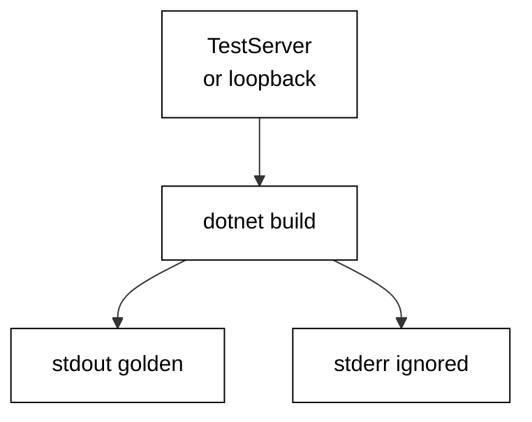

Prerequisites for this course: [just-enough-csharp](/en/learn/courses/just-enough-csharp/learning/overview) for C# syntax, tooling, and the `dotnet` workflow, and [backend-essentials](/en/learn/courses/backend-essentials/learning/overview) for HTTP methods, status codes, headers, and JSON. Comfort editing and running C# console programs from a terminal is assumed throughout, and every example builds only on the primers plus earlier examples in this course.

## Why this exists -- the big idea

**The problem before the solution**: FastAPI teaches you to think in decorators, `Depends`, and Pydantic models, but none of that transfers line-for-line to C#. ASP.NET Core has its own vocabulary — minimal-API route mappings, middleware delegates, endpoint filters, and three service lifetimes — and guessing at it from Python produces services that compile but fight the framework. This course teaches the C# vocabulary directly, one runnable service at a time.

**Keep this if you forget everything else**: A route handler is a pure function from request to response until you deliberately reach for shared state.

## Tensions and trade-offs -- when NOT to reach for this

- **Small versus strict**: nullable reference handling and validation attributes catch malformed input at the boundary; a loose handler ships faster but debugs slower. Each parsing example names which side it takes, and Examples 10 and 11 collect the reject-early shape for going strict safely.
- **One service versus many**: minimal APIs in a single file stay readable to dozens of routes; beyond that, route groups and thin handlers with injected services keep the file honest. The course defaults to one file per example and splits only when the seam is load-bearing.
- **When NOT**: a throwaway probe needs no middleware, no DI container, and no test suite — map the route, print the check, delete the file. Minimal APIs earn their structure when the service outlives the session: shared development services, staging, and anything resembling production.

## Lineage -- where this tool sits

ASP.NET Core is the HTTP-serving companion to the C# ecosystem, and this course assumes both the C# primer and basic HTTP vocabulary as background. The backend courses teach HTTP thinking; this course teaches ASP.NET Core's own framework idioms — routing, middleware, dependency injection, and in-process testing — at the depth the legacy corpus already reached. Later service courses assume routes, handlers, and middleware exist and build queues, caches, and deploys on top of them.

## How this course is organized

[Beginner](/en/learn/courses/web-backends-in-csharp-with-aspnetcore/learning/beginner) (Examples 1–25) maps routes to handlers, parses paths, queries, headers, and bodies into typed values, and shapes statuses, envelopes, and downloads. [Intermediate](/en/learn/courses/web-backends-in-csharp-with-aspnetcore/learning/intermediate) (Examples 26–53) wraps the pipeline in middleware, injects singleton, scoped, and transient services, and tests every layer in-process without a socket. [Advanced](/en/learn/courses/web-backends-in-csharp-with-aspnetcore/learning/advanced) (Examples 54–78) loads the service concurrently, drains it gracefully on shutdown, and compares each design choice against FastAPI. The [capstone](/en/learn/courses/web-backends-in-csharp-with-aspnetcore/learning/capstone/overview) ships an order-tracking service with five routes, validation, structured errors, a health check, and an in-process suite, and [drilling](/en/learn/courses/web-backends-in-csharp-with-aspnetcore/drilling/overview) turns the sixteen concepts into recall, katas, and checklists.

## About the runtime

Every example runs as a compiled C# program in the pinned .NET container: no mocks, no fixtures-as-data. Most examples serve through `TestServer`, which runs the full ASP.NET Core pipeline in memory with no socket and no port; the examples that teach listening and shutdown bind `127.0.0.1` on an OS-chosen ephemeral port and never print it. The harness network is closed and NuGet restores from the course-local locked feed, so every unit restores the byte-identical `Microsoft.AspNetCore.TestHost` package from its own `packages.lock.json`. Programs print labels, statuses, and body bytes — never paths, ports, timings, temp names, or revision noise — so reruns match byte for byte. Standard output is the asserted golden transcript; standard error is ignored.

## Examples by Level

### Beginner (Examples 1–25)

- [Example 1: Hello Route Returns JSON](/en/learn/courses/web-backends-in-csharp-with-aspnetcore/learning/beginner#example-1-hello-route-returns-json)
- [Example 2: Path Parameter Names a Resource](/en/learn/courses/web-backends-in-csharp-with-aspnetcore/learning/beginner#example-2-path-parameter-names-a-resource)
- [Example 3: Query String Filters a List](/en/learn/courses/web-backends-in-csharp-with-aspnetcore/learning/beginner#example-3-query-string-filters-a-list)
- [Example 4: Method and Path Pick the Handler](/en/learn/courses/web-backends-in-csharp-with-aspnetcore/learning/beginner#example-4-method-and-path-pick-the-handler)
- [Example 5: Route Groups Share a Prefix](/en/learn/courses/web-backends-in-csharp-with-aspnetcore/learning/beginner#example-5-route-groups-share-a-prefix)
- [Example 6: Custom 404 for Unknown Routes](/en/learn/courses/web-backends-in-csharp-with-aspnetcore/learning/beginner#example-6-custom-404-for-unknown-routes)
- [Example 7: Redirect Moves a Client](/en/learn/courses/web-backends-in-csharp-with-aspnetcore/learning/beginner#example-7-redirect-moves-a-client)
- [Example 8: Handlers Are Small Functions](/en/learn/courses/web-backends-in-csharp-with-aspnetcore/learning/beginner#example-8-handlers-are-small-functions)
- [Example 9: Bind JSON into a Typed Record](/en/learn/courses/web-backends-in-csharp-with-aspnetcore/learning/beginner#example-9-bind-json-into-a-typed-record)
- [Example 10: Validation Rejects a Bad Body](/en/learn/courses/web-backends-in-csharp-with-aspnetcore/learning/beginner#example-10-validation-rejects-a-bad-body)
- [Example 11: Validation Attributes Name the Rules](/en/learn/courses/web-backends-in-csharp-with-aspnetcore/learning/beginner#example-11-validation-attributes-name-the-rules)
- [Example 12: Bind Query Params with Defaults](/en/learn/courses/web-backends-in-csharp-with-aspnetcore/learning/beginner#example-12-bind-query-params-with-defaults)
- [Example 13: Bind Route Values into Typed Params](/en/learn/courses/web-backends-in-csharp-with-aspnetcore/learning/beginner#example-13-bind-route-values-into-typed-params)
- [Example 14: Read Headers into the Handler](/en/learn/courses/web-backends-in-csharp-with-aspnetcore/learning/beginner#example-14-read-headers-into-the-handler)
- [Example 15: Forms Carry Key Value Pairs](/en/learn/courses/web-backends-in-csharp-with-aspnetcore/learning/beginner#example-15-forms-carry-key-value-pairs)
- [Example 16: Content Type Picks the Reader](/en/learn/courses/web-backends-in-csharp-with-aspnetcore/learning/beginner#example-16-content-type-picks-the-reader)
- [Example 17: Repeated Query Keys Collect a List](/en/learn/courses/web-backends-in-csharp-with-aspnetcore/learning/beginner#example-17-repeated-query-keys-collect-a-list)
- [Example 18: Status Code Says What Happened](/en/learn/courses/web-backends-in-csharp-with-aspnetcore/learning/beginner#example-18-status-code-says-what-happened)
- [Example 19: JSON Keys Follow a Contract](/en/learn/courses/web-backends-in-csharp-with-aspnetcore/learning/beginner#example-19-json-keys-follow-a-contract)
- [Example 20: Problem Envelope Stays Consistent](/en/learn/courses/web-backends-in-csharp-with-aspnetcore/learning/beginner#example-20-problem-envelope-stays-consistent)
- [Example 21: Headers Shape Caching](/en/learn/courses/web-backends-in-csharp-with-aspnetcore/learning/beginner#example-21-headers-shape-caching)
- [Example 22: Cookies Carry a Session](/en/learn/courses/web-backends-in-csharp-with-aspnetcore/learning/beginner#example-22-cookies-carry-a-session)
- [Example 23: File Download Names Itself](/en/learn/courses/web-backends-in-csharp-with-aspnetcore/learning/beginner#example-23-file-download-names-itself)
- [Example 24: Created Points at the New Resource](/en/learn/courses/web-backends-in-csharp-with-aspnetcore/learning/beginner#example-24-created-points-at-the-new-resource)
- [Example 25: Beginner Orders Service](/en/learn/courses/web-backends-in-csharp-with-aspnetcore/learning/beginner#example-25-beginner-orders-service)

### Intermediate (Examples 26–53)

- [Example 26: Middleware Wraps Every Request](/en/learn/courses/web-backends-in-csharp-with-aspnetcore/learning/intermediate#example-26-middleware-wraps-every-request)
- [Example 27: Short Circuit Stops the Chain](/en/learn/courses/web-backends-in-csharp-with-aspnetcore/learning/intermediate#example-27-short-circuit-stops-the-chain)
- [Example 28: Middleware Order Is Outer to Inner](/en/learn/courses/web-backends-in-csharp-with-aspnetcore/learning/intermediate#example-28-middleware-order-is-outer-to-inner)
- [Example 29: Exception Handler Turns Throws into 500](/en/learn/courses/web-backends-in-csharp-with-aspnetcore/learning/intermediate#example-29-exception-handler-turns-throws-into-500)
- [Example 30: Status Code Pages Fill Empty Bodies](/en/learn/courses/web-backends-in-csharp-with-aspnetcore/learning/intermediate#example-30-status-code-pages-fill-empty-bodies)
- [Example 31: Request Logging Sees Every Call](/en/learn/courses/web-backends-in-csharp-with-aspnetcore/learning/intermediate#example-31-request-logging-sees-every-call)
- [Example 32: Timing Header Measures the Pipeline](/en/learn/courses/web-backends-in-csharp-with-aspnetcore/learning/intermediate#example-32-timing-header-measures-the-pipeline)
- [Example 33: Endpoint Filters Guard One Route](/en/learn/courses/web-backends-in-csharp-with-aspnetcore/learning/intermediate#example-33-endpoint-filters-guard-one-route)
- [Example 34: Global Error Envelope for Clients](/en/learn/courses/web-backends-in-csharp-with-aspnetcore/learning/intermediate#example-34-global-error-envelope-for-clients)
- [Example 35: Singleton Holds Shared State](/en/learn/courses/web-backends-in-csharp-with-aspnetcore/learning/intermediate#example-35-singleton-holds-shared-state)
- [Example 36: Scoped Gives One Per Request](/en/learn/courses/web-backends-in-csharp-with-aspnetcore/learning/intermediate#example-36-scoped-gives-one-per-request)
- [Example 37: Transient Builds Fresh Each Time](/en/learn/courses/web-backends-in-csharp-with-aspnetcore/learning/intermediate#example-37-transient-builds-fresh-each-time)
- [Example 38: Lifetimes Compose Safely](/en/learn/courses/web-backends-in-csharp-with-aspnetcore/learning/intermediate#example-38-lifetimes-compose-safely)
- [Example 39: Options Pattern Carries Settings](/en/learn/courses/web-backends-in-csharp-with-aspnetcore/learning/intermediate#example-39-options-pattern-carries-settings)
- [Example 40: Keyed Services Pick an Implementation](/en/learn/courses/web-backends-in-csharp-with-aspnetcore/learning/intermediate#example-40-keyed-services-pick-an-implementation)
- [Example 41: Try Add Keeps Defaults Overridable](/en/learn/courses/web-backends-in-csharp-with-aspnetcore/learning/intermediate#example-41-try-add-keeps-defaults-overridable)
- [Example 42: Factory Registration Builds Complex Graphs](/en/learn/courses/web-backends-in-csharp-with-aspnetcore/learning/intermediate#example-42-factory-registration-builds-complex-graphs)
- [Example 43: From Services Injects into Handlers](/en/learn/courses/web-backends-in-csharp-with-aspnetcore/learning/intermediate#example-43-from-services-injects-into-handlers)
- [Example 44: Validation Service Keeps Handlers Thin](/en/learn/courses/web-backends-in-csharp-with-aspnetcore/learning/intermediate#example-44-validation-service-keeps-handlers-thin)
- [Example 45: Test Server Serves in Memory](/en/learn/courses/web-backends-in-csharp-with-aspnetcore/learning/intermediate#example-45-test-server-serves-in-memory)
- [Example 46: One Client Drives Many Requests](/en/learn/courses/web-backends-in-csharp-with-aspnetcore/learning/intermediate#example-46-one-client-drives-many-requests)
- [Example 47: Assert Status and Body Together](/en/learn/courses/web-backends-in-csharp-with-aspnetcore/learning/intermediate#example-47-assert-status-and-body-together)
- [Example 48: Post Then Get Proves State](/en/learn/courses/web-backends-in-csharp-with-aspnetcore/learning/intermediate#example-48-post-then-get-proves-state)
- [Example 49: Error Paths Get Tests Too](/en/learn/courses/web-backends-in-csharp-with-aspnetcore/learning/intermediate#example-49-error-paths-get-tests-too)
- [Example 50: Middleware Under Test Alone](/en/learn/courses/web-backends-in-csharp-with-aspnetcore/learning/intermediate#example-50-middleware-under-test-alone)
- [Example 51: Test Services Replace the Real Ones](/en/learn/courses/web-backends-in-csharp-with-aspnetcore/learning/intermediate#example-51-test-services-replace-the-real-ones)
- [Example 52: Loopback Port Stays Ephemeral](/en/learn/courses/web-backends-in-csharp-with-aspnetcore/learning/intermediate#example-52-loopback-port-stays-ephemeral)
- [Example 53: Parallel Requests Share Nothing](/en/learn/courses/web-backends-in-csharp-with-aspnetcore/learning/intermediate#example-53-parallel-requests-share-nothing)

### Advanced (Examples 54–78)

- [Example 54: Async Handlers Free the Thread](/en/learn/courses/web-backends-in-csharp-with-aspnetcore/learning/advanced#example-54-async-handlers-free-the-thread)
- [Example 55: Interlocked Counts Shared Hits](/en/learn/courses/web-backends-in-csharp-with-aspnetcore/learning/advanced#example-55-interlocked-counts-shared-hits)
- [Example 56: Semaphore Caps Concurrent Work](/en/learn/courses/web-backends-in-csharp-with-aspnetcore/learning/advanced#example-56-semaphore-caps-concurrent-work)
- [Example 57: Concurrent Dictionary Caches Safely](/en/learn/courses/web-backends-in-csharp-with-aspnetcore/learning/advanced#example-57-concurrent-dictionary-caches-safely)
- [Example 58: Cancellation Abandons Slow Work](/en/learn/courses/web-backends-in-csharp-with-aspnetcore/learning/advanced#example-58-cancellation-abandons-slow-work)
- [Example 59: Task When All Fans Requests Out](/en/learn/courses/web-backends-in-csharp-with-aspnetcore/learning/advanced#example-59-task-when-all-fans-requests-out)
- [Example 60: Rate Limiter Sheds Excess Load](/en/learn/courses/web-backends-in-csharp-with-aspnetcore/learning/advanced#example-60-rate-limiter-sheds-excess-load)
- [Example 61: Output Cache Answers Repeats Fast](/en/learn/courses/web-backends-in-csharp-with-aspnetcore/learning/advanced#example-61-output-cache-answers-repeats-fast)
- [Example 62: Server Binds a Loopback Port](/en/learn/courses/web-backends-in-csharp-with-aspnetcore/learning/advanced#example-62-server-binds-a-loopback-port)
- [Example 63: StopAsync Drains in Flight](/en/learn/courses/web-backends-in-csharp-with-aspnetcore/learning/advanced#example-63-stopasync-drains-in-flight)
- [Example 64: Application Lifetime Signals Shutdown](/en/learn/courses/web-backends-in-csharp-with-aspnetcore/learning/advanced#example-64-application-lifetime-signals-shutdown)
- [Example 65: Cancellation Token Flows to Handlers](/en/learn/courses/web-backends-in-csharp-with-aspnetcore/learning/advanced#example-65-cancellation-token-flows-to-handlers)
- [Example 66: Health Gate Blocks Traffic First](/en/learn/courses/web-backends-in-csharp-with-aspnetcore/learning/advanced#example-66-health-gate-blocks-traffic-first)
- [Example 67: Connection Close Is Clean](/en/learn/courses/web-backends-in-csharp-with-aspnetcore/learning/advanced#example-67-connection-close-is-clean)
- [Example 68: Shutdown Deadline Bounds Draining](/en/learn/courses/web-backends-in-csharp-with-aspnetcore/learning/advanced#example-68-shutdown-deadline-bounds-draining)
- [Example 69: Hosted Service Starts Before Traffic](/en/learn/courses/web-backends-in-csharp-with-aspnetcore/learning/advanced#example-69-hosted-service-starts-before-traffic)
- [Example 70: Zero Downtime Is a Handoff](/en/learn/courses/web-backends-in-csharp-with-aspnetcore/learning/advanced#example-70-zero-downtime-is-a-handoff)
- [Example 71: Minimal APIs Versus Decorators](/en/learn/courses/web-backends-in-csharp-with-aspnetcore/learning/advanced#example-71-minimal-apis-versus-decorators)
- [Example 72: Model Binding Versus Pydantic](/en/learn/courses/web-backends-in-csharp-with-aspnetcore/learning/advanced#example-72-model-binding-versus-pydantic)
- [Example 73: Middleware Shape Compared](/en/learn/courses/web-backends-in-csharp-with-aspnetcore/learning/advanced#example-73-middleware-shape-compared)
- [Example 74: DI Container Versus Depends](/en/learn/courses/web-backends-in-csharp-with-aspnetcore/learning/advanced#example-74-di-container-versus-depends)
- [Example 75: Error Shape Compared](/en/learn/courses/web-backends-in-csharp-with-aspnetcore/learning/advanced#example-75-error-shape-compared)
- [Example 76: Validation Pipeline Compared](/en/learn/courses/web-backends-in-csharp-with-aspnetcore/learning/advanced#example-76-validation-pipeline-compared)
- [Example 77: Test Client Compared](/en/learn/courses/web-backends-in-csharp-with-aspnetcore/learning/advanced#example-77-test-client-compared)
- [Example 78: Concurrency Model Compared](/en/learn/courses/web-backends-in-csharp-with-aspnetcore/learning/advanced#example-78-concurrency-model-compared)
