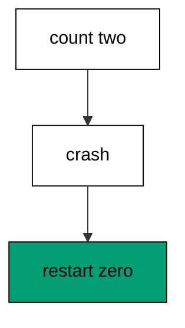
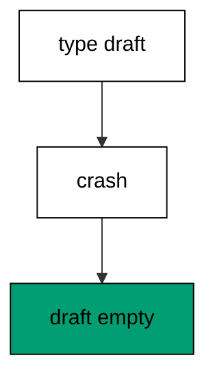
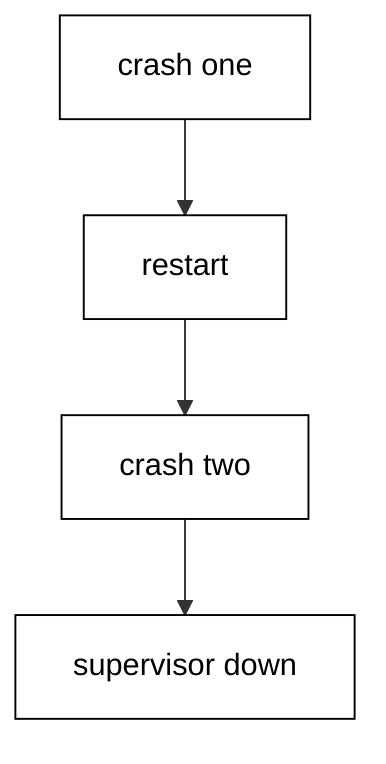
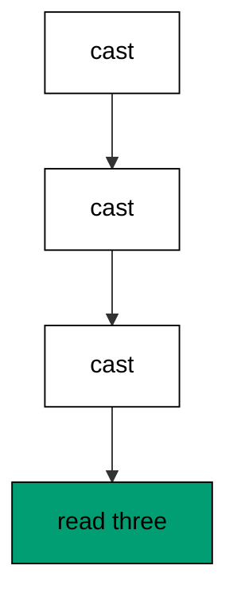
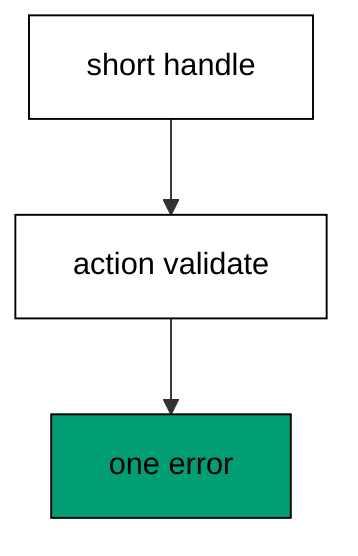
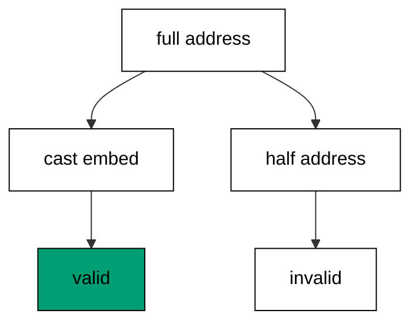
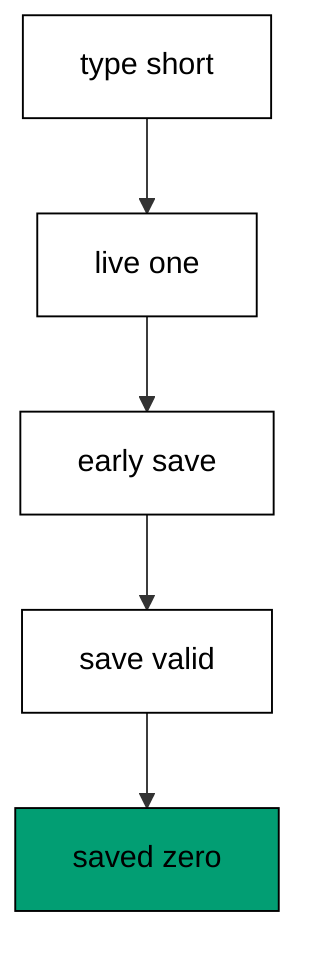
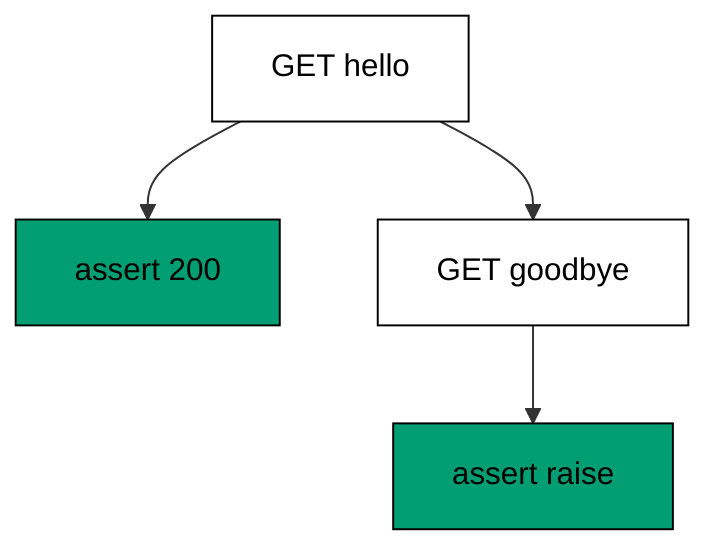
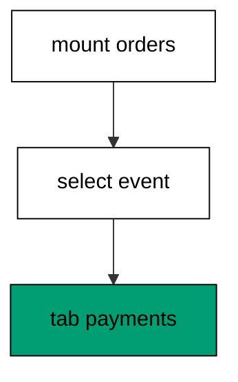
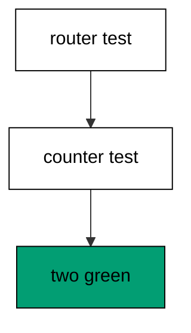

Examples 54–78 take the training wheels off: supervising live state like production does, handling forms end to end, and testing everything without a browser. Three clusters carry the level: supervision of live state (Examples 54–61), form handling end to end (Examples 62–70), and testing without a browser (Examples 71–78). Every program runs in-process in the pinned Elixir container; every output is a fixed transcript.

### Example 54: Supervisor Restarts the Counter

A LiveView is a supervised process, and this is what supervision buys: when the counter crashes, the supervisor boots a fresh one at zero. This example counts to two, crashes the worker, and prints the restarted zero. (Concepts: co-12, co-11.)



**`learning/code/ex-54-supervisor-restarts-the-counter/priv/main.exs`**:

```elixir
# => Example 54: Supervisor Restarts the Counter
Logger.configure(level: :critical)
# => crash reports stay out of the transcript
Code.compiler_options(ignore_module_conflict: true)
# => reloaded modules stay silent on double runs

# => one GenServer module counts like a LiveView would
defmodule Ex54.Counter do
  # => GenServer callbacks live here
  use GenServer

  # => clients start one counter under a supervisor
  def start_link(_opts), do: GenServer.start_link(__MODULE__, 0)

  # => the counter starts at zero after every boot
  def init(first), do: {:ok, first}

  # => inc adds exactly one per call
  def handle_call(:inc, _from, count), do: {:reply, count + 1, count + 1}

  # => get reads the count without changing it
  def handle_call(:get, _from, count), do: {:reply, count, count}
end

# => run/0 holds the whole example narrative
defmodule Ex54.Main do
  # => single entry point the last line calls
  def run do
    # => one supervision tree owns the counter
    {:ok, sup} = Supervisor.start_link([{Ex54.Counter, []}], strategy: :one_for_one)
    # => the single child answers under a known id
    [{_, first, _, _}] = Supervisor.which_children(sup)
    # => two presses bring the count to two
    GenServer.call(first, :inc)
    # => Output: before: 2
    IO.puts("before: #{GenServer.call(first, :inc)}")
    # => a crash stops the counter abnormally
    :ok = GenServer.stop(first, :boom)
    # => the supervisor booted a fresh counter
    [{_, second, _, _}] = Supervisor.which_children(sup)
    # => Output: restarted: true count: 0
    IO.puts("restarted: #{first != second} count: #{GenServer.call(second, :get)}")

    # => end run: the narrative returns here
  end

  # => module boundary stays explicit
end

# => the entry point runs exactly once per execution
Ex54.Main.run()
```

**Output** (`learning/code/ex-54-supervisor-restarts-the-counter/expected/main.stdout.txt`):

```text
before: 2
restarted: true count: 0
```

**Key takeaway**: A crashed supervised worker restarts with initial state; the printed zero proves crashes reset, never corrupt.

**Why it matters**: This is the keep-this-if-you-forget-everything made concrete: a LiveView holds one user's state in a supervised process, so a bug crashes one visitor's page — which reboots clean — instead of the whole server.

### Example 55: GenServer Holds Live State

Before trusting supervisors, see the state they guard: a GenServer holds one shopper's basket across calls, adding items one by one. This example adds two items and prints the basket in arrival order. (Concepts: co-11.)

**`learning/code/ex-55-genserver-holds-live-state/priv/main.exs`**:

```elixir
# => Example 55: GenServer Holds Live State
Logger.configure(level: :warning)
# => warnings only; GenServers stay silent below this
Code.compiler_options(ignore_module_conflict: true)
# => reloaded modules stay silent on double runs

# => one GenServer module holds one shopper's basket
defmodule Ex55.Basket do
  # => GenServer callbacks live here
  use GenServer

  # => clients start one basket per shopper
  def start_link(_opts), do: GenServer.start_link(__MODULE__, [])

  # => the basket starts empty after every boot
  def init(first), do: {:ok, first}

  # => add conses one item onto the basket
  def handle_call({:add, item}, _from, items), do: {:reply, :ok, [item | items]}

  # => list reads the items in arrival order
  def handle_call(:list, _from, items), do: {:reply, Enum.reverse(items), items}
end

# => run/0 holds the whole example narrative
defmodule Ex55.Main do
  # => single entry point the last line calls
  def run do
    # => one supervision tree owns the basket
    {:ok, sup} = Supervisor.start_link([{Ex55.Basket, []}], strategy: :one_for_one)
    # => the single child answers under a known id
    [{_, basket, _, _}] = Supervisor.which_children(sup)
    # => two items land in arrival order
    GenServer.call(basket, {:add, "noodles"})
    # => the second add joins the first
    GenServer.call(basket, {:add, "tea"})
    # => Output: basket: noodles tea
    IO.puts("basket: #{GenServer.call(basket, :list) |> Enum.join(" ")}")

    # => end run: the narrative returns here
  end

  # => module boundary stays explicit
end

# => the entry point runs exactly once per execution
Ex55.Main.run()
```

**Output** (`learning/code/ex-55-genserver-holds-live-state/expected/main.stdout.txt`):

```text
basket: noodles tea
```

**Key takeaway**: A GenServer keeps its state between calls; two adds print back in the order they arrived.

**Why it matters**: LiveView sockets, channels, and presence trackers are all GenServers underneath. Understanding 'state lives in a process that answers messages' first makes every LiveView callback feel familiar instead of magical.

### Example 56: Crash Loses Unsaved Drafts

Restart recovers the process, not its memory: the draft typed before the crash is gone when the fresh worker boots empty. This example types half a sentence, crashes, and prints the emptied draft. (Concepts: co-12.)



**`learning/code/ex-56-crash-loses-unsaved-drafts/priv/main.exs`**:

```elixir
# => Example 56: Crash Loses Unsaved Drafts
Logger.configure(level: :critical)
# => crash reports stay out of the transcript
Code.compiler_options(ignore_module_conflict: true)
# => reloaded modules stay silent on double runs

# => one GenServer module holds one editor draft
defmodule Ex56.Draft do
  # => GenServer callbacks live here
  use GenServer

  # => clients start one draft holder
  def start_link(_opts), do: GenServer.start_link(__MODULE__, "")

  # => the draft starts empty after every boot
  def init(first), do: {:ok, first}

  # => type replaces the draft with longer text
  def handle_call({:type, text}, _from, _draft), do: {:reply, :ok, text}

  # => read returns the draft without changing it
  def handle_call(:read, _from, draft), do: {:reply, draft, draft}
end

# => run/0 holds the whole example narrative
defmodule Ex56.Main do
  # => single entry point the last line calls
  def run do
    # => one supervision tree owns the draft holder
    {:ok, sup} = Supervisor.start_link([{Ex56.Draft, []}], strategy: :one_for_one)
    # => the single child answers under a known id
    [{_, holder, _, _}] = Supervisor.which_children(sup)
    # => the visitor types half a sentence
    GenServer.call(holder, {:type, "dear diary"})
    # => the process crashes before any save
    :ok = GenServer.stop(holder, :boom)
    # => the supervisor booted a fresh holder
    [{_, fresh, _, _}] = Supervisor.which_children(sup)
    # => Output: draft after crash: empty
    IO.puts("draft after crash: #{if GenServer.call(fresh, :read) == "", do: "empty", else: "kept"}")

    # => end run: the narrative returns here
  end

  # => module boundary stays explicit
end

# => the entry point runs exactly once per execution
Ex56.Main.run()
```

**Output** (`learning/code/ex-56-crash-loses-unsaved-drafts/expected/main.stdout.txt`):

```text
draft after crash: empty
```

**Key takeaway**: A restarted worker boots with initial state; unsaved drafts vanish with the crashed process.

**Why it matters**: Users forgive a crash that loses nothing; they remember one that eats their essay. Knowing exactly what survives (persisted rows) and what does not (process memory) tells you what to save eagerly — and when to warn.

### Example 57: Ets Outlives the Worker

Some memory should survive its writer: an ETS table owned by a long-lived process keeps its rows after the worker that wrote them exits. This example has a short worker cache one total, then reads it back after the exit. (Concepts: co-12.)

**`learning/code/ex-57-ets-outlives-the-worker/priv/main.exs`**:

```elixir
# => Example 57: Ets Outlives the Worker
Logger.configure(level: :warning)
# => warnings only; ETS stays silent below this
Code.compiler_options(ignore_module_conflict: true)
# => reloaded modules stay silent on double runs

# => run/0 holds the whole example narrative
defmodule Ex57.Main do
  # => single entry point the last line calls
  def run do
    # => this process owns the table, not the worker
    table = :ets.new(:ex57_cache, [:set, :public])
    # => a short worker writes one row, then exits
    worker = spawn(fn -> :ets.insert(table, {:total, 42}) end)
    # => the monitor reports the worker's normal exit
    ref = Process.monitor(worker)
    # => the DOWN arrives once the write finished
    receive do
      # => the worker is gone, the row remains
      {:DOWN, ^ref, :process, _, _} -> :ok
      # => end receive: exit observed, table kept
    after
      # => a missing exit would fail loudly here
      1000 -> IO.puts("worker: missing")
      # => end after: workers always finish
    end
    # => Output: cached: 42
    IO.puts("cached: #{:ets.lookup(table, :total) |> hd() |> elem(1)}")

    # => end run: the narrative returns here
  end

  # => module boundary stays explicit
end

# => the entry point runs exactly once per execution
Ex57.Main.run()
```

**Output** (`learning/code/ex-57-ets-outlives-the-worker/expected/main.stdout.txt`):

```text
cached: 42
```

**Key takeaway**: An ETS table owned outside the worker survives the worker's exit; the cached total reads back unchanged.

**Why it matters**: Caches, rate-limit counters, and compiled templates all need memory that outlives any single request process. ETS — owned by supervisors, written by workers — is the BEAM's answer to 'fast, shared, and crash-proof'.

### Example 58: Restart Budget Stops the Loop

Restarts must not loop forever: the supervisor's restart budget shuts the whole tree down when crashes come too fast, and a telemetry event marks the shutdown. This example spends its one restart, crashes again, and prints the stopped supervisor with its telemetry line. (Concepts: co-12, co-15.)



**`learning/code/ex-58-restart-budget-stops-the-loop/priv/main.exs`**:

```elixir
# => Example 58: Restart Budget Stops the Loop
Logger.configure(level: :critical)
# => crash reports stay out of the transcript
Code.compiler_options(ignore_module_conflict: true)
# => reloaded modules stay silent on double runs

# => one GenServer module crashes on demand
defmodule Ex58.Flaky do
  # => GenServer callbacks live here
  use GenServer

  # => clients start one flaky worker
  def start_link(_opts), do: GenServer.start_link(__MODULE__, :ok)

  # => no state matters for this lesson
  def init(first), do: {:ok, first}

  # => stop the worker abnormally right now
  def handle_call(:crash, _from, state), do: {:stop, :boom, :ok, state}
end

# => run/0 holds the whole example narrative
defmodule Ex58.Main do
  # => single entry point the last line calls
  def run do
    # => telemetry listens for the shutdown event
    :telemetry.attach("ex58-listener", [:ex58, :down], fn ev, _ms, _md, _c -> send(self(), {:seen, ev}) end, nil)
    # => one restart allowed per second of wall time
    {:ok, sup} = Supervisor.start_link([{Ex58.Flaky, []}], strategy: :one_for_one, max_restarts: 1, max_seconds: 60)
    # => unlink first, so the shutdown cannot kill the script
    Process.unlink(sup)
    # => the supervisor's death arrives exactly once
    ref = Process.monitor(sup)
    # => the single child answers under a known id
    [{_, first, _, _}] = Supervisor.which_children(sup)
    # => the first death arrives exactly once
    watch = Process.monitor(first)
    # => the first crash spends the one restart
    GenServer.call(first, :crash)
    # => the DOWN proves the first worker died
    receive do
      # => restart follows, the lesson proceeds
      {:DOWN, ^watch, :process, _, _} -> :ok
      # => end receive: death observed, restart next
    after
      # => a missing death would fail loudly here
      5000 -> IO.puts("first: missing")
      # => end after: crashes always land
    end
    # => the restarted child answers under a new id
    [{_, second, _, _}] = Supervisor.which_children(sup)
    # => the second crash spends more than allowed
    GenServer.call(second, :crash)
    # => the supervisor exits once the budget breaks
    receive do
      # => Output: supervisor alive: false
      {:DOWN, ^ref, :process, _, _} -> IO.puts("supervisor alive: false")
      # => end receive: the budget stopped the loop
    after
      # => a living supervisor would fail loudly here
      5000 -> IO.puts("supervisor alive: true")
      # => end after: budgets always break loops
    end
    # => the shutdown emits one telemetry event
    :telemetry.execute([:ex58, :down], %{}, %{})
    # => the listener proves the event arrived
    receive do
      # => Output: telemetry: down
      {:seen, [:ex58, :down]} -> IO.puts("telemetry: down")
      # => end receive: one event, one line
    after
      # => a missing event would fail loudly here
      1000 -> IO.puts("telemetry: missing")
      # => end after: executes always deliver
    end

    # => end run: the narrative returns here
  end

  # => module boundary stays explicit
end

# => the entry point runs exactly once per execution
Ex58.Main.run()
```

**Output** (`learning/code/ex-58-restart-budget-stops-the-loop/expected/main.stdout.txt`):

```text
supervisor alive: false
telemetry: down
```

**Key takeaway**: `max_restarts` bounds crash loops; exceeding it terminates the supervisor, and the telemetry event records the stop.

**Why it matters**: A worker crashing on boot, restarted instantly, crashing again, is a hot loop that melts schedulers. The budget converts infinite failure into one clean shutdown — which the supervisor above can then handle, escalating exactly as designed.

### Example 59: Task Reports Its Result

One-off work gets one-off processes: `Task.async` computes beside the caller and `await` collects the answer. This example multiplies in a sibling process and prints the collected total. (Concepts: co-11.)

**`learning/code/ex-59-task-reports-its-result/priv/main.exs`**:

```elixir
# => Example 59: Task Reports Its Result
Logger.configure(level: :warning)
# => warnings only; tasks stay silent below this
Code.compiler_options(ignore_module_conflict: true)
# => reloaded modules stay silent on double runs

# => run/0 holds the whole example narrative
defmodule Ex59.Main do
  # => single entry point the last line calls
  def run do
    # => the total computes in a sibling process
    task = Task.async(fn -> 6 * 7 end)
    # => await collects the answer or raises
    total = Task.await(task)
    # => Output: total: 42
    IO.puts("total: #{total}")

    # => end run: the narrative returns here
  end

  # => module boundary stays explicit
end

# => the entry point runs exactly once per execution
Ex59.Main.run()
```

**Output** (`learning/code/ex-59-task-reports-its-result/expected/main.stdout.txt`):

```text
total: 42
```

**Key takeaway**: `Task.async` plus `await` runs one computation in a sibling process and returns its value to the caller.

**Why it matters**: Report rows, thumbnail renders, and price quotes should not block the page process — but they are too small for a GenServer each. Tasks are the middle path: supervised-ish concurrency for work with exactly one answer.

### Example 60: Casts Queue Before Calls

Messages from one sender arrive in order: three casts queue ahead of the call that reads the count, so the answer reflects all three. This example fires three increments then reads, printing three. (Concepts: co-11.)



**`learning/code/ex-60-casts-queue-before-calls/priv/main.exs`**:

```elixir
# => Example 60: Casts Queue Before Calls
Logger.configure(level: :warning)
# => warnings only; GenServers stay silent below this
Code.compiler_options(ignore_module_conflict: true)
# => reloaded modules stay silent on double runs

# => one GenServer module counts cast increments
defmodule Ex60.Counter do
  # => GenServer callbacks live here
  use GenServer

  # => clients start one counter
  def start_link(_opts), do: GenServer.start_link(__MODULE__, 0)

  # => the counter starts at zero after every boot
  def init(first), do: {:ok, first}

  # => each cast adds exactly one, answering nothing
  def handle_cast(:inc, count), do: {:noreply, count + 1}

  # => get reads the count after every queued cast
  def handle_call(:get, _from, count), do: {:reply, count, count}
end

# => run/0 holds the whole example narrative
defmodule Ex60.Main do
  # => single entry point the last line calls
  def run do
    # => one supervision tree owns the counter
    {:ok, sup} = Supervisor.start_link([{Ex60.Counter, []}], strategy: :one_for_one)
    # => the single child answers under a known id
    [{_, counter, _, _}] = Supervisor.which_children(sup)
    # => three casts queue without waiting
    GenServer.cast(counter, :inc)
    # => the second cast queues behind the first
    GenServer.cast(counter, :inc)
    # => the third cast queues behind the second
    GenServer.cast(counter, :inc)
    # => the call runs after all three casts
    IO.puts("count: #{GenServer.call(counter, :get)}")

    # => end run: the narrative returns here
  end

  # => module boundary stays explicit
end

# => the entry point runs exactly once per execution
Ex60.Main.run()
```

**Output** (`learning/code/ex-60-casts-queue-before-calls/expected/main.stdout.txt`):

```text
count: 3
```

**Key takeaway**: Same-sender messages process in send order; the call after three casts always reads three.

**Why it matters**: LiveView leans on this guarantee constantly — rapid presses apply in press order, never scrambled. Ordering per sender is what makes 'press press press, see three' true without any locking.

### Example 61: Monitor Hears the Exit

Links propagate crashes; monitors merely report them: watching a worker delivers a DOWN message with the exit reason while the watcher lives on. This example watches a short worker and prints its exit reason. (Concepts: co-12.)

**`learning/code/ex-61-monitor-hears-the-exit/priv/main.exs`**:

```elixir
# => Example 61: Monitor Hears the Exit
Logger.configure(level: :warning)
# => warnings only; monitors stay silent below this
Code.compiler_options(ignore_module_conflict: true)
# => reloaded modules stay silent on double runs

# => run/0 holds the whole example narrative
defmodule Ex61.Main do
  # => single entry point the last line calls
  def run do
    # => a short worker exits with a named reason
    worker = spawn(fn -> exit(:shift_over) end)
    # => the monitor watches that one worker
    ref = Process.monitor(worker)
    # => the DOWN message names the exit reason
    receive do
      # => Output: down: shift_over
      {:DOWN, ^ref, :process, _, reason} -> IO.puts("down: #{reason}")
      # => end receive: one exit, one line
    after
      # => a missing exit would fail loudly here
      1000 -> IO.puts("down: missing")
      # => end after: workers always exit
    end

    # => end run: the narrative returns here
  end

  # => module boundary stays explicit
end

# => the entry point runs exactly once per execution
Ex61.Main.run()
```

**Output** (`learning/code/ex-61-monitor-hears-the-exit/expected/main.stdout.txt`):

```text
down: shift_over
```

**Key takeaway**: `Process.monitor` reports the watched exit as a DOWN message carrying the reason; the watcher survives to read it.

**Why it matters**: Supervisors monitor (in effect) rather than link blindly, which is why one child's crash reboots the child instead of killing the tree. Monitors are also how dashboards, pools, and tests observe lifetimes without sharing fate.

### Example 62: Validate Marks the Form

A submitted form becomes a changeset with an action: marking `:validate` surfaces the errors `to_form` renders beside the inputs. This example validates a short handle and prints the form's error count. (Concepts: co-13, co-03.)



**`learning/code/ex-62-validate-marks-the-form/priv/main.exs`**:

```elixir
# => Example 62: Validate Marks the Form
Logger.configure(level: :warning)
# => warnings only; Ecto stays silent below this
Code.compiler_options(ignore_module_conflict: true)
# => reloaded modules stay silent on double runs

# => one schema module names the handle field
defmodule Ex62.Handle do
  # => schema and changeset macros live here
  use Ecto.Schema
  # => cast and validate helpers live here
  import Ecto.Changeset

  # => handles persist under this source name
  schema "handles" do
    # => the unique name a member chooses
    field :handle, :string
  end

  # => three characters minimum, as before
  def changeset(handle, attrs) do
    # => cast first, then require, then bound
    handle |> cast(attrs, [:handle]) |> validate_required([:handle]) |> validate_length(:handle, min: 3)
    # => end changeset: every submit re-runs this
  end

  # => module boundary stays explicit
end

# => run/0 holds the whole example narrative
defmodule Ex62.Main do
  # => single entry point the last line calls
  def run do
    # => the visitor submits a two-letter handle
    cs =
      # => struct plus params, validated first
      struct(Ex62.Handle)
      # => the changeset carries the rules
      |> Ex62.Handle.changeset(%{handle: "ab"})
      # => validate marks the form attempted
      |> Map.put(:action, :validate)
    # => to_form bridges the changeset to the template
    form = Phoenix.Component.to_form(cs, as: "handle")
    # => Output: errors: 1
    IO.puts("errors: #{length(form.errors)}")

    # => end run: the narrative returns here
  end

  # => module boundary stays explicit
end

# => the entry point runs exactly once per execution
Ex62.Main.run()
```

**Output** (`learning/code/ex-62-validate-marks-the-form/expected/main.stdout.txt`):

```text
errors: 1
```

**Key takeaway**: Setting the changeset action to `:validate` exposes its errors through `to_form`; the printed count proves the bridge works.

**Why it matters**: Forms show errors only for attempted submits — a pristine form shouting about empty fields insults the visitor. The action flag is the line between 'not yet tried' and 'tried and wrong', and the template reads exactly that.

### Example 63: Submit Builds the Member

A valid submit becomes a struct: the changeset applies into a member the rest of the system can use, still without a database. This example submits complete input and prints the built handle with its age. (Concepts: co-13.)

**`learning/code/ex-63-submit-builds-the-member/priv/main.exs`**:

```elixir
# => Example 63: Submit Builds the Member
Logger.configure(level: :warning)
# => warnings only; Ecto stays silent below this
Code.compiler_options(ignore_module_conflict: true)
# => reloaded modules stay silent on double runs

# => one schema module names the member fields
defmodule Ex63.Member do
  # => schema and changeset macros live here
  use Ecto.Schema
  # => cast and validate helpers live here
  import Ecto.Changeset

  # => members persist under this source name
  schema "members" do
    # => the unique name a member chooses
    field :handle, :string
    # => full years, optional at the boundary
    field :age, :integer
  end

  # => the boundary function every submit runs
  def changeset(member, attrs) do
    # => cast keeps only the listed fields
    member |> cast(attrs, [:handle, :age]) |> validate_required([:handle])
    # => end changeset: handle must be present
  end

  # => module boundary stays explicit
end

# => run/0 holds the whole example narrative
defmodule Ex63.Main do
  # => single entry point the last line calls
  def run do
    # => valid params apply into a struct, no repo
    {:ok, member} =
      # => struct plus params, validated first
      struct(Ex63.Member)
      # => the changeset carries the rules
      |> Ex63.Member.changeset(%{handle: "ada", age: 36})
      # => apply_action runs insert semantics in memory
      |> Ecto.Changeset.apply_action(:insert)
    # => Output: saved: ada 36
    IO.puts("saved: #{member.handle} #{member.age}")

    # => end run: the narrative returns here
  end

  # => module boundary stays explicit
end

# => the entry point runs exactly once per execution
Ex63.Main.run()
```

**Output** (`learning/code/ex-63-submit-builds-the-member/expected/main.stdout.txt`):

```text
saved: ada 36
```

**Key takeaway**: Valid submit params apply into a struct via the changeset; the printed fields prove the boundary produced usable data.

**Why it matters**: The happy path deserves its own lesson because every sad path compares against it. Seeing the struct a good submit builds tells you exactly what 'correct' looks like before learning the dozen ways input goes wrong.

### Example 64: Submit Refuses Bad Input

An invalid submit becomes sentences, not a crash: the refused changeset traverses into messages the form renders. This example submits a short handle and prints the refusal sentence. (Concepts: co-13.)

**`learning/code/ex-64-submit-refuses-bad-input/priv/main.exs`**:

```elixir
# => Example 64: Submit Refuses Bad Input
Logger.configure(level: :warning)
# => warnings only; Ecto stays silent below this
Code.compiler_options(ignore_module_conflict: true)
# => reloaded modules stay silent on double runs

# => one schema module names the member fields
defmodule Ex64.Member do
  # => schema and changeset macros live here
  use Ecto.Schema
  # => cast and validate helpers live here
  import Ecto.Changeset

  # => members persist under this source name
  schema "members" do
    # => the unique name a member chooses
    field :handle, :string
  end

  # => the boundary function every submit runs
  def changeset(member, attrs) do
    # => cast first, then require, then bound
    member |> cast(attrs, [:handle]) |> validate_required([:handle]) |> validate_length(:handle, min: 3)
    # => end changeset: short handles never save
  end

  # => module boundary stays explicit
end

# => run/0 holds the whole example narrative
defmodule Ex64.Main do
  # => single entry point the last line calls
  def run do
    # => invalid params return the failed changeset
    {:error, failed} =
      # => a two-letter handle fails the bound
      struct(Ex64.Member)
      # => the same rules, the opposite outcome
      |> Ex64.Member.changeset(%{handle: "ab"})
      # => apply_action refuses to build
      |> Ecto.Changeset.apply_action(:insert)
    # => traverse_errors turns tuples into sentences
    messages = Ecto.Changeset.traverse_errors(failed, fn {msg, _opts} -> msg end)
    # => Output: refused: should be at least 3 character(s)
    IO.puts("refused: #{messages[:handle] |> hd() |> String.replace("%{count}", "3")}")

    # => end run: the narrative returns here
  end

  # => module boundary stays explicit
end

# => the entry point runs exactly once per execution
Ex64.Main.run()
```

**Output** (`learning/code/ex-64-submit-refuses-bad-input/expected/main.stdout.txt`):

```text
refused: should be at least 3 character(s)
```

**Key takeaway**: Invalid submits return the failed changeset; traversing its errors yields the human sentence the form shows.

**Why it matters**: Refusals are the common case on the hostile internet — bots, typos, impatience. A refusal path that returns guidance instead of a 500 keeps the door open for the legitimate visitor standing behind the bot.

### Example 65: Checkbox Casts to Boolean

HTML speaks strings, even for checkboxes: the form sends `"true"` and `"false"`, and `cast` converts them into real booleans. This example casts both spellings and prints each resulting boolean. (Concepts: co-13.)

**`learning/code/ex-65-checkbox-casts-to-boolean/priv/main.exs`**:

```elixir
# => Example 65: Checkbox Casts to Boolean
Logger.configure(level: :warning)
# => warnings only; Ecto stays silent below this
Code.compiler_options(ignore_module_conflict: true)
# => reloaded modules stay silent on double runs

# => one schema module names the preference fields
defmodule Ex65.Prefs do
  # => schema and changeset macros live here
  use Ecto.Schema
  # => cast and validate helpers live here
  import Ecto.Changeset

  # => preferences persist under this source name
  schema "prefs" do
    # => the unique name a member chooses
    field :handle, :string
    # => the newsletter checkbox state
    field :subscribed, :boolean
  end

  # => checkboxes arrive as strings from the form
  def changeset(prefs, attrs) do
    # => cast converts "true" into a real boolean
    prefs |> cast(attrs, [:handle, :subscribed]) |> validate_required([:handle])
    # => end changeset: strings in, booleans out
  end

  # => module boundary stays explicit
end

# => run/0 holds the whole example narrative
defmodule Ex65.Main do
  # => single entry point the last line calls
  def run do
    # => the checked box arrives as the string true
    checked = Ex65.Prefs.changeset(struct(Ex65.Prefs), %{handle: "ada", subscribed: "true"})
    # => Output: checked: true
    IO.puts("checked: #{Ecto.Changeset.get_field(checked, :subscribed)}")
    # => the unchecked box arrives as the string false
    unchecked = Ex65.Prefs.changeset(struct(Ex65.Prefs), %{handle: "ada", subscribed: "false"})
    # => Output: unchecked: false
    IO.puts("unchecked: #{Ecto.Changeset.get_field(unchecked, :subscribed)}")

    # => end run: the narrative returns here
  end

  # => module boundary stays explicit
end

# => the entry point runs exactly once per execution
Ex65.Main.run()
```

**Output** (`learning/code/ex-65-checkbox-casts-to-boolean/expected/main.stdout.txt`):

```text
checked: true
unchecked: false
```

**Key takeaway**: `cast` converts checkbox strings to booleans; checked prints true and unchecked prints false.

**Why it matters**: Stringly-typed input infects conditionals (`if subscribed == "true"`) and databases alike. Converting at the cast boundary keeps every downstream `if` honest — booleans in, booleans out.

### Example 66: Embeds Validate Together

Forms nest, and so do changesets: `cast_embed` runs the address changeset inside the account one, so one submit validates two levels at once. This example submits a full address (valid) and a half one (invalid) and prints both verdicts. (Concepts: co-13, co-03.)



**`learning/code/ex-66-embeds-validate-together/priv/main.exs`**:

```elixir
# => Example 66: Embeds Validate Together
Logger.configure(level: :warning)
# => warnings only; Ecto stays silent below this
Code.compiler_options(ignore_module_conflict: true)
# => reloaded modules stay silent on double runs

# => one embedded schema names the address fields
defmodule Ex66.Address do
  # => schema and changeset macros live here
  use Ecto.Schema
  # => cast and validate helpers live here
  import Ecto.Changeset

  # => embedded rows carry no primary key
  @primary_key false

  # => addresses live inside their account
  embedded_schema do
    # => the street line of the address
    field :street, :string
    # => the city line of the address
    field :city, :string
  end

  # => both lines required together
  def changeset(address, attrs) do
    # => cast both, require both
    address |> cast(attrs, [:street, :city]) |> validate_required([:street, :city])
    # => end changeset: half an address fails
  end

  # => module boundary stays explicit
end

# => one schema module owns the account plus address
defmodule Ex66.Account do
  # => schema and changeset macros live here
  use Ecto.Schema
  # => cast and validate helpers live here
  import Ecto.Changeset

  # => accounts persist under this source name
  schema "accounts" do
    # => the unique name a member chooses
    field :handle, :string
    # => the address nests inside the account
    embeds_one :address, Ex66.Address
  end

  # => the parent validates, then the embed
  def changeset(account, attrs) do
    # => one submit crosses two schemas at once
    # => cast_embed runs the address changeset inside
    account |> cast(attrs, [:handle]) |> validate_required([:handle]) |> cast_embed(:address, required: true)
    # => end changeset: one form, two levels
  end

  # => module boundary stays explicit
end

# => run/0 holds the whole example narrative
defmodule Ex66.Main do
  # => single entry point the last line calls
  def run do
    # => a full address passes both levels
    full = Ex66.Account.changeset(struct(Ex66.Account), %{handle: "ada", address: %{street: "jl mawar", city: "bandung"}})
    # => Output: full: true
    IO.puts("full: #{full.valid?}")
    # => a half address fails the nested level
    half = Ex66.Account.changeset(struct(Ex66.Account), %{handle: "ada", address: %{street: "jl mawar"}})
    # => Output: half: false
    IO.puts("half: #{half.valid?}")

    # => end run: the narrative returns here
  end

  # => module boundary stays explicit
end

# => the entry point runs exactly once per execution
Ex66.Main.run()
```

**Output** (`learning/code/ex-66-embeds-validate-together/expected/main.stdout.txt`):

```text
full: true
half: false
```

**Key takeaway**: `cast_embed` validates the nested schema inside the parent; a half address fails the whole submit while a full one passes.

**Why it matters**: Addresses, line items, and settings blocks arrive nested in real forms. Validating the tree as one unit (instead of saving the parent then discovering the child is broken) keeps half-written records out of the system.

### Example 67: Constraint Waits for the Database

Uniqueness cannot be proven in memory: `unique_constraint` records which index the database will check, staying valid until the insert tests it. This example builds the changeset and prints its validity with the recorded index name. (Concepts: co-13.)

**`learning/code/ex-67-constraint-waits-for-the-database/priv/main.exs`**:

```elixir
# => Example 67: Constraint Waits for the Database
Logger.configure(level: :warning)
# => warnings only; Ecto stays silent below this
Code.compiler_options(ignore_module_conflict: true)
# => reloaded modules stay silent on double runs

# => one schema module names the member fields
defmodule Ex67.Member do
  # => schema and changeset macros live here
  use Ecto.Schema
  # => cast and validate helpers live here
  import Ecto.Changeset

  # => members persist under this source name
  schema "members" do
    # => the unique name a member chooses
    field :handle, :string
  end

  # => uniqueness enforced by the database, not memory
  def changeset(member, attrs) do
    # => unique_constraint records the index to watch
    member |> cast(attrs, [:handle]) |> validate_required([:handle]) |> unique_constraint(:handle)
    # => end changeset: valid now, checked on insert
  end

  # => module boundary stays explicit
end

# => run/0 holds the whole example narrative
defmodule Ex67.Main do
  # => single entry point the last line calls
  def run do
    # => the changeset stays valid without a repo
    cs = Ex67.Member.changeset(struct(Ex67.Member), %{handle: "ada"})
    # => Output: valid: true constraints: 1
    IO.puts("valid: #{cs.valid?} constraints: #{length(cs.constraints)}")
    # => the recorded constraint names its index
    [only] = cs.constraints
    # => Output: index: members_handle_index
    IO.puts("index: #{only.constraint}")

    # => end run: the narrative returns here
  end

  # => module boundary stays explicit
end

# => the entry point runs exactly once per execution
Ex67.Main.run()
```

**Output** (`learning/code/ex-67-constraint-waits-for-the-database/expected/main.stdout.txt`):

```text
valid: true constraints: 1
index: members_handle_index
```

**Key takeaway**: `unique_constraint` names the database index without checking it; the changeset stays valid with one recorded constraint.

**Why it matters**: Two simultaneous signups with the same handle both look valid until the database serializes them — this is the classic race that application-level checks cannot win. Recording the constraint converts the loser's crash into a proper changeset error.

### Example 68: Confirmation Matches Passwords

Typed-twice fields must agree: `validate_confirmation` compares the password against its confirmation and fails the pair on mismatch. This example submits matching and differing confirmations and prints both verdicts. (Concepts: co-13.)

**`learning/code/ex-68-confirmation-matches-passwords/priv/main.exs`**:

```elixir
# => Example 68: Confirmation Matches Passwords
Logger.configure(level: :warning)
# => warnings only; Ecto stays silent below this
Code.compiler_options(ignore_module_conflict: true)
# => reloaded modules stay silent on double runs

# => one schema module names the password fields
defmodule Ex68.Account do
  # => schema and changeset macros live here
  use Ecto.Schema
  # => cast and validate helpers live here
  import Ecto.Changeset

  # => accounts persist under this source name
  schema "accounts" do
    # => the unique name a member chooses
    field :handle, :string
    # => the secret typed once
    field :password, :string
    # => the secret typed twice
    field :password_confirmation, :string
  end

  # => both typings must agree before saving
  def changeset(account, attrs) do
    # => cast both, require one, compare the pair
    account |> cast(attrs, [:handle, :password]) |> validate_required([:handle, :password]) |> validate_confirmation(:password)
    # => end changeset: mismatch fails the pair
  end

  # => module boundary stays explicit
end

# => run/0 holds the whole example narrative
defmodule Ex68.Main do
  # => single entry point the last line calls
  def run do
    # => matching typings pass the comparison
    match = Ex68.Account.changeset(struct(Ex68.Account), %{handle: "ada", password: "s3cret", password_confirmation: "s3cret"})
    # => Output: match: true
    IO.puts("match: #{match.valid?}")
    # => differing typings fail it
    mismatch = Ex68.Account.changeset(struct(Ex68.Account), %{handle: "ada", password: "s3cret", password_confirmation: "nope"})
    # => Output: mismatch: false
    IO.puts("mismatch: #{mismatch.valid?}")

    # => end run: the narrative returns here
  end

  # => module boundary stays explicit
end

# => the entry point runs exactly once per execution
Ex68.Main.run()
```

**Output** (`learning/code/ex-68-confirmation-matches-passwords/expected/main.stdout.txt`):

```text
match: true
mismatch: false
```

**Key takeaway**: `validate_confirmation` passes matching pairs and fails mismatches; both verdicts print from one rule.

**Why it matters**: A mistyped password discovered at next login burns a support ticket and a password reset. Comparing the two typings at the boundary catches the slip while the visitor still remembers what they meant.

### Example 69: Errors Become Form Sentences

Multi-field failures need per-field sentences: traversing the failed signup changeset yields one message list per field. This example fails handle and email together, then prints the sorted fields with the email's sentence. (Concepts: co-13, co-03.)

**`learning/code/ex-69-errors-become-form-sentences/priv/main.exs`**:

```elixir
# => Example 69: Errors Become Form Sentences
Logger.configure(level: :warning)
# => warnings only; Ecto stays silent below this
Code.compiler_options(ignore_module_conflict: true)
# => reloaded modules stay silent on double runs

# => one schema module names the signup fields
defmodule Ex69.Signup do
  # => schema and changeset macros live here
  use Ecto.Schema
  # => cast and validate helpers live here
  import Ecto.Changeset

  # => signups persist under this source name
  schema "signups" do
    # => the unique name a member chooses
    field :handle, :string
    # => the address replies go to
    field :email, :string
  end

  # => both fields validated at once
  def changeset(signup, attrs) do
    # => cast both, require both, bound one
    signup |> cast(attrs, [:handle, :email]) |> validate_required([:handle, :email]) |> validate_length(:handle, min: 3)
    # => end changeset: two failures possible
  end

  # => module boundary stays explicit
end

# => run/0 holds the whole example narrative
defmodule Ex69.Main do
  # => single entry point the last line calls
  def run do
    # => a short handle and a missing email fail together
    cs = Ex69.Signup.changeset(struct(Ex69.Signup), %{handle: "ab"})
    # => traverse_errors turns tuples into sentences
    messages = Ecto.Changeset.traverse_errors(cs, fn {msg, _opts} -> msg end)
    # => the fields sort themselves for the transcript
    fields = messages |> Map.keys() |> Enum.sort() |> Enum.join(" ")
    # => Output: fields: email handle
    IO.puts("fields: #{fields}")
    # => the email sentence reads ready for the form
    [email_sentence] = messages[:email]
    # => Output: email says: can't be blank
    IO.puts("email says: #{email_sentence}")

    # => end run: the narrative returns here
  end

  # => module boundary stays explicit
end

# => the entry point runs exactly once per execution
Ex69.Main.run()
```

**Output** (`learning/code/ex-69-errors-become-form-sentences/expected/main.stdout.txt`):

```text
fields: email handle
email says: can't be blank
```

**Key takeaway**: Traversing a multi-field failure yields per-field sentences; the printed fields and email sentence are form-ready.

**Why it matters**: A signup failing three fields at once must show three messages beside three inputs — not one toast, not a crash. Per-field sentences are the data shape every form template in this course consumes.

### Example 70: LiveView Runs the Form Cycle

The whole course converges here: a LiveView that validates each keystroke, refuses early saves, and stores valid ones — mount, validate event, save event, one status assign. This example types short (live, one error), saves early (still live), completes, and saves (saved, zero). (Concepts: co-13, co-06, co-04.)



**`learning/code/ex-70-liveview-runs-the-form-cycle/priv/main.exs`**:

```elixir
# => Example 70: LiveView Runs the Form Cycle
Logger.configure(level: :warning)
# => warnings only; LiveView stays silent below this
Code.compiler_options(ignore_module_conflict: true)
# => reloaded modules stay silent on double runs

# => one schema module names the handle field
defmodule Ex70.Handle do
  # => schema and changeset macros live here
  use Ecto.Schema
  # => cast and validate helpers live here
  import Ecto.Changeset

  # => handles persist under this source name
  schema "handles" do
    # => the unique name a member chooses
    field :handle, :string
  end

  # => three characters minimum, as before
  def changeset(handle, attrs) do
    # => cast first, then require, then bound
    handle |> cast(attrs, [:handle]) |> validate_required([:handle]) |> validate_length(:handle, min: 3)
    # => end changeset: both events run this
  end

  # => module boundary stays explicit
end

# => one LiveView module runs validate then save
defmodule Ex70.Form do
  # => mount, event, and render callbacks live here
  use Phoenix.LiveView

  # => mount starts from a blank attempted form
  def mount(_params, _session, socket) do
    # => status moves from blank to live to saved
    {:ok, assign(socket, status: "blank", errors: 0)}
    # => end mount: nothing typed, nothing saved
  end

  # => the validate event counts the current errors
  def handle_event("validate", %{"handle" => handle}, socket) do
    # => the changeset runs on the fresh input
    cs = Ex70.Handle.changeset(struct(Ex70.Handle), %{handle: handle})
    # => live names the validating state
    {:noreply, assign(socket, status: "live", errors: map_size(cs.errors |> Map.new()))}
    # => end validate: keystroke in, count out
  end

  # => the save event stores the valid handle
  def handle_event("save", %{"handle" => handle}, socket) do
    # => apply_action builds or refuses in memory
    case struct(Ex70.Handle) |> Ex70.Handle.changeset(%{handle: handle}) |> Ecto.Changeset.apply_action(:insert) do
      # => the valid handle flips the status
      {:ok, _} -> {:noreply, assign(socket, status: "saved", errors: 0)}
      # => the invalid handle keeps the error count
      {:error, failed} -> {:noreply, assign(socket, status: "live", errors: map_size(failed.errors |> Map.new()))}
      # => end case: built or refused, both shown
    end
    # => end save: submit in, status out
  end

  # => the template reads the status assign
  def render(assigns), do: ~H"<p>status: {@status} errors: {@errors}</p>"
  # => end view: status in, line out
end

# => run/0 holds the whole example narrative
defmodule Ex70.Main do
  # => single entry point the last line calls
  def run do
    # => mount first, so the status assign exists
    {:ok, socket} = Ex70.Form.mount(%{}, %{}, struct(Phoenix.LiveView.Socket))
    # => the visitor types a two-letter handle
    {:noreply, live} = Ex70.Form.handle_event("validate", %{"handle" => "ab"}, socket)
    # => Output: after type: live 1
    IO.puts("after type: #{live.assigns.status} #{live.assigns.errors}")
    # => the visitor saves too early and stays live
    {:noreply, refused} = Ex70.Form.handle_event("save", %{"handle" => "ab"}, live)
    # => Output: early save: live 1
    IO.puts("early save: #{refused.assigns.status} #{refused.assigns.errors}")
    # => the visitor completes the handle, then saves
    {:noreply, typed} = Ex70.Form.handle_event("validate", %{"handle" => "adanya"}, refused)
    # => the valid save flips the status
    {:noreply, saved} = Ex70.Form.handle_event("save", %{"handle" => "adanya"}, typed)
    # => Output: final save: saved 0
    IO.puts("final save: #{saved.assigns.status} #{saved.assigns.errors}")

    # => end run: the narrative returns here
  end

  # => module boundary stays explicit
end

# => the entry point runs exactly once per execution
Ex70.Main.run()
```

**Output** (`learning/code/ex-70-liveview-runs-the-form-cycle/expected/main.stdout.txt`):

```text
after type: live 1
early save: live 1
final save: saved 0
```

**Key takeaway**: Validate counts errors, save builds or refuses, and the status assign narrates the cycle; the printed lines trace blank to live to saved.

**Why it matters**: This is the shape behind nearly every LiveView form in production: same changeset in both events, status derived from outcomes, no database until the final save. Learn this cycle once and every form after is configuration.

### Example 71: Conn Test Pins the Answer

Controller tests never boot a server: a test connection dispatched in-process pins the status and body with plain assertions. This example asserts 200 and the greeting inside an ExUnit suite and prints its numbers. (Concepts: co-14.)

**`learning/code/ex-71-conn-test-pins-the-answer/priv/main.exs`**:

```elixir
# => Example 71: Conn Test Pins the Answer
Logger.configure(level: :warning)
# => warnings only; ExUnit stays silent below this
Code.compiler_options(ignore_module_conflict: true)
# => reloaded modules stay silent on double runs

# => ExUnit runs the suite inside this script
ExUnit.start(auto_run: false, seed: 0)
# => no formatter output keeps the transcript fixed
ExUnit.configure(formatters: [])

# => one controller module owns the hello answer
defmodule Ex71.HelloController do
  # => text answers without an endpoint
  use Phoenix.Controller, formats: [:html, :json]

  # => the action the route below names
  def hello(conn, %{"name" => name}) do
    # => plain-text answer built from the path segment
    text(conn, "hello #{name}")
    # => end hello: no template, no socket
  end

  # => module boundary stays explicit
end

# => one router module owns the route table
defmodule Ex71.Router do
  # => the macro that builds match and dispatch
  use Phoenix.Router

  # => GET /hello/:name reaches hello with name bound
  get "/hello/:name", Ex71.HelloController, :hello
  # => end router: one route, one answer
end

# => one test module pins the controller answer
defmodule Ex71.RouterTest do
  # => tests run one after another here
  use ExUnit.Case, async: false

  # => the status assertion names 200 exactly
  test "hello answers 200" do
    # => a test connection, never a socket
    conn = Ex71.Router.call(Plug.Test.conn(:get, "/hello/ada"), [])
    # => the status is the assertion
    assert conn.status == 200
    # => end test: status pinned, no browser
  end

  # => the body assertion names the greeting
  test "hello greets by name" do
    # => the same request, the same dispatch
    conn = Ex71.Router.call(Plug.Test.conn(:get, "/hello/ada"), [])
    # => the body is the assertion
    assert conn.resp_body == "hello ada"
    # => end test: body pinned, no browser
  end

  # => module boundary stays explicit
end

# => run/0 holds the whole example narrative
defmodule Ex71.Main do
  # => single entry point the last line calls
  def run do
    # => the suite output stays captured and discarded
    _output = ExUnit.CaptureIO.capture_io(fn -> send(self(), {:result, ExUnit.run()}) end)
    # => the result map carries the only printed numbers
    receive do
      # => Output: tests: 2 failures: 0
      {:result, result} -> IO.puts("tests: #{result.total} failures: #{result.failures}")
      # => end receive: two tests, zero failures
    end

    # => end run: the narrative returns here
  end

  # => module boundary stays explicit
end

# => the entry point runs exactly once per execution
Ex71.Main.run()
```

**Output** (`learning/code/ex-71-conn-test-pins-the-answer/expected/main.stdout.txt`):

```text
tests: 2 failures: 0
```

**Key takeaway**: Dispatching test connections through the router inside ExUnit pins status and body; the suite prints two tests, zero failures.

**Why it matters**: HTTP tests that boot servers are slow, flaky, and port-hungry — CI poison at scale. In-process dispatch tests the same code path (router plus action) in milliseconds with zero setup.

### Example 72: Router Test Pins the Miss

Misses deserve tests too: `assert_raise` pins that unknown paths raise `NoRouteError`, beside the known route's 200. This example asserts both inside one suite and prints its numbers. (Concepts: co-14.)



**`learning/code/ex-72-router-test-pins-the-miss/priv/main.exs`**:

```elixir
# => Example 72: Router Test Pins the Miss
Logger.configure(level: :warning)
# => warnings only; ExUnit stays silent below this
Code.compiler_options(ignore_module_conflict: true)
# => reloaded modules stay silent on double runs

# => ExUnit runs the suite inside this script
ExUnit.start(auto_run: false, seed: 0)
# => no formatter output keeps the transcript fixed
ExUnit.configure(formatters: [])

# => one controller module owns the single known answer
defmodule Ex72.HelloController do
  # => text answers without an endpoint
  use Phoenix.Controller, formats: [:html, :json]

  # => the only action this router exposes
  def hello(conn, _params) do
    # => plain-text answer for the known path
    text(conn, "hello")
    # => end hello: nothing else matches
  end

  # => module boundary stays explicit
end

# => one router module owns the small route table
defmodule Ex72.Router do
  # => the macro that builds match and dispatch
  use Phoenix.Router

  # => exactly one known route exists
  get "/hello", Ex72.HelloController, :hello
  # => end router: unknown paths raise instead
end

# => one test module pins both outcomes
defmodule Ex72.RouterTest do
  # => tests run one after another here
  use ExUnit.Case, async: false

  # => the known path still answers 200
  test "hello answers 200" do
    # => a request to the declared route
    conn = Ex72.Router.call(Plug.Test.conn(:get, "/hello"), [])
    # => the status is the assertion
    assert conn.status == 200
    # => end test: known route pinned
  end

  # => the miss carries plug_status 404
  test "unknown path raises 404" do
    # => the miss raises instead of answering
    assert_raise Phoenix.Router.NoRouteError, fn ->
      # => no route matches this path
      Ex72.Router.call(Plug.Test.conn(:get, "/goodbye"), [])
      # => end call: the raise is the assertion
    end
    # => end test: miss pinned, no browser
  end

  # => module boundary stays explicit
end

# => run/0 holds the whole example narrative
defmodule Ex72.Main do
  # => single entry point the last line calls
  def run do
    # => the suite output stays captured and discarded
    _output = ExUnit.CaptureIO.capture_io(fn -> send(self(), {:result, ExUnit.run()}) end)
    # => the result map carries the only printed numbers
    receive do
      # => Output: tests: 2 failures: 0
      {:result, result} -> IO.puts("tests: #{result.total} failures: #{result.failures}")
      # => end receive: two tests, zero failures
    end

    # => end run: the narrative returns here
  end

  # => module boundary stays explicit
end

# => the entry point runs exactly once per execution
Ex72.Main.run()
```

**Output** (`learning/code/ex-72-router-test-pins-the-miss/expected/main.stdout.txt`):

```text
tests: 2 failures: 0
```

**Key takeaway**: `assert_raise` pins the route miss while a plain assertion pins the hit; the suite prints two tests, zero failures.

**Why it matters**: A renamed URL that silently 404s is a broken bookmark, a dead integration, a lost customer. Pinning both the hit and the miss turns URL refactors from scary to mechanical.

### Example 73: Changeset Test Pins Errors

Boundary rules deserve regression tests: this suite asserts that blank handles fail required and short ones fail length, pinning the exact error field. It prints two tests, zero failures. (Concepts: co-14.)

**`learning/code/ex-73-changeset-test-pins-errors/priv/main.exs`**:

```elixir
# => Example 73: Changeset Test Pins Errors
Logger.configure(level: :warning)
# => warnings only; ExUnit stays silent below this
Code.compiler_options(ignore_module_conflict: true)
# => reloaded modules stay silent on double runs

# => ExUnit runs the suite inside this script
ExUnit.start(auto_run: false, seed: 0)
# => no formatter output keeps the transcript fixed
ExUnit.configure(formatters: [])

# => one schema module names the member fields
defmodule Ex73.Member do
  # => schema and changeset macros live here
  use Ecto.Schema
  # => cast and validate helpers live here
  import Ecto.Changeset

  # => members persist under this source name
  schema "members" do
    # => the unique name a member chooses
    field :handle, :string
  end

  # => the boundary function the tests pin
  def changeset(member, attrs) do
    # => cast first, then require, then bound
    member |> cast(attrs, [:handle]) |> validate_required([:handle]) |> validate_length(:handle, min: 3)
    # => end changeset: handle must be present and long
  end

  # => module boundary stays explicit
end

# => one test module pins the error fields
defmodule Ex73.MemberTest do
  # => tests run one after another here
  use ExUnit.Case, async: false

  # => the missing handle fails the required rule
  test "blank handle is invalid" do
    # => empty attrs miss the required field
    cs = Ex73.Member.changeset(struct(Ex73.Member), %{})
    # => validity and field are the assertions
    assert cs.valid? == false
    # => the error keys name the failed field
    assert :handle in Keyword.keys(cs.errors)
    # => end test: required rule pinned
  end

  # => the short handle fails the length rule
  test "short handle is invalid" do
    # => two characters miss the bound
    cs = Ex73.Member.changeset(struct(Ex73.Member), %{handle: "ab"})
    # => validity is the assertion again
    assert cs.valid? == false
    # => end test: length rule pinned
  end

  # => module boundary stays explicit
end

# => run/0 holds the whole example narrative
defmodule Ex73.Main do
  # => single entry point the last line calls
  def run do
    # => the suite output stays captured and discarded
    _output = ExUnit.CaptureIO.capture_io(fn -> send(self(), {:result, ExUnit.run()}) end)
    # => the result map carries the only printed numbers
    receive do
      # => Output: tests: 2 failures: 0
      {:result, result} -> IO.puts("tests: #{result.total} failures: #{result.failures}")
      # => end receive: two tests, zero failures
    end

    # => end run: the narrative returns here
  end

  # => module boundary stays explicit
end

# => the entry point runs exactly once per execution
Ex73.Main.run()
```

**Output** (`learning/code/ex-73-changeset-test-pins-errors/expected/main.stdout.txt`):

```text
tests: 2 failures: 0
```

**Key takeaway**: Changeset tests assert validity and error fields directly; the suite pins both rules with no database and no browser.

**Why it matters**: Validation rules rot silently — a well-meaning refactor loosens a bound and nobody notices until bad data ships. Pinning each rule in a millisecond test keeps the boundary honest forever.

### Example 74: Mount Test Pins Assigns

LiveView tests start at mount: calling it directly pins the ok tuple and the seeded assigns without any browser. This suite asserts both and prints two tests, zero failures. (Concepts: co-14.)

**`learning/code/ex-74-mount-test-pins-assigns/priv/main.exs`**:

```elixir
# => Example 74: Mount Test Pins Assigns
Logger.configure(level: :warning)
# => warnings only; ExUnit stays silent below this
Code.compiler_options(ignore_module_conflict: true)
# => reloaded modules stay silent on double runs

# => ExUnit runs the suite inside this script
ExUnit.start(auto_run: false, seed: 0)
# => no formatter output keeps the transcript fixed
ExUnit.configure(formatters: [])

# => one LiveView module counts button presses
defmodule Ex74.Counter do
  # => mount, event, and render callbacks live here
  use Phoenix.LiveView

  # => mount starts every visitor at zero
  def mount(_params, _session, socket) do
    # => one assign holds the whole state
    {:ok, assign(socket, count: 0)}
    # => end mount: zero until the first press
  end

  # => the template reads the count assign
  def render(assigns), do: ~H"<p>count: {@count}</p>"
  # => end view: mount first, render after
end

# => one test module pins the mount assigns
defmodule Ex74.CounterTest do
  # => tests run one after another here
  use ExUnit.Case, async: false

  # => mount answers ok with a socket
  test "mount answers ok" do
    # => mount with no params and no session
    assert {:ok, _socket} = Ex74.Counter.mount(%{}, %{}, struct(Phoenix.LiveView.Socket))
    # => end test: ok pinned, no browser
  end

  # => the count assign starts at zero
  test "count starts at zero" do
    # => mount first, so the count assign exists
    {:ok, socket} = Ex74.Counter.mount(%{}, %{}, struct(Phoenix.LiveView.Socket))
    # => the assign is the assertion
    assert socket.assigns.count == 0
    # => end test: first state pinned
  end

  # => module boundary stays explicit
end

# => run/0 holds the whole example narrative
defmodule Ex74.Main do
  # => single entry point the last line calls
  def run do
    # => the suite output stays captured and discarded
    _output = ExUnit.CaptureIO.capture_io(fn -> send(self(), {:result, ExUnit.run()}) end)
    # => the result map carries the only printed numbers
    receive do
      # => Output: tests: 2 failures: 0
      {:result, result} -> IO.puts("tests: #{result.total} failures: #{result.failures}")
      # => end receive: two tests, zero failures
    end

    # => end run: the narrative returns here
  end

  # => module boundary stays explicit
end

# => the entry point runs exactly once per execution
Ex74.Main.run()
```

**Output** (`learning/code/ex-74-mount-test-pins-assigns/expected/main.stdout.txt`):

```text
tests: 2 failures: 0
```

**Key takeaway**: Calling `mount` inside a test pins its return and first state; no endpoint, socket, or browser takes part.

**Why it matters**: Mount is where identity, authorization, and first data all load — the highest-value lines in the view. Testing them directly catches the 'wrong user sees wrong data' class of bug before any browser could.

### Example 75: Event Test Pins New State

Events are pure folds under test: mount, send the event, assert the next assigns. This suite pins the default tab and the switch to payments, printing two tests, zero failures. (Concepts: co-14.)



**`learning/code/ex-75-event-test-pins-new-state/priv/main.exs`**:

```elixir
# => Example 75: Event Test Pins New State
Logger.configure(level: :warning)
# => warnings only; ExUnit stays silent below this
Code.compiler_options(ignore_module_conflict: true)
# => reloaded modules stay silent on double runs

# => ExUnit runs the suite inside this script
ExUnit.start(auto_run: false, seed: 0)
# => no formatter output keeps the transcript fixed
ExUnit.configure(formatters: [])

# => one LiveView module picks one of three tabs
defmodule Ex75.Tabs do
  # => mount, event, and render callbacks live here
  use Phoenix.LiveView

  # => mount selects the first tab for everyone
  def mount(_params, _session, socket) do
    # => the tab assign names the visible panel
    {:ok, assign(socket, tab: "orders")}
    # => end mount: orders until the visitor chooses
  end

  # => the select event carries the tab value
  def handle_event("select", %{"tab" => tab}, socket) do
    # => the payload decides the next state
    {:noreply, assign(socket, tab: tab)}
    # => end event: value in, tab out
  end

  # => the template reads the tab assign
  def render(assigns), do: ~H"<p>tab: {@tab}</p>"
  # => end view: value in, panel out
end

# => one test module pins the event transitions
defmodule Ex75.TabsTest do
  # => tests run one after another here
  use ExUnit.Case, async: false

  # => the default tab is orders
  test "mount selects orders" do
    # => mount first, so the tab assign exists
    {:ok, socket} = Ex75.Tabs.mount(%{}, %{}, struct(Phoenix.LiveView.Socket))
    # => the default is the assertion
    assert socket.assigns.tab == "orders"
    # => end test: first state pinned
  end

  # => the select event switches the tab
  test "select switches to payments" do
    # => mount first, then send the event
    {:ok, socket} = Ex75.Tabs.mount(%{}, %{}, struct(Phoenix.LiveView.Socket))
    # => the event answers noreply with a socket
    assert {:noreply, next} = Ex75.Tabs.handle_event("select", %{"tab" => "payments"}, socket)
    # => the new tab is the assertion
    assert next.assigns.tab == "payments"
    # => end test: transition pinned, no browser
  end

  # => module boundary stays explicit
end

# => run/0 holds the whole example narrative
defmodule Ex75.Main do
  # => single entry point the last line calls
  def run do
    # => the suite output stays captured and discarded
    _output = ExUnit.CaptureIO.capture_io(fn -> send(self(), {:result, ExUnit.run()}) end)
    # => the result map carries the only printed numbers
    receive do
      # => Output: tests: 2 failures: 0
      {:result, result} -> IO.puts("tests: #{result.total} failures: #{result.failures}")
      # => end receive: two tests, zero failures
    end

    # => end run: the narrative returns here
  end

  # => module boundary stays explicit
end

# => the entry point runs exactly once per execution
Ex75.Main.run()
```

**Output** (`learning/code/ex-75-event-test-pins-new-state/expected/main.stdout.txt`):

```text
tests: 2 failures: 0
```

**Key takeaway**: Calling `handle_event` with a mounted socket pins the transition; the suite asserts both the default and the switched tab.

**Why it matters**: Clicking through every tab in a real browser per commit is how suites grow to hours. Folding events in-process checks the same state machine in milliseconds — browsers remain for styling, not logic.

### Example 76: Channel Test Pins the Reply

Channels test like functions because they are functions: join directly, send events directly, assert the tuples. This suite pins the join and the ping-pong reply, printing two tests, zero failures. (Concepts: co-14.)

**`learning/code/ex-76-channel-test-pins-the-reply/priv/main.exs`**:

```elixir
# => Example 76: Channel Test Pins the Reply
Logger.configure(level: :warning)
# => warnings only; ExUnit stays silent below this
Code.compiler_options(ignore_module_conflict: true)
# => reloaded modules stay silent on double runs

# => ExUnit runs the suite inside this script
ExUnit.start(auto_run: false, seed: 0)
# => no formatter output keeps the transcript fixed
ExUnit.configure(formatters: [])

# => one channel module owns the room topics
defmodule Ex76.RoomChannel do
  # => join and event callbacks live here
  use Phoenix.Channel

  # => room ids join freely in this lesson
  def join("room:" <> _id, _params, socket) do
    # => joins always succeed here
    {:ok, socket}
    # => end join: door always open
  end

  # => ping answers at once, nothing stored
  def handle_in("ping", _payload, socket) do
    # => the reply carries the pong straight back
    {:reply, {:ok, %{pong: true}}, socket}
    # => end event: question in, answer out
  end

  # => module boundary stays explicit
end

# => one test module pins join and reply
defmodule Ex76.RoomChannelTest do
  # => tests run one after another here
  use ExUnit.Case, async: false

  # => room 7 joins with ok
  test "join accepts room 7" do
    # => the join tuple is the assertion
    assert {:ok, _socket} = Ex76.RoomChannel.join("room:7", %{}, struct(Phoenix.Socket))
    # => end test: join pinned, no socket
  end

  # => ping answers pong on the joined channel
  test "ping answers pong" do
    # => join first, then speak
    {:ok, socket} = Ex76.RoomChannel.join("room:7", %{}, struct(Phoenix.Socket))
    # => the reply tuple is the assertion
    assert {:reply, {:ok, %{pong: true}}, _} = Ex76.RoomChannel.handle_in("ping", %{}, socket)
    # => end test: reply pinned, no socket
  end

  # => module boundary stays explicit
end

# => run/0 holds the whole example narrative
defmodule Ex76.Main do
  # => single entry point the last line calls
  def run do
    # => the suite output stays captured and discarded
    _output = ExUnit.CaptureIO.capture_io(fn -> send(self(), {:result, ExUnit.run()}) end)
    # => the result map carries the only printed numbers
    receive do
      # => Output: tests: 2 failures: 0
      {:result, result} -> IO.puts("tests: #{result.total} failures: #{result.failures}")
      # => end receive: two tests, zero failures
    end

    # => end run: the narrative returns here
  end

  # => module boundary stays explicit
end

# => the entry point runs exactly once per execution
Ex76.Main.run()
```

**Output** (`learning/code/ex-76-channel-test-pins-the-reply/expected/main.stdout.txt`):

```text
tests: 2 failures: 0
```

**Key takeaway**: Direct `join` and `handle_in` calls pin admission and replies; channels need no socket to prove their protocol.

**Why it matters**: WebSocket tests with real clients are timing-sensitive and CI-hostile. The channel callbacks are pure functions of topic, payload, and socket — testing them as functions is faster and strictly more precise.

### Example 77: PubSub Test Pins Delivery

Even the bus tests in-process: `assert_received` pins that broadcasts land, and `refute_received` pins that skipped senders hear nothing. This suite asserts both and prints two tests, zero failures. (Concepts: co-14.)

**`learning/code/ex-77-pubsub-test-pins-delivery/priv/main.exs`**:

```elixir
# => Example 77: PubSub Test Pins Delivery
Logger.configure(level: :warning)
# => warnings only; ExUnit stays silent below this
Code.compiler_options(ignore_module_conflict: true)
# => reloaded modules stay silent on double runs

# => ExUnit runs the suite inside this script
ExUnit.start(auto_run: false, seed: 0)
# => no formatter output keeps the transcript fixed
ExUnit.configure(formatters: [])

# => one test module pins the broadcast delivery
defmodule Ex77.BusTest do
  # => tests run one after another here
  use ExUnit.Case, async: false

  # => one tree owns the bus for every test
  setup_all do
    # => the bus starts once for the whole module
    {:ok, _} = Supervisor.start_link([{Phoenix.PubSub, name: Ex77.Bus}], strategy: :one_for_one)
    # => setup shares nothing else
    :ok
    # => end setup: bus ready, tests proceed
  end

  # => the broadcast lands in the subscriber mailbox
  test "broadcast reaches subscribers" do
    # => this test process listens on orders
    Phoenix.PubSub.subscribe(Ex77.Bus, "orders")
    # => the broadcast names order 101
    Phoenix.PubSub.broadcast(Ex77.Bus, "orders", {:created, 101})
    # => the mailbox assertion names the message
    assert_received {:created, 101}
    # => end test: delivery pinned, no socket
  end

  # => the skipped sender hears nothing
  test "broadcast_from skips the sender" do
    # => this test process listens on the room
    Phoenix.PubSub.subscribe(Ex77.Bus, "room:7")
    # => broadcast_from skips this very process
    Phoenix.PubSub.broadcast_from(Ex77.Bus, self(), "room:7", {:shout, "hi"})
    # => the mailbox stays empty for the sender
    refute_received {:shout, _}
    # => end test: skip pinned, no socket
  end

  # => module boundary stays explicit
end

# => run/0 holds the whole example narrative
defmodule Ex77.Main do
  # => single entry point the last line calls
  def run do
    # => the suite output stays captured and discarded
    _output = ExUnit.CaptureIO.capture_io(fn -> send(self(), {:result, ExUnit.run()}) end)
    # => the result map carries the only printed numbers
    receive do
      # => Output: tests: 2 failures: 0
      {:result, result} -> IO.puts("tests: #{result.total} failures: #{result.failures}")
      # => end receive: two tests, zero failures
    end

    # => end run: the narrative returns here
  end

  # => module boundary stays explicit
end

# => the entry point runs exactly once per execution
Ex77.Main.run()
```

**Output** (`learning/code/ex-77-pubsub-test-pins-delivery/expected/main.stdout.txt`):

```text
tests: 2 failures: 0
```

**Key takeaway**: `assert_received` pins delivery and `refute_received` pins sender-skipping; the bus proves itself inside ordinary tests.

**Why it matters**: Broadcast wiring ('does the board update when the order saves?') is the integration seam of every live app. Pinning delivery at the bus level catches broken topics and payloads without booting a single LiveView.

### Example 78: Suite Reports All Green

The course closes where production confidence starts: one suite pinning the router greeting and the counter's two presses, run in-process with captured output. It prints two tests, zero failures — the shape every later test in the reader's career follows. (Concepts: co-14.)



**`learning/code/ex-78-suite-reports-all-green/priv/main.exs`**:

```elixir
# => Example 78: Suite Reports All Green
Logger.configure(level: :warning)
# => warnings only; ExUnit stays silent below this
Code.compiler_options(ignore_module_conflict: true)
# => reloaded modules stay silent on double runs

# => ExUnit runs the suite inside this script
ExUnit.start(auto_run: false, seed: 0)
# => no formatter output keeps the transcript fixed
ExUnit.configure(formatters: [])

# => one controller module owns the hello answer
defmodule Ex78.HelloController do
  # => text answers without an endpoint
  use Phoenix.Controller, formats: [:html, :json]

  # => the action the route below names
  def hello(conn, %{"name" => name}) do
    # => plain-text answer built from the path segment
    text(conn, "hello #{name}")
    # => end hello: no template, no socket
  end

  # => module boundary stays explicit
end

# => one router module owns the route table
defmodule Ex78.Router do
  # => the macro that builds match and dispatch
  use Phoenix.Router

  # => GET /hello/:name reaches hello with name bound
  get "/hello/:name", Ex78.HelloController, :hello
  # => end router: one route, one answer
end

# => one LiveView module counts button presses
defmodule Ex78.Counter do
  # => mount, event, and render callbacks live here
  use Phoenix.LiveView

  # => mount starts every visitor at zero
  def mount(_params, _session, socket) do
    # => one assign holds the whole state
    {:ok, assign(socket, count: 0)}
    # => end mount: zero until the first press
  end

  # => the inc event adds exactly one
  def handle_event("inc", _params, socket) do
    # => update transforms the old count
    {:noreply, update(socket, :count, &(&1 + 1))}
    # => end event: state change, no reply
  end

  # => the template reads the count assign
  def render(assigns), do: ~H"<p>count: {@count}</p>"
  # => end view: press in, number out
end

# => one mixed suite pins all three layers
defmodule Ex78.AppTest do
  # => tests run one after another here
  use ExUnit.Case, async: false

  # => the web layer answers its greeting
  test "router greets ada" do
    # => dispatch the greeting in-process
    conn = Ex78.Router.call(Plug.Test.conn(:get, "/hello/ada"), [])
    # => status and body are the assertions
    assert conn.status == 200
    # => the greeting names the visitor
    assert conn.resp_body == "hello ada"
    # => end test: controller pinned
  end

  # => the live layer counts its presses
  test "counter reaches two" do
    # => mount first, so the count assign exists
    {:ok, socket} = Ex78.Counter.mount(%{}, %{}, struct(Phoenix.LiveView.Socket))
    # => two presses in a row
    {:noreply, one} = Ex78.Counter.handle_event("inc", %{}, socket)
    # => the second press sees the first
    {:noreply, two} = Ex78.Counter.handle_event("inc", %{}, one)
    # => the count is the assertion
    assert two.assigns.count == 2
    # => end test: LiveView pinned
  end

  # => module boundary stays explicit
end

# => run/0 holds the whole example narrative
defmodule Ex78.Main do
  # => single entry point the last line calls
  def run do
    # => the suite output stays captured and discarded
    _output = ExUnit.CaptureIO.capture_io(fn -> send(self(), {:result, ExUnit.run()}) end)
    # => the result map carries the only printed numbers
    receive do
      # => Output: tests: 2 failures: 0
      {:result, result} -> IO.puts("tests: #{result.total} failures: #{result.failures}")
      # => end receive: two tests, zero failures
    end

    # => end run: the narrative returns here
  end

  # => module boundary stays explicit
end

# => the entry point runs exactly once per execution
Ex78.Main.run()
```

**Output** (`learning/code/ex-78-suite-reports-all-green/expected/main.stdout.txt`):

```text
tests: 2 failures: 0
```

**Key takeaway**: One suite can pin the web layer and the live layer together; direct calls plus ExUnit assertions replace the browser for logic.

**Why it matters**: Confidence compounds: each pinned behavior is one fewer thing to click through by hand before deploying. A green in-process suite is what lets teams ship LiveView apps daily instead of demo-day-ly.
