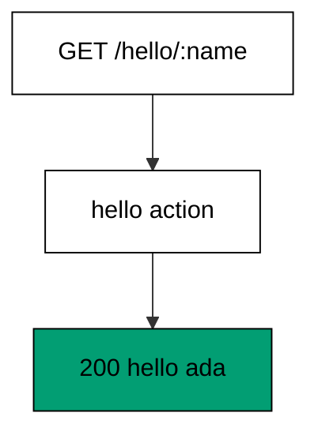
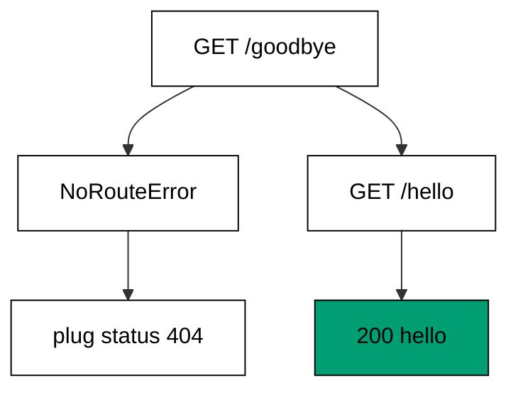
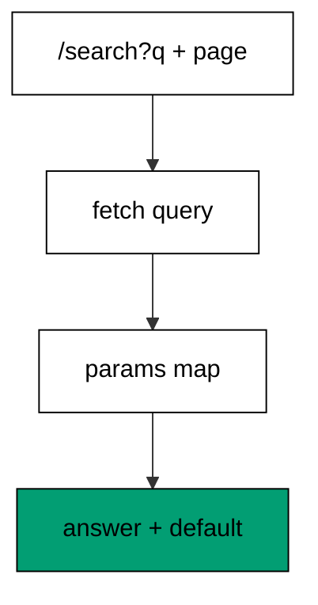
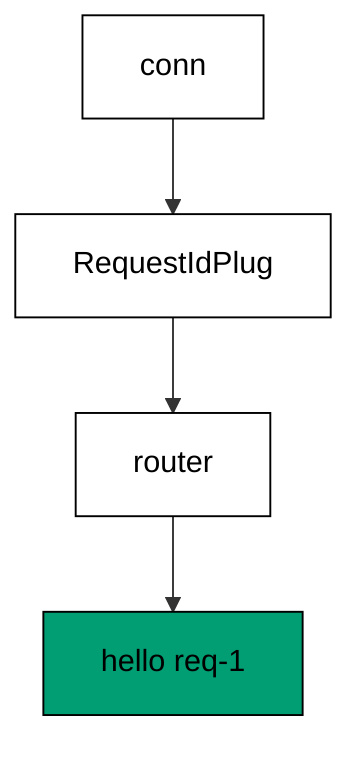
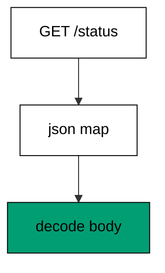
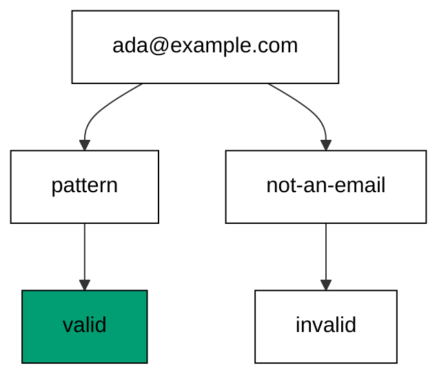
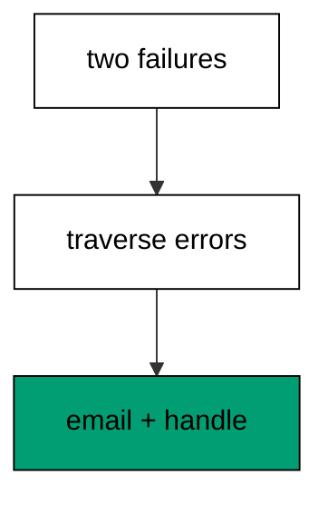
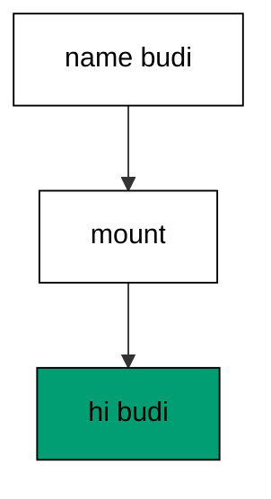
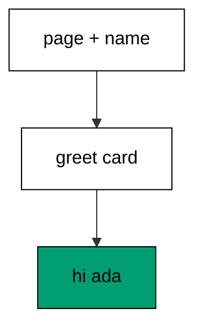

Examples 1–25 build the habits every later example assumes: routing requests through controllers and plugs, validating input with changesets, and mounting LiveViews that render their first HTML. Three clusters carry the level: routes, controllers, and plugs (Examples 1–8), changesets and validation (Examples 9–17), and first LiveViews that mount and render (Examples 18–25). Every program runs in-process in the pinned Elixir container — no socket, no browser; every output is a fixed transcript.

### Example 1: First Route Answers Hello

A route is a promise from a method and a path to a controller action, and this example keeps the smallest real one: one GET route answers with the name from the path. The program builds a test connection in-process and dispatches it through the route table, printing the status and body. (Concepts: co-01, co-02.)



**`learning/code/ex-01-first-route-answers-hello/priv/main.exs`**:

```elixir
# => Example 1: First Route Answers Hello
Logger.configure(level: :warning)
# => warnings only; request logs never reach the transcript
Code.compiler_options(ignore_module_conflict: true)
# => reloaded modules stay silent on double runs

# => one controller module owns the hello answer
defmodule Ex01.HelloController do
  # => text and json answers without an endpoint
  use Phoenix.Controller, formats: [:html, :json]

  # => the action the route below names
  def hello(conn, %{"name" => name}) do
    # => plain-text answer built from the path segment
    text(conn, "hello #{name}")
    # => end hello: no template, no socket
  end

  # => module boundary stays explicit
end

# => one router module owns the route table
defmodule Ex01.Router do
  # => the macro that builds match and dispatch
  use Phoenix.Router

  # => GET /hello/:name reaches hello with name bound
  get "/hello/:name", Ex01.HelloController, :hello
  # => end router: one route, one answer
end

# => run/0 holds the whole example narrative
defmodule Ex01.Main do
  # => single entry point the last line calls
  def run do
    # => a test connection, never a socket
    conn = Plug.Test.conn(:get, "/hello/ada")
    # => the route table dispatches it in-process
    conn = Ex01.Router.call(conn, [])
    # => Output: status: 200 body: hello ada
    IO.puts("status: #{conn.status} body: #{conn.resp_body}")

    # => end run: the narrative returns here
  end

  # => module boundary stays explicit
end

# => the entry point runs exactly once per execution
Ex01.Main.run()
```

**Output** (`learning/code/ex-01-first-route-answers-hello/expected/main.stdout.txt`):

```text
status: 200 body: hello ada
```

**Key takeaway**: A `get` route pairs a path pattern with a controller action; dispatching a test connection through the router prints exactly what the action answers.

**Why it matters**: Production Phoenix apps are route tables first: every URL a user can reach is a row in the router. Reading dispatch as data — method plus path in, action out — makes later debugging (why did this URL 404?) a table lookup instead of a mystery.

### Example 2: Missing Route Raises 404

No route table covers every path, and Phoenix says so by raising `NoRouteError` — an exception that already carries `plug_status: 404`, which the endpoint renders into the familiar page. This example dispatches a path nobody declared, rescues the miss, and prints its status beside a known route that still answers. (Concepts: co-01.)



**`learning/code/ex-02-missing-route-raises-404/priv/main.exs`**:

```elixir
# => Example 2: Missing Route Raises 404
Logger.configure(level: :warning)
# => warnings only; Plug logs never reach the transcript
Code.compiler_options(ignore_module_conflict: true)
# => reloaded modules stay silent on double runs

# => one controller module owns the single known answer
defmodule Ex02.HelloController do
  # => text answers without an endpoint
  use Phoenix.Controller, formats: [:html, :json]

  # => the only action this router exposes
  def hello(conn, _params) do
    # => plain-text answer for the known path
    text(conn, "hello")
    # => end hello: nothing else matches
  end

  # => module boundary stays explicit
end

# => one router module owns the small route table
defmodule Ex02.Router do
  # => the macro that builds match and dispatch
  use Phoenix.Router

  # => exactly one known route exists
  get "/hello", Ex02.HelloController, :hello
  # => end router: unknown paths raise instead
end

# => run/0 holds the whole example narrative
defmodule Ex02.Main do
  # => single entry point the last line calls
  def run do
    # => a request to a path nobody declared
    missed =
      # => try the dispatch that cannot match
      try do
        # => this call raises before answering
        Ex02.Router.call(Plug.Test.conn(:get, "/goodbye"), [])
        # => matched would print here, never reached
        "matched"
      rescue
        # => the miss carries its production status
        e in Phoenix.Router.NoRouteError -> "no route: #{e.plug_status}"
        # => end rescue: 404 without an endpoint
      end
    # => Output: no route: 404
    IO.puts(missed)
    # => a request to the known path still answers
    conn = Plug.Test.conn(:get, "/hello")
    # => dispatch finds the declared route
    conn = Ex02.Router.call(conn, [])
    # => Output: known: 200 hello
    IO.puts("known: #{conn.status} #{conn.resp_body}")

    # => end run: the narrative returns here
  end

  # => module boundary stays explicit
end

# => the entry point runs exactly once per execution
Ex02.Main.run()
```

**Output** (`learning/code/ex-02-missing-route-raises-404/expected/main.stdout.txt`):

```text
no route: 404
known: 200 hello
```

**Key takeaway**: An unmatched path raises `NoRouteError` carrying 404; the endpoint turns that raise into the 404 response users see.

**Why it matters**: Route misses are the most common production surprise after deploys that rename URLs. Knowing the miss raises — with its status attached — tells you where to catch it (a fallback controller, an error view) instead of fearing it.

### Example 3: Post Route Reads Params

The router matches the method as well as the path: a POST route ignores GET requests to the same URL and vice versa. This example declares a POST echo route, sends a POST with a message parameter, and prints the echoed answer. (Concepts: co-01, co-02.)

**`learning/code/ex-03-post-route-reads-params/priv/main.exs`**:

```elixir
# => Example 3: Post Route Reads Params
Logger.configure(level: :warning)
# => warnings only; request logs never reach the transcript
Code.compiler_options(ignore_module_conflict: true)
# => reloaded modules stay silent on double runs

# => one controller module echoes the posted message
defmodule Ex03.EchoController do
  # => text answers without an endpoint
  use Phoenix.Controller, formats: [:html, :json]

  # => the action the POST route below names
  def echo(conn, params) do
    # => the msg param comes from the request line
    text(conn, "echo #{params["msg"]}")
    # => end echo: POST body or query both land in params
  end

  # => module boundary stays explicit
end

# => one router module owns the POST route
defmodule Ex03.Router do
  # => the macro that builds match and dispatch
  use Phoenix.Router

  # => POST /echo reaches echo, GET would miss
  post "/echo", Ex03.EchoController, :echo
  # => end router: method is part of the match
end

# => run/0 holds the whole example narrative
defmodule Ex03.Main do
  # => single entry point the last line calls
  def run do
    # => a POST carrying its message on the request line
    conn = Plug.Test.conn(:post, "/echo?msg=hi")
    # => pipelines fetch the query string into params
    conn = Plug.Conn.fetch_query_params(conn)
    # => the router dispatches by method and path
    conn = Ex03.Router.call(conn, [])
    # => Output: post: 200 echo hi
    IO.puts("post: #{conn.status} #{conn.resp_body}")

    # => end run: the narrative returns here
  end

  # => module boundary stays explicit
end

# => the entry point runs exactly once per execution
Ex03.Main.run()
```

**Output** (`learning/code/ex-03-post-route-reads-params/expected/main.stdout.txt`):

```text
post: 200 echo hi
```

**Key takeaway**: `post` routes match the method and the path together; the action reads the request parameters the pipeline fetched.

**Why it matters**: Forms, webhooks, and API clients all speak POST to URLs that also answer GET differently (or not at all). Matching on method keeps one URL serving two purposes without the actions ever colliding.

### Example 4: Query Params Shape the Answer

Query strings ride outside the route match: the router sees `/search` while `q` and `page` travel in `conn.params` after the pipeline fetches them. This example answers one search route twice — once with every query value, once with the page missing — and prints how the default fills the gap. (Concepts: co-01, co-02.)



**`learning/code/ex-04-query-params-shape-the-answer/priv/main.exs`**:

```elixir
# => Example 4: Query Params Shape the Answer
Logger.configure(level: :warning)
# => warnings only; request logs never reach the transcript
Code.compiler_options(ignore_module_conflict: true)
# => reloaded modules stay silent on double runs

# => one controller module lists one fake search page
defmodule Ex04.SearchController do
  # => text answers without an endpoint
  use Phoenix.Controller, formats: [:html, :json]

  # => the action the search route below names
  def search(conn, params) do
    # => two query values with a default page
    text(conn, "q=#{params["q"]} page=#{params["page"] || "1"}")
    # => end search: missing keys fall back loudly
  end

  # => module boundary stays explicit
end

# => one router module owns the search route
defmodule Ex04.Router do
  # => the macro that builds match and dispatch
  use Phoenix.Router

  # => GET /search reaches search with the query intact
  get "/search", Ex04.SearchController, :search
  # => end router: the query string is not in the match
end

# => run/0 holds the whole example narrative
defmodule Ex04.Main do
  # => single entry point the last line calls
  def run do
    # => a search with both query values present
    conn = Plug.Test.conn(:get, "/search?q=phoenix&page=2")
    # => pipelines fetch the query string into params
    conn = Plug.Conn.fetch_query_params(conn)
    # => the router dispatches, the query rides along
    conn = Ex04.Router.call(conn, [])
    # => Output: full: q=phoenix page=2
    IO.puts("full: #{conn.resp_body}")
    # => a search that omits the page entirely
    conn = Plug.Test.conn(:get, "/search?q=liveview")
    # => the same fetch step runs again
    conn = Plug.Conn.fetch_query_params(conn)
    # => the router dispatches the same route
    conn = Ex04.Router.call(conn, [])
    # => Output: default: q=liveview page=1
    IO.puts("default: #{conn.resp_body}")

    # => end run: the narrative returns here
  end

  # => module boundary stays explicit
end

# => the entry point runs exactly once per execution
Ex04.Main.run()
```

**Output** (`learning/code/ex-04-query-params-shape-the-answer/expected/main.stdout.txt`):

```text
full: q=phoenix page=2
default: q=liveview page=1
```

**Key takeaway**: The query string never participates in route matching; the pipeline fetches it into params where the action applies defaults.

**Why it matters**: Pagination, filtering, and sorting all live in query strings that callers may omit. Actions that default missing keys loudly (page 1, not a crash) turn sloppy links into working pages.

### Example 5: Scopes Group Api Routes

Real routers hold hundreds of routes, and scopes keep them organized: every route inside `scope "/api"` shares the prefix without repeating it. This example groups one user route under `/api`, dispatches a scoped request, and decodes the JSON answer. (Concepts: co-01, co-02.)

**`learning/code/ex-05-scopes-group-api-routes/priv/main.exs`**:

```elixir
# => Example 5: Scopes Group Api Routes
Logger.configure(level: :warning)
# => warnings only; request logs never reach the transcript
Code.compiler_options(ignore_module_conflict: true)
# => reloaded modules stay silent on double runs

# => one controller module answers for one fake user
defmodule Ex05.UserController do
  # => json answers without an endpoint
  use Phoenix.Controller, formats: [:html, :json]

  # => the action the scoped route below names
  def show(conn, %{"id" => id}) do
    # => the id segment echoes inside a JSON object
    json(conn, %{id: id, name: "ada"})
    # => end show: one resource, one shape
  end

  # => module boundary stays explicit
end

# => one router module groups routes under /api
defmodule Ex05.Router do
  # => the macro that builds match and dispatch
  use Phoenix.Router

  # => every route inside shares the /api prefix
  scope "/api" do
    # => GET /api/users/:id reaches show
    get "/users/:id", Ex05.UserController, :show
    # => end scope: prefixes compose, never repeat
  end

  # => end router: one scope, one route
end

# => run/0 holds the whole example narrative
defmodule Ex05.Main do
  # => single entry point the last line calls
  def run do
    # => a request to the scoped path
    conn = Plug.Test.conn(:get, "/api/users/7")
    # => the scope prefix matches, then the route
    conn = Ex05.Router.call(conn, [])
    # => the JSON body carries the echoed id
    {:ok, decoded} = Jason.decode(conn.resp_body)
    # => Output: user: 7 ada
    IO.puts("user: #{decoded["id"]} #{decoded["name"]}")

    # => end run: the narrative returns here
  end

  # => module boundary stays explicit
end

# => the entry point runs exactly once per execution
Ex05.Main.run()
```

**Output** (`learning/code/ex-05-scopes-group-api-routes/expected/main.stdout.txt`):

```text
user: 7 ada
```

**Key takeaway**: `scope` prefixes a group of routes at once; the action inside still matches and answers exactly like an unscoped route.

**Why it matters**: Versioned APIs (`/api/v1`, `/api/v2`) and admin sections stay readable only when the shared prefix lives in one place. Scopes make moving a whole section one-line work instead of a hundred-line rewrite.

### Example 6: Plug Assigns Before Dispatch

Plugs are the pipeline's composable steps: small modules that transform the connection before the router ever sees it. This example runs a request-id plug that stamps an assign, then dispatches — and the controller reads the stamp the plug left behind. (Concepts: co-01.)



**`learning/code/ex-06-plug-assigns-before-dispatch/priv/main.exs`**:

```elixir
# => Example 6: Plug Assigns Before Dispatch
Logger.configure(level: :warning)
# => warnings only; request logs never reach the transcript
Code.compiler_options(ignore_module_conflict: true)
# => reloaded modules stay silent on double runs

# => one plug module stamps every request it sees
defmodule Ex06.RequestIdPlug do
  # => assign and header helpers live here
  import Plug.Conn

  # => plugs receive their options through init
  def init(opts), do: opts

  # => the stamp lands in assigns for later readers
  def call(conn, _opts), do: assign(conn, :request_id, "req-1")
  # => end plug: transform, then pass along
end

# => one controller module reads the stamp back
defmodule Ex06.HelloController do
  # => text answers without an endpoint
  use Phoenix.Controller, formats: [:html, :json]

  # => the action the route below names
  def hello(conn, _params) do
    # => the plug ran first, so the assign exists
    text(conn, "hello #{conn.assigns[:request_id]}")
    # => end hello: plugs prepare, actions answer
  end

  # => module boundary stays explicit
end

# => one router module owns the hello route
defmodule Ex06.Router do
  # => the macro that builds match and dispatch
  use Phoenix.Router

  # => GET /hello reaches hello after the plug
  get "/hello", Ex06.HelloController, :hello
  # => end router: routing is the last step
end

# => run/0 holds the whole example narrative
defmodule Ex06.Main do
  # => single entry point the last line calls
  def run do
    # => a plain request with no stamp yet
    conn = Plug.Test.conn(:get, "/hello")
    # => the plug runs before the router sees it
    conn = Ex06.RequestIdPlug.call(conn, [])
    # => dispatch finds the route with assigns ready
    conn = Ex06.Router.call(conn, [])
    # => Output: stamped: hello req-1
    IO.puts("stamped: #{conn.resp_body}")

    # => end run: the narrative returns here
  end

  # => module boundary stays explicit
end

# => the entry point runs exactly once per execution
Ex06.Main.run()
```

**Output** (`learning/code/ex-06-plug-assigns-before-dispatch/expected/main.stdout.txt`):

```text
stamped: hello req-1
```

**Key takeaway**: A plug transforms the connection (here: stamping an assign) before dispatch; actions downstream read what plugs prepared.

**Why it matters**: Authentication, request ids, locale, and feature flags all enter the request as plugs, not as action code. Keeping preparation in plugs keeps every action focused on answering instead of re-checking the same headers.

### Example 7: Plug Halts Unauthorized Early

A plug can also end the request: `halt` stops the pipeline so the router never runs, which is how authentication guards answer 401 before any action code loads. This example runs one secret-checking plug against a bare request (halted, 401) and a credentialed one (passed through with a user assign). (Concepts: co-01, co-16.)

**`learning/code/ex-07-plug-halts-unauthorized-early/priv/main.exs`**:

```elixir
# => Example 7: Plug Halts Unauthorized Early
Logger.configure(level: :warning)
# => warnings only; request logs never reach the transcript
Code.compiler_options(ignore_module_conflict: true)
# => reloaded modules stay silent on double runs

# => one plug module guards every request it sees
defmodule Ex07.AuthPlug do
  # => assign, header, halt, and send helpers live here
  import Plug.Conn

  # => plugs receive their options through init
  def init(opts), do: opts

  # => the secret header decides pass or halt
  def call(conn, _opts) do
    # => match the header the client was told
    case get_req_header(conn, "authorization") do
      # => the known secret lets the request through
      ["secret" <> _] -> assign(conn, :user, "ada")
      # => anything else answers 401 immediately
      _ -> conn |> send_resp(401, "denied") |> halt()
      # => end case: halted conns skip the router
    end
    # => end call: one decision, two outcomes
  end

  # => module boundary stays explicit
end

# => run/0 holds the whole example narrative
defmodule Ex07.Main do
  # => single entry point the last line calls
  def run do
    # => a request with no credentials at all
    denied = Plug.Test.conn(:get, "/hello") |> Ex07.AuthPlug.call([])
    # => Output: denied: 401 halted=true denied
    IO.puts("denied: #{denied.status} halted=#{denied.halted} #{denied.resp_body}")
    # => a request carrying the shared secret
    allowed =
      # => the header the plug was told to expect
      Plug.Test.conn(:get, "/hello")
      # => put_req_header sets it before the plug runs
      |> Plug.Conn.put_req_header("authorization", "secret-1")
      # => the plug assigns instead of halting
      |> Ex07.AuthPlug.call([])
    # => Output: allowed: halted=false user=ada
    IO.puts("allowed: halted=#{allowed.halted} user=#{allowed.assigns[:user]}")

    # => end run: the narrative returns here
  end

  # => module boundary stays explicit
end

# => the entry point runs exactly once per execution
Ex07.Main.run()
```

**Output** (`learning/code/ex-07-plug-halts-unauthorized-early/expected/main.stdout.txt`):

```text
denied: 401 halted=true denied
allowed: halted=false user=ada
```

**Key takeaway**: `halt` ends the pipeline inside a plug; denied requests answer 401 without ever reaching the router, while allowed ones carry their assign forward.

**Why it matters**: Rejecting unauthenticated traffic at the pipeline edge costs one header comparison instead of a full dispatch plus database lookup. That is the framework trade-off in miniature: server work you skip early is work you never pay for — unlike a client-side guard, which an attacker simply removes.

### Example 8: Controller Answers Json

API actions answer data, not pages: `json` encodes a map through Jason and sets the JSON content type in one step. This example dispatches a status route, prints the content type, and decodes the body back to prove the round trip. (Concepts: co-02.)



**`learning/code/ex-08-controller-answers-json/priv/main.exs`**:

```elixir
# => Example 8: Controller Answers Json
Logger.configure(level: :warning)
# => warnings only; request logs never reach the transcript
Code.compiler_options(ignore_module_conflict: true)
# => reloaded modules stay silent on double runs

# => one controller module answers with a JSON object
defmodule Ex08.StatusController do
  # => json answers without an endpoint
  use Phoenix.Controller, formats: [:html, :json]

  # => the action the route below names
  def status(conn, _params) do
    # => the map encodes through the Jason library
    json(conn, %{service: "orders", ok: true})
    # => end status: data out, no template
  end

  # => module boundary stays explicit
end

# => one router module owns the status route
defmodule Ex08.Router do
  # => the macro that builds match and dispatch
  use Phoenix.Router

  # => GET /status reaches status
  get "/status", Ex08.StatusController, :status
  # => end router: health checks are routes too
end

# => run/0 holds the whole example narrative
defmodule Ex08.Main do
  # => single entry point the last line calls
  def run do
    # => a request to the status route
    conn = Plug.Test.conn(:get, "/status")
    # => the router dispatches to the JSON action
    conn = Ex08.Router.call(conn, [])
    # => the content type names JSON explicitly
    [ctype] = Plug.Conn.get_resp_header(conn, "content-type")
    # => Output: ctype: application/json
    IO.puts("ctype: #{String.split(ctype, ";") |> hd()}")
    # => the body decodes back to the sent fields
    {:ok, decoded} = Jason.decode(conn.resp_body)
    # => Output: json: orders true
    IO.puts("json: #{decoded["service"]} #{decoded["ok"]}")

    # => end run: the narrative returns here
  end

  # => module boundary stays explicit
end

# => the entry point runs exactly once per execution
Ex08.Main.run()
```

**Output** (`learning/code/ex-08-controller-answers-json/expected/main.stdout.txt`):

```text
ctype: application/json
json: orders true
```

**Key takeaway**: `json` encodes the given map and labels the response JSON; decoding the body returns exactly the fields the action sent.

**Why it matters**: Health checks, machine clients, and JavaScript front ends all consume JSON, and a wrong content type breaks them silently. Asserting the content type alongside the body catches the class of bug where the data is right but the label lies.

### Example 9: Changeset Accepts Valid Input

Every web boundary in this course is a changeset: `cast` keeps only the allowed fields and `validate_required` demands the essential ones. This example builds a member changeset from complete input and prints its validity with the sorted change keys. (Concepts: co-03.)

**`learning/code/ex-09-changeset-accepts-valid-input/priv/main.exs`**:

```elixir
# => Example 9: Changeset Accepts Valid Input
Logger.configure(level: :warning)
# => warnings only; Ecto stays silent below this
Code.compiler_options(ignore_module_conflict: true)
# => reloaded modules stay silent on double runs

# => one schema module names the member fields
defmodule Ex09.Member do
  # => schema and changeset macros live here
  use Ecto.Schema
  # => cast and validate helpers live here
  import Ecto.Changeset

  # => members persist under this source name
  schema "members" do
    # => the unique name a member chooses
    field :handle, :string
    # => full years, optional at the boundary
    field :age, :integer
  end

  # => the boundary function every example reuses
  def changeset(member, attrs) do
    # => cast keeps only the listed fields
    member |> cast(attrs, [:handle, :age]) |> validate_required([:handle])
    # => end changeset: handle must be present
  end

  # => module boundary stays explicit
end

# => run/0 holds the whole example narrative
defmodule Ex09.Main do
  # => single entry point the last line calls
  def run do
    # => input with every required field present
    cs = Ex09.Member.changeset(struct(Ex09.Member), %{handle: "ada", age: 36})
    # => Output: valid: true changes: age handle
    IO.puts("valid: #{cs.valid?} changes: #{cs.changes |> Map.keys() |> Enum.sort() |> Enum.join(" ")}")

    # => end run: the narrative returns here
  end

  # => module boundary stays explicit
end

# => the entry point runs exactly once per execution
Ex09.Main.run()
```

**Output** (`learning/code/ex-09-changeset-accepts-valid-input/expected/main.stdout.txt`):

```text
valid: true changes: age handle
```

**Key takeaway**: A changeset with all required fields present reports valid and lists exactly the fields it accepted.

**Why it matters**: Changesets sit between untrusted web input and everything downstream — the database, the LiveView, the broadcast. One validation function reused by the form, the API, and the tests means the boundary has a single definition instead of three.

### Example 10: Required Field Errors Loudly

Validation fails in data, not in exceptions: a changeset built from incomplete input reports `valid?: false` and names the missing field in its errors. This example omits the required handle and prints the validity with the failed field. (Concepts: co-03.)

**`learning/code/ex-10-required-field-errors-loudly/priv/main.exs`**:

```elixir
# => Example 10: Required Field Errors Loudly
Logger.configure(level: :warning)
# => warnings only; Ecto stays silent below this
Code.compiler_options(ignore_module_conflict: true)
# => reloaded modules stay silent on double runs

# => one schema module names the member fields
defmodule Ex10.Member do
  # => schema and changeset macros live here
  use Ecto.Schema
  # => cast and validate helpers live here
  import Ecto.Changeset

  # => members persist under this source name
  schema "members" do
    # => the unique name a member chooses
    field :handle, :string
  end

  # => the boundary function every example reuses
  def changeset(member, attrs) do
    # => cast keeps only the listed fields
    member |> cast(attrs, [:handle]) |> validate_required([:handle])
    # => end changeset: handle must be present
  end

  # => module boundary stays explicit
end

# => run/0 holds the whole example narrative
defmodule Ex10.Main do
  # => single entry point the last line calls
  def run do
    # => input with the required handle missing
    cs = Ex10.Member.changeset(struct(Ex10.Member), %{})
    # => Output: valid: false errors: handle
    IO.puts("valid: #{cs.valid?} errors: #{cs.errors |> Keyword.keys() |> Enum.join(" ")}")

    # => end run: the narrative returns here
  end

  # => module boundary stays explicit
end

# => the entry point runs exactly once per execution
Ex10.Main.run()
```

**Output** (`learning/code/ex-10-required-field-errors-loudly/expected/main.stdout.txt`):

```text
valid: false errors: handle
```

**Key takeaway**: Missing required input yields an invalid changeset whose error keys name exactly the absent fields.

**Why it matters**: Web input is hostile by default — fields missing, mistyped, or malicious. Failing as data lets the caller (a form, an API error renderer) show the problem instead of crashing on it.

### Example 11: Length Bounds the Handle

Bounds turn vague rules into exact ones: `validate_length` with a minimum and maximum accepts, rejects-short, and rejects-long in three separate calls. This example runs all three against a 3-to-12 handle rule and prints each verdict. (Concepts: co-03.)

**`learning/code/ex-11-length-bounds-the-handle/priv/main.exs`**:

```elixir
# => Example 11: Length Bounds the Handle
Logger.configure(level: :warning)
# => warnings only; Ecto stays silent below this
Code.compiler_options(ignore_module_conflict: true)
# => reloaded modules stay silent on double runs

# => one schema module names the member fields
defmodule Ex11.Member do
  # => schema and changeset macros live here
  use Ecto.Schema
  # => cast and validate helpers live here
  import Ecto.Changeset

  # => members persist under this source name
  schema "members" do
    # => the unique name a member chooses
    field :handle, :string
  end

  # => handles run 3 to 12 characters here
  def changeset(member, attrs) do
    # => cast first, then require, then bound
    member |> cast(attrs, [:handle]) |> validate_required([:handle]) |> validate_length(:handle, min: 3, max: 12)
    # => end changeset: short and long both fail
  end

  # => module boundary stays explicit
end

# => run/0 holds the whole example narrative
defmodule Ex11.Main do
  # => single entry point the last line calls
  def run do
    # => two characters are too few
    short = Ex11.Member.changeset(struct(Ex11.Member), %{handle: "ab"})
    # => Output: short: false
    IO.puts("short: #{short.valid?}")
    # => thirteen characters are too many
    long = Ex11.Member.changeset(struct(Ex11.Member), %{handle: "abcdefghijklm"})
    # => Output: long: false
    IO.puts("long: #{long.valid?}")
    # => five characters sit inside the bounds
    just = Ex11.Member.changeset(struct(Ex11.Member), %{handle: "adanya"})
    # => Output: just: true
    IO.puts("just: #{just.valid?}")

    # => end run: the narrative returns here
  end

  # => module boundary stays explicit
end

# => the entry point runs exactly once per execution
Ex11.Main.run()
```

**Output** (`learning/code/ex-11-length-bounds-the-handle/expected/main.stdout.txt`):

```text
short: false
long: false
just: true
```

**Key takeaway**: `validate_length` with min and max draws an exact acceptance window; inputs on either side fail while inside passes.

**Why it matters**: Usernames, slugs, and codes all have lengths the rest of the system assumes — database columns, URL segments, display widths. Enforcing the window at the boundary keeps every downstream assumption true.

### Example 12: Format Checks the Email

Some fields carry shape, not just presence: `validate_format` checks the email against a small pattern that demands one at-sign and no spaces. This example runs a plain address and a broken string through the rule and prints both verdicts. (Concepts: co-03.)



**`learning/code/ex-12-format-checks-the-email/priv/main.exs`**:

```elixir
# => Example 12: Format Checks the Email
Logger.configure(level: :warning)
# => warnings only; Ecto stays silent below this
Code.compiler_options(ignore_module_conflict: true)
# => reloaded modules stay silent on double runs

# => one schema module names the contact fields
defmodule Ex12.Contact do
  # => schema and changeset macros live here
  use Ecto.Schema
  # => cast and validate helpers live here
  import Ecto.Changeset

  # => contacts persist under this source name
  schema "contacts" do
    # => the address replies go to
    field :email, :string
  end

  # => a small pattern keeps obvious typos out
  def changeset(contact, attrs) do
    # => cast first, then require, then match
    contact |> cast(attrs, [:email]) |> validate_required([:email]) |> validate_format(:email, ~r/^[^@\s]+@[^@\s]+$/)
    # => end changeset: one at-sign, no spaces
  end

  # => module boundary stays explicit
end

# => run/0 holds the whole example narrative
defmodule Ex12.Main do
  # => single entry point the last line calls
  def run do
    # => a plain address passes the pattern
    good = Ex12.Contact.changeset(struct(Ex12.Contact), %{email: "ada@example.com"})
    # => Output: good: true
    IO.puts("good: #{good.valid?}")
    # => a string with no at-sign fails it
    bad = Ex12.Contact.changeset(struct(Ex12.Contact), %{email: "not-an-email"})
    # => Output: bad: false
    IO.puts("bad: #{bad.valid?}")

    # => end run: the narrative returns here
  end

  # => module boundary stays explicit
end

# => the entry point runs exactly once per execution
Ex12.Main.run()
```

**Output** (`learning/code/ex-12-format-checks-the-email/expected/main.stdout.txt`):

```text
good: true
bad: false
```

**Key takeaway**: `validate_format` accepts values matching the pattern and rejects the rest; the pattern here requires one at-sign and no spaces.

**Why it matters**: A mistyped email never bounces loudly — the confirmation mail simply vanishes. Catching obvious typos at the boundary saves the support conversation that starts with 'I never got the email'.

### Example 13: Number Bounds the Age

Numbers compare rather than match: `validate_number` with `greater_than_or_equal_to` draws the line this community sets at thirteen. This example runs twelve and thirteen through the rule and prints each verdict. (Concepts: co-03.)

**`learning/code/ex-13-number-bounds-the-age/priv/main.exs`**:

```elixir
# => Example 13: Number Bounds the Age
Logger.configure(level: :warning)
# => warnings only; Ecto stays silent below this
Code.compiler_options(ignore_module_conflict: true)
# => reloaded modules stay silent on double runs

# => one schema module names the member fields
defmodule Ex13.Member do
  # => schema and changeset macros live here
  use Ecto.Schema
  # => cast and validate helpers live here
  import Ecto.Changeset

  # => members persist under this source name
  schema "members" do
    # => the unique name a member chooses
    field :handle, :string
    # => full years, bounded below
    field :age, :integer
  end

  # => members are at least thirteen here
  def changeset(member, attrs) do
    # => cast first, then require, then compare
    member |> cast(attrs, [:handle, :age]) |> validate_required([:handle, :age]) |> validate_number(:age, greater_than_or_equal_to: 13)
    # => end changeset: twelve fails, thirteen passes
  end

  # => module boundary stays explicit
end

# => run/0 holds the whole example narrative
defmodule Ex13.Main do
  # => single entry point the last line calls
  def run do
    # => twelve falls below the bound
    young = Ex13.Member.changeset(struct(Ex13.Member), %{handle: "ada", age: 12})
    # => Output: young: false
    IO.puts("young: #{young.valid?}")
    # => thirteen meets the bound exactly
    teen = Ex13.Member.changeset(struct(Ex13.Member), %{handle: "ada", age: 13})
    # => Output: teen: true
    IO.puts("teen: #{teen.valid?}")

    # => end run: the narrative returns here
  end

  # => module boundary stays explicit
end

# => the entry point runs exactly once per execution
Ex13.Main.run()
```

**Output** (`learning/code/ex-13-number-bounds-the-age/expected/main.stdout.txt`):

```text
young: false
teen: true
```

**Key takeaway**: `validate_number` enforces numeric floors and ceilings; the boundary value itself passes while anything below fails.

**Why it matters**: Age gates, quantity limits, and price floors are legal or business rules, not suggestions. Placing the comparison in the changeset puts the rule where every entry path — form, API, import — must pass it.

### Example 14: Inclusion Picks the Role

Enumerations belong in the validation, not in tribal knowledge: `validate_inclusion` accepts only the three roles the system knows. This example runs a known role and an invented one through the rule and prints both verdicts. (Concepts: co-03.)

**`learning/code/ex-14-inclusion-picks-the-role/priv/main.exs`**:

```elixir
# => Example 14: Inclusion Picks the Role
Logger.configure(level: :warning)
# => warnings only; Ecto stays silent below this
Code.compiler_options(ignore_module_conflict: true)
# => reloaded modules stay silent on double runs

# => one schema module names the account fields
defmodule Ex14.Account do
  # => schema and changeset macros live here
  use Ecto.Schema
  # => cast and validate helpers live here
  import Ecto.Changeset

  # => accounts persist under this source name
  schema "accounts" do
    # => the unique name a member chooses
    field :handle, :string
    # => one of the three known roles
    field :role, :string
  end

  # => unknown roles never reach the web layer
  def changeset(account, attrs) do
    # => cast first, then require, then restrict
    account |> cast(attrs, [:handle, :role]) |> validate_required([:handle, :role]) |> validate_inclusion(:role, ["reader", "writer", "admin"])
    # => end changeset: the list is the whole vocabulary
  end

  # => module boundary stays explicit
end

# => run/0 holds the whole example narrative
defmodule Ex14.Main do
  # => single entry point the last line calls
  def run do
    # => writer sits inside the vocabulary
    known = Ex14.Account.changeset(struct(Ex14.Account), %{handle: "ada", role: "writer"})
    # => Output: known: true
    IO.puts("known: #{known.valid?}")
    # => owner sits outside of it
    strange = Ex14.Account.changeset(struct(Ex14.Account), %{handle: "ada", role: "owner"})
    # => Output: strange: false
    IO.puts("strange: #{strange.valid?}")

    # => end run: the narrative returns here
  end

  # => module boundary stays explicit
end

# => the entry point runs exactly once per execution
Ex14.Main.run()
```

**Output** (`learning/code/ex-14-inclusion-picks-the-role/expected/main.stdout.txt`):

```text
known: true
strange: false
```

**Key takeaway**: `validate_inclusion` restricts a field to an explicit vocabulary; anything outside the list fails.

**Why it matters**: An unexpected role string that reaches authorization code can escalate privileges or crash pattern matches. Closing the vocabulary at the boundary keeps the rest of the system total over its inputs.

### Example 15: Custom Rule Rejects Reserved

Built-in validators cover the common cases; `validate_change` covers the policy only this product has — here, that `admin` and `root` stay reserved forever. This example runs a reserved name and an ordinary one through the custom rule and prints both verdicts. (Concepts: co-03.)

**`learning/code/ex-15-custom-rule-rejects-reserved/priv/main.exs`**:

```elixir
# => Example 15: Custom Rule Rejects Reserved
Logger.configure(level: :warning)
# => warnings only; Ecto stays silent below this
Code.compiler_options(ignore_module_conflict: true)
# => reloaded modules stay silent on double runs

# => one schema module names the member fields
defmodule Ex15.Member do
  # => schema and changeset macros live here
  use Ecto.Schema
  # => cast and validate helpers live here
  import Ecto.Changeset

  # => members persist under this source name
  schema "members" do
    # => the unique name a member chooses
    field :handle, :string
  end

  # => admin and root stay reserved forever
  def changeset(member, attrs) do
    # => cast first, then require, then the custom rule
    member
    # => the pipeline reads top to bottom
    |> cast(attrs, [:handle])
    # => presence still comes first
    |> validate_required([:handle])
    # => the custom rule sees the cast handle
    |> validate_change(:handle, fn :handle, handle ->
      # => reserved names collect one error
      if handle in ["admin", "root"], do: [handle: "is reserved"], else: []
      # => end rule: anything else passes through
    end)
    # => end changeset: built-ins plus one custom step
  end

  # => module boundary stays explicit
end

# => run/0 holds the whole example narrative
defmodule Ex15.Main do
  # => single entry point the last line calls
  def run do
    # => admin is reserved by policy
    taken = Ex15.Member.changeset(struct(Ex15.Member), %{handle: "admin"})
    # => Output: taken: false
    IO.puts("taken: #{taken.valid?}")
    # => operator is an ordinary name
    free = Ex15.Member.changeset(struct(Ex15.Member), %{handle: "operator"})
    # => Output: free: true
    IO.puts("free: #{free.valid?}")

    # => end run: the narrative returns here
  end

  # => module boundary stays explicit
end

# => the entry point runs exactly once per execution
Ex15.Main.run()
```

**Output** (`learning/code/ex-15-custom-rule-rejects-reserved/expected/main.stdout.txt`):

```text
taken: false
free: true
```

**Key takeaway**: `validate_change` runs an arbitrary function over one field; returning error tuples rejects input the built-ins cannot describe.

**Why it matters**: Reserved names, profanity lists, and tenant-specific rules change with the business, not with the framework. A custom validator keeps product policy in the boundary function reviewers already read, instead of scattered across controllers.

### Example 16: Errors Read as Messages

Error tuples are for machines; `traverse_errors` turns them into sentences for humans, one list per field. This example fails two fields at once, then prints the sorted field names with the email's human sentence. (Concepts: co-03.)



**`learning/code/ex-16-errors-read-as-messages/priv/main.exs`**:

```elixir
# => Example 16: Errors Read as Messages
Logger.configure(level: :warning)
# => warnings only; Ecto stays silent below this
Code.compiler_options(ignore_module_conflict: true)
# => reloaded modules stay silent on double runs

# => one schema module names the signup fields
defmodule Ex16.Signup do
  # => schema and changeset macros live here
  use Ecto.Schema
  # => cast and validate helpers live here
  import Ecto.Changeset

  # => signups persist under this source name
  schema "signups" do
    # => the unique name a member chooses
    field :handle, :string
    # => the address replies go to
    field :email, :string
  end

  # => both fields validated at once
  def changeset(signup, attrs) do
    # => cast both, require both, bound one
    signup |> cast(attrs, [:handle, :email]) |> validate_required([:handle, :email]) |> validate_length(:handle, min: 3)
    # => end changeset: two failures possible
  end

  # => module boundary stays explicit
end

# => run/0 holds the whole example narrative
defmodule Ex16.Main do
  # => single entry point the last line calls
  def run do
    # => a short handle and a missing email fail together
    cs = Ex16.Signup.changeset(struct(Ex16.Signup), %{handle: "ab"})
    # => traverse_errors turns tuples into sentences
    messages = Ecto.Changeset.traverse_errors(cs, fn {msg, _opts} -> msg end)
    # => Output: fields: email handle
    IO.puts("fields: #{messages |> Map.keys() |> Enum.sort() |> Enum.join(" ")}")
    # => Output: email: can't be blank
    IO.puts("email: #{messages[:email] |> hd()}")

    # => end run: the narrative returns here
  end

  # => module boundary stays explicit
end

# => the entry point runs exactly once per execution
Ex16.Main.run()
```

**Output** (`learning/code/ex-16-errors-read-as-messages/expected/main.stdout.txt`):

```text
fields: email handle
email: can't be blank
```

**Key takeaway**: `traverse_errors` maps each field's error tuples to message strings, ready to render beside the form inputs that caused them.

**Why it matters**: A form that says 'invalid' teaches nothing; a form that says 'email can't be blank' beside the email box teaches everything. The traversal is the step that converts validation data into user guidance.

### Example 17: Action Builds Without a Database

Changesets do not need a database: `apply_action` runs insert semantics in memory, returning either the built struct or the failed changeset. This example builds a valid member and refuses an invalid one, printing both outcomes. (Concepts: co-03.)

**`learning/code/ex-17-action-builds-without-a-database/priv/main.exs`**:

```elixir
# => Example 17: Action Builds Without a Database
Logger.configure(level: :warning)
# => warnings only; Ecto stays silent below this
Code.compiler_options(ignore_module_conflict: true)
# => reloaded modules stay silent on double runs

# => one schema module names the member fields
defmodule Ex17.Member do
  # => schema and changeset macros live here
  use Ecto.Schema
  # => cast and validate helpers live here
  import Ecto.Changeset

  # => members persist under this source name
  schema "members" do
    # => the unique name a member chooses
    field :handle, :string
    # => full years, optional at the boundary
    field :age, :integer
  end

  # => the boundary function every example reuses
  def changeset(member, attrs) do
    # => cast keeps only the listed fields
    member |> cast(attrs, [:handle, :age]) |> validate_required([:handle])
    # => end changeset: handle must be present
  end

  # => module boundary stays explicit
end

# => run/0 holds the whole example narrative
defmodule Ex17.Main do
  # => single entry point the last line calls
  def run do
    # => valid input applies into a struct, no repo
    {:ok, member} =
      # => struct plus attrs, validated first
      struct(Ex17.Member)
      # => the changeset carries the rules
      |> Ex17.Member.changeset(%{handle: "ada", age: 36})
      # => apply_action runs insert semantics in memory
      |> Ecto.Changeset.apply_action(:insert)
    # => Output: built: ada 36
    IO.puts("built: #{member.handle} #{member.age}")
    # => invalid input returns the changeset instead
    {:error, failed} =
      # => empty attrs fail the required handle
      struct(Ex17.Member)
      # => the same rules, the opposite outcome
      |> Ex17.Member.changeset(%{})
      # => apply_action refuses to build
      |> Ecto.Changeset.apply_action(:insert)
    # => Output: refused: false
    IO.puts("refused: #{failed.valid?}")

    # => end run: the narrative returns here
  end

  # => module boundary stays explicit
end

# => the entry point runs exactly once per execution
Ex17.Main.run()
```

**Output** (`learning/code/ex-17-action-builds-without-a-database/expected/main.stdout.txt`):

```text
built: ada 36
refused: false
```

**Key takeaway**: `apply_action(:insert)` on a valid changeset returns the built struct; on an invalid one it returns the changeset — no repository involved.

**Why it matters**: Tests, previews, and multi-step wizards all need 'what would save?' without touching the database. Building in memory keeps the fast feedback loop fast and the database out of unit tests entirely.

### Example 18: Mount Seeds Initial Assigns

A LiveView is a process with state, and `mount` is where that state begins: it runs once per connected visitor and returns the socket carrying the first assigns. This example mounts a counter with no params and prints the seeded count. (Concepts: co-04, co-11.)

**`learning/code/ex-18-mount-seeds-initial-assigns/priv/main.exs`**:

```elixir
# => Example 18: Mount Seeds Initial Assigns
Logger.configure(level: :warning)
# => warnings only; LiveView stays silent below this
Code.compiler_options(ignore_module_conflict: true)
# => reloaded modules stay silent on double runs

# => one LiveView module owns the counter state
defmodule Ex18.Counter do
  # => mount, event, and render callbacks live here
  use Phoenix.LiveView

  # => mount runs once per connected process
  def mount(_params, _session, socket) do
    # => the counter starts at zero for everyone
    {:ok, assign(socket, count: 0)}
    # => end mount: state lives in the process
  end

  # => render turns the assigns into HTML later
  def render(assigns), do: ~H"<p>count: {@count}</p>"
  # => end view: mount first, render after
end

# => run/0 holds the whole example narrative
defmodule Ex18.Main do
  # => single entry point the last line calls
  def run do
    # => mount with no params and no session
    {:ok, socket} = Ex18.Counter.mount(%{}, %{}, struct(Phoenix.LiveView.Socket))
    # => Output: count: 0
    IO.puts("count: #{socket.assigns.count}")

    # => end run: the narrative returns here
  end

  # => module boundary stays explicit
end

# => the entry point runs exactly once per execution
Ex18.Main.run()
```

**Output** (`learning/code/ex-18-mount-seeds-initial-assigns/expected/main.stdout.txt`):

```text
count: 0
```

**Key takeaway**: `mount` runs once per LiveView process and seeds its assigns; everything the page later shows starts from what mount stored.

**Why it matters**: Forgetting that mount runs per visitor — not once per deploy — is the classic LiveView misunderstanding. State seeded here belongs to one user in one process, which is exactly why one visitor's counter never leaks into another's.

### Example 19: Render Turns Assigns Into Html

If mount is the state, `render` is the mirror: it turns the current assigns into HTML every time the state changes. This example mounts a greeter and renders its assigns to a string, printing the resulting paragraph. (Concepts: co-05.)

**`learning/code/ex-19-render-turns-assigns-into-html/priv/main.exs`**:

```elixir
# => Example 19: Render Turns Assigns Into Html
Logger.configure(level: :warning)
# => warnings only; LiveView stays silent below this
Code.compiler_options(ignore_module_conflict: true)
# => reloaded modules stay silent on double runs

# => one LiveView module greets by assign
defmodule Ex19.Greeter do
  # => mount, event, and render callbacks live here
  use Phoenix.LiveView

  # => mount seeds the name every render reads
  def mount(_params, _session, socket) do
    # => the greeting names ada from the start
    {:ok, assign(socket, name: "ada")}
    # => end mount: one assign, one template
  end

  # => the template reads the name assign
  def render(assigns), do: ~H"<p>hi {@name}</p>"
  # => end view: assigns in, HTML out
end

# => run/0 holds the whole example narrative
defmodule Ex19.Main do
  # => single entry point the last line calls
  def run do
    # => mount first, so assigns exist
    {:ok, socket} = Ex19.Greeter.mount(%{}, %{}, struct(Phoenix.LiveView.Socket))
    # => render produces the template struct
    html = Ex19.Greeter.render(socket.assigns) |> Phoenix.HTML.Safe.to_iodata() |> IO.iodata_to_binary()
    # => Output: html: <p>hi ada</p>
    IO.puts("html: #{html}")

    # => end run: the narrative returns here
  end

  # => module boundary stays explicit
end

# => the entry point runs exactly once per execution
Ex19.Main.run()
```

**Output** (`learning/code/ex-19-render-turns-assigns-into-html/expected/main.stdout.txt`):

```text
html: <p>hi ada</p>
```

**Key takeaway**: `render` maps assigns to HTML; rendering the mounted assigns to a string shows exactly what the visitor's first paint contains.

**Why it matters**: Separating state (assigns) from presentation (render) is what makes LiveView testable without a browser: assert the assigns, render the string, and the whole UI contract is pinned in-process.

### Example 20: Mount Reads Url Params

LiveViews mounted at router paths receive the URL segments as mount params — the same values the router matched. This example mounts with a `name` segment and prints the greeting it produces. (Concepts: co-04.)



**`learning/code/ex-20-mount-reads-url-params/priv/main.exs`**:

```elixir
# => Example 20: Mount Reads Url Params
Logger.configure(level: :warning)
# => warnings only; LiveView stays silent below this
Code.compiler_options(ignore_module_conflict: true)
# => reloaded modules stay silent on double runs

# => one LiveView module greets the routed name
defmodule Ex20.Greeter do
  # => mount, event, and render callbacks live here
  use Phoenix.LiveView

  # => params carry the router's segments
  def mount(%{"name" => name}, _session, socket) do
    # => the URL segment becomes the greeting name
    {:ok, assign(socket, name: name)}
    # => end mount: params shape the first state
  end

  # => the template reads the name assign
  def render(assigns), do: ~H"<p>hi {@name}</p>"
  # => end view: one param, one greeting
end

# => run/0 holds the whole example narrative
defmodule Ex20.Main do
  # => single entry point the last line calls
  def run do
    # => mount with the router's name segment
    {:ok, socket} = Ex20.Greeter.mount(%{"name" => "budi"}, %{}, struct(Phoenix.LiveView.Socket))
    # => the segment survived into assigns
    html = Ex20.Greeter.render(socket.assigns) |> Phoenix.HTML.Safe.to_iodata() |> IO.iodata_to_binary()
    # => Output: html: <p>hi budi</p>
    IO.puts("html: #{html}")

    # => end run: the narrative returns here
  end

  # => module boundary stays explicit
end

# => the entry point runs exactly once per execution
Ex20.Main.run()
```

**Output** (`learning/code/ex-20-mount-reads-url-params/expected/main.stdout.txt`):

```text
html: <p>hi budi</p>
```

**Key takeaway**: Router segments arrive as mount params; seeding assigns from them personalizes the first render per URL.

**Why it matters**: Profile pages, order pages, and room pages all start from a URL segment. Reading it in mount (not in a later event) means the first paint already shows the right thing instead of flashing a loading state.

### Example 21: Mount Reads the Session

Params name the page; the session names the visitor. The router passes session values into mount separately, so the page learns who it renders for. This example mounts with a signed `user_id` and prints the signed line. (Concepts: co-04.)

**`learning/code/ex-21-mount-reads-the-session/priv/main.exs`**:

```elixir
# => Example 21: Mount Reads the Session
Logger.configure(level: :warning)
# => warnings only; LiveView stays silent below this
Code.compiler_options(ignore_module_conflict: true)
# => reloaded modules stay silent on double runs

# => one LiveView module signs the page per user
defmodule Ex21.Dashboard do
  # => mount, event, and render callbacks live here
  use Phoenix.LiveView

  # => the session carries the signed user id
  def mount(_params, %{"user_id" => user_id}, socket) do
    # => the page knows who it renders for
    {:ok, assign(socket, user_id: user_id)}
    # => end mount: session in, identity out
  end

  # => the template signs with the user id
  def render(assigns), do: ~H"<p>signed {@user_id}</p>"
  # => end view: one session key, one line
end

# => run/0 holds the whole example narrative
defmodule Ex21.Main do
  # => single entry point the last line calls
  def run do
    # => mount with a signed session for user 7
    {:ok, socket} = Ex21.Dashboard.mount(%{}, %{"user_id" => 7}, struct(Phoenix.LiveView.Socket))
    # => the session value survived into assigns
    html = Ex21.Dashboard.render(socket.assigns) |> Phoenix.HTML.Safe.to_iodata() |> IO.iodata_to_binary()
    # => Output: html: <p>signed 7</p>
    IO.puts("html: #{html}")

    # => end run: the narrative returns here
  end

  # => module boundary stays explicit
end

# => the entry point runs exactly once per execution
Ex21.Main.run()
```

**Output** (`learning/code/ex-21-mount-reads-the-session/expected/main.stdout.txt`):

```text
html: <p>signed 7</p>
```

**Key takeaway**: Session values arrive as mount's second argument; seeding identity from them signs every render for the right user.

**Why it matters**: Authentication in LiveView happens at mount time: no session, no identity, no data. Checking the session before seeding keeps strangers from ever seeing another user's first paint.

### Example 22: Function Component Reuses Markup

Repeated markup becomes a function component: a function of assigns with declared attributes, invoked like a tag inside templates. This example defines a greeting card requiring a name and renders it from a page, printing the expanded paragraph. (Concepts: co-05.)



**`learning/code/ex-22-function-component-reuses-markup/priv/main.exs`**:

```elixir
# => Example 22: Function Component Reuses Markup
Logger.configure(level: :warning)
# => warnings only; LiveView stays silent below this
Code.compiler_options(ignore_module_conflict: true)
# => reloaded modules stay silent on double runs

# => one component module owns the greeting markup
defmodule Ex22.Cards do
  # => attr and slot macros live here
  use Phoenix.Component

  # => the greeting needs exactly one name
  attr :name, :string, required: true

  # => one function, one reusable paragraph
  def greet(assigns), do: ~H"<p>hi {@name}</p>"
  # => end component: markup with a contract
end

# => one LiveView module places the component
defmodule Ex22.Page do
  # => mount, event, and render callbacks live here
  use Phoenix.LiveView

  # => mount seeds the name the component reads
  def mount(_params, _session, socket) do
    # => the page owns the data, the card owns markup
    {:ok, assign(socket, name: "ada")}
    # => end mount: data stays in the view
  end

  # => the template delegates one line to the card
  def render(assigns), do: ~H"<Ex22.Cards.greet name={@name} />"
  # => end view: composition over duplication
end

# => run/0 holds the whole example narrative
defmodule Ex22.Main do
  # => single entry point the last line calls
  def run do
    # => mount first, so the name assign exists
    {:ok, socket} = Ex22.Page.mount(%{}, %{}, struct(Phoenix.LiveView.Socket))
    # => render expands the component inline
    html = Ex22.Page.render(socket.assigns) |> Phoenix.HTML.Safe.to_iodata() |> IO.iodata_to_binary()
    # => Output: html: <p>hi ada</p>
    IO.puts("html: #{html}")

    # => end run: the narrative returns here
  end

  # => module boundary stays explicit
end

# => the entry point runs exactly once per execution
Ex22.Main.run()
```

**Output** (`learning/code/ex-22-function-component-reuses-markup/expected/main.stdout.txt`):

```text
html: <p>hi ada</p>
```

**Key takeaway**: A function component declares its attributes and renders its markup; pages invoke it as a tag, passing data without duplicating HTML.

**Why it matters**: Dashboards repeat the same card, row, and badge dozens of times. Components with required attributes turn copy-paste markup into a contract the compiler checks — a missing name fails at compile time, not in production.

### Example 23: Slot Carries Inner Content

Components sometimes wrap content instead of taking values: a slot lets the caller pass inner markup that the component renders inside its shell. This example defines a card with an inner block and fills it with an order count, printing the wrapped section. (Concepts: co-05.)

**`learning/code/ex-23-slot-carries-inner-content/priv/main.exs`**:

```elixir
# => Example 23: Slot Carries Inner Content
Logger.configure(level: :warning)
# => warnings only; LiveView stays silent below this
Code.compiler_options(ignore_module_conflict: true)
# => reloaded modules stay silent on double runs

# => one component module owns the section shell
defmodule Ex23.Cards do
  # => attr and slot macros live here
  use Phoenix.Component

  # => callers fill exactly one inner block
  slot :inner_block, required: true

  # => the shell wraps whatever the caller passes
  def card(assigns), do: ~H"<section>{render_slot(@inner_block)}</section>"
  # => end component: shell outside, content inside
end

# => one LiveView module fills the slot
defmodule Ex23.Page do
  # => mount, event, and render callbacks live here
  use Phoenix.LiveView

  # => mount seeds the order count the slot reads
  def mount(_params, _session, socket) do
    # => two open orders wait inside the card
    {:ok, assign(socket, open: 2)}
    # => end mount: content data stays in the view
  end

  # => the template passes content into the card
  def render(assigns), do: ~H"<Ex23.Cards.card>open {@open}</Ex23.Cards.card>"
  # => end view: caller chooses the words
end

# => run/0 holds the whole example narrative
defmodule Ex23.Main do
  # => single entry point the last line calls
  def run do
    # => mount first, so the count assign exists
    {:ok, socket} = Ex23.Page.mount(%{}, %{}, struct(Phoenix.LiveView.Socket))
    # => render wraps the inner content in the shell
    html = Ex23.Page.render(socket.assigns) |> Phoenix.HTML.Safe.to_iodata() |> IO.iodata_to_binary()
    # => Output: html: <section>open 2</section>
    IO.puts("html: #{html}")

    # => end run: the narrative returns here
  end

  # => module boundary stays explicit
end

# => the entry point runs exactly once per execution
Ex23.Main.run()
```

**Output** (`learning/code/ex-23-slot-carries-inner-content/expected/main.stdout.txt`):

```text
html: <section>open 2</section>
```

**Key takeaway**: A slot receives the caller's inner content; the component renders its shell around whatever each caller passes.

**Why it matters**: Modals, cards, and layout shells all share chrome with varying guts. Slots keep the shell in one module while every caller supplies its own content — composition without inheritance.

### Example 24: Condition Branches the Template

Templates branch on assigns with `:if`: one flag decides which of two paragraphs survives rendering. This example mounts the same banner switched on and off, printing each surviving line. (Concepts: co-05.)

**`learning/code/ex-24-condition-branches-the-template/priv/main.exs`**:

```elixir
# => Example 24: Condition Branches the Template
Logger.configure(level: :warning)
# => warnings only; LiveView stays silent below this
Code.compiler_options(ignore_module_conflict: true)
# => reloaded modules stay silent on double runs

# => one LiveView module shows or hides one line
defmodule Ex24.Banner do
  # => mount, event, and render callbacks live here
  use Phoenix.LiveView

  # => mount seeds the flag the branch reads
  def mount(%{"show" => show}, _session, socket) do
    # => the string flag becomes a real boolean
    {:ok, assign(socket, show: show == "yes")}
    # => end mount: params decide the first branch
  end

  # => the template keeps one branch, drops one
  def render(assigns), do: ~H"<p :if={@show}>sale on</p><p :if={!@show}>sale off</p>"
  # => end view: assigns pick the branch
end

# => run/0 holds the whole example narrative
defmodule Ex24.Main do
  # => single entry point the last line calls
  def run do
    # => mount with the banner switched on
    {:ok, on} = Ex24.Banner.mount(%{"show" => "yes"}, %{}, struct(Phoenix.LiveView.Socket))
    # => only the sale-on paragraph survives
    on_html = Ex24.Banner.render(on.assigns) |> Phoenix.HTML.Safe.to_iodata() |> IO.iodata_to_binary()
    # => Output: on: <p>sale on</p>
    IO.puts("on: #{on_html}")
    # => mount with the banner switched off
    {:ok, off} = Ex24.Banner.mount(%{"show" => "no"}, %{}, struct(Phoenix.LiveView.Socket))
    # => only the sale-off paragraph survives
    off_html = Ex24.Banner.render(off.assigns) |> Phoenix.HTML.Safe.to_iodata() |> IO.iodata_to_binary()
    # => Output: off: <p>sale off</p>
    IO.puts("off: #{off_html}")

    # => end run: the narrative returns here
  end

  # => module boundary stays explicit
end

# => the entry point runs exactly once per execution
Ex24.Main.run()
```

**Output** (`learning/code/ex-24-condition-branches-the-template/expected/main.stdout.txt`):

```text
on: <p>sale on</p>
off: <p>sale off</p>
```

**Key takeaway**: `:if` keeps or drops template branches per assigns; mounting with different flags renders different pages from one template.

**Why it matters**: Empty states, feature flags, and permission-gated buttons are all branches on assigns. Branching in the template (not in string concatenation) keeps every visible state in one readable place.

### Example 25: Comprehension Lists the Items

Lists render with `:for`: one template line expands into one item per row, with no manual joining. This example mounts two order rows and prints the list they expand into. (Concepts: co-05.)

**`learning/code/ex-25-comprehension-lists-the-items/priv/main.exs`**:

```elixir
# => Example 25: Comprehension Lists the Items
Logger.configure(level: :warning)
# => warnings only; LiveView stays silent below this
Code.compiler_options(ignore_module_conflict: true)
# => reloaded modules stay silent on double runs

# => one LiveView module lists two fixed orders
defmodule Ex25.Orders do
  # => mount, event, and render callbacks live here
  use Phoenix.LiveView

  # => mount seeds the two rows the list reads
  def mount(_params, _session, socket) do
    # => fixed rows keep the transcript stable
    {:ok, assign(socket, items: ["noodles", "tea"])}
    # => end mount: the list owns the rows
  end

  # => one list item per row, nothing else
  def render(assigns), do: ~H"<ul><li :for={item <- @items}>{item}</li></ul>"
  # => end view: rows in, list out
end

# => run/0 holds the whole example narrative
defmodule Ex25.Main do
  # => single entry point the last line calls
  def run do
    # => mount first, so the rows assign exists
    {:ok, socket} = Ex25.Orders.mount(%{}, %{}, struct(Phoenix.LiveView.Socket))
    # => render expands one item per row
    html = Ex25.Orders.render(socket.assigns) |> Phoenix.HTML.Safe.to_iodata() |> IO.iodata_to_binary()
    # => Output: html: <ul><li>noodles</li><li>tea</li></ul>
    IO.puts("html: #{html}")

    # => end run: the narrative returns here
  end

  # => module boundary stays explicit
end

# => the entry point runs exactly once per execution
Ex25.Main.run()
```

**Output** (`learning/code/ex-25-comprehension-lists-the-items/expected/main.stdout.txt`):

```text
html: <ul><li>noodles</li><li>tea</li></ul>
```

**Key takeaway**: `:for` expands one template line per row; the rendered list always mirrors the assigns it read.

**Why it matters**: Order lists, rosters, and feeds are the most rendered thing on the web. A comprehension that mirrors its data means the list can never drift from the state — add a row, get an item.
