Examples 26–53 wire LiveViews to the live system around them: handling events with diffed updates, talking over channels and PubSub, and tracking who is online with Presence. Three clusters carry the level: LiveView events and diffed updates (Examples 26–34), channels and PubSub (Examples 35–44), and presence tracking (Examples 45–53). Every program runs in-process in the pinned Elixir container; every output is a fixed transcript.

### Example 26: Event Increments the Counter

Client gestures arrive as named events with payloads, and `handle_event` folds each one into the process state. This example presses `inc` twice against a mounted counter and prints the resulting count. (Concepts: co-06.)

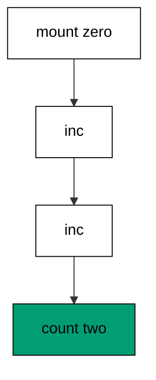

**`learning/code/ex-26-event-increments-the-counter/priv/main.exs`**:

```elixir
# => Example 26: Event Increments the Counter
Logger.configure(level: :warning)
# => warnings only; LiveView stays silent below this
Code.compiler_options(ignore_module_conflict: true)
# => reloaded modules stay silent on double runs

# => one LiveView module counts button presses
defmodule Ex26.Counter do
  # => mount, event, and render callbacks live here
  use Phoenix.LiveView

  # => mount starts every visitor at zero
  def mount(_params, _session, socket) do
    # => one assign holds the whole state
    {:ok, assign(socket, count: 0)}
    # => end mount: zero until the first press
  end

  # => the inc event adds exactly one
  def handle_event("inc", _params, socket) do
    # => update transforms the old count
    {:noreply, update(socket, :count, &(&1 + 1))}
    # => end event: state change, no reply
  end

  # => the template reads the count assign
  def render(assigns), do: ~H"<p>count: {@count}</p>"
  # => end view: press in, number out
end

# => run/0 holds the whole example narrative
defmodule Ex26.Main do
  # => single entry point the last line calls
  def run do
    # => mount first, so the count assign exists
    {:ok, socket} = Ex26.Counter.mount(%{}, %{}, struct(Phoenix.LiveView.Socket))
    # => the client presses inc twice in a row
    {:noreply, one} = Ex26.Counter.handle_event("inc", %{}, socket)
    # => the second press sees the first press's state
    {:noreply, two} = Ex26.Counter.handle_event("inc", %{}, one)
    # => Output: count: 2
    IO.puts("count: #{two.assigns.count}")

    # => end run: the narrative returns here
  end

  # => module boundary stays explicit
end

# => the entry point runs exactly once per execution
Ex26.Main.run()
```

**Output** (`learning/code/ex-26-event-increments-the-counter/expected/main.stdout.txt`):

```text
count: 2
```

**Key takeaway**: `handle_event` receives the event name and payload with the current socket and returns the next socket; two presses move the count from zero to two.

**Why it matters**: Every button, keystroke, and form change in LiveView funnels through this one callback shape. Learning it on a counter means every later event — validates, saves, selects — is the same fold with different data.

### Example 27: Event Carries Its Value

Events carry values, not just names: the payload map tells the handler which tab, row, or option the visitor chose. This example sends a `select` event naming the payments tab and prints the switched state. (Concepts: co-06.)

**`learning/code/ex-27-event-carries-its-value/priv/main.exs`**:

```elixir
# => Example 27: Event Carries Its Value
Logger.configure(level: :warning)
# => warnings only; LiveView stays silent below this
Code.compiler_options(ignore_module_conflict: true)
# => reloaded modules stay silent on double runs

# => one LiveView module picks one of three tabs
defmodule Ex27.Tabs do
  # => mount, event, and render callbacks live here
  use Phoenix.LiveView

  # => mount selects the first tab for everyone
  def mount(_params, _session, socket) do
    # => the tab assign names the visible panel
    {:ok, assign(socket, tab: "orders")}
    # => end mount: orders until the visitor chooses
  end

  # => the select event carries the tab value
  def handle_event("select", %{"tab" => tab}, socket) do
    # => the payload decides the next state
    {:noreply, assign(socket, tab: tab)}
    # => end event: value in, tab out
  end

  # => the template reads the tab assign
  def render(assigns), do: ~H"<p>tab: {@tab}</p>"
  # => end view: value in, panel out
end

# => run/0 holds the whole example narrative
defmodule Ex27.Main do
  # => single entry point the last line calls
  def run do
    # => mount first, so the tab assign exists
    {:ok, socket} = Ex27.Tabs.mount(%{}, %{}, struct(Phoenix.LiveView.Socket))
    # => the visitor picks the payments tab
    {:noreply, next} = Ex27.Tabs.handle_event("select", %{"tab" => "payments"}, socket)
    # => Output: tab: payments
    IO.puts("tab: #{next.assigns.tab}")

    # => end run: the narrative returns here
  end

  # => module boundary stays explicit
end

# => the entry point runs exactly once per execution
Ex27.Main.run()
```

**Output** (`learning/code/ex-27-event-carries-its-value/expected/main.stdout.txt`):

```text
tab: payments
```

**Key takeaway**: The event payload delivers the visitor's choice; the handler stores it as the next state without any extra lookup.

**Why it matters**: Tabs, dropdowns, and toggles all share this shape: choice in, state out. Reading the value from the payload (not from a re-query) keeps interactions instant even before the database is involved.

### Example 28: Change Event Validates Live

Forms validate per keystroke in LiveView: each `validate` event re-runs the changeset over the fresh input and stores the resulting errors. This example types a short handle (one error) then a full one (zero) and prints both counts. (Concepts: co-06, co-03.)

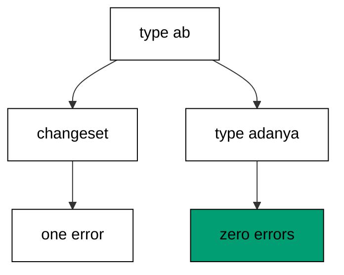

**`learning/code/ex-28-change-event-validates-live/priv/main.exs`**:

```elixir
# => Example 28: Change Event Validates Live
Logger.configure(level: :warning)
# => warnings only; LiveView stays silent below this
Code.compiler_options(ignore_module_conflict: true)
# => reloaded modules stay silent on double runs

# => one schema module names the handle field
defmodule Ex28.Handle do
  # => schema and changeset macros live here
  use Ecto.Schema
  # => cast and validate helpers live here
  import Ecto.Changeset

  # => handles persist under this source name
  schema "handles" do
    # => the unique name a member chooses
    field :handle, :string
  end

  # => three characters minimum, as before
  def changeset(handle, attrs) do
    # => cast first, then require, then bound
    handle |> cast(attrs, [:handle]) |> validate_required([:handle]) |> validate_length(:handle, min: 3)
    # => end changeset: every keystroke re-runs this
  end

  # => module boundary stays explicit
end

# => one LiveView module validates each keystroke
defmodule Ex28.Form do
  # => mount, event, and render callbacks live here
  use Phoenix.LiveView

  # => mount starts from an empty changeset
  def mount(_params, _session, socket) do
    # => the form assign carries the first errors
    {:ok, assign(socket, errors: [])}
    # => end mount: empty form, empty errors
  end

  # => the validate event re-checks the typed handle
  def handle_event("validate", %{"handle" => handle}, socket) do
    # => the changeset runs on the fresh input
    cs = Ex28.Handle.changeset(struct(Ex28.Handle), %{handle: handle})
    # => traverse_errors turns tuples into sentences
    errors = Ecto.Changeset.traverse_errors(cs, fn {msg, _opts} -> msg end)
    # => the error list becomes the next state
    {:noreply, assign(socket, errors: errors[:handle] || [])}
    # => end event: keystroke in, errors out
  end

  # => the template counts the error lines
  def render(assigns), do: ~H"<p>errors: {length(@errors)}</p>"
  # => end view: errors shape the page
end

# => run/0 holds the whole example narrative
defmodule Ex28.Main do
  # => single entry point the last line calls
  def run do
    # => mount first, so the errors assign exists
    {:ok, socket} = Ex28.Form.mount(%{}, %{}, struct(Phoenix.LiveView.Socket))
    # => the visitor types a two-letter handle
    {:noreply, bad} = Ex28.Form.handle_event("validate", %{"handle" => "ab"}, socket)
    # => Output: short: 1
    IO.puts("short: #{length(bad.assigns.errors)}")
    # => the visitor completes a five-letter handle
    {:noreply, good} = Ex28.Form.handle_event("validate", %{"handle" => "adanya"}, bad)
    # => Output: fixed: 0
    IO.puts("fixed: #{length(good.assigns.errors)}")

    # => end run: the narrative returns here
  end

  # => module boundary stays explicit
end

# => the entry point runs exactly once per execution
Ex28.Main.run()
```

**Output** (`learning/code/ex-28-change-event-validates-live/expected/main.stdout.txt`):

```text
short: 1
fixed: 0
```

**Key takeaway**: A `validate` event rebuilds the changeset from the event payload and stores its errors; the page always shows the current input's verdict.

**Why it matters**: Waiting for submit to reveal errors wastes the visitor's time and the server's round trips. Validating live — with the same changeset the submit will run — means the submit button only ever confirms what the visitor already sees.

### Example 29: Event Replies With an Ack

Most events answer with silence (`:noreply`), but some callers need confirmation: `{:reply, payload, socket}` sends an answer back to the client that triggered the event. This example saves a draft note and prints the acknowledgement with the flipped flag. (Concepts: co-06.)

**`learning/code/ex-29-event-replies-with-an-ack/priv/main.exs`**:

```elixir
# => Example 29: Event Replies With an Ack
Logger.configure(level: :warning)
# => warnings only; LiveView stays silent below this
Code.compiler_options(ignore_module_conflict: true)
# => reloaded modules stay silent on double runs

# => one LiveView module saves one draft note
defmodule Ex29.Draft do
  # => mount, event, and render callbacks live here
  use Phoenix.LiveView

  # => mount starts with nothing saved yet
  def mount(_params, _session, socket) do
    # => saved flips to true on the first save
    {:ok, assign(socket, saved: false)}
    # => end mount: unsaved until the event
  end

  # => the save event answers the caller directly
  def handle_event("save", %{"note" => note}, socket) do
    # => the reply carries the saved note back
    {:reply, %{saved: note}, assign(socket, saved: true)}
    # => end event: state flips, caller learns it
  end

  # => the template reads the saved flag
  def render(assigns), do: ~H"<p>saved: {@saved}</p>"
  # => end view: flag in, line out
end

# => run/0 holds the whole example narrative
defmodule Ex29.Main do
  # => single entry point the last line calls
  def run do
    # => mount first, so the saved assign exists
    {:ok, socket} = Ex29.Draft.mount(%{}, %{}, struct(Phoenix.LiveView.Socket))
    # => the client saves one short note
    {:reply, ack, next} = Ex29.Draft.handle_event("save", %{"note" => "buy tea"}, socket)
    # => Output: ack: buy tea saved: true
    IO.puts("ack: #{ack.saved} saved: #{next.assigns.saved}")

    # => end run: the narrative returns here
  end

  # => module boundary stays explicit
end

# => the entry point runs exactly once per execution
Ex29.Main.run()
```

**Output** (`learning/code/ex-29-event-replies-with-an-ack/expected/main.stdout.txt`):

```text
ack: buy tea saved: true
```

**Key takeaway**: `{:reply, payload, socket}` acknowledges the triggering client with data while still updating the state every client sees.

**Why it matters**: Save buttons, uploads, and optimistic UI all need 'did it land?' answered now, not on the next broadcast. Replies give the triggering client its confirmation without spamming every other visitor.

### Example 30: Info Message Loads Async Data

Slow work must not block mount: the view kicks off the load, keeps a loading flag, and finishes when the answer message arrives at `handle_info`. This example mounts a loading total, delivers its answer, and prints the loaded line — with a telemetry event marking the load for operators. (Concepts: co-06, co-15.)

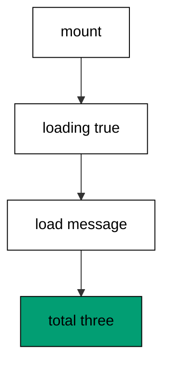

**`learning/code/ex-30-info-message-loads-async-data/priv/main.exs`**:

```elixir
# => Example 30: Info Message Loads Async Data
Logger.configure(level: :warning)
# => warnings only; LiveView stays silent below this
Code.compiler_options(ignore_module_conflict: true)
# => reloaded modules stay silent on double runs

# => one LiveView module loads its total after mount
defmodule Ex30.Total do
  # => mount, event, and render callbacks live here
  use Phoenix.LiveView

  # => mount starts loading and reports nothing yet
  def mount(_params, _session, socket) do
    # => self() stands in for the async worker
    send(self(), :load_total)
    # => loading stays true until the message lands
    {:ok, assign(socket, loading: true, total: 0)}
    # => end mount: question asked, answer pending
  end

  # => the load message carries the computed total
  def handle_info(:load_total, socket) do
    # => telemetry marks the load for operators
    :telemetry.execute([:ex30, :loaded], %{rows: 3}, %{view: "total"})
    # => two plus one stands in for a real query
    {:noreply, assign(socket, loading: false, total: 3)}
    # => end info: answer lands, flag flips
  end

  # => the template reads the loading flag
  def render(assigns), do: ~H"<p>loading: {@loading} total: {@total}</p>"
  # => end view: flag in, line out
end

# => run/0 holds the whole example narrative
defmodule Ex30.Main do
  # => single entry point the last line calls
  def run do
    # => telemetry listens for the load event
    :telemetry.attach("ex30-listener", [:ex30, :loaded], fn ev, ms, _md, _c -> send(self(), {:seen, ev, ms}) end, nil)
    # => mount queues the load message to self
    {:ok, socket} = Ex30.Total.mount(%{}, %{}, struct(Phoenix.LiveView.Socket))
    # => handle_info consumes it like the process would
    {:noreply, done} = Ex30.Total.handle_info(:load_total, socket)
    # => Output: loaded: false total: 3
    IO.puts("loaded: #{done.assigns.loading} total: #{done.assigns.total}")
    # => the telemetry event arrived with its count
    receive do
      # => the rows measurement proves the load ran
      {:seen, [:ex30, :loaded], %{rows: 3}} -> IO.puts("telemetry: rows 3")
      # => end receive: one event, one line
    after
      # => a missing event would fail loudly here
      1000 -> IO.puts("telemetry: missing")
      # => end after: the worker always answers
    end

    # => end run: the narrative returns here
  end

  # => module boundary stays explicit
end

# => the entry point runs exactly once per execution
Ex30.Main.run()
```

**Output** (`learning/code/ex-30-info-message-loads-async-data/expected/main.stdout.txt`):

```text
loaded: false total: 3
telemetry: rows 3
```

**Key takeaway**: `handle_info` completes work mount started; the loading flag bridges the gap, and a telemetry event records the load with its row count.

**Why it matters**: Mounts that await the database hold the connection and stall the first paint. The async pattern — flag now, data later — keeps pages snappy, and the telemetry event is how operators see loads the users never notice.

### Example 31: Diff Keeps the Static Shell

LiveView never resends the whole page: after an event it re-renders, diffs against the previous render, and ships only what changed. This example renders a counter page before and after one press, prints both, and proves the static header survived untouched. (Concepts: co-07, co-16.)

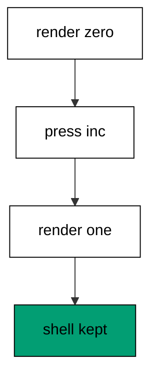

**`learning/code/ex-31-diff-keeps-the-static-shell/priv/main.exs`**:

```elixir
# => Example 31: Diff Keeps the Static Shell
Logger.configure(level: :warning)
# => warnings only; LiveView stays silent below this
Code.compiler_options(ignore_module_conflict: true)
# => reloaded modules stay silent on double runs

# => one LiveView module counts inside a fixed shell
defmodule Ex31.Counter do
  # => mount, event, and render callbacks live here
  use Phoenix.LiveView

  # => mount starts every visitor at zero
  def mount(_params, _session, socket) do
    # => one assign holds the whole state
    {:ok, assign(socket, count: 0)}
    # => end mount: zero until the first press
  end

  # => the inc event adds exactly one
  def handle_event("inc", _params, socket) do
    # => update transforms the old count
    {:noreply, update(socket, :count, &(&1 + 1))}
    # => end event: state change, no reply
  end

  # => the header never changes, the count does
  def render(assigns), do: ~H"<header>shop</header><p>count: {@count}</p>"
  # => end view: static shell, dynamic line
end

# => run/0 holds the whole example narrative
defmodule Ex31.Main do
  # => single entry point the last line calls
  def run do
    # => mount first, so the count assign exists
    {:ok, socket} = Ex31.Counter.mount(%{}, %{}, struct(Phoenix.LiveView.Socket))
    # => render the page before any press
    before = Ex31.Counter.render(socket.assigns) |> Phoenix.HTML.Safe.to_iodata() |> IO.iodata_to_binary()
    # => one press changes exactly one assign
    {:noreply, next} = Ex31.Counter.handle_event("inc", %{}, socket)
    # => render the page after the press
    after_press = Ex31.Counter.render(next.assigns) |> Phoenix.HTML.Safe.to_iodata() |> IO.iodata_to_binary()
    # => Output: before: <header>shop</header><p>count: 0</p>
    IO.puts("before: #{before}")
    # => Output: after: <header>shop</header><p>count: 1</p>
    IO.puts("after: #{after_press}")
    # => the shell survives in both renders
    kept = String.contains?(before, "<header>shop</header>") and String.contains?(after_press, "<header>shop</header>")
    # => Output: static kept: true
    IO.puts("static kept: #{kept}")

    # => end run: the narrative returns here
  end

  # => module boundary stays explicit
end

# => the entry point runs exactly once per execution
Ex31.Main.run()
```

**Output** (`learning/code/ex-31-diff-keeps-the-static-shell/expected/main.stdout.txt`):

```text
before: <header>shop</header><p>count: 0</p>
after: <header>shop</header><p>count: 1</p>
static kept: true
```

**Key takeaway**: Re-rendering after a state change keeps static markup byte-identical; the wire carries only the changed dynamic parts.

**Why it matters**: This is the server-rendered answer to the single-page-app: interactivity without shipping a JavaScript bundle or a JSON API. The trade-off cuts the other way for highly dynamic canvases — but for forms, lists, and dashboards, diffs beat full reloads and rival client frameworks at a fraction of the code.

### Example 32: Stream Inserts One Row

Long lists outgrow full re-renders: streams send inserts, updates, and deletes as operations against keyed rows. This example mounts a two-row order stream, inserts a third row by event, and prints the rendered three-row list. (Concepts: co-07, co-06.)

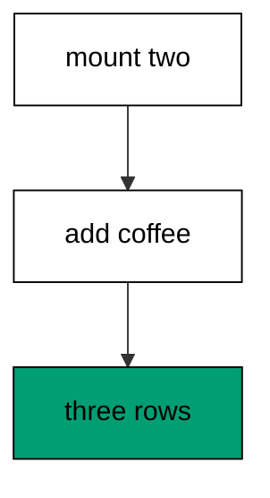

**`learning/code/ex-32-stream-inserts-one-row/priv/main.exs`**:

```elixir
# => Example 32: Stream Inserts One Row
Logger.configure(level: :warning)
# => warnings only; LiveView stays silent below this
Code.compiler_options(ignore_module_conflict: true)
# => reloaded modules stay silent on double runs

# => one LiveView module lists orders as a stream
defmodule Ex32.Orders do
  # => mount, event, and render callbacks live here
  use Phoenix.LiveView
  # => stream helpers attach to the socket
  import Phoenix.LiveView, only: [stream: 3, stream_insert: 3]

  # => mount starts the stream with two rows
  def mount(_params, _session, socket) do
    # => ids key the rows across inserts
    {:ok, stream(socket, :orders, [%{id: 1, item: "noodles"}, %{id: 2, item: "tea"}])}
    # => end mount: two rows, keyed by id
  end

  # => the add event inserts exactly one row
  def handle_event("add", %{"item" => item}, socket) do
    # => id 3 is fixed so the transcript stays stable
    {:noreply, stream_insert(socket, :orders, %{id: 3, item: item})}
    # => end event: insert, never re-render all
  end

  # => the template reads the stream, not a list
  def render(assigns), do: ~H"<ul><li :for={{id, order} <- @streams.orders}>{order.item}</li></ul>"
  # => end view: stream in, list out
end

# => run/0 holds the whole example narrative
defmodule Ex32.Main do
  # => single entry point the last line calls
  def run do
    # => streams need a lifecycle-primed socket
    primed = struct(Phoenix.LiveView.Socket, private: %{lifecycle: struct(Phoenix.LiveView.Lifecycle)})
    # => mount starts the two-row stream
    {:ok, socket} = Ex32.Orders.mount(%{}, %{}, primed)
    # => the add event inserts the third row
    {:noreply, next} = Ex32.Orders.handle_event("add", %{"item" => "coffee"}, socket)
    # => render expands all three rows
    html = Ex32.Orders.render(next.assigns) |> Phoenix.HTML.Safe.to_iodata() |> IO.iodata_to_binary()
    # => Output: rows: <ul><li>noodles</li><li>tea</li><li>coffee</li></ul>
    IO.puts("rows: #{html}")

    # => end run: the narrative returns here
  end

  # => module boundary stays explicit
end

# => the entry point runs exactly once per execution
Ex32.Main.run()
```

**Output** (`learning/code/ex-32-stream-inserts-one-row/expected/main.stdout.txt`):

```text
rows: <ul><li>noodles</li><li>tea</li><li>coffee</li></ul>
```

**Key takeaway**: `stream` keys rows by id and `stream_insert` adds one row; rendering the stream shows every row without re-sending the old ones.

**Why it matters**: A thousand-row table re-rendered per keystroke melts browsers and budgets. Streams keep big lists live at constant cost per change — the difference between a dashboard that scales and one that collapses at demo time.

### Example 33: Flash Carries One Notice

Notices belong to the next render, not to the state: `put_flash` stores a one-shot message the template shows once. This example saves an order, stores its notice in flash, and prints the notice with the flipped flag. (Concepts: co-07, co-06.)

**`learning/code/ex-33-flash-carries-one-notice/priv/main.exs`**:

```elixir
# => Example 33: Flash Carries One Notice
Logger.configure(level: :warning)
# => warnings only; LiveView stays silent below this
Code.compiler_options(ignore_module_conflict: true)
# => reloaded modules stay silent on double runs

# => one LiveView module confirms one saved order
defmodule Ex33.Saver do
  # => mount, event, and render callbacks live here
  use Phoenix.LiveView

  # => mount starts with nothing saved yet
  def mount(_params, _session, socket) do
    # => saved flips to true on the first save
    {:ok, assign(socket, saved: false)}
    # => end mount: unsaved until the event
  end

  # => the save event stores a notice in flash
  def handle_event("save", _params, socket) do
    # => put_flash writes the notice for the next render
    {:noreply, socket |> put_flash(:info, "order saved") |> assign(saved: true)}
    # => end event: notice set, flag flipped
  end

  # => the template reads the saved flag
  def render(assigns), do: ~H"<p>saved: {@saved}</p>"
  # => end view: flag in, line out
end

# => run/0 holds the whole example narrative
defmodule Ex33.Main do
  # => single entry point the last line calls
  def run do
    # => the transport seeds an empty flash map
    seeded = Map.update!(struct(Phoenix.LiveView.Socket), :assigns, &Map.put(&1, :flash, %{}))
    # => mount first, so the saved assign exists
    {:ok, socket} = Ex33.Saver.mount(%{}, %{}, seeded)
    # => the client saves the order once
    {:noreply, next} = Ex33.Saver.handle_event("save", %{}, socket)
    # => Output: notice: order saved saved: true
    IO.puts("notice: #{next.assigns.flash["info"]} saved: #{next.assigns.saved}")

    # => end run: the narrative returns here
  end

  # => module boundary stays explicit
end

# => the entry point runs exactly once per execution
Ex33.Main.run()
```

**Output** (`learning/code/ex-33-flash-carries-one-notice/expected/main.stdout.txt`):

```text
notice: order saved saved: true
```

**Key takeaway**: `put_flash` records a notice for the next render without polluting the assigns; reading it back shows the confirmation exactly once.

**Why it matters**: Success and error notices are the most lied-about UI: stored in state they repeat forever, stored nowhere they never appear. Flash — transport-seeded, function-written, render-consumed — is the one place with exactly-once semantics.

### Example 34: Js Commands Stay Client Side

Not every interaction deserves a round trip: `JS` commands compose client-side operations — show, hide, push — as data the client executes. This example composes three operations, prints the operation count with the first name, and confirms zero server round trips. (Concepts: co-07.)

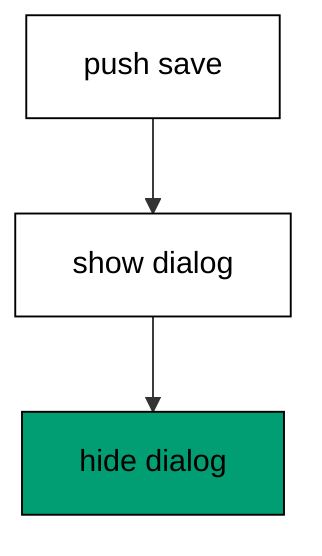

**`learning/code/ex-34-js-commands-stay-client-side/priv/main.exs`**:

```elixir
# => Example 34: Js Commands Stay Client Side
Logger.configure(level: :warning)
# => warnings only; LiveView stays silent below this
Code.compiler_options(ignore_module_conflict: true)
# => reloaded modules stay silent on double runs

# => run/0 holds the whole example narrative
defmodule Ex34.Main do
  # => single entry point the last line calls
  def run do
    # => JS commands are plain data until the client runs them
    ops =
      # => push names the event the server will receive
      Phoenix.LiveView.JS.push("save")
      # => show reveals the dialog without a round trip
      |> Phoenix.LiveView.JS.show(to: "#dialog")
      # => hide dismisses it again, still client side
      |> Phoenix.LiveView.JS.hide(to: "#dialog")
    # => Output: ops: 3 first: push
    IO.puts("ops: #{length(ops.ops)} first: #{ops.ops |> hd() |> hd()}")
    # => nothing above touched the server process
    IO.puts("server round trips: 0")

    # => end run: the narrative returns here
  end

  # => module boundary stays explicit
end

# => the entry point runs exactly once per execution
Ex34.Main.run()
```

**Output** (`learning/code/ex-34-js-commands-stay-client-side/expected/main.stdout.txt`):

```text
ops: 3 first: push
server round trips: 0
```

**Key takeaway**: `JS` commands are pure data describing client operations; composing them costs nothing server-side until a `push` asks for the server.

**Why it matters**: Dialogs, dropdowns, and transitions that round-trip to the server feel sluggish and waste connections. Pushing purely visual work to composable client commands reserves the LiveView process for state that actually lives on the server.

### Example 35: Broadcast Reaches Subscribers

PubSub is the building's intercom: processes subscribe to topics and broadcasts land in every subscriber's mailbox. This example subscribes to the orders topic, broadcasts one creation, and prints the received message. (Concepts: co-09.)

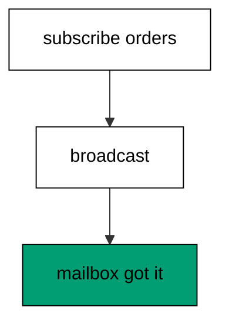

**`learning/code/ex-35-broadcast-reaches-subscribers/priv/main.exs`**:

```elixir
# => Example 35: Broadcast Reaches Subscribers
Logger.configure(level: :warning)
# => warnings only; PubSub stays silent below this
Code.compiler_options(ignore_module_conflict: true)
# => reloaded modules stay silent on double runs

# => run/0 holds the whole example narrative
defmodule Ex35.Main do
  # => single entry point the last line calls
  def run do
    # => one supervision tree owns the local bus
    {:ok, _} = Supervisor.start_link([{Phoenix.PubSub, name: Ex35.Bus}], strategy: :one_for_one)
    # => this process listens on the orders topic
    Phoenix.PubSub.subscribe(Ex35.Bus, "orders")
    # => the broadcast lands in every subscriber mailbox
    Phoenix.PubSub.broadcast(Ex35.Bus, "orders", {:created, 101})
    # => the mailbox holds exactly what was sent
    receive do
      # => Output: got: created 101
      {:created, 101} -> IO.puts("got: created 101")
      # => end receive: one message, one line
    after
      # => a missing message would fail loudly here
      1000 -> IO.puts("got: nothing")
      # => end after: the bus always delivers
    end

    # => end run: the narrative returns here
  end

  # => module boundary stays explicit
end

# => the entry point runs exactly once per execution
Ex35.Main.run()
```

**Output** (`learning/code/ex-35-broadcast-reaches-subscribers/expected/main.stdout.txt`):

```text
got: created 101
```

**Key takeaway**: `subscribe` joins a topic and `broadcast` delivers to every subscriber; the mailbox holds exactly the sent message.

**Why it matters**: LiveViews on different nodes — different visitors, different servers — learn about each other's changes almost exclusively through PubSub. It is the one primitive that turns isolated processes into a coherent live application.

### Example 36: Unsubscribe Leaves Quietly

Subscriptions end as explicitly as they begin: `unsubscribe` drops the topic so later broadcasts find an empty mailbox. This example subscribes, leaves, broadcasts, and prints the resulting silence. (Concepts: co-09.)

**`learning/code/ex-36-unsubscribe-leaves-quietly/priv/main.exs`**:

```elixir
# => Example 36: Unsubscribe Leaves Quietly
Logger.configure(level: :warning)
# => warnings only; PubSub stays silent below this
Code.compiler_options(ignore_module_conflict: true)
# => reloaded modules stay silent on double runs

# => run/0 holds the whole example narrative
defmodule Ex36.Main do
  # => single entry point the last line calls
  def run do
    # => one supervision tree owns the local bus
    {:ok, _} = Supervisor.start_link([{Phoenix.PubSub, name: Ex36.Bus}], strategy: :one_for_one)
    # => this process listens on the orders topic
    Phoenix.PubSub.subscribe(Ex36.Bus, "orders")
    # => leaving drops the subscription at once
    Phoenix.PubSub.unsubscribe(Ex36.Bus, "orders")
    # => the broadcast finds no subscriber here
    Phoenix.PubSub.broadcast(Ex36.Bus, "orders", {:created, 101})
    # => the mailbox stays empty after leaving
    receive do
      # => any arrival here would surprise the lesson
      {:created, _} -> IO.puts("got: unexpected")
      # => end receive: silence is the assertion
    after
      # => Output: quiet: true
      100 -> IO.puts("quiet: true")
      # => end after: leaving means silence
    end

    # => end run: the narrative returns here
  end

  # => module boundary stays explicit
end

# => the entry point runs exactly once per execution
Ex36.Main.run()
```

**Output** (`learning/code/ex-36-unsubscribe-leaves-quietly/expected/main.stdout.txt`):

```text
quiet: true
```

**Key takeaway**: `unsubscribe` ends delivery immediately; broadcasts after leaving never reach the departed process.

**Why it matters**: Leaked subscriptions are leaked attention: processes that keep receiving — and waking for — topics they no longer show. Leaving when the view unmounts or the interest ends keeps mailboxes (and CPU) quiet.

### Example 37: Channel Join Accepts Its Topic

Channels are long-lived conversations on topics: `join` pattern-matches the topic and either admits the client with state or turns it away. This example joins room 7 and prints the room id the socket stored. (Concepts: co-08.)

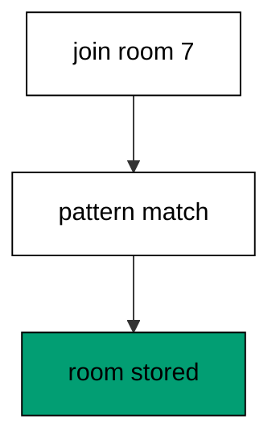

**`learning/code/ex-37-channel-join-accepts-its-topic/priv/main.exs`**:

```elixir
# => Example 37: Channel Join Accepts Its Topic
Logger.configure(level: :warning)
# => warnings only; channels stay silent below this
Code.compiler_options(ignore_module_conflict: true)
# => reloaded modules stay silent on double runs

# => one channel module owns the room topics
defmodule Ex37.RoomChannel do
  # => join and event callbacks live here
  use Phoenix.Channel

  # => room ids join, everything else turns away
  def join("room:" <> id, _params, socket) do
    # => the room id rides into the socket assigns
    {:ok, assign(socket, :room_id, id)}
    # => end join: topic matched, state stored
  end

  # => module boundary stays explicit
end

# => run/0 holds the whole example narrative
defmodule Ex37.Main do
  # => single entry point the last line calls
  def run do
    # => a client asks to join room 7
    {:ok, socket} = Ex37.RoomChannel.join("room:7", %{}, struct(Phoenix.Socket))
    # => Output: joined: 7
    IO.puts("joined: #{socket.assigns.room_id}")

    # => end run: the narrative returns here
  end

  # => module boundary stays explicit
end

# => the entry point runs exactly once per execution
Ex37.Main.run()
```

**Output** (`learning/code/ex-37-channel-join-accepts-its-topic/expected/main.stdout.txt`):

```text
joined: 7
```

**Key takeaway**: `join` matches the topic pattern and returns the socket carrying per-connection state; the stored room id proves admission.

**Why it matters**: Chat rooms, game lobbies, and collaborative editors all start with 'who may enter which conversation'. Pattern-matched joins put that admission rule in one readable function head instead of an if-nest.

### Example 38: Channel Join Rejects Strangers

The same pattern match that admits can refuse: a join clause without the right ticket returns an error tuple naming the reason. This example knocks without a ticket (refused) and with one (admitted), printing both outcomes. (Concepts: co-08.)

**`learning/code/ex-38-channel-join-rejects-strangers/priv/main.exs`**:

```elixir
# => Example 38: Channel Join Rejects Strangers
Logger.configure(level: :warning)
# => warnings only; channels stay silent below this
Code.compiler_options(ignore_module_conflict: true)
# => reloaded modules stay silent on double runs

# => one channel module guards the room topics
defmodule Ex38.RoomChannel do
  # => join and event callbacks live here
  use Phoenix.Channel

  # => room ids join when the ticket matches
  def join("room:" <> _id, %{"ticket" => "letmein"}, socket) do
    # => the right ticket opens the room
    {:ok, socket}
    # => end join: ticket checked, door open
  end

  # => every other join attempt turns away
  def join("room:" <> _id, _params, _socket) do
    # => the error names the reason for the client
    {:error, %{reason: "no ticket"}}
    # => end join: no ticket, no room
  end

  # => module boundary stays explicit
end

# => run/0 holds the whole example narrative
defmodule Ex38.Main do
  # => single entry point the last line calls
  def run do
    # => a client without a ticket knocks first
    {:error, refused} = Ex38.RoomChannel.join("room:7", %{}, struct(Phoenix.Socket))
    # => Output: refused: no ticket
    IO.puts("refused: #{refused.reason}")
    # => the same client returns with the ticket
    {:ok, _} = Ex38.RoomChannel.join("room:7", %{"ticket" => "letmein"}, struct(Phoenix.Socket))
    # => Output: admitted: true
    IO.puts("admitted: true")

    # => end run: the narrative returns here
  end

  # => module boundary stays explicit
end

# => the entry point runs exactly once per execution
Ex38.Main.run()
```

**Output** (`learning/code/ex-38-channel-join-rejects-strangers/expected/main.stdout.txt`):

```text
refused: no ticket
admitted: true
```

**Key takeaway**: A join clause returning `{:error, reason}` refuses admission with a named cause; the ticketed join right after still succeeds.

**Why it matters**: Authorization at the door beats authorization in every handler: one refused join protects all subsequent events. Naming the reason ('no ticket') instead of closing silently tells legitimate clients what to fix.

### Example 39: Channel Answers Ping With Pong

Channel events mirror LiveView events with a twist: `handle_in` can reply directly to the sender while the conversation continues. This example joins a room, pings it, and prints the pong the reply carried back. (Concepts: co-08.)

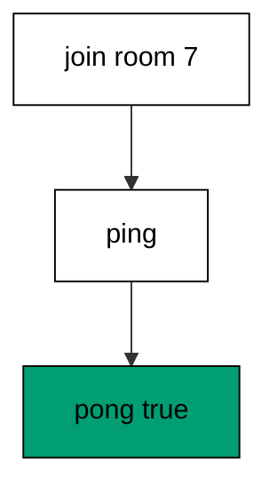

**`learning/code/ex-39-channel-answers-ping-with-pong/priv/main.exs`**:

```elixir
# => Example 39: Channel Answers Ping With Pong
Logger.configure(level: :warning)
# => warnings only; channels stay silent below this
Code.compiler_options(ignore_module_conflict: true)
# => reloaded modules stay silent on double runs

# => one channel module owns the room topics
defmodule Ex39.RoomChannel do
  # => join and event callbacks live here
  use Phoenix.Channel

  # => room ids join freely in this lesson
  def join("room:" <> _id, _params, socket) do
    # => joins always succeed here
    {:ok, socket}
    # => end join: door always open
  end

  # => ping answers at once, nothing stored
  def handle_in("ping", _payload, socket) do
    # => the reply carries the pong straight back
    {:reply, {:ok, %{pong: true}}, socket}
    # => end event: question in, answer out
  end

  # => module boundary stays explicit
end

# => run/0 holds the whole example narrative
defmodule Ex39.Main do
  # => single entry point the last line calls
  def run do
    # => join room 7 before speaking
    {:ok, socket} = Ex39.RoomChannel.join("room:7", %{}, struct(Phoenix.Socket))
    # => the client pings the joined channel
    {:reply, {:ok, %{pong: true}}, _} = Ex39.RoomChannel.handle_in("ping", %{}, socket)
    # => Output: pong: true
    IO.puts("pong: true")

    # => end run: the narrative returns here
  end

  # => module boundary stays explicit
end

# => the entry point runs exactly once per execution
Ex39.Main.run()
```

**Output** (`learning/code/ex-39-channel-answers-ping-with-pong/expected/main.stdout.txt`):

```text
pong: true
```

**Key takeaway**: `handle_in` handles the sender's event and `{:reply, ...}` answers that sender immediately; the printed pong proves the round trip.

**Why it matters**: Request-response over a persistent connection (game moves, command acknowledgements) avoids HTTP's handshake per message. Replies give the sender its answer on the same wire the conversation already holds open.

### Example 40: Broadcast From Skips the Sender

Some shouts should reach everyone except the shouter: `broadcast_from` delivers to all subscribers but the sender, who already knows what it said. This example subscribes, shouts from itself, and prints the resulting self-silence. (Concepts: co-09, co-08.)

**`learning/code/ex-40-broadcast-from-skips-the-sender/priv/main.exs`**:

```elixir
# => Example 40: Broadcast From Skips the Sender
Logger.configure(level: :warning)
# => warnings only; PubSub stays silent below this
Code.compiler_options(ignore_module_conflict: true)
# => reloaded modules stay silent on double runs

# => run/0 holds the whole example narrative
defmodule Ex40.Main do
  # => single entry point the last line calls
  def run do
    # => one supervision tree owns the local bus
    {:ok, _} = Supervisor.start_link([{Phoenix.PubSub, name: Ex40.Bus}], strategy: :one_for_one)
    # => this process listens on the room topic
    Phoenix.PubSub.subscribe(Ex40.Bus, "room:7")
    # => broadcast_from skips the sender's own mailbox
    Phoenix.PubSub.broadcast_from(Ex40.Bus, self(), "room:7", {:shout, "hi"})
    # => the sender hears nothing from itself
    receive do
      # => any arrival here would surprise the lesson
      {:shout, _} -> IO.puts("heard: self")
      # => end receive: the sender stays deaf
    after
      # => Output: self skipped: true
      100 -> IO.puts("self skipped: true")
      # => end after: from-skips-self holds
    end

    # => end run: the narrative returns here
  end

  # => module boundary stays explicit
end

# => the entry point runs exactly once per execution
Ex40.Main.run()
```

**Output** (`learning/code/ex-40-broadcast-from-skips-the-sender/expected/main.stdout.txt`):

```text
self skipped: true
```

**Key takeaway**: `broadcast_from` skips the sender's mailbox; subscribing processes hear the shout while the shouter hears nothing.

**Why it matters**: Echoes confuse users ('why did my message arrive twice?') and waste renders. Skipping the sender is the default shape for chat, cursors, and presence-adjacent chatter where the actor already updated its own view.

### Example 41: LiveView Learns From PubSub

This is the course's central wiring: a LiveView subscribes to a topic and its `handle_info` folds each broadcast into state, so one process's change becomes every visitor's new render. This example broadcasts an order creation and prints the board's updated latest id. (Concepts: co-09, co-06.)

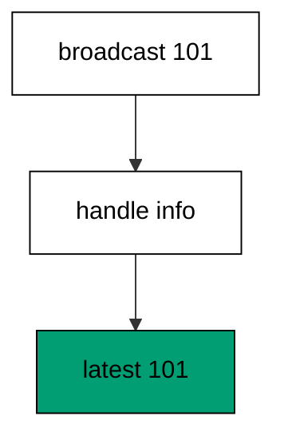

**`learning/code/ex-41-liveview-learns-from-pubsub/priv/main.exs`**:

```elixir
# => Example 41: LiveView Learns From PubSub
Logger.configure(level: :warning)
# => warnings only; LiveView stays silent below this
Code.compiler_options(ignore_module_conflict: true)
# => reloaded modules stay silent on double runs

# => one LiveView module shows the newest order
defmodule Ex41.Board do
  # => mount, event, and render callbacks live here
  use Phoenix.LiveView

  # => mount starts with no order on the board
  def mount(_params, _session, socket) do
    # => latest stays nil until the first broadcast
    {:ok, assign(socket, latest: nil)}
    # => end mount: empty board, open ears
  end

  # => order broadcasts update the board state
  def handle_info({:order_created, id}, socket) do
    # => the newest id replaces the old one
    {:noreply, assign(socket, latest: id)}
    # => end info: message in, state out
  end

  # => the template reads the latest assign
  def render(assigns), do: ~H"<p>latest: {@latest}</p>"
  # => end view: broadcast in, line out
end

# => run/0 holds the whole example narrative
defmodule Ex41.Main do
  # => single entry point the last line calls
  def run do
    # => one supervision tree owns the local bus
    {:ok, _} = Supervisor.start_link([{Phoenix.PubSub, name: Ex41.Bus}], strategy: :one_for_one)
    # => this process listens for new orders
    Phoenix.PubSub.subscribe(Ex41.Bus, "orders")
    # => a new order appears elsewhere in the system
    Phoenix.PubSub.broadcast(Ex41.Bus, "orders", {:order_created, 101})
    # => the broadcast waits in the mailbox
    receive do
      # => the LiveView callback consumes it
      {:order_created, _} = msg ->
        # => mount first, so the latest assign exists
        {:ok, socket} = Ex41.Board.mount(%{}, %{}, struct(Phoenix.LiveView.Socket))
        # => handle_info folds the message into state
        {:noreply, next} = Ex41.Board.handle_info(msg, socket)
        # => Output: latest: 101
        IO.puts("latest: #{next.assigns.latest}")
        # => end branch: message handled, board updated
    after
      # => a missing message would fail loudly here
      1000 -> IO.puts("latest: missing")
      # => end after: the bus always delivers
    end

    # => end run: the narrative returns here
  end

  # => module boundary stays explicit
end

# => the entry point runs exactly once per execution
Ex41.Main.run()
```

**Output** (`learning/code/ex-41-liveview-learns-from-pubsub/expected/main.stdout.txt`):

```text
latest: 101
```

**Key takeaway**: A subscribed LiveView's `handle_info` turns broadcasts into assigns; the printed latest id proves the bus reached the board.

**Why it matters**: Without this wiring, live pages are just fast static pages. With it, the order board, the chat window, and the dashboard all update the moment anything changes — the whole reason to keep stateful server processes instead of serving files.

### Example 42: Join Assigns Carry the User

Join-time data should not need re-asking: assigns stored during `join` stay on the socket for every later event. This example joins carrying a username and proves the socket remembers it by answering a `who` event. (Concepts: co-08.)

**`learning/code/ex-42-join-assigns-carry-the-user/priv/main.exs`**:

```elixir
# => Example 42: Join Assigns Carry the User
Logger.configure(level: :warning)
# => warnings only; channels stay silent below this
Code.compiler_options(ignore_module_conflict: true)
# => reloaded modules stay silent on double runs

# => one channel module remembers who joined
defmodule Ex42.RoomChannel do
  # => join and event callbacks live here
  use Phoenix.Channel

  # => the ticket names the joining user
  def join("room:" <> _id, %{"user" => user}, socket) do
    # => the user rides into the socket assigns
    {:ok, assign(socket, :user, user)}
    # => end join: identity stored at the door
  end

  # => the who event reads the stored identity
  def handle_in("who", _payload, socket) do
    # => the reply names the joined user back
    {:reply, {:ok, %{user: socket.assigns.user}}, socket}
    # => end event: memory in, answer out
  end

  # => module boundary stays explicit
end

# => run/0 holds the whole example narrative
defmodule Ex42.Main do
  # => single entry point the last line calls
  def run do
    # => ada joins carrying her name in the ticket
    {:ok, socket} = Ex42.RoomChannel.join("room:7", %{"user" => "ada"}, struct(Phoenix.Socket))
    # => the who event proves the socket remembers
    {:reply, {:ok, %{user: user}}, _} = Ex42.RoomChannel.handle_in("who", %{}, socket)
    # => Output: joined as: ada
    IO.puts("joined as: #{user}")

    # => end run: the narrative returns here
  end

  # => module boundary stays explicit
end

# => the entry point runs exactly once per execution
Ex42.Main.run()
```

**Output** (`learning/code/ex-42-join-assigns-carry-the-user/expected/main.stdout.txt`):

```text
joined as: ada
```

**Key takeaway**: Assigns set in `join` persist on the channel socket; a later event reads the stored identity without any new parameter.

**Why it matters**: Re-authenticating per event wastes lookups and invites inconsistency (the user changed mid-conversation?). Capturing identity once at the door keeps every later handler simple and consistent.

### Example 43: Intercept Rewrites Outgoing Shouts

Outgoing broadcasts can pass through `handle_out` first when the channel declares `intercept`: each subscriber's process rewrites the message before delivery. This example intercepts shouts and prints the rewritten text the socket stored. (Concepts: co-08.)

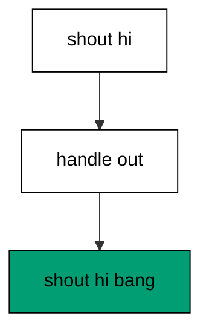

**`learning/code/ex-43-intercept-rewrites-outgoing-shouts/priv/main.exs`**:

```elixir
# => Example 43: Intercept Rewrites Outgoing Shouts
Logger.configure(level: :warning)
# => warnings only; channels stay silent below this
Code.compiler_options(ignore_module_conflict: true)
# => reloaded modules stay silent on double runs

# => one channel module filters its own shouts
defmodule Ex43.RoomChannel do
  # => join and event callbacks live here
  use Phoenix.Channel

  # => shouts pass through handle_out before delivery
  intercept ["shout"]

  # => room ids join freely in this lesson
  def join("room:" <> _id, _params, socket) do
    # => joins always succeed here
    {:ok, socket}
    # => end join: door always open
  end

  # => outgoing shouts gain an exclamation mark
  def handle_out("shout", %{text: text}, socket) do
    # => the rewrite lands in the socket for the test
    {:noreply, assign(socket, :last_shout, text <> "!")}
    # => end out: message in, louder message stored
  end

  # => module boundary stays explicit
end

# => run/0 holds the whole example narrative
defmodule Ex43.Main do
  # => single entry point the last line calls
  def run do
    # => join room 7 before shouting
    {:ok, socket} = Ex43.RoomChannel.join("room:7", %{}, struct(Phoenix.Socket))
    # => the outgoing path rewrites the text
    {:noreply, next} = Ex43.RoomChannel.handle_out("shout", %{text: "hi"}, socket)
    # => Output: shout: hi!
    IO.puts("shout: #{next.assigns.last_shout}")

    # => end run: the narrative returns here
  end

  # => module boundary stays explicit
end

# => the entry point runs exactly once per execution
Ex43.Main.run()
```

**Output** (`learning/code/ex-43-intercept-rewrites-outgoing-shouts/expected/main.stdout.txt`):

```text
shout: hi!
```

**Key takeaway**: `intercept` routes outgoing events of a type through `handle_out`; the printed shout proves the rewrite ran before delivery.

**Why it matters**: Per-subscriber filtering — censoring, localization, permission-trimming — cannot live in the broadcast itself, which is one message for all. Interception personalizes at the edge, where each subscriber's context lives.

### Example 44: Terminate Cleans the Join

Conversations end, and `terminate` runs the cleanup: releasing seats, notifying watchers, saying goodbye. This example joins a room, terminates with `:leave`, and prints the farewell the callback sent. (Concepts: co-08.)

**`learning/code/ex-44-terminate-cleans-the-join/priv/main.exs`**:

```elixir
# => Example 44: Terminate Cleans the Join
Logger.configure(level: :warning)
# => warnings only; channels stay silent below this
Code.compiler_options(ignore_module_conflict: true)
# => reloaded modules stay silent on double runs

# => one channel module counts its own leavers
defmodule Ex44.RoomChannel do
  # => join and event callbacks live here
  use Phoenix.Channel

  # => room ids join freely in this lesson
  def join("room:" <> _id, _params, socket) do
    # => joins always succeed here
    {:ok, socket}
    # => end join: door always open
  end

  # => leaving runs the terminate callback
  def terminate(_reason, socket) do
    # => the farewell reaches the leaving process
    send(socket.transport_pid, :cleaned)
    # => terminate always answers ok
    :ok
    # => end terminate: goodbye sent, state dropped
  end

  # => module boundary stays explicit
end

# => run/0 holds the whole example narrative
defmodule Ex44.Main do
  # => single entry point the last line calls
  def run do
    # => the socket names this process as transport
    socket = struct(Phoenix.Socket, transport_pid: self())
    # => join room 7 before leaving it
    {:ok, joined} = Ex44.RoomChannel.join("room:7", %{}, socket)
    # => leaving runs terminate with the joined socket
    :ok = Ex44.RoomChannel.terminate(:leave, joined)
    # => the farewell waits in the mailbox
    receive do
      # => Output: cleaned: true
      :cleaned -> IO.puts("cleaned: true")
      # => end receive: goodbye arrived
    after
      # => a missing farewell would fail loudly here
      1000 -> IO.puts("cleaned: false")
      # => end after: terminate always says goodbye
    end

    # => end run: the narrative returns here
  end

  # => module boundary stays explicit
end

# => the entry point runs exactly once per execution
Ex44.Main.run()
```

**Output** (`learning/code/ex-44-terminate-cleans-the-join/expected/main.stdout.txt`):

```text
cleaned: true
```

**Key takeaway**: `terminate` runs when the channel ends; the received farewell proves cleanup code executes on every leave.

**Why it matters**: Unreleased seats fill rooms with ghosts — users who left but still count. A terminate callback that always runs (crash or calm leave) is what keeps presence, counters, and locks honest.

### Example 45: Presence Tracks One User

Presence answers 'who is here?' without a database: `track` registers this process under a key on a topic, and `list` reads the roster back. This example tracks one arrival and prints the roster size. (Concepts: co-10.)

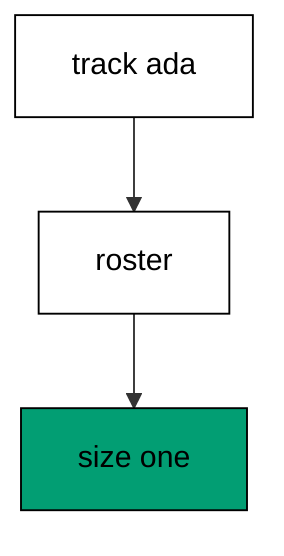

**`learning/code/ex-45-presence-tracks-one-user/priv/main.exs`**:

```elixir
# => Example 45: Presence Tracks One User
Logger.configure(level: :warning)
# => warnings only; Presence stays silent below this
Code.compiler_options(ignore_module_conflict: true)
# => reloaded modules stay silent on double runs

# => one presence module names the tracker
defmodule Ex45.Tracker do
  # => the bus name wires tracker to PubSub
  use Phoenix.Presence, otp_app: :app, pubsub_server: Ex45.Bus
end

# => run/0 holds the whole example narrative
defmodule Ex45.Main do
  # => single entry point the last line calls
  def run do
    # => one tree owns the bus and the tracker
    {:ok, _} = Supervisor.start_link([{Phoenix.PubSub, name: Ex45.Bus}, Ex45.Tracker], strategy: :one_for_one)
    # => ada arrives in room 7 from the web client
    {:ok, _} = Ex45.Tracker.track(self(), "room:7", "ada", %{device: "web"})
    # => Output: tracked: 1
    IO.puts("tracked: #{Ex45.Tracker.list("room:7") |> map_size()}")

    # => end run: the narrative returns here
  end

  # => module boundary stays explicit
end

# => the entry point runs exactly once per execution
Ex45.Main.run()
```

**Output** (`learning/code/ex-45-presence-tracks-one-user/expected/main.stdout.txt`):

```text
tracked: 1
```

**Key takeaway**: `track` registers a key with metadata on a topic; `list` returns the roster, here holding exactly one arrival.

**Why it matters**: Online indicators, room counts, and collaborator cursors all need membership that updates in real time and vanishes on disconnect. Presence derives all of it from process lifetimes — no heartbeat tables, no stale rows.

### Example 46: Presence Lists Many Users

Rosters hold crowds, not just individuals: three arrivals on one topic list back as three keys. This example tracks three friends and prints the sorted roster names. (Concepts: co-10.)

**`learning/code/ex-46-presence-lists-many-users/priv/main.exs`**:

```elixir
# => Example 46: Presence Lists Many Users
Logger.configure(level: :warning)
# => warnings only; Presence stays silent below this
Code.compiler_options(ignore_module_conflict: true)
# => reloaded modules stay silent on double runs

# => one presence module names the tracker
defmodule Ex46.Tracker do
  # => the bus name wires tracker to PubSub
  use Phoenix.Presence, otp_app: :app, pubsub_server: Ex46.Bus
end

# => run/0 holds the whole example narrative
defmodule Ex46.Main do
  # => single entry point the last line calls
  def run do
    # => one tree owns the bus and the tracker
    {:ok, _} = Supervisor.start_link([{Phoenix.PubSub, name: Ex46.Bus}, Ex46.Tracker], strategy: :one_for_one)
    # => three friends arrive in the same room
    {:ok, _} = Ex46.Tracker.track(self(), "room:7", "ada", %{device: "web"})
    # => the second arrival shares the tracker
    {:ok, _} = Ex46.Tracker.track(self(), "room:7", "budi", %{device: "mobile"})
    # => the third arrival completes the room
    {:ok, _} = Ex46.Tracker.track(self(), "room:7", "citra", %{device: "web"})
    # => the room roster sorts itself for the transcript
    names = Ex46.Tracker.list("room:7") |> Map.keys() |> Enum.sort() |> Enum.join(" ")
    # => Output: room: ada budi citra
    IO.puts("room: #{names}")

    # => end run: the narrative returns here
  end

  # => module boundary stays explicit
end

# => the entry point runs exactly once per execution
Ex46.Main.run()
```

**Output** (`learning/code/ex-46-presence-lists-many-users/expected/main.stdout.txt`):

```text
room: ada budi citra
```

**Key takeaway**: `list` returns every tracked key on the topic; three arrivals print as three sorted names.

**Why it matters**: A roster that works for one but breaks for a hundred is a demo, not a feature. Presence backed by CRDT gossip keeps multi-node rosters consistent, so the hundredth arrival costs like the first.

### Example 47: Untrack Removes the Leaver

Leaving is explicit too: `untrack` removes the key so the roster shrinks the moment the goodbye processes. This example tracks one arrival, untracks it, and prints the emptied roster size. (Concepts: co-10.)

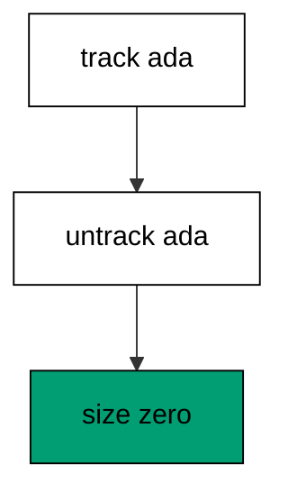

**`learning/code/ex-47-untrack-removes-the-leaver/priv/main.exs`**:

```elixir
# => Example 47: Untrack Removes the Leaver
Logger.configure(level: :warning)
# => warnings only; Presence stays silent below this
Code.compiler_options(ignore_module_conflict: true)
# => reloaded modules stay silent on double runs

# => one presence module names the tracker
defmodule Ex47.Tracker do
  # => the bus name wires tracker to PubSub
  use Phoenix.Presence, otp_app: :app, pubsub_server: Ex47.Bus
end

# => run/0 holds the whole example narrative
defmodule Ex47.Main do
  # => single entry point the last line calls
  def run do
    # => one tree owns the bus and the tracker
    {:ok, _} = Supervisor.start_link([{Phoenix.PubSub, name: Ex47.Bus}, Ex47.Tracker], strategy: :one_for_one)
    # => ada arrives in room 7 first
    {:ok, _} = Ex47.Tracker.track(self(), "room:7", "ada", %{device: "web"})
    # => ada leaves the room again
    :ok = Ex47.Tracker.untrack(self(), "room:7", "ada")
    # => Output: left: 0
    IO.puts("left: #{Ex47.Tracker.list("room:7") |> map_size()}")

    # => end run: the narrative returns here
  end

  # => module boundary stays explicit
end

# => the entry point runs exactly once per execution
Ex47.Main.run()
```

**Output** (`learning/code/ex-47-untrack-removes-the-leaver/expected/main.stdout.txt`):

```text
left: 0
```

**Key takeaway**: `untrack` removes the key from the topic; the roster size drops back to zero immediately.

**Why it matters**: Ghost users — present in the list, gone from the world — erode trust in every online indicator. Explicit untrack on leave (plus automatic removal on crash) is what keeps the roster truthful.

### Example 48: Metas Carry Device Facts

Keys name who; metas describe how: each tracked entry carries metadata like the device or status the UI shows beside the name. This example tracks one arrival with a device fact and prints the stored device. (Concepts: co-10.)

**`learning/code/ex-48-metas-carry-device-facts/priv/main.exs`**:

```elixir
# => Example 48: Metas Carry Device Facts
Logger.configure(level: :warning)
# => warnings only; Presence stays silent below this
Code.compiler_options(ignore_module_conflict: true)
# => reloaded modules stay silent on double runs

# => one presence module names the tracker
defmodule Ex48.Tracker do
  # => the bus name wires tracker to PubSub
  use Phoenix.Presence, otp_app: :app, pubsub_server: Ex48.Bus
end

# => run/0 holds the whole example narrative
defmodule Ex48.Main do
  # => single entry point the last line calls
  def run do
    # => one tree owns the bus and the tracker
    {:ok, _} = Supervisor.start_link([{Phoenix.PubSub, name: Ex48.Bus}, Ex48.Tracker], strategy: :one_for_one)
    # => ada arrives carrying her device fact
    {:ok, _} = Ex48.Tracker.track(self(), "room:7", "ada", %{device: "mobile"})
    # => get_by_key returns the entry with its metas
    entry = Ex48.Tracker.get_by_key("room:7", "ada")
    # => the first meta carries the tracked device
    device = entry.metas |> hd() |> Map.get(:device)
    # => Output: device: mobile
    IO.puts("device: #{device}")

    # => end run: the narrative returns here
  end

  # => module boundary stays explicit
end

# => the entry point runs exactly once per execution
Ex48.Main.run()
```

**Output** (`learning/code/ex-48-metas-carry-device-facts/expected/main.stdout.txt`):

```text
device: mobile
```

**Key takeaway**: `get_by_key` returns the entry with its metas; the printed device proves metadata rides with the key.

**Why it matters**: 'Ada is online' helps; 'Ada is online on mobile' decides whether to send the heavy desktop layout or the light one. Metas turn a name list into actionable context without a second lookup.

### Example 49: Diff Joins Feed the Board

Presence speaks to LiveViews through diffs: join and leave maps arrive as messages that `handle_info` folds into the roster assigns. This example feeds a two-join diff to a board and prints the online count. (Concepts: co-10, co-06.)

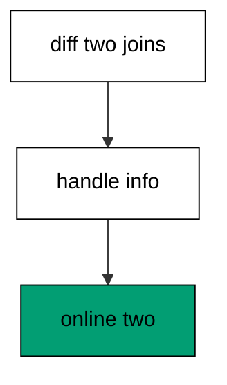

**`learning/code/ex-49-diff-joins-feed-the-board/priv/main.exs`**:

```elixir
# => Example 49: Diff Joins Feed the Board
Logger.configure(level: :warning)
# => warnings only; LiveView stays silent below this
Code.compiler_options(ignore_module_conflict: true)
# => reloaded modules stay silent on double runs

# => one LiveView module counts the online friends
defmodule Ex49.Board do
  # => mount, event, and render callbacks live here
  use Phoenix.LiveView

  # => mount starts with nobody online yet
  def mount(_params, _session, socket) do
    # => online counts the friends on the board
    {:ok, assign(socket, online: [])}
    # => end mount: empty board, open ears
  end

  # => join diffs append the arrived names
  def handle_info(%{event: "presence_diff", joins: joins}, socket) do
    # => the join keys name the arrived friends
    {:noreply, assign(socket, online: Map.keys(joins))}
    # => end info: diff in, roster out
  end

  # => the template counts the online names
  def render(assigns), do: ~H"<p>online: {length(@online)}</p>"
  # => end view: roster in, count out
end

# => run/0 holds the whole example narrative
defmodule Ex49.Main do
  # => single entry point the last line calls
  def run do
    # => mount first, so the online assign exists
    {:ok, socket} = Ex49.Board.mount(%{}, %{}, struct(Phoenix.LiveView.Socket))
    # => two friends arrive in one diff message
    diff = %{event: "presence_diff", joins: %{"ada" => %{}, "budi" => %{}}}
    # => handle_info folds the diff into state
    {:noreply, next} = Ex49.Board.handle_info(diff, socket)
    # => Output: online: 2
    IO.puts("online: #{length(next.assigns.online)}")

    # => end run: the narrative returns here
  end

  # => module boundary stays explicit
end

# => the entry point runs exactly once per execution
Ex49.Main.run()
```

**Output** (`learning/code/ex-49-diff-joins-feed-the-board/expected/main.stdout.txt`):

```text
online: 2
```

**Key takeaway**: A presence diff's joins map becomes the board's roster; two joined keys print as an online count of two.

**Why it matters**: Polling the roster every second wakes every viewer for nothing most of the time. Diffs push only the delta — arrivals and departures — so quiet rooms cost nothing and busy ones cost exactly their churn.

### Example 50: Two Devices Share One Key

One human, many screens: the same key tracked from two processes carries two metas, and the roster shows both. This example tracks one user from two processes and prints the sorted device names. (Concepts: co-10.)

**`learning/code/ex-50-two-devices-share-one-key/priv/main.exs`**:

```elixir
# => Example 50: Two Devices Share One Key
Logger.configure(level: :warning)
# => warnings only; Presence stays silent below this
Code.compiler_options(ignore_module_conflict: true)
# => reloaded modules stay silent on double runs

# => one presence module names the tracker
defmodule Ex50.Tracker do
  # => the bus name wires tracker to PubSub
  use Phoenix.Presence, otp_app: :app, pubsub_server: Ex50.Bus
end

# => run/0 holds the whole example narrative
defmodule Ex50.Main do
  # => single entry point the last line calls
  def run do
    # => one tree owns the bus and the tracker
    {:ok, _} = Supervisor.start_link([{Phoenix.PubSub, name: Ex50.Bus}, Ex50.Tracker], strategy: :one_for_one)
    # => a keeper holds one tracking alive
    keeper = spawn(fn -> receive do :stop -> :ok end end)
    # => ada arrives from the web client process
    {:ok, _} = Ex50.Tracker.track(self(), "room:7", "ada", %{device: "web"})
    # => ada arrives again from the keeper process
    {:ok, _} = Ex50.Tracker.track(keeper, "room:7", "ada", %{device: "mobile"})
    # => one key now carries two device metas
    entry = Ex50.Tracker.get_by_key("room:7", "ada")
    # => the devices sort themselves for the transcript
    devices = entry.metas |> Enum.map(&Map.get(&1, :device)) |> Enum.sort() |> Enum.join(" ")
    # => Output: devices: mobile web
    IO.puts("devices: #{devices}")
    # => the keeper process may exit now
    send(keeper, :stop)

    # => end run: the narrative returns here
  end

  # => module boundary stays explicit
end

# => the entry point runs exactly once per execution
Ex50.Main.run()
```

**Output** (`learning/code/ex-50-two-devices-share-one-key/expected/main.stdout.txt`):

```text
devices: mobile web
```

**Key takeaway**: Two tracks under one key yield two metas; the printed devices prove one roster entry can span many connections.

**Why it matters**: Users live on phones and laptops simultaneously, and 'online' must mean 'reachable somewhere'. Multi-meta keys model that truth directly instead of forcing one row per device in application code.

### Example 51: LiveView Counts Online Friends

The full loop in one lesson: mount reads the current roster for its first count, and each join diff grows it. This example mounts with one friend present, lands one arrival diff, and prints the count of two. (Concepts: co-10, co-06.)

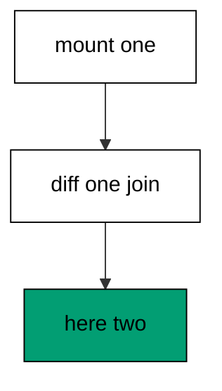

**`learning/code/ex-51-liveview-counts-online-friends/priv/main.exs`**:

```elixir
# => Example 51: LiveView Counts Online Friends
Logger.configure(level: :warning)
# => warnings only; LiveView stays silent below this
Code.compiler_options(ignore_module_conflict: true)
# => reloaded modules stay silent on double runs

# => one presence module names the tracker
defmodule Ex51.Tracker do
  # => the bus name wires tracker to PubSub
  use Phoenix.Presence, otp_app: :app, pubsub_server: Ex51.Bus
end

# => one LiveView module shows the room count
defmodule Ex51.Room do
  # => mount, event, and render callbacks live here
  use Phoenix.LiveView

  # => mount reads the current roster once
  def mount(_params, _session, socket) do
    # => the count starts from whoever is already here
    {:ok, assign(socket, count: map_size(Ex51.Tracker.list("room:7")))}
    # => end mount: count what exists, watch the rest
  end

  # => join diffs grow the count by the arrivals
  def handle_info(%{event: "presence_diff", joins: joins}, socket) do
    # => each arrival adds exactly one
    {:noreply, update(socket, :count, &(&1 + map_size(joins)))}
    # => end info: arrivals in, count out
  end

  # => the template reads the count assign
  def render(assigns), do: ~H"<p>here: {@count}</p>"
  # => end view: count in, line out
end

# => run/0 holds the whole example narrative
defmodule Ex51.Main do
  # => single entry point the last line calls
  def run do
    # => one tree owns the bus and the tracker
    {:ok, _} = Supervisor.start_link([{Phoenix.PubSub, name: Ex51.Bus}, Ex51.Tracker], strategy: :one_for_one)
    # => ada is already in the room at mount time
    {:ok, _} = Ex51.Tracker.track(self(), "room:7", "ada", %{device: "web"})
    # => mount counts the one present friend
    {:ok, socket} = Ex51.Room.mount(%{}, %{}, struct(Phoenix.LiveView.Socket))
    # => budi arrives in a diff right after mount
    {:noreply, next} = Ex51.Room.handle_info(%{event: "presence_diff", joins: %{"budi" => %{}}}, socket)
    # => Output: here: 2
    IO.puts("here: #{next.assigns.count}")

    # => end run: the narrative returns here
  end

  # => module boundary stays explicit
end

# => the entry point runs exactly once per execution
Ex51.Main.run()
```

**Output** (`learning/code/ex-51-liveview-counts-online-friends/expected/main.stdout.txt`):

```text
here: 2
```

**Key takeaway**: Mount seeds the count from `list` and diffs grow it; the printed two proves roster and updates agree.

**Why it matters**: First paint and live updates must tell the same story — a room showing '1 online' that jumps to '3' on the first diff looks broken. Seeding from the roster at mount closes the gap between now and next.

### Example 52: Topics Keep Separate Rosters

Topics isolate crowds: two rooms tracked under different names list back independently. This example fills two rooms with one friend each and prints both sizes. (Concepts: co-10.)

**`learning/code/ex-52-topics-keep-separate-rosters/priv/main.exs`**:

```elixir
# => Example 52: Topics Keep Separate Rosters
Logger.configure(level: :warning)
# => warnings only; Presence stays silent below this
Code.compiler_options(ignore_module_conflict: true)
# => reloaded modules stay silent on double runs

# => one presence module names the tracker
defmodule Ex52.Tracker do
  # => the bus name wires tracker to PubSub
  use Phoenix.Presence, otp_app: :app, pubsub_server: Ex52.Bus
end

# => run/0 holds the whole example narrative
defmodule Ex52.Main do
  # => single entry point the last line calls
  def run do
    # => one tree owns the bus and the tracker
    {:ok, _} = Supervisor.start_link([{Phoenix.PubSub, name: Ex52.Bus}, Ex52.Tracker], strategy: :one_for_one)
    # => ada joins the noodles room
    {:ok, _} = Ex52.Tracker.track(self(), "room:noodles", "ada", %{})
    # => budi joins the tea room instead
    {:ok, _} = Ex52.Tracker.track(self(), "room:tea", "budi", %{})
    # => Output: noodles: 1 tea: 1
    IO.puts("noodles: #{Ex52.Tracker.list("room:noodles") |> map_size()} tea: #{Ex52.Tracker.list("room:tea") |> map_size()}")

    # => end run: the narrative returns here
  end

  # => module boundary stays explicit
end

# => the entry point runs exactly once per execution
Ex52.Main.run()
```

**Output** (`learning/code/ex-52-topics-keep-separate-rosters/expected/main.stdout.txt`):

```text
noodles: 1 tea: 1
```

**Key takeaway**: Each topic lists only its own keys; the two rooms print one arrival each with no crossover.

**Why it matters**: A chat server hosts thousands of rooms on one tracker; isolation by topic is what keeps room A's crowd out of room B's roster. Naming topics well (room ids, not 'general') is the whole scaling story.

### Example 53: Update Refreshes the Meta

Metas change while keys stay: `update` replaces the metadata (web to mobile) without disturbing the roster entry. This example tracks one arrival, refreshes its device, and prints the new value. (Concepts: co-10.)

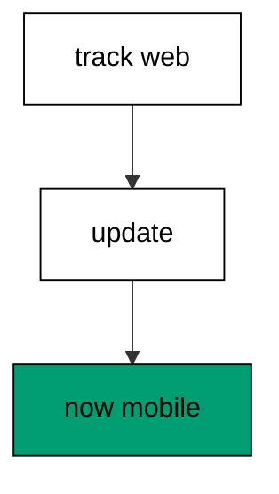

**`learning/code/ex-53-update-refreshes-the-meta/priv/main.exs`**:

```elixir
# => Example 53: Update Refreshes the Meta
Logger.configure(level: :warning)
# => warnings only; Presence stays silent below this
Code.compiler_options(ignore_module_conflict: true)
# => reloaded modules stay silent on double runs

# => one presence module names the tracker
defmodule Ex53.Tracker do
  # => the bus name wires tracker to PubSub
  use Phoenix.Presence, otp_app: :app, pubsub_server: Ex53.Bus
end

# => run/0 holds the whole example narrative
defmodule Ex53.Main do
  # => single entry point the last line calls
  def run do
    # => one tree owns the bus and the tracker
    {:ok, _} = Supervisor.start_link([{Phoenix.PubSub, name: Ex53.Bus}, Ex53.Tracker], strategy: :one_for_one)
    # => ada arrives on the web client first
    {:ok, _} = Ex53.Tracker.track(self(), "room:7", "ada", %{device: "web"})
    # => ada switches to the mobile client after
    {:ok, _} = Ex53.Tracker.update(self(), "room:7", "ada", %{device: "mobile"})
    # => the entry still names one key
    entry = Ex53.Tracker.get_by_key("room:7", "ada")
    # => the refreshed meta names the new device
    device = entry.metas |> hd() |> Map.get(:device)
    # => Output: now: mobile
    IO.puts("now: #{device}")

    # => end run: the narrative returns here
  end

  # => module boundary stays explicit
end

# => the entry point runs exactly once per execution
Ex53.Main.run()
```

**Output** (`learning/code/ex-53-update-refreshes-the-meta/expected/main.stdout.txt`):

```text
now: mobile
```

**Key takeaway**: `update` replaces a key's metas in place; the printed device proves the roster entry survived with fresh facts.

**Why it matters**: Status flips — available to busy, web to mobile — happen constantly while identity stays put. Updating in place (not untrack-plus-track) avoids the flicker where a user briefly vanishes from every viewer.
