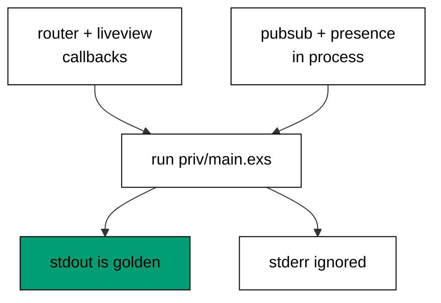

Prerequisites for this course: [just-enough-elixir](/en/learn/courses/just-enough-elixir/learning/overview) for basic syntax, functions, and modules, [actor-model-concurrency](/en/learn/courses/actor-model-concurrency/learning/overview) for processes and supervisors, and [backend-essentials](/en/learn/courses/backend-essentials/learning/overview) for shared HTTP vocabulary. Comfort editing and running Elixir scripts from a terminal is assumed throughout, and every example builds only on the primers plus earlier examples in this course.

## Why this exists -- the big idea

**The problem before the solution**: no course teaches Phoenix or LiveView; the Python web course speaks FastAPI and the concurrency course teaches OTP without the web-framework layer on top. Teams reaching for Elixir on the web face two disconnected manuals — HTTP routing in one, stateful processes in another — with nothing showing how a request becomes a live page. Phoenix plus LiveView closes that gap: one framework where the request handler and the live process share the same language, the same validation, and the same supervision trees.

**Keep this if you forget everything else**: A LiveView is a supervised process with state, not a page that re-renders from scratch.

## Tensions and trade-offs -- when NOT to reach for this

- **Server state versus client state**: LiveView keeps UI state in a server process per visitor, which makes interactions trivially consistent but spends server memory per connection. Reaching for it fits dashboards, forms, and feeds; a mostly-static marketing page pays the connection cost for nothing.
- **Diffs versus full renders**: sending only changed DOM keeps updates light, but deeply dynamic canvases (games, editors) still suit client rendering better. Each LiveView example names what the diff carries and what it skips.
- **When NOT**: a JSON API consumed by native mobile apps needs no LiveView; a static site needs no Phoenix. This stack earns its place when the browser should feel instant without writing two applications.

## Lineage -- where this tool sits

Phoenix is the web layer for Elixir, and this course assumes the Elixir primer, basic OTP, and shared HTTP vocabulary as background. The actor-model course teaches processes and supervisors generically; this course puts the web framework on top of them. Later application courses assume routing, validation, and live state exist and build products on top.

## How this course is organized

[Beginner](/en/learn/courses/web-backends-in-elixir-with-phoenix-and-liveview/learning/beginner) (Examples 1–25) routes requests through controllers and plugs, validates input with changesets, and mounts first LiveViews that render. [Intermediate](/en/learn/courses/web-backends-in-elixir-with-phoenix-and-liveview/learning/intermediate) (Examples 26–53) handles LiveView events with diffed updates, talks over channels and PubSub, and tracks presence. [Advanced](/en/learn/courses/web-backends-in-elixir-with-phoenix-and-liveview/learning/advanced) (Examples 54–78) supervises live state, handles forms end to end, and tests everything without a browser. The [capstone](/en/learn/courses/web-backends-in-elixir-with-phoenix-and-liveview/learning/capstone/overview) builds a live order-tracking dashboard with a JSON API, a PubSub-driven LiveView board, and an in-process suite, and [drilling](/en/learn/courses/web-backends-in-elixir-with-phoenix-and-liveview/drilling/overview) turns the sixteen concepts into recall, katas, and checklists.

## About the runtime

Every example runs as `mix run --no-compile priv/main.exs` in the pinned Elixir container with a shared hash-locked dependency set (Phoenix, LiveView, Ecto, Jason): no mocks, no browser, no network socket. Controllers answer through `Plug.Test` connections, LiveViews mount and handle events by direct callback, and channels, PubSub, and Presence run inside the script's own supervision tree. Standard output is the asserted golden transcript; standard error is ignored. Programs print labels, counts, and rendered values — never paths, timings, pids, or references — so reruns match byte for byte.

## Examples by Level

### Beginner (Examples 1–25)

- [Example 1: First Route Answers Hello](/en/learn/courses/web-backends-in-elixir-with-phoenix-and-liveview/learning/beginner#example-1-first-route-answers-hello)
- [Example 2: Missing Route Raises 404](/en/learn/courses/web-backends-in-elixir-with-phoenix-and-liveview/learning/beginner#example-2-missing-route-raises-404)
- [Example 3: Post Route Reads Params](/en/learn/courses/web-backends-in-elixir-with-phoenix-and-liveview/learning/beginner#example-3-post-route-reads-params)
- [Example 4: Query Params Shape the Answer](/en/learn/courses/web-backends-in-elixir-with-phoenix-and-liveview/learning/beginner#example-4-query-params-shape-the-answer)
- [Example 5: Scopes Group Api Routes](/en/learn/courses/web-backends-in-elixir-with-phoenix-and-liveview/learning/beginner#example-5-scopes-group-api-routes)
- [Example 6: Plug Assigns Before Dispatch](/en/learn/courses/web-backends-in-elixir-with-phoenix-and-liveview/learning/beginner#example-6-plug-assigns-before-dispatch)
- [Example 7: Plug Halts Unauthorized Early](/en/learn/courses/web-backends-in-elixir-with-phoenix-and-liveview/learning/beginner#example-7-plug-halts-unauthorized-early)
- [Example 8: Controller Answers Json](/en/learn/courses/web-backends-in-elixir-with-phoenix-and-liveview/learning/beginner#example-8-controller-answers-json)
- [Example 9: Changeset Accepts Valid Input](/en/learn/courses/web-backends-in-elixir-with-phoenix-and-liveview/learning/beginner#example-9-changeset-accepts-valid-input)
- [Example 10: Required Field Errors Loudly](/en/learn/courses/web-backends-in-elixir-with-phoenix-and-liveview/learning/beginner#example-10-required-field-errors-loudly)
- [Example 11: Length Bounds the Handle](/en/learn/courses/web-backends-in-elixir-with-phoenix-and-liveview/learning/beginner#example-11-length-bounds-the-handle)
- [Example 12: Format Checks the Email](/en/learn/courses/web-backends-in-elixir-with-phoenix-and-liveview/learning/beginner#example-12-format-checks-the-email)
- [Example 13: Number Bounds the Age](/en/learn/courses/web-backends-in-elixir-with-phoenix-and-liveview/learning/beginner#example-13-number-bounds-the-age)
- [Example 14: Inclusion Picks the Role](/en/learn/courses/web-backends-in-elixir-with-phoenix-and-liveview/learning/beginner#example-14-inclusion-picks-the-role)
- [Example 15: Custom Rule Rejects Reserved](/en/learn/courses/web-backends-in-elixir-with-phoenix-and-liveview/learning/beginner#example-15-custom-rule-rejects-reserved)
- [Example 16: Errors Read as Messages](/en/learn/courses/web-backends-in-elixir-with-phoenix-and-liveview/learning/beginner#example-16-errors-read-as-messages)
- [Example 17: Action Builds Without a Database](/en/learn/courses/web-backends-in-elixir-with-phoenix-and-liveview/learning/beginner#example-17-action-builds-without-a-database)
- [Example 18: Mount Seeds Initial Assigns](/en/learn/courses/web-backends-in-elixir-with-phoenix-and-liveview/learning/beginner#example-18-mount-seeds-initial-assigns)
- [Example 19: Render Turns Assigns Into Html](/en/learn/courses/web-backends-in-elixir-with-phoenix-and-liveview/learning/beginner#example-19-render-turns-assigns-into-html)
- [Example 20: Mount Reads Url Params](/en/learn/courses/web-backends-in-elixir-with-phoenix-and-liveview/learning/beginner#example-20-mount-reads-url-params)
- [Example 21: Mount Reads the Session](/en/learn/courses/web-backends-in-elixir-with-phoenix-and-liveview/learning/beginner#example-21-mount-reads-the-session)
- [Example 22: Function Component Reuses Markup](/en/learn/courses/web-backends-in-elixir-with-phoenix-and-liveview/learning/beginner#example-22-function-component-reuses-markup)
- [Example 23: Slot Carries Inner Content](/en/learn/courses/web-backends-in-elixir-with-phoenix-and-liveview/learning/beginner#example-23-slot-carries-inner-content)
- [Example 24: Condition Branches the Template](/en/learn/courses/web-backends-in-elixir-with-phoenix-and-liveview/learning/beginner#example-24-condition-branches-the-template)
- [Example 25: Comprehension Lists the Items](/en/learn/courses/web-backends-in-elixir-with-phoenix-and-liveview/learning/beginner#example-25-comprehension-lists-the-items)

### Intermediate (Examples 26–53)

- [Example 26: Event Increments the Counter](/en/learn/courses/web-backends-in-elixir-with-phoenix-and-liveview/learning/intermediate#example-26-event-increments-the-counter)
- [Example 27: Event Carries Its Value](/en/learn/courses/web-backends-in-elixir-with-phoenix-and-liveview/learning/intermediate#example-27-event-carries-its-value)
- [Example 28: Change Event Validates Live](/en/learn/courses/web-backends-in-elixir-with-phoenix-and-liveview/learning/intermediate#example-28-change-event-validates-live)
- [Example 29: Event Replies With an Ack](/en/learn/courses/web-backends-in-elixir-with-phoenix-and-liveview/learning/intermediate#example-29-event-replies-with-an-ack)
- [Example 30: Info Message Loads Async Data](/en/learn/courses/web-backends-in-elixir-with-phoenix-and-liveview/learning/intermediate#example-30-info-message-loads-async-data)
- [Example 31: Diff Keeps the Static Shell](/en/learn/courses/web-backends-in-elixir-with-phoenix-and-liveview/learning/intermediate#example-31-diff-keeps-the-static-shell)
- [Example 32: Stream Inserts One Row](/en/learn/courses/web-backends-in-elixir-with-phoenix-and-liveview/learning/intermediate#example-32-stream-inserts-one-row)
- [Example 33: Flash Carries One Notice](/en/learn/courses/web-backends-in-elixir-with-phoenix-and-liveview/learning/intermediate#example-33-flash-carries-one-notice)
- [Example 34: Js Commands Stay Client Side](/en/learn/courses/web-backends-in-elixir-with-phoenix-and-liveview/learning/intermediate#example-34-js-commands-stay-client-side)
- [Example 35: Broadcast Reaches Subscribers](/en/learn/courses/web-backends-in-elixir-with-phoenix-and-liveview/learning/intermediate#example-35-broadcast-reaches-subscribers)
- [Example 36: Unsubscribe Leaves Quietly](/en/learn/courses/web-backends-in-elixir-with-phoenix-and-liveview/learning/intermediate#example-36-unsubscribe-leaves-quietly)
- [Example 37: Channel Join Accepts Its Topic](/en/learn/courses/web-backends-in-elixir-with-phoenix-and-liveview/learning/intermediate#example-37-channel-join-accepts-its-topic)
- [Example 38: Channel Join Rejects Strangers](/en/learn/courses/web-backends-in-elixir-with-phoenix-and-liveview/learning/intermediate#example-38-channel-join-rejects-strangers)
- [Example 39: Channel Answers Ping With Pong](/en/learn/courses/web-backends-in-elixir-with-phoenix-and-liveview/learning/intermediate#example-39-channel-answers-ping-with-pong)
- [Example 40: Broadcast From Skips the Sender](/en/learn/courses/web-backends-in-elixir-with-phoenix-and-liveview/learning/intermediate#example-40-broadcast-from-skips-the-sender)
- [Example 41: LiveView Learns From PubSub](/en/learn/courses/web-backends-in-elixir-with-phoenix-and-liveview/learning/intermediate#example-41-liveview-learns-from-pubsub)
- [Example 42: Join Assigns Carry the User](/en/learn/courses/web-backends-in-elixir-with-phoenix-and-liveview/learning/intermediate#example-42-join-assigns-carry-the-user)
- [Example 43: Intercept Rewrites Outgoing Shouts](/en/learn/courses/web-backends-in-elixir-with-phoenix-and-liveview/learning/intermediate#example-43-intercept-rewrites-outgoing-shouts)
- [Example 44: Terminate Cleans the Join](/en/learn/courses/web-backends-in-elixir-with-phoenix-and-liveview/learning/intermediate#example-44-terminate-cleans-the-join)
- [Example 45: Presence Tracks One User](/en/learn/courses/web-backends-in-elixir-with-phoenix-and-liveview/learning/intermediate#example-45-presence-tracks-one-user)
- [Example 46: Presence Lists Many Users](/en/learn/courses/web-backends-in-elixir-with-phoenix-and-liveview/learning/intermediate#example-46-presence-lists-many-users)
- [Example 47: Untrack Removes the Leaver](/en/learn/courses/web-backends-in-elixir-with-phoenix-and-liveview/learning/intermediate#example-47-untrack-removes-the-leaver)
- [Example 48: Metas Carry Device Facts](/en/learn/courses/web-backends-in-elixir-with-phoenix-and-liveview/learning/intermediate#example-48-metas-carry-device-facts)
- [Example 49: Diff Joins Feed the Board](/en/learn/courses/web-backends-in-elixir-with-phoenix-and-liveview/learning/intermediate#example-49-diff-joins-feed-the-board)
- [Example 50: Two Devices Share One Key](/en/learn/courses/web-backends-in-elixir-with-phoenix-and-liveview/learning/intermediate#example-50-two-devices-share-one-key)
- [Example 51: LiveView Counts Online Friends](/en/learn/courses/web-backends-in-elixir-with-phoenix-and-liveview/learning/intermediate#example-51-liveview-counts-online-friends)
- [Example 52: Topics Keep Separate Rosters](/en/learn/courses/web-backends-in-elixir-with-phoenix-and-liveview/learning/intermediate#example-52-topics-keep-separate-rosters)
- [Example 53: Update Refreshes the Meta](/en/learn/courses/web-backends-in-elixir-with-phoenix-and-liveview/learning/intermediate#example-53-update-refreshes-the-meta)

### Advanced (Examples 54–78)

- [Example 54: Supervisor Restarts the Counter](/en/learn/courses/web-backends-in-elixir-with-phoenix-and-liveview/learning/advanced#example-54-supervisor-restarts-the-counter)
- [Example 55: GenServer Holds Live State](/en/learn/courses/web-backends-in-elixir-with-phoenix-and-liveview/learning/advanced#example-55-genserver-holds-live-state)
- [Example 56: Crash Loses Unsaved Drafts](/en/learn/courses/web-backends-in-elixir-with-phoenix-and-liveview/learning/advanced#example-56-crash-loses-unsaved-drafts)
- [Example 57: Ets Outlives the Worker](/en/learn/courses/web-backends-in-elixir-with-phoenix-and-liveview/learning/advanced#example-57-ets-outlives-the-worker)
- [Example 58: Restart Budget Stops the Loop](/en/learn/courses/web-backends-in-elixir-with-phoenix-and-liveview/learning/advanced#example-58-restart-budget-stops-the-loop)
- [Example 59: Task Reports Its Result](/en/learn/courses/web-backends-in-elixir-with-phoenix-and-liveview/learning/advanced#example-59-task-reports-its-result)
- [Example 60: Casts Queue Before Calls](/en/learn/courses/web-backends-in-elixir-with-phoenix-and-liveview/learning/advanced#example-60-casts-queue-before-calls)
- [Example 61: Monitor Hears the Exit](/en/learn/courses/web-backends-in-elixir-with-phoenix-and-liveview/learning/advanced#example-61-monitor-hears-the-exit)
- [Example 62: Validate Marks the Form](/en/learn/courses/web-backends-in-elixir-with-phoenix-and-liveview/learning/advanced#example-62-validate-marks-the-form)
- [Example 63: Submit Builds the Member](/en/learn/courses/web-backends-in-elixir-with-phoenix-and-liveview/learning/advanced#example-63-submit-builds-the-member)
- [Example 64: Submit Refuses Bad Input](/en/learn/courses/web-backends-in-elixir-with-phoenix-and-liveview/learning/advanced#example-64-submit-refuses-bad-input)
- [Example 65: Checkbox Casts to Boolean](/en/learn/courses/web-backends-in-elixir-with-phoenix-and-liveview/learning/advanced#example-65-checkbox-casts-to-boolean)
- [Example 66: Embeds Validate Together](/en/learn/courses/web-backends-in-elixir-with-phoenix-and-liveview/learning/advanced#example-66-embeds-validate-together)
- [Example 67: Constraint Waits for the Database](/en/learn/courses/web-backends-in-elixir-with-phoenix-and-liveview/learning/advanced#example-67-constraint-waits-for-the-database)
- [Example 68: Confirmation Matches Passwords](/en/learn/courses/web-backends-in-elixir-with-phoenix-and-liveview/learning/advanced#example-68-confirmation-matches-passwords)
- [Example 69: Errors Become Form Sentences](/en/learn/courses/web-backends-in-elixir-with-phoenix-and-liveview/learning/advanced#example-69-errors-become-form-sentences)
- [Example 70: LiveView Runs the Form Cycle](/en/learn/courses/web-backends-in-elixir-with-phoenix-and-liveview/learning/advanced#example-70-liveview-runs-the-form-cycle)
- [Example 71: Conn Test Pins the Answer](/en/learn/courses/web-backends-in-elixir-with-phoenix-and-liveview/learning/advanced#example-71-conn-test-pins-the-answer)
- [Example 72: Router Test Pins the Miss](/en/learn/courses/web-backends-in-elixir-with-phoenix-and-liveview/learning/advanced#example-72-router-test-pins-the-miss)
- [Example 73: Changeset Test Pins Errors](/en/learn/courses/web-backends-in-elixir-with-phoenix-and-liveview/learning/advanced#example-73-changeset-test-pins-errors)
- [Example 74: Mount Test Pins Assigns](/en/learn/courses/web-backends-in-elixir-with-phoenix-and-liveview/learning/advanced#example-74-mount-test-pins-assigns)
- [Example 75: Event Test Pins New State](/en/learn/courses/web-backends-in-elixir-with-phoenix-and-liveview/learning/advanced#example-75-event-test-pins-new-state)
- [Example 76: Channel Test Pins the Reply](/en/learn/courses/web-backends-in-elixir-with-phoenix-and-liveview/learning/advanced#example-76-channel-test-pins-the-reply)
- [Example 77: PubSub Test Pins Delivery](/en/learn/courses/web-backends-in-elixir-with-phoenix-and-liveview/learning/advanced#example-77-pubsub-test-pins-delivery)
- [Example 78: Suite Reports All Green](/en/learn/courses/web-backends-in-elixir-with-phoenix-and-liveview/learning/advanced#example-78-suite-reports-all-green)
