Examples 54–78 load the service, stop it gracefully, and argue with FastAPI: async handlers under concurrency (Examples 54–61), shutdown-era habits from drains to startup gates (Examples 62–70), and honest design comparisons of values versus decorators, results versus exceptions, and loopback versus loopback (Examples 71–78). A review closes the shutdown cluster; a full-service tour closes the course and opens the capstone. Every claim about the other framework cites its documentation in the course references.

### Example 54: Async Handlers Free the Thread

Async handlers free the thread while awaiting, and this example pauses ten milliseconds inside the route before answering. The program serves the slow route twice to show the pause repeating. (Concepts: co-07.)

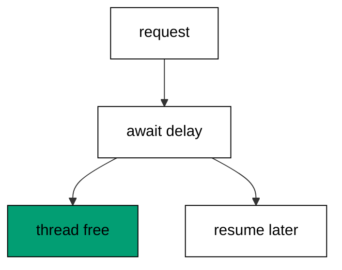

`do!` inside the task expression suspends the handler without blocking a thread: the runtime parks the continuation and lends the thread to other requests until the delay completes. That lending is the whole scalability story — thousands of concurrent slow requests need only a handful of threads when every wait is async. A blocking `Thread.Sleep` would hold its thread hostage for the same ten milliseconds; `Task.Delay` holds nothing.

The ten-millisecond pause stands in for real asynchronous work: database reads, downstream calls, and file access all await the same way. Serving the route twice proves the pause is structural rather than incidental — every call waits, every call answers, and the transcript stays identical. Later examples build on this shape: fan-out awaits many operations at once, and cancellation abandons the ones that stop mattering.

**`learning/code/ex-54-async-handlers-free-the-thread/Program.fs`**:

```fsharp
module App // => one module owns the whole unit

open System // => String.Join sorts joined output deterministically
open System.Net.Http // => HttpClient drives the service in-process (co-09)
open System.Text // => Encoding names UTF8 for JSON payloads
open System.Threading // => Interlocked and SemaphoreSlim live here (co-07)
open System.Threading.Tasks // => Task.WhenAll fans requests out (co-07)
open Microsoft.AspNetCore.Builder // => WebApplication wires routes to handlers
open Microsoft.AspNetCore.Hosting // => UseTestServer marks the in-memory host
open Microsoft.AspNetCore.Http // => HttpContext carries request and response
open Microsoft.AspNetCore.TestHost // => TestServer serves with no socket (co-09)
open Microsoft.Extensions.DependencyInjection // => AddSingleton registers services (co-06)
open Microsoft.Extensions.Logging // => ClearProviders silences logs (co-13)
open Giraffe // => route, choose, and json live here (co-01)

// => All checks below block on async HTTP with GetAwaiter().GetResult().
// => Main stays synchronous so prints land in request order, and the
// => in-process pipeline answers before the next request leaves.

// => show prints one transcript line with no trailing space.
let show (line: string) = // => every printed line flows through here
    printfn "%s" (line.TrimEnd()) // => TrimEnd keeps empty bodies clean

// => get serves one GET and prints method, path, status, and body.
// => One client drives every check: no per-case construction, no sockets.
let get (client: HttpClient) (path: string) = // => path names the resource
    let resp = client.GetAsync(path).GetAwaiter().GetResult() // => full pipeline runs in-process
    let body = resp.Content.ReadAsStringAsync().GetAwaiter().GetResult() // => the exact bytes written
    show (sprintf "GET %s -> %d %s" path (int resp.StatusCode) (body.Trim())) // => status plus body in one line

// => send serves one arbitrary method and prints status with body.
let send (client: HttpClient) (method: string) (path: string) = // => method plus path name the call
    use request = new HttpRequestMessage(HttpMethod(method), path) // => no body on these calls
    use resp = client.SendAsync(request).GetAwaiter().GetResult() // => the pipeline answers in memory
    let body = resp.Content.ReadAsStringAsync().GetAwaiter().GetResult() // => empty for HEAD and redirects
    show (sprintf "%s %s -> %d %s" method path (int resp.StatusCode) (body.Trim())) // => one line per call

// => postJson serves one JSON POST and prints status with body.
let postJson (client: HttpClient) (path: string) (payload: string) = // => payload is already JSON text
    use content = new StringContent(payload, Encoding.UTF8, "application/json") // => UTF8 names the charset
    use resp = client.PostAsync(path, content).GetAwaiter().GetResult() // => the handler reads the body
    let body = resp.Content.ReadAsStringAsync().GetAwaiter().GetResult() // => the exact bytes written
    show (sprintf "POST %s -> %d %s" path (int resp.StatusCode) (body.Trim())) // => status plus body in one line
// => webApp awaits real asynchronous work inside the handler.
let webApp: HttpHandler = // => task handlers free the thread while awaiting (co-07)
    choose [
        GET >=> route "/slow" >=> fun next ctx ->
            task {
                do! System.Threading.Tasks.Task.Delay(10) // => the thread serves others during the wait
                return! text "slow-ok" next ctx // => the answer lands after the pause
            }
        setStatusCode 404 >=> text "Not Found" // => other paths miss
    ]
// => buildApp wires the service every check in this unit exercises.
let buildApp (args: string[]) = // => args carry no flags in this course
    let builder = WebApplication.CreateBuilder(args) // => defaults plus our overrides
    // => Silenced logs keep stdout to printed lines only: golden transcripts
    // => must never contain framework chatter.
    builder.Logging.ClearProviders() |> ignore // => no log lines: only our prints appear
    // => Giraffe's JSON serializer lives in DI: without AddGiraffe the first
    // => json answer throws MissingDependencyException at runtime.
    builder.Services.AddGiraffe() |> ignore // => Giraffe needs its serializer in DI
    builder.WebHost.UseTestServer() |> ignore // => in-memory server: no socket, no port
    let app = builder.Build() // => the pipeline with routing and endpoints
    app.UseGiraffe(webApp) |> ignore // => every request flows through webApp
    app // => hand the wired service back to the caller
// => Top-level entry: build once, check, stop cleanly.
[<EntryPoint>] // => the harness runs the compiled assembly
let main args = // => every unit answers zero on success
    let app = buildApp args // => wiring separate from traffic, as always
    // => StartAsync boots the in-memory host: no socket binds, no port opens,
    // => yet every middleware and route runs exactly as in production.
    app.StartAsync().GetAwaiter().GetResult() // => TestServer starts without any socket
    use client = app.GetTestClient() // => client talks to memory, not the network
    get client "/slow" // => the awaited answer arrives
    get client "/slow" // => twice proves the pause repeats cleanly
    // => StopAsync drains in-flight requests before releasing the host, so the
    // => checks above always land before the process exits.
    app.StopAsync().GetAwaiter().GetResult() // => stop cleanly: nothing in flight is cut (co-08)
    0 // => zero exit means the transcript matched
```

**Output** (`learning/code/ex-54-async-handlers-free-the-thread/expected/main.stdout.txt`):

```text
GET /slow -> 200 slow-ok
GET /slow -> 200 slow-ok
```

**Key takeaway**: Await inside handlers with do!: the thread serves others during the wait, and the answer lands after.

**Why it matters**: Async-all-the-way-down is what lets one host serve thousands of slow clients: blocked threads cap concurrency at the thread count, while awaited operations scale with memory instead. The habit starts in the handler — every blocking call converted is headroom the whole service shares. Ten milliseconds looks trivial until a thousand requests each need it at once; then the awaited version answers all and the blocked version queues. Concurrency budgets are spent one handler at a time.

### Example 55: Interlocked Counts Shared Hits

Shared counters need atomic increments, and this example numbers three sequential hits with `Interlocked`. The program shows 1, 2, and 3 in order. (Concepts: co-07.)

`Interlocked.Increment` performs the read-add-write as one indivisible step: no two concurrent hits can receive the same number, because the hardware serializes the updates. A plain `n <- n + 1` compiles to three steps that interleave under load — two hits read 1, both write 2, and a hit vanishes without a trace. The missing hit never errors; the total just reads low, which makes the bug invisible without atomicity and obvious with it.

Sequential checks print 1, 2, 3 because each increment lands before the next request starts — order here is a check convenience, not a concurrency guarantee. Under real load the numbers stay unique but arrive unordered, which is exactly the contract worth asserting: uniqueness always, ordering never. The `&hits` byref is the F# ceremony for passing the field to the atomic operation; the pattern transfers to every shared number the course touches.

**`learning/code/ex-55-interlocked-counts-shared-hits/Program.fs`**:

```fsharp
module App // => one module owns the whole unit

open System // => String.Join sorts joined output deterministically
open System.Net.Http // => HttpClient drives the service in-process (co-09)
open System.Text // => Encoding names UTF8 for JSON payloads
open System.Threading // => Interlocked and SemaphoreSlim live here (co-07)
open System.Threading.Tasks // => Task.WhenAll fans requests out (co-07)
open Microsoft.AspNetCore.Builder // => WebApplication wires routes to handlers
open Microsoft.AspNetCore.Hosting // => UseTestServer marks the in-memory host
open Microsoft.AspNetCore.Http // => HttpContext carries request and response
open Microsoft.AspNetCore.TestHost // => TestServer serves with no socket (co-09)
open Microsoft.Extensions.DependencyInjection // => AddSingleton registers services (co-06)
open Microsoft.Extensions.Logging // => ClearProviders silences logs (co-13)
open Giraffe // => route, choose, and json live here (co-01)

// => All checks below block on async HTTP with GetAwaiter().GetResult().
// => Main stays synchronous so prints land in request order, and the
// => in-process pipeline answers before the next request leaves.

// => show prints one transcript line with no trailing space.
let show (line: string) = // => every printed line flows through here
    printfn "%s" (line.TrimEnd()) // => TrimEnd keeps empty bodies clean

// => get serves one GET and prints method, path, status, and body.
// => One client drives every check: no per-case construction, no sockets.
let get (client: HttpClient) (path: string) = // => path names the resource
    let resp = client.GetAsync(path).GetAwaiter().GetResult() // => full pipeline runs in-process
    let body = resp.Content.ReadAsStringAsync().GetAwaiter().GetResult() // => the exact bytes written
    show (sprintf "GET %s -> %d %s" path (int resp.StatusCode) (body.Trim())) // => status plus body in one line

// => send serves one arbitrary method and prints status with body.
let send (client: HttpClient) (method: string) (path: string) = // => method plus path name the call
    use request = new HttpRequestMessage(HttpMethod(method), path) // => no body on these calls
    use resp = client.SendAsync(request).GetAwaiter().GetResult() // => the pipeline answers in memory
    let body = resp.Content.ReadAsStringAsync().GetAwaiter().GetResult() // => empty for HEAD and redirects
    show (sprintf "%s %s -> %d %s" method path (int resp.StatusCode) (body.Trim())) // => one line per call

// => postJson serves one JSON POST and prints status with body.
let postJson (client: HttpClient) (path: string) (payload: string) = // => payload is already JSON text
    use content = new StringContent(payload, Encoding.UTF8, "application/json") // => UTF8 names the charset
    use resp = client.PostAsync(path, content).GetAwaiter().GetResult() // => the handler reads the body
    let body = resp.Content.ReadAsStringAsync().GetAwaiter().GetResult() // => the exact bytes written
    show (sprintf "POST %s -> %d %s" path (int resp.StatusCode) (body.Trim())) // => status plus body in one line
// => hits counts every request the handler serves.
let mutable hits = 0 // => one shared number behind an atomic door (co-07)
// => webApp numbers each hit atomically.
let webApp: HttpHandler = // => concurrent hits each receive their own number
    choose [
        GET >=> route "/hit" >=> fun next ctx ->
            task {
                let n = System.Threading.Interlocked.Increment(&hits) // => atomic: no two hits share a number
                return! text ("hit=" + string n) next ctx // => the number proves the count
            }
        setStatusCode 404 >=> text "Not Found" // => other paths miss
    ]
// => buildApp wires the service every check in this unit exercises.
let buildApp (args: string[]) = // => args carry no flags in this course
    let builder = WebApplication.CreateBuilder(args) // => defaults plus our overrides
    // => Silenced logs keep stdout to printed lines only: golden transcripts
    // => must never contain framework chatter.
    builder.Logging.ClearProviders() |> ignore // => no log lines: only our prints appear
    // => Giraffe's JSON serializer lives in DI: without AddGiraffe the first
    // => json answer throws MissingDependencyException at runtime.
    builder.Services.AddGiraffe() |> ignore // => Giraffe needs its serializer in DI
    builder.WebHost.UseTestServer() |> ignore // => in-memory server: no socket, no port
    let app = builder.Build() // => the pipeline with routing and endpoints
    app.UseGiraffe(webApp) |> ignore // => every request flows through webApp
    app // => hand the wired service back to the caller
// => Top-level entry: build once, check, stop cleanly.
[<EntryPoint>] // => the harness runs the compiled assembly
let main args = // => every unit answers zero on success
    let app = buildApp args // => wiring separate from traffic, as always
    // => StartAsync boots the in-memory host: no socket binds, no port opens,
    // => yet every middleware and route runs exactly as in production.
    app.StartAsync().GetAwaiter().GetResult() // => TestServer starts without any socket
    use client = app.GetTestClient() // => client talks to memory, not the network
    get client "/hit" // => first hit numbers 1
    get client "/hit" // => second hit numbers 2
    get client "/hit" // => third hit numbers 3
    // => StopAsync drains in-flight requests before releasing the host, so the
    // => checks above always land before the process exits.
    app.StopAsync().GetAwaiter().GetResult() // => stop cleanly: nothing in flight is cut (co-08)
    0 // => zero exit means the transcript matched
```

**Output** (`learning/code/ex-55-interlocked-counts-shared-hits/expected/main.stdout.txt`):

```text
GET /hit -> 200 hit=1
GET /hit -> 200 hit=2
GET /hit -> 200 hit=3
```

**Key takeaway**: Increment shared numbers with Interlocked: unique under any load, ordered only when checks run sequentially.

**Why it matters**: Atomic counters are the foundation of honest metrics: request counts, error tallies, and queue depths all depend on increments that never lose one. A racy counter undercounts precisely when accuracy matters most — at peak load, during the incident the numbers are supposed to explain. The one-line discipline of reaching for `Interlocked` first turns shared numbers from approximations into facts. Every dashboard downstream inherits whichever choice the handler made.

### Example 56: Semaphore Caps Concurrent Work

Semaphores bound concurrent entries, and this example's gate of two admits one caller and sheds the next. The program exhausts the permits, shows the 429, releases, and shows admission. (Concepts: co-07.)

`Wait(0)` asks without blocking: a free permit admits the caller immediately, and none free means the handler answers 429 instead of queuing. Shed-not-queue is the overload philosophy — a fast rejection lets the caller retry, back off, or degrade, while a queued request consumes a thread, a timeout budget, and eventually the caller's patience. The check holds both permits itself to deterministically create the full gate, then releases them to show the empty one.

Releasing in `finally` keeps the gate honest when handlers throw: a permit leaked on the error path shrinks capacity by one per failure until the service admits nothing. Real gates wrap downstream calls and slow computations; this teaching gate wraps a text answer so the lesson stays about admission rather than work. Two permits are enough to show both states — the exact bound matters less than the discipline of bounding.

**`learning/code/ex-56-semaphore-caps-concurrent-work/Program.fs`**:

```fsharp
module App // => one module owns the whole unit

open System // => String.Join sorts joined output deterministically
open System.Net.Http // => HttpClient drives the service in-process (co-09)
open System.Text // => Encoding names UTF8 for JSON payloads
open System.Threading // => Interlocked and SemaphoreSlim live here (co-07)
open System.Threading.Tasks // => Task.WhenAll fans requests out (co-07)
open Microsoft.AspNetCore.Builder // => WebApplication wires routes to handlers
open Microsoft.AspNetCore.Hosting // => UseTestServer marks the in-memory host
open Microsoft.AspNetCore.Http // => HttpContext carries request and response
open Microsoft.AspNetCore.TestHost // => TestServer serves with no socket (co-09)
open Microsoft.Extensions.DependencyInjection // => AddSingleton registers services (co-06)
open Microsoft.Extensions.Logging // => ClearProviders silences logs (co-13)
open Giraffe // => route, choose, and json live here (co-01)

// => All checks below block on async HTTP with GetAwaiter().GetResult().
// => Main stays synchronous so prints land in request order, and the
// => in-process pipeline answers before the next request leaves.

// => show prints one transcript line with no trailing space.
let show (line: string) = // => every printed line flows through here
    printfn "%s" (line.TrimEnd()) // => TrimEnd keeps empty bodies clean

// => get serves one GET and prints method, path, status, and body.
// => One client drives every check: no per-case construction, no sockets.
let get (client: HttpClient) (path: string) = // => path names the resource
    let resp = client.GetAsync(path).GetAwaiter().GetResult() // => full pipeline runs in-process
    let body = resp.Content.ReadAsStringAsync().GetAwaiter().GetResult() // => the exact bytes written
    show (sprintf "GET %s -> %d %s" path (int resp.StatusCode) (body.Trim())) // => status plus body in one line

// => send serves one arbitrary method and prints status with body.
let send (client: HttpClient) (method: string) (path: string) = // => method plus path name the call
    use request = new HttpRequestMessage(HttpMethod(method), path) // => no body on these calls
    use resp = client.SendAsync(request).GetAwaiter().GetResult() // => the pipeline answers in memory
    let body = resp.Content.ReadAsStringAsync().GetAwaiter().GetResult() // => empty for HEAD and redirects
    show (sprintf "%s %s -> %d %s" method path (int resp.StatusCode) (body.Trim())) // => one line per call

// => postJson serves one JSON POST and prints status with body.
let postJson (client: HttpClient) (path: string) (payload: string) = // => payload is already JSON text
    use content = new StringContent(payload, Encoding.UTF8, "application/json") // => UTF8 names the charset
    use resp = client.PostAsync(path, content).GetAwaiter().GetResult() // => the handler reads the body
    let body = resp.Content.ReadAsStringAsync().GetAwaiter().GetResult() // => the exact bytes written
    show (sprintf "POST %s -> %d %s" path (int resp.StatusCode) (body.Trim())) // => status plus body in one line
// => gate caps concurrent entries at two permits.
let gate = new System.Threading.SemaphoreSlim(2) // => the bound the checks exhaust on purpose (co-07)
// => webApp admits only callers that win a permit immediately.
let webApp: HttpHandler = // => Wait(0) never blocks: shed or serve, never queue
    choose [
        GET >=> route "/limited" >=> fun next ctx ->
            task {
                if gate.Wait(0) then // => a free permit admits this caller
                    try
                        return! text "in" next ctx // => admitted work answers plainly
                    finally
                        gate.Release() |> ignore // => the permit returns after the answer
                else // => no free permit means shed load, not slow load
                    return! (setStatusCode 429 >=> text "shed") next ctx
            }
        setStatusCode 404 >=> text "Not Found" // => other paths miss
    ]
// => buildApp wires the service every check in this unit exercises.
let buildApp (args: string[]) = // => args carry no flags in this course
    let builder = WebApplication.CreateBuilder(args) // => defaults plus our overrides
    // => Silenced logs keep stdout to printed lines only: golden transcripts
    // => must never contain framework chatter.
    builder.Logging.ClearProviders() |> ignore // => no log lines: only our prints appear
    // => Giraffe's JSON serializer lives in DI: without AddGiraffe the first
    // => json answer throws MissingDependencyException at runtime.
    builder.Services.AddGiraffe() |> ignore // => Giraffe needs its serializer in DI
    builder.WebHost.UseTestServer() |> ignore // => in-memory server: no socket, no port
    let app = builder.Build() // => the pipeline with routing and endpoints
    app.UseGiraffe(webApp) |> ignore // => every request flows through webApp
    app // => hand the wired service back to the caller
// => Top-level entry: build once, check, stop cleanly.
[<EntryPoint>] // => the harness runs the compiled assembly
let main args = // => every unit answers zero on success
    let app = buildApp args // => wiring separate from traffic, as always
    // => StartAsync boots the in-memory host: no socket binds, no port opens,
    // => yet every middleware and route runs exactly as in production.
    app.StartAsync().GetAwaiter().GetResult() // => TestServer starts without any socket
    use client = app.GetTestClient() // => client talks to memory, not the network
    gate.WaitAsync().GetAwaiter().GetResult() |> ignore // => first permit held by the check
    gate.WaitAsync().GetAwaiter().GetResult() |> ignore // => second permit held: the gate is full
    get client "/limited" // => no permit left, so the load sheds with 429
    gate.Release() |> ignore // => first permit returns
    gate.Release() |> ignore // => the gate is empty again
    get client "/limited" // => a free permit admits this caller
    // => StopAsync drains in-flight requests before releasing the host, so the
    // => checks above always land before the process exits.
    app.StopAsync().GetAwaiter().GetResult() // => stop cleanly: nothing in flight is cut (co-08)
    0 // => zero exit means the transcript matched
```

**Output** (`learning/code/ex-56-semaphore-caps-concurrent-work/expected/main.stdout.txt`):

```text
GET /limited -> 429 shed
GET /limited -> 200 in
```

**Key takeaway**: Bound entries with a semaphore and shed on Wait(0): admit when a permit is free, answer 429 when none is.

**Why it matters**: Admission control is what keeps a slow dependency from becoming a dead service: unbounded concurrency turns one lagging downstream into thread exhaustion everywhere upstream. Shedding fast with 429 preserves the host for the calls it can still serve — partial availability beats total collapse, and callers handle explicit rejection far better than timeouts. The `finally`-release habit completes the pattern: capacity must return even when work fails, or every incident permanently shrinks the gate.

### Example 57: Concurrent Dictionary Caches Safely

Caches compute once and reuse, and this example's dictionary squares 4 on the miss and reuses on the hit. The program shows the compute count staying at 1 across both calls. (Concepts: co-07.)

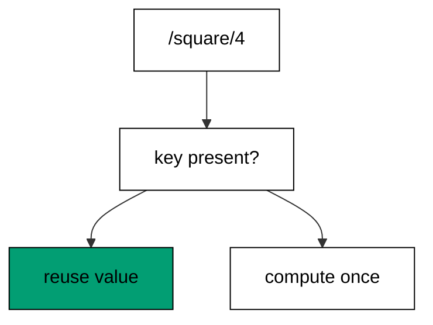

`GetOrAdd` is the atomic cache primitive: the factory runs only when the key is absent, and concurrent callers racing on the same key receive the same stored value. The `computed` counter moves exactly once across two identical requests, which is the observable proof the second call cached. `ConcurrentDictionary` supplies the thread safety — plain maps would race on the absent key and compute twice, or worse, corrupt.

Counting computations instead of timing them keeps the lesson deterministic: cache behavior is about how many times work runs, not how fast it runs. The square itself is incidental — any pure function of the key would do — because the pattern transfers to rendered pages, parsed configs, and fetched rows unchanged. Eviction, expiry, and sizing are deliberately absent: this example teaches the hit-miss discipline that every cache policy later assumes.

**`learning/code/ex-57-concurrent-dictionary-caches-safely/Program.fs`**:

```fsharp
module App // => one module owns the whole unit

open System // => String.Join sorts joined output deterministically
open System.Net.Http // => HttpClient drives the service in-process (co-09)
open System.Text // => Encoding names UTF8 for JSON payloads
open System.Threading // => Interlocked and SemaphoreSlim live here (co-07)
open System.Threading.Tasks // => Task.WhenAll fans requests out (co-07)
open Microsoft.AspNetCore.Builder // => WebApplication wires routes to handlers
open Microsoft.AspNetCore.Hosting // => UseTestServer marks the in-memory host
open Microsoft.AspNetCore.Http // => HttpContext carries request and response
open Microsoft.AspNetCore.TestHost // => TestServer serves with no socket (co-09)
open Microsoft.Extensions.DependencyInjection // => AddSingleton registers services (co-06)
open Microsoft.Extensions.Logging // => ClearProviders silences logs (co-13)
open Giraffe // => route, choose, and json live here (co-01)

// => All checks below block on async HTTP with GetAwaiter().GetResult().
// => Main stays synchronous so prints land in request order, and the
// => in-process pipeline answers before the next request leaves.

// => show prints one transcript line with no trailing space.
let show (line: string) = // => every printed line flows through here
    printfn "%s" (line.TrimEnd()) // => TrimEnd keeps empty bodies clean

// => get serves one GET and prints method, path, status, and body.
// => One client drives every check: no per-case construction, no sockets.
let get (client: HttpClient) (path: string) = // => path names the resource
    let resp = client.GetAsync(path).GetAwaiter().GetResult() // => full pipeline runs in-process
    let body = resp.Content.ReadAsStringAsync().GetAwaiter().GetResult() // => the exact bytes written
    show (sprintf "GET %s -> %d %s" path (int resp.StatusCode) (body.Trim())) // => status plus body in one line

// => send serves one arbitrary method and prints status with body.
let send (client: HttpClient) (method: string) (path: string) = // => method plus path name the call
    use request = new HttpRequestMessage(HttpMethod(method), path) // => no body on these calls
    use resp = client.SendAsync(request).GetAwaiter().GetResult() // => the pipeline answers in memory
    let body = resp.Content.ReadAsStringAsync().GetAwaiter().GetResult() // => empty for HEAD and redirects
    show (sprintf "%s %s -> %d %s" method path (int resp.StatusCode) (body.Trim())) // => one line per call

// => postJson serves one JSON POST and prints status with body.
let postJson (client: HttpClient) (path: string) (payload: string) = // => payload is already JSON text
    use content = new StringContent(payload, Encoding.UTF8, "application/json") // => UTF8 names the charset
    use resp = client.PostAsync(path, content).GetAwaiter().GetResult() // => the handler reads the body
    let body = resp.Content.ReadAsStringAsync().GetAwaiter().GetResult() // => the exact bytes written
    show (sprintf "POST %s -> %d %s" path (int resp.StatusCode) (body.Trim())) // => status plus body in one line
// => squares caches one square per input, computed once.
let squares = System.Collections.Concurrent.ConcurrentDictionary<int, int>() // => input to square, thread-safe (co-07)

// => computes counts how many squares were actually calculated.
let mutable computes = 0 // => cache hits must not move this number
// => webApp serves cached squares and reports the compute count.
let webApp: HttpHandler = // => GetOrAdd computes only on a miss
    choose [
        GET >=> routef "/square/%i" (fun n -> // => the input travels typed
            fun next ctx ->
                task {
                    let square = squares.GetOrAdd(n, fun key -> // => miss computes, hit reuses
                        System.Threading.Interlocked.Increment(&computes) |> ignore // => the miss counter moves once
                        key * key) // => the square of the key
                    return! json {| computed = computes; n = n; square = square |} next ctx // => count proves the cache
                })
        setStatusCode 404 >=> text "Not Found" // => non-numbers miss
    ]
// => buildApp wires the service every check in this unit exercises.
let buildApp (args: string[]) = // => args carry no flags in this course
    let builder = WebApplication.CreateBuilder(args) // => defaults plus our overrides
    // => Silenced logs keep stdout to printed lines only: golden transcripts
    // => must never contain framework chatter.
    builder.Logging.ClearProviders() |> ignore // => no log lines: only our prints appear
    // => Giraffe's JSON serializer lives in DI: without AddGiraffe the first
    // => json answer throws MissingDependencyException at runtime.
    builder.Services.AddGiraffe() |> ignore // => Giraffe needs its serializer in DI
    builder.WebHost.UseTestServer() |> ignore // => in-memory server: no socket, no port
    let app = builder.Build() // => the pipeline with routing and endpoints
    app.UseGiraffe(webApp) |> ignore // => every request flows through webApp
    app // => hand the wired service back to the caller
// => Top-level entry: build once, check, stop cleanly.
[<EntryPoint>] // => the harness runs the compiled assembly
let main args = // => every unit answers zero on success
    let app = buildApp args // => wiring separate from traffic, as always
    // => StartAsync boots the in-memory host: no socket binds, no port opens,
    // => yet every middleware and route runs exactly as in production.
    app.StartAsync().GetAwaiter().GetResult() // => TestServer starts without any socket
    use client = app.GetTestClient() // => client talks to memory, not the network
    get client "/square/4" // => the miss computes: computed reads 1
    get client "/square/4" // => the hit reuses: computed still reads 1
    // => StopAsync drains in-flight requests before releasing the host, so the
    // => checks above always land before the process exits.
    app.StopAsync().GetAwaiter().GetResult() // => stop cleanly: nothing in flight is cut (co-08)
    0 // => zero exit means the transcript matched
```

**Output** (`learning/code/ex-57-concurrent-dictionary-caches-safely/expected/main.stdout.txt`):

```text
GET /square/4 -> 200 {"computed":1,"n":4,"square":16}
GET /square/4 -> 200 {"computed":1,"n":4,"square":16}
```

**Key takeaway**: Cache with GetOrAdd on a concurrent dictionary: the factory runs once per key, and the compute count proves it.

**Why it matters**: Compute-once caching converts repeated expensive work into repeated cheap lookups: the first caller pays, every later caller rides free, and capacity multiplies without new hardware. Atomicity is the load-bearing half — a cache that computes twice under contention saves nothing precisely when savings matter. Counting computations in checks builds the verification habit directly: never trust that caching works, always prove the second call skipped the work.

### Example 58: Cancellation Abandons Slow Work

Cancelled work should stop, not run, and this example abandons a job whose token was cancelled before the request. The program shows the 503 and the unaffected neighbor. (Concepts: co-07.)

`Task.Delay` with an already-cancelled token throws immediately: the handler never sleeps, never works, and lands directly in the cancellation arm. Catching `OperationCanceledException` converts abandonment from a crash into an answer — 503 with a name, shaped like every other failure in the course. Cooperative cancellation only works when awaits observe the token; code that ignores it runs to completion regardless of who stopped waiting.

Cancelling before the first request makes the outcome fixed: real cancellation races the work, but this unit teaches the handling, not the race. The neighbor route proves abandonment is selective — one job cancelled does not slow the rest of the table. Shutdown, timeouts, and disconnected clients all deliver cancellation through the same token shape; handlers that honor it free their resources the moment nobody needs them.

**`learning/code/ex-58-cancellation-abandons-slow-work/Program.fs`**:

```fsharp
module App // => one module owns the whole unit

open System // => String.Join sorts joined output deterministically
open System.Net.Http // => HttpClient drives the service in-process (co-09)
open System.Text // => Encoding names UTF8 for JSON payloads
open System.Threading // => Interlocked and SemaphoreSlim live here (co-07)
open System.Threading.Tasks // => Task.WhenAll fans requests out (co-07)
open Microsoft.AspNetCore.Builder // => WebApplication wires routes to handlers
open Microsoft.AspNetCore.Hosting // => UseTestServer marks the in-memory host
open Microsoft.AspNetCore.Http // => HttpContext carries request and response
open Microsoft.AspNetCore.TestHost // => TestServer serves with no socket (co-09)
open Microsoft.Extensions.DependencyInjection // => AddSingleton registers services (co-06)
open Microsoft.Extensions.Logging // => ClearProviders silences logs (co-13)
open Giraffe // => route, choose, and json live here (co-01)

// => All checks below block on async HTTP with GetAwaiter().GetResult().
// => Main stays synchronous so prints land in request order, and the
// => in-process pipeline answers before the next request leaves.

// => show prints one transcript line with no trailing space.
let show (line: string) = // => every printed line flows through here
    printfn "%s" (line.TrimEnd()) // => TrimEnd keeps empty bodies clean

// => get serves one GET and prints method, path, status, and body.
// => One client drives every check: no per-case construction, no sockets.
let get (client: HttpClient) (path: string) = // => path names the resource
    let resp = client.GetAsync(path).GetAwaiter().GetResult() // => full pipeline runs in-process
    let body = resp.Content.ReadAsStringAsync().GetAwaiter().GetResult() // => the exact bytes written
    show (sprintf "GET %s -> %d %s" path (int resp.StatusCode) (body.Trim())) // => status plus body in one line

// => send serves one arbitrary method and prints status with body.
let send (client: HttpClient) (method: string) (path: string) = // => method plus path name the call
    use request = new HttpRequestMessage(HttpMethod(method), path) // => no body on these calls
    use resp = client.SendAsync(request).GetAwaiter().GetResult() // => the pipeline answers in memory
    let body = resp.Content.ReadAsStringAsync().GetAwaiter().GetResult() // => empty for HEAD and redirects
    show (sprintf "%s %s -> %d %s" method path (int resp.StatusCode) (body.Trim())) // => one line per call

// => postJson serves one JSON POST and prints status with body.
let postJson (client: HttpClient) (path: string) (payload: string) = // => payload is already JSON text
    use content = new StringContent(payload, Encoding.UTF8, "application/json") // => UTF8 names the charset
    use resp = client.PostAsync(path, content).GetAwaiter().GetResult() // => the handler reads the body
    let body = resp.Content.ReadAsStringAsync().GetAwaiter().GetResult() // => the exact bytes written
    show (sprintf "POST %s -> %d %s" path (int resp.StatusCode) (body.Trim())) // => status plus body in one line
// => abandoned is cancelled before any request runs.
let abandoned = new System.Threading.CancellationTokenSource() // => the token of work that never starts (co-07)

// => the setup cancels upfront so the outcome is fixed.
do abandoned.Cancel() // => cancelled before the first request: deterministic
// => webApp abandons cancelled work instead of running it.
let webApp: HttpHandler = // => cooperative cancellation, honored up front
    choose [
        GET >=> route "/job" >=> fun next ctx ->
            task {
                try
                    do! System.Threading.Tasks.Task.Delay(50, abandoned.Token) // => already cancelled: throws at once
                    return! text "finished" next ctx // => never reached in this unit
                with :? System.OperationCanceledException -> // => abandonment is an answer, not a crash
                    return! (setStatusCode 503 >=> text "cancelled") next ctx
            }
        GET >=> route "/quick" >=> text "quick-ok" // => uncancelled work answers normally
        setStatusCode 404 >=> text "Not Found" // => other paths miss
    ]
// => buildApp wires the service every check in this unit exercises.
let buildApp (args: string[]) = // => args carry no flags in this course
    let builder = WebApplication.CreateBuilder(args) // => defaults plus our overrides
    // => Silenced logs keep stdout to printed lines only: golden transcripts
    // => must never contain framework chatter.
    builder.Logging.ClearProviders() |> ignore // => no log lines: only our prints appear
    // => Giraffe's JSON serializer lives in DI: without AddGiraffe the first
    // => json answer throws MissingDependencyException at runtime.
    builder.Services.AddGiraffe() |> ignore // => Giraffe needs its serializer in DI
    builder.WebHost.UseTestServer() |> ignore // => in-memory server: no socket, no port
    let app = builder.Build() // => the pipeline with routing and endpoints
    app.UseGiraffe(webApp) |> ignore // => every request flows through webApp
    app // => hand the wired service back to the caller
// => Top-level entry: build once, check, stop cleanly.
[<EntryPoint>] // => the harness runs the compiled assembly
let main args = // => every unit answers zero on success
    let app = buildApp args // => wiring separate from traffic, as always
    // => StartAsync boots the in-memory host: no socket binds, no port opens,
    // => yet every middleware and route runs exactly as in production.
    app.StartAsync().GetAwaiter().GetResult() // => TestServer starts without any socket
    use client = app.GetTestClient() // => client talks to memory, not the network
    get client "/job" // => the cancelled job abandons with 503
    get client "/quick" // => abandonment is selective: neighbors still serve
    // => StopAsync drains in-flight requests before releasing the host, so the
    // => checks above always land before the process exits.
    app.StopAsync().GetAwaiter().GetResult() // => stop cleanly: nothing in flight is cut (co-08)
    0 // => zero exit means the transcript matched
```

**Output** (`learning/code/ex-58-cancellation-abandons-slow-work/expected/main.stdout.txt`):

```text
GET /job -> 503 cancelled
GET /quick -> 200 quick-ok
```

**Key takeaway**: Honor cancellation tokens in awaits and answer abandonment with 503: cancelled work stops, neighbors keep serving.

**Why it matters**: Cancellation hygiene is what lets services shut down gracefully and shed stale work: a handler that ignores its token holds threads, connections, and memory long after the caller gave up. Under load, abandoned-but-running work is indistinguishable from a leak — capacity drains while dashboards show requests that finished minutes ago. Answering 503 names the outcome for the rare caller still listening and keeps the failure taxonomy complete. Cooperative cancellation only cooperates when handlers actually check.

### Example 59: Parallel Fan-Out Then Join

Independent calls run together and join after, and this example fans four echoes out at once and sorts the landed bodies. The program prints the joined, ordered answers. (Concepts: co-07.)

`Task.WhenAll` awaits the whole flight with one expression: four requests leave together, the join waits for the slowest, and the results arrive as an array. Sorting before printing removes arrival order from the transcript — concurrency reorders completions by nature, and golden files must not depend on who landed first. The sorted join proves every request answered without freezing an accidental order into the expectation.

Fan-out suits independent calls: four echoes share nothing, so parallelism costs no coordination and buys the latency of the slowest instead of the sum. Dependent calls chain awaits instead — the course keeps the two shapes distinct because mixing them creates races that look like fan-out but behave like luck. One join, one sort, one line: the pattern for every scatter-gather the service will ever need.

**`learning/code/ex-59-parallel-fan-out-then-join/Program.fs`**:

```fsharp
module App // => one module owns the whole unit

open System // => String.Join sorts joined output deterministically
open System.Net.Http // => HttpClient drives the service in-process (co-09)
open System.Text // => Encoding names UTF8 for JSON payloads
open System.Threading // => Interlocked and SemaphoreSlim live here (co-07)
open System.Threading.Tasks // => Task.WhenAll fans requests out (co-07)
open Microsoft.AspNetCore.Builder // => WebApplication wires routes to handlers
open Microsoft.AspNetCore.Hosting // => UseTestServer marks the in-memory host
open Microsoft.AspNetCore.Http // => HttpContext carries request and response
open Microsoft.AspNetCore.TestHost // => TestServer serves with no socket (co-09)
open Microsoft.Extensions.DependencyInjection // => AddSingleton registers services (co-06)
open Microsoft.Extensions.Logging // => ClearProviders silences logs (co-13)
open Giraffe // => route, choose, and json live here (co-01)

// => All checks below block on async HTTP with GetAwaiter().GetResult().
// => Main stays synchronous so prints land in request order, and the
// => in-process pipeline answers before the next request leaves.

// => show prints one transcript line with no trailing space.
let show (line: string) = // => every printed line flows through here
    printfn "%s" (line.TrimEnd()) // => TrimEnd keeps empty bodies clean

// => get serves one GET and prints method, path, status, and body.
// => One client drives every check: no per-case construction, no sockets.
let get (client: HttpClient) (path: string) = // => path names the resource
    let resp = client.GetAsync(path).GetAwaiter().GetResult() // => full pipeline runs in-process
    let body = resp.Content.ReadAsStringAsync().GetAwaiter().GetResult() // => the exact bytes written
    show (sprintf "GET %s -> %d %s" path (int resp.StatusCode) (body.Trim())) // => status plus body in one line

// => send serves one arbitrary method and prints status with body.
let send (client: HttpClient) (method: string) (path: string) = // => method plus path name the call
    use request = new HttpRequestMessage(HttpMethod(method), path) // => no body on these calls
    use resp = client.SendAsync(request).GetAwaiter().GetResult() // => the pipeline answers in memory
    let body = resp.Content.ReadAsStringAsync().GetAwaiter().GetResult() // => empty for HEAD and redirects
    show (sprintf "%s %s -> %d %s" method path (int resp.StatusCode) (body.Trim())) // => one line per call

// => postJson serves one JSON POST and prints status with body.
let postJson (client: HttpClient) (path: string) (payload: string) = // => payload is already JSON text
    use content = new StringContent(payload, Encoding.UTF8, "application/json") // => UTF8 names the charset
    use resp = client.PostAsync(path, content).GetAwaiter().GetResult() // => the handler reads the body
    let body = resp.Content.ReadAsStringAsync().GetAwaiter().GetResult() // => the exact bytes written
    show (sprintf "POST %s -> %d %s" path (int resp.StatusCode) (body.Trim())) // => status plus body in one line
// => webApp echoes numbers for the fan-out to collect.
let webApp: HttpHandler = // => one tiny route, driven many at once (co-07)
    choose [
        GET >=> routef "/echo/%i" (fun i -> // => the number travels typed
            text ("n=" + string i)) // => the echo proves which request answered
        setStatusCode 404 >=> text "Not Found" // => non-numbers miss
    ]
// => buildApp wires the service every check in this unit exercises.
let buildApp (args: string[]) = // => args carry no flags in this course
    let builder = WebApplication.CreateBuilder(args) // => defaults plus our overrides
    // => Silenced logs keep stdout to printed lines only: golden transcripts
    // => must never contain framework chatter.
    builder.Logging.ClearProviders() |> ignore // => no log lines: only our prints appear
    // => Giraffe's JSON serializer lives in DI: without AddGiraffe the first
    // => json answer throws MissingDependencyException at runtime.
    builder.Services.AddGiraffe() |> ignore // => Giraffe needs its serializer in DI
    builder.WebHost.UseTestServer() |> ignore // => in-memory server: no socket, no port
    let app = builder.Build() // => the pipeline with routing and endpoints
    app.UseGiraffe(webApp) |> ignore // => every request flows through webApp
    app // => hand the wired service back to the caller
// => Top-level entry: build once, check, stop cleanly.
[<EntryPoint>] // => the harness runs the compiled assembly
let main args = // => every unit answers zero on success
    let app = buildApp args // => wiring separate from traffic, as always
    // => StartAsync boots the in-memory host: no socket binds, no port opens,
    // => yet every middleware and route runs exactly as in production.
    app.StartAsync().GetAwaiter().GetResult() // => TestServer starts without any socket
    use client = app.GetTestClient() // => client talks to memory, not the network
    let flights = [| for i in 1..4 -> client.GetStringAsync("/echo/" + string i) |] // => four requests leave at once
    let landed = System.Threading.Tasks.Task.WhenAll(flights).GetAwaiter().GetResult() // => the join waits for all four
    show (sprintf "joined=%s" (System.String.Join(",", landed |> Array.sort))) // => sorted: arrival order never leaks
    // => StopAsync drains in-flight requests before releasing the host, so the
    // => checks above always land before the process exits.
    app.StopAsync().GetAwaiter().GetResult() // => stop cleanly: nothing in flight is cut (co-08)
    0 // => zero exit means the transcript matched
```

**Output** (`learning/code/ex-59-parallel-fan-out-then-join/expected/main.stdout.txt`):

```text
joined=n=1,n=2,n=3,n=4
```

**Key takeaway**: Fan out with WhenAll and sort before asserting: parallel calls join at the slowest, and order never leaks into output.

**Why it matters**: Scatter-gather is the latency strategy behind every fast aggregator: independent downstream calls fly together, and the response waits once instead of once per call. Sorting at the join is the determinism discipline that makes the pattern testable — without it, suites flake on arrival order and teams stop trusting them. The habit transfers directly to production fan-out over services, shards, and regions: same shape, larger stage, same sorted proof.

### Example 60: Rate Limiter Sheds Excess Load

Rate limiters spend a budget and shed the excess, and this example's bucket of three admits three calls then answers 429 twice. The program shows the exact spend-down order. (Concepts: co-07.)

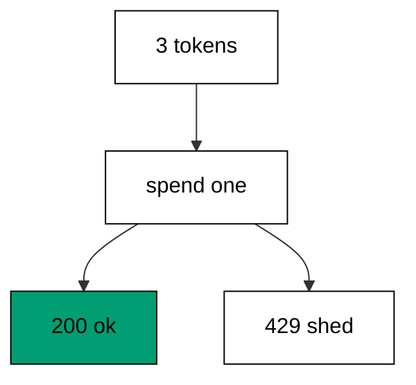

The lock makes each spend atomic: check the budget, decrement, and admit happen as one step, so concurrent callers cannot both spend the last token. Sequential checks print the deterministic spend-down — three oks, then two sheds — because each request completes before the next starts. Under real concurrency the admitted set varies while the count holds: any three of five pass, never four, which is the guarantee worth asserting.

Answering 429 instead of queuing keeps the limiter honest about capacity: the service serves what it can and names what it cannot, rather than accepting everything and timing out mysteriously. Real buckets refill on a clock; this teaching bucket spends once and stays empty, because refill timing would trade determinism for realism the lesson does not need. The shape transfers — budget, atomic spend, shed — whatever refills it.

**`learning/code/ex-60-rate-limiter-sheds-excess-load/Program.fs`**:

```fsharp
module App // => one module owns the whole unit

open System // => String.Join sorts joined output deterministically
open System.Net.Http // => HttpClient drives the service in-process (co-09)
open System.Text // => Encoding names UTF8 for JSON payloads
open System.Threading // => Interlocked and SemaphoreSlim live here (co-07)
open System.Threading.Tasks // => Task.WhenAll fans requests out (co-07)
open Microsoft.AspNetCore.Builder // => WebApplication wires routes to handlers
open Microsoft.AspNetCore.Hosting // => UseTestServer marks the in-memory host
open Microsoft.AspNetCore.Http // => HttpContext carries request and response
open Microsoft.AspNetCore.TestHost // => TestServer serves with no socket (co-09)
open Microsoft.Extensions.DependencyInjection // => AddSingleton registers services (co-06)
open Microsoft.Extensions.Logging // => ClearProviders silences logs (co-13)
open Giraffe // => route, choose, and json live here (co-01)

// => All checks below block on async HTTP with GetAwaiter().GetResult().
// => Main stays synchronous so prints land in request order, and the
// => in-process pipeline answers before the next request leaves.

// => show prints one transcript line with no trailing space.
let show (line: string) = // => every printed line flows through here
    printfn "%s" (line.TrimEnd()) // => TrimEnd keeps empty bodies clean

// => get serves one GET and prints method, path, status, and body.
// => One client drives every check: no per-case construction, no sockets.
let get (client: HttpClient) (path: string) = // => path names the resource
    let resp = client.GetAsync(path).GetAwaiter().GetResult() // => full pipeline runs in-process
    let body = resp.Content.ReadAsStringAsync().GetAwaiter().GetResult() // => the exact bytes written
    show (sprintf "GET %s -> %d %s" path (int resp.StatusCode) (body.Trim())) // => status plus body in one line

// => send serves one arbitrary method and prints status with body.
let send (client: HttpClient) (method: string) (path: string) = // => method plus path name the call
    use request = new HttpRequestMessage(HttpMethod(method), path) // => no body on these calls
    use resp = client.SendAsync(request).GetAwaiter().GetResult() // => the pipeline answers in memory
    let body = resp.Content.ReadAsStringAsync().GetAwaiter().GetResult() // => empty for HEAD and redirects
    show (sprintf "%s %s -> %d %s" method path (int resp.StatusCode) (body.Trim())) // => one line per call

// => postJson serves one JSON POST and prints status with body.
let postJson (client: HttpClient) (path: string) (payload: string) = // => payload is already JSON text
    use content = new StringContent(payload, Encoding.UTF8, "application/json") // => UTF8 names the charset
    use resp = client.PostAsync(path, content).GetAwaiter().GetResult() // => the handler reads the body
    let body = resp.Content.ReadAsStringAsync().GetAwaiter().GetResult() // => the exact bytes written
    show (sprintf "POST %s -> %d %s" path (int resp.StatusCode) (body.Trim())) // => status plus body in one line
// => tokens is the bucket: three calls allowed, then shed.
let mutable tokens = 3 // => the budget every request spends from (co-07)

// => bucketLock serializes the spend so the count never races.
let bucketLock = obj() // => one lock owns the budget
// => webApp spends one token per call and sheds when empty.
let webApp: HttpHandler = // => the lock makes the spend atomic
    choose [
        GET >=> route "/api" >=> fun next ctx ->
            task {
                let allowed = lock bucketLock (fun () -> // => spend under the lock
                    if tokens > 0 then // => budget remains
                        tokens <- tokens - 1 // => spend one
                        true // => admitted
                    else // => budget spent
                        false) // => shed
                if allowed then // => admitted calls serve
                    return! text "ok" next ctx
                else // => shed calls answer 429, never queue
                    return! (setStatusCode 429 >=> text "shed") next ctx
            }
        setStatusCode 404 >=> text "Not Found" // => other paths miss
    ]
// => buildApp wires the service every check in this unit exercises.
let buildApp (args: string[]) = // => args carry no flags in this course
    let builder = WebApplication.CreateBuilder(args) // => defaults plus our overrides
    // => Silenced logs keep stdout to printed lines only: golden transcripts
    // => must never contain framework chatter.
    builder.Logging.ClearProviders() |> ignore // => no log lines: only our prints appear
    // => Giraffe's JSON serializer lives in DI: without AddGiraffe the first
    // => json answer throws MissingDependencyException at runtime.
    builder.Services.AddGiraffe() |> ignore // => Giraffe needs its serializer in DI
    builder.WebHost.UseTestServer() |> ignore // => in-memory server: no socket, no port
    let app = builder.Build() // => the pipeline with routing and endpoints
    app.UseGiraffe(webApp) |> ignore // => every request flows through webApp
    app // => hand the wired service back to the caller
// => Top-level entry: build once, check, stop cleanly.
[<EntryPoint>] // => the harness runs the compiled assembly
let main args = // => every unit answers zero on success
    let app = buildApp args // => wiring separate from traffic, as always
    // => StartAsync boots the in-memory host: no socket binds, no port opens,
    // => yet every middleware and route runs exactly as in production.
    app.StartAsync().GetAwaiter().GetResult() // => TestServer starts without any socket
    use client = app.GetTestClient() // => client talks to memory, not the network
    get client "/api" // => token one admits
    get client "/api" // => token two admits
    get client "/api" // => token three admits
    get client "/api" // => the bucket is empty: shed
    get client "/api" // => still empty: shed again
    // => StopAsync drains in-flight requests before releasing the host, so the
    // => checks above always land before the process exits.
    app.StopAsync().GetAwaiter().GetResult() // => stop cleanly: nothing in flight is cut (co-08)
    0 // => zero exit means the transcript matched
```

**Output** (`learning/code/ex-60-rate-limiter-sheds-excess-load/expected/main.stdout.txt`):

```text
GET /api -> 200 ok
GET /api -> 200 ok
GET /api -> 200 ok
GET /api -> 429 shed
GET /api -> 429 shed
```

**Key takeaway**: Spend rate-limit tokens atomically under a lock: admit while the budget lasts, shed with 429 when it runs out.

**Why it matters**: Rate limiting protects shared capacity from its heaviest users: one runaway client spends the budget while legitimate traffic queues behind it. Shed-fast keeps the service responsive for everyone inside their quota and tells over-quota callers exactly what happened. Atomic spending is the correctness half — a racy bucket admits twice its budget precisely during the surge it was built to contain. Three tokens in a check teach the discipline that guards millions of calls in production.

### Example 61: Mailbox Serializes Writes

Mailboxes serialize concurrent writers through one loop, and this example numbers two posted lines in arrival order. The program shows the first line numbered 1 and the second 2. (Concepts: co-07.)

The agent owns the count alone: every `Log` message waits its turn in the inbox, the loop numbers exactly one message at a time, and `PostAndReply` hands the number back to the poster. No lock appears anywhere because no state is shared — the mailbox is the serialization point, and serialization without shared memory cannot race. Sequential posts number 1 then 2; concurrent posts would number in arrival order, whatever that happens to be.

`PostAndReply` blocks the poster until the loop confirms, which trades throughput for certainty the write landed: the confirmation carries the number, so the response proves the order. Fire-and-forget `Post` suits notifications nobody confirms; numbered writes need the reply. Agents scale this pattern to whole subsystems — one loop per aggregate, messages as the only coupling — which is why the course closes its concurrency cluster here.

**`learning/code/ex-61-mailbox-serializes-writes/Program.fs`**:

```fsharp
module App // => one module owns the whole unit

open System // => String.Join sorts joined output deterministically
open System.Net.Http // => HttpClient drives the service in-process (co-09)
open System.Text // => Encoding names UTF8 for JSON payloads
open System.Threading // => Interlocked and SemaphoreSlim live here (co-07)
open System.Threading.Tasks // => Task.WhenAll fans requests out (co-07)
open Microsoft.AspNetCore.Builder // => WebApplication wires routes to handlers
open Microsoft.AspNetCore.Hosting // => UseTestServer marks the in-memory host
open Microsoft.AspNetCore.Http // => HttpContext carries request and response
open Microsoft.AspNetCore.TestHost // => TestServer serves with no socket (co-09)
open Microsoft.Extensions.DependencyInjection // => AddSingleton registers services (co-06)
open Microsoft.Extensions.Logging // => ClearProviders silences logs (co-13)
open Giraffe // => route, choose, and json live here (co-01)

// => All checks below block on async HTTP with GetAwaiter().GetResult().
// => Main stays synchronous so prints land in request order, and the
// => in-process pipeline answers before the next request leaves.

// => show prints one transcript line with no trailing space.
let show (line: string) = // => every printed line flows through here
    printfn "%s" (line.TrimEnd()) // => TrimEnd keeps empty bodies clean

// => get serves one GET and prints method, path, status, and body.
// => One client drives every check: no per-case construction, no sockets.
let get (client: HttpClient) (path: string) = // => path names the resource
    let resp = client.GetAsync(path).GetAwaiter().GetResult() // => full pipeline runs in-process
    let body = resp.Content.ReadAsStringAsync().GetAwaiter().GetResult() // => the exact bytes written
    show (sprintf "GET %s -> %d %s" path (int resp.StatusCode) (body.Trim())) // => status plus body in one line

// => send serves one arbitrary method and prints status with body.
let send (client: HttpClient) (method: string) (path: string) = // => method plus path name the call
    use request = new HttpRequestMessage(HttpMethod(method), path) // => no body on these calls
    use resp = client.SendAsync(request).GetAwaiter().GetResult() // => the pipeline answers in memory
    let body = resp.Content.ReadAsStringAsync().GetAwaiter().GetResult() // => empty for HEAD and redirects
    show (sprintf "%s %s -> %d %s" method path (int resp.StatusCode) (body.Trim())) // => one line per call

// => postJson serves one JSON POST and prints status with body.
let postJson (client: HttpClient) (path: string) (payload: string) = // => payload is already JSON text
    use content = new StringContent(payload, Encoding.UTF8, "application/json") // => UTF8 names the charset
    use resp = client.PostAsync(path, content).GetAwaiter().GetResult() // => the handler reads the body
    let body = resp.Content.ReadAsStringAsync().GetAwaiter().GetResult() // => the exact bytes written
    show (sprintf "POST %s -> %d %s" path (int resp.StatusCode) (body.Trim())) // => status plus body in one line
// => LogMsg carries a line plus its reply channel.
type LogMsg = // => the mailbox counts lines in arrival order (co-07)
    | Log of string * AsyncReplyChannel<int> // => the line plus who to confirm

// => counter serializes every write through one loop.
let counter = MailboxProcessor.Start(fun inbox -> // => the mailbox owns the count alone
    let rec loop n = // => n is the count so far
        async {
            let! (Log(_, reply)) = inbox.Receive() // => one message at a time, in order
            reply.Reply(n + 1) // => confirm with the new count
            return! loop (n + 1) // => the count moves exactly once per message
        }
    loop 0) // => counting starts at zero

// => NewLog is the typed shape of the posted line.
[<CLIMutable>] // => one field to bind
type NewLog =
    { note: string } // => the line the mailbox counts
// => webApp posts each line to the mailbox and prints its number.
let webApp: HttpHandler = // => PostAndReply serializes concurrent writers
    choose [
        POST >=> route "/log" >=> fun next ctx ->
            task {
                let! entry = ctx.BindJsonAsync<NewLog>() // => the line binds typed
                let n = counter.PostAndReply(fun channel -> Log(entry.note, channel)) // => the mailbox numbers it
                return! text ("logged=" + string n) next ctx // => the number proves the order
            }
        setStatusCode 404 >=> text "Not Found" // => GET on the log route misses
    ]
// => buildApp wires the service every check in this unit exercises.
let buildApp (args: string[]) = // => args carry no flags in this course
    let builder = WebApplication.CreateBuilder(args) // => defaults plus our overrides
    // => Silenced logs keep stdout to printed lines only: golden transcripts
    // => must never contain framework chatter.
    builder.Logging.ClearProviders() |> ignore // => no log lines: only our prints appear
    // => Giraffe's JSON serializer lives in DI: without AddGiraffe the first
    // => json answer throws MissingDependencyException at runtime.
    builder.Services.AddGiraffe() |> ignore // => Giraffe needs its serializer in DI
    builder.WebHost.UseTestServer() |> ignore // => in-memory server: no socket, no port
    let app = builder.Build() // => the pipeline with routing and endpoints
    app.UseGiraffe(webApp) |> ignore // => every request flows through webApp
    app // => hand the wired service back to the caller
// => Top-level entry: build once, check, stop cleanly.
[<EntryPoint>] // => the harness runs the compiled assembly
let main args = // => every unit answers zero on success
    let app = buildApp args // => wiring separate from traffic, as always
    // => StartAsync boots the in-memory host: no socket binds, no port opens,
    // => yet every middleware and route runs exactly as in production.
    app.StartAsync().GetAwaiter().GetResult() // => TestServer starts without any socket
    use client = app.GetTestClient() // => client talks to memory, not the network
    postJson client "/log" """{"note":"first"}""" // => the first line numbers 1
    postJson client "/log" """{"note":"second"}""" // => the second line numbers 2
    // => StopAsync drains in-flight requests before releasing the host, so the
    // => checks above always land before the process exits.
    app.StopAsync().GetAwaiter().GetResult() // => stop cleanly: nothing in flight is cut (co-08)
    0 // => zero exit means the transcript matched
```

**Output** (`learning/code/ex-61-mailbox-serializes-writes/expected/main.stdout.txt`):

```text
POST /log -> 200 logged=1
POST /log -> 200 logged=2
```

**Key takeaway**: Serialize writes through a mailbox: one loop owns the count, PostAndReply confirms with the number.

**Why it matters**: Actor-style serialization eliminates whole categories of concurrency bugs: no locks to forget, no races on shared fields, no deadlocks between competing acquirers. The mailbox makes ordering explicit — arrival order is processing order — which turns mysterious interleavings into a visible queue. Numbered confirmations close the loop for writers that must know their write landed and where it stands. When shared state must evolve under concurrency, a single owning loop beats every lock the team would otherwise maintain.

### Example 62: Stop Waits for the App

Stops must wait for in-flight work, and this example serves two requests before the standard stop runs. The program prints both answers and the clean-stop marker. (Concepts: co-08.)

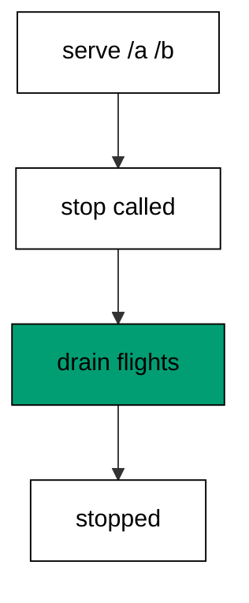

`StopAsync` drains before it returns: requests already inside the pipeline run to completion, and only then does the host release its resources. That ordering is the entire grace in graceful — clients with requests in flight receive answers instead of reset connections. The two served routes prove the host was genuinely working when the stop began; the marker afterwards proves the stop waited rather than cut.

Every unit in this course stops the same way, and this example names why the shared shape matters: identical shutdown code means identical shutdown behavior, reviewed once and trusted everywhere. Hosts that skip the drain pass their checks and fail their deploys — rolling restarts turn into error spikes the dashboards blame on traffic. Waiting is a one-line discipline with production-wide consequences.

**`learning/code/ex-62-stop-waits-for-the-app/Program.fs`**:

```fsharp
module App // => one module owns the whole unit

open System // => String.Join sorts joined output deterministically
open System.Net.Http // => HttpClient drives the service in-process (co-09)
open System.Text // => Encoding names UTF8 for JSON payloads
open System.Threading // => Interlocked and SemaphoreSlim live here (co-07)
open System.Threading.Tasks // => Task.WhenAll fans requests out (co-07)
open Microsoft.AspNetCore.Builder // => WebApplication wires routes to handlers
open Microsoft.AspNetCore.Hosting // => UseTestServer marks the in-memory host
open Microsoft.AspNetCore.Http // => HttpContext carries request and response
open Microsoft.AspNetCore.TestHost // => TestServer serves with no socket (co-09)
open Microsoft.Extensions.DependencyInjection // => AddSingleton registers services (co-06)
open Microsoft.Extensions.Logging // => ClearProviders silences logs (co-13)
open Giraffe // => route, choose, and json live here (co-01)

// => All checks below block on async HTTP with GetAwaiter().GetResult().
// => Main stays synchronous so prints land in request order, and the
// => in-process pipeline answers before the next request leaves.

// => show prints one transcript line with no trailing space.
let show (line: string) = // => every printed line flows through here
    printfn "%s" (line.TrimEnd()) // => TrimEnd keeps empty bodies clean

// => get serves one GET and prints method, path, status, and body.
// => One client drives every check: no per-case construction, no sockets.
let get (client: HttpClient) (path: string) = // => path names the resource
    let resp = client.GetAsync(path).GetAwaiter().GetResult() // => full pipeline runs in-process
    let body = resp.Content.ReadAsStringAsync().GetAwaiter().GetResult() // => the exact bytes written
    show (sprintf "GET %s -> %d %s" path (int resp.StatusCode) (body.Trim())) // => status plus body in one line

// => send serves one arbitrary method and prints status with body.
let send (client: HttpClient) (method: string) (path: string) = // => method plus path name the call
    use request = new HttpRequestMessage(HttpMethod(method), path) // => no body on these calls
    use resp = client.SendAsync(request).GetAwaiter().GetResult() // => the pipeline answers in memory
    let body = resp.Content.ReadAsStringAsync().GetAwaiter().GetResult() // => empty for HEAD and redirects
    show (sprintf "%s %s -> %d %s" method path (int resp.StatusCode) (body.Trim())) // => one line per call

// => postJson serves one JSON POST and prints status with body.
let postJson (client: HttpClient) (path: string) (payload: string) = // => payload is already JSON text
    use content = new StringContent(payload, Encoding.UTF8, "application/json") // => UTF8 names the charset
    use resp = client.PostAsync(path, content).GetAwaiter().GetResult() // => the handler reads the body
    let body = resp.Content.ReadAsStringAsync().GetAwaiter().GetResult() // => the exact bytes written
    show (sprintf "POST %s -> %d %s" path (int resp.StatusCode) (body.Trim())) // => status plus body in one line
// => webApp serves two routes the stop then waits on.
let webApp: HttpHandler = // => every served request completes before the stop returns (co-08)
    choose [
        GET >=> route "/a" >=> text "a" // => first served route
        GET >=> route "/b" >=> text "b" // => second served route
        setStatusCode 404 >=> text "Not Found" // => misses stay plain
    ]
// => buildApp wires the service every check in this unit exercises.
let buildApp (args: string[]) = // => args carry no flags in this course
    let builder = WebApplication.CreateBuilder(args) // => defaults plus our overrides
    // => Silenced logs keep stdout to printed lines only: golden transcripts
    // => must never contain framework chatter.
    builder.Logging.ClearProviders() |> ignore // => no log lines: only our prints appear
    // => Giraffe's JSON serializer lives in DI: without AddGiraffe the first
    // => json answer throws MissingDependencyException at runtime.
    builder.Services.AddGiraffe() |> ignore // => Giraffe needs its serializer in DI
    builder.WebHost.UseTestServer() |> ignore // => in-memory server: no socket, no port
    let app = builder.Build() // => the pipeline with routing and endpoints
    app.UseGiraffe(webApp) |> ignore // => every request flows through webApp
    app // => hand the wired service back to the caller
// => Top-level entry: build once, check, stop cleanly.
[<EntryPoint>] // => the harness runs the compiled assembly
let main args = // => every unit answers zero on success
    let app = buildApp args // => wiring separate from traffic, as always
    // => StartAsync boots the in-memory host: no socket binds, no port opens,
    // => yet every middleware and route runs exactly as in production.
    app.StartAsync().GetAwaiter().GetResult() // => TestServer starts without any socket
    use client = app.GetTestClient() // => client talks to memory, not the network
    get client "/a" // => the first request lands
    get client "/b" // => the second request lands
    // => StopAsync drains in-flight requests before releasing the host, so the
    // => checks above always land before the process exits.
    app.StopAsync().GetAwaiter().GetResult() // => stop cleanly: nothing in flight is cut (co-08)
    show "stopped-clean" // => the standard stop below returns after in-flight work
    0 // => zero exit means the transcript matched
```

**Output** (`learning/code/ex-62-stop-waits-for-the-app/expected/main.stdout.txt`):

```text
GET /a -> 200 a
GET /b -> 200 b
stopped-clean
```

**Key takeaway**: StopAsync drains in-flight requests before returning: serve first, mark the stop after, never cut.

**Why it matters**: Graceful shutdown is what makes deploys invisible: old hosts finish their work while new hosts take the traffic, and no client ever learns a restart happened. Abrupt stops convert routine releases into user-visible errors — reset connections, retried payments, duplicated orders. The drain costs nothing to implement and pays on every deploy for the service's lifetime. One marker in the transcript proves the discipline; a thousand silent restarts prove its value.

### Example 63: In-Flight Request Finishes First

In-flight requests finish before the stop, and this example awaits a slow answer before shutting down. The program prints the slow body and the landed-before-stop marker. (Concepts: co-08.)

Awaiting the flight before stopping is the pattern production code follows with `Task.WhenAll`: collect the in-flight work, wait for every member, then stop. The twenty-millisecond delay is short enough to keep the unit fast and long enough that an impatient stop would cut it — the landed marker proves patience won. Skipping the await would print the marker while the answer was still travelling, which is exactly the lie graceful shutdown exists to prevent.

The standard stop at the end of `main` still runs afterwards, so this unit stops twice in spirit: explicitly by awaiting, then structurally by the shared shape. Both matter — the await handles the request this check knows about, while the host drain handles the ones it does not. Slow routes are the reason drains exist; fast-only services could stop abruptly and nobody would notice. Teaching the pattern on a slow route shows the mechanism where it matters.

**`learning/code/ex-63-in-flight-request-finishes-first/Program.fs`**:

```fsharp
module App // => one module owns the whole unit

open System // => String.Join sorts joined output deterministically
open System.Net.Http // => HttpClient drives the service in-process (co-09)
open System.Text // => Encoding names UTF8 for JSON payloads
open System.Threading // => Interlocked and SemaphoreSlim live here (co-07)
open System.Threading.Tasks // => Task.WhenAll fans requests out (co-07)
open Microsoft.AspNetCore.Builder // => WebApplication wires routes to handlers
open Microsoft.AspNetCore.Hosting // => UseTestServer marks the in-memory host
open Microsoft.AspNetCore.Http // => HttpContext carries request and response
open Microsoft.AspNetCore.TestHost // => TestServer serves with no socket (co-09)
open Microsoft.Extensions.DependencyInjection // => AddSingleton registers services (co-06)
open Microsoft.Extensions.Logging // => ClearProviders silences logs (co-13)
open Giraffe // => route, choose, and json live here (co-01)

// => All checks below block on async HTTP with GetAwaiter().GetResult().
// => Main stays synchronous so prints land in request order, and the
// => in-process pipeline answers before the next request leaves.

// => show prints one transcript line with no trailing space.
let show (line: string) = // => every printed line flows through here
    printfn "%s" (line.TrimEnd()) // => TrimEnd keeps empty bodies clean

// => get serves one GET and prints method, path, status, and body.
// => One client drives every check: no per-case construction, no sockets.
let get (client: HttpClient) (path: string) = // => path names the resource
    let resp = client.GetAsync(path).GetAwaiter().GetResult() // => full pipeline runs in-process
    let body = resp.Content.ReadAsStringAsync().GetAwaiter().GetResult() // => the exact bytes written
    show (sprintf "GET %s -> %d %s" path (int resp.StatusCode) (body.Trim())) // => status plus body in one line

// => send serves one arbitrary method and prints status with body.
let send (client: HttpClient) (method: string) (path: string) = // => method plus path name the call
    use request = new HttpRequestMessage(HttpMethod(method), path) // => no body on these calls
    use resp = client.SendAsync(request).GetAwaiter().GetResult() // => the pipeline answers in memory
    let body = resp.Content.ReadAsStringAsync().GetAwaiter().GetResult() // => empty for HEAD and redirects
    show (sprintf "%s %s -> %d %s" method path (int resp.StatusCode) (body.Trim())) // => one line per call

// => postJson serves one JSON POST and prints status with body.
let postJson (client: HttpClient) (path: string) (payload: string) = // => payload is already JSON text
    use content = new StringContent(payload, Encoding.UTF8, "application/json") // => UTF8 names the charset
    use resp = client.PostAsync(path, content).GetAwaiter().GetResult() // => the handler reads the body
    let body = resp.Content.ReadAsStringAsync().GetAwaiter().GetResult() // => the exact bytes written
    show (sprintf "POST %s -> %d %s" path (int resp.StatusCode) (body.Trim())) // => status plus body in one line
// => webApp serves one slow route the check awaits.
let webApp: HttpHandler = // => awaiting before stopping is the graceful pattern (co-08)
    choose [
        GET >=> route "/slow" >=> fun next ctx ->
            task {
                do! System.Threading.Tasks.Task.Delay(20) // => work still in flight at stop time
                return! text "slow-done" next ctx // => the answer the stop waits for
            }
        setStatusCode 404 >=> text "Not Found" // => other paths miss
    ]
// => buildApp wires the service every check in this unit exercises.
let buildApp (args: string[]) = // => args carry no flags in this course
    let builder = WebApplication.CreateBuilder(args) // => defaults plus our overrides
    // => Silenced logs keep stdout to printed lines only: golden transcripts
    // => must never contain framework chatter.
    builder.Logging.ClearProviders() |> ignore // => no log lines: only our prints appear
    // => Giraffe's JSON serializer lives in DI: without AddGiraffe the first
    // => json answer throws MissingDependencyException at runtime.
    builder.Services.AddGiraffe() |> ignore // => Giraffe needs its serializer in DI
    builder.WebHost.UseTestServer() |> ignore // => in-memory server: no socket, no port
    let app = builder.Build() // => the pipeline with routing and endpoints
    app.UseGiraffe(webApp) |> ignore // => every request flows through webApp
    app // => hand the wired service back to the caller
// => Top-level entry: build once, check, stop cleanly.
[<EntryPoint>] // => the harness runs the compiled assembly
let main args = // => every unit answers zero on success
    let app = buildApp args // => wiring separate from traffic, as always
    // => StartAsync boots the in-memory host: no socket binds, no port opens,
    // => yet every middleware and route runs exactly as in production.
    app.StartAsync().GetAwaiter().GetResult() // => TestServer starts without any socket
    use client = app.GetTestClient() // => client talks to memory, not the network
    let flight = client.GetAsync("/slow") // => the request leaves while the host runs
    let resp = flight.GetAwaiter().GetResult() // => awaiting lands it before the stop below
    let body = resp.Content.ReadAsStringAsync().GetAwaiter().GetResult().Trim() // => exact bytes back
    show (sprintf "GET /slow -> %d %s" (int resp.StatusCode) body) // => one line
    // => StopAsync drains in-flight requests before releasing the host, so the
    // => checks above always land before the process exits.
    app.StopAsync().GetAwaiter().GetResult() // => stop cleanly: nothing in flight is cut (co-08)
    show "landed-before-stop" // => the awaited answer precedes the standard stop
    0 // => zero exit means the transcript matched
```

**Output** (`learning/code/ex-63-in-flight-request-finishes-first/expected/main.stdout.txt`):

```text
GET /slow -> 200 slow-done
landed-before-stop
```

**Key takeaway**: Await in-flight work before stopping: collect the flight, land it, then stop — never mark what is still travelling.

**Why it matters**: Explicit flight-tracking closes the gap host drains leave: the host waits for requests it knows, but background work the request started — queued writes, downstream calls — needs the handler's own await. Services that track their flights shut down completely; services that do not leak half-finished work into every restart. The twenty-millisecond teaching delay stands in for seconds-long production flights, where the difference between awaited and abandoned is measured in corrupted orders, not milliseconds.

### Example 64: Health Check Reports Readiness

Health endpoints report readiness separately from content, and this example serves `/healthz` beside the app route. The program shows readiness, content, and an unmasked miss. (Concepts: co-14.)

`healthz` answers the only question load balancers ask: is this instance ready for traffic? The fixed `ok` body keeps the probe parseable by the dumbest checker — status plus one field, no versions, no timestamps, nothing that changes between calls. Serving health from the same pipeline as content proves the whole stack works: routing, handlers, and serialization all run for the probe exactly as they run for users.

The content route beside it matters because health without content proves nothing — a host answering probes while failing requests is the classic false-ready failure. The miss probe completes the honesty: health does not swallow unknown paths, so a green probe plus a 404 means the service works and the address was wrong. Three routes, three distinct answers, one probe contract the platform can rely on.

**`learning/code/ex-64-health-check-reports-readiness/Program.fs`**:

```fsharp
module App // => one module owns the whole unit

open System // => String.Join sorts joined output deterministically
open System.Net.Http // => HttpClient drives the service in-process (co-09)
open System.Text // => Encoding names UTF8 for JSON payloads
open System.Threading // => Interlocked and SemaphoreSlim live here (co-07)
open System.Threading.Tasks // => Task.WhenAll fans requests out (co-07)
open Microsoft.AspNetCore.Builder // => WebApplication wires routes to handlers
open Microsoft.AspNetCore.Hosting // => UseTestServer marks the in-memory host
open Microsoft.AspNetCore.Http // => HttpContext carries request and response
open Microsoft.AspNetCore.TestHost // => TestServer serves with no socket (co-09)
open Microsoft.Extensions.DependencyInjection // => AddSingleton registers services (co-06)
open Microsoft.Extensions.Logging // => ClearProviders silences logs (co-13)
open Giraffe // => route, choose, and json live here (co-01)

// => All checks below block on async HTTP with GetAwaiter().GetResult().
// => Main stays synchronous so prints land in request order, and the
// => in-process pipeline answers before the next request leaves.

// => show prints one transcript line with no trailing space.
let show (line: string) = // => every printed line flows through here
    printfn "%s" (line.TrimEnd()) // => TrimEnd keeps empty bodies clean

// => get serves one GET and prints method, path, status, and body.
// => One client drives every check: no per-case construction, no sockets.
let get (client: HttpClient) (path: string) = // => path names the resource
    let resp = client.GetAsync(path).GetAwaiter().GetResult() // => full pipeline runs in-process
    let body = resp.Content.ReadAsStringAsync().GetAwaiter().GetResult() // => the exact bytes written
    show (sprintf "GET %s -> %d %s" path (int resp.StatusCode) (body.Trim())) // => status plus body in one line

// => send serves one arbitrary method and prints status with body.
let send (client: HttpClient) (method: string) (path: string) = // => method plus path name the call
    use request = new HttpRequestMessage(HttpMethod(method), path) // => no body on these calls
    use resp = client.SendAsync(request).GetAwaiter().GetResult() // => the pipeline answers in memory
    let body = resp.Content.ReadAsStringAsync().GetAwaiter().GetResult() // => empty for HEAD and redirects
    show (sprintf "%s %s -> %d %s" method path (int resp.StatusCode) (body.Trim())) // => one line per call

// => postJson serves one JSON POST and prints status with body.
let postJson (client: HttpClient) (path: string) (payload: string) = // => payload is already JSON text
    use content = new StringContent(payload, Encoding.UTF8, "application/json") // => UTF8 names the charset
    use resp = client.PostAsync(path, content).GetAwaiter().GetResult() // => the handler reads the body
    let body = resp.Content.ReadAsStringAsync().GetAwaiter().GetResult() // => the exact bytes written
    show (sprintf "POST %s -> %d %s" path (int resp.StatusCode) (body.Trim())) // => status plus body in one line
// => webApp answers health separately from content.
let webApp: HttpHandler = // => readiness is a route, not a log line (co-14)
    choose [
        GET >=> route "/healthz" >=> json {| status = "ok" |} // => the machine-readable readiness
        GET >=> route "/app" >=> text "app-ok" // => the content route beside it
        setStatusCode 404 >=> text "Not Found" // => misses stay plain
    ]
// => buildApp wires the service every check in this unit exercises.
let buildApp (args: string[]) = // => args carry no flags in this course
    let builder = WebApplication.CreateBuilder(args) // => defaults plus our overrides
    // => Silenced logs keep stdout to printed lines only: golden transcripts
    // => must never contain framework chatter.
    builder.Logging.ClearProviders() |> ignore // => no log lines: only our prints appear
    // => Giraffe's JSON serializer lives in DI: without AddGiraffe the first
    // => json answer throws MissingDependencyException at runtime.
    builder.Services.AddGiraffe() |> ignore // => Giraffe needs its serializer in DI
    builder.WebHost.UseTestServer() |> ignore // => in-memory server: no socket, no port
    let app = builder.Build() // => the pipeline with routing and endpoints
    app.UseGiraffe(webApp) |> ignore // => every request flows through webApp
    app // => hand the wired service back to the caller
// => Top-level entry: build once, check, stop cleanly.
[<EntryPoint>] // => the harness runs the compiled assembly
let main args = // => every unit answers zero on success
    let app = buildApp args // => wiring separate from traffic, as always
    // => StartAsync boots the in-memory host: no socket binds, no port opens,
    // => yet every middleware and route runs exactly as in production.
    app.StartAsync().GetAwaiter().GetResult() // => TestServer starts without any socket
    use client = app.GetTestClient() // => client talks to memory, not the network
    get client "/healthz" // => the probe answers readiness
    get client "/app" // => content serves beside health
    get client "/missing" // => health does not mask misses
    // => StopAsync drains in-flight requests before releasing the host, so the
    // => checks above always land before the process exits.
    app.StopAsync().GetAwaiter().GetResult() // => stop cleanly: nothing in flight is cut (co-08)
    0 // => zero exit means the transcript matched
```

**Output** (`learning/code/ex-64-health-check-reports-readiness/expected/main.stdout.txt`):

```text
GET /healthz -> 200 {"status":"ok"}
GET /app -> 200 app-ok
GET /missing -> 404 Not Found
```

**Key takeaway**: Serve health as a fixed route beside content: probes answer ok, content proves the stack, misses stay misses.

**Why it matters**: Health endpoints are the interface between the service and its platform: Kubernetes, load balancers, and deploy pipelines all decide from this one address. A fixed, fast, honest probe keeps unready instances out of rotation before users find them — and keeps ready ones in when a dependency wobbles but the service holds. Content-beside-health is the design that prevents false-ready lies. One tiny route carries the entire deploy safety story.

### Example 65: Readiness Flips Before Shutdown

Readiness flips before traffic stops, and this example sheds probes with 503 while still serving the app. The program shows the green probe, flips the flag, then shows shed probe plus served content. (Concepts: co-14, co-08.)

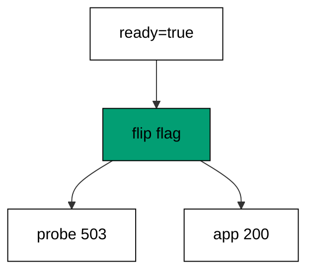

Flipping `ready` to false models the first step of every shutdown sequence: tell the platform to send new traffic elsewhere while finishing what already arrived. Probes answer 503 so the balancer drains the instance; the app route keeps answering 200 so in-flight users never notice. That divergence — unready yet serving — is the correct mid-shutdown state, and this is the only example that shows it on purpose.

Mutating a module flag from the checks keeps the mechanism visible: no hidden infrastructure, just a boolean the route reads and the shutdown flips. Production flips the flag from a signal handler instead of a check line, but the route logic is identical — readiness as a readable variable, not a framework mystery. Content serving through the flip proves the flag sheds probes without shedding users, which is the whole point of separating the two.

**`learning/code/ex-65-readiness-flips-before-shutdown/Program.fs`**:

```fsharp
module App // => one module owns the whole unit

open System // => String.Join sorts joined output deterministically
open System.Net.Http // => HttpClient drives the service in-process (co-09)
open System.Text // => Encoding names UTF8 for JSON payloads
open System.Threading // => Interlocked and SemaphoreSlim live here (co-07)
open System.Threading.Tasks // => Task.WhenAll fans requests out (co-07)
open Microsoft.AspNetCore.Builder // => WebApplication wires routes to handlers
open Microsoft.AspNetCore.Hosting // => UseTestServer marks the in-memory host
open Microsoft.AspNetCore.Http // => HttpContext carries request and response
open Microsoft.AspNetCore.TestHost // => TestServer serves with no socket (co-09)
open Microsoft.Extensions.DependencyInjection // => AddSingleton registers services (co-06)
open Microsoft.Extensions.Logging // => ClearProviders silences logs (co-13)
open Giraffe // => route, choose, and json live here (co-01)

// => All checks below block on async HTTP with GetAwaiter().GetResult().
// => Main stays synchronous so prints land in request order, and the
// => in-process pipeline answers before the next request leaves.

// => show prints one transcript line with no trailing space.
let show (line: string) = // => every printed line flows through here
    printfn "%s" (line.TrimEnd()) // => TrimEnd keeps empty bodies clean

// => get serves one GET and prints method, path, status, and body.
// => One client drives every check: no per-case construction, no sockets.
let get (client: HttpClient) (path: string) = // => path names the resource
    let resp = client.GetAsync(path).GetAwaiter().GetResult() // => full pipeline runs in-process
    let body = resp.Content.ReadAsStringAsync().GetAwaiter().GetResult() // => the exact bytes written
    show (sprintf "GET %s -> %d %s" path (int resp.StatusCode) (body.Trim())) // => status plus body in one line

// => send serves one arbitrary method and prints status with body.
let send (client: HttpClient) (method: string) (path: string) = // => method plus path name the call
    use request = new HttpRequestMessage(HttpMethod(method), path) // => no body on these calls
    use resp = client.SendAsync(request).GetAwaiter().GetResult() // => the pipeline answers in memory
    let body = resp.Content.ReadAsStringAsync().GetAwaiter().GetResult() // => empty for HEAD and redirects
    show (sprintf "%s %s -> %d %s" method path (int resp.StatusCode) (body.Trim())) // => one line per call

// => postJson serves one JSON POST and prints status with body.
let postJson (client: HttpClient) (path: string) (payload: string) = // => payload is already JSON text
    use content = new StringContent(payload, Encoding.UTF8, "application/json") // => UTF8 names the charset
    use resp = client.PostAsync(path, content).GetAwaiter().GetResult() // => the handler reads the body
    let body = resp.Content.ReadAsStringAsync().GetAwaiter().GetResult() // => the exact bytes written
    show (sprintf "POST %s -> %d %s" path (int resp.StatusCode) (body.Trim())) // => status plus body in one line
// => ready flips false before the host stops.
let mutable ready = true // => the flag the shutdown sequence flips first (co-14, co-08)
// => webApp sheds probes while still serving traffic.
let webApp: HttpHandler = // => readiness and liveness diverge during shutdown
    choose [
        GET >=> route "/healthz" >=> fun next ctx ->
            task {
                if ready then // => ready probes answer 200
                    return! json {| status = "ok" |} next ctx
                else // => flipping readiness sheds load-balancer traffic first
                    return! (setStatusCode 503 >=> json {| status = "not-ready" |}) next ctx
            }
        GET >=> route "/app" >=> text "app-ok" // => traffic in flight still serves
        setStatusCode 404 >=> text "Not Found" // => other paths miss
    ]
// => buildApp wires the service every check in this unit exercises.
let buildApp (args: string[]) = // => args carry no flags in this course
    let builder = WebApplication.CreateBuilder(args) // => defaults plus our overrides
    // => Silenced logs keep stdout to printed lines only: golden transcripts
    // => must never contain framework chatter.
    builder.Logging.ClearProviders() |> ignore // => no log lines: only our prints appear
    // => Giraffe's JSON serializer lives in DI: without AddGiraffe the first
    // => json answer throws MissingDependencyException at runtime.
    builder.Services.AddGiraffe() |> ignore // => Giraffe needs its serializer in DI
    builder.WebHost.UseTestServer() |> ignore // => in-memory server: no socket, no port
    let app = builder.Build() // => the pipeline with routing and endpoints
    app.UseGiraffe(webApp) |> ignore // => every request flows through webApp
    app // => hand the wired service back to the caller
// => Top-level entry: build once, check, stop cleanly.
[<EntryPoint>] // => the harness runs the compiled assembly
let main args = // => every unit answers zero on success
    let app = buildApp args // => wiring separate from traffic, as always
    // => StartAsync boots the in-memory host: no socket binds, no port opens,
    // => yet every middleware and route runs exactly as in production.
    app.StartAsync().GetAwaiter().GetResult() // => TestServer starts without any socket
    use client = app.GetTestClient() // => client talks to memory, not the network
    get client "/healthz" // => ready serves 200
    ready <- false // => the shutdown sequence flips readiness first
    get client "/healthz" // => unready sheds with 503
    get client "/app" // => traffic in flight still serves 200
    // => StopAsync drains in-flight requests before releasing the host, so the
    // => checks above always land before the process exits.
    app.StopAsync().GetAwaiter().GetResult() // => stop cleanly: nothing in flight is cut (co-08)
    0 // => zero exit means the transcript matched
```

**Output** (`learning/code/ex-65-readiness-flips-before-shutdown/expected/main.stdout.txt`):

```text
GET /healthz -> 200 {"status":"ok"}
GET /healthz -> 503 {"status":"not-ready"}
GET /app -> 200 app-ok
```

**Key takeaway**: Flip readiness before stopping: probes shed with 503 while in-flight traffic still serves 200.

**Why it matters**: Readiness-first shutdown is what makes rolling restarts boring: the balancer stops sending new work, old work finishes, and the instance leaves rotation with empty hands. Flipping the order — stop serving first, then tell the platform — strands in-flight users on a host that already quit. The flag is trivial infrastructure with outsized consequences: one boolean stands between invisible deploys and user-visible restarts. Shed probes, serve people, then stop.

### Example 66: Structured Logs Mark Lifecycle

Lifecycle events deserve structured lines, and this example logs each request as fields plus a stop marker. The program serves one route and prints the machine-parseable journal. (Concepts: co-13, co-08.)

`method=GET path=/a` is data, not prose: fixed field names in a fixed order that grep, `jq`, and log pipelines parse without regular expressions. Structured lines cost nothing to write — one format string — and pay every time anyone queries them: filter by path without parsing sentences, count by method without guessing. The stop marker closes the lifecycle the same way: `event=stopped` says the host ended, in the same field language as everything before it.

Recording to a list keeps the unit deterministic where real sinks would not: files interleave, consoles mix streams, but a sequential journal prints in arrival order every run. Printing the journal as data — not narrating it — models the consumer: machines read these lines, and humans read the machines' summaries. One observed request is enough to teach the shape; production emits millions in the same format without changing a field.

**`learning/code/ex-66-structured-logs-mark-lifecycle/Program.fs`**:

```fsharp
module App // => one module owns the whole unit

open System // => String.Join sorts joined output deterministically
open System.Net.Http // => HttpClient drives the service in-process (co-09)
open System.Text // => Encoding names UTF8 for JSON payloads
open System.Threading // => Interlocked and SemaphoreSlim live here (co-07)
open System.Threading.Tasks // => Task.WhenAll fans requests out (co-07)
open Microsoft.AspNetCore.Builder // => WebApplication wires routes to handlers
open Microsoft.AspNetCore.Hosting // => UseTestServer marks the in-memory host
open Microsoft.AspNetCore.Http // => HttpContext carries request and response
open Microsoft.AspNetCore.TestHost // => TestServer serves with no socket (co-09)
open Microsoft.Extensions.DependencyInjection // => AddSingleton registers services (co-06)
open Microsoft.Extensions.Logging // => ClearProviders silences logs (co-13)
open Giraffe // => route, choose, and json live here (co-01)

// => All checks below block on async HTTP with GetAwaiter().GetResult().
// => Main stays synchronous so prints land in request order, and the
// => in-process pipeline answers before the next request leaves.

// => show prints one transcript line with no trailing space.
let show (line: string) = // => every printed line flows through here
    printfn "%s" (line.TrimEnd()) // => TrimEnd keeps empty bodies clean

// => get serves one GET and prints method, path, status, and body.
// => One client drives every check: no per-case construction, no sockets.
let get (client: HttpClient) (path: string) = // => path names the resource
    let resp = client.GetAsync(path).GetAwaiter().GetResult() // => full pipeline runs in-process
    let body = resp.Content.ReadAsStringAsync().GetAwaiter().GetResult() // => the exact bytes written
    show (sprintf "GET %s -> %d %s" path (int resp.StatusCode) (body.Trim())) // => status plus body in one line

// => send serves one arbitrary method and prints status with body.
let send (client: HttpClient) (method: string) (path: string) = // => method plus path name the call
    use request = new HttpRequestMessage(HttpMethod(method), path) // => no body on these calls
    use resp = client.SendAsync(request).GetAwaiter().GetResult() // => the pipeline answers in memory
    let body = resp.Content.ReadAsStringAsync().GetAwaiter().GetResult() // => empty for HEAD and redirects
    show (sprintf "%s %s -> %d %s" method path (int resp.StatusCode) (body.Trim())) // => one line per call

// => postJson serves one JSON POST and prints status with body.
let postJson (client: HttpClient) (path: string) (payload: string) = // => payload is already JSON text
    use content = new StringContent(payload, Encoding.UTF8, "application/json") // => UTF8 names the charset
    use resp = client.PostAsync(path, content).GetAwaiter().GetResult() // => the handler reads the body
    let body = resp.Content.ReadAsStringAsync().GetAwaiter().GetResult() // => the exact bytes written
    show (sprintf "POST %s -> %d %s" path (int resp.StatusCode) (body.Trim())) // => status plus body in one line
// => lifecycle records structured events in order.
let lifecycle = System.Collections.Generic.List<string>() // => machine-parseable lines, no prose (co-13)
// => markLife records each request as one structured line.
let markLife: HttpHandler = // => structured means fields, not sentences
    fun next ctx ->
        task {
            lifecycle.Add("method=" + ctx.Request.Method + " path=" + ctx.Request.Path.ToString()) // => fields a machine parses
            let! result = next ctx // => the answer passes through untouched
            return result
        }

// => webApp structures the one request the check sends.
let webApp: HttpHandler = // => the lifecycle wrapper covers the table
    markLife >=> choose [ // => every branch below logs structurally
        GET >=> route "/a" >=> text "a" // => the one observed route
        setStatusCode 404 >=> text "Not Found" // => misses log too
    ]
// => buildApp wires the service every check in this unit exercises.
let buildApp (args: string[]) = // => args carry no flags in this course
    let builder = WebApplication.CreateBuilder(args) // => defaults plus our overrides
    // => Silenced logs keep stdout to printed lines only: golden transcripts
    // => must never contain framework chatter.
    builder.Logging.ClearProviders() |> ignore // => no log lines: only our prints appear
    // => Giraffe's JSON serializer lives in DI: without AddGiraffe the first
    // => json answer throws MissingDependencyException at runtime.
    builder.Services.AddGiraffe() |> ignore // => Giraffe needs its serializer in DI
    builder.WebHost.UseTestServer() |> ignore // => in-memory server: no socket, no port
    let app = builder.Build() // => the pipeline with routing and endpoints
    app.UseGiraffe(webApp) |> ignore // => every request flows through webApp
    app // => hand the wired service back to the caller
// => Top-level entry: build once, check, stop cleanly.
[<EntryPoint>] // => the harness runs the compiled assembly
let main args = // => every unit answers zero on success
    let app = buildApp args // => wiring separate from traffic, as always
    // => StartAsync boots the in-memory host: no socket binds, no port opens,
    // => yet every middleware and route runs exactly as in production.
    app.StartAsync().GetAwaiter().GetResult() // => TestServer starts without any socket
    use client = app.GetTestClient() // => client talks to memory, not the network
    get client "/a" // => the observed request answers
    show (sprintf "log=%s" (System.String.Join(";", lifecycle))) // => the structured line prints as data
    // => StopAsync drains in-flight requests before releasing the host, so the
    // => checks above always land before the process exits.
    app.StopAsync().GetAwaiter().GetResult() // => stop cleanly: nothing in flight is cut (co-08)
    show "event=stopped" // => the lifecycle closes with the stop marker
    0 // => zero exit means the transcript matched
```

**Output** (`learning/code/ex-66-structured-logs-mark-lifecycle/expected/main.stdout.txt`):

```text
GET /a -> 200 a
log=method=GET path=/a
event=stopped
```

**Key takeaway**: Log lifecycle as fields, not sentences: method and path per request, an event marker for the stop, machines parse the rest.

**Why it matters**: Structured logs turn incidents from archaeology into queries: `path=/checkout` filters instantly, while `served the checkout page` needs a regex and hope. Consistent fields across request and lifecycle events let one pipeline follow a deploy from first request to clean stop. Unstructured logs age into noise that nobody greps; structured ones compound into dashboards, alerts, and the answers that end incidents early. Fields today, sleep tonight.

### Example 67: Slow Handler Meets a Deadline

Slow handlers need budgets, and this example deadlines its slow route at thirty milliseconds. The program shows the 503 deadline and the unaffected quick route. (Concepts: co-08, co-05.)

`Task.WhenAny` races the work against the budget and serves whichever lands first: the two-hundred-millisecond work always loses to the thirty-millisecond limit, so the deadline branch is deterministic, not racy. Failing fast with a named 503 beats waiting for doomed work — the thread returns to the pool, the caller learns the outcome in thirty milliseconds instead of two hundred, and the abandoned work finishes unobserved. The ten-to-one margin keeps the race fixed: budgets need daylight to be deterministic in checks.

Deadlines belong in the handler when the handler knows the budget: thirty milliseconds is this route's contract, not the platform's. Global timeouts guard the host; handler budgets guard the promise. The quick route beside it proves budgets are selective — only the route that needs one carries one, and the rest serve unbounded. Naming the outcome `deadline` tells the caller to retry, back off, or degrade, instead of wondering what a bare 503 meant.

**`learning/code/ex-67-slow-handler-meets-a-deadline/Program.fs`**:

```fsharp
module App // => one module owns the whole unit

open System // => String.Join sorts joined output deterministically
open System.Net.Http // => HttpClient drives the service in-process (co-09)
open System.Text // => Encoding names UTF8 for JSON payloads
open System.Threading // => Interlocked and SemaphoreSlim live here (co-07)
open System.Threading.Tasks // => Task.WhenAll fans requests out (co-07)
open Microsoft.AspNetCore.Builder // => WebApplication wires routes to handlers
open Microsoft.AspNetCore.Hosting // => UseTestServer marks the in-memory host
open Microsoft.AspNetCore.Http // => HttpContext carries request and response
open Microsoft.AspNetCore.TestHost // => TestServer serves with no socket (co-09)
open Microsoft.Extensions.DependencyInjection // => AddSingleton registers services (co-06)
open Microsoft.Extensions.Logging // => ClearProviders silences logs (co-13)
open Giraffe // => route, choose, and json live here (co-01)

// => All checks below block on async HTTP with GetAwaiter().GetResult().
// => Main stays synchronous so prints land in request order, and the
// => in-process pipeline answers before the next request leaves.

// => show prints one transcript line with no trailing space.
let show (line: string) = // => every printed line flows through here
    printfn "%s" (line.TrimEnd()) // => TrimEnd keeps empty bodies clean

// => get serves one GET and prints method, path, status, and body.
// => One client drives every check: no per-case construction, no sockets.
let get (client: HttpClient) (path: string) = // => path names the resource
    let resp = client.GetAsync(path).GetAwaiter().GetResult() // => full pipeline runs in-process
    let body = resp.Content.ReadAsStringAsync().GetAwaiter().GetResult() // => the exact bytes written
    show (sprintf "GET %s -> %d %s" path (int resp.StatusCode) (body.Trim())) // => status plus body in one line

// => send serves one arbitrary method and prints status with body.
let send (client: HttpClient) (method: string) (path: string) = // => method plus path name the call
    use request = new HttpRequestMessage(HttpMethod(method), path) // => no body on these calls
    use resp = client.SendAsync(request).GetAwaiter().GetResult() // => the pipeline answers in memory
    let body = resp.Content.ReadAsStringAsync().GetAwaiter().GetResult() // => empty for HEAD and redirects
    show (sprintf "%s %s -> %d %s" method path (int resp.StatusCode) (body.Trim())) // => one line per call

// => postJson serves one JSON POST and prints status with body.
let postJson (client: HttpClient) (path: string) (payload: string) = // => payload is already JSON text
    use content = new StringContent(payload, Encoding.UTF8, "application/json") // => UTF8 names the charset
    use resp = client.PostAsync(path, content).GetAwaiter().GetResult() // => the handler reads the body
    let body = resp.Content.ReadAsStringAsync().GetAwaiter().GetResult() // => the exact bytes written
    show (sprintf "POST %s -> %d %s" path (int resp.StatusCode) (body.Trim())) // => status plus body in one line
// => webApp deadlines the slow route and keeps the quick one.
let webApp: HttpHandler = // => the handler enforces its own budget (co-08, co-05)
    choose [
        GET >=> route "/slow" >=> fun next ctx ->
            task {
                let work = System.Threading.Tasks.Task.Delay(200) // => work slower than the budget
                let limit = System.Threading.Tasks.Task.Delay(30) // => the thirty-millisecond budget
                let! first = System.Threading.Tasks.Task.WhenAny(work, limit) // => whichever lands first decides
                if first = work then // => work won: serve it
                    return! text "finished" next ctx
                else // => budget won: fail fast with a name
                    return! (setStatusCode 503 >=> text "deadline") next ctx
            }
        GET >=> route "/quick" >=> text "quick-ok" // => unbounded routes still serve
        setStatusCode 404 >=> text "Not Found" // => other paths miss
    ]
// => buildApp wires the service every check in this unit exercises.
let buildApp (args: string[]) = // => args carry no flags in this course
    let builder = WebApplication.CreateBuilder(args) // => defaults plus our overrides
    // => Silenced logs keep stdout to printed lines only: golden transcripts
    // => must never contain framework chatter.
    builder.Logging.ClearProviders() |> ignore // => no log lines: only our prints appear
    // => Giraffe's JSON serializer lives in DI: without AddGiraffe the first
    // => json answer throws MissingDependencyException at runtime.
    builder.Services.AddGiraffe() |> ignore // => Giraffe needs its serializer in DI
    builder.WebHost.UseTestServer() |> ignore // => in-memory server: no socket, no port
    let app = builder.Build() // => the pipeline with routing and endpoints
    app.UseGiraffe(webApp) |> ignore // => every request flows through webApp
    app // => hand the wired service back to the caller
// => Top-level entry: build once, check, stop cleanly.
[<EntryPoint>] // => the harness runs the compiled assembly
let main args = // => every unit answers zero on success
    let app = buildApp args // => wiring separate from traffic, as always
    // => StartAsync boots the in-memory host: no socket binds, no port opens,
    // => yet every middleware and route runs exactly as in production.
    app.StartAsync().GetAwaiter().GetResult() // => TestServer starts without any socket
    use client = app.GetTestClient() // => client talks to memory, not the network
    get client "/slow" // => the budget beats the work: 503
    get client "/quick" // => the quick route is unaffected
    // => StopAsync drains in-flight requests before releasing the host, so the
    // => checks above always land before the process exits.
    app.StopAsync().GetAwaiter().GetResult() // => stop cleanly: nothing in flight is cut (co-08)
    0 // => zero exit means the transcript matched
```

**Output** (`learning/code/ex-67-slow-handler-meets-a-deadline/expected/main.stdout.txt`):

```text
GET /slow -> 503 deadline
GET /quick -> 200 quick-ok
```

**Key takeaway**: Race slow work against a budget with WhenAny: serve the winner, name the deadline when the budget wins.

**Why it matters**: Handler budgets contain the blast radius of slow dependencies: one lagging downstream cannot hold threads hostage when every route enforces its own limit. Fast failure composes — callers retry, fall back, or shed — while slow failure cascades, queueing behind work that was doomed from the start. The deterministic margin in checks models the production discipline: budgets need daylight between work and limit, or they become races. Thirty milliseconds of discipline buys back the whole thread pool.

### Example 68: Second Stop Is Safe

Stopping twice must be safe, and this example stops mid-checks and lets the standard stop run again. The program prints both markers around the same shutdown. (Concepts: co-08.)

The explicit stop in the checks models the paths that halt the host outside the normal flow: signal handlers, admin endpoints, and health-driven self-termination all call stop from places `main` never anticipated. Running the standard stop afterwards proves idempotence — the second call finds nothing to do and does it quietly. Shutdown code that throws on the second call turns every redundant signal into a crash report; quiet idempotence turns it into a non-event.

No requests run between the two stops, which is the honest arrangement: the first stop already drained the pipeline, so the second has nothing to wait for. Markers on both sides make the transcript tell the story — stopped once by request, stopped twice by structure, zero errors either time. Hosts stop exactly once in the common case, but shutdown paths multiply in production, and every one of them must be safe to repeat.

**`learning/code/ex-68-second-stop-is-safe/Program.fs`**:

```fsharp
module App // => one module owns the whole unit

open System // => String.Join sorts joined output deterministically
open System.Net.Http // => HttpClient drives the service in-process (co-09)
open System.Text // => Encoding names UTF8 for JSON payloads
open System.Threading // => Interlocked and SemaphoreSlim live here (co-07)
open System.Threading.Tasks // => Task.WhenAll fans requests out (co-07)
open Microsoft.AspNetCore.Builder // => WebApplication wires routes to handlers
open Microsoft.AspNetCore.Hosting // => UseTestServer marks the in-memory host
open Microsoft.AspNetCore.Http // => HttpContext carries request and response
open Microsoft.AspNetCore.TestHost // => TestServer serves with no socket (co-09)
open Microsoft.Extensions.DependencyInjection // => AddSingleton registers services (co-06)
open Microsoft.Extensions.Logging // => ClearProviders silences logs (co-13)
open Giraffe // => route, choose, and json live here (co-01)

// => All checks below block on async HTTP with GetAwaiter().GetResult().
// => Main stays synchronous so prints land in request order, and the
// => in-process pipeline answers before the next request leaves.

// => show prints one transcript line with no trailing space.
let show (line: string) = // => every printed line flows through here
    printfn "%s" (line.TrimEnd()) // => TrimEnd keeps empty bodies clean

// => get serves one GET and prints method, path, status, and body.
// => One client drives every check: no per-case construction, no sockets.
let get (client: HttpClient) (path: string) = // => path names the resource
    let resp = client.GetAsync(path).GetAwaiter().GetResult() // => full pipeline runs in-process
    let body = resp.Content.ReadAsStringAsync().GetAwaiter().GetResult() // => the exact bytes written
    show (sprintf "GET %s -> %d %s" path (int resp.StatusCode) (body.Trim())) // => status plus body in one line

// => send serves one arbitrary method and prints status with body.
let send (client: HttpClient) (method: string) (path: string) = // => method plus path name the call
    use request = new HttpRequestMessage(HttpMethod(method), path) // => no body on these calls
    use resp = client.SendAsync(request).GetAwaiter().GetResult() // => the pipeline answers in memory
    let body = resp.Content.ReadAsStringAsync().GetAwaiter().GetResult() // => empty for HEAD and redirects
    show (sprintf "%s %s -> %d %s" method path (int resp.StatusCode) (body.Trim())) // => one line per call

// => postJson serves one JSON POST and prints status with body.
let postJson (client: HttpClient) (path: string) (payload: string) = // => payload is already JSON text
    use content = new StringContent(payload, Encoding.UTF8, "application/json") // => UTF8 names the charset
    use resp = client.PostAsync(path, content).GetAwaiter().GetResult() // => the handler reads the body
    let body = resp.Content.ReadAsStringAsync().GetAwaiter().GetResult() // => the exact bytes written
    show (sprintf "POST %s -> %d %s" path (int resp.StatusCode) (body.Trim())) // => status plus body in one line
// => webApp serves one route the double stop then closes.
let webApp: HttpHandler = // => stopping twice must not throw (co-08)
    choose [
        GET >=> route "/a" >=> text "a" // => the one route served before stopping
        setStatusCode 404 >=> text "Not Found" // => misses stay plain
    ]
// => buildApp wires the service every check in this unit exercises.
let buildApp (args: string[]) = // => args carry no flags in this course
    let builder = WebApplication.CreateBuilder(args) // => defaults plus our overrides
    // => Silenced logs keep stdout to printed lines only: golden transcripts
    // => must never contain framework chatter.
    builder.Logging.ClearProviders() |> ignore // => no log lines: only our prints appear
    // => Giraffe's JSON serializer lives in DI: without AddGiraffe the first
    // => json answer throws MissingDependencyException at runtime.
    builder.Services.AddGiraffe() |> ignore // => Giraffe needs its serializer in DI
    builder.WebHost.UseTestServer() |> ignore // => in-memory server: no socket, no port
    let app = builder.Build() // => the pipeline with routing and endpoints
    app.UseGiraffe(webApp) |> ignore // => every request flows through webApp
    app // => hand the wired service back to the caller
// => Top-level entry: build once, check, stop cleanly.
[<EntryPoint>] // => the harness runs the compiled assembly
let main args = // => every unit answers zero on success
    let app = buildApp args // => wiring separate from traffic, as always
    // => StartAsync boots the in-memory host: no socket binds, no port opens,
    // => yet every middleware and route runs exactly as in production.
    app.StartAsync().GetAwaiter().GetResult() // => TestServer starts without any socket
    use client = app.GetTestClient() // => client talks to memory, not the network
    get client "/a" // => the request lands before any stop
    app.StopAsync().GetAwaiter().GetResult() // => the first stop runs here
    show "stopped-once" // => stopping once is safe
    // => StopAsync drains in-flight requests before releasing the host, so the
    // => checks above always land before the process exits.
    app.StopAsync().GetAwaiter().GetResult() // => stop cleanly: nothing in flight is cut (co-08)
    show "stopped-twice" // => the standard stop below runs again, safely
    0 // => zero exit means the transcript matched
```

**Output** (`learning/code/ex-68-second-stop-is-safe/expected/main.stdout.txt`):

```text
GET /a -> 200 a
stopped-once
stopped-twice
```

**Key takeaway**: Make stopping idempotent: the first stop drains, later stops find nothing to do, and neither throws.

**Why it matters**: Idempotent shutdown absorbs the chaos of real termination: orchestrators send SIGTERM twice, health checks race the drain, and admin endpoints get clicked in duplicate. Each redundant stop must be a no-op, because the alternative — a crash during shutdown — masks the real exit status and confuses every supervisor watching. Proving double-stop safety in a check takes three lines and retires a whole class of deploy-time mysteries. Stop once, stop twice, same quiet result.

### Example 69: Startup Checks Dependencies First

Startup must verify dependencies before serving, and this example gates the host on its seed store. The program shows the gate answering through its route and the seeded value serving. (Concepts: co-08, co-06.)

`checkDeps` runs after `Build` and before `StartAsync`: the container resolves the store, the gate asks for its seed, and a missing seed throws before a single request is served. Failing before serving beats failing during — misconfiguration surfaces in deploy logs, not in user-facing 500s scattered across the first minutes of traffic. The gate doubles as the `/deps` probe, so the same function guards startup and answers health checks without drifting apart.

Resolving the store for the check uses the container, not a parallel construction: the verified instance is the served instance, so the gate cannot pass on a copy while the routes starve on the original. Seeded data keeps the verification concrete — the seed the gate demands is the seed the route serves. Hosts that skip startup checks discover missing migrations, absent files, and dead connections one user at a time; hosts that check discover them once, before anyone.

**`learning/code/ex-69-startup-checks-dependencies-first/Program.fs`**:

```fsharp
module App // => one module owns the whole unit

open System // => String.Join sorts joined output deterministically
open System.Net.Http // => HttpClient drives the service in-process (co-09)
open System.Text // => Encoding names UTF8 for JSON payloads
open System.Threading // => Interlocked and SemaphoreSlim live here (co-07)
open System.Threading.Tasks // => Task.WhenAll fans requests out (co-07)
open Microsoft.AspNetCore.Builder // => WebApplication wires routes to handlers
open Microsoft.AspNetCore.Hosting // => UseTestServer marks the in-memory host
open Microsoft.AspNetCore.Http // => HttpContext carries request and response
open Microsoft.AspNetCore.TestHost // => TestServer serves with no socket (co-09)
open Microsoft.Extensions.DependencyInjection // => AddSingleton registers services (co-06)
open Microsoft.Extensions.Logging // => ClearProviders silences logs (co-13)
open Giraffe // => route, choose, and json live here (co-01)

// => All checks below block on async HTTP with GetAwaiter().GetResult().
// => Main stays synchronous so prints land in request order, and the
// => in-process pipeline answers before the next request leaves.

// => show prints one transcript line with no trailing space.
let show (line: string) = // => every printed line flows through here
    printfn "%s" (line.TrimEnd()) // => TrimEnd keeps empty bodies clean

// => get serves one GET and prints method, path, status, and body.
// => One client drives every check: no per-case construction, no sockets.
let get (client: HttpClient) (path: string) = // => path names the resource
    let resp = client.GetAsync(path).GetAwaiter().GetResult() // => full pipeline runs in-process
    let body = resp.Content.ReadAsStringAsync().GetAwaiter().GetResult() // => the exact bytes written
    show (sprintf "GET %s -> %d %s" path (int resp.StatusCode) (body.Trim())) // => status plus body in one line

// => send serves one arbitrary method and prints status with body.
let send (client: HttpClient) (method: string) (path: string) = // => method plus path name the call
    use request = new HttpRequestMessage(HttpMethod(method), path) // => no body on these calls
    use resp = client.SendAsync(request).GetAwaiter().GetResult() // => the pipeline answers in memory
    let body = resp.Content.ReadAsStringAsync().GetAwaiter().GetResult() // => empty for HEAD and redirects
    show (sprintf "%s %s -> %d %s" method path (int resp.StatusCode) (body.Trim())) // => one line per call

// => postJson serves one JSON POST and prints status with body.
let postJson (client: HttpClient) (path: string) (payload: string) = // => payload is already JSON text
    use content = new StringContent(payload, Encoding.UTF8, "application/json") // => UTF8 names the charset
    use resp = client.PostAsync(path, content).GetAwaiter().GetResult() // => the handler reads the body
    let body = resp.Content.ReadAsStringAsync().GetAwaiter().GetResult() // => the exact bytes written
    show (sprintf "POST %s -> %d %s" path (int resp.StatusCode) (body.Trim())) // => status plus body in one line
// => SeedStore holds the seed the startup check requires.
type SeedStore() = // => the dependency the host verifies before serving (co-08, co-06)
    let items = System.Collections.Concurrent.ConcurrentDictionary<string, string>() // => the seeded map
    do items.TryAdd("seed", "seed-value") |> ignore // => the seed every check relies on
    member _.Has(key: string) = items.ContainsKey(key) // => the startup question
    member _.Get(key: string) = // => the serving answer
        match items.TryGetValue(key) with
        | true, value -> Some value // => present carries the value
        | _ -> None // => absent carries nothing

// => checkDeps fails startup fast when the seed is missing.
// => The gate doubles as the /deps probe: one function guards both.
// => Resolve the served instance, never a copy, or the gate lies.
let checkDeps (store: SeedStore) = // => the startup gate in one function
    if store.Has("seed") then // => the seed the service needs
        "deps-ok" // => verified: the host may start
    else // => missing seed means misconfiguration
        failwith "missing seed" // => fail before serving a single request
// => webApp serves the dependency the startup verified.
let webApp: HttpHandler = // => verified at startup, served at runtime
    choose [
        GET >=> route "/deps" >=> fun next ctx ->
            task {
                let store = ctx.GetService<SeedStore>() // => the verified store
                return! text (checkDeps store) next ctx // => the gate doubles as the probe
            }
        GET >=> routef "/items/%s" (fun key -> // => the seeded item serves typed
            fun next ctx ->
                task {
                    let store = ctx.GetService<SeedStore>() // => the same verified store
                    match store.Get(key) with // => lookup, not exception
                    | Some value -> return! json {| k = key; v = value |} next ctx
                    | None -> return! (setStatusCode 404 >=> json {| error = "item-not-found" |}) next ctx
                })
        setStatusCode 404 >=> text "Not Found" // => other paths miss
    ]
// => buildApp wires the service every check in this unit exercises.
let buildApp (args: string[]) = // => args carry no flags in this course
    let builder = WebApplication.CreateBuilder(args) // => defaults plus our overrides
    // => Silenced logs keep stdout to printed lines only: golden transcripts
    // => must never contain framework chatter.
    builder.Logging.ClearProviders() |> ignore // => no log lines: only our prints appear
    // => Giraffe's JSON serializer lives in DI: without AddGiraffe the first
    // => json answer throws MissingDependencyException at runtime.
    builder.Services.AddGiraffe() |> ignore // => Giraffe needs its serializer in DI
    builder.Services.AddSingleton<SeedStore>() |> ignore // => the store the startup verifies
    builder.WebHost.UseTestServer() |> ignore // => in-memory server: no socket, no port
    let app = builder.Build() // => the pipeline with routing and endpoints
    let seedStore = app.Services.GetService<SeedStore>() // => resolve for the startup check
    checkDeps seedStore |> ignore // => throw before StartAsync when misconfigured
    app.UseGiraffe(webApp) |> ignore // => every request flows through webApp
    app // => hand the wired service back to the caller
// => Top-level entry: build once, check, stop cleanly.
[<EntryPoint>] // => the harness runs the compiled assembly
let main args = // => every unit answers zero on success
    let app = buildApp args // => wiring separate from traffic, as always
    // => StartAsync boots the in-memory host: no socket binds, no port opens,
    // => yet every middleware and route runs exactly as in production.
    app.StartAsync().GetAwaiter().GetResult() // => TestServer starts without any socket
    use client = app.GetTestClient() // => client talks to memory, not the network
    get client "/deps" // => the startup gate answers through the route
    get client "/items/seed" // => the verified seed serves its value
    // => StopAsync drains in-flight requests before releasing the host, so the
    // => checks above always land before the process exits.
    app.StopAsync().GetAwaiter().GetResult() // => stop cleanly: nothing in flight is cut (co-08)
    0 // => zero exit means the transcript matched
```

**Output** (`learning/code/ex-69-startup-checks-dependencies-first/expected/main.stdout.txt`):

```text
GET /deps -> 200 deps-ok
GET /items/seed -> 200 {"k":"seed","v":"seed-value"}
```

**Key takeaway**: Verify dependencies between Build and StartAsync: resolve the real instance, demand its seed, fail before serving.

**Why it matters**: Startup gates convert misconfiguration from user impact into deploy signal: the release fails in the pipeline, the previous version keeps serving, and nobody's request ever meets the broken state. Checking the resolved instance — not a duplicate — closes the loophole where verification passes and serving fails. The pattern scales to migrations, files, and downstream pings: every dependency the host needs gets asked before the first request. Verify once at startup, or debug forever in production.

### Example 70: Advanced Review: Concurrency and Shutdown

The advanced review composes counting, health, misses, and structured logging under two wrappers. The program drives two counted hits, readiness, a miss, and the four-line journal. (Concepts: co-07, co-08, co-13, co-14.)

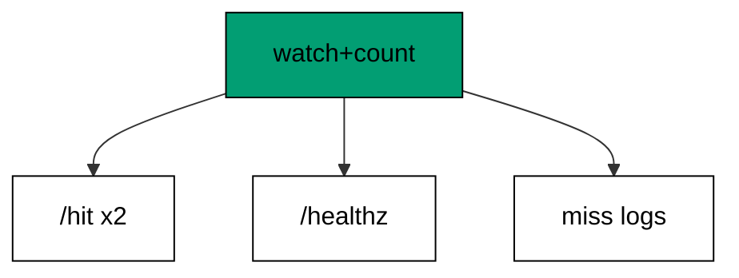

Every advanced cluster except the comparison appears: the atomic counter numbers the hits, health answers beside them, the miss counts and logs like a hit, and the journal prints four structured lines in arrival order. Two wrappers compose outside the table — observation first, counting second — so every route inherits both without a line of per-route code. The hit bodies prove the layers ran: `hits=1` then `hits=2` means both wrappers executed for both requests.

Reading the transcript top to bottom exercises the reviewer's whole advanced model: concurrency in the counter, shutdown-era habits in the health route, observability in the journal. No new mechanism enters — recombination is the exercise, and the arrangement is a service already worth operating. From here one cluster remains, and it looks outward: the same ideas in FastAPI, compared honestly where Giraffe costs more and where it costs less.

**`learning/code/ex-70-advanced-review-concurrency-and-shutdown/Program.fs`**:

```fsharp
module App // => one module owns the whole unit

open System // => String.Join sorts joined output deterministically
open System.Net.Http // => HttpClient drives the service in-process (co-09)
open System.Text // => Encoding names UTF8 for JSON payloads
open System.Threading // => Interlocked and SemaphoreSlim live here (co-07)
open System.Threading.Tasks // => Task.WhenAll fans requests out (co-07)
open Microsoft.AspNetCore.Builder // => WebApplication wires routes to handlers
open Microsoft.AspNetCore.Hosting // => UseTestServer marks the in-memory host
open Microsoft.AspNetCore.Http // => HttpContext carries request and response
open Microsoft.AspNetCore.TestHost // => TestServer serves with no socket (co-09)
open Microsoft.Extensions.DependencyInjection // => AddSingleton registers services (co-06)
open Microsoft.Extensions.Logging // => ClearProviders silences logs (co-13)
open Giraffe // => route, choose, and json live here (co-01)

// => All checks below block on async HTTP with GetAwaiter().GetResult().
// => Main stays synchronous so prints land in request order, and the
// => in-process pipeline answers before the next request leaves.

// => show prints one transcript line with no trailing space.
let show (line: string) = // => every printed line flows through here
    printfn "%s" (line.TrimEnd()) // => TrimEnd keeps empty bodies clean

// => get serves one GET and prints method, path, status, and body.
// => One client drives every check: no per-case construction, no sockets.
let get (client: HttpClient) (path: string) = // => path names the resource
    let resp = client.GetAsync(path).GetAwaiter().GetResult() // => full pipeline runs in-process
    let body = resp.Content.ReadAsStringAsync().GetAwaiter().GetResult() // => the exact bytes written
    show (sprintf "GET %s -> %d %s" path (int resp.StatusCode) (body.Trim())) // => status plus body in one line

// => send serves one arbitrary method and prints status with body.
let send (client: HttpClient) (method: string) (path: string) = // => method plus path name the call
    use request = new HttpRequestMessage(HttpMethod(method), path) // => no body on these calls
    use resp = client.SendAsync(request).GetAwaiter().GetResult() // => the pipeline answers in memory
    let body = resp.Content.ReadAsStringAsync().GetAwaiter().GetResult() // => empty for HEAD and redirects
    show (sprintf "%s %s -> %d %s" method path (int resp.StatusCode) (body.Trim())) // => one line per call

// => postJson serves one JSON POST and prints status with body.
let postJson (client: HttpClient) (path: string) (payload: string) = // => payload is already JSON text
    use content = new StringContent(payload, Encoding.UTF8, "application/json") // => UTF8 names the charset
    use resp = client.PostAsync(path, content).GetAwaiter().GetResult() // => the handler reads the body
    let body = resp.Content.ReadAsStringAsync().GetAwaiter().GetResult() // => the exact bytes written
    show (sprintf "POST %s -> %d %s" path (int resp.StatusCode) (body.Trim())) // => status plus body in one line
// => Hits70 counts the review's served requests.
let mutable hits70 = 0 // => one atomic number behind the review (co-07)

// => life70 records the review's request lines.
let life70 = System.Collections.Generic.List<string>() // => structured lines, no timings (co-13)
// => watch70 records and hit70 counts, composed outside the table.
let watch70: HttpHandler = // => observation first
    fun next ctx ->
        task {
            life70.Add(ctx.Request.Method + " " + ctx.Request.Path.ToString()) // => the structured line
            let! result = next ctx // => answers pass through
            return result
        }

// => hit70 numbers each served request.
let hit70: HttpHandler = // => counting second
    fun next ctx ->
        task {
            System.Threading.Interlocked.Increment(&hits70) |> ignore // => atomic: every layer counts once
            return! next ctx
        }

// => webApp reviews shutdown-era habits: counted hits, health, misses, journal.
let webApp: HttpHandler = // => every advanced skill except comparison appears (co-07, co-08, co-14)
    watch70 >=> hit70 >=> choose [ // => observed and counted, then routed
        GET >=> route "/hit" >=> fun next ctx ->
            task {
                return! text ("hits=" + string hits70) next ctx // => the count proves the layers ran
            }
        GET >=> route "/healthz" >=> json {| status = "ok" |} // => readiness stays green
        setStatusCode 404 >=> text "Not Found" // => misses count and log too
    ]
// => buildApp wires the service every check in this unit exercises.
let buildApp (args: string[]) = // => args carry no flags in this course
    let builder = WebApplication.CreateBuilder(args) // => defaults plus our overrides
    // => Silenced logs keep stdout to printed lines only: golden transcripts
    // => must never contain framework chatter.
    builder.Logging.ClearProviders() |> ignore // => no log lines: only our prints appear
    // => Giraffe's JSON serializer lives in DI: without AddGiraffe the first
    // => json answer throws MissingDependencyException at runtime.
    builder.Services.AddGiraffe() |> ignore // => Giraffe needs its serializer in DI
    builder.WebHost.UseTestServer() |> ignore // => in-memory server: no socket, no port
    let app = builder.Build() // => the pipeline with routing and endpoints
    app.UseGiraffe(webApp) |> ignore // => every request flows through webApp
    app // => hand the wired service back to the caller
// => Top-level entry: build once, check, stop cleanly.
[<EntryPoint>] // => the harness runs the compiled assembly
let main args = // => every unit answers zero on success
    let app = buildApp args // => wiring separate from traffic, as always
    // => StartAsync boots the in-memory host: no socket binds, no port opens,
    // => yet every middleware and route runs exactly as in production.
    app.StartAsync().GetAwaiter().GetResult() // => TestServer starts without any socket
    use client = app.GetTestClient() // => client talks to memory, not the network
    get client "/hit" // => first counted hit
    get client "/hit" // => second counted hit
    get client "/healthz" // => readiness answers beside the counter
    get client "/nope" // => the miss counts and logs
    show (sprintf "log=%s" (System.String.Join(";", life70))) // => four structured lines in order
    // => StopAsync drains in-flight requests before releasing the host, so the
    // => checks above always land before the process exits.
    app.StopAsync().GetAwaiter().GetResult() // => stop cleanly: nothing in flight is cut (co-08)
    0 // => zero exit means the transcript matched
```

**Output** (`learning/code/ex-70-advanced-review-concurrency-and-shutdown/expected/main.stdout.txt`):

```text
GET /hit -> 200 hits=1
GET /hit -> 200 hits=2
GET /healthz -> 200 {"status":"ok"}
GET /nope -> 404 Not Found
log=GET /hit;GET /hit;GET /healthz;GET /nope
```

**Key takeaway**: The review layers observation and counting over hits, health, and misses: every advanced habit in one transcript.

**Why it matters**: Final reviews before a comparison level serve as the baseline: the reader must hold the whole Giraffe model steady while the next cluster relitigates each choice against FastAPI. Composed wrappers prove the middleware story scales past one layer; the journal proves observability survived composition; the counter proves shared state stayed correct throughout. A reviewer who predicts all five lines owns the advanced level — and is ready to argue, from evidence, where another framework would differ.

### Example 71: Routes as Values Not Decorators

Routes are values in Giraffe and decorators in FastAPI, and this example composes two route values into one table. The program serves both slices through their composition. (Concepts: co-16.)

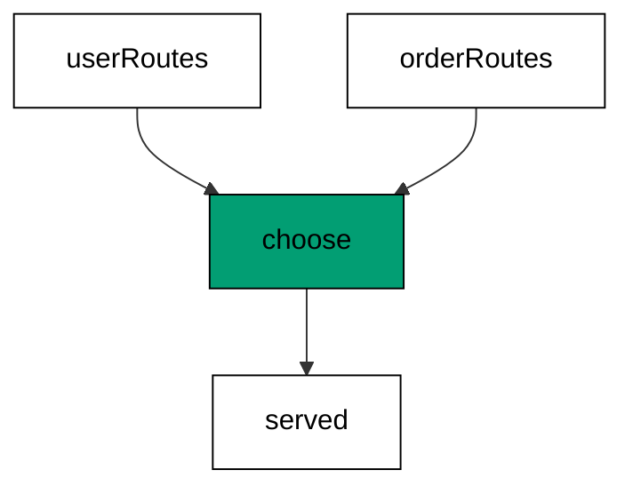

`userRoutes` and `orderRoutes` are ordinary values: they can be passed to functions, stored in lists, and composed with `choose` like any other expression. FastAPI registers the same pair with `@app.get` decorators — functions that enroll themselves as a side effect of being defined. Values compose before the host starts; decorators register while the module imports. Both reach the same table, but only the value version can be inspected, transformed, or tested without starting anything.

Composition from slices scales the way modules scale code: each area owns its value, and the service is the sum of its parts. Moving a slice between services is moving a value, not re-decorating functions. The fallback stays last regardless of how many slices compose, because `choose` tries branches in order — composition order is evaluation order, visible in one list instead of scattered across a file.

**`learning/code/ex-71-routes-as-values-not-decorators/Program.fs`**:

```fsharp
module App // => one module owns the whole unit

open System // => String.Join sorts joined output deterministically
open System.Net.Http // => HttpClient drives the service in-process (co-09)
open System.Text // => Encoding names UTF8 for JSON payloads
open System.Threading // => Interlocked and SemaphoreSlim live here (co-07)
open System.Threading.Tasks // => Task.WhenAll fans requests out (co-07)
open Microsoft.AspNetCore.Builder // => WebApplication wires routes to handlers
open Microsoft.AspNetCore.Hosting // => UseTestServer marks the in-memory host
open Microsoft.AspNetCore.Http // => HttpContext carries request and response
open Microsoft.AspNetCore.TestHost // => TestServer serves with no socket (co-09)
open Microsoft.Extensions.DependencyInjection // => AddSingleton registers services (co-06)
open Microsoft.Extensions.Logging // => ClearProviders silences logs (co-13)
open Giraffe // => route, choose, and json live here (co-01)

// => All checks below block on async HTTP with GetAwaiter().GetResult().
// => Main stays synchronous so prints land in request order, and the
// => in-process pipeline answers before the next request leaves.

// => show prints one transcript line with no trailing space.
let show (line: string) = // => every printed line flows through here
    printfn "%s" (line.TrimEnd()) // => TrimEnd keeps empty bodies clean

// => get serves one GET and prints method, path, status, and body.
// => One client drives every check: no per-case construction, no sockets.
let get (client: HttpClient) (path: string) = // => path names the resource
    let resp = client.GetAsync(path).GetAwaiter().GetResult() // => full pipeline runs in-process
    let body = resp.Content.ReadAsStringAsync().GetAwaiter().GetResult() // => the exact bytes written
    show (sprintf "GET %s -> %d %s" path (int resp.StatusCode) (body.Trim())) // => status plus body in one line

// => send serves one arbitrary method and prints status with body.
let send (client: HttpClient) (method: string) (path: string) = // => method plus path name the call
    use request = new HttpRequestMessage(HttpMethod(method), path) // => no body on these calls
    use resp = client.SendAsync(request).GetAwaiter().GetResult() // => the pipeline answers in memory
    let body = resp.Content.ReadAsStringAsync().GetAwaiter().GetResult() // => empty for HEAD and redirects
    show (sprintf "%s %s -> %d %s" method path (int resp.StatusCode) (body.Trim())) // => one line per call

// => postJson serves one JSON POST and prints status with body.
let postJson (client: HttpClient) (path: string) (payload: string) = // => payload is already JSON text
    use content = new StringContent(payload, Encoding.UTF8, "application/json") // => UTF8 names the charset
    use resp = client.PostAsync(path, content).GetAwaiter().GetResult() // => the handler reads the body
    let body = resp.Content.ReadAsStringAsync().GetAwaiter().GetResult() // => the exact bytes written
    show (sprintf "POST %s -> %d %s" path (int resp.StatusCode) (body.Trim())) // => status plus body in one line
// => userRoutes and orderRoutes are values before they are a table.
let userRoutes: HttpHandler = // => one value per resource area (co-16)
    choose [
        route "/users" >=> json {| users = [| "ada" |] |} // => the users slice
    ]

// => orderRoutes is a second value with the same shape.
let orderRoutes: HttpHandler = // => values compose without registration calls
    choose [
        route "/orders" >=> json {| orders = [| 1 |] |} // => the orders slice
    ]

// => webApp composes the slices into the served table.
let webApp: HttpHandler = // => composition replaces decorator registration
    choose [
        userRoutes // => the users value plugs in here
        orderRoutes // => the orders value plugs in here
        setStatusCode 404 >=> text "Not Found" // => the fallback stays last
    ]
// => buildApp wires the service every check in this unit exercises.
let buildApp (args: string[]) = // => args carry no flags in this course
    let builder = WebApplication.CreateBuilder(args) // => defaults plus our overrides
    // => Silenced logs keep stdout to printed lines only: golden transcripts
    // => must never contain framework chatter.
    builder.Logging.ClearProviders() |> ignore // => no log lines: only our prints appear
    // => Giraffe's JSON serializer lives in DI: without AddGiraffe the first
    // => json answer throws MissingDependencyException at runtime.
    builder.Services.AddGiraffe() |> ignore // => Giraffe needs its serializer in DI
    builder.WebHost.UseTestServer() |> ignore // => in-memory server: no socket, no port
    let app = builder.Build() // => the pipeline with routing and endpoints
    app.UseGiraffe(webApp) |> ignore // => every request flows through webApp
    app // => hand the wired service back to the caller
// => Top-level entry: build once, check, stop cleanly.
[<EntryPoint>] // => the harness runs the compiled assembly
let main args = // => every unit answers zero on success
    let app = buildApp args // => wiring separate from traffic, as always
    // => StartAsync boots the in-memory host: no socket binds, no port opens,
    // => yet every middleware and route runs exactly as in production.
    app.StartAsync().GetAwaiter().GetResult() // => TestServer starts without any socket
    use client = app.GetTestClient() // => client talks to memory, not the network
    get client "/users" // => the composed users slice answers
    get client "/orders" // => the composed orders slice answers
    // => StopAsync drains in-flight requests before releasing the host, so the
    // => checks above always land before the process exits.
    app.StopAsync().GetAwaiter().GetResult() // => stop cleanly: nothing in flight is cut (co-08)
    0 // => zero exit means the transcript matched
```

**Output** (`learning/code/ex-71-routes-as-values-not-decorators/expected/main.stdout.txt`):

```text
GET /users -> 200 {"users":["ada"]}
GET /orders -> 200 {"orders":[1]}
```

**Key takeaway**: Compose routes as values: slices plug into choose like expressions, testable and movable without a host.

**Why it matters**: Value-based routing keeps the route table programmable: teams generate branches, guard groups, and version slices with ordinary functions instead of editing decorators line by line. Testability follows — a slice is a value the checks can drive without the whole service. Decorators optimize the common case of one function per route; values optimize the growing case of tables assembled from parts. Services start as one file and end as compositions; choosing the composable shape early avoids the rewrite later.

### Example 72: Composition Replaces Nesting

Grouping plus guarding composes in layers here, where FastAPI stacks router prefixes with dependency lists. The example nests a guarded versioned group and serves both routes through the key. (Concepts: co-16, co-02, co-11.)

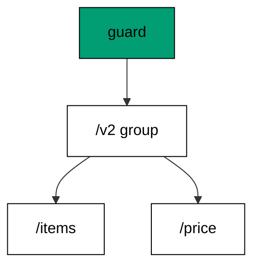

Three layers read outside-in: the guard decides who enters, `subRoute` decides the address space, and the inner table decides the content. FastAPI expresses the same stack with an `APIRouter(prefix=...)` carrying `dependencies=[...]` — one object holding prefix plus guard, included into the app. Giraffe spreads the same three decisions across three composed values, each visible and each movable. One edit relocates guard and prefix together because they are one expression, not two arguments that must agree.

The probes prove the layers independently: no key stops outside, the key opens both grouped routes, and the prefix keeps bare paths unreachable. Layered composition makes each decision testable in isolation — the guard without the prefix, the prefix without the guard — while stacked arguments test only as a unit. When version three arrives, the whole group copies as one block and changes its prefix in one place.

**`learning/code/ex-72-composition-replaces-nesting/Program.fs`**:

```fsharp
module App // => one module owns the whole unit

open System // => String.Join sorts joined output deterministically
open System.Net.Http // => HttpClient drives the service in-process (co-09)
open System.Text // => Encoding names UTF8 for JSON payloads
open System.Threading // => Interlocked and SemaphoreSlim live here (co-07)
open System.Threading.Tasks // => Task.WhenAll fans requests out (co-07)
open Microsoft.AspNetCore.Builder // => WebApplication wires routes to handlers
open Microsoft.AspNetCore.Hosting // => UseTestServer marks the in-memory host
open Microsoft.AspNetCore.Http // => HttpContext carries request and response
open Microsoft.AspNetCore.TestHost // => TestServer serves with no socket (co-09)
open Microsoft.Extensions.DependencyInjection // => AddSingleton registers services (co-06)
open Microsoft.Extensions.Logging // => ClearProviders silences logs (co-13)
open Giraffe // => route, choose, and json live here (co-01)

// => All checks below block on async HTTP with GetAwaiter().GetResult().
// => Main stays synchronous so prints land in request order, and the
// => in-process pipeline answers before the next request leaves.

// => show prints one transcript line with no trailing space.
let show (line: string) = // => every printed line flows through here
    printfn "%s" (line.TrimEnd()) // => TrimEnd keeps empty bodies clean

// => get serves one GET and prints method, path, status, and body.
// => One client drives every check: no per-case construction, no sockets.
let get (client: HttpClient) (path: string) = // => path names the resource
    let resp = client.GetAsync(path).GetAwaiter().GetResult() // => full pipeline runs in-process
    let body = resp.Content.ReadAsStringAsync().GetAwaiter().GetResult() // => the exact bytes written
    show (sprintf "GET %s -> %d %s" path (int resp.StatusCode) (body.Trim())) // => status plus body in one line

// => send serves one arbitrary method and prints status with body.
let send (client: HttpClient) (method: string) (path: string) = // => method plus path name the call
    use request = new HttpRequestMessage(HttpMethod(method), path) // => no body on these calls
    use resp = client.SendAsync(request).GetAwaiter().GetResult() // => the pipeline answers in memory
    let body = resp.Content.ReadAsStringAsync().GetAwaiter().GetResult() // => empty for HEAD and redirects
    show (sprintf "%s %s -> %d %s" method path (int resp.StatusCode) (body.Trim())) // => one line per call

// => postJson serves one JSON POST and prints status with body.
let postJson (client: HttpClient) (path: string) (payload: string) = // => payload is already JSON text
    use content = new StringContent(payload, Encoding.UTF8, "application/json") // => UTF8 names the charset
    use resp = client.PostAsync(path, content).GetAwaiter().GetResult() // => the handler reads the body
    let body = resp.Content.ReadAsStringAsync().GetAwaiter().GetResult() // => the exact bytes written
    show (sprintf "POST %s -> %d %s" path (int resp.StatusCode) (body.Trim())) // => status plus body in one line
// => v2Gate keeps strangers off the versioned group.
let v2Gate: HttpHandler = // => one guard for the whole group (co-02)
    fun next ctx ->
        task {
            match ctx.TryGetQueryStringValue "key" with // => the group key decides
            | Some "s3cr3t" -> return! next ctx // => holders enter the group
            | _ -> return! (setStatusCode 403 >=> text "forbidden") next ctx // => strangers stop outside
        }
// => webApp nests guarded routes under one versioned prefix.
let webApp: HttpHandler = // => guard outside, prefix inside, routes innermost (co-11, co-16)
    choose [
        v2Gate >=> subRoute "/v2" (choose [ // => one edit moves guard and prefix together
            route "/items" >=> json {| items = [| "a"; "b" |] |} // => first grouped route
            route "/price" >=> json {| price = 9 |} // => second grouped route
        ])
        setStatusCode 404 >=> text "Not Found" // => misses stay plain
    ]
// => buildApp wires the service every check in this unit exercises.
let buildApp (args: string[]) = // => args carry no flags in this course
    let builder = WebApplication.CreateBuilder(args) // => defaults plus our overrides
    // => Silenced logs keep stdout to printed lines only: golden transcripts
    // => must never contain framework chatter.
    builder.Logging.ClearProviders() |> ignore // => no log lines: only our prints appear
    // => Giraffe's JSON serializer lives in DI: without AddGiraffe the first
    // => json answer throws MissingDependencyException at runtime.
    builder.Services.AddGiraffe() |> ignore // => Giraffe needs its serializer in DI
    builder.WebHost.UseTestServer() |> ignore // => in-memory server: no socket, no port
    let app = builder.Build() // => the pipeline with routing and endpoints
    app.UseGiraffe(webApp) |> ignore // => every request flows through webApp
    app // => hand the wired service back to the caller
// => Top-level entry: build once, check, stop cleanly.
[<EntryPoint>] // => the harness runs the compiled assembly
let main args = // => every unit answers zero on success
    let app = buildApp args // => wiring separate from traffic, as always
    // => StartAsync boots the in-memory host: no socket binds, no port opens,
    // => yet every middleware and route runs exactly as in production.
    app.StartAsync().GetAwaiter().GetResult() // => TestServer starts without any socket
    use client = app.GetTestClient() // => client talks to memory, not the network
    get client "/v2/items" // => the group denies strangers
    get client "/v2/items?key=s3cr3t" // => holders read the grouped items
    get client "/v2/price?key=s3cr3t" // => the sibling shares guard and prefix
    // => StopAsync drains in-flight requests before releasing the host, so the
    // => checks above always land before the process exits.
    app.StopAsync().GetAwaiter().GetResult() // => stop cleanly: nothing in flight is cut (co-08)
    0 // => zero exit means the transcript matched
```

**Output** (`learning/code/ex-72-composition-replaces-nesting/expected/main.stdout.txt`):

```text
GET /v2/items -> 403 forbidden
GET /v2/items?key=s3cr3t -> 200 {"items":["a","b"]}
GET /v2/price?key=s3cr3t -> 200 {"price":9}
```

**Key takeaway**: Layer guard, prefix, and routes as nested values: each decision composes, moves, and tests on its own.

**Why it matters**: Explicit layering keeps cross-cutting decisions reviewable: a reader sees the guard, the version, and the content as three nested facts instead of one configured object. Moving any layer is moving an expression, which the compiler checks, rather than editing arguments, which only tests catch. The version-migration story is the payoff — whole API generations relocate as blocks. Composition order documents policy order, and policy readers outnumber policy authors ten to one.

### Example 73: Explicit Services vs Injection Magic

Dependencies resolve explicitly here, where FastAPI threads them through `Depends`. The example registers a named store in startup and serves its tag through one route. (Concepts: co-16, co-06.)

The constructor argument sits in the registration line, visible to every reader of startup: `NamedStore("warehouse")` says what was built and with what. FastAPI's `Depends` declares the need at the handler signature and lets the framework build it per request — less startup code, more framework magic. Explicit construction trades that magic for grepability: every instance the service holds is constructed in one file, with arguments the reviewer can read without running anything.

Per-request versus singleton lifetimes exist in both designs, spelled differently: FastAPI dependencies default to per-request callables with caching controls, while this container defaults to the registered lifetime and resolves the same instance every time. The route code barely differs — receive, read, answer — because both frameworks agree the handler should declare rather than construct. The disagreement is only about where construction lives and who can see it.

**`learning/code/ex-73-explicit-services-vs-injection-magic/Program.fs`**:

```fsharp
module App // => one module owns the whole unit

open System // => String.Join sorts joined output deterministically
open System.Net.Http // => HttpClient drives the service in-process (co-09)
open System.Text // => Encoding names UTF8 for JSON payloads
open System.Threading // => Interlocked and SemaphoreSlim live here (co-07)
open System.Threading.Tasks // => Task.WhenAll fans requests out (co-07)
open Microsoft.AspNetCore.Builder // => WebApplication wires routes to handlers
open Microsoft.AspNetCore.Hosting // => UseTestServer marks the in-memory host
open Microsoft.AspNetCore.Http // => HttpContext carries request and response
open Microsoft.AspNetCore.TestHost // => TestServer serves with no socket (co-09)
open Microsoft.Extensions.DependencyInjection // => AddSingleton registers services (co-06)
open Microsoft.Extensions.Logging // => ClearProviders silences logs (co-13)
open Giraffe // => route, choose, and json live here (co-01)

// => All checks below block on async HTTP with GetAwaiter().GetResult().
// => Main stays synchronous so prints land in request order, and the
// => in-process pipeline answers before the next request leaves.

// => show prints one transcript line with no trailing space.
let show (line: string) = // => every printed line flows through here
    printfn "%s" (line.TrimEnd()) // => TrimEnd keeps empty bodies clean

// => get serves one GET and prints method, path, status, and body.
// => One client drives every check: no per-case construction, no sockets.
let get (client: HttpClient) (path: string) = // => path names the resource
    let resp = client.GetAsync(path).GetAwaiter().GetResult() // => full pipeline runs in-process
    let body = resp.Content.ReadAsStringAsync().GetAwaiter().GetResult() // => the exact bytes written
    show (sprintf "GET %s -> %d %s" path (int resp.StatusCode) (body.Trim())) // => status plus body in one line

// => send serves one arbitrary method and prints status with body.
let send (client: HttpClient) (method: string) (path: string) = // => method plus path name the call
    use request = new HttpRequestMessage(HttpMethod(method), path) // => no body on these calls
    use resp = client.SendAsync(request).GetAwaiter().GetResult() // => the pipeline answers in memory
    let body = resp.Content.ReadAsStringAsync().GetAwaiter().GetResult() // => empty for HEAD and redirects
    show (sprintf "%s %s -> %d %s" method path (int resp.StatusCode) (body.Trim())) // => one line per call

// => postJson serves one JSON POST and prints status with body.
let postJson (client: HttpClient) (path: string) (payload: string) = // => payload is already JSON text
    use content = new StringContent(payload, Encoding.UTF8, "application/json") // => UTF8 names the charset
    use resp = client.PostAsync(path, content).GetAwaiter().GetResult() // => the handler reads the body
    let body = resp.Content.ReadAsStringAsync().GetAwaiter().GetResult() // => the exact bytes written
    show (sprintf "POST %s -> %d %s" path (int resp.StatusCode) (body.Trim())) // => status plus body in one line
// => NamedStore carries the name given at registration.
type NamedStore(name: string) = // => construction arguments are explicit (co-06, co-16)
    member _.Tag = name // => the registered name serves every read
// => webApp serves the registered name through one route.
let webApp: HttpHandler = // => no hidden callables: the instance is built in startup
    choose [
        route "/tag" >=> fun next ctx ->
            task {
                let store = ctx.GetService<NamedStore>() // => the explicit instance resolves
                return! text store.Tag next ctx // => the startup argument answers
            }
        setStatusCode 404 >=> text "Not Found" // => other paths miss
    ]
// => buildApp wires the service every check in this unit exercises.
let buildApp (args: string[]) = // => args carry no flags in this course
    let builder = WebApplication.CreateBuilder(args) // => defaults plus our overrides
    // => Silenced logs keep stdout to printed lines only: golden transcripts
    // => must never contain framework chatter.
    builder.Logging.ClearProviders() |> ignore // => no log lines: only our prints appear
    // => Giraffe's JSON serializer lives in DI: without AddGiraffe the first
    // => json answer throws MissingDependencyException at runtime.
    builder.Services.AddGiraffe() |> ignore // => Giraffe needs its serializer in DI
    builder.Services.AddSingleton<NamedStore>(NamedStore("warehouse")) |> ignore // => the argument sits in startup, visible
    builder.WebHost.UseTestServer() |> ignore // => in-memory server: no socket, no port
    let app = builder.Build() // => the pipeline with routing and endpoints
    app.UseGiraffe(webApp) |> ignore // => every request flows through webApp
    app // => hand the wired service back to the caller
// => Top-level entry: build once, check, stop cleanly.
[<EntryPoint>] // => the harness runs the compiled assembly
let main args = // => every unit answers zero on success
    let app = buildApp args // => wiring separate from traffic, as always
    // => StartAsync boots the in-memory host: no socket binds, no port opens,
    // => yet every middleware and route runs exactly as in production.
    app.StartAsync().GetAwaiter().GetResult() // => TestServer starts without any socket
    use client = app.GetTestClient() // => client talks to memory, not the network
    get client "/tag" // => the startup-built name through the route
    // => StopAsync drains in-flight requests before releasing the host, so the
    // => checks above always land before the process exits.
    app.StopAsync().GetAwaiter().GetResult() // => stop cleanly: nothing in flight is cut (co-08)
    0 // => zero exit means the transcript matched
```

**Output** (`learning/code/ex-73-explicit-services-vs-injection-magic/expected/main.stdout.txt`):

```text
GET /tag -> 200 warehouse
```

**Key takeaway**: Construct dependencies explicitly at startup: the registration line names every instance and its arguments.

**Why it matters**: Visible construction shortens every debugging session that ends with 'which instance is this': one file answers, instead of a graph of callables the framework assembled. Explicit arguments also version cleanly — changing a connection string edits a registration, not a dozen signatures. The magic-versus-explicit trade is genuine: `Depends` removes boilerplate for the common case, while explicit registration removes mystery for the uncommon one. Services that live for years optimize for the uncommon case.

### Example 74: Validation Without Decorators

Validation here is a walked list of named rules, where Pydantic declares them as field annotations. The example fails the first broken rule by name and creates the order that passes all. (Concepts: co-10, co-16.)

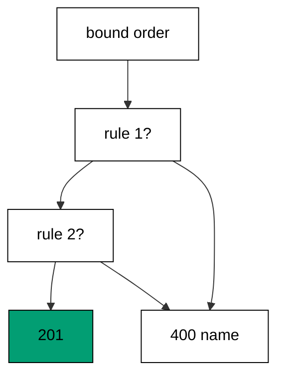

Each rule is a name plus a predicate, and the handler finds the first predicate that fails: `item-required` before `qty-positive`, in list order, every time. Pydantic reaches the same verdicts from field types and validators declared on the model — the rules live with the shape, checked by the framework before the handler runs. Listed rules trade that declarativeness for plain code: no validator protocol to learn, no framework order to remember, just a list the team reads top to bottom.

First-failure reporting keeps responses stable: the same bad order fails with the same name on every call, because list order never changes. Appending a rule appends a tuple — no decorator to place, no base class to extend. The 201 for the clean order completes the contract the same way the earlier validation example did: the gate opens as well as closes, and the tests prove both directions.

**`learning/code/ex-74-validation-without-decorators/Program.fs`**:

```fsharp
module App // => one module owns the whole unit

open System // => String.Join sorts joined output deterministically
open System.Net.Http // => HttpClient drives the service in-process (co-09)
open System.Text // => Encoding names UTF8 for JSON payloads
open System.Threading // => Interlocked and SemaphoreSlim live here (co-07)
open System.Threading.Tasks // => Task.WhenAll fans requests out (co-07)
open Microsoft.AspNetCore.Builder // => WebApplication wires routes to handlers
open Microsoft.AspNetCore.Hosting // => UseTestServer marks the in-memory host
open Microsoft.AspNetCore.Http // => HttpContext carries request and response
open Microsoft.AspNetCore.TestHost // => TestServer serves with no socket (co-09)
open Microsoft.Extensions.DependencyInjection // => AddSingleton registers services (co-06)
open Microsoft.Extensions.Logging // => ClearProviders silences logs (co-13)
open Giraffe // => route, choose, and json live here (co-01)

// => All checks below block on async HTTP with GetAwaiter().GetResult().
// => Main stays synchronous so prints land in request order, and the
// => in-process pipeline answers before the next request leaves.

// => show prints one transcript line with no trailing space.
let show (line: string) = // => every printed line flows through here
    printfn "%s" (line.TrimEnd()) // => TrimEnd keeps empty bodies clean

// => get serves one GET and prints method, path, status, and body.
// => One client drives every check: no per-case construction, no sockets.
let get (client: HttpClient) (path: string) = // => path names the resource
    let resp = client.GetAsync(path).GetAwaiter().GetResult() // => full pipeline runs in-process
    let body = resp.Content.ReadAsStringAsync().GetAwaiter().GetResult() // => the exact bytes written
    show (sprintf "GET %s -> %d %s" path (int resp.StatusCode) (body.Trim())) // => status plus body in one line

// => send serves one arbitrary method and prints status with body.
let send (client: HttpClient) (method: string) (path: string) = // => method plus path name the call
    use request = new HttpRequestMessage(HttpMethod(method), path) // => no body on these calls
    use resp = client.SendAsync(request).GetAwaiter().GetResult() // => the pipeline answers in memory
    let body = resp.Content.ReadAsStringAsync().GetAwaiter().GetResult() // => empty for HEAD and redirects
    show (sprintf "%s %s -> %d %s" method path (int resp.StatusCode) (body.Trim())) // => one line per call

// => postJson serves one JSON POST and prints status with body.
let postJson (client: HttpClient) (path: string) (payload: string) = // => payload is already JSON text
    use content = new StringContent(payload, Encoding.UTF8, "application/json") // => UTF8 names the charset
    use resp = client.PostAsync(path, content).GetAwaiter().GetResult() // => the handler reads the body
    let body = resp.Content.ReadAsStringAsync().GetAwaiter().GetResult() // => the exact bytes written
    show (sprintf "POST %s -> %d %s" path (int resp.StatusCode) (body.Trim())) // => status plus body in one line
// => ValOrder is the order the rules judge.
[<CLIMutable>] // => bind first, judge second
type ValOrder =
    { item: string // => must name something
      qty: int } // => must count something positive

// => Rule names the check every order faces.
type Rule = string * (ValOrder -> bool) // => the error name plus its predicate

// => rules lists every validation as data, not decorators.
let rules: Rule list = // => adding a rule appends a tuple (co-10, co-16)
    [ ("item-required", fun o -> not (System.String.IsNullOrEmpty(o.item))) // => first rule judges the item
      ("qty-positive", fun o -> o.qty > 0) ] // => second rule judges the count
// => webApp fails the first broken rule or creates the order.
let webApp: HttpHandler = // => validation as a walked list
    choose [
        POST >=> route "/orders" >=> fun next ctx ->
            task {
                let! order = ctx.BindJsonAsync<ValOrder>() // => the candidate binds typed
                match rules |> List.tryFind (fun (_, holds) -> not (holds order)) with // => the first failure wins
                | Some (name, _) -> return! (setStatusCode 400 >=> json {| error = name |}) next ctx // => named by the rule
                | None -> return! (setStatusCode 201 >=> json {| item = order.item; qty = order.qty |}) next ctx // => all rules held
            }
        setStatusCode 404 >=> text "Not Found" // => other paths miss
    ]
// => buildApp wires the service every check in this unit exercises.
let buildApp (args: string[]) = // => args carry no flags in this course
    let builder = WebApplication.CreateBuilder(args) // => defaults plus our overrides
    // => Silenced logs keep stdout to printed lines only: golden transcripts
    // => must never contain framework chatter.
    builder.Logging.ClearProviders() |> ignore // => no log lines: only our prints appear
    // => Giraffe's JSON serializer lives in DI: without AddGiraffe the first
    // => json answer throws MissingDependencyException at runtime.
    builder.Services.AddGiraffe() |> ignore // => Giraffe needs its serializer in DI
    builder.WebHost.UseTestServer() |> ignore // => in-memory server: no socket, no port
    let app = builder.Build() // => the pipeline with routing and endpoints
    app.UseGiraffe(webApp) |> ignore // => every request flows through webApp
    app // => hand the wired service back to the caller
// => Top-level entry: build once, check, stop cleanly.
[<EntryPoint>] // => the harness runs the compiled assembly
let main args = // => every unit answers zero on success
    let app = buildApp args // => wiring separate from traffic, as always
    // => StartAsync boots the in-memory host: no socket binds, no port opens,
    // => yet every middleware and route runs exactly as in production.
    app.StartAsync().GetAwaiter().GetResult() // => TestServer starts without any socket
    use client = app.GetTestClient() // => client talks to memory, not the network
    postJson client "/orders" """{"item":"","qty":2}""" // => the first rule fires
    postJson client "/orders" """{"item":"book","qty":0}""" // => the second rule fires
    postJson client "/orders" """{"item":"book","qty":2}""" // => clean orders create
    // => StopAsync drains in-flight requests before releasing the host, so the
    // => checks above always land before the process exits.
    app.StopAsync().GetAwaiter().GetResult() // => stop cleanly: nothing in flight is cut (co-08)
    0 // => zero exit means the transcript matched
```

**Output** (`learning/code/ex-74-validation-without-decorators/expected/main.stdout.txt`):

```text
POST /orders -> 400 {"error":"item-required"}
POST /orders -> 400 {"error":"qty-positive"}
POST /orders -> 201 {"item":"book","qty":2}
```

**Key takeaway**: Validate with a list of named predicates: first failure names the error, all passing creates the resource.

**Why it matters**: Rule lists keep validation logic in the language the team already debugs: predicates step through in a debugger, names read in a transcript, and ordering is list order rather than framework order. Declarative validators win on brevity for standard shapes — email fields, ranges, nested models — while explicit lists win on unusual rules that fight the annotation vocabulary. Either way, naming the failure beats describing it: clients branch on names, dashboards group by them, and support quotes one field.

### Example 75: Errors as Values Not Exceptions

Failures here travel as `Result` values, where FastAPI raises `HTTPException` and catches it in handlers. The example matches on `Ok` and `Error` with no throw anywhere. (Concepts: co-05, co-16.)

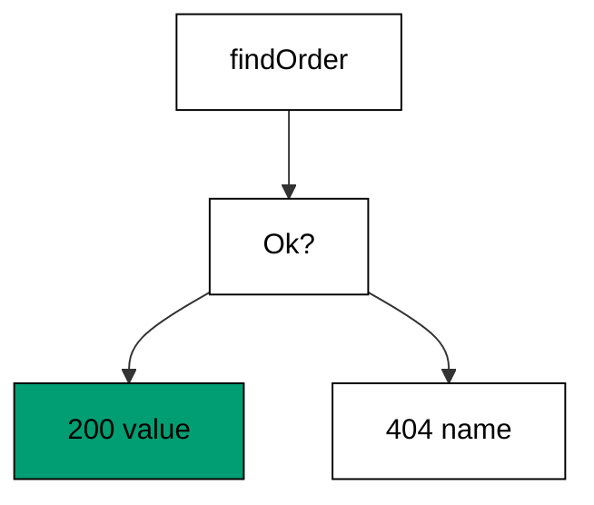

`findOrder` returns `Ok` with the value or `Error` with the name, and the handler matches: success renders, absence envelopes, and nothing unwinds a stack. FastAPI inverts the flow — handlers raise `HTTPException`, and registered exception handlers convert the flight into a response. Exceptions optimize the deep call: any layer can fail without threading results upward. Values optimize the near call: the decision sits beside the lookup, total and typed, with the compiler refusing to forget an arm.

Total matching is the property exceptions cannot give: the compiler proves every `Error` got an answer, while a missing exception handler surfaces only when the throw happens. Small services feel the values win more — lookups and validations resolve within sight of their callers. Deep pipelines feel the exceptions win more — plumbing results through six layers for one failure case taxes every reader. This course chooses values at the edge, where decisions stay local.

**`learning/code/ex-75-errors-as-values-not-exceptions/Program.fs`**:

```fsharp
module App // => one module owns the whole unit

open System // => String.Join sorts joined output deterministically
open System.Net.Http // => HttpClient drives the service in-process (co-09)
open System.Text // => Encoding names UTF8 for JSON payloads
open System.Threading // => Interlocked and SemaphoreSlim live here (co-07)
open System.Threading.Tasks // => Task.WhenAll fans requests out (co-07)
open Microsoft.AspNetCore.Builder // => WebApplication wires routes to handlers
open Microsoft.AspNetCore.Hosting // => UseTestServer marks the in-memory host
open Microsoft.AspNetCore.Http // => HttpContext carries request and response
open Microsoft.AspNetCore.TestHost // => TestServer serves with no socket (co-09)
open Microsoft.Extensions.DependencyInjection // => AddSingleton registers services (co-06)
open Microsoft.Extensions.Logging // => ClearProviders silences logs (co-13)
open Giraffe // => route, choose, and json live here (co-01)

// => All checks below block on async HTTP with GetAwaiter().GetResult().
// => Main stays synchronous so prints land in request order, and the
// => in-process pipeline answers before the next request leaves.

// => show prints one transcript line with no trailing space.
let show (line: string) = // => every printed line flows through here
    printfn "%s" (line.TrimEnd()) // => TrimEnd keeps empty bodies clean

// => get serves one GET and prints method, path, status, and body.
// => One client drives every check: no per-case construction, no sockets.
let get (client: HttpClient) (path: string) = // => path names the resource
    let resp = client.GetAsync(path).GetAwaiter().GetResult() // => full pipeline runs in-process
    let body = resp.Content.ReadAsStringAsync().GetAwaiter().GetResult() // => the exact bytes written
    show (sprintf "GET %s -> %d %s" path (int resp.StatusCode) (body.Trim())) // => status plus body in one line

// => send serves one arbitrary method and prints status with body.
let send (client: HttpClient) (method: string) (path: string) = // => method plus path name the call
    use request = new HttpRequestMessage(HttpMethod(method), path) // => no body on these calls
    use resp = client.SendAsync(request).GetAwaiter().GetResult() // => the pipeline answers in memory
    let body = resp.Content.ReadAsStringAsync().GetAwaiter().GetResult() // => empty for HEAD and redirects
    show (sprintf "%s %s -> %d %s" method path (int resp.StatusCode) (body.Trim())) // => one line per call

// => postJson serves one JSON POST and prints status with body.
let postJson (client: HttpClient) (path: string) (payload: string) = // => payload is already JSON text
    use content = new StringContent(payload, Encoding.UTF8, "application/json") // => UTF8 names the charset
    use resp = client.PostAsync(path, content).GetAwaiter().GetResult() // => the handler reads the body
    let body = resp.Content.ReadAsStringAsync().GetAwaiter().GetResult() // => the exact bytes written
    show (sprintf "POST %s -> %d %s" path (int resp.StatusCode) (body.Trim())) // => status plus body in one line
// => findOrder answers with a value, never a throw.
let findOrder (id: int) = // => Result carries both outcomes in the type (co-05, co-16)
    if id = 1 then // => the one known order
        Ok {| id = 1; item = "book" |} // => success carries the value
    else // => every other id is absence, not failure
        Error "order-not-found" // => absence carries the name
// => webApp matches on the Result instead of catching.
let webApp: HttpHandler = // => control flow by matching, not by throwing
    choose [
        GET >=> routef "/orders/%i" (fun id -> // => the id travels typed
            fun next ctx ->
                task {
                    match findOrder id with // => the value decides the branch
                    | Ok order -> return! json order next ctx // => success renders
                    | Error name -> return! (setStatusCode 404 >=> json {| error = name |}) next ctx // => absence envelopes
                })
        setStatusCode 404 >=> text "Not Found" // => non-order paths miss as text
    ]
// => buildApp wires the service every check in this unit exercises.
let buildApp (args: string[]) = // => args carry no flags in this course
    let builder = WebApplication.CreateBuilder(args) // => defaults plus our overrides
    // => Silenced logs keep stdout to printed lines only: golden transcripts
    // => must never contain framework chatter.
    builder.Logging.ClearProviders() |> ignore // => no log lines: only our prints appear
    // => Giraffe's JSON serializer lives in DI: without AddGiraffe the first
    // => json answer throws MissingDependencyException at runtime.
    builder.Services.AddGiraffe() |> ignore // => Giraffe needs its serializer in DI
    builder.WebHost.UseTestServer() |> ignore // => in-memory server: no socket, no port
    let app = builder.Build() // => the pipeline with routing and endpoints
    app.UseGiraffe(webApp) |> ignore // => every request flows through webApp
    app // => hand the wired service back to the caller
// => Top-level entry: build once, check, stop cleanly.
[<EntryPoint>] // => the harness runs the compiled assembly
let main args = // => every unit answers zero on success
    let app = buildApp args // => wiring separate from traffic, as always
    // => StartAsync boots the in-memory host: no socket binds, no port opens,
    // => yet every middleware and route runs exactly as in production.
    app.StartAsync().GetAwaiter().GetResult() // => TestServer starts without any socket
    use client = app.GetTestClient() // => client talks to memory, not the network
    get client "/orders/1" // => the known order renders from Ok
    get client "/orders/9" // => absence renders from Error, no throw anywhere
    // => StopAsync drains in-flight requests before releasing the host, so the
    // => checks above always land before the process exits.
    app.StopAsync().GetAwaiter().GetResult() // => stop cleanly: nothing in flight is cut (co-08)
    0 // => zero exit means the transcript matched
```

**Output** (`learning/code/ex-75-errors-as-values-not-exceptions/expected/main.stdout.txt`):

```text
GET /orders/1 -> 200 {"id":1,"item":"book"}
GET /orders/9 -> 404 {"error":"order-not-found"}
```

**Key takeaway**: Return Results at the edge and match them: the compiler proves every failure got an answer, no throw needed.

**Why it matters**: Value-based errors make failure handling reviewable: every branch is syntax the reader sees, not a flight path they reconstruct. Exception-based errors make failure handling composable: any depth can fail without intermediate cooperation. The honest choice depends on distance — near decisions read better as matches, far ones propagate better as throws. Edge handlers mostly decide near: validate, look up, answer. Keeping those decisions in values keeps the edge total, typed, and provably complete.

### Example 76: Tests Without a Live Server

Both frameworks test without a live server: FastAPI's `TestClient` drives ASGI in-process, and this example drives six parallel checks through `TestServer`. The program counts six 200s from one flight. (Concepts: co-09, co-16.)

The comparison is honest because the topologies match: no sockets, no ports, no network in either design — requests travel framework internals and answers come back as values. The clients differ the way the frameworks differ: FastAPI speaks httpx request and response objects, Giraffe speaks `HttpClient` against an in-memory host. Parallel checks work identically on both — fire the flight, join it, count the statuses — because in-process serving absorbs concurrency the same way regardless of brand.

Counting 200s instead of comparing bodies keeps this check about serving rather than shaping: six parallel requests, six answers, zero flakes. Body assertions belong in the sequential checks that precede this one; the parallel check proves the host absorbs the flight. Teams migrating between frameworks keep their check structure and swap the client — the table of methods, paths, and wants transfers verbatim, because HTTP is the contract both sides honor.

**`learning/code/ex-76-tests-without-a-live-server/Program.fs`**:

```fsharp
module App // => one module owns the whole unit

open System // => String.Join sorts joined output deterministically
open System.Net.Http // => HttpClient drives the service in-process (co-09)
open System.Text // => Encoding names UTF8 for JSON payloads
open System.Threading // => Interlocked and SemaphoreSlim live here (co-07)
open System.Threading.Tasks // => Task.WhenAll fans requests out (co-07)
open Microsoft.AspNetCore.Builder // => WebApplication wires routes to handlers
open Microsoft.AspNetCore.Hosting // => UseTestServer marks the in-memory host
open Microsoft.AspNetCore.Http // => HttpContext carries request and response
open Microsoft.AspNetCore.TestHost // => TestServer serves with no socket (co-09)
open Microsoft.Extensions.DependencyInjection // => AddSingleton registers services (co-06)
open Microsoft.Extensions.Logging // => ClearProviders silences logs (co-13)
open Giraffe // => route, choose, and json live here (co-01)

// => All checks below block on async HTTP with GetAwaiter().GetResult().
// => Main stays synchronous so prints land in request order, and the
// => in-process pipeline answers before the next request leaves.

// => show prints one transcript line with no trailing space.
let show (line: string) = // => every printed line flows through here
    printfn "%s" (line.TrimEnd()) // => TrimEnd keeps empty bodies clean

// => get serves one GET and prints method, path, status, and body.
// => One client drives every check: no per-case construction, no sockets.
let get (client: HttpClient) (path: string) = // => path names the resource
    let resp = client.GetAsync(path).GetAwaiter().GetResult() // => full pipeline runs in-process
    let body = resp.Content.ReadAsStringAsync().GetAwaiter().GetResult() // => the exact bytes written
    show (sprintf "GET %s -> %d %s" path (int resp.StatusCode) (body.Trim())) // => status plus body in one line

// => send serves one arbitrary method and prints status with body.
let send (client: HttpClient) (method: string) (path: string) = // => method plus path name the call
    use request = new HttpRequestMessage(HttpMethod(method), path) // => no body on these calls
    use resp = client.SendAsync(request).GetAwaiter().GetResult() // => the pipeline answers in memory
    let body = resp.Content.ReadAsStringAsync().GetAwaiter().GetResult() // => empty for HEAD and redirects
    show (sprintf "%s %s -> %d %s" method path (int resp.StatusCode) (body.Trim())) // => one line per call

// => postJson serves one JSON POST and prints status with body.
let postJson (client: HttpClient) (path: string) (payload: string) = // => payload is already JSON text
    use content = new StringContent(payload, Encoding.UTF8, "application/json") // => UTF8 names the charset
    use resp = client.PostAsync(path, content).GetAwaiter().GetResult() // => the handler reads the body
    let body = resp.Content.ReadAsStringAsync().GetAwaiter().GetResult() // => the exact bytes written
    show (sprintf "POST %s -> %d %s" path (int resp.StatusCode) (body.Trim())) // => status plus body in one line
// => webApp serves one tiny route the parallel checks hammer.
let webApp: HttpHandler = // => in-process serving absorbs parallel checks (co-09, co-16)
    choose [
        GET >=> route "/ping" >=> text "pong" // => the smallest answer worth counting
        setStatusCode 404 >=> text "Not Found" // => other paths miss
    ]
// => buildApp wires the service every check in this unit exercises.
let buildApp (args: string[]) = // => args carry no flags in this course
    let builder = WebApplication.CreateBuilder(args) // => defaults plus our overrides
    // => Silenced logs keep stdout to printed lines only: golden transcripts
    // => must never contain framework chatter.
    builder.Logging.ClearProviders() |> ignore // => no log lines: only our prints appear
    // => Giraffe's JSON serializer lives in DI: without AddGiraffe the first
    // => json answer throws MissingDependencyException at runtime.
    builder.Services.AddGiraffe() |> ignore // => Giraffe needs its serializer in DI
    builder.WebHost.UseTestServer() |> ignore // => in-memory server: no socket, no port
    let app = builder.Build() // => the pipeline with routing and endpoints
    app.UseGiraffe(webApp) |> ignore // => every request flows through webApp
    app // => hand the wired service back to the caller
// => Top-level entry: build once, check, stop cleanly.
[<EntryPoint>] // => the harness runs the compiled assembly
let main args = // => every unit answers zero on success
    let app = buildApp args // => wiring separate from traffic, as always
    // => StartAsync boots the in-memory host: no socket binds, no port opens,
    // => yet every middleware and route runs exactly as in production.
    app.StartAsync().GetAwaiter().GetResult() // => TestServer starts without any socket
    use client = app.GetTestClient() // => client talks to memory, not the network
    let flights = [| for _ in 1..6 -> client.GetAsync("/ping") |] // => six checks leave at once
    let landed = System.Threading.Tasks.Task.WhenAll(flights).GetAwaiter().GetResult() // => the join waits for all six
    let oks = landed |> Array.filter (fun r -> int r.StatusCode = 200) |> Array.length // => count the 200s
    show (sprintf "ok=%d/6" oks) // => six parallel checks, six answers
    // => StopAsync drains in-flight requests before releasing the host, so the
    // => checks above always land before the process exits.
    app.StopAsync().GetAwaiter().GetResult() // => stop cleanly: nothing in flight is cut (co-08)
    0 // => zero exit means the transcript matched
```

**Output** (`learning/code/ex-76-tests-without-a-live-server/expected/main.stdout.txt`):

```text
ok=6/6
```

**Key takeaway**: Test in-process on either framework: fire parallel checks, join the flight, count statuses — no sockets anywhere.

**Why it matters**: In-process checks are the great equalizer between frameworks: they run in milliseconds, need no environment, and fail only when behavior breaks. The habit transfers whole — tables of cases, status-plus-body assertions, parallel flights — because every web framework ultimately answers requests with statuses and bytes. Framework migrations change clients, not check discipline; teams that learned table-driven checks in one ecosystem bring them intact to the next. The socket was never the point; the assertion was.

### Example 77: Typing at the Boundary Both Worlds

Boundary typing pairs compile-time records with runtime rules here, where Pydantic validates annotations at parse time. The example judges three fields and registers the clean signup. (Concepts: co-15, co-10, co-16.)

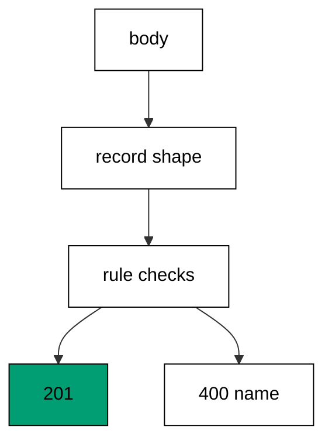

The `Signup` record fixes the shape before any request arrives: three fields, fixed types, misspelled keys rejected by the binder. Pydantic models fix the same shape at class definition, then validate values when the body parses — missing fields, wrong types, and custom validators each produce structured errors. Records give the F# compiler the shape; the three ordered checks give the runtime the judgment. Both layers agree: the boundary admits only what it can name.

Ordered field checks report the first failure deterministically: email, then name, then year, the same verdict for the same body on every call. The checks drive all four outcomes — three named rejections plus the 201 — so the boundary proves it opens as well as closes. Compile-time shape plus runtime rules is the complete boundary story in any typed stack; the frameworks differ only in where each half lives.

**`learning/code/ex-77-typing-at-the-boundary-both-worlds/Program.fs`**:

```fsharp
module App // => one module owns the whole unit

open System // => String.Join sorts joined output deterministically
open System.Net.Http // => HttpClient drives the service in-process (co-09)
open System.Text // => Encoding names UTF8 for JSON payloads
open System.Threading // => Interlocked and SemaphoreSlim live here (co-07)
open System.Threading.Tasks // => Task.WhenAll fans requests out (co-07)
open Microsoft.AspNetCore.Builder // => WebApplication wires routes to handlers
open Microsoft.AspNetCore.Hosting // => UseTestServer marks the in-memory host
open Microsoft.AspNetCore.Http // => HttpContext carries request and response
open Microsoft.AspNetCore.TestHost // => TestServer serves with no socket (co-09)
open Microsoft.Extensions.DependencyInjection // => AddSingleton registers services (co-06)
open Microsoft.Extensions.Logging // => ClearProviders silences logs (co-13)
open Giraffe // => route, choose, and json live here (co-01)

// => All checks below block on async HTTP with GetAwaiter().GetResult().
// => Main stays synchronous so prints land in request order, and the
// => in-process pipeline answers before the next request leaves.

// => show prints one transcript line with no trailing space.
let show (line: string) = // => every printed line flows through here
    printfn "%s" (line.TrimEnd()) // => TrimEnd keeps empty bodies clean

// => get serves one GET and prints method, path, status, and body.
// => One client drives every check: no per-case construction, no sockets.
let get (client: HttpClient) (path: string) = // => path names the resource
    let resp = client.GetAsync(path).GetAwaiter().GetResult() // => full pipeline runs in-process
    let body = resp.Content.ReadAsStringAsync().GetAwaiter().GetResult() // => the exact bytes written
    show (sprintf "GET %s -> %d %s" path (int resp.StatusCode) (body.Trim())) // => status plus body in one line

// => send serves one arbitrary method and prints status with body.
let send (client: HttpClient) (method: string) (path: string) = // => method plus path name the call
    use request = new HttpRequestMessage(HttpMethod(method), path) // => no body on these calls
    use resp = client.SendAsync(request).GetAwaiter().GetResult() // => the pipeline answers in memory
    let body = resp.Content.ReadAsStringAsync().GetAwaiter().GetResult() // => empty for HEAD and redirects
    show (sprintf "%s %s -> %d %s" method path (int resp.StatusCode) (body.Trim())) // => one line per call

// => postJson serves one JSON POST and prints status with body.
let postJson (client: HttpClient) (path: string) (payload: string) = // => payload is already JSON text
    use content = new StringContent(payload, Encoding.UTF8, "application/json") // => UTF8 names the charset
    use resp = client.PostAsync(path, content).GetAwaiter().GetResult() // => the handler reads the body
    let body = resp.Content.ReadAsStringAsync().GetAwaiter().GetResult() // => the exact bytes written
    show (sprintf "POST %s -> %d %s" path (int resp.StatusCode) (body.Trim())) // => status plus body in one line
// => Signup is the member the rules judge.
[<CLIMutable>] // => three fields bind from one body (co-15)
type Signup =
    { email: string // => must contain an at-sign
      name: string // => must name someone
      year: int } // => must be a plausible birth year
// => webApp judges the signup field by field.
// => Email, then name, then year: the same body fails the same first.
// => Ordered checks turn the boundary into a contract callers program to.
let webApp: HttpHandler = // => compile-time record plus runtime rules (co-10, co-16)
    choose [
        POST >=> route "/signup" >=> fun next ctx ->
            task {
                let! s = ctx.BindJsonAsync<Signup>() // => the shape is fixed at compile time
                if System.String.IsNullOrEmpty(s.email) || not (s.email.Contains("@")) then // => first rule: a real email
                    return! (setStatusCode 400 >=> json {| error = "email-invalid" |}) next ctx
                elif System.String.IsNullOrEmpty(s.name) then // => second rule: a real name
                    return! (setStatusCode 400 >=> json {| error = "name-required" |}) next ctx
                elif s.year < 1900 then // => third rule: a plausible year
                    return! (setStatusCode 400 >=> json {| error = "year-invalid" |}) next ctx
                else // => every rule held: the member registers
                    return! (setStatusCode 201 >=> json {| email = s.email; name = s.name; year = s.year |}) next ctx
            }
        setStatusCode 404 >=> text "Not Found" // => other paths miss
    ]
// => buildApp wires the service every check in this unit exercises.
let buildApp (args: string[]) = // => args carry no flags in this course
    let builder = WebApplication.CreateBuilder(args) // => defaults plus our overrides
    // => Silenced logs keep stdout to printed lines only: golden transcripts
    // => must never contain framework chatter.
    builder.Logging.ClearProviders() |> ignore // => no log lines: only our prints appear
    // => Giraffe's JSON serializer lives in DI: without AddGiraffe the first
    // => json answer throws MissingDependencyException at runtime.
    builder.Services.AddGiraffe() |> ignore // => Giraffe needs its serializer in DI
    builder.WebHost.UseTestServer() |> ignore // => in-memory server: no socket, no port
    let app = builder.Build() // => the pipeline with routing and endpoints
    app.UseGiraffe(webApp) |> ignore // => every request flows through webApp
    app // => hand the wired service back to the caller
// => Top-level entry: build once, check, stop cleanly.
[<EntryPoint>] // => the harness runs the compiled assembly
let main args = // => every unit answers zero on success
    let app = buildApp args // => wiring separate from traffic, as always
    // => StartAsync boots the in-memory host: no socket binds, no port opens,
    // => yet every middleware and route runs exactly as in production.
    app.StartAsync().GetAwaiter().GetResult() // => TestServer starts without any socket
    use client = app.GetTestClient() // => client talks to memory, not the network
    postJson client "/signup" """{"email":"no-at-sign","name":"ada","year":2001}""" // => the email rule fires
    postJson client "/signup" """{"email":"a@x.io","name":"","year":2001}""" // => the name rule fires
    postJson client "/signup" """{"email":"a@x.io","name":"ada","year":1800}""" // => the year rule fires
    postJson client "/signup" """{"email":"a@x.io","name":"ada","year":2001}""" // => the clean signup registers
    // => StopAsync drains in-flight requests before releasing the host, so the
    // => checks above always land before the process exits.
    app.StopAsync().GetAwaiter().GetResult() // => stop cleanly: nothing in flight is cut (co-08)
    0 // => zero exit means the transcript matched
```

**Output** (`learning/code/ex-77-typing-at-the-boundary-both-worlds/expected/main.stdout.txt`):

```text
POST /signup -> 400 {"error":"email-invalid"}
POST /signup -> 400 {"error":"name-required"}
POST /signup -> 400 {"error":"year-invalid"}
POST /signup -> 201 {"email":"a@x.io","name":"ada","year":2001}
```

**Key takeaway**: Fix the shape in a record and judge values with ordered checks: the compiler owns fields, the handler owns rules.

**Why it matters**: Two-layer boundaries catch two kinds of mistakes: shapes stop malformed payloads at parse time, and rules stop well-formed nonsense at judgment time. Either layer alone leaves a hole — typed but absurd values, or validated but misshapen ones. Deterministic first-failure order turns the boundary into a contract clients can program against: same body, same error, every time. Strict boundaries feel slow to write and fast to operate; loose ones reverse both.

### Example 78: Capstone Preview: Full Service Tour

The course closes with a five-route tour of everything it taught: seeded list, validated create with `Location`, typed fetch, health, and a designed miss. The program drives all five and the miss names itself. (Concepts: co-01, co-04, co-09, co-10, co-14, co-15.)

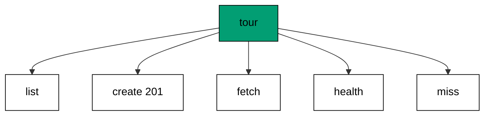

Each route replays a level: the sorted list replays fixed-data determinism, the validated create replays binding plus rules plus 201, the typed fetch replays captures with a named miss, health replays readiness beside content, and the envelope replays the designed 404. The tour is also the capstone's shape in miniature — five routes, one shelf, validation at the edge — so readers arrive at the capstone having already served its skeleton. Nothing here is new; everything here is load-bearing.

Reading the transcript end to end is the final exam the course sets itself: list, create, fetch, probe, miss — can the reader predict each line before looking? The `Location` on the create points at the fetch's address, closing the loop between writing and reading that the roundtrip lesson opened. From values to middleware to concurrency to comparison, the tour compresses seventy-eight examples into five routes that fit on one screen. The capstone expands them back into a service.

**`learning/code/ex-78-capstone-preview-full-service-tour/Program.fs`**:

```fsharp
module App // => one module owns the whole unit

open System // => String.Join sorts joined output deterministically
open System.Net.Http // => HttpClient drives the service in-process (co-09)
open System.Text // => Encoding names UTF8 for JSON payloads
open System.Threading // => Interlocked and SemaphoreSlim live here (co-07)
open System.Threading.Tasks // => Task.WhenAll fans requests out (co-07)
open Microsoft.AspNetCore.Builder // => WebApplication wires routes to handlers
open Microsoft.AspNetCore.Hosting // => UseTestServer marks the in-memory host
open Microsoft.AspNetCore.Http // => HttpContext carries request and response
open Microsoft.AspNetCore.TestHost // => TestServer serves with no socket (co-09)
open Microsoft.Extensions.DependencyInjection // => AddSingleton registers services (co-06)
open Microsoft.Extensions.Logging // => ClearProviders silences logs (co-13)
open Giraffe // => route, choose, and json live here (co-01)

// => All checks below block on async HTTP with GetAwaiter().GetResult().
// => Main stays synchronous so prints land in request order, and the
// => in-process pipeline answers before the next request leaves.

// => show prints one transcript line with no trailing space.
let show (line: string) = // => every printed line flows through here
    printfn "%s" (line.TrimEnd()) // => TrimEnd keeps empty bodies clean

// => get serves one GET and prints method, path, status, and body.
// => One client drives every check: no per-case construction, no sockets.
let get (client: HttpClient) (path: string) = // => path names the resource
    let resp = client.GetAsync(path).GetAwaiter().GetResult() // => full pipeline runs in-process
    let body = resp.Content.ReadAsStringAsync().GetAwaiter().GetResult() // => the exact bytes written
    show (sprintf "GET %s -> %d %s" path (int resp.StatusCode) (body.Trim())) // => status plus body in one line

// => send serves one arbitrary method and prints status with body.
let send (client: HttpClient) (method: string) (path: string) = // => method plus path name the call
    use request = new HttpRequestMessage(HttpMethod(method), path) // => no body on these calls
    use resp = client.SendAsync(request).GetAwaiter().GetResult() // => the pipeline answers in memory
    let body = resp.Content.ReadAsStringAsync().GetAwaiter().GetResult() // => empty for HEAD and redirects
    show (sprintf "%s %s -> %d %s" method path (int resp.StatusCode) (body.Trim())) // => one line per call

// => postJson serves one JSON POST and prints status with body.
let postJson (client: HttpClient) (path: string) (payload: string) = // => payload is already JSON text
    use content = new StringContent(payload, Encoding.UTF8, "application/json") // => UTF8 names the charset
    use resp = client.PostAsync(path, content).GetAwaiter().GetResult() // => the handler reads the body
    let body = resp.Content.ReadAsStringAsync().GetAwaiter().GetResult() // => the exact bytes written
    show (sprintf "POST %s -> %d %s" path (int resp.StatusCode) (body.Trim())) // => status plus body in one line
// => TourShelf holds the tour's two seeded orders.
type TourShelf() = // => fixed data keeps the tour deterministic (co-06)
    let items = System.Collections.Concurrent.ConcurrentDictionary<int, string>() // => id to item
    do items.TryAdd(1, "book") |> ignore // => first seeded order
    do items.TryAdd(2, "pen") |> ignore // => second seeded order
    member _.List() = // => the listing reads sorted
        items |> Seq.map (fun kv -> {| id = kv.Key; item = kv.Value |}) |> Seq.sortBy (fun o -> o.id) |> Seq.toArray

// => NewTourOrder is the typed shape of the created order.
[<CLIMutable>] // => one validated field
type NewTourOrder =
    { item: string } // => empty items fail validation
// => webApp tours the whole course in five routes.
// => The Location on create points at the fetch: write and read agree.
// => Health beside content proves the stack, not just the probe.
let webApp: HttpHandler = // => list, validated create, typed fetch, health, miss (co-01, co-04, co-09, co-10, co-14, co-15)
    choose [
        // => The tour list renders both seeds sorted: fixed data, fixed order.
        // => Sorting before rendering keeps the transcript byte-stable.
        GET >=> route "/orders" >=> fun next ctx ->
            task {
                let shelf = ctx.GetService<TourShelf>() // => the seeded shelf serves
                return! json (shelf.List()) next ctx // => both seeds render sorted
            }
        POST >=> route "/orders" >=> fun next ctx ->
            task {
                let! order = ctx.BindJsonAsync<NewTourOrder>() // => the candidate binds typed
                if System.String.IsNullOrEmpty(order.item) then // => validated before creating
                    return! (setStatusCode 400 >=> json {| error = "item-required" |}) next ctx
                else // => clean orders point at their address
                    return! (setStatusCode 201 >=> setHttpHeader "Location" "/orders/3" >=> json {| id = 3; item = order.item |}) next ctx
            }
        // => The typed fetch proves captures plus lookup in one branch.
        // => Seeded ids serve; the rest name their miss with an envelope.
        GET >=> routef "/orders/%i" (fun id -> // => typed fetch with a named miss
            fun next ctx ->
                task {
                    if id = 1 || id = 2 then // => the seeded ids serve
                        return! json {| id = id; item = (if id = 1 then "book" else "pen") |} next ctx
                    else // => unknown ids name their miss
                        return! (setStatusCode 404 >=> json {| error = "order-not-found" |}) next ctx
                })
        GET >=> route "/healthz" >=> json {| status = "ok" |} // => readiness answers beside content
        setStatusCode 404 >=> json {| error = "not-found" |} // => the designed miss closes the tour
    ]
// => buildApp wires the service every check in this unit exercises.
let buildApp (args: string[]) = // => args carry no flags in this course
    let builder = WebApplication.CreateBuilder(args) // => defaults plus our overrides
    // => Silenced logs keep stdout to printed lines only: golden transcripts
    // => must never contain framework chatter.
    builder.Logging.ClearProviders() |> ignore // => no log lines: only our prints appear
    // => Giraffe's JSON serializer lives in DI: without AddGiraffe the first
    // => json answer throws MissingDependencyException at runtime.
    builder.Services.AddGiraffe() |> ignore // => Giraffe needs its serializer in DI
    builder.Services.AddSingleton<TourShelf>() |> ignore // => one shelf for the tour
    builder.WebHost.UseTestServer() |> ignore // => in-memory server: no socket, no port
    let app = builder.Build() // => the pipeline with routing and endpoints
    app.UseGiraffe(webApp) |> ignore // => every request flows through webApp
    app // => hand the wired service back to the caller
// => Top-level entry: build once, check, stop cleanly.
[<EntryPoint>] // => the harness runs the compiled assembly
let main args = // => every unit answers zero on success
    let app = buildApp args // => wiring separate from traffic, as always
    // => StartAsync boots the in-memory host: no socket binds, no port opens,
    // => yet every middleware and route runs exactly as in production.
    app.StartAsync().GetAwaiter().GetResult() // => TestServer starts without any socket
    use client = app.GetTestClient() // => client talks to memory, not the network
    get client "/orders" // => the seeded list renders sorted
    use tour = new StringContent("""{"item":"ruler"}""", Encoding.UTF8, "application/json") // => a clean tour order
    use made = client.PostAsync("/orders", tour).GetAwaiter().GetResult() // => creation answers 201
    let madeBody = made.Content.ReadAsStringAsync().GetAwaiter().GetResult() // => exact bytes back
    show (sprintf "POST /orders -> %d loc=%s %s" (int made.StatusCode) (string made.Headers.Location) (madeBody.Trim())) // => one line
    get client "/orders/1" // => the known id serves its order
    get client "/healthz" // => readiness answers beside content
    get client "/orders/7" // => the unknown id names its miss
    // => StopAsync drains in-flight requests before releasing the host, so the
    // => checks above always land before the process exits.
    app.StopAsync().GetAwaiter().GetResult() // => stop cleanly: nothing in flight is cut (co-08)
    0 // => zero exit means the transcript matched
```

**Output** (`learning/code/ex-78-capstone-preview-full-service-tour/expected/main.stdout.txt`):

```text
GET /orders -> 200 [{"id":1,"item":"book"},{"id":2,"item":"pen"}]
POST /orders -> 201 loc=/orders/3 {"id":3,"item":"ruler"}
GET /orders/1 -> 200 {"id":1,"item":"book"}
GET /healthz -> 200 {"status":"ok"}
GET /orders/7 -> 404 {"error":"order-not-found"}
```

**Key takeaway**: The tour compresses the course into five routes: list, validated create with Location, typed fetch, health, designed miss.

**Why it matters**: Closing tours convert a long course from memories into a model: five routes the reader can hold in mind at once, each standing for a level they studied in depth. The capstone that follows is this tour with real requirements — the skeleton already proven, the flesh left to write. Tours also serve future maintainers: one screen that shows what the course considers essential, against which every later edit can be judged. Seventy-eight examples taught the parts; five routes teach the whole.
