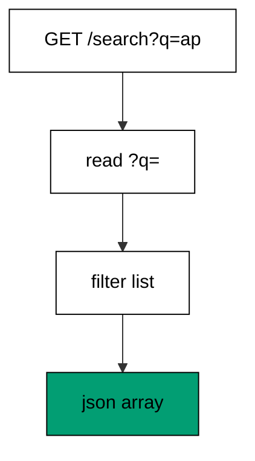
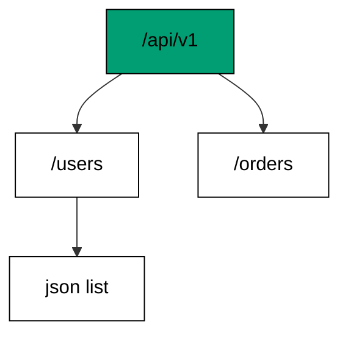
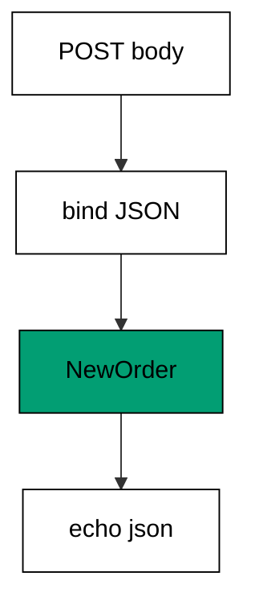
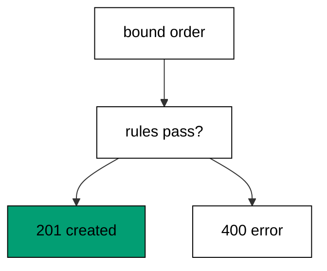
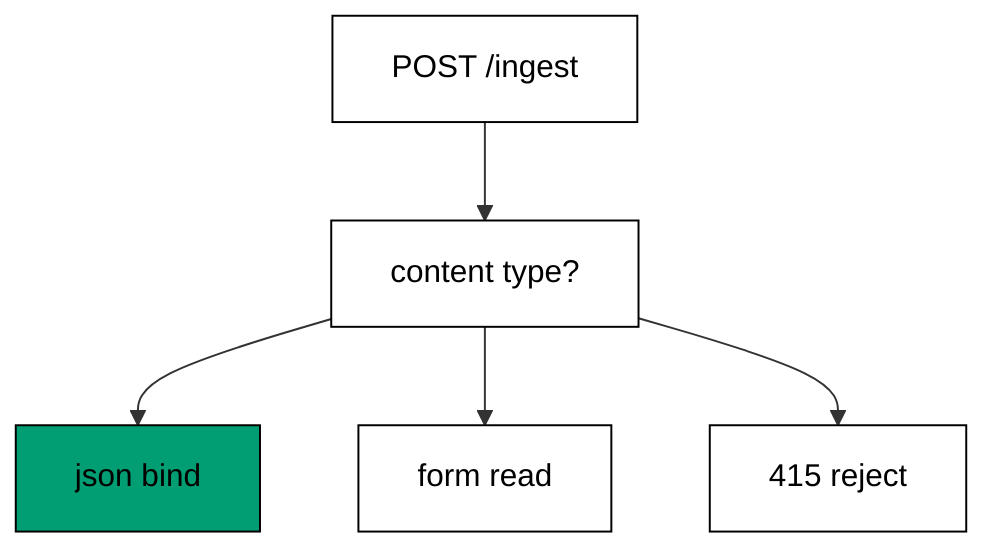
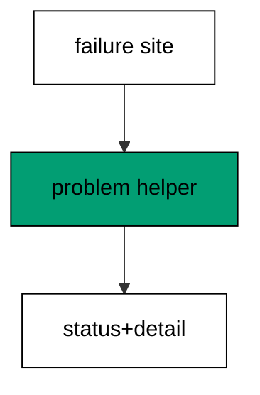
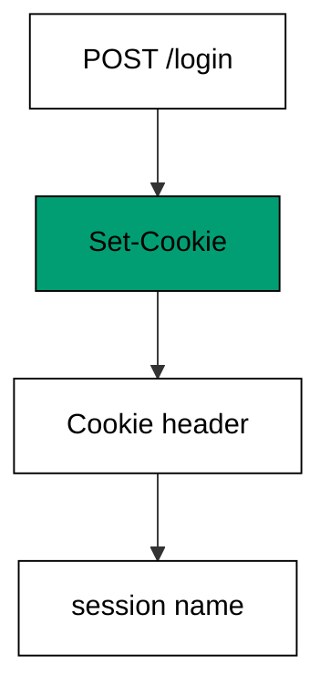
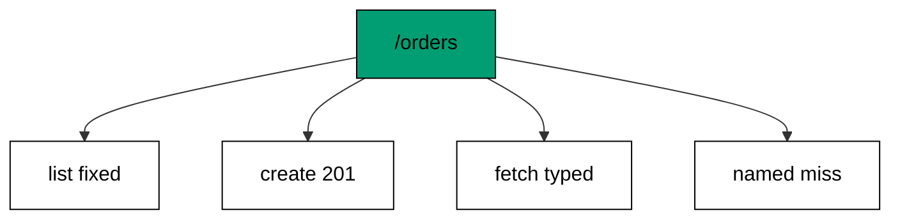

Examples 1–25 build the habits every later example assumes: registering routes with typed captures, reading queries headers and bodies, and shaping responses with statuses envelopes and headers. Three clusters carry the level: routes and handlers that compose into tables (Examples 1–8), request parsing plus validation from paths to bodies (Examples 9–17), and response shaping from status codes to downloads (Examples 18–25). Every program runs in-process through TestServer with no socket and no port; every output is a fixed transcript.

### Example 1: Hello Route Returns JSON

A route maps one method plus one path to one handler, and this example registers the smallest real one: GET /hello answering JSON. The program serves it in-process with TestServer, so no socket opens and no port is chosen. (Concepts: co-01.)


The route table is a value: `choose` holds a list of branches, and each branch pairs a matcher with the handler that answers it. Requests walk the list top to bottom, and the first branch whose matcher fits runs. Nothing here listens on a network port — the test client talks to the pipeline inside this process, which is why the whole check finishes in milliseconds and prints the same bytes twice.

The fallback branch matters as much as the route: an unmatched request must get a deliberate answer, not an accident of middleware order. Setting the status before the body keeps the two decisions visible in one line — status first, representation second. Every later example in this cluster keeps this two-branch shape, so the table grows without the fallback drifting away from the end.

**`learning/code/ex-01-hello-route-returns-json/Program.fs`**:

```fsharp
module App // => one module owns the whole unit

open System // => String.Join sorts joined output deterministically
open System.Net.Http // => HttpClient drives the service in-process (co-09)
open System.Text // => Encoding names UTF8 for JSON payloads
open System.Threading // => Interlocked and SemaphoreSlim live here (co-07)
open System.Threading.Tasks // => Task.WhenAll fans requests out (co-07)
open Microsoft.AspNetCore.Builder // => WebApplication wires routes to handlers
open Microsoft.AspNetCore.Hosting // => UseTestServer marks the in-memory host
open Microsoft.AspNetCore.Http // => HttpContext carries request and response
open Microsoft.AspNetCore.TestHost // => TestServer serves with no socket (co-09)
open Microsoft.Extensions.DependencyInjection // => AddSingleton registers services (co-06)
open Microsoft.Extensions.Logging // => ClearProviders silences logs (co-13)
open Giraffe // => route, choose, and json live here (co-01)

// => All checks below block on async HTTP with GetAwaiter().GetResult().
// => Main stays synchronous so prints land in request order, and the
// => in-process pipeline answers before the next request leaves.

// => show prints one transcript line with no trailing space.
let show (line: string) = // => every printed line flows through here
    printfn "%s" (line.TrimEnd()) // => TrimEnd keeps empty bodies clean

// => get serves one GET and prints method, path, status, and body.
// => One client drives every check: no per-case construction, no sockets.
let get (client: HttpClient) (path: string) = // => path names the resource
    let resp = client.GetAsync(path).GetAwaiter().GetResult() // => full pipeline runs in-process
    let body = resp.Content.ReadAsStringAsync().GetAwaiter().GetResult() // => the exact bytes written
    show (sprintf "GET %s -> %d %s" path (int resp.StatusCode) (body.Trim())) // => status plus body in one line

// => send serves one arbitrary method and prints status with body.
let send (client: HttpClient) (method: string) (path: string) = // => method plus path name the call
    use request = new HttpRequestMessage(HttpMethod(method), path) // => no body on these calls
    use resp = client.SendAsync(request).GetAwaiter().GetResult() // => the pipeline answers in memory
    let body = resp.Content.ReadAsStringAsync().GetAwaiter().GetResult() // => empty for HEAD and redirects
    show (sprintf "%s %s -> %d %s" method path (int resp.StatusCode) (body.Trim())) // => one line per call

// => postJson serves one JSON POST and prints status with body.
let postJson (client: HttpClient) (path: string) (payload: string) = // => payload is already JSON text
    use content = new StringContent(payload, Encoding.UTF8, "application/json") // => UTF8 names the charset
    use resp = client.PostAsync(path, content).GetAwaiter().GetResult() // => the handler reads the body
    let body = resp.Content.ReadAsStringAsync().GetAwaiter().GetResult() // => the exact bytes written
    show (sprintf "POST %s -> %d %s" path (int resp.StatusCode) (body.Trim())) // => status plus body in one line
// => webApp names every route this unit serves.
let webApp: HttpHandler = // => HttpHandler is the Giraffe handler type
    choose [ // => choose tries each branch in order
        route "/hello" >=> json {| message = "hello" |} // => 200 plus JSON (co-01, co-04)
        setStatusCode 404 >=> text "Not Found" // => unknown paths land here (co-04)
    ]
// => buildApp wires the service every check in this unit exercises.
let buildApp (args: string[]) = // => args carry no flags in this course
    let builder = WebApplication.CreateBuilder(args) // => defaults plus our overrides
    // => Silenced logs keep stdout to printed lines only: golden transcripts
    // => must never contain framework chatter.
    builder.Logging.ClearProviders() |> ignore // => no log lines: only our prints appear
    // => Giraffe's JSON serializer lives in DI: without AddGiraffe the first
    // => json answer throws MissingDependencyException at runtime.
    builder.Services.AddGiraffe() |> ignore // => Giraffe needs its serializer in DI
    builder.WebHost.UseTestServer() |> ignore // => in-memory server: no socket, no port
    let app = builder.Build() // => the pipeline with routing and endpoints
    app.UseGiraffe(webApp) |> ignore // => every request flows through webApp
    app // => hand the wired service back to the caller
// => Top-level entry: build once, check, stop cleanly.
[<EntryPoint>] // => the harness runs the compiled assembly
let main args = // => every unit answers zero on success
    let app = buildApp args // => wiring separate from traffic, as always
    // => StartAsync boots the in-memory host: no socket binds, no port opens,
    // => yet every middleware and route runs exactly as in production.
    app.StartAsync().GetAwaiter().GetResult() // => TestServer starts without any socket
    use client = app.GetTestClient() // => client talks to memory, not the network
    get client "/hello" // => the wired route answers with JSON
    get client "/goodbye" // => no branch matches, so the fallback answers 404
    // => StopAsync drains in-flight requests before releasing the host, so the
    // => checks above always land before the process exits.
    app.StopAsync().GetAwaiter().GetResult() // => stop cleanly: nothing in flight is cut (co-08)
    0 // => zero exit means the transcript matched
```

**Output** (`learning/code/ex-01-hello-route-returns-json/expected/main.stdout.txt`):

```text
GET /hello -> 200 {"message":"hello"}
GET /goodbye -> 404 Not Found
```

**Key takeaway**: One route plus one fallback is a complete service: matchers pick the handler, and the last branch answers the misses.

**Why it matters**: Fixed route tables beat stringly-wired dispatch because the compiler sees every branch in one list: a renamed path breaks the build instead of 404ing in production at midnight. In-process checks then turn that table into a habit — every route gets a request the moment it is written, not in a staging environment next week. Small services stay small exactly this way, one explicit branch at a time.

### Example 2: Path Parameter Names a Resource

Path segments carry values, and this example captures them with format placeholders: a name as `%s` and two numbers as `%i`. The program serves two routes and shows what happens when a segment misses its type. (Concepts: co-01, co-15.)

`routef` turns a path pattern into a typed function call: each placeholder becomes one argument with a fixed type, so the handler body never parses strings by hand. A segment that cannot convert — `x` where `%i` stands — simply does not match, and routing falls through to the next branch. That fall-through is load-bearing: type errors in the address become 404s instead of 500s, because the route never claimed a request it could not serve.

Typed captures are the first taste of the boundary rule this course repeats: strings enter, typed values travel inward. The JSON body the handler returns mirrors the capture, which keeps the example honest — the response proves what the route understood. Later examples push the same idea further up the stack, into query strings, headers, and request bodies.

**`learning/code/ex-02-path-parameter-names-a-resource/Program.fs`**:

```fsharp
module App // => one module owns the whole unit

open System // => String.Join sorts joined output deterministically
open System.Net.Http // => HttpClient drives the service in-process (co-09)
open System.Text // => Encoding names UTF8 for JSON payloads
open System.Threading // => Interlocked and SemaphoreSlim live here (co-07)
open System.Threading.Tasks // => Task.WhenAll fans requests out (co-07)
open Microsoft.AspNetCore.Builder // => WebApplication wires routes to handlers
open Microsoft.AspNetCore.Hosting // => UseTestServer marks the in-memory host
open Microsoft.AspNetCore.Http // => HttpContext carries request and response
open Microsoft.AspNetCore.TestHost // => TestServer serves with no socket (co-09)
open Microsoft.Extensions.DependencyInjection // => AddSingleton registers services (co-06)
open Microsoft.Extensions.Logging // => ClearProviders silences logs (co-13)
open Giraffe // => route, choose, and json live here (co-01)

// => All checks below block on async HTTP with GetAwaiter().GetResult().
// => Main stays synchronous so prints land in request order, and the
// => in-process pipeline answers before the next request leaves.

// => show prints one transcript line with no trailing space.
let show (line: string) = // => every printed line flows through here
    printfn "%s" (line.TrimEnd()) // => TrimEnd keeps empty bodies clean

// => get serves one GET and prints method, path, status, and body.
// => One client drives every check: no per-case construction, no sockets.
let get (client: HttpClient) (path: string) = // => path names the resource
    let resp = client.GetAsync(path).GetAwaiter().GetResult() // => full pipeline runs in-process
    let body = resp.Content.ReadAsStringAsync().GetAwaiter().GetResult() // => the exact bytes written
    show (sprintf "GET %s -> %d %s" path (int resp.StatusCode) (body.Trim())) // => status plus body in one line

// => send serves one arbitrary method and prints status with body.
let send (client: HttpClient) (method: string) (path: string) = // => method plus path name the call
    use request = new HttpRequestMessage(HttpMethod(method), path) // => no body on these calls
    use resp = client.SendAsync(request).GetAwaiter().GetResult() // => the pipeline answers in memory
    let body = resp.Content.ReadAsStringAsync().GetAwaiter().GetResult() // => empty for HEAD and redirects
    show (sprintf "%s %s -> %d %s" method path (int resp.StatusCode) (body.Trim())) // => one line per call

// => postJson serves one JSON POST and prints status with body.
let postJson (client: HttpClient) (path: string) (payload: string) = // => payload is already JSON text
    use content = new StringContent(payload, Encoding.UTF8, "application/json") // => UTF8 names the charset
    use resp = client.PostAsync(path, content).GetAwaiter().GetResult() // => the handler reads the body
    let body = resp.Content.ReadAsStringAsync().GetAwaiter().GetResult() // => the exact bytes written
    show (sprintf "POST %s -> %d %s" path (int resp.StatusCode) (body.Trim())) // => status plus body in one line
// => webApp reads path segments into typed handler arguments.
let webApp: HttpHandler = // => one value holds the whole route table
    choose [ // => first match wins, top to bottom
        GET >=> routef "/users/%s" (fun name -> // => %s captures one segment as a string (co-01)
            json {| user = name |}) // => the typed model echoes the capture (co-15)
        GET >=> routef "/add/%i/%i" (fun (a, b) -> // => %i captures two segments as ints
            text (string (a + b))) // => the handler computes from typed values
        setStatusCode 404 >=> text "Not Found" // => non-numbers never reach the adder
    ]
// => buildApp wires the service every check in this unit exercises.
let buildApp (args: string[]) = // => args carry no flags in this course
    let builder = WebApplication.CreateBuilder(args) // => defaults plus our overrides
    // => Silenced logs keep stdout to printed lines only: golden transcripts
    // => must never contain framework chatter.
    builder.Logging.ClearProviders() |> ignore // => no log lines: only our prints appear
    // => Giraffe's JSON serializer lives in DI: without AddGiraffe the first
    // => json answer throws MissingDependencyException at runtime.
    builder.Services.AddGiraffe() |> ignore // => Giraffe needs its serializer in DI
    builder.WebHost.UseTestServer() |> ignore // => in-memory server: no socket, no port
    let app = builder.Build() // => the pipeline with routing and endpoints
    app.UseGiraffe(webApp) |> ignore // => every request flows through webApp
    app // => hand the wired service back to the caller
// => Top-level entry: build once, check, stop cleanly.
[<EntryPoint>] // => the harness runs the compiled assembly
let main args = // => every unit answers zero on success
    let app = buildApp args // => wiring separate from traffic, as always
    // => StartAsync boots the in-memory host: no socket binds, no port opens,
    // => yet every middleware and route runs exactly as in production.
    app.StartAsync().GetAwaiter().GetResult() // => TestServer starts without any socket
    use client = app.GetTestClient() // => client talks to memory, not the network
    get client "/users/ada" // => the segment becomes the typed field
    get client "/add/2/3" // => two ints in, one sum out
    get client "/add/2/x" // => x is not an int, so no branch matches
    // => StopAsync drains in-flight requests before releasing the host, so the
    // => checks above always land before the process exits.
    app.StopAsync().GetAwaiter().GetResult() // => stop cleanly: nothing in flight is cut (co-08)
    0 // => zero exit means the transcript matched
```

**Output** (`learning/code/ex-02-path-parameter-names-a-resource/expected/main.stdout.txt`):

```text
GET /users/ada -> 200 {"user":"ada"}
GET /add/2/3 -> 200 5
GET /add/2/x -> 404 Not Found
```

**Key takeaway**: Placeholders turn path segments into typed arguments, and a segment with the wrong type falls through instead of crashing.

**Why it matters**: Typed routing moves a whole class of bugs from runtime to route-matching time: a handler that wants an integer can never receive the string the user typed, because the match itself enforces the type. That guarantee compounds across a service — every handler trusts its inputs, so validation concentrates at the places that genuinely need judgment. Explicit types at the edge are the cheapest tests a backend can own.

### Example 3: Query String Filters a List

Query strings filter without new routes, and this example reads `?q=` to slice a fixed catalog. The program shows the filtered answer and the unfiltered answer when the parameter is absent. (Concepts: co-01, co-03.)



Query parameters are optional by nature: the same path means something slightly different depending on what follows the question mark. `TryGetQueryStringValue` returns an option, so the handler says what absence means instead of the framework guessing. Here absence means no filter, which keeps one route serving both the search box and the full listing without a second branch.

The catalog is fixed data, and that is deliberate: the example teaches request parsing, not database access, so the data must never change the transcript. Filtering with `StartsWith` over three items is trivially correct, and the JSON array in the response proves the filter ran. Deterministic fixtures like this one make every check byte-stable, which is why the course reaches for them before any real store appears.

**`learning/code/ex-03-query-string-filters-a-list/Program.fs`**:

```fsharp
module App // => one module owns the whole unit

open System // => String.Join sorts joined output deterministically
open System.Net.Http // => HttpClient drives the service in-process (co-09)
open System.Text // => Encoding names UTF8 for JSON payloads
open System.Threading // => Interlocked and SemaphoreSlim live here (co-07)
open System.Threading.Tasks // => Task.WhenAll fans requests out (co-07)
open Microsoft.AspNetCore.Builder // => WebApplication wires routes to handlers
open Microsoft.AspNetCore.Hosting // => UseTestServer marks the in-memory host
open Microsoft.AspNetCore.Http // => HttpContext carries request and response
open Microsoft.AspNetCore.TestHost // => TestServer serves with no socket (co-09)
open Microsoft.Extensions.DependencyInjection // => AddSingleton registers services (co-06)
open Microsoft.Extensions.Logging // => ClearProviders silences logs (co-13)
open Giraffe // => route, choose, and json live here (co-01)

// => All checks below block on async HTTP with GetAwaiter().GetResult().
// => Main stays synchronous so prints land in request order, and the
// => in-process pipeline answers before the next request leaves.

// => show prints one transcript line with no trailing space.
let show (line: string) = // => every printed line flows through here
    printfn "%s" (line.TrimEnd()) // => TrimEnd keeps empty bodies clean

// => get serves one GET and prints method, path, status, and body.
// => One client drives every check: no per-case construction, no sockets.
let get (client: HttpClient) (path: string) = // => path names the resource
    let resp = client.GetAsync(path).GetAwaiter().GetResult() // => full pipeline runs in-process
    let body = resp.Content.ReadAsStringAsync().GetAwaiter().GetResult() // => the exact bytes written
    show (sprintf "GET %s -> %d %s" path (int resp.StatusCode) (body.Trim())) // => status plus body in one line

// => send serves one arbitrary method and prints status with body.
let send (client: HttpClient) (method: string) (path: string) = // => method plus path name the call
    use request = new HttpRequestMessage(HttpMethod(method), path) // => no body on these calls
    use resp = client.SendAsync(request).GetAwaiter().GetResult() // => the pipeline answers in memory
    let body = resp.Content.ReadAsStringAsync().GetAwaiter().GetResult() // => empty for HEAD and redirects
    show (sprintf "%s %s -> %d %s" method path (int resp.StatusCode) (body.Trim())) // => one line per call

// => postJson serves one JSON POST and prints status with body.
let postJson (client: HttpClient) (path: string) (payload: string) = // => payload is already JSON text
    use content = new StringContent(payload, Encoding.UTF8, "application/json") // => UTF8 names the charset
    use resp = client.PostAsync(path, content).GetAwaiter().GetResult() // => the handler reads the body
    let body = resp.Content.ReadAsStringAsync().GetAwaiter().GetResult() // => the exact bytes written
    show (sprintf "POST %s -> %d %s" path (int resp.StatusCode) (body.Trim())) // => status plus body in one line
// => webApp filters a fixed catalog from the query string.
let catalog = // => a fixed catalog keeps the unit deterministic
    [ "apple"; "apricot"; "banana" ] // => two items share the "ap" prefix

// => search reads ?q= and answers the matching slice as JSON.
let webApp: HttpHandler = // => one route carries the whole lesson (co-01, co-03)
    choose [
        route "/search" >=> fun next ctx -> // => fun handlers read the context
            task {
                let query = ctx.TryGetQueryStringValue "q" // => None when ?q= is absent
                let prefix = defaultArg query "" // => absent means no filter
                let hits = catalog |> List.filter (fun item -> item.StartsWith(prefix)) // => prefix match
                return! json hits next ctx // => F# list renders as a JSON array
            }
        setStatusCode 404 >=> text "Not Found" // => every other path misses
    ]
// => buildApp wires the service every check in this unit exercises.
let buildApp (args: string[]) = // => args carry no flags in this course
    let builder = WebApplication.CreateBuilder(args) // => defaults plus our overrides
    // => Silenced logs keep stdout to printed lines only: golden transcripts
    // => must never contain framework chatter.
    builder.Logging.ClearProviders() |> ignore // => no log lines: only our prints appear
    // => Giraffe's JSON serializer lives in DI: without AddGiraffe the first
    // => json answer throws MissingDependencyException at runtime.
    builder.Services.AddGiraffe() |> ignore // => Giraffe needs its serializer in DI
    builder.WebHost.UseTestServer() |> ignore // => in-memory server: no socket, no port
    let app = builder.Build() // => the pipeline with routing and endpoints
    app.UseGiraffe(webApp) |> ignore // => every request flows through webApp
    app // => hand the wired service back to the caller
// => Top-level entry: build once, check, stop cleanly.
[<EntryPoint>] // => the harness runs the compiled assembly
let main args = // => every unit answers zero on success
    let app = buildApp args // => wiring separate from traffic, as always
    // => StartAsync boots the in-memory host: no socket binds, no port opens,
    // => yet every middleware and route runs exactly as in production.
    app.StartAsync().GetAwaiter().GetResult() // => TestServer starts without any socket
    use client = app.GetTestClient() // => client talks to memory, not the network
    get client "/search?q=ap" // => two catalog items share the prefix
    get client "/search" // => no filter means the whole catalog
    // => StopAsync drains in-flight requests before releasing the host, so the
    // => checks above always land before the process exits.
    app.StopAsync().GetAwaiter().GetResult() // => stop cleanly: nothing in flight is cut (co-08)
    0 // => zero exit means the transcript matched
```

**Output** (`learning/code/ex-03-query-string-filters-a-list/expected/main.stdout.txt`):

```text
GET /search?q=ap -> 200 ["apple","apricot"]
GET /search -> 200 ["apple","apricot","banana"]
```

**Key takeaway**: Query values arrive as options: absence gets a default, presence filters the data, and one route serves both.

**Why it matters**: Optional parameters deserve explicit defaults because every caller forgets them eventually: bookmarks, health checks, and hand-written curl commands all skip the query string sooner or later. A handler that names its default keeps serving those callers instead of 400ing them. Fixed fixtures add the second half of the habit — parse logic gets tests that never depend on a database, so they run in milliseconds and fail only when the parsing itself breaks.

### Example 4: Method and Path Pick the Handler

One path can serve four methods, and this example maps GET, POST, PUT, and DELETE on `/notes` to four different handlers. The program drives each method and shows the fallback answering the untaught PATCH. (Concepts: co-01.)

Method filters compose with path matchers using the same operator as everything else: `GET >=> route "/notes"` is just two matchers in a row. That uniformity is the point — there is no separate routing DSL for methods, only small matchers stacked until the request is fully described. Reading the table top to bottom tells the whole story of what `/notes` does, one line per verb.

The PATCH probe earns its line: it proves the table is closed, that every combination not listed gets the deliberate fallback instead of an accidental handler. REST designs live or die on this closedness — a client that sends an unsupported verb should learn the boundary, not trigger a handler written for another verb. Four taught methods plus one proven miss is the complete contract of this tiny resource.

**`learning/code/ex-04-method-and-path-pick-the-handler/Program.fs`**:

```fsharp
module App // => one module owns the whole unit

open System // => String.Join sorts joined output deterministically
open System.Net.Http // => HttpClient drives the service in-process (co-09)
open System.Text // => Encoding names UTF8 for JSON payloads
open System.Threading // => Interlocked and SemaphoreSlim live here (co-07)
open System.Threading.Tasks // => Task.WhenAll fans requests out (co-07)
open Microsoft.AspNetCore.Builder // => WebApplication wires routes to handlers
open Microsoft.AspNetCore.Hosting // => UseTestServer marks the in-memory host
open Microsoft.AspNetCore.Http // => HttpContext carries request and response
open Microsoft.AspNetCore.TestHost // => TestServer serves with no socket (co-09)
open Microsoft.Extensions.DependencyInjection // => AddSingleton registers services (co-06)
open Microsoft.Extensions.Logging // => ClearProviders silences logs (co-13)
open Giraffe // => route, choose, and json live here (co-01)

// => All checks below block on async HTTP with GetAwaiter().GetResult().
// => Main stays synchronous so prints land in request order, and the
// => in-process pipeline answers before the next request leaves.

// => show prints one transcript line with no trailing space.
let show (line: string) = // => every printed line flows through here
    printfn "%s" (line.TrimEnd()) // => TrimEnd keeps empty bodies clean

// => get serves one GET and prints method, path, status, and body.
// => One client drives every check: no per-case construction, no sockets.
let get (client: HttpClient) (path: string) = // => path names the resource
    let resp = client.GetAsync(path).GetAwaiter().GetResult() // => full pipeline runs in-process
    let body = resp.Content.ReadAsStringAsync().GetAwaiter().GetResult() // => the exact bytes written
    show (sprintf "GET %s -> %d %s" path (int resp.StatusCode) (body.Trim())) // => status plus body in one line

// => send serves one arbitrary method and prints status with body.
let send (client: HttpClient) (method: string) (path: string) = // => method plus path name the call
    use request = new HttpRequestMessage(HttpMethod(method), path) // => no body on these calls
    use resp = client.SendAsync(request).GetAwaiter().GetResult() // => the pipeline answers in memory
    let body = resp.Content.ReadAsStringAsync().GetAwaiter().GetResult() // => empty for HEAD and redirects
    show (sprintf "%s %s -> %d %s" method path (int resp.StatusCode) (body.Trim())) // => one line per call

// => postJson serves one JSON POST and prints status with body.
let postJson (client: HttpClient) (path: string) (payload: string) = // => payload is already JSON text
    use content = new StringContent(payload, Encoding.UTF8, "application/json") // => UTF8 names the charset
    use resp = client.PostAsync(path, content).GetAwaiter().GetResult() // => the handler reads the body
    let body = resp.Content.ReadAsStringAsync().GetAwaiter().GetResult() // => the exact bytes written
    show (sprintf "POST %s -> %d %s" path (int resp.StatusCode) (body.Trim())) // => status plus body in one line
// => webApp maps one method plus one path to one handler.
let webApp: HttpHandler = // => method filters compose with route picks (co-01)
    choose [ // => the first method-and-path match handles the request
        GET >=> route "/notes" >=> text "list-notes" // => GET reads the collection
        POST >=> route "/notes" >=> text "create-note" // => POST adds to it
        PUT >=> route "/notes" >=> text "replace-notes" // => PUT replaces it
        DELETE >=> route "/notes" >=> text "drop-notes" // => DELETE clears it
        setStatusCode 404 >=> text "Not Found" // => PATCH is not taught here
    ]
// => buildApp wires the service every check in this unit exercises.
let buildApp (args: string[]) = // => args carry no flags in this course
    let builder = WebApplication.CreateBuilder(args) // => defaults plus our overrides
    // => Silenced logs keep stdout to printed lines only: golden transcripts
    // => must never contain framework chatter.
    builder.Logging.ClearProviders() |> ignore // => no log lines: only our prints appear
    // => Giraffe's JSON serializer lives in DI: without AddGiraffe the first
    // => json answer throws MissingDependencyException at runtime.
    builder.Services.AddGiraffe() |> ignore // => Giraffe needs its serializer in DI
    builder.WebHost.UseTestServer() |> ignore // => in-memory server: no socket, no port
    let app = builder.Build() // => the pipeline with routing and endpoints
    app.UseGiraffe(webApp) |> ignore // => every request flows through webApp
    app // => hand the wired service back to the caller
// => Top-level entry: build once, check, stop cleanly.
[<EntryPoint>] // => the harness runs the compiled assembly
let main args = // => every unit answers zero on success
    let app = buildApp args // => wiring separate from traffic, as always
    // => StartAsync boots the in-memory host: no socket binds, no port opens,
    // => yet every middleware and route runs exactly as in production.
    app.StartAsync().GetAwaiter().GetResult() // => TestServer starts without any socket
    use client = app.GetTestClient() // => client talks to memory, not the network
    get client "/notes" // => GET reads
    send client "POST" "/notes" // => POST creates
    send client "PUT" "/notes" // => PUT replaces
    send client "DELETE" "/notes" // => DELETE clears
    send client "PATCH" "/notes" // => untaught method falls through to 404
    // => StopAsync drains in-flight requests before releasing the host, so the
    // => checks above always land before the process exits.
    app.StopAsync().GetAwaiter().GetResult() // => stop cleanly: nothing in flight is cut (co-08)
    0 // => zero exit means the transcript matched
```

**Output** (`learning/code/ex-04-method-and-path-pick-the-handler/expected/main.stdout.txt`):

```text
GET /notes -> 200 list-notes
POST /notes -> 200 create-note
PUT /notes -> 200 replace-notes
DELETE /notes -> 200 drop-notes
PATCH /notes -> 404 Not Found
```

**Key takeaway**: Method filters stack with path matchers, so one path serves many verbs and every unlisted verb falls through.

**Why it matters**: Explicit method tables stop verb confusion before it starts: POST never accidentally reads, GET never accidentally writes, because each verb owns its line. That explicitness is also documentation a new teammate can read without running anything — the route table is the API contract, not a comment about it. Proving the unlisted verb misses closes the loop, turning the table from a list of hopes into a checked guarantee.

### Example 5: Route Groups Share a Prefix

Related routes share a prefix, and this example nests two versioned routes under `/api/v1` with `subRoute`. The program shows both grouped routes answering and the ungrouped path missing. (Concepts: co-11.)



`subRoute` factors the shared prefix out of every branch it wraps: the inner table reads as `/users` and `/orders` while the outside world sees the full versioned paths. Versioning by prefix is the gentlest evolution story — `/api/v2` grows beside `/api/v1` without touching a line of the old table. The group is one value, so moving it, testing it, or deleting it is a single edit.

The third probe guards the grouping: `/users` without the prefix must miss, because the inner names are not real addresses on their own. That miss is the feature — it proves the prefix is structural, not a comment. Loose routes drift into collisions as a service grows; grouped routes collide loudly at composition time, where the fix is one changed line.

**`learning/code/ex-05-route-groups-share-a-prefix/Program.fs`**:

```fsharp
module App // => one module owns the whole unit

open System // => String.Join sorts joined output deterministically
open System.Net.Http // => HttpClient drives the service in-process (co-09)
open System.Text // => Encoding names UTF8 for JSON payloads
open System.Threading // => Interlocked and SemaphoreSlim live here (co-07)
open System.Threading.Tasks // => Task.WhenAll fans requests out (co-07)
open Microsoft.AspNetCore.Builder // => WebApplication wires routes to handlers
open Microsoft.AspNetCore.Hosting // => UseTestServer marks the in-memory host
open Microsoft.AspNetCore.Http // => HttpContext carries request and response
open Microsoft.AspNetCore.TestHost // => TestServer serves with no socket (co-09)
open Microsoft.Extensions.DependencyInjection // => AddSingleton registers services (co-06)
open Microsoft.Extensions.Logging // => ClearProviders silences logs (co-13)
open Giraffe // => route, choose, and json live here (co-01)

// => All checks below block on async HTTP with GetAwaiter().GetResult().
// => Main stays synchronous so prints land in request order, and the
// => in-process pipeline answers before the next request leaves.

// => show prints one transcript line with no trailing space.
let show (line: string) = // => every printed line flows through here
    printfn "%s" (line.TrimEnd()) // => TrimEnd keeps empty bodies clean

// => get serves one GET and prints method, path, status, and body.
// => One client drives every check: no per-case construction, no sockets.
let get (client: HttpClient) (path: string) = // => path names the resource
    let resp = client.GetAsync(path).GetAwaiter().GetResult() // => full pipeline runs in-process
    let body = resp.Content.ReadAsStringAsync().GetAwaiter().GetResult() // => the exact bytes written
    show (sprintf "GET %s -> %d %s" path (int resp.StatusCode) (body.Trim())) // => status plus body in one line

// => send serves one arbitrary method and prints status with body.
let send (client: HttpClient) (method: string) (path: string) = // => method plus path name the call
    use request = new HttpRequestMessage(HttpMethod(method), path) // => no body on these calls
    use resp = client.SendAsync(request).GetAwaiter().GetResult() // => the pipeline answers in memory
    let body = resp.Content.ReadAsStringAsync().GetAwaiter().GetResult() // => empty for HEAD and redirects
    show (sprintf "%s %s -> %d %s" method path (int resp.StatusCode) (body.Trim())) // => one line per call

// => postJson serves one JSON POST and prints status with body.
let postJson (client: HttpClient) (path: string) (payload: string) = // => payload is already JSON text
    use content = new StringContent(payload, Encoding.UTF8, "application/json") // => UTF8 names the charset
    use resp = client.PostAsync(path, content).GetAwaiter().GetResult() // => the handler reads the body
    let body = resp.Content.ReadAsStringAsync().GetAwaiter().GetResult() // => the exact bytes written
    show (sprintf "POST %s -> %d %s" path (int resp.StatusCode) (body.Trim())) // => status plus body in one line
// => webApp nests versioned routes under one shared prefix.
let webApp: HttpHandler = // => subRoute factors the prefix out once (co-11)
    choose [
        subRoute "/api/v1" (choose [ // => everything inside shares /api/v1
            route "/users" >=> json {| users = [| "ada"; "lin" |] |} // => array renders as JSON
            route "/orders" >=> json {| orders = [| 1; 2 |] |} // => sibling route, same prefix
        ])
        setStatusCode 404 >=> text "Not Found" // => the bare paths are not served
    ]
// => buildApp wires the service every check in this unit exercises.
let buildApp (args: string[]) = // => args carry no flags in this course
    let builder = WebApplication.CreateBuilder(args) // => defaults plus our overrides
    // => Silenced logs keep stdout to printed lines only: golden transcripts
    // => must never contain framework chatter.
    builder.Logging.ClearProviders() |> ignore // => no log lines: only our prints appear
    // => Giraffe's JSON serializer lives in DI: without AddGiraffe the first
    // => json answer throws MissingDependencyException at runtime.
    builder.Services.AddGiraffe() |> ignore // => Giraffe needs its serializer in DI
    builder.WebHost.UseTestServer() |> ignore // => in-memory server: no socket, no port
    let app = builder.Build() // => the pipeline with routing and endpoints
    app.UseGiraffe(webApp) |> ignore // => every request flows through webApp
    app // => hand the wired service back to the caller
// => Top-level entry: build once, check, stop cleanly.
[<EntryPoint>] // => the harness runs the compiled assembly
let main args = // => every unit answers zero on success
    let app = buildApp args // => wiring separate from traffic, as always
    // => StartAsync boots the in-memory host: no socket binds, no port opens,
    // => yet every middleware and route runs exactly as in production.
    app.StartAsync().GetAwaiter().GetResult() // => TestServer starts without any socket
    use client = app.GetTestClient() // => client talks to memory, not the network
    get client "/api/v1/users" // => grouped route answers
    get client "/api/v1/orders" // => sibling under the same prefix answers
    get client "/users" // => outside the group means no match
    // => StopAsync drains in-flight requests before releasing the host, so the
    // => checks above always land before the process exits.
    app.StopAsync().GetAwaiter().GetResult() // => stop cleanly: nothing in flight is cut (co-08)
    0 // => zero exit means the transcript matched
```

**Output** (`learning/code/ex-05-route-groups-share-a-prefix/expected/main.stdout.txt`):

```text
GET /api/v1/users -> 200 {"users":["ada","lin"]}
GET /api/v1/orders -> 200 {"orders":[1,2]}
GET /users -> 404 Not Found
```

**Key takeaway**: subRoute nests a route table under one prefix, so versioned groups move as a unit and bare inner paths stay unreachable.

**Why it matters**: Prefix groups scale the route table the way modules scale code: each group owns a namespace, and namespaces compose without surprises. Without grouping, every new route risks shadowing an old one, and reviews devolve into string-matching across a flat list. With grouping, the version boundary is visible in the address itself — clients, proxies, and dashboards all see which generation of the API they are talking to.

### Example 6: Custom 404 for Unknown Routes

Unknown paths deserve a designed answer, and this example serves a JSON error envelope for every miss. The program hits the one real route and one miss to show both shapes side by side. (Concepts: co-04, co-05.)

A 404 is a response, not an absence: clients parse it, dashboards count it, and support engineers read it. Returning JSON with a machine-readable error name keeps the miss in the same contract as every success, so the same client code handles both. Text fallbacks break that symmetry — one miss shape for humans, another for machines, and a parser that handles neither.

Placement is the whole implementation: the envelope branch sits last, so it only runs when nothing above matched. That ordering rule never changes, which means every example from here on inherits a designed miss for free. Error envelopes compound the same way success shapes do — one consistent field, `error`, that every later example reuses instead of reinventing.

**`learning/code/ex-06-custom-404-for-unknown-routes/Program.fs`**:

```fsharp
module App // => one module owns the whole unit

open System // => String.Join sorts joined output deterministically
open System.Net.Http // => HttpClient drives the service in-process (co-09)
open System.Text // => Encoding names UTF8 for JSON payloads
open System.Threading // => Interlocked and SemaphoreSlim live here (co-07)
open System.Threading.Tasks // => Task.WhenAll fans requests out (co-07)
open Microsoft.AspNetCore.Builder // => WebApplication wires routes to handlers
open Microsoft.AspNetCore.Hosting // => UseTestServer marks the in-memory host
open Microsoft.AspNetCore.Http // => HttpContext carries request and response
open Microsoft.AspNetCore.TestHost // => TestServer serves with no socket (co-09)
open Microsoft.Extensions.DependencyInjection // => AddSingleton registers services (co-06)
open Microsoft.Extensions.Logging // => ClearProviders silences logs (co-13)
open Giraffe // => route, choose, and json live here (co-01)

// => All checks below block on async HTTP with GetAwaiter().GetResult().
// => Main stays synchronous so prints land in request order, and the
// => in-process pipeline answers before the next request leaves.

// => show prints one transcript line with no trailing space.
let show (line: string) = // => every printed line flows through here
    printfn "%s" (line.TrimEnd()) // => TrimEnd keeps empty bodies clean

// => get serves one GET and prints method, path, status, and body.
// => One client drives every check: no per-case construction, no sockets.
let get (client: HttpClient) (path: string) = // => path names the resource
    let resp = client.GetAsync(path).GetAwaiter().GetResult() // => full pipeline runs in-process
    let body = resp.Content.ReadAsStringAsync().GetAwaiter().GetResult() // => the exact bytes written
    show (sprintf "GET %s -> %d %s" path (int resp.StatusCode) (body.Trim())) // => status plus body in one line

// => send serves one arbitrary method and prints status with body.
let send (client: HttpClient) (method: string) (path: string) = // => method plus path name the call
    use request = new HttpRequestMessage(HttpMethod(method), path) // => no body on these calls
    use resp = client.SendAsync(request).GetAwaiter().GetResult() // => the pipeline answers in memory
    let body = resp.Content.ReadAsStringAsync().GetAwaiter().GetResult() // => empty for HEAD and redirects
    show (sprintf "%s %s -> %d %s" method path (int resp.StatusCode) (body.Trim())) // => one line per call

// => postJson serves one JSON POST and prints status with body.
let postJson (client: HttpClient) (path: string) (payload: string) = // => payload is already JSON text
    use content = new StringContent(payload, Encoding.UTF8, "application/json") // => UTF8 names the charset
    use resp = client.PostAsync(path, content).GetAwaiter().GetResult() // => the handler reads the body
    let body = resp.Content.ReadAsStringAsync().GetAwaiter().GetResult() // => the exact bytes written
    show (sprintf "POST %s -> %d %s" path (int resp.StatusCode) (body.Trim())) // => status plus body in one line
// => webApp answers unknown paths with a JSON envelope, not text.
let webApp: HttpHandler = // => the last branch is the catch-all (co-04, co-05)
    choose [
        route "/known" >=> text "here" // => the one real route in this unit
        setStatusCode 404 >=> json {| error = "not-found" |} // => JSON envelope for misses
    ]
// => buildApp wires the service every check in this unit exercises.
let buildApp (args: string[]) = // => args carry no flags in this course
    let builder = WebApplication.CreateBuilder(args) // => defaults plus our overrides
    // => Silenced logs keep stdout to printed lines only: golden transcripts
    // => must never contain framework chatter.
    builder.Logging.ClearProviders() |> ignore // => no log lines: only our prints appear
    // => Giraffe's JSON serializer lives in DI: without AddGiraffe the first
    // => json answer throws MissingDependencyException at runtime.
    builder.Services.AddGiraffe() |> ignore // => Giraffe needs its serializer in DI
    builder.WebHost.UseTestServer() |> ignore // => in-memory server: no socket, no port
    let app = builder.Build() // => the pipeline with routing and endpoints
    app.UseGiraffe(webApp) |> ignore // => every request flows through webApp
    app // => hand the wired service back to the caller
// => Top-level entry: build once, check, stop cleanly.
[<EntryPoint>] // => the harness runs the compiled assembly
let main args = // => every unit answers zero on success
    let app = buildApp args // => wiring separate from traffic, as always
    // => StartAsync boots the in-memory host: no socket binds, no port opens,
    // => yet every middleware and route runs exactly as in production.
    app.StartAsync().GetAwaiter().GetResult() // => TestServer starts without any socket
    use client = app.GetTestClient() // => client talks to memory, not the network
    get client "/known" // => the real route answers plainly
    get client "/missing" // => the envelope names the miss as data
    // => StopAsync drains in-flight requests before releasing the host, so the
    // => checks above always land before the process exits.
    app.StopAsync().GetAwaiter().GetResult() // => stop cleanly: nothing in flight is cut (co-08)
    0 // => zero exit means the transcript matched
```

**Output** (`learning/code/ex-06-custom-404-for-unknown-routes/expected/main.stdout.txt`):

```text
GET /known -> 200 here
GET /missing -> 404 {"error":"not-found"}
```

**Key takeaway**: The last branch designs the miss: a JSON error envelope keeps 404s inside the same contract as successes.

**Why it matters**: Designed misses save debugging hours because every layer of the stack can quote them: the client logs the envelope, the dashboard graphs the error name, and the fix starts from a shared fact instead of a pasted screenshot. Undesigned misses do the opposite — a default HTML page leaks framework details to attackers while telling operators nothing. One envelope field, agreed once, pays for itself at every incident that follows.

### Example 7: Redirect Moves a Client

Addresses move, and this example answers the old path with a 302 pointing at the new one. The program follows neither redirect — it prints the bare 302 and then the target's body. (Concepts: co-04.)

`redirectTo` takes the permanence flag first: `false` writes a temporary 302, `true` a permanent 301, and the distinction guides caches and search engines, not just browsers. A temporary move says the old address still has meaning; a permanent one says forget it. Getting this flag right at authoring time beats purging a wrongly-cached permanent redirect later, which is a multi-day embarrassment.

The test client does not follow redirects here, and that is the point: the check asserts what the service said, not what a browser would do next. Status 302 with an empty body is the complete, honest answer of the old address. Testing the wire response instead of the followed result keeps the example about routing, where it belongs, instead of about client configuration.

**`learning/code/ex-07-redirect-moves-a-client/Program.fs`**:

```fsharp
module App // => one module owns the whole unit

open System // => String.Join sorts joined output deterministically
open System.Net.Http // => HttpClient drives the service in-process (co-09)
open System.Text // => Encoding names UTF8 for JSON payloads
open System.Threading // => Interlocked and SemaphoreSlim live here (co-07)
open System.Threading.Tasks // => Task.WhenAll fans requests out (co-07)
open Microsoft.AspNetCore.Builder // => WebApplication wires routes to handlers
open Microsoft.AspNetCore.Hosting // => UseTestServer marks the in-memory host
open Microsoft.AspNetCore.Http // => HttpContext carries request and response
open Microsoft.AspNetCore.TestHost // => TestServer serves with no socket (co-09)
open Microsoft.Extensions.DependencyInjection // => AddSingleton registers services (co-06)
open Microsoft.Extensions.Logging // => ClearProviders silences logs (co-13)
open Giraffe // => route, choose, and json live here (co-01)

// => All checks below block on async HTTP with GetAwaiter().GetResult().
// => Main stays synchronous so prints land in request order, and the
// => in-process pipeline answers before the next request leaves.

// => show prints one transcript line with no trailing space.
let show (line: string) = // => every printed line flows through here
    printfn "%s" (line.TrimEnd()) // => TrimEnd keeps empty bodies clean

// => get serves one GET and prints method, path, status, and body.
// => One client drives every check: no per-case construction, no sockets.
let get (client: HttpClient) (path: string) = // => path names the resource
    let resp = client.GetAsync(path).GetAwaiter().GetResult() // => full pipeline runs in-process
    let body = resp.Content.ReadAsStringAsync().GetAwaiter().GetResult() // => the exact bytes written
    show (sprintf "GET %s -> %d %s" path (int resp.StatusCode) (body.Trim())) // => status plus body in one line

// => send serves one arbitrary method and prints status with body.
let send (client: HttpClient) (method: string) (path: string) = // => method plus path name the call
    use request = new HttpRequestMessage(HttpMethod(method), path) // => no body on these calls
    use resp = client.SendAsync(request).GetAwaiter().GetResult() // => the pipeline answers in memory
    let body = resp.Content.ReadAsStringAsync().GetAwaiter().GetResult() // => empty for HEAD and redirects
    show (sprintf "%s %s -> %d %s" method path (int resp.StatusCode) (body.Trim())) // => one line per call

// => postJson serves one JSON POST and prints status with body.
let postJson (client: HttpClient) (path: string) (payload: string) = // => payload is already JSON text
    use content = new StringContent(payload, Encoding.UTF8, "application/json") // => UTF8 names the charset
    use resp = client.PostAsync(path, content).GetAwaiter().GetResult() // => the handler reads the body
    let body = resp.Content.ReadAsStringAsync().GetAwaiter().GetResult() // => the exact bytes written
    show (sprintf "POST %s -> %d %s" path (int resp.StatusCode) (body.Trim())) // => status plus body in one line
// => webApp moves one path with a redirect and serves its target.
let webApp: HttpHandler = // => redirectTo keeps the old address alive (co-04)
    choose [
        route "/old" >=> redirectTo false "/new" // => false means temporary: 302
        route "/new" >=> text "new-home" // => the address clients should keep
        setStatusCode 404 >=> text "Not Found" // => anything else still misses
    ]
// => buildApp wires the service every check in this unit exercises.
let buildApp (args: string[]) = // => args carry no flags in this course
    let builder = WebApplication.CreateBuilder(args) // => defaults plus our overrides
    // => Silenced logs keep stdout to printed lines only: golden transcripts
    // => must never contain framework chatter.
    builder.Logging.ClearProviders() |> ignore // => no log lines: only our prints appear
    // => Giraffe's JSON serializer lives in DI: without AddGiraffe the first
    // => json answer throws MissingDependencyException at runtime.
    builder.Services.AddGiraffe() |> ignore // => Giraffe needs its serializer in DI
    builder.WebHost.UseTestServer() |> ignore // => in-memory server: no socket, no port
    let app = builder.Build() // => the pipeline with routing and endpoints
    app.UseGiraffe(webApp) |> ignore // => every request flows through webApp
    app // => hand the wired service back to the caller
// => Top-level entry: build once, check, stop cleanly.
[<EntryPoint>] // => the harness runs the compiled assembly
let main args = // => every unit answers zero on success
    let app = buildApp args // => wiring separate from traffic, as always
    // => StartAsync boots the in-memory host: no socket binds, no port opens,
    // => yet every middleware and route runs exactly as in production.
    app.StartAsync().GetAwaiter().GetResult() // => TestServer starts without any socket
    use client = app.GetTestClient() // => client talks to memory, not the network
    get client "/old" // => the move answers 302 with an empty body
    get client "/new" // => the target serves the content
    // => StopAsync drains in-flight requests before releasing the host, so the
    // => checks above always land before the process exits.
    app.StopAsync().GetAwaiter().GetResult() // => stop cleanly: nothing in flight is cut (co-08)
    0 // => zero exit means the transcript matched
```

**Output** (`learning/code/ex-07-redirect-moves-a-client/expected/main.stdout.txt`):

```text
GET /old -> 302
GET /new -> 200 new-home
```

**Key takeaway**: redirectTo moves an address with one line: the flag names the permanence, and the old path answers 302 with an empty body.

**Why it matters**: Redirects are the cheapest compatibility policy a backend owns: old links in emails, bookmarks, and partner integrations keep working while the address scheme evolves underneath. A missing redirect turns every rename into a breaking change, discovered by users instead of announced by the team. One line per moved route, written at rename time, is the entire cost of never breaking a bookmark again.

### Example 8: Handlers Are Small Functions

Handlers read best as small named values, and this example lifts two JSON handlers out of the route table into names. The program serves both and the table reads as a list of names. (Concepts: co-01.)

A named handler is documentation that compiles: `route "/hello" >=> hello` says the greeting lives in `hello`, and jumping to that name shows exactly one job. Anonymous handlers invite growth — one more line, then a branch, then a helper, until the route table is a program with URLs in it. Names resist that drift because a second job in `hello` looks wrong the moment it is written.

This shape also previews everything the course builds on handlers: middleware wraps named handlers, tests drive them, and dependency injection feeds them. Each of those composes better with a named value than with an inline lambda, because there is something to wrap, drive, and feed. Eight examples in, the route table is already a composition of tested parts instead of a script of closures.

**`learning/code/ex-08-handlers-are-small-functions/Program.fs`**:

```fsharp
module App // => one module owns the whole unit

open System // => String.Join sorts joined output deterministically
open System.Net.Http // => HttpClient drives the service in-process (co-09)
open System.Text // => Encoding names UTF8 for JSON payloads
open System.Threading // => Interlocked and SemaphoreSlim live here (co-07)
open System.Threading.Tasks // => Task.WhenAll fans requests out (co-07)
open Microsoft.AspNetCore.Builder // => WebApplication wires routes to handlers
open Microsoft.AspNetCore.Hosting // => UseTestServer marks the in-memory host
open Microsoft.AspNetCore.Http // => HttpContext carries request and response
open Microsoft.AspNetCore.TestHost // => TestServer serves with no socket (co-09)
open Microsoft.Extensions.DependencyInjection // => AddSingleton registers services (co-06)
open Microsoft.Extensions.Logging // => ClearProviders silences logs (co-13)
open Giraffe // => route, choose, and json live here (co-01)

// => All checks below block on async HTTP with GetAwaiter().GetResult().
// => Main stays synchronous so prints land in request order, and the
// => in-process pipeline answers before the next request leaves.

// => show prints one transcript line with no trailing space.
let show (line: string) = // => every printed line flows through here
    printfn "%s" (line.TrimEnd()) // => TrimEnd keeps empty bodies clean

// => get serves one GET and prints method, path, status, and body.
// => One client drives every check: no per-case construction, no sockets.
let get (client: HttpClient) (path: string) = // => path names the resource
    let resp = client.GetAsync(path).GetAwaiter().GetResult() // => full pipeline runs in-process
    let body = resp.Content.ReadAsStringAsync().GetAwaiter().GetResult() // => the exact bytes written
    show (sprintf "GET %s -> %d %s" path (int resp.StatusCode) (body.Trim())) // => status plus body in one line

// => send serves one arbitrary method and prints status with body.
let send (client: HttpClient) (method: string) (path: string) = // => method plus path name the call
    use request = new HttpRequestMessage(HttpMethod(method), path) // => no body on these calls
    use resp = client.SendAsync(request).GetAwaiter().GetResult() // => the pipeline answers in memory
    let body = resp.Content.ReadAsStringAsync().GetAwaiter().GetResult() // => empty for HEAD and redirects
    show (sprintf "%s %s -> %d %s" method path (int resp.StatusCode) (body.Trim())) // => one line per call

// => postJson serves one JSON POST and prints status with body.
let postJson (client: HttpClient) (path: string) (payload: string) = // => payload is already JSON text
    use content = new StringContent(payload, Encoding.UTF8, "application/json") // => UTF8 names the charset
    use resp = client.PostAsync(path, content).GetAwaiter().GetResult() // => the handler reads the body
    let body = resp.Content.ReadAsStringAsync().GetAwaiter().GetResult() // => the exact bytes written
    show (sprintf "POST %s -> %d %s" path (int resp.StatusCode) (body.Trim())) // => status plus body in one line
// => Small named handlers keep each route readable on its own.
// => hello answers the greeting route and nothing else.
let hello: HttpHandler = // => a name documents what the route does (co-01)
    json {| message = "hello" |} // => the body is fixed data

// => version answers the version route and nothing else.
let version: HttpHandler = // => one handler, one job
    json {| version = "1.0.0" |} // => fixed data again: no logic to hide

// => webApp composes the small handlers into the route table.
let webApp: HttpHandler = // => composition replaces one giant function
    choose [
        route "/hello" >=> hello // => read the name, know the route
        route "/version" >=> version // => same shape, different data
        setStatusCode 404 >=> text "Not Found" // => the fallback stays last
    ]
// => buildApp wires the service every check in this unit exercises.
let buildApp (args: string[]) = // => args carry no flags in this course
    let builder = WebApplication.CreateBuilder(args) // => defaults plus our overrides
    // => Silenced logs keep stdout to printed lines only: golden transcripts
    // => must never contain framework chatter.
    builder.Logging.ClearProviders() |> ignore // => no log lines: only our prints appear
    // => Giraffe's JSON serializer lives in DI: without AddGiraffe the first
    // => json answer throws MissingDependencyException at runtime.
    builder.Services.AddGiraffe() |> ignore // => Giraffe needs its serializer in DI
    builder.WebHost.UseTestServer() |> ignore // => in-memory server: no socket, no port
    let app = builder.Build() // => the pipeline with routing and endpoints
    app.UseGiraffe(webApp) |> ignore // => every request flows through webApp
    app // => hand the wired service back to the caller
// => Top-level entry: build once, check, stop cleanly.
[<EntryPoint>] // => the harness runs the compiled assembly
let main args = // => every unit answers zero on success
    let app = buildApp args // => wiring separate from traffic, as always
    // => StartAsync boots the in-memory host: no socket binds, no port opens,
    // => yet every middleware and route runs exactly as in production.
    app.StartAsync().GetAwaiter().GetResult() // => TestServer starts without any socket
    use client = app.GetTestClient() // => client talks to memory, not the network
    get client "/hello" // => the named handler answers
    get client "/version" // => the second named handler answers
    // => StopAsync drains in-flight requests before releasing the host, so the
    // => checks above always land before the process exits.
    app.StopAsync().GetAwaiter().GetResult() // => stop cleanly: nothing in flight is cut (co-08)
    0 // => zero exit means the transcript matched
```

**Output** (`learning/code/ex-08-handlers-are-small-functions/expected/main.stdout.txt`):

```text
GET /hello -> 200 {"message":"hello"}
GET /version -> 200 {"version":"1.0.0"}
```

**Key takeaway**: Named handlers keep the route table a readable list: each name owns one job, and composition replaces nesting.

**Why it matters**: Naming is the smallest design act with the largest review payoff: a reviewer reads the table to learn the API and opens a name only when the behavior needs checking. Inline handlers force every reader to parse every implementation before knowing what the service even does. Small named handlers also make the testing story trivial — each name is a unit with a boundary, which is exactly what the in-process checks of the next level want to drive.

### Example 9: Bind JSON into a Typed Record

Request bodies arrive as bytes, and this example binds a JSON order into the `NewOrder` record with `BindJsonAsync`. The program posts one order and echoes it back as proof of the bind. (Concepts: co-03, co-15.)



The record is the contract: field names and types say exactly which JSON the handler accepts, and the binder enforces it before the body runs. `CLIMutable` is the one line of ceremony — the binder constructs the record through its mutable surface, so the attribute is load-bearing, not decoration. A missing attribute fails at runtime with a binder error, which is why this course writes it on every bound record without exception.

Echoing the bound record keeps the example honest: the response proves what the binder understood, field by field. Silent binds are the norm in tutorials and the failure mode in production — a handler that succeeds without showing its input teaches nothing when the shape drifts. Every body-reading example from here on echoes or validates, never swallows.

**`learning/code/ex-09-bind-json-into-a-typed-record/Program.fs`**:

```fsharp
module App // => one module owns the whole unit

open System // => String.Join sorts joined output deterministically
open System.Net.Http // => HttpClient drives the service in-process (co-09)
open System.Text // => Encoding names UTF8 for JSON payloads
open System.Threading // => Interlocked and SemaphoreSlim live here (co-07)
open System.Threading.Tasks // => Task.WhenAll fans requests out (co-07)
open Microsoft.AspNetCore.Builder // => WebApplication wires routes to handlers
open Microsoft.AspNetCore.Hosting // => UseTestServer marks the in-memory host
open Microsoft.AspNetCore.Http // => HttpContext carries request and response
open Microsoft.AspNetCore.TestHost // => TestServer serves with no socket (co-09)
open Microsoft.Extensions.DependencyInjection // => AddSingleton registers services (co-06)
open Microsoft.Extensions.Logging // => ClearProviders silences logs (co-13)
open Giraffe // => route, choose, and json live here (co-01)

// => All checks below block on async HTTP with GetAwaiter().GetResult().
// => Main stays synchronous so prints land in request order, and the
// => in-process pipeline answers before the next request leaves.

// => show prints one transcript line with no trailing space.
let show (line: string) = // => every printed line flows through here
    printfn "%s" (line.TrimEnd()) // => TrimEnd keeps empty bodies clean

// => get serves one GET and prints method, path, status, and body.
// => One client drives every check: no per-case construction, no sockets.
let get (client: HttpClient) (path: string) = // => path names the resource
    let resp = client.GetAsync(path).GetAwaiter().GetResult() // => full pipeline runs in-process
    let body = resp.Content.ReadAsStringAsync().GetAwaiter().GetResult() // => the exact bytes written
    show (sprintf "GET %s -> %d %s" path (int resp.StatusCode) (body.Trim())) // => status plus body in one line

// => send serves one arbitrary method and prints status with body.
let send (client: HttpClient) (method: string) (path: string) = // => method plus path name the call
    use request = new HttpRequestMessage(HttpMethod(method), path) // => no body on these calls
    use resp = client.SendAsync(request).GetAwaiter().GetResult() // => the pipeline answers in memory
    let body = resp.Content.ReadAsStringAsync().GetAwaiter().GetResult() // => empty for HEAD and redirects
    show (sprintf "%s %s -> %d %s" method path (int resp.StatusCode) (body.Trim())) // => one line per call

// => postJson serves one JSON POST and prints status with body.
let postJson (client: HttpClient) (path: string) (payload: string) = // => payload is already JSON text
    use content = new StringContent(payload, Encoding.UTF8, "application/json") // => UTF8 names the charset
    use resp = client.PostAsync(path, content).GetAwaiter().GetResult() // => the handler reads the body
    let body = resp.Content.ReadAsStringAsync().GetAwaiter().GetResult() // => the exact bytes written
    show (sprintf "POST %s -> %d %s" path (int resp.StatusCode) (body.Trim())) // => status plus body in one line
// => NewOrder is the typed shape of the request body (co-15).
[<CLIMutable>] // => CLIMutable lets the binder set each field
type NewOrder = // => one record owns the whole contract
    { item: string // => what the client wants to order
      qty: int } // => how many the client wants
// => webApp binds the JSON body into NewOrder and echoes it.
let webApp: HttpHandler = // => BindJsonAsync does the typed read (co-03)
    choose [
        POST >=> route "/orders" >=> fun next ctx -> // => fun handlers read the body
            task {
                let! order = ctx.BindJsonAsync<NewOrder>() // => JSON becomes a record
                return! json {| item = order.item; qty = order.qty |} next ctx // => echo proves the bind
            }
        setStatusCode 404 >=> text "Not Found" // => GET on this path misses
    ]
// => buildApp wires the service every check in this unit exercises.
let buildApp (args: string[]) = // => args carry no flags in this course
    let builder = WebApplication.CreateBuilder(args) // => defaults plus our overrides
    // => Silenced logs keep stdout to printed lines only: golden transcripts
    // => must never contain framework chatter.
    builder.Logging.ClearProviders() |> ignore // => no log lines: only our prints appear
    // => Giraffe's JSON serializer lives in DI: without AddGiraffe the first
    // => json answer throws MissingDependencyException at runtime.
    builder.Services.AddGiraffe() |> ignore // => Giraffe needs its serializer in DI
    builder.WebHost.UseTestServer() |> ignore // => in-memory server: no socket, no port
    let app = builder.Build() // => the pipeline with routing and endpoints
    app.UseGiraffe(webApp) |> ignore // => every request flows through webApp
    app // => hand the wired service back to the caller
// => Top-level entry: build once, check, stop cleanly.
[<EntryPoint>] // => the harness runs the compiled assembly
let main args = // => every unit answers zero on success
    let app = buildApp args // => wiring separate from traffic, as always
    // => StartAsync boots the in-memory host: no socket binds, no port opens,
    // => yet every middleware and route runs exactly as in production.
    app.StartAsync().GetAwaiter().GetResult() // => TestServer starts without any socket
    use client = app.GetTestClient() // => client talks to memory, not the network
    postJson client "/orders" """{"item":"book","qty":2}""" // => typed body in, typed echo out
    get client "/orders" // => wrong verb misses the POST-only route
    // => StopAsync drains in-flight requests before releasing the host, so the
    // => checks above always land before the process exits.
    app.StopAsync().GetAwaiter().GetResult() // => stop cleanly: nothing in flight is cut (co-08)
    0 // => zero exit means the transcript matched
```

**Output** (`learning/code/ex-09-bind-json-into-a-typed-record/expected/main.stdout.txt`):

```text
POST /orders -> 200 {"item":"book","qty":2}
GET /orders -> 404 Not Found
```

**Key takeaway**: BindJsonAsync turns a JSON body into a typed record, and the echo proves the bind field by field.

**Why it matters**: Typed bodies turn integration bugs into compile-time facts: a renamed field breaks the record, not a midnight dashboard, because both sides of the boundary share one shape. Echo-first examples build the habit of proving every bind instead of assuming it — the response is the test, written before the test suite exists. Services that bind strictly also document themselves: the record lists every accepted field better than any wiki page could.

### Example 10: Validation Rejects a Bad Body

Binding without judgment accepts garbage, and this example validates the order before answering: empty items and non-positive counts get 400, valid orders get 201. The program posts all three shapes. (Concepts: co-10.)



Validation sits between the bind and the success branch, and the order is deliberate: parse the shape first, judge the values second. Each check owns one rule and one error name, so a client can tell a missing item from a bad count without parsing prose. The error bodies are data in the same JSON contract as successes, which keeps one parser serving both outcomes.

Status codes do the coarse work and bodies the fine work: 400 says the request was wrong, the `error` field says which rule fired. Returning 201 for the valid order completes the trio — the check proves the gate opens as well as closes. A validator that only rejects teaches fear; one that also accepts with the right status teaches the boundary.

**`learning/code/ex-10-validation-rejects-a-bad-body/Program.fs`**:

```fsharp
module App // => one module owns the whole unit

open System // => String.Join sorts joined output deterministically
open System.Net.Http // => HttpClient drives the service in-process (co-09)
open System.Text // => Encoding names UTF8 for JSON payloads
open System.Threading // => Interlocked and SemaphoreSlim live here (co-07)
open System.Threading.Tasks // => Task.WhenAll fans requests out (co-07)
open Microsoft.AspNetCore.Builder // => WebApplication wires routes to handlers
open Microsoft.AspNetCore.Hosting // => UseTestServer marks the in-memory host
open Microsoft.AspNetCore.Http // => HttpContext carries request and response
open Microsoft.AspNetCore.TestHost // => TestServer serves with no socket (co-09)
open Microsoft.Extensions.DependencyInjection // => AddSingleton registers services (co-06)
open Microsoft.Extensions.Logging // => ClearProviders silences logs (co-13)
open Giraffe // => route, choose, and json live here (co-01)

// => All checks below block on async HTTP with GetAwaiter().GetResult().
// => Main stays synchronous so prints land in request order, and the
// => in-process pipeline answers before the next request leaves.

// => show prints one transcript line with no trailing space.
let show (line: string) = // => every printed line flows through here
    printfn "%s" (line.TrimEnd()) // => TrimEnd keeps empty bodies clean

// => get serves one GET and prints method, path, status, and body.
// => One client drives every check: no per-case construction, no sockets.
let get (client: HttpClient) (path: string) = // => path names the resource
    let resp = client.GetAsync(path).GetAwaiter().GetResult() // => full pipeline runs in-process
    let body = resp.Content.ReadAsStringAsync().GetAwaiter().GetResult() // => the exact bytes written
    show (sprintf "GET %s -> %d %s" path (int resp.StatusCode) (body.Trim())) // => status plus body in one line

// => send serves one arbitrary method and prints status with body.
let send (client: HttpClient) (method: string) (path: string) = // => method plus path name the call
    use request = new HttpRequestMessage(HttpMethod(method), path) // => no body on these calls
    use resp = client.SendAsync(request).GetAwaiter().GetResult() // => the pipeline answers in memory
    let body = resp.Content.ReadAsStringAsync().GetAwaiter().GetResult() // => empty for HEAD and redirects
    show (sprintf "%s %s -> %d %s" method path (int resp.StatusCode) (body.Trim())) // => one line per call

// => postJson serves one JSON POST and prints status with body.
let postJson (client: HttpClient) (path: string) (payload: string) = // => payload is already JSON text
    use content = new StringContent(payload, Encoding.UTF8, "application/json") // => UTF8 names the charset
    use resp = client.PostAsync(path, content).GetAwaiter().GetResult() // => the handler reads the body
    let body = resp.Content.ReadAsStringAsync().GetAwaiter().GetResult() // => the exact bytes written
    show (sprintf "POST %s -> %d %s" path (int resp.StatusCode) (body.Trim())) // => status plus body in one line
// => NewOrder is the typed shape of the request body (co-15).
[<CLIMutable>] // => CLIMutable lets the binder set each field
type NewOrder = // => one record owns the whole contract
    { item: string // => what the client wants to order
      qty: int } // => how many the client wants
// => webApp validates the order before it answers 201.
let webApp: HttpHandler = // => validation sits in the handler, up front (co-10)
    choose [
        POST >=> route "/orders" >=> fun next ctx ->
            task {
                let! order = ctx.BindJsonAsync<NewOrder>() // => bind first, judge second
                if System.String.IsNullOrEmpty(order.item) then // => empty names fail
                    return! (setStatusCode 400 >=> json {| error = "item-required" |}) next ctx
                elif order.qty <= 0 then // => non-positive counts fail
                    return! (setStatusCode 400 >=> json {| error = "qty-must-be-positive" |}) next ctx
                else // => only valid orders reach the success branch
                    return! (setStatusCode 201 >=> json {| item = order.item; qty = order.qty |}) next ctx
            }
        setStatusCode 404 >=> text "Not Found" // => anything else misses
    ]
// => buildApp wires the service every check in this unit exercises.
let buildApp (args: string[]) = // => args carry no flags in this course
    let builder = WebApplication.CreateBuilder(args) // => defaults plus our overrides
    // => Silenced logs keep stdout to printed lines only: golden transcripts
    // => must never contain framework chatter.
    builder.Logging.ClearProviders() |> ignore // => no log lines: only our prints appear
    // => Giraffe's JSON serializer lives in DI: without AddGiraffe the first
    // => json answer throws MissingDependencyException at runtime.
    builder.Services.AddGiraffe() |> ignore // => Giraffe needs its serializer in DI
    builder.WebHost.UseTestServer() |> ignore // => in-memory server: no socket, no port
    let app = builder.Build() // => the pipeline with routing and endpoints
    app.UseGiraffe(webApp) |> ignore // => every request flows through webApp
    app // => hand the wired service back to the caller
// => Top-level entry: build once, check, stop cleanly.
[<EntryPoint>] // => the harness runs the compiled assembly
let main args = // => every unit answers zero on success
    let app = buildApp args // => wiring separate from traffic, as always
    // => StartAsync boots the in-memory host: no socket binds, no port opens,
    // => yet every middleware and route runs exactly as in production.
    app.StartAsync().GetAwaiter().GetResult() // => TestServer starts without any socket
    use client = app.GetTestClient() // => client talks to memory, not the network
    postJson client "/orders" """{"item":"","qty":2}""" // => empty item fails
    postJson client "/orders" """{"item":"book","qty":0}""" // => zero qty fails
    postJson client "/orders" """{"item":"book","qty":2}""" // => valid order lands 201
    // => StopAsync drains in-flight requests before releasing the host, so the
    // => checks above always land before the process exits.
    app.StopAsync().GetAwaiter().GetResult() // => stop cleanly: nothing in flight is cut (co-08)
    0 // => zero exit means the transcript matched
```

**Output** (`learning/code/ex-10-validation-rejects-a-bad-body/expected/main.stdout.txt`):

```text
POST /orders -> 400 {"error":"item-required"}
POST /orders -> 400 {"error":"qty-must-be-positive"}
POST /orders -> 201 {"item":"book","qty":2}
```

**Key takeaway**: Validate after binding: one rule per check, one error name per failure, 201 only for the order that passes all three.

**Why it matters**: Up-front validation is the cheapest reliability a backend buys: every bad request rejected at the edge is one that never touches business logic, storage, or a teammate's pager. Named errors compound the value — clients can branch on `qty-must-be-positive` while humans read the same field. Services that validate late scatter the same rules across handlers; services that validate at the boundary state them once, where every request passes through.

### Example 11: Path and Query Combine

Paths name the resource and queries filter the view, and this example reads both at once: the user from `/users/%s/orders` and the filter from `?status=`. The program shows the filtered and defaulted answers. (Concepts: co-03.)

Path and query answer different questions, so they arrive through different readers: `routef` captures identity, `TryGetQueryStringValue` reads preference. Mixing them — stuffing the filter into the path or the identity into the query — muddles caching, logging, and every dashboard in between. Identity belongs in the path because paths name resources; filters belong in the query because queries vary the view.

The default for an absent filter is a design decision, not a shortcut: `all` says this route lists before it filters, and every caller sees the same whole picture unless they ask narrower. Defaults deserve names in code rather than empty-string accidents, because the next reader should learn the policy without running the service. One route serving both shapes keeps the table small while the behavior stays explicit.

**`learning/code/ex-11-path-and-query-combine/Program.fs`**:

```fsharp
module App // => one module owns the whole unit

open System // => String.Join sorts joined output deterministically
open System.Net.Http // => HttpClient drives the service in-process (co-09)
open System.Text // => Encoding names UTF8 for JSON payloads
open System.Threading // => Interlocked and SemaphoreSlim live here (co-07)
open System.Threading.Tasks // => Task.WhenAll fans requests out (co-07)
open Microsoft.AspNetCore.Builder // => WebApplication wires routes to handlers
open Microsoft.AspNetCore.Hosting // => UseTestServer marks the in-memory host
open Microsoft.AspNetCore.Http // => HttpContext carries request and response
open Microsoft.AspNetCore.TestHost // => TestServer serves with no socket (co-09)
open Microsoft.Extensions.DependencyInjection // => AddSingleton registers services (co-06)
open Microsoft.Extensions.Logging // => ClearProviders silences logs (co-13)
open Giraffe // => route, choose, and json live here (co-01)

// => All checks below block on async HTTP with GetAwaiter().GetResult().
// => Main stays synchronous so prints land in request order, and the
// => in-process pipeline answers before the next request leaves.

// => show prints one transcript line with no trailing space.
let show (line: string) = // => every printed line flows through here
    printfn "%s" (line.TrimEnd()) // => TrimEnd keeps empty bodies clean

// => get serves one GET and prints method, path, status, and body.
// => One client drives every check: no per-case construction, no sockets.
let get (client: HttpClient) (path: string) = // => path names the resource
    let resp = client.GetAsync(path).GetAwaiter().GetResult() // => full pipeline runs in-process
    let body = resp.Content.ReadAsStringAsync().GetAwaiter().GetResult() // => the exact bytes written
    show (sprintf "GET %s -> %d %s" path (int resp.StatusCode) (body.Trim())) // => status plus body in one line

// => send serves one arbitrary method and prints status with body.
let send (client: HttpClient) (method: string) (path: string) = // => method plus path name the call
    use request = new HttpRequestMessage(HttpMethod(method), path) // => no body on these calls
    use resp = client.SendAsync(request).GetAwaiter().GetResult() // => the pipeline answers in memory
    let body = resp.Content.ReadAsStringAsync().GetAwaiter().GetResult() // => empty for HEAD and redirects
    show (sprintf "%s %s -> %d %s" method path (int resp.StatusCode) (body.Trim())) // => one line per call

// => postJson serves one JSON POST and prints status with body.
let postJson (client: HttpClient) (path: string) (payload: string) = // => payload is already JSON text
    use content = new StringContent(payload, Encoding.UTF8, "application/json") // => UTF8 names the charset
    use resp = client.PostAsync(path, content).GetAwaiter().GetResult() // => the handler reads the body
    let body = resp.Content.ReadAsStringAsync().GetAwaiter().GetResult() // => the exact bytes written
    show (sprintf "POST %s -> %d %s" path (int resp.StatusCode) (body.Trim())) // => status plus body in one line
// => webApp reads the user from the path and the filter from the query.
let webApp: HttpHandler = // => path plus query describe one request (co-03)
    choose [
        GET >=> routef "/users/%s/orders" (fun user -> // => %s names the user
            fun next ctx ->
                task {
                    let status = defaultArg (ctx.TryGetQueryStringValue "status") "all" // => absent means all
                    return! json {| status = status; user = user |} next ctx // => both halves in one body
                })
        setStatusCode 404 >=> text "Not Found" // => other shapes miss
    ]
// => buildApp wires the service every check in this unit exercises.
let buildApp (args: string[]) = // => args carry no flags in this course
    let builder = WebApplication.CreateBuilder(args) // => defaults plus our overrides
    // => Silenced logs keep stdout to printed lines only: golden transcripts
    // => must never contain framework chatter.
    builder.Logging.ClearProviders() |> ignore // => no log lines: only our prints appear
    // => Giraffe's JSON serializer lives in DI: without AddGiraffe the first
    // => json answer throws MissingDependencyException at runtime.
    builder.Services.AddGiraffe() |> ignore // => Giraffe needs its serializer in DI
    builder.WebHost.UseTestServer() |> ignore // => in-memory server: no socket, no port
    let app = builder.Build() // => the pipeline with routing and endpoints
    app.UseGiraffe(webApp) |> ignore // => every request flows through webApp
    app // => hand the wired service back to the caller
// => Top-level entry: build once, check, stop cleanly.
[<EntryPoint>] // => the harness runs the compiled assembly
let main args = // => every unit answers zero on success
    let app = buildApp args // => wiring separate from traffic, as always
    // => StartAsync boots the in-memory host: no socket binds, no port opens,
    // => yet every middleware and route runs exactly as in production.
    app.StartAsync().GetAwaiter().GetResult() // => TestServer starts without any socket
    use client = app.GetTestClient() // => client talks to memory, not the network
    get client "/users/ada/orders?status=open" // => path and query arrive together
    get client "/users/ada/orders" // => absent filter defaults to all
    // => StopAsync drains in-flight requests before releasing the host, so the
    // => checks above always land before the process exits.
    app.StopAsync().GetAwaiter().GetResult() // => stop cleanly: nothing in flight is cut (co-08)
    0 // => zero exit means the transcript matched
```

**Output** (`learning/code/ex-11-path-and-query-combine/expected/main.stdout.txt`):

```text
GET /users/ada/orders?status=open -> 200 {"status":"open","user":"ada"}
GET /users/ada/orders -> 200 {"status":"all","user":"ada"}
```

**Key takeaway**: Identity travels in the path and preference in the query: capture one, read the other, and name the default.

**Why it matters**: Splitting identity from filtering keeps addresses stable while views evolve: bookmarks name the resource, and each caller adds its own lens without new routes. Caches, logs, and rate limiters all key on the path, so keeping filters out of it keeps every layer honest. The named default is the quiet half of the lesson — explicit fallbacks turn absent parameters from edge cases into documented behavior callers can rely on.

### Example 12: Headers Carry Metadata

Headers carry what the path cannot — trace ids, tokens, client versions — and this example reads `X-Trace` into a JSON body. The program shows the default answer and the answered header side by side. (Concepts: co-03.)

`TryGetRequestHeader` returns an option for the same reason query reads do: headers are ambient, and any of them can be absent on any request. The handler names its default — `none` — instead of failing, because a missing trace id is normal traffic, not an attack. Metadata readers that crash on absence turn every forgetful proxy into an outage.

Sending the header needs a hand-built request, which is why the second check constructs its own message instead of using the `get` helper. The contrast is the lesson: convenience helpers cover the common case, and raw messages cover everything else, with no magic in between. Reading the response the same way in both checks keeps the proof uniform — status plus body, whatever carried the input.

**`learning/code/ex-12-headers-carry-metadata/Program.fs`**:

```fsharp
module App // => one module owns the whole unit

open System // => String.Join sorts joined output deterministically
open System.Net.Http // => HttpClient drives the service in-process (co-09)
open System.Text // => Encoding names UTF8 for JSON payloads
open System.Threading // => Interlocked and SemaphoreSlim live here (co-07)
open System.Threading.Tasks // => Task.WhenAll fans requests out (co-07)
open Microsoft.AspNetCore.Builder // => WebApplication wires routes to handlers
open Microsoft.AspNetCore.Hosting // => UseTestServer marks the in-memory host
open Microsoft.AspNetCore.Http // => HttpContext carries request and response
open Microsoft.AspNetCore.TestHost // => TestServer serves with no socket (co-09)
open Microsoft.Extensions.DependencyInjection // => AddSingleton registers services (co-06)
open Microsoft.Extensions.Logging // => ClearProviders silences logs (co-13)
open Giraffe // => route, choose, and json live here (co-01)

// => All checks below block on async HTTP with GetAwaiter().GetResult().
// => Main stays synchronous so prints land in request order, and the
// => in-process pipeline answers before the next request leaves.

// => show prints one transcript line with no trailing space.
let show (line: string) = // => every printed line flows through here
    printfn "%s" (line.TrimEnd()) // => TrimEnd keeps empty bodies clean

// => get serves one GET and prints method, path, status, and body.
// => One client drives every check: no per-case construction, no sockets.
let get (client: HttpClient) (path: string) = // => path names the resource
    let resp = client.GetAsync(path).GetAwaiter().GetResult() // => full pipeline runs in-process
    let body = resp.Content.ReadAsStringAsync().GetAwaiter().GetResult() // => the exact bytes written
    show (sprintf "GET %s -> %d %s" path (int resp.StatusCode) (body.Trim())) // => status plus body in one line

// => send serves one arbitrary method and prints status with body.
let send (client: HttpClient) (method: string) (path: string) = // => method plus path name the call
    use request = new HttpRequestMessage(HttpMethod(method), path) // => no body on these calls
    use resp = client.SendAsync(request).GetAwaiter().GetResult() // => the pipeline answers in memory
    let body = resp.Content.ReadAsStringAsync().GetAwaiter().GetResult() // => empty for HEAD and redirects
    show (sprintf "%s %s -> %d %s" method path (int resp.StatusCode) (body.Trim())) // => one line per call

// => postJson serves one JSON POST and prints status with body.
let postJson (client: HttpClient) (path: string) (payload: string) = // => payload is already JSON text
    use content = new StringContent(payload, Encoding.UTF8, "application/json") // => UTF8 names the charset
    use resp = client.PostAsync(path, content).GetAwaiter().GetResult() // => the handler reads the body
    let body = resp.Content.ReadAsStringAsync().GetAwaiter().GetResult() // => the exact bytes written
    show (sprintf "POST %s -> %d %s" path (int resp.StatusCode) (body.Trim())) // => status plus body in one line
// => webApp reads request metadata from a header.
let webApp: HttpHandler = // => headers carry what the path cannot (co-03)
    choose [
        route "/trace" >=> fun next ctx ->
            task {
                let trace = defaultArg (ctx.TryGetRequestHeader "X-Trace") "none" // => absent means none
                return! json {| trace = trace |} next ctx // => the header value as data
            }
        setStatusCode 404 >=> text "Not Found" // => other paths miss
    ]
// => buildApp wires the service every check in this unit exercises.
let buildApp (args: string[]) = // => args carry no flags in this course
    let builder = WebApplication.CreateBuilder(args) // => defaults plus our overrides
    // => Silenced logs keep stdout to printed lines only: golden transcripts
    // => must never contain framework chatter.
    builder.Logging.ClearProviders() |> ignore // => no log lines: only our prints appear
    // => Giraffe's JSON serializer lives in DI: without AddGiraffe the first
    // => json answer throws MissingDependencyException at runtime.
    builder.Services.AddGiraffe() |> ignore // => Giraffe needs its serializer in DI
    builder.WebHost.UseTestServer() |> ignore // => in-memory server: no socket, no port
    let app = builder.Build() // => the pipeline with routing and endpoints
    app.UseGiraffe(webApp) |> ignore // => every request flows through webApp
    app // => hand the wired service back to the caller
// => Top-level entry: build once, check, stop cleanly.
[<EntryPoint>] // => the harness runs the compiled assembly
let main args = // => every unit answers zero on success
    let app = buildApp args // => wiring separate from traffic, as always
    // => StartAsync boots the in-memory host: no socket binds, no port opens,
    // => yet every middleware and route runs exactly as in production.
    app.StartAsync().GetAwaiter().GetResult() // => TestServer starts without any socket
    use client = app.GetTestClient() // => client talks to memory, not the network
    get client "/trace" // => no header means the default
    use traced = new HttpRequestMessage(HttpMethod("GET"), "/trace") // => a second request carries metadata
    traced.Headers.Add("X-Trace", "abc") // => the header rides outside the path
    use tracedResp = client.SendAsync(traced).GetAwaiter().GetResult() // => the pipeline reads it
    let tracedBody = tracedResp.Content.ReadAsStringAsync().GetAwaiter().GetResult() // => exact bytes back
    show (sprintf "GET /trace + X-Trace -> %d %s" (int tracedResp.StatusCode) (tracedBody.Trim())) // => one line
    // => StopAsync drains in-flight requests before releasing the host, so the
    // => checks above always land before the process exits.
    app.StopAsync().GetAwaiter().GetResult() // => stop cleanly: nothing in flight is cut (co-08)
    0 // => zero exit means the transcript matched
```

**Output** (`learning/code/ex-12-headers-carry-metadata/expected/main.stdout.txt`):

```text
GET /trace -> 200 {"trace":"none"}
GET /trace + X-Trace -> 200 {"trace":"abc"}
```

**Key takeaway**: Headers arrive as options through TryGetRequestHeader: name the default, and build raw messages when helpers run out.

**Why it matters**: Header-driven metadata is how distributed systems stay debuggable: one trace id flows through ten services, and each one logs it without changing its routes. Handlers that read headers defensively keep that chain unbroken — a missing header degrades to `none`, never to a 500. Knowing when to drop down to raw messages is the companion skill: helpers speed the common path, but the protocol underneath stays reachable for everything unusual.

### Example 13: Forms Carry Key-Value Pairs

Browsers post forms, not JSON, and this example reads a url-encoded login form into a name. The program posts the form and proves the POST-only route rejects a GET. (Concepts: co-03.)

`ReadFormAsync` parses the pair encoding browsers have sent for decades: `name=ada` in the body with a form content type. The handler reads one named field, which is all a login form needs at the edge — hashing and session logic live deeper, behind this parse. Supporting forms alongside JSON costs one reader branch and buys every HTML page that posts without JavaScript.

The GET probe guards the verb boundary: `POST >=> route` means the path alone is not enough, and a curious GET falls through to 404 instead of crashing on an empty body. Form readers assume a body exists, so the method filter is load-bearing, not decorative. Every body-reading route in this course pairs its reader with its verb for exactly this reason.

**`learning/code/ex-13-forms-carry-key-value-pairs/Program.fs`**:

```fsharp
module App // => one module owns the whole unit

open System // => String.Join sorts joined output deterministically
open System.Net.Http // => HttpClient drives the service in-process (co-09)
open System.Text // => Encoding names UTF8 for JSON payloads
open System.Threading // => Interlocked and SemaphoreSlim live here (co-07)
open System.Threading.Tasks // => Task.WhenAll fans requests out (co-07)
open Microsoft.AspNetCore.Builder // => WebApplication wires routes to handlers
open Microsoft.AspNetCore.Hosting // => UseTestServer marks the in-memory host
open Microsoft.AspNetCore.Http // => HttpContext carries request and response
open Microsoft.AspNetCore.TestHost // => TestServer serves with no socket (co-09)
open Microsoft.Extensions.DependencyInjection // => AddSingleton registers services (co-06)
open Microsoft.Extensions.Logging // => ClearProviders silences logs (co-13)
open Giraffe // => route, choose, and json live here (co-01)

// => All checks below block on async HTTP with GetAwaiter().GetResult().
// => Main stays synchronous so prints land in request order, and the
// => in-process pipeline answers before the next request leaves.

// => show prints one transcript line with no trailing space.
let show (line: string) = // => every printed line flows through here
    printfn "%s" (line.TrimEnd()) // => TrimEnd keeps empty bodies clean

// => get serves one GET and prints method, path, status, and body.
// => One client drives every check: no per-case construction, no sockets.
let get (client: HttpClient) (path: string) = // => path names the resource
    let resp = client.GetAsync(path).GetAwaiter().GetResult() // => full pipeline runs in-process
    let body = resp.Content.ReadAsStringAsync().GetAwaiter().GetResult() // => the exact bytes written
    show (sprintf "GET %s -> %d %s" path (int resp.StatusCode) (body.Trim())) // => status plus body in one line

// => send serves one arbitrary method and prints status with body.
let send (client: HttpClient) (method: string) (path: string) = // => method plus path name the call
    use request = new HttpRequestMessage(HttpMethod(method), path) // => no body on these calls
    use resp = client.SendAsync(request).GetAwaiter().GetResult() // => the pipeline answers in memory
    let body = resp.Content.ReadAsStringAsync().GetAwaiter().GetResult() // => empty for HEAD and redirects
    show (sprintf "%s %s -> %d %s" method path (int resp.StatusCode) (body.Trim())) // => one line per call

// => postJson serves one JSON POST and prints status with body.
let postJson (client: HttpClient) (path: string) (payload: string) = // => payload is already JSON text
    use content = new StringContent(payload, Encoding.UTF8, "application/json") // => UTF8 names the charset
    use resp = client.PostAsync(path, content).GetAwaiter().GetResult() // => the handler reads the body
    let body = resp.Content.ReadAsStringAsync().GetAwaiter().GetResult() // => the exact bytes written
    show (sprintf "POST %s -> %d %s" path (int resp.StatusCode) (body.Trim())) // => status plus body in one line
// => webApp reads an HTML form the way browsers send one.
let webApp: HttpHandler = // => forms arrive url-encoded, not as JSON (co-03)
    choose [
        POST >=> route "/login" >=> fun next ctx ->
            task {
                let! form = ctx.Request.ReadFormAsync() // => the form reader parses pairs
                let name = form.["name"].ToString() // => one named field out
                return! text ("name=" + name) next ctx // => echo proves the parse
            }
        setStatusCode 404 >=> text "Not Found" // => GET on a form route misses
    ]
// => buildApp wires the service every check in this unit exercises.
let buildApp (args: string[]) = // => args carry no flags in this course
    let builder = WebApplication.CreateBuilder(args) // => defaults plus our overrides
    // => Silenced logs keep stdout to printed lines only: golden transcripts
    // => must never contain framework chatter.
    builder.Logging.ClearProviders() |> ignore // => no log lines: only our prints appear
    // => Giraffe's JSON serializer lives in DI: without AddGiraffe the first
    // => json answer throws MissingDependencyException at runtime.
    builder.Services.AddGiraffe() |> ignore // => Giraffe needs its serializer in DI
    builder.WebHost.UseTestServer() |> ignore // => in-memory server: no socket, no port
    let app = builder.Build() // => the pipeline with routing and endpoints
    app.UseGiraffe(webApp) |> ignore // => every request flows through webApp
    app // => hand the wired service back to the caller
// => Top-level entry: build once, check, stop cleanly.
[<EntryPoint>] // => the harness runs the compiled assembly
let main args = // => every unit answers zero on success
    let app = buildApp args // => wiring separate from traffic, as always
    // => StartAsync boots the in-memory host: no socket binds, no port opens,
    // => yet every middleware and route runs exactly as in production.
    app.StartAsync().GetAwaiter().GetResult() // => TestServer starts without any socket
    use client = app.GetTestClient() // => client talks to memory, not the network
    use loginForm = new FormUrlEncodedContent(dict [ ("name", "ada") ]) // => browser-shaped body
    use loginResp = client.PostAsync("/login", loginForm).GetAwaiter().GetResult() // => the handler reads it
    let loginBody = loginResp.Content.ReadAsStringAsync().GetAwaiter().GetResult() // => exact bytes back
    show (sprintf "POST /login -> %d %s" (int loginResp.StatusCode) (loginBody.Trim())) // => one line
    get client "/login" // => the verb matters: GET misses the POST route
    // => StopAsync drains in-flight requests before releasing the host, so the
    // => checks above always land before the process exits.
    app.StopAsync().GetAwaiter().GetResult() // => stop cleanly: nothing in flight is cut (co-08)
    0 // => zero exit means the transcript matched
```

**Output** (`learning/code/ex-13-forms-carry-key-value-pairs/expected/main.stdout.txt`):

```text
POST /login -> 200 name=ada
GET /login -> 404 Not Found
```

**Key takeaway**: ReadFormAsync parses browser bodies into pairs, and the POST filter keeps bodyless GETs from ever reaching the reader.

**Why it matters**: Form support keeps backends reachable from the simplest possible clients: a plain HTML page, a ten-line script, a test that posts pairs. JSON-only services quietly demand a JavaScript runtime on the other end, which excludes whole classes of callers. Pairing each reader with its verb is the deeper habit — body readers must never run without a body, and method filters are the cheapest guarantee of that invariant.

### Example 14: Content Type Picks the Reader

One path can read two body shapes, and this example picks its reader from the content type: JSON binds a record, forms yield a pair, anything else gets 415. A second route negotiates the response format from the Accept header, proving the same dispatch works in reverse. (Concepts: co-12.)



Content negotiation starts with the request, not the response: the content type declares what the body is, and the handler believes the declaration by choosing a matching reader. Matching on the prefix — `application/json` before any charset suffix — keeps the check robust against clients that annotate their charset. The 415 branch closes the table: a declared shape nobody reads is a client bug worth naming.

Reusing the `NewOrder` record for the JSON branch is deliberate continuity: the same contract from Example 9 now shares a route with forms. One path serving two shapes is a migration story — old form clients keep working while new JSON clients arrive. The day the last form client migrates, deleting one match branch retires the shape without touching the survivor. The `/offer` route mirrors the dispatch on the way out: one address, two representations, and the Accept header casting the deciding vote.

**`learning/code/ex-14-content-type-picks-the-reader/Program.fs`**:

```fsharp
module App // => one module owns the whole unit

open System // => String.Join sorts joined output deterministically
open System.Net.Http // => HttpClient drives the service in-process (co-09)
open System.Text // => Encoding names UTF8 for JSON payloads
open System.Threading // => Interlocked and SemaphoreSlim live here (co-07)
open System.Threading.Tasks // => Task.WhenAll fans requests out (co-07)
open Microsoft.AspNetCore.Builder // => WebApplication wires routes to handlers
open Microsoft.AspNetCore.Hosting // => UseTestServer marks the in-memory host
open Microsoft.AspNetCore.Http // => HttpContext carries request and response
open Microsoft.AspNetCore.TestHost // => TestServer serves with no socket (co-09)
open Microsoft.Extensions.DependencyInjection // => AddSingleton registers services (co-06)
open Microsoft.Extensions.Logging // => ClearProviders silences logs (co-13)
open Giraffe // => route, choose, and json live here (co-01)

// => All checks below block on async HTTP with GetAwaiter().GetResult().
// => Main stays synchronous so prints land in request order, and the
// => in-process pipeline answers before the next request leaves.

// => show prints one transcript line with no trailing space.
let show (line: string) = // => every printed line flows through here
    printfn "%s" (line.TrimEnd()) // => TrimEnd keeps empty bodies clean

// => get serves one GET and prints method, path, status, and body.
// => One client drives every check: no per-case construction, no sockets.
let get (client: HttpClient) (path: string) = // => path names the resource
    let resp = client.GetAsync(path).GetAwaiter().GetResult() // => full pipeline runs in-process
    let body = resp.Content.ReadAsStringAsync().GetAwaiter().GetResult() // => the exact bytes written
    show (sprintf "GET %s -> %d %s" path (int resp.StatusCode) (body.Trim())) // => status plus body in one line

// => send serves one arbitrary method and prints status with body.
let send (client: HttpClient) (method: string) (path: string) = // => method plus path name the call
    use request = new HttpRequestMessage(HttpMethod(method), path) // => no body on these calls
    use resp = client.SendAsync(request).GetAwaiter().GetResult() // => the pipeline answers in memory
    let body = resp.Content.ReadAsStringAsync().GetAwaiter().GetResult() // => empty for HEAD and redirects
    show (sprintf "%s %s -> %d %s" method path (int resp.StatusCode) (body.Trim())) // => one line per call

// => postJson serves one JSON POST and prints status with body.
let postJson (client: HttpClient) (path: string) (payload: string) = // => payload is already JSON text
    use content = new StringContent(payload, Encoding.UTF8, "application/json") // => UTF8 names the charset
    use resp = client.PostAsync(path, content).GetAwaiter().GetResult() // => the handler reads the body
    let body = resp.Content.ReadAsStringAsync().GetAwaiter().GetResult() // => the exact bytes written
    show (sprintf "POST %s -> %d %s" path (int resp.StatusCode) (body.Trim())) // => status plus body in one line
// => NewOrder is the typed shape of the request body (co-15).
[<CLIMutable>] // => CLIMutable lets the binder set each field
type NewOrder = // => one record owns the whole contract
    { item: string // => what the client wants to order
      qty: int } // => how many the client wants
// => webApp picks its reader from the request content type.
// => Content-Type names the body shape; the match arms name the readers.
// => Prefix matching tolerates charset suffixes clients love to append.
let webApp: HttpHandler = // => one path, two body shapes (co-12)
    choose [
        POST >=> route "/ingest" >=> fun next ctx ->
            task {
                match ctx.Request.ContentType with // => the header names the shape
                | null -> return! (setStatusCode 415 >=> text "missing-content-type") next ctx
                | ct when ct.StartsWith("application/json") -> // => JSON readers bind records
                    let! order = ctx.BindJsonAsync<NewOrder>() // => same record as Example 9
                    return! json {| item = order.item; qty = order.qty |} next ctx
                | ct when ct.StartsWith("application/x-www-form-urlencoded") -> // => form readers read pairs
                    let! form = ctx.Request.ReadFormAsync() // => the pair reader
                    return! json {| name = form.["name"].ToString() |} next ctx
                | _ -> return! (setStatusCode 415 >=> text "unsupported-media-type") next ctx // => anything else fails
            }
        // => The offer route negotiates the way out: Accept names the format.
        // => Absent means JSON; text/csv switches the representation.
        GET >=> route "/offer" >=> fun next ctx ->
            task {
                let accept = defaultArg (ctx.TryGetRequestHeader "Accept") "application/json" // => absent means JSON
                if accept.Contains("text/csv") then // => the client names its format
                    return! (setHttpHeader "Content-Type" "text/csv" >=> text "id,qty\n9,2") next ctx // => the CSV representation
                else // => JSON is the default representation
                    return! json {| id = 9; qty = 2 |} next ctx // => the JSON representation
            }
        setStatusCode 404 >=> text "Not Found" // => other paths miss
    ]
// => buildApp wires the service every check in this unit exercises.
let buildApp (args: string[]) = // => args carry no flags in this course
    let builder = WebApplication.CreateBuilder(args) // => defaults plus our overrides
    // => Silenced logs keep stdout to printed lines only: golden transcripts
    // => must never contain framework chatter.
    builder.Logging.ClearProviders() |> ignore // => no log lines: only our prints appear
    // => Giraffe's JSON serializer lives in DI: without AddGiraffe the first
    // => json answer throws MissingDependencyException at runtime.
    builder.Services.AddGiraffe() |> ignore // => Giraffe needs its serializer in DI
    builder.WebHost.UseTestServer() |> ignore // => in-memory server: no socket, no port
    let app = builder.Build() // => the pipeline with routing and endpoints
    app.UseGiraffe(webApp) |> ignore // => every request flows through webApp
    app // => hand the wired service back to the caller
// => Top-level entry: build once, check, stop cleanly.
[<EntryPoint>] // => the harness runs the compiled assembly
let main args = // => every unit answers zero on success
    let app = buildApp args // => wiring separate from traffic, as always
    // => StartAsync boots the in-memory host: no socket binds, no port opens,
    // => yet every middleware and route runs exactly as in production.
    app.StartAsync().GetAwaiter().GetResult() // => TestServer starts without any socket
    use client = app.GetTestClient() // => client talks to memory, not the network
    postJson client "/ingest" """{"item":"book","qty":2}""" // => JSON takes the record reader
    use ingestForm = new FormUrlEncodedContent(dict [ ("name", "ada") ]) // => form-shaped body
    use ingestResp = client.PostAsync("/ingest", ingestForm).GetAwaiter().GetResult() // => form takes the pair reader
    let ingestBody = ingestResp.Content.ReadAsStringAsync().GetAwaiter().GetResult() // => exact bytes back
    show (sprintf "POST /ingest form -> %d %s" (int ingestResp.StatusCode) (ingestBody.Trim())) // => one line
    use plain = new StringContent("hi", Encoding.UTF8, "text/plain") // => a shape nobody reads
    use plainResp = client.PostAsync("/ingest", plain).GetAwaiter().GetResult() // => the fallback answers
    let plainBody = plainResp.Content.ReadAsStringAsync().GetAwaiter().GetResult() // => exact bytes back
    show (sprintf "POST /ingest text -> %d %s" (int plainResp.StatusCode) (plainBody.Trim())) // => one line
    get client "/offer" // => the default representation is JSON
    use csvReq = new HttpRequestMessage(HttpMethod("GET"), "/offer") // => a second request names its format
    csvReq.Headers.Add("Accept", "text/csv") // => the client asks for CSV
    use csvResp = client.SendAsync(csvReq).GetAwaiter().GetResult() // => the route negotiates
    let csvBody = csvResp.Content.ReadAsStringAsync().GetAwaiter().GetResult() // => exact bytes back
    show (sprintf "GET /offer + accept csv -> %d %s" (int csvResp.StatusCode) (csvBody.Trim())) // => one line
    // => StopAsync drains in-flight requests before releasing the host, so the
    // => checks above always land before the process exits.
    app.StopAsync().GetAwaiter().GetResult() // => stop cleanly: nothing in flight is cut (co-08)
    0 // => zero exit means the transcript matched
```

**Output** (`learning/code/ex-14-content-type-picks-the-reader/expected/main.stdout.txt`):

```text
POST /ingest -> 200 {"item":"book","qty":2}
POST /ingest form -> 200 {"name":"ada"}
POST /ingest text -> 415 unsupported-media-type
GET /offer -> 200 {"id":9,"qty":2}
GET /offer + accept csv -> 200 id,qty
9,2
```

**Key takeaway**: Match on the content type to pick the reader: records for JSON, pairs for forms, 415 for everything unrecognized.

**Why it matters**: Content-type dispatch future-proofs ingestion points: new client generations bring new body shapes, and a handler that dispatches on the declaration absorbs them one branch at a time. The 415 answer is the professional half — it tells the sender exactly what went wrong instead of 400ing with a parse error from the wrong reader. Explicit reader choice also documents the supported shapes better than any comment: the match arms are the compatibility list.

### Example 15: Repeated Query Keys Collect a List

A repeated query key is a set, and this example collects every `tag` value into one sorted list. The program shows three tags arriving unsorted and the empty answer when the key is absent. (Concepts: co-03.)

`Query.["tag"]` returns all values for the key as a collection, not the first one — repeated keys are a feature of the query encoding, the way checkboxes submit. Sorting before printing makes the transcript deterministic regardless of arrival order, which matters because map ordering is an implementation detail no test should depend on. The sorted join proves the set arrived complete without freezing an accidental order into the golden file.

Absence yields the empty set, and the empty set prints as `tags=` with nothing after the equals sign. That bare line looks odd and is exactly right: it distinguishes no-tags from one-empty-tag in the transcript. Collection parameters deserve this care because callers build them programmatically — a filter UI sends zero, one, or many values, and the handler must mean something sane in all three cases.

**`learning/code/ex-15-repeated-query-keys-collect-a-list/Program.fs`**:

```fsharp
module App // => one module owns the whole unit

open System // => String.Join sorts joined output deterministically
open System.Net.Http // => HttpClient drives the service in-process (co-09)
open System.Text // => Encoding names UTF8 for JSON payloads
open System.Threading // => Interlocked and SemaphoreSlim live here (co-07)
open System.Threading.Tasks // => Task.WhenAll fans requests out (co-07)
open Microsoft.AspNetCore.Builder // => WebApplication wires routes to handlers
open Microsoft.AspNetCore.Hosting // => UseTestServer marks the in-memory host
open Microsoft.AspNetCore.Http // => HttpContext carries request and response
open Microsoft.AspNetCore.TestHost // => TestServer serves with no socket (co-09)
open Microsoft.Extensions.DependencyInjection // => AddSingleton registers services (co-06)
open Microsoft.Extensions.Logging // => ClearProviders silences logs (co-13)
open Giraffe // => route, choose, and json live here (co-01)

// => All checks below block on async HTTP with GetAwaiter().GetResult().
// => Main stays synchronous so prints land in request order, and the
// => in-process pipeline answers before the next request leaves.

// => show prints one transcript line with no trailing space.
let show (line: string) = // => every printed line flows through here
    printfn "%s" (line.TrimEnd()) // => TrimEnd keeps empty bodies clean

// => get serves one GET and prints method, path, status, and body.
// => One client drives every check: no per-case construction, no sockets.
let get (client: HttpClient) (path: string) = // => path names the resource
    let resp = client.GetAsync(path).GetAwaiter().GetResult() // => full pipeline runs in-process
    let body = resp.Content.ReadAsStringAsync().GetAwaiter().GetResult() // => the exact bytes written
    show (sprintf "GET %s -> %d %s" path (int resp.StatusCode) (body.Trim())) // => status plus body in one line

// => send serves one arbitrary method and prints status with body.
let send (client: HttpClient) (method: string) (path: string) = // => method plus path name the call
    use request = new HttpRequestMessage(HttpMethod(method), path) // => no body on these calls
    use resp = client.SendAsync(request).GetAwaiter().GetResult() // => the pipeline answers in memory
    let body = resp.Content.ReadAsStringAsync().GetAwaiter().GetResult() // => empty for HEAD and redirects
    show (sprintf "%s %s -> %d %s" method path (int resp.StatusCode) (body.Trim())) // => one line per call

// => postJson serves one JSON POST and prints status with body.
let postJson (client: HttpClient) (path: string) (payload: string) = // => payload is already JSON text
    use content = new StringContent(payload, Encoding.UTF8, "application/json") // => UTF8 names the charset
    use resp = client.PostAsync(path, content).GetAwaiter().GetResult() // => the handler reads the body
    let body = resp.Content.ReadAsStringAsync().GetAwaiter().GetResult() // => the exact bytes written
    show (sprintf "POST %s -> %d %s" path (int resp.StatusCode) (body.Trim())) // => status plus body in one line
// => webApp collects a repeated query key into one sorted list.
let webApp: HttpHandler = // => ?tag=a&tag=b means a set, not a string (co-03)
    choose [
        route "/tags" >=> fun next ctx ->
            task {
                let tags = ctx.Request.Query.["tag"].ToArray() |> Array.sort // => every value, in order
                return! text ("tags=" + System.String.Join(",", tags)) next ctx // => join proves the set
            }
        setStatusCode 404 >=> text "Not Found" // => other paths miss
    ]
// => buildApp wires the service every check in this unit exercises.
let buildApp (args: string[]) = // => args carry no flags in this course
    let builder = WebApplication.CreateBuilder(args) // => defaults plus our overrides
    // => Silenced logs keep stdout to printed lines only: golden transcripts
    // => must never contain framework chatter.
    builder.Logging.ClearProviders() |> ignore // => no log lines: only our prints appear
    // => Giraffe's JSON serializer lives in DI: without AddGiraffe the first
    // => json answer throws MissingDependencyException at runtime.
    builder.Services.AddGiraffe() |> ignore // => Giraffe needs its serializer in DI
    builder.WebHost.UseTestServer() |> ignore // => in-memory server: no socket, no port
    let app = builder.Build() // => the pipeline with routing and endpoints
    app.UseGiraffe(webApp) |> ignore // => every request flows through webApp
    app // => hand the wired service back to the caller
// => Top-level entry: build once, check, stop cleanly.
[<EntryPoint>] // => the harness runs the compiled assembly
let main args = // => every unit answers zero on success
    let app = buildApp args // => wiring separate from traffic, as always
    // => StartAsync boots the in-memory host: no socket binds, no port opens,
    // => yet every middleware and route runs exactly as in production.
    app.StartAsync().GetAwaiter().GetResult() // => TestServer starts without any socket
    use client = app.GetTestClient() // => client talks to memory, not the network
    get client "/tags?tag=b&tag=a&tag=c" // => three values arrive unsorted
    get client "/tags" // => no key means the empty set
    // => StopAsync drains in-flight requests before releasing the host, so the
    // => checks above always land before the process exits.
    app.StopAsync().GetAwaiter().GetResult() // => stop cleanly: nothing in flight is cut (co-08)
    0 // => zero exit means the transcript matched
```

**Output** (`learning/code/ex-15-repeated-query-keys-collect-a-list/expected/main.stdout.txt`):

```text
GET /tags?tag=b&tag=a&tag=c -> 200 tags=a,b,c
GET /tags -> 200 tags=
```

**Key takeaway**: Repeated keys arrive as collections: read them all, sort for determinism, and let absence mean the empty set.

**Why it matters**: Multi-value parameters are everywhere once you look: tag filters, id lists, checkbox groups all arrive as repeated keys. Handlers that read only the first value silently drop user intent — the classic bug where selecting three filters applies one. Sorting for determinism is the testing half of the lesson: order-free inputs need order-free assertions, or the suite flakes on dictionary ordering instead of catching real regressions.

### Example 16: Missing Field Means 400

A missing JSON field binds as null, not as an error, and this example turns that null into a 400 with a name. The program posts an empty object and a valid registration. (Concepts: co-10.)

System.Text.Json leaves absent string fields null rather than failing, which splits required-field handling into two visible steps: bind, then check for null or empty. `IsNullOrEmpty` covers both the missing field and the explicitly empty string in one call — the two shapes callers actually send. Treating them alike is a policy worth stating: this service wants a name with content, however it arrives.

The 201 for the valid registration completes the contract the same way Example 10 did: the gate opens as well as closes. Registration is the canonical required-field story — usernames, emails, and titles all share this shape — so the pattern transfers directly. One record, one null check, one error name: required fields need no more ceremony than this.

**`learning/code/ex-16-missing-field-means-400/Program.fs`**:

```fsharp
module App // => one module owns the whole unit

open System // => String.Join sorts joined output deterministically
open System.Net.Http // => HttpClient drives the service in-process (co-09)
open System.Text // => Encoding names UTF8 for JSON payloads
open System.Threading // => Interlocked and SemaphoreSlim live here (co-07)
open System.Threading.Tasks // => Task.WhenAll fans requests out (co-07)
open Microsoft.AspNetCore.Builder // => WebApplication wires routes to handlers
open Microsoft.AspNetCore.Hosting // => UseTestServer marks the in-memory host
open Microsoft.AspNetCore.Http // => HttpContext carries request and response
open Microsoft.AspNetCore.TestHost // => TestServer serves with no socket (co-09)
open Microsoft.Extensions.DependencyInjection // => AddSingleton registers services (co-06)
open Microsoft.Extensions.Logging // => ClearProviders silences logs (co-13)
open Giraffe // => route, choose, and json live here (co-01)

// => All checks below block on async HTTP with GetAwaiter().GetResult().
// => Main stays synchronous so prints land in request order, and the
// => in-process pipeline answers before the next request leaves.

// => show prints one transcript line with no trailing space.
let show (line: string) = // => every printed line flows through here
    printfn "%s" (line.TrimEnd()) // => TrimEnd keeps empty bodies clean

// => get serves one GET and prints method, path, status, and body.
// => One client drives every check: no per-case construction, no sockets.
let get (client: HttpClient) (path: string) = // => path names the resource
    let resp = client.GetAsync(path).GetAwaiter().GetResult() // => full pipeline runs in-process
    let body = resp.Content.ReadAsStringAsync().GetAwaiter().GetResult() // => the exact bytes written
    show (sprintf "GET %s -> %d %s" path (int resp.StatusCode) (body.Trim())) // => status plus body in one line

// => send serves one arbitrary method and prints status with body.
let send (client: HttpClient) (method: string) (path: string) = // => method plus path name the call
    use request = new HttpRequestMessage(HttpMethod(method), path) // => no body on these calls
    use resp = client.SendAsync(request).GetAwaiter().GetResult() // => the pipeline answers in memory
    let body = resp.Content.ReadAsStringAsync().GetAwaiter().GetResult() // => empty for HEAD and redirects
    show (sprintf "%s %s -> %d %s" method path (int resp.StatusCode) (body.Trim())) // => one line per call

// => postJson serves one JSON POST and prints status with body.
let postJson (client: HttpClient) (path: string) (payload: string) = // => payload is already JSON text
    use content = new StringContent(payload, Encoding.UTF8, "application/json") // => UTF8 names the charset
    use resp = client.PostAsync(path, content).GetAwaiter().GetResult() // => the handler reads the body
    let body = resp.Content.ReadAsStringAsync().GetAwaiter().GetResult() // => the exact bytes written
    show (sprintf "POST %s -> %d %s" path (int resp.StatusCode) (body.Trim())) // => status plus body in one line
// => NewMember is the typed shape of the registration body (co-15).
[<CLIMutable>] // => the binder needs the mutable attribute
type NewMember =
    { name: string } // => one required field
// => webApp rejects a registration whose name is missing.
let webApp: HttpHandler = // => absent fields arrive as null, not as errors (co-10)
    choose [
        POST >=> route "/register" >=> fun next ctx ->
            task {
                let! applicant = ctx.BindJsonAsync<NewMember>() // => missing name binds null
                if System.String.IsNullOrEmpty(applicant.name) then // => null and empty both fail
                    return! (setStatusCode 400 >=> json {| error = "name-required" |}) next ctx
                else // => only a real name registers
                    return! (setStatusCode 201 >=> json {| name = applicant.name |}) next ctx
            }
        setStatusCode 404 >=> text "Not Found" // => other paths miss
    ]
// => buildApp wires the service every check in this unit exercises.
let buildApp (args: string[]) = // => args carry no flags in this course
    let builder = WebApplication.CreateBuilder(args) // => defaults plus our overrides
    // => Silenced logs keep stdout to printed lines only: golden transcripts
    // => must never contain framework chatter.
    builder.Logging.ClearProviders() |> ignore // => no log lines: only our prints appear
    // => Giraffe's JSON serializer lives in DI: without AddGiraffe the first
    // => json answer throws MissingDependencyException at runtime.
    builder.Services.AddGiraffe() |> ignore // => Giraffe needs its serializer in DI
    builder.WebHost.UseTestServer() |> ignore // => in-memory server: no socket, no port
    let app = builder.Build() // => the pipeline with routing and endpoints
    app.UseGiraffe(webApp) |> ignore // => every request flows through webApp
    app // => hand the wired service back to the caller
// => Top-level entry: build once, check, stop cleanly.
[<EntryPoint>] // => the harness runs the compiled assembly
let main args = // => every unit answers zero on success
    let app = buildApp args // => wiring separate from traffic, as always
    // => StartAsync boots the in-memory host: no socket binds, no port opens,
    // => yet every middleware and route runs exactly as in production.
    app.StartAsync().GetAwaiter().GetResult() // => TestServer starts without any socket
    use client = app.GetTestClient() // => client talks to memory, not the network
    postJson client "/register" "{}" // => the field is absent entirely
    postJson client "/register" """{"name":"ada"}""" // => a real name registers
    // => StopAsync drains in-flight requests before releasing the host, so the
    // => checks above always land before the process exits.
    app.StopAsync().GetAwaiter().GetResult() // => stop cleanly: nothing in flight is cut (co-08)
    0 // => zero exit means the transcript matched
```

**Output** (`learning/code/ex-16-missing-field-means-400/expected/main.stdout.txt`):

```text
POST /register -> 400 {"error":"name-required"}
POST /register -> 201 {"name":"ada"}
```

**Key takeaway**: Absent fields bind null, so check IsNullOrEmpty after binding and answer 400 with a name before 201ing the valid ones.

**Why it matters**: Null-by-default binding surprises every team once: the binder succeeds, the handler trusts the record, and a null flows three layers deep before exploding far from the edge. Checking at the boundary converts that mystery into a one-line 400 the client can act on immediately. Explicit required-field checks also age better than binder attributes — the rule lives in code the team reads, with an error name the dashboards graph, instead of in metadata only the framework understands.

### Example 17: Numbers Parse or Fail Cleanly

Query strings are text until parsed, and this example parses `?n=` into an integer with `TryParse` or fails cleanly. The program shows the math branch, the bad-word branch, and the absent-parameter branch. (Concepts: co-03, co-10.)

`TryParse` never throws, which makes it the honest parser for user-supplied text: the boolean says whether the string was a number, and the handler branches instead of catching. Pattern matching on both the option and the parse result gives three exhaustive arms — valid, invalid, absent — with no fourth case hiding. Exhaustive matches are the F# way of proving every input shape got an answer.

The math itself is incidental: square root stands in for any computation that needs a real number, from pagination offsets to price arithmetic. What transfers is the shape — parse at the edge, compute inside, fail with a name when the text is not a number. Handlers that parse inline with `int` conversions trade this clarity for exceptions, and exceptions at the edge become 500s for client mistakes.

**`learning/code/ex-17-numbers-parse-or-fail-cleanly/Program.fs`**:

```fsharp
module App // => one module owns the whole unit

open System // => String.Join sorts joined output deterministically
open System.Net.Http // => HttpClient drives the service in-process (co-09)
open System.Text // => Encoding names UTF8 for JSON payloads
open System.Threading // => Interlocked and SemaphoreSlim live here (co-07)
open System.Threading.Tasks // => Task.WhenAll fans requests out (co-07)
open Microsoft.AspNetCore.Builder // => WebApplication wires routes to handlers
open Microsoft.AspNetCore.Hosting // => UseTestServer marks the in-memory host
open Microsoft.AspNetCore.Http // => HttpContext carries request and response
open Microsoft.AspNetCore.TestHost // => TestServer serves with no socket (co-09)
open Microsoft.Extensions.DependencyInjection // => AddSingleton registers services (co-06)
open Microsoft.Extensions.Logging // => ClearProviders silences logs (co-13)
open Giraffe // => route, choose, and json live here (co-01)

// => All checks below block on async HTTP with GetAwaiter().GetResult().
// => Main stays synchronous so prints land in request order, and the
// => in-process pipeline answers before the next request leaves.

// => show prints one transcript line with no trailing space.
let show (line: string) = // => every printed line flows through here
    printfn "%s" (line.TrimEnd()) // => TrimEnd keeps empty bodies clean

// => get serves one GET and prints method, path, status, and body.
// => One client drives every check: no per-case construction, no sockets.
let get (client: HttpClient) (path: string) = // => path names the resource
    let resp = client.GetAsync(path).GetAwaiter().GetResult() // => full pipeline runs in-process
    let body = resp.Content.ReadAsStringAsync().GetAwaiter().GetResult() // => the exact bytes written
    show (sprintf "GET %s -> %d %s" path (int resp.StatusCode) (body.Trim())) // => status plus body in one line

// => send serves one arbitrary method and prints status with body.
let send (client: HttpClient) (method: string) (path: string) = // => method plus path name the call
    use request = new HttpRequestMessage(HttpMethod(method), path) // => no body on these calls
    use resp = client.SendAsync(request).GetAwaiter().GetResult() // => the pipeline answers in memory
    let body = resp.Content.ReadAsStringAsync().GetAwaiter().GetResult() // => empty for HEAD and redirects
    show (sprintf "%s %s -> %d %s" method path (int resp.StatusCode) (body.Trim())) // => one line per call

// => postJson serves one JSON POST and prints status with body.
let postJson (client: HttpClient) (path: string) (payload: string) = // => payload is already JSON text
    use content = new StringContent(payload, Encoding.UTF8, "application/json") // => UTF8 names the charset
    use resp = client.PostAsync(path, content).GetAwaiter().GetResult() // => the handler reads the body
    let body = resp.Content.ReadAsStringAsync().GetAwaiter().GetResult() // => the exact bytes written
    show (sprintf "POST %s -> %d %s" path (int resp.StatusCode) (body.Trim())) // => status plus body in one line
// => webApp parses a number from the query or fails cleanly.
let webApp: HttpHandler = // => query values are strings until parsed (co-03, co-10)
    choose [
        route "/sqrt" >=> fun next ctx ->
            task {
                match ctx.TryGetQueryStringValue "n" with // => the raw string, if any
                | Some raw ->
                    match System.Int32.TryParse(raw) with // => TryParse never throws
                    | true, n -> return! json {| root = System.Math.Sqrt(float n) |} next ctx // => math on the parsed int
                    | _ -> return! (setStatusCode 400 >=> json {| error = "n-must-be-an-integer" |}) next ctx
                | None -> return! (setStatusCode 400 >=> json {| error = "n-required" |}) next ctx // => absent fails too
            }
        setStatusCode 404 >=> text "Not Found" // => other paths miss
    ]
// => buildApp wires the service every check in this unit exercises.
let buildApp (args: string[]) = // => args carry no flags in this course
    let builder = WebApplication.CreateBuilder(args) // => defaults plus our overrides
    // => Silenced logs keep stdout to printed lines only: golden transcripts
    // => must never contain framework chatter.
    builder.Logging.ClearProviders() |> ignore // => no log lines: only our prints appear
    // => Giraffe's JSON serializer lives in DI: without AddGiraffe the first
    // => json answer throws MissingDependencyException at runtime.
    builder.Services.AddGiraffe() |> ignore // => Giraffe needs its serializer in DI
    builder.WebHost.UseTestServer() |> ignore // => in-memory server: no socket, no port
    let app = builder.Build() // => the pipeline with routing and endpoints
    app.UseGiraffe(webApp) |> ignore // => every request flows through webApp
    app // => hand the wired service back to the caller
// => Top-level entry: build once, check, stop cleanly.
[<EntryPoint>] // => the harness runs the compiled assembly
let main args = // => every unit answers zero on success
    let app = buildApp args // => wiring separate from traffic, as always
    // => StartAsync boots the in-memory host: no socket binds, no port opens,
    // => yet every middleware and route runs exactly as in production.
    app.StartAsync().GetAwaiter().GetResult() // => TestServer starts without any socket
    use client = app.GetTestClient() // => client talks to memory, not the network
    get client "/sqrt?n=16" // => a clean integer takes the math branch
    get client "/sqrt?n=many" // => a word fails the parse
    get client "/sqrt" // => absence fails before parsing
    // => StopAsync drains in-flight requests before releasing the host, so the
    // => checks above always land before the process exits.
    app.StopAsync().GetAwaiter().GetResult() // => stop cleanly: nothing in flight is cut (co-08)
    0 // => zero exit means the transcript matched
```

**Output** (`learning/code/ex-17-numbers-parse-or-fail-cleanly/expected/main.stdout.txt`):

```text
GET /sqrt?n=16 -> 200 {"root":4}
GET /sqrt?n=many -> 400 {"error":"n-must-be-an-integer"}
GET /sqrt -> 400 {"error":"n-required"}
```

**Key takeaway**: Parse query text with TryParse inside a match: valid numbers compute, words and absence each get their own 400.

**Why it matters**: Stringly-typed inputs are the reality of HTTP: every query value arrives as text, and the service decides what counts as a number. TryParse-based parsing keeps that decision total — no input crashes the handler, because unparseable text is just another match arm. The habit scales to every conversion the boundary performs: dates, decimals, and enums all deserve parsers that return answers instead of throwing. Total parsing at the edge is what keeps client mistakes as 400s.

### Example 18: Status Code Says What Happened

Status codes are the headline of every response, and this example serves three of them on purpose: 200 for success, 201 for creation, 202 for accepted-but-unfinished work. The program hits all three side by side. (Concepts: co-04.)

Each status tells the client what to do next: 200 means read the body and move on, 201 means a new resource exists at the address the headers name, and 202 means the work started but the answer is not ready. Handlers that always answer 200 force clients to parse bodies for outcomes the status line already encodes — a waste of the one field every HTTP client reads first. Statuses also compose with caches and retries, which read the code without ever parsing a body.

Setting the status before the body keeps the two decisions in one line and in the right order: outcome first, representation second. This example fixes statuses in code to isolate the lesson, but the shape transfers directly — later handlers compute the status from validation, lookups, and business rules. The fallback stays 404, so the four codes together already cover the beginner vocabulary.

**`learning/code/ex-18-status-code-says-what-happened/Program.fs`**:

```fsharp
module App // => one module owns the whole unit

open System // => String.Join sorts joined output deterministically
open System.Net.Http // => HttpClient drives the service in-process (co-09)
open System.Text // => Encoding names UTF8 for JSON payloads
open System.Threading // => Interlocked and SemaphoreSlim live here (co-07)
open System.Threading.Tasks // => Task.WhenAll fans requests out (co-07)
open Microsoft.AspNetCore.Builder // => WebApplication wires routes to handlers
open Microsoft.AspNetCore.Hosting // => UseTestServer marks the in-memory host
open Microsoft.AspNetCore.Http // => HttpContext carries request and response
open Microsoft.AspNetCore.TestHost // => TestServer serves with no socket (co-09)
open Microsoft.Extensions.DependencyInjection // => AddSingleton registers services (co-06)
open Microsoft.Extensions.Logging // => ClearProviders silences logs (co-13)
open Giraffe // => route, choose, and json live here (co-01)

// => All checks below block on async HTTP with GetAwaiter().GetResult().
// => Main stays synchronous so prints land in request order, and the
// => in-process pipeline answers before the next request leaves.

// => show prints one transcript line with no trailing space.
let show (line: string) = // => every printed line flows through here
    printfn "%s" (line.TrimEnd()) // => TrimEnd keeps empty bodies clean

// => get serves one GET and prints method, path, status, and body.
// => One client drives every check: no per-case construction, no sockets.
let get (client: HttpClient) (path: string) = // => path names the resource
    let resp = client.GetAsync(path).GetAwaiter().GetResult() // => full pipeline runs in-process
    let body = resp.Content.ReadAsStringAsync().GetAwaiter().GetResult() // => the exact bytes written
    show (sprintf "GET %s -> %d %s" path (int resp.StatusCode) (body.Trim())) // => status plus body in one line

// => send serves one arbitrary method and prints status with body.
let send (client: HttpClient) (method: string) (path: string) = // => method plus path name the call
    use request = new HttpRequestMessage(HttpMethod(method), path) // => no body on these calls
    use resp = client.SendAsync(request).GetAwaiter().GetResult() // => the pipeline answers in memory
    let body = resp.Content.ReadAsStringAsync().GetAwaiter().GetResult() // => empty for HEAD and redirects
    show (sprintf "%s %s -> %d %s" method path (int resp.StatusCode) (body.Trim())) // => one line per call

// => postJson serves one JSON POST and prints status with body.
let postJson (client: HttpClient) (path: string) (payload: string) = // => payload is already JSON text
    use content = new StringContent(payload, Encoding.UTF8, "application/json") // => UTF8 names the charset
    use resp = client.PostAsync(path, content).GetAwaiter().GetResult() // => the handler reads the body
    let body = resp.Content.ReadAsStringAsync().GetAwaiter().GetResult() // => the exact bytes written
    show (sprintf "POST %s -> %d %s" path (int resp.StatusCode) (body.Trim())) // => status plus body in one line
// => webApp answers the same shape with three different statuses.
let webApp: HttpHandler = // => status is data about the outcome (co-04)
    choose [
        route "/ok" >=> setStatusCode 200 >=> text "fine" // => 200 names success
        route "/created" >=> setStatusCode 201 >=> text "made" // => 201 names creation
        route "/accepted" >=> setStatusCode 202 >=> text "queued" // => 202 names deferred work
        setStatusCode 404 >=> text "Not Found" // => the miss stays 404
    ]
// => buildApp wires the service every check in this unit exercises.
let buildApp (args: string[]) = // => args carry no flags in this course
    let builder = WebApplication.CreateBuilder(args) // => defaults plus our overrides
    // => Silenced logs keep stdout to printed lines only: golden transcripts
    // => must never contain framework chatter.
    builder.Logging.ClearProviders() |> ignore // => no log lines: only our prints appear
    // => Giraffe's JSON serializer lives in DI: without AddGiraffe the first
    // => json answer throws MissingDependencyException at runtime.
    builder.Services.AddGiraffe() |> ignore // => Giraffe needs its serializer in DI
    builder.WebHost.UseTestServer() |> ignore // => in-memory server: no socket, no port
    let app = builder.Build() // => the pipeline with routing and endpoints
    app.UseGiraffe(webApp) |> ignore // => every request flows through webApp
    app // => hand the wired service back to the caller
// => Top-level entry: build once, check, stop cleanly.
[<EntryPoint>] // => the harness runs the compiled assembly
let main args = // => every unit answers zero on success
    let app = buildApp args // => wiring separate from traffic, as always
    // => StartAsync boots the in-memory host: no socket binds, no port opens,
    // => yet every middleware and route runs exactly as in production.
    app.StartAsync().GetAwaiter().GetResult() // => TestServer starts without any socket
    use client = app.GetTestClient() // => client talks to memory, not the network
    get client "/ok" // => success reads 200
    get client "/created" // => creation reads 201
    get client "/accepted" // => deferral reads 202
    // => StopAsync drains in-flight requests before releasing the host, so the
    // => checks above always land before the process exits.
    app.StopAsync().GetAwaiter().GetResult() // => stop cleanly: nothing in flight is cut (co-08)
    0 // => zero exit means the transcript matched
```

**Output** (`learning/code/ex-18-status-code-says-what-happened/expected/main.stdout.txt`):

```text
GET /ok -> 200 fine
GET /created -> 201 made
GET /accepted -> 202 queued
```

**Key takeaway**: Set the status before the body: 200 succeeds, 201 creates, 202 defers, and the code names the outcome.

**Why it matters**: Precise statuses turn client code from string-matching into branching: retries key on 503, creation flows key on 201, and polling starts on 202 without parsing a single body. Dashboards and alerts aggregate the same codes, so a status discipline chosen at authoring time becomes operational visibility for free. Services that 200 everything push that work onto every client forever; services that choose codes pay once and profit on every call.

### Example 19: JSON Keys Follow a Contract

JSON keys are a contract, and this example serves one fixed book whose keys never change: author, title, year in that order. The program fetches the known book and names the miss for an unknown id. (Concepts: co-04, co-15.)

The `Book` record is the contract written once: every response carries exactly its fields, spelled exactly its way, because the serializer walks the record rather than hand-built strings. Fields are declared alphabetically so the wire order matches the source order — JSON objects are unordered by specification, but stable output keeps golden transcripts byte-identical and diffs readable. A client built against this shape never meets a surprise key.

The unknown id gets a named miss instead of an empty success: a lookup that finds nothing is a 404 with an error name, not a 200 with a null body. That split — contract for hits, envelope for misses — is the whole response discipline in miniature. Fixed data keeps the lesson about shape rather than storage; the database arrives in later courses, and the contract it must honor is already decided here.

**`learning/code/ex-19-json-keys-follow-a-contract/Program.fs`**:

```fsharp
module App // => one module owns the whole unit

open System // => String.Join sorts joined output deterministically
open System.Net.Http // => HttpClient drives the service in-process (co-09)
open System.Text // => Encoding names UTF8 for JSON payloads
open System.Threading // => Interlocked and SemaphoreSlim live here (co-07)
open System.Threading.Tasks // => Task.WhenAll fans requests out (co-07)
open Microsoft.AspNetCore.Builder // => WebApplication wires routes to handlers
open Microsoft.AspNetCore.Hosting // => UseTestServer marks the in-memory host
open Microsoft.AspNetCore.Http // => HttpContext carries request and response
open Microsoft.AspNetCore.TestHost // => TestServer serves with no socket (co-09)
open Microsoft.Extensions.DependencyInjection // => AddSingleton registers services (co-06)
open Microsoft.Extensions.Logging // => ClearProviders silences logs (co-13)
open Giraffe // => route, choose, and json live here (co-01)

// => All checks below block on async HTTP with GetAwaiter().GetResult().
// => Main stays synchronous so prints land in request order, and the
// => in-process pipeline answers before the next request leaves.

// => show prints one transcript line with no trailing space.
let show (line: string) = // => every printed line flows through here
    printfn "%s" (line.TrimEnd()) // => TrimEnd keeps empty bodies clean

// => get serves one GET and prints method, path, status, and body.
// => One client drives every check: no per-case construction, no sockets.
let get (client: HttpClient) (path: string) = // => path names the resource
    let resp = client.GetAsync(path).GetAwaiter().GetResult() // => full pipeline runs in-process
    let body = resp.Content.ReadAsStringAsync().GetAwaiter().GetResult() // => the exact bytes written
    show (sprintf "GET %s -> %d %s" path (int resp.StatusCode) (body.Trim())) // => status plus body in one line

// => send serves one arbitrary method and prints status with body.
let send (client: HttpClient) (method: string) (path: string) = // => method plus path name the call
    use request = new HttpRequestMessage(HttpMethod(method), path) // => no body on these calls
    use resp = client.SendAsync(request).GetAwaiter().GetResult() // => the pipeline answers in memory
    let body = resp.Content.ReadAsStringAsync().GetAwaiter().GetResult() // => empty for HEAD and redirects
    show (sprintf "%s %s -> %d %s" method path (int resp.StatusCode) (body.Trim())) // => one line per call

// => postJson serves one JSON POST and prints status with body.
let postJson (client: HttpClient) (path: string) (payload: string) = // => payload is already JSON text
    use content = new StringContent(payload, Encoding.UTF8, "application/json") // => UTF8 names the charset
    use resp = client.PostAsync(path, content).GetAwaiter().GetResult() // => the handler reads the body
    let body = resp.Content.ReadAsStringAsync().GetAwaiter().GetResult() // => the exact bytes written
    show (sprintf "POST %s -> %d %s" path (int resp.StatusCode) (body.Trim())) // => status plus body in one line
// => Book is the typed contract every book response keeps (co-15).
[<CLIMutable>] // => records travel both directions on the wire
type Book =
    { author: string // => alphabetical fields serialize in order
      title: string // => the contract names each key once
      year: int } // => numbers stay numbers in JSON

// => The catalog is fixed so the contract never wobbles.
let catalog = // => one map owns every book this unit knows
    Map.ofList [ (1, { author = "Pradnya"; title = "Akar"; year = 2021 }) ] // => a single known book
// => webApp serves the book contract or a named miss.
let webApp: HttpHandler = // => keys follow the record, always (co-04)
    choose [
        GET >=> routef "/books/%i" (fun id -> // => the id picks the book
            fun next ctx ->
                task {
                    match Map.tryFind id catalog with // => lookup, not exception
                    | Some book -> return! json book next ctx // => the full contract as JSON
                    | None -> return! (setStatusCode 404 >=> json {| error = "book-not-found" |}) next ctx
                })
        setStatusCode 404 >=> text "Not Found" // => non-book paths miss as text
    ]
// => buildApp wires the service every check in this unit exercises.
let buildApp (args: string[]) = // => args carry no flags in this course
    let builder = WebApplication.CreateBuilder(args) // => defaults plus our overrides
    // => Silenced logs keep stdout to printed lines only: golden transcripts
    // => must never contain framework chatter.
    builder.Logging.ClearProviders() |> ignore // => no log lines: only our prints appear
    // => Giraffe's JSON serializer lives in DI: without AddGiraffe the first
    // => json answer throws MissingDependencyException at runtime.
    builder.Services.AddGiraffe() |> ignore // => Giraffe needs its serializer in DI
    builder.WebHost.UseTestServer() |> ignore // => in-memory server: no socket, no port
    let app = builder.Build() // => the pipeline with routing and endpoints
    app.UseGiraffe(webApp) |> ignore // => every request flows through webApp
    app // => hand the wired service back to the caller
// => Top-level entry: build once, check, stop cleanly.
[<EntryPoint>] // => the harness runs the compiled assembly
let main args = // => every unit answers zero on success
    let app = buildApp args // => wiring separate from traffic, as always
    // => StartAsync boots the in-memory host: no socket binds, no port opens,
    // => yet every middleware and route runs exactly as in production.
    app.StartAsync().GetAwaiter().GetResult() // => TestServer starts without any socket
    use client = app.GetTestClient() // => client talks to memory, not the network
    get client "/books/1" // => the known id serves the contract
    get client "/books/2" // => the unknown id names its miss
    // => StopAsync drains in-flight requests before releasing the host, so the
    // => checks above always land before the process exits.
    app.StopAsync().GetAwaiter().GetResult() // => stop cleanly: nothing in flight is cut (co-08)
    0 // => zero exit means the transcript matched
```

**Output** (`learning/code/ex-19-json-keys-follow-a-contract/expected/main.stdout.txt`):

```text
GET /books/1 -> 200 {"author":"Pradnya","title":"Akar","year":2021}
GET /books/2 -> 404 {"error":"book-not-found"}
```

**Key takeaway**: Serve records, not strings: the type fixes the keys, alphabetical fields keep output stable, and misses get names.

**Why it matters**: Stable contracts are what let frontends and backends evolve separately: a documented key set means the client team ships against mocks while the server team changes storage underneath. Alphabetical fields add a testing dividend — deterministic bytes make golden transcripts trustworthy instead of flaky. Named misses complete the story: a client that can distinguish absence from failure handles both, while a client handed nulls must guess. Contracts are promises; this example shows how to keep one.

### Example 20: Problem Envelope Stays Consistent

Errors need one shape too, and this example builds every failure body with a `problem` helper: status plus detail, same keys every time. The program serves one success and two enveloped failures. (Concepts: co-05, co-04.)



The `problem` helper takes a code and a name and returns a handler, so each failure site names its reason in one call instead of rebuilding JSON by hand. Centralizing the envelope means a later decision — adding a trace id, renaming a field — lands in one place instead of thirty. The success branch stays bare on purpose: envelopes wrap failures, and wrapping successes too would tax every happy path for no reason.

Two failures prove the envelope is shared rather than copied: 422 for a business rule and 404 for a lookup miss carry the same keys with different values. Clients parse once and branch on values, which is exactly how a contract should work. Routing misses stay outside the envelope deliberately — a path nobody defined is a different kind of absence than a resource that failed its rules.

**`learning/code/ex-20-problem-envelope-stays-consistent/Program.fs`**:

```fsharp
module App // => one module owns the whole unit

open System // => String.Join sorts joined output deterministically
open System.Net.Http // => HttpClient drives the service in-process (co-09)
open System.Text // => Encoding names UTF8 for JSON payloads
open System.Threading // => Interlocked and SemaphoreSlim live here (co-07)
open System.Threading.Tasks // => Task.WhenAll fans requests out (co-07)
open Microsoft.AspNetCore.Builder // => WebApplication wires routes to handlers
open Microsoft.AspNetCore.Hosting // => UseTestServer marks the in-memory host
open Microsoft.AspNetCore.Http // => HttpContext carries request and response
open Microsoft.AspNetCore.TestHost // => TestServer serves with no socket (co-09)
open Microsoft.Extensions.DependencyInjection // => AddSingleton registers services (co-06)
open Microsoft.Extensions.Logging // => ClearProviders silences logs (co-13)
open Giraffe // => route, choose, and json live here (co-01)

// => All checks below block on async HTTP with GetAwaiter().GetResult().
// => Main stays synchronous so prints land in request order, and the
// => in-process pipeline answers before the next request leaves.

// => show prints one transcript line with no trailing space.
let show (line: string) = // => every printed line flows through here
    printfn "%s" (line.TrimEnd()) // => TrimEnd keeps empty bodies clean

// => get serves one GET and prints method, path, status, and body.
// => One client drives every check: no per-case construction, no sockets.
let get (client: HttpClient) (path: string) = // => path names the resource
    let resp = client.GetAsync(path).GetAwaiter().GetResult() // => full pipeline runs in-process
    let body = resp.Content.ReadAsStringAsync().GetAwaiter().GetResult() // => the exact bytes written
    show (sprintf "GET %s -> %d %s" path (int resp.StatusCode) (body.Trim())) // => status plus body in one line

// => send serves one arbitrary method and prints status with body.
let send (client: HttpClient) (method: string) (path: string) = // => method plus path name the call
    use request = new HttpRequestMessage(HttpMethod(method), path) // => no body on these calls
    use resp = client.SendAsync(request).GetAwaiter().GetResult() // => the pipeline answers in memory
    let body = resp.Content.ReadAsStringAsync().GetAwaiter().GetResult() // => empty for HEAD and redirects
    show (sprintf "%s %s -> %d %s" method path (int resp.StatusCode) (body.Trim())) // => one line per call

// => postJson serves one JSON POST and prints status with body.
let postJson (client: HttpClient) (path: string) (payload: string) = // => payload is already JSON text
    use content = new StringContent(payload, Encoding.UTF8, "application/json") // => UTF8 names the charset
    use resp = client.PostAsync(path, content).GetAwaiter().GetResult() // => the handler reads the body
    let body = resp.Content.ReadAsStringAsync().GetAwaiter().GetResult() // => the exact bytes written
    show (sprintf "POST %s -> %d %s" path (int resp.StatusCode) (body.Trim())) // => status plus body in one line
// => problem builds every error body in this unit from one shape.
// => code is the HTTP status and name is the machine-readable reason.
let problem (code: int) (name: string): HttpHandler = // => one helper, every error (co-05)
    setStatusCode code >=> json {| detail = name; status = code |} // => same keys, every time (co-04)

// => webApp serves one success and two designed failures.
let webApp: HttpHandler = // => errors share the envelope by construction
    choose [
        route "/ok" >=> text "fine" // => the happy path needs no envelope
        route "/fail" >=> problem 422 "order-not-ready" // => business failure, named
        route "/missing" >=> problem 404 "order-not-found" // => lookup failure, named
        setStatusCode 404 >=> text "Not Found" // => routing misses stay plain
    ]
// => buildApp wires the service every check in this unit exercises.
let buildApp (args: string[]) = // => args carry no flags in this course
    let builder = WebApplication.CreateBuilder(args) // => defaults plus our overrides
    // => Silenced logs keep stdout to printed lines only: golden transcripts
    // => must never contain framework chatter.
    builder.Logging.ClearProviders() |> ignore // => no log lines: only our prints appear
    // => Giraffe's JSON serializer lives in DI: without AddGiraffe the first
    // => json answer throws MissingDependencyException at runtime.
    builder.Services.AddGiraffe() |> ignore // => Giraffe needs its serializer in DI
    builder.WebHost.UseTestServer() |> ignore // => in-memory server: no socket, no port
    let app = builder.Build() // => the pipeline with routing and endpoints
    app.UseGiraffe(webApp) |> ignore // => every request flows through webApp
    app // => hand the wired service back to the caller
// => Top-level entry: build once, check, stop cleanly.
[<EntryPoint>] // => the harness runs the compiled assembly
let main args = // => every unit answers zero on success
    let app = buildApp args // => wiring separate from traffic, as always
    // => StartAsync boots the in-memory host: no socket binds, no port opens,
    // => yet every middleware and route runs exactly as in production.
    app.StartAsync().GetAwaiter().GetResult() // => TestServer starts without any socket
    use client = app.GetTestClient() // => client talks to memory, not the network
    get client "/ok" // => success stays bare
    get client "/fail" // => the failure carries its envelope
    get client "/missing" // => the miss carries the same envelope
    // => StopAsync drains in-flight requests before releasing the host, so the
    // => checks above always land before the process exits.
    app.StopAsync().GetAwaiter().GetResult() // => stop cleanly: nothing in flight is cut (co-08)
    0 // => zero exit means the transcript matched
```

**Output** (`learning/code/ex-20-problem-envelope-stays-consistent/expected/main.stdout.txt`):

```text
GET /ok -> 200 fine
GET /fail -> 422 {"detail":"order-not-ready","status":422}
GET /missing -> 404 {"detail":"order-not-found","status":404}
```

**Key takeaway**: Build one problem helper and route every failure through it: same keys, different names, no hand-built error JSON.

**Why it matters**: Uniform error shapes are the difference between debuggable services and archaeology: one parser handles every failure, dashboards group by the detail name, and support quotes one field instead of pasting screens. Hand-built errors drift — one handler adds a field, another renames one — until clients defend against shapes instead of handling failures. A single helper is a policy that enforces itself: the easiest way to report an error is also the consistent way.

### Example 21: Headers Shape Caching

Caching is a header policy, and this example marks one response cacheable for a minute and another explicitly uncacheable. The program reads the `Cache-Control` header back alongside each body. (Concepts: co-04.)

`setHttpHeader` writes the policy before the body renders, so the caching decision travels with the representation it governs: `max-age=60` invites a minute of reuse, `no-store` forbids any. The header is the whole mechanism — no handler logic, no conditional branches — which is why proxies and browsers honor it without knowing the framework. Getting the policy onto the wire is the entire implementation; everything downstream already speaks the language.

The checks read the header back through the client's view, proving the policy survived serialization instead of assuming it. That read-back habit matters because headers are easy to set and easy to lose — a middleware that strips them fails silently, and only a client-side assertion catches it. Two routes with opposite policies make the lesson comparative: same JSON shape, different caching fate, decided by one header line each.

**`learning/code/ex-21-headers-shape-caching/Program.fs`**:

```fsharp
module App // => one module owns the whole unit

open System // => String.Join sorts joined output deterministically
open System.Net.Http // => HttpClient drives the service in-process (co-09)
open System.Text // => Encoding names UTF8 for JSON payloads
open System.Threading // => Interlocked and SemaphoreSlim live here (co-07)
open System.Threading.Tasks // => Task.WhenAll fans requests out (co-07)
open Microsoft.AspNetCore.Builder // => WebApplication wires routes to handlers
open Microsoft.AspNetCore.Hosting // => UseTestServer marks the in-memory host
open Microsoft.AspNetCore.Http // => HttpContext carries request and response
open Microsoft.AspNetCore.TestHost // => TestServer serves with no socket (co-09)
open Microsoft.Extensions.DependencyInjection // => AddSingleton registers services (co-06)
open Microsoft.Extensions.Logging // => ClearProviders silences logs (co-13)
open Giraffe // => route, choose, and json live here (co-01)

// => All checks below block on async HTTP with GetAwaiter().GetResult().
// => Main stays synchronous so prints land in request order, and the
// => in-process pipeline answers before the next request leaves.

// => show prints one transcript line with no trailing space.
let show (line: string) = // => every printed line flows through here
    printfn "%s" (line.TrimEnd()) // => TrimEnd keeps empty bodies clean

// => get serves one GET and prints method, path, status, and body.
// => One client drives every check: no per-case construction, no sockets.
let get (client: HttpClient) (path: string) = // => path names the resource
    let resp = client.GetAsync(path).GetAwaiter().GetResult() // => full pipeline runs in-process
    let body = resp.Content.ReadAsStringAsync().GetAwaiter().GetResult() // => the exact bytes written
    show (sprintf "GET %s -> %d %s" path (int resp.StatusCode) (body.Trim())) // => status plus body in one line

// => send serves one arbitrary method and prints status with body.
let send (client: HttpClient) (method: string) (path: string) = // => method plus path name the call
    use request = new HttpRequestMessage(HttpMethod(method), path) // => no body on these calls
    use resp = client.SendAsync(request).GetAwaiter().GetResult() // => the pipeline answers in memory
    let body = resp.Content.ReadAsStringAsync().GetAwaiter().GetResult() // => empty for HEAD and redirects
    show (sprintf "%s %s -> %d %s" method path (int resp.StatusCode) (body.Trim())) // => one line per call

// => postJson serves one JSON POST and prints status with body.
let postJson (client: HttpClient) (path: string) (payload: string) = // => payload is already JSON text
    use content = new StringContent(payload, Encoding.UTF8, "application/json") // => UTF8 names the charset
    use resp = client.PostAsync(path, content).GetAwaiter().GetResult() // => the handler reads the body
    let body = resp.Content.ReadAsStringAsync().GetAwaiter().GetResult() // => the exact bytes written
    show (sprintf "POST %s -> %d %s" path (int resp.StatusCode) (body.Trim())) // => status plus body in one line
// => webApp marks one response cacheable and one explicitly not.
let webApp: HttpHandler = // => caching is a header policy, not a body (co-04)
    choose [
        route "/feed" >=> setHttpHeader "Cache-Control" "max-age=60" >=> json {| items = [| 1; 2 |] |}
        route "/live" >=> setHttpHeader "Cache-Control" "no-store" >=> json {| items = [| 3 |] |}
        setStatusCode 404 >=> text "Not Found" // => other paths miss
    ]
// => buildApp wires the service every check in this unit exercises.
let buildApp (args: string[]) = // => args carry no flags in this course
    let builder = WebApplication.CreateBuilder(args) // => defaults plus our overrides
    // => Silenced logs keep stdout to printed lines only: golden transcripts
    // => must never contain framework chatter.
    builder.Logging.ClearProviders() |> ignore // => no log lines: only our prints appear
    // => Giraffe's JSON serializer lives in DI: without AddGiraffe the first
    // => json answer throws MissingDependencyException at runtime.
    builder.Services.AddGiraffe() |> ignore // => Giraffe needs its serializer in DI
    builder.WebHost.UseTestServer() |> ignore // => in-memory server: no socket, no port
    let app = builder.Build() // => the pipeline with routing and endpoints
    app.UseGiraffe(webApp) |> ignore // => every request flows through webApp
    app // => hand the wired service back to the caller
// => Top-level entry: build once, check, stop cleanly.
[<EntryPoint>] // => the harness runs the compiled assembly
let main args = // => every unit answers zero on success
    let app = buildApp args // => wiring separate from traffic, as always
    // => StartAsync boots the in-memory host: no socket binds, no port opens,
    // => yet every middleware and route runs exactly as in production.
    app.StartAsync().GetAwaiter().GetResult() // => TestServer starts without any socket
    use client = app.GetTestClient() // => client talks to memory, not the network
    let cached (path: string) = // => cached reads the caching header too
        let resp = client.GetAsync(path).GetAwaiter().GetResult() // => the pipeline answers in memory
        let body = resp.Content.ReadAsStringAsync().GetAwaiter().GetResult() // => exact bytes back
        let policy = resp.Headers.CacheControl.ToString() // => the header as the client sees it
        show (sprintf "GET %s -> %d cache=%s %s" path (int resp.StatusCode) policy (body.Trim())) // => one line
    cached "/feed" // => cacheable for a minute
    cached "/live" // => never stored
    // => StopAsync drains in-flight requests before releasing the host, so the
    // => checks above always land before the process exits.
    app.StopAsync().GetAwaiter().GetResult() // => stop cleanly: nothing in flight is cut (co-08)
    0 // => zero exit means the transcript matched
```

**Output** (`learning/code/ex-21-headers-shape-caching/expected/main.stdout.txt`):

```text
GET /feed -> 200 cache=max-age=60 {"items":[1,2]}
GET /live -> 200 cache=no-store {"items":[3]}
```

**Key takeaway**: Write Cache-Control before the body and read it back through the client: max-age invites reuse, no-store forbids it.

**Why it matters**: Cache headers are the cheapest scaling a backend buys: one line of policy absorbs repeat traffic before it reaches the handler, and correct `no-store` marks keep private data out of shared caches. Services that ignore caching pay for every repeated byte with compute; services that set policies deliberately turn their CDN into a second server they never operate. Reading headers back in tests closes the loop — policy declared, policy observed, policy trusted.

### Example 22: Cookies Carry a Session

Cookies carry sessions across stateless requests, and this example plants one on login and reads it back on the profile route. The program shows anonymous access, then the same request with the cookie attached. (Concepts: co-04, co-03.)



`Cookies.Append` plants the session on the response and `TryGetValue` reads it on the next request — the classic round trip, with each half owned by a different route. The test client keeps no cookie jar, so the check carries the cookie by hand: parse the `Set-Cookie` header, keep the name-value pair, and attach it as a `Cookie` header. Manual carrying looks tedious and teaches the protocol — automatic jars hide exactly the exchange this example exists to show.

Anonymous access stays a first-class outcome rather than an error: the profile route answers `anonymous` instead of 401, because this unit teaches transport, not authorization. Guards arrive in the middleware level; here the lesson is that cookies are just headers with a lifecycle. Splitting plant from read across two routes keeps each handler honest about which half it owns.

**`learning/code/ex-22-cookies-carry-a-session/Program.fs`**:

```fsharp
module App // => one module owns the whole unit

open System // => String.Join sorts joined output deterministically
open System.Net.Http // => HttpClient drives the service in-process (co-09)
open System.Text // => Encoding names UTF8 for JSON payloads
open System.Threading // => Interlocked and SemaphoreSlim live here (co-07)
open System.Threading.Tasks // => Task.WhenAll fans requests out (co-07)
open Microsoft.AspNetCore.Builder // => WebApplication wires routes to handlers
open Microsoft.AspNetCore.Hosting // => UseTestServer marks the in-memory host
open Microsoft.AspNetCore.Http // => HttpContext carries request and response
open Microsoft.AspNetCore.TestHost // => TestServer serves with no socket (co-09)
open Microsoft.Extensions.DependencyInjection // => AddSingleton registers services (co-06)
open Microsoft.Extensions.Logging // => ClearProviders silences logs (co-13)
open Giraffe // => route, choose, and json live here (co-01)

// => All checks below block on async HTTP with GetAwaiter().GetResult().
// => Main stays synchronous so prints land in request order, and the
// => in-process pipeline answers before the next request leaves.

// => show prints one transcript line with no trailing space.
let show (line: string) = // => every printed line flows through here
    printfn "%s" (line.TrimEnd()) // => TrimEnd keeps empty bodies clean

// => get serves one GET and prints method, path, status, and body.
// => One client drives every check: no per-case construction, no sockets.
let get (client: HttpClient) (path: string) = // => path names the resource
    let resp = client.GetAsync(path).GetAwaiter().GetResult() // => full pipeline runs in-process
    let body = resp.Content.ReadAsStringAsync().GetAwaiter().GetResult() // => the exact bytes written
    show (sprintf "GET %s -> %d %s" path (int resp.StatusCode) (body.Trim())) // => status plus body in one line

// => send serves one arbitrary method and prints status with body.
let send (client: HttpClient) (method: string) (path: string) = // => method plus path name the call
    use request = new HttpRequestMessage(HttpMethod(method), path) // => no body on these calls
    use resp = client.SendAsync(request).GetAwaiter().GetResult() // => the pipeline answers in memory
    let body = resp.Content.ReadAsStringAsync().GetAwaiter().GetResult() // => empty for HEAD and redirects
    show (sprintf "%s %s -> %d %s" method path (int resp.StatusCode) (body.Trim())) // => one line per call

// => postJson serves one JSON POST and prints status with body.
let postJson (client: HttpClient) (path: string) (payload: string) = // => payload is already JSON text
    use content = new StringContent(payload, Encoding.UTF8, "application/json") // => UTF8 names the charset
    use resp = client.PostAsync(path, content).GetAwaiter().GetResult() // => the handler reads the body
    let body = resp.Content.ReadAsStringAsync().GetAwaiter().GetResult() // => the exact bytes written
    show (sprintf "POST %s -> %d %s" path (int resp.StatusCode) (body.Trim())) // => status plus body in one line
// => webApp issues a session cookie and reads it back.
// => Plant and read live on different routes: each owns half the round trip.
// => The checks carry the pair by hand because the client keeps no jar.
let webApp: HttpHandler = // => cookies persist state across requests (co-04)
    choose [
        POST >=> route "/login" >=> fun next ctx ->
            task {
                ctx.Response.Cookies.Append("session", "s3cr3t") // => the server plants the cookie
                return! text "logged-in" next ctx // => the body confirms, the header carries
            }
        route "/me" >=> fun next ctx ->
            task {
                let found, value = ctx.Request.Cookies.TryGetValue("session") // => the client returns it (co-03)
                if found then // => a presented cookie names its owner
                    return! text ("session=" + value) next ctx
                else // => no cookie means no identity
                    return! text "anonymous" next ctx
            }
        setStatusCode 404 >=> text "Not Found" // => other paths miss
    ]
// => buildApp wires the service every check in this unit exercises.
let buildApp (args: string[]) = // => args carry no flags in this course
    let builder = WebApplication.CreateBuilder(args) // => defaults plus our overrides
    // => Silenced logs keep stdout to printed lines only: golden transcripts
    // => must never contain framework chatter.
    builder.Logging.ClearProviders() |> ignore // => no log lines: only our prints appear
    // => Giraffe's JSON serializer lives in DI: without AddGiraffe the first
    // => json answer throws MissingDependencyException at runtime.
    builder.Services.AddGiraffe() |> ignore // => Giraffe needs its serializer in DI
    builder.WebHost.UseTestServer() |> ignore // => in-memory server: no socket, no port
    let app = builder.Build() // => the pipeline with routing and endpoints
    app.UseGiraffe(webApp) |> ignore // => every request flows through webApp
    app // => hand the wired service back to the caller
// => Top-level entry: build once, check, stop cleanly.
[<EntryPoint>] // => the harness runs the compiled assembly
let main args = // => every unit answers zero on success
    let app = buildApp args // => wiring separate from traffic, as always
    // => StartAsync boots the in-memory host: no socket binds, no port opens,
    // => yet every middleware and route runs exactly as in production.
    app.StartAsync().GetAwaiter().GetResult() // => TestServer starts without any socket
    use client = app.GetTestClient() // => client talks to memory, not the network
    use empty = new StringContent("", Encoding.UTF8, "application/json") // => login carries no fields
    use loginResp = client.PostAsync("/login", empty).GetAwaiter().GetResult() // => the server plants the cookie
    let setCookie = loginResp.Headers.GetValues("Set-Cookie") |> Seq.head // => the raw cookie header
    let sessionPair = (setCookie.Split(';')).[0] // => name=value before the attributes
    show (sprintf "POST /login -> %d cookie=%s" (int loginResp.StatusCode) sessionPair) // => one line
    get client "/me" // => no cookie jar means anonymous here
    use meReq = new HttpRequestMessage(HttpMethod("GET"), "/me") // => a second request returns the cookie
    meReq.Headers.Add("Cookie", sessionPair) // => the client hands the cookie back
    use meResp = client.SendAsync(meReq).GetAwaiter().GetResult() // => the pipeline reads it
    let meBody = meResp.Content.ReadAsStringAsync().GetAwaiter().GetResult() // => exact bytes back
    show (sprintf "GET /me + cookie -> %d %s" (int meResp.StatusCode) (meBody.Trim())) // => one line
    // => StopAsync drains in-flight requests before releasing the host, so the
    // => checks above always land before the process exits.
    app.StopAsync().GetAwaiter().GetResult() // => stop cleanly: nothing in flight is cut (co-08)
    0 // => zero exit means the transcript matched
```

**Output** (`learning/code/ex-22-cookies-carry-a-session/expected/main.stdout.txt`):

```text
POST /login -> 200 cookie=session=s3cr3t
GET /me -> 200 anonymous
GET /me + cookie -> 200 session=s3cr3t
```

**Key takeaway**: Append plants the cookie and TryGetValue reads it back: carry the pair by hand in checks to see the protocol.

**Why it matters**: Cookie mechanics underpin every session-based product: login plants, requests carry, logout clears, and the whole dance rides on two headers. Understanding the exchange by hand — rather than through a client jar — pays off the first time a cross-domain cookie silently vanishes in production. Services that treat cookies as opaque magic misdiagnose auth failures for days; services whose engineers have carried one by hand read the headers and find the missing attribute in minutes.

### Example 23: File Download Names Itself

Downloads are bodies with filenames, and this example serves CSV text with a `Content-Disposition` attachment header. The same route answers JSON when the Accept header asks for it, proving negotiation works both directions. (Concepts: co-04, co-12.)

The disposition header is what turns content into a download: `attachment; filename=report.csv` tells the client to save rather than display, and names the file it should save as. The body itself is ordinary text — the header does all the work, which is why the same bytes served without it would render inline. Filenames belong in quotes when they carry spaces; this unit's simple name keeps the header readable while the mechanism stays identical.

Reading the disposition back through content headers proves the policy reached the wire, mirroring the caching lesson two examples ago. Export endpoints are the canonical use: reports, invoices, and data dumps all share this one-header shape regardless of format. The JSON branch serves the same cells as data for clients that parse rather than save — one route, two representations, and the Accept header casting the deciding vote.

**`learning/code/ex-23-file-download-names-itself/Program.fs`**:

```fsharp
module App // => one module owns the whole unit

open System // => String.Join sorts joined output deterministically
open System.Net.Http // => HttpClient drives the service in-process (co-09)
open System.Text // => Encoding names UTF8 for JSON payloads
open System.Threading // => Interlocked and SemaphoreSlim live here (co-07)
open System.Threading.Tasks // => Task.WhenAll fans requests out (co-07)
open Microsoft.AspNetCore.Builder // => WebApplication wires routes to handlers
open Microsoft.AspNetCore.Hosting // => UseTestServer marks the in-memory host
open Microsoft.AspNetCore.Http // => HttpContext carries request and response
open Microsoft.AspNetCore.TestHost // => TestServer serves with no socket (co-09)
open Microsoft.Extensions.DependencyInjection // => AddSingleton registers services (co-06)
open Microsoft.Extensions.Logging // => ClearProviders silences logs (co-13)
open Giraffe // => route, choose, and json live here (co-01)

// => All checks below block on async HTTP with GetAwaiter().GetResult().
// => Main stays synchronous so prints land in request order, and the
// => in-process pipeline answers before the next request leaves.

// => show prints one transcript line with no trailing space.
let show (line: string) = // => every printed line flows through here
    printfn "%s" (line.TrimEnd()) // => TrimEnd keeps empty bodies clean

// => get serves one GET and prints method, path, status, and body.
// => One client drives every check: no per-case construction, no sockets.
let get (client: HttpClient) (path: string) = // => path names the resource
    let resp = client.GetAsync(path).GetAwaiter().GetResult() // => full pipeline runs in-process
    let body = resp.Content.ReadAsStringAsync().GetAwaiter().GetResult() // => the exact bytes written
    show (sprintf "GET %s -> %d %s" path (int resp.StatusCode) (body.Trim())) // => status plus body in one line

// => send serves one arbitrary method and prints status with body.
let send (client: HttpClient) (method: string) (path: string) = // => method plus path name the call
    use request = new HttpRequestMessage(HttpMethod(method), path) // => no body on these calls
    use resp = client.SendAsync(request).GetAwaiter().GetResult() // => the pipeline answers in memory
    let body = resp.Content.ReadAsStringAsync().GetAwaiter().GetResult() // => empty for HEAD and redirects
    show (sprintf "%s %s -> %d %s" method path (int resp.StatusCode) (body.Trim())) // => one line per call

// => postJson serves one JSON POST and prints status with body.
let postJson (client: HttpClient) (path: string) (payload: string) = // => payload is already JSON text
    use content = new StringContent(payload, Encoding.UTF8, "application/json") // => UTF8 names the charset
    use resp = client.PostAsync(path, content).GetAwaiter().GetResult() // => the handler reads the body
    let body = resp.Content.ReadAsStringAsync().GetAwaiter().GetResult() // => the exact bytes written
    show (sprintf "POST %s -> %d %s" path (int resp.StatusCode) (body.Trim())) // => status plus body in one line
// => webApp serves a download by default and JSON on request.
let webApp: HttpHandler = // => disposition turns a body into a file (co-04, co-12)
    choose [
        route "/report" >=> fun next ctx ->
            task {
                let accept = defaultArg (ctx.TryGetRequestHeader "Accept") "text/csv" // => absent means the file
                if accept.Contains("application/json") then // => the client names its format
                    return! json {| rows = [| [| "a"; "b" |] |] |} next ctx // => the same data as JSON
                else // => the default representation downloads
                    return! (setHttpHeader "Content-Disposition" "attachment; filename=report.csv" >=> text "a,b") next ctx
            }
        setStatusCode 404 >=> text "Not Found" // => other paths miss
    ]
// => buildApp wires the service every check in this unit exercises.
let buildApp (args: string[]) = // => args carry no flags in this course
    let builder = WebApplication.CreateBuilder(args) // => defaults plus our overrides
    // => Silenced logs keep stdout to printed lines only: golden transcripts
    // => must never contain framework chatter.
    builder.Logging.ClearProviders() |> ignore // => no log lines: only our prints appear
    // => Giraffe's JSON serializer lives in DI: without AddGiraffe the first
    // => json answer throws MissingDependencyException at runtime.
    builder.Services.AddGiraffe() |> ignore // => Giraffe needs its serializer in DI
    builder.WebHost.UseTestServer() |> ignore // => in-memory server: no socket, no port
    let app = builder.Build() // => the pipeline with routing and endpoints
    app.UseGiraffe(webApp) |> ignore // => every request flows through webApp
    app // => hand the wired service back to the caller
// => Top-level entry: build once, check, stop cleanly.
[<EntryPoint>] // => the harness runs the compiled assembly
let main args = // => every unit answers zero on success
    let app = buildApp args // => wiring separate from traffic, as always
    // => StartAsync boots the in-memory host: no socket binds, no port opens,
    // => yet every middleware and route runs exactly as in production.
    app.StartAsync().GetAwaiter().GetResult() // => TestServer starts without any socket
    use client = app.GetTestClient() // => client talks to memory, not the network
    let report (accept: string option) = // => report reads the disposition back too
        use req = new HttpRequestMessage(HttpMethod("GET"), "/report") // => one request per format
        match accept with // => the format rides the Accept header when present
        | Some a -> req.Headers.Add("Accept", a) // => JSON only when asked
        | None -> () // => absent means the file
        use resp = client.SendAsync(req).GetAwaiter().GetResult() // => the route negotiates
        let body = resp.Content.ReadAsStringAsync().GetAwaiter().GetResult().Trim() // => the negotiated bytes
        let disp = // => the disposition or its absence
            if resp.Content.Headers.Contains("Content-Disposition") then resp.Content.Headers.ContentDisposition.ToString()
            else "inline"
        show (sprintf "GET /report accept=%s -> %d file=%s %s" (defaultArg accept "none") (int resp.StatusCode) disp body) // => one line
    report None // => the default downloads the file
    report (Some "application/json") // => the header switches the format
    // => StopAsync drains in-flight requests before releasing the host, so the
    // => checks above always land before the process exits.
    app.StopAsync().GetAwaiter().GetResult() // => stop cleanly: nothing in flight is cut (co-08)
    0 // => zero exit means the transcript matched
```

**Output** (`learning/code/ex-23-file-download-names-itself/expected/main.stdout.txt`):

```text
GET /report accept=none -> 200 file=attachment; filename=report.csv a,b
GET /report accept=application/json -> 200 file=inline {"rows":[["a","b"]]}
```

**Key takeaway**: Set Content-Disposition to attachment with a filename, and the same bytes become a download instead of a page.

**Why it matters**: File exports are a product feature users can see: a report that downloads with the right name feels finished, while one that renders as text in a tab feels broken — same bytes, different header. Getting disposition right also protects inline content: images and PDFs meant for display must not carry attachment, or every view becomes a download. One header line decides the client's whole posture toward the bytes, which makes it worth a dedicated example and a read-back check.

### Example 24: Created Points at the New Resource

Creation answers 201 and points at the new resource, and this example does both: the `Location` header names `/orders/9` and the address serves the order. The program creates, then follows the pointer. (Concepts: co-04.)

The 201-plus-Location pair is the creation contract: the status says a resource was born, and the header says where it lives. Clients that follow the pointer never construct addresses by string concatenation — the service owns its URL space, and the header is how it shares it. Hard-coded address building breaks on the first prefix change; header-following survives every regrouping this course teaches.

The order itself is fixed data, which keeps the lesson about the protocol rather than storage: any payload creates id 9, because identity assignment is a persistence concern this unit deliberately skips. What matters is observable on the wire — 201, the Location value, and the body at that address all agree. Real stores fill in the id later without changing a line of this contract.

**`learning/code/ex-24-created-points-at-the-new-resource/Program.fs`**:

```fsharp
module App // => one module owns the whole unit

open System // => String.Join sorts joined output deterministically
open System.Net.Http // => HttpClient drives the service in-process (co-09)
open System.Text // => Encoding names UTF8 for JSON payloads
open System.Threading // => Interlocked and SemaphoreSlim live here (co-07)
open System.Threading.Tasks // => Task.WhenAll fans requests out (co-07)
open Microsoft.AspNetCore.Builder // => WebApplication wires routes to handlers
open Microsoft.AspNetCore.Hosting // => UseTestServer marks the in-memory host
open Microsoft.AspNetCore.Http // => HttpContext carries request and response
open Microsoft.AspNetCore.TestHost // => TestServer serves with no socket (co-09)
open Microsoft.Extensions.DependencyInjection // => AddSingleton registers services (co-06)
open Microsoft.Extensions.Logging // => ClearProviders silences logs (co-13)
open Giraffe // => route, choose, and json live here (co-01)

// => All checks below block on async HTTP with GetAwaiter().GetResult().
// => Main stays synchronous so prints land in request order, and the
// => in-process pipeline answers before the next request leaves.

// => show prints one transcript line with no trailing space.
let show (line: string) = // => every printed line flows through here
    printfn "%s" (line.TrimEnd()) // => TrimEnd keeps empty bodies clean

// => get serves one GET and prints method, path, status, and body.
// => One client drives every check: no per-case construction, no sockets.
let get (client: HttpClient) (path: string) = // => path names the resource
    let resp = client.GetAsync(path).GetAwaiter().GetResult() // => full pipeline runs in-process
    let body = resp.Content.ReadAsStringAsync().GetAwaiter().GetResult() // => the exact bytes written
    show (sprintf "GET %s -> %d %s" path (int resp.StatusCode) (body.Trim())) // => status plus body in one line

// => send serves one arbitrary method and prints status with body.
let send (client: HttpClient) (method: string) (path: string) = // => method plus path name the call
    use request = new HttpRequestMessage(HttpMethod(method), path) // => no body on these calls
    use resp = client.SendAsync(request).GetAwaiter().GetResult() // => the pipeline answers in memory
    let body = resp.Content.ReadAsStringAsync().GetAwaiter().GetResult() // => empty for HEAD and redirects
    show (sprintf "%s %s -> %d %s" method path (int resp.StatusCode) (body.Trim())) // => one line per call

// => postJson serves one JSON POST and prints status with body.
let postJson (client: HttpClient) (path: string) (payload: string) = // => payload is already JSON text
    use content = new StringContent(payload, Encoding.UTF8, "application/json") // => UTF8 names the charset
    use resp = client.PostAsync(path, content).GetAwaiter().GetResult() // => the handler reads the body
    let body = resp.Content.ReadAsStringAsync().GetAwaiter().GetResult() // => the exact bytes written
    show (sprintf "POST %s -> %d %s" path (int resp.StatusCode) (body.Trim())) // => status plus body in one line
// => CreatedOrder is the typed shape of a stored order (co-15).
[<CLIMutable>] // => the record crosses the boundary both ways
type CreatedOrder =
    { id: int // => the server assigns the id
      item: string } // => the client names the item
// => webApp creates one fixed order and points at it.
let webApp: HttpHandler = // => 201 plus Location is the creation contract (co-04)
    choose [
        POST >=> route "/orders" >=> setStatusCode 201 >=> setHttpHeader "Location" "/orders/9" >=> json {| id = 9; item = "book" |}
        GET >=> route "/orders/9" >=> json {| id = 9; item = "book" |} // => the address from Location serves it
        setStatusCode 404 >=> text "Not Found" // => anything else misses
    ]
// => buildApp wires the service every check in this unit exercises.
let buildApp (args: string[]) = // => args carry no flags in this course
    let builder = WebApplication.CreateBuilder(args) // => defaults plus our overrides
    // => Silenced logs keep stdout to printed lines only: golden transcripts
    // => must never contain framework chatter.
    builder.Logging.ClearProviders() |> ignore // => no log lines: only our prints appear
    // => Giraffe's JSON serializer lives in DI: without AddGiraffe the first
    // => json answer throws MissingDependencyException at runtime.
    builder.Services.AddGiraffe() |> ignore // => Giraffe needs its serializer in DI
    builder.WebHost.UseTestServer() |> ignore // => in-memory server: no socket, no port
    let app = builder.Build() // => the pipeline with routing and endpoints
    app.UseGiraffe(webApp) |> ignore // => every request flows through webApp
    app // => hand the wired service back to the caller
// => Top-level entry: build once, check, stop cleanly.
[<EntryPoint>] // => the harness runs the compiled assembly
let main args = // => every unit answers zero on success
    let app = buildApp args // => wiring separate from traffic, as always
    // => StartAsync boots the in-memory host: no socket binds, no port opens,
    // => yet every middleware and route runs exactly as in production.
    app.StartAsync().GetAwaiter().GetResult() // => TestServer starts without any socket
    use client = app.GetTestClient() // => client talks to memory, not the network
    use payload = new StringContent("{}", Encoding.UTF8, "application/json") // => the fixed order needs no fields
    use created = client.PostAsync("/orders", payload).GetAwaiter().GetResult() // => creation answers 201
    let createdBody = created.Content.ReadAsStringAsync().GetAwaiter().GetResult() // => exact bytes back
    show (sprintf "POST /orders -> %d loc=%s %s" (int created.StatusCode) (string created.Headers.Location) (createdBody.Trim())) // => one line
    get client "/orders/9" // => the Location address serves the order
    // => StopAsync drains in-flight requests before releasing the host, so the
    // => checks above always land before the process exits.
    app.StopAsync().GetAwaiter().GetResult() // => stop cleanly: nothing in flight is cut (co-08)
    0 // => zero exit means the transcript matched
```

**Output** (`learning/code/ex-24-created-points-at-the-new-resource/expected/main.stdout.txt`):

```text
POST /orders -> 201 loc=/orders/9 {"id":9,"item":"book"}
GET /orders/9 -> 200 {"id":9,"item":"book"}
```

**Key takeaway**: Answer creation with 201 plus a Location header the client can follow, and serve the same body at that address.

**Why it matters**: Location headers decouple clients from URL construction: the service may nest, version, or rename its routes, and clients that follow pointers keep working while clients that concatenate strings break. That decoupling is the quiet foundation of evolvable APIs — every rename becomes a server-side edit instead of a coordinated migration. Fixed test data keeps the example honest about scope: the contract is the status plus the pointer, and storage details can arrive later without disturbing either.

### Example 25: Beginner Review: Orders Mini Service

The beginner level closes with a review service that combines its skills: a fixed order list, a validated create with 201 plus Location, a typed fetch, and a designed miss. The program drives all four and the miss. (Concepts: co-01, co-03, co-04, co-05, co-10, co-15.)



Every beginner cluster appears exactly once: routes and captures from the first, binding and validation from the second, statuses and envelopes from the third. The list sorts by id before rendering, which keeps the golden transcript stable regardless of map ordering — determinism is itself a reviewed skill, applied without comment. New pieces are deliberately absent: a review that teaches is a test wearing a costume, not a fifth lesson.

The validation gate earns its place in the review because it is the most-likely beginner bug: an unchecked bind that trusts the client. Both rejection arms — empty item, non-positive qty — funnel into one named error, showing that strictness and simplicity coexist. From here the intermediate level trades fixed data for cross-cutting behavior: middleware that wraps these same handlers, services that feed them, and checks that drive them.

**`learning/code/ex-25-beginner-review-orders-mini-service/Program.fs`**:

```fsharp
module App // => one module owns the whole unit

open System // => String.Join sorts joined output deterministically
open System.Net.Http // => HttpClient drives the service in-process (co-09)
open System.Text // => Encoding names UTF8 for JSON payloads
open System.Threading // => Interlocked and SemaphoreSlim live here (co-07)
open System.Threading.Tasks // => Task.WhenAll fans requests out (co-07)
open Microsoft.AspNetCore.Builder // => WebApplication wires routes to handlers
open Microsoft.AspNetCore.Hosting // => UseTestServer marks the in-memory host
open Microsoft.AspNetCore.Http // => HttpContext carries request and response
open Microsoft.AspNetCore.TestHost // => TestServer serves with no socket (co-09)
open Microsoft.Extensions.DependencyInjection // => AddSingleton registers services (co-06)
open Microsoft.Extensions.Logging // => ClearProviders silences logs (co-13)
open Giraffe // => route, choose, and json live here (co-01)

// => All checks below block on async HTTP with GetAwaiter().GetResult().
// => Main stays synchronous so prints land in request order, and the
// => in-process pipeline answers before the next request leaves.

// => show prints one transcript line with no trailing space.
let show (line: string) = // => every printed line flows through here
    printfn "%s" (line.TrimEnd()) // => TrimEnd keeps empty bodies clean

// => get serves one GET and prints method, path, status, and body.
// => One client drives every check: no per-case construction, no sockets.
let get (client: HttpClient) (path: string) = // => path names the resource
    let resp = client.GetAsync(path).GetAwaiter().GetResult() // => full pipeline runs in-process
    let body = resp.Content.ReadAsStringAsync().GetAwaiter().GetResult() // => the exact bytes written
    show (sprintf "GET %s -> %d %s" path (int resp.StatusCode) (body.Trim())) // => status plus body in one line

// => send serves one arbitrary method and prints status with body.
let send (client: HttpClient) (method: string) (path: string) = // => method plus path name the call
    use request = new HttpRequestMessage(HttpMethod(method), path) // => no body on these calls
    use resp = client.SendAsync(request).GetAwaiter().GetResult() // => the pipeline answers in memory
    let body = resp.Content.ReadAsStringAsync().GetAwaiter().GetResult() // => empty for HEAD and redirects
    show (sprintf "%s %s -> %d %s" method path (int resp.StatusCode) (body.Trim())) // => one line per call

// => postJson serves one JSON POST and prints status with body.
let postJson (client: HttpClient) (path: string) (payload: string) = // => payload is already JSON text
    use content = new StringContent(payload, Encoding.UTF8, "application/json") // => UTF8 names the charset
    use resp = client.PostAsync(path, content).GetAwaiter().GetResult() // => the handler reads the body
    let body = resp.Content.ReadAsStringAsync().GetAwaiter().GetResult() // => the exact bytes written
    show (sprintf "POST %s -> %d %s" path (int resp.StatusCode) (body.Trim())) // => status plus body in one line
// => MiniOrder is the review service's typed order (co-15).
[<CLIMutable>] // => the record binds and renders
type MiniOrder =
    { id: int // => server-assigned on creation
      item: string // => client-supplied, validated
      qty: int } // => client-supplied, positive only

// => The review service keeps two fixed orders in memory.
let miniCatalog = // => fixed data keeps the review deterministic
    Map.ofList [ (1, { id = 1; item = "book"; qty = 2 }); (2, { id = 2; item = "pen"; qty = 5 }) ]
// => webApp reviews the level: list, validated create, fetch, miss.
// => New pieces are deliberately absent: a review rearranges, never teaches.
// => Each branch below maps to one cluster the level already covered.
let webApp: HttpHandler = // => every beginner skill appears once (co-01 to co-05, co-10, co-15)
    choose [
        // => The list sorts by id before rendering: map order never leaks.
        // => Deterministic transcripts need one order that never changes.
        GET >=> route "/orders" >=> json (miniCatalog.Values |> Seq.sortBy (fun o -> o.id) |> Seq.toArray)
        POST >=> route "/orders" >=> fun next ctx ->
            task {
                let! order = ctx.BindJsonAsync<MiniOrder>() // => typed bind (co-03, co-15)
                if System.String.IsNullOrEmpty(order.item) || order.qty <= 0 then // => validated create (co-10)
                    return! (setStatusCode 400 >=> json {| error = "bad-order" |}) next ctx
                else // => the review accepts only clean orders
                    return! (setStatusCode 201 >=> setHttpHeader "Location" "/orders/3" >=> json {| id = 3; item = order.item; qty = order.qty |}) next ctx
            }
        GET >=> routef "/orders/%i" (fun id -> // => typed fetch (co-01)
            fun next ctx ->
                task {
                    match Map.tryFind id miniCatalog with // => lookup, not exception (co-05)
                    | Some order -> return! json order next ctx
                    | None -> return! (setStatusCode 404 >=> json {| error = "order-not-found" |}) next ctx
                })
        setStatusCode 404 >=> json {| error = "not-found" |} // => designed miss (co-04)
    ]
// => buildApp wires the service every check in this unit exercises.
let buildApp (args: string[]) = // => args carry no flags in this course
    let builder = WebApplication.CreateBuilder(args) // => defaults plus our overrides
    // => Silenced logs keep stdout to printed lines only: golden transcripts
    // => must never contain framework chatter.
    builder.Logging.ClearProviders() |> ignore // => no log lines: only our prints appear
    // => Giraffe's JSON serializer lives in DI: without AddGiraffe the first
    // => json answer throws MissingDependencyException at runtime.
    builder.Services.AddGiraffe() |> ignore // => Giraffe needs its serializer in DI
    builder.WebHost.UseTestServer() |> ignore // => in-memory server: no socket, no port
    let app = builder.Build() // => the pipeline with routing and endpoints
    app.UseGiraffe(webApp) |> ignore // => every request flows through webApp
    app // => hand the wired service back to the caller
// => Top-level entry: build once, check, stop cleanly.
[<EntryPoint>] // => the harness runs the compiled assembly
let main args = // => every unit answers zero on success
    let app = buildApp args // => wiring separate from traffic, as always
    // => StartAsync boots the in-memory host: no socket binds, no port opens,
    // => yet every middleware and route runs exactly as in production.
    app.StartAsync().GetAwaiter().GetResult() // => TestServer starts without any socket
    use client = app.GetTestClient() // => client talks to memory, not the network
    get client "/orders" // => the fixed list, id-sorted
    use fresh = new StringContent("""{"id":0,"item":"ruler","qty":1}""", Encoding.UTF8, "application/json") // => a clean order
    use made = client.PostAsync("/orders", fresh).GetAwaiter().GetResult() // => creation answers 201
    let madeBody = made.Content.ReadAsStringAsync().GetAwaiter().GetResult() // => exact bytes back
    show (sprintf "POST /orders -> %d loc=%s %s" (int made.StatusCode) (string made.Headers.Location) (madeBody.Trim())) // => one line
    get client "/orders/1" // => the known id serves its order
    get client "/orders/7" // => the unknown id names its miss
    // => StopAsync drains in-flight requests before releasing the host, so the
    // => checks above always land before the process exits.
    app.StopAsync().GetAwaiter().GetResult() // => stop cleanly: nothing in flight is cut (co-08)
    0 // => zero exit means the transcript matched
```

**Output** (`learning/code/ex-25-beginner-review-orders-mini-service/expected/main.stdout.txt`):

```text
GET /orders -> 200 [{"id":1,"item":"book","qty":2},{"id":2,"item":"pen","qty":5}]
POST /orders -> 201 loc=/orders/3 {"id":3,"item":"ruler","qty":1}
GET /orders/1 -> 200 {"id":1,"item":"book","qty":2}
GET /orders/7 -> 404 {"error":"order-not-found"}
```

**Key takeaway**: The review composes listing, validated creation, typed fetch, and a named miss: every beginner skill in one service.

**Why it matters**: Reviews convert scattered examples into usable skill by forcing recall in a new arrangement: the same handlers reappear, but the reader must recognize which beginner idea each route exercises. That recognition is the actual learning outcome — isolated examples fade, while composed ones transfer to real services. The review also sets the course's honesty standard: fixed data is labeled fixed, validation is shown rather than assumed, and every claim on the page has a printed line beneath it proving it true.
