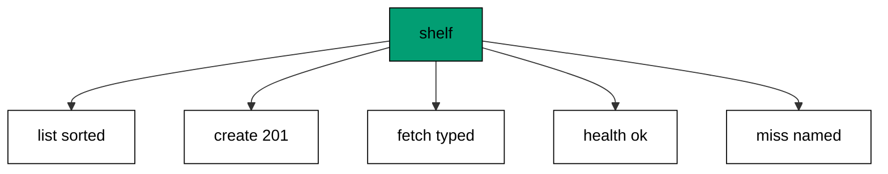

## Why this exists -- the big idea

Every skill in this course was taught in isolation so it could be learned exactly; the capstone proves they compose. An order-tracking service with creation, lookup, validation, errors, and health is the smallest backend worth operating — five routes where each one exercises a different level, and one transcript where they all agree. If the tour previewed the shape, the capstone inhabits it: real rules, real misses, real readiness, and an in-process suite that would catch a regression in any of them.

## What you will build

A five-route order service backed by an in-memory shelf: `GET /orders` lists the seeds sorted, `POST /orders` validates and creates with 201 plus `Location`, `GET /orders/{id}` fetches typed or names its miss, `GET /healthz` answers readiness, and every other path lands in the JSON miss envelope. Two seeded orders keep the suite deterministic; creation starts at id 3 and climbs atomically. Every snippet on this page comes from the capstone code, and every line of the transcript comes from running it — nothing here is described without being shown. Rework any surprising line by rebuilding its example from an empty file before rereading the page. Doing rebuilds the skill; reading only refreshes the memory of it. The transcript is the arbiter: when the page and the output disagree, the output wins and the page follows. The suite drives seven lines: list, valid create, created fetch, unknown fetch, invalid create, health, and the designed miss. The shelf seeds two orders so the very first line has something deterministic to render; creation starts at id 3 because the seeds own 1 and 2, and the atomic counter keeps later creates unique. Validation runs the same two rules the level taught — nonempty items, positive counts — so the capstone inherits the boundary rather than reinventing it.

## How the pieces compose

The shelf registers once as a singleton and serves every route through `GetService` — the dependency level's shape unchanged. Validation sits between binding and success with one rule per check and one error name per failure. Misses share the envelope helper so the 404 for an unknown order and the 404 for an unknown path differ only in their names. Health answers from the same pipeline as content, proving the stack rather than the socket. The checks run the whole service through `TestClient` with no network, the same topology as every example, because the composition under test is the composition that ships.

## Reading the transcript

The seven lines read as a service biography: the seeds list sorted, the clean create lands 201 with its address, the new order serves at that address, the unknown id names its miss, the empty body fails its rule, health stays green, and the envelope closes the service. Statuses do the coarse work and bodies the fine work — 201 announces while `Location` points, 400 names the broken rule, 404 names the absence. Any line that surprises you names the example to revisit; the transcript is the course compressed.

## Testing the service

The suite drives the service the way every example does: build once, start the in-memory host, run the checks through the loopback client, stop cleanly. Seven lines cover the contract end to end — two seeds render sorted, the valid create lands with its pointer, the pointer resolves, the unknown id envelopes, the invalid body fails its rule, health answers, and the fallback closes the service. No line asserts internals: statuses and bytes are the whole vocabulary, so the suite survives refactors that keep behavior. The atomic id assignment keeps creates unique even if the suite grows concurrent, and the sorted listing keeps the transcript byte-stable regardless of map ordering. A suite that reads like this is a specification the team can run: new requirements arrive as new lines, and the seven already here guard every behavior the capstone promises.

## The pinning note

The capstone restores locked and offline like every unit: Giraffe 8.3.0 plus TestHost 10.0.13 with `FSharp.Core` pinned explicitly, `NUGET_CERT_REVOCATION_MODE=offline` with telemetry opt-outs, and the compiled assembly run against the loopback client. The `Location` on creation points at the fetch the suite reads next, so write and read verify each other — the roundtrip the testing level taught, wearing production clothes.



**`learning/capstone/code/Program.fs`**:

```fsharp
module App // => one module owns the whole unit

open System // => String.Join sorts joined output deterministically
open System.Net.Http // => HttpClient drives the service in-process (co-09)
open System.Text // => Encoding names UTF8 for JSON payloads
open System.Threading // => Interlocked and SemaphoreSlim live here (co-07)
open System.Threading.Tasks // => Task.WhenAll fans requests out (co-07)
open Microsoft.AspNetCore.Builder // => WebApplication wires routes to handlers
open Microsoft.AspNetCore.Hosting // => UseTestServer marks the in-memory host
open Microsoft.AspNetCore.Http // => HttpContext carries request and response
open Microsoft.AspNetCore.TestHost // => TestServer serves with no socket (co-09)
open Microsoft.Extensions.DependencyInjection // => AddSingleton registers services (co-06)
open Microsoft.Extensions.Logging // => ClearProviders silences logs (co-13)
open Giraffe // => route, choose, and json live here (co-01)

// => All checks below block on async HTTP with GetAwaiter().GetResult().
// => Main stays synchronous so prints land in request order, and the
// => in-process pipeline answers before the next request leaves.

// => show prints one transcript line with no trailing space.
let show (line: string) = // => every printed line flows through here
    printfn "%s" (line.TrimEnd()) // => TrimEnd keeps empty bodies clean

// => get serves one GET and prints method, path, status, and body.
// => One client drives every check: no per-case construction, no sockets.
let get (client: HttpClient) (path: string) = // => path names the resource
    let resp = client.GetAsync(path).GetAwaiter().GetResult() // => full pipeline runs in-process
    let body = resp.Content.ReadAsStringAsync().GetAwaiter().GetResult() // => the exact bytes written
    show (sprintf "GET %s -> %d %s" path (int resp.StatusCode) (body.Trim())) // => status plus body in one line

// => send serves one arbitrary method and prints status with body.
let send (client: HttpClient) (method: string) (path: string) = // => method plus path name the call
    use request = new HttpRequestMessage(HttpMethod(method), path) // => no body on these calls
    use resp = client.SendAsync(request).GetAwaiter().GetResult() // => the pipeline answers in memory
    let body = resp.Content.ReadAsStringAsync().GetAwaiter().GetResult() // => empty for HEAD and redirects
    show (sprintf "%s %s -> %d %s" method path (int resp.StatusCode) (body.Trim())) // => one line per call

// => postJson serves one JSON POST and prints status with body.
let postJson (client: HttpClient) (path: string) (payload: string) = // => payload is already JSON text
    use content = new StringContent(payload, Encoding.UTF8, "application/json") // => UTF8 names the charset
    use resp = client.PostAsync(path, content).GetAwaiter().GetResult() // => the handler reads the body
    let body = resp.Content.ReadAsStringAsync().GetAwaiter().GetResult() // => the exact bytes written
    show (sprintf "POST %s -> %d %s" path (int resp.StatusCode) (body.Trim())) // => status plus body in one line
// => CapOrder is the capstone's stored order.
[<CLIMutable>] // => binds from POST and renders on GET (co-15)
type CapOrder =
    { id: int // => server-assigned on creation
      item: string // => validated: never empty
      qty: int } // => validated: always positive

// => CapShelf holds the capstone's orders in memory.
type CapShelf() = // => fixed seeds keep the suite deterministic (co-06)
    let items = System.Collections.Concurrent.ConcurrentDictionary<int, CapOrder>() // => id to order
    let mutable nextId = 3 // => seeds own 1 and 2; creates start at 3
    do items.TryAdd(1, { id = 1; item = "book"; qty = 2 }) |> ignore // => first seeded order
    do items.TryAdd(2, { id = 2; item = "pen"; qty = 5 }) |> ignore // => second seeded order
    member _.List() = // => the listing reads back sorted
        items.Values |> Seq.sortBy (fun o -> o.id) |> Seq.toArray
    member _.Get(id: int) = // => typed lookup without exceptions
        match items.TryGetValue(id) with
        | true, order -> Some order // => found carries the order
        | _ -> None // => missing carries nothing
    member _.Create(item: string, qty: int) = // => creation assigns the next id
        let id = System.Threading.Interlocked.Increment(&nextId) - 1 // => atomic: 3, 4, 5 across creates
        let order = { id = id; item = item; qty = qty } // => the stored shape
        items.TryAdd(id, order) |> ignore // => the order lands under its id
        order // => the caller learns the stored order

// => NewCapOrder is the typed shape of the creation body.
[<CLIMutable>] // => two fields the validation judges
type NewCapOrder =
    { item: string // => must name something
      qty: int } // => must count something positive
// => webApp serves the order-tracking service: list, create, fetch, health, miss.
let webApp: HttpHandler = // => five routes, one shelf, validation at the edge
    choose [
        GET >=> route "/orders" >=> fun next ctx ->
            task {
                let shelf = ctx.GetService<CapShelf>() // => the seeded shelf serves
                return! json (shelf.List()) next ctx // => every order renders sorted
            }
        POST >=> route "/orders" >=> fun next ctx ->
            task {
                let! candidate = ctx.BindJsonAsync<NewCapOrder>() // => the candidate binds typed
                if System.String.IsNullOrEmpty(candidate.item) then // => first rule: a real item
                    return! (setStatusCode 400 >=> json {| error = "item-required" |}) next ctx
                elif candidate.qty <= 0 then // => second rule: a real count
                    return! (setStatusCode 400 >=> json {| error = "qty-positive" |}) next ctx
                else // => clean orders land under the next id
                    let shelf = ctx.GetService<CapShelf>() // => the shelf stores
                    let order = shelf.Create(candidate.item, candidate.qty) // => id 3 on the first create
                    return! (setStatusCode 201 >=> setHttpHeader "Location" ("/orders/" + string order.id) >=> json order) next ctx
            }
        GET >=> routef "/orders/%i" (fun id -> // => typed fetch with a named miss
            fun next ctx ->
                task {
                    let shelf = ctx.GetService<CapShelf>() // => the same shelf reads
                    match shelf.Get(id) with // => lookup, not exception
                    | Some order -> return! json order next ctx // => found renders
                    | None -> return! (setStatusCode 404 >=> json {| error = "order-not-found" |}) next ctx
                })
        GET >=> route "/healthz" >=> json {| status = "ok" |} // => readiness answers beside content
        setStatusCode 404 >=> json {| error = "not-found" |} // => the designed miss closes the service
    ]
// => buildApp wires the service every check in this unit exercises.
let buildApp (args: string[]) = // => args carry no flags in this course
    let builder = WebApplication.CreateBuilder(args) // => defaults plus our overrides
    // => Silenced logs keep stdout to printed lines only: golden transcripts
    // => must never contain framework chatter.
    builder.Logging.ClearProviders() |> ignore // => no log lines: only our prints appear
    // => Giraffe's JSON serializer lives in DI: without AddGiraffe the first
    // => json answer throws MissingDependencyException at runtime.
    builder.Services.AddGiraffe() |> ignore // => Giraffe needs its serializer in DI
    builder.Services.AddSingleton<CapShelf>() |> ignore // => one shelf for the service
    builder.WebHost.UseTestServer() |> ignore // => in-memory server: no socket, no port
    let app = builder.Build() // => the pipeline with routing and endpoints
    app.UseGiraffe(webApp) |> ignore // => every request flows through webApp
    app // => hand the wired service back to the caller
// => Top-level entry: build once, check, stop cleanly.
[<EntryPoint>] // => the harness runs the compiled assembly
let main args = // => every unit answers zero on success
    let app = buildApp args // => wiring separate from traffic, as always
    // => StartAsync boots the in-memory host: no socket binds, no port opens,
    // => yet every middleware and route runs exactly as in production.
    app.StartAsync().GetAwaiter().GetResult() // => TestServer starts without any socket
    use client = app.GetTestClient() // => client talks to memory, not the network
    get client "/orders" // => the seeded list renders sorted
    use fresh = new StringContent("""{"item":"ruler","qty":1}""", Encoding.UTF8, "application/json") // => a clean order
    use made = client.PostAsync("/orders", fresh).GetAwaiter().GetResult() // => creation answers 201
    let madeBody = made.Content.ReadAsStringAsync().GetAwaiter().GetResult() // => exact bytes back
    show (sprintf "POST /orders -> %d loc=%s %s" (int made.StatusCode) (string made.Headers.Location) (madeBody.Trim())) // => one line
    get client "/orders/3" // => the created order serves at its address
    get client "/orders/9" // => the unknown id names its miss
    postJson client "/orders" "{}" // => the empty body fails validation
    get client "/healthz" // => readiness answers beside content
    get client "/nope" // => the envelope closes the service
    // => StopAsync drains in-flight requests before releasing the host, so the
    // => checks above always land before the process exits.
    app.StopAsync().GetAwaiter().GetResult() // => stop cleanly: nothing in flight is cut (co-08)
    0 // => zero exit means the transcript matched
```

**Output** (`learning/capstone/code/expected/main/main.stdout.txt`):

```text
GET /orders -> 200 [{"id":1,"item":"book","qty":2},{"id":2,"item":"pen","qty":5}]
POST /orders -> 201 loc=/orders/3 {"id":3,"item":"ruler","qty":1}
GET /orders/3 -> 200 {"id":3,"item":"ruler","qty":1}
GET /orders/9 -> 404 {"error":"order-not-found"}
POST /orders -> 400 {"error":"item-required"}
GET /healthz -> 200 {"status":"ok"}
GET /nope -> 404 {"error":"not-found"}
```

## References

- [Giraffe documentation](https://github.com/giraffe-fsharp/Giraffe) — handlers, routing, and error handling behind the service. Accessed 2026-10-24.
- [ASP.NET Core integration tests with TestServer](https://learn.microsoft.com/en-us/aspnet/core/test/integration-tests) — the in-process suite topology. Accessed 2026-10-24.
- [backend-essentials](/en/learn/courses/backend-essentials) — the task-API capstone this service mirrors in shape: health, CRUD, validation, envelope, in-process suite. Accessed 2026-10-24.
