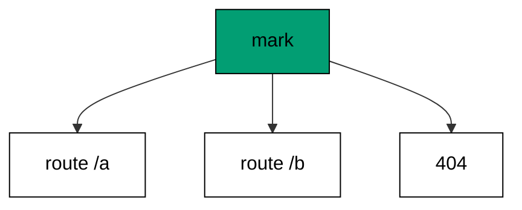
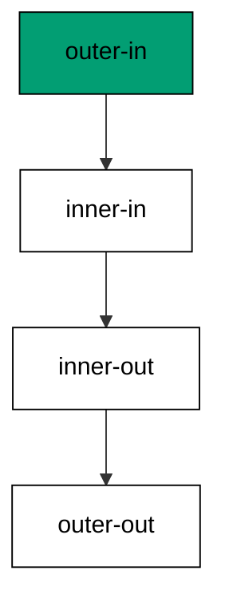
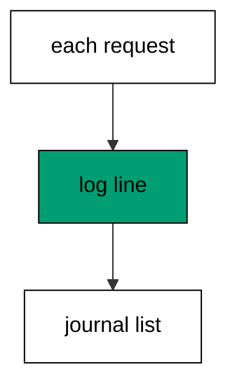
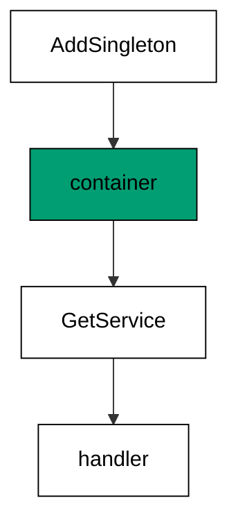
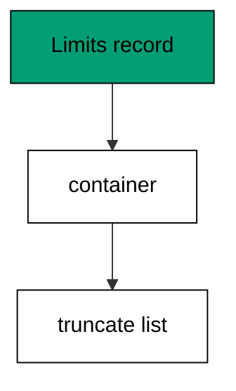
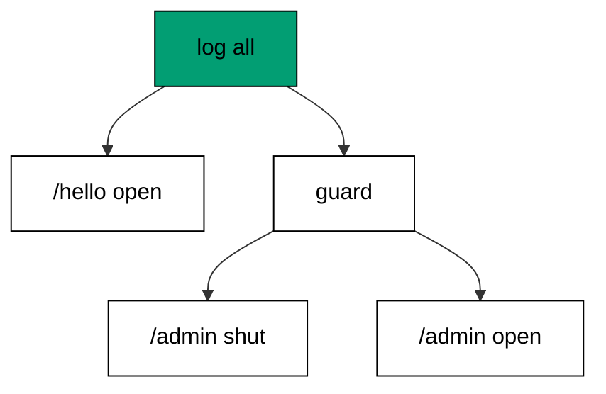
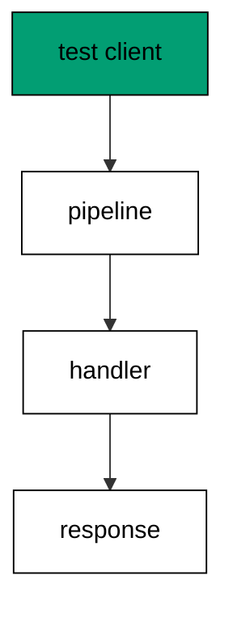
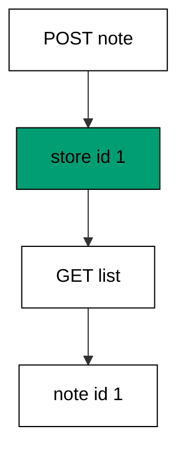
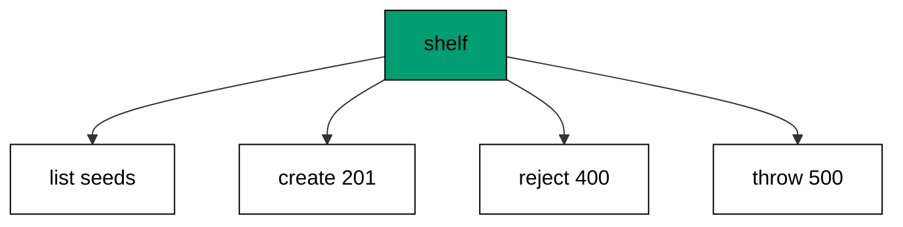

Examples 26–53 wrap the beginner tables in behavior: middleware that stamps guards and logs, services that carry state through the container, and checks that drive everything without a network. Three clusters carry the level: middleware and error handling around every route (Examples 26–34), dependency injection from singletons to missing registrations (Examples 35–44), and testing habits from tables to fakes (Examples 45–53). Reviews close the dependency and testing clusters by composing their skills into one service.

### Example 26: Middleware Wraps Every Request

Middleware runs around every handler, and this example stamps each response with an `X-Marked` header through one wrapper. The program reads the stamp back on two routes and the fallback. (Concepts: co-02.)



A middleware is a handler that takes the next handler: `mark` receives `next`, stamps the response, and calls `next ctx` to continue inward. Composing it with `>=>` in front of the table wraps every branch at once — no route opts in, and none can opt out. That totality is the point: cross-cutting behavior must be impossible to forget for one route, or it will be forgotten for exactly the route that needed it.

Stamping the fallback too is deliberate: misses are responses, and a header policy with holes teaches clients to distrust it. The checks read the header back through the client's eyes rather than asserting server-side state, because middleware exists for the wire, not for the process. What the client cannot observe might as well not exist — observability is the contract middleware signs.

**`learning/code/ex-26-middleware-wraps-every-request/Program.fs`**:

```fsharp
module App // => one module owns the whole unit

open System // => String.Join sorts joined output deterministically
open System.Net.Http // => HttpClient drives the service in-process (co-09)
open System.Text // => Encoding names UTF8 for JSON payloads
open System.Threading // => Interlocked and SemaphoreSlim live here (co-07)
open System.Threading.Tasks // => Task.WhenAll fans requests out (co-07)
open Microsoft.AspNetCore.Builder // => WebApplication wires routes to handlers
open Microsoft.AspNetCore.Hosting // => UseTestServer marks the in-memory host
open Microsoft.AspNetCore.Http // => HttpContext carries request and response
open Microsoft.AspNetCore.TestHost // => TestServer serves with no socket (co-09)
open Microsoft.Extensions.DependencyInjection // => AddSingleton registers services (co-06)
open Microsoft.Extensions.Logging // => ClearProviders silences logs (co-13)
open Giraffe // => route, choose, and json live here (co-01)

// => All checks below block on async HTTP with GetAwaiter().GetResult().
// => Main stays synchronous so prints land in request order, and the
// => in-process pipeline answers before the next request leaves.

// => show prints one transcript line with no trailing space.
let show (line: string) = // => every printed line flows through here
    printfn "%s" (line.TrimEnd()) // => TrimEnd keeps empty bodies clean

// => get serves one GET and prints method, path, status, and body.
// => One client drives every check: no per-case construction, no sockets.
let get (client: HttpClient) (path: string) = // => path names the resource
    let resp = client.GetAsync(path).GetAwaiter().GetResult() // => full pipeline runs in-process
    let body = resp.Content.ReadAsStringAsync().GetAwaiter().GetResult() // => the exact bytes written
    show (sprintf "GET %s -> %d %s" path (int resp.StatusCode) (body.Trim())) // => status plus body in one line

// => send serves one arbitrary method and prints status with body.
let send (client: HttpClient) (method: string) (path: string) = // => method plus path name the call
    use request = new HttpRequestMessage(HttpMethod(method), path) // => no body on these calls
    use resp = client.SendAsync(request).GetAwaiter().GetResult() // => the pipeline answers in memory
    let body = resp.Content.ReadAsStringAsync().GetAwaiter().GetResult() // => empty for HEAD and redirects
    show (sprintf "%s %s -> %d %s" method path (int resp.StatusCode) (body.Trim())) // => one line per call

// => postJson serves one JSON POST and prints status with body.
let postJson (client: HttpClient) (path: string) (payload: string) = // => payload is already JSON text
    use content = new StringContent(payload, Encoding.UTF8, "application/json") // => UTF8 names the charset
    use resp = client.PostAsync(path, content).GetAwaiter().GetResult() // => the handler reads the body
    let body = resp.Content.ReadAsStringAsync().GetAwaiter().GetResult() // => the exact bytes written
    show (sprintf "POST %s -> %d %s" path (int resp.StatusCode) (body.Trim())) // => status plus body in one line
// => mark stamps every response with one header.
let mark: HttpHandler = // => middleware is a handler that calls next (co-02)
    fun next ctx ->
        task {
            ctx.Response.Headers.Append("X-Marked", Microsoft.Extensions.Primitives.StringValues("yes")) // => the stamp rides every answer
            return! next ctx // => always continue inward
        }

// => webApp wraps the whole table in the stamp.
let webApp: HttpHandler = // => composition applies the middleware (co-02)
    mark >=> choose [ // => every branch below runs stamped
        route "/a" >=> text "a" // => first stamped route
        route "/b" >=> text "b" // => second stamped route
        setStatusCode 404 >=> text "Not Found" // => the fallback is stamped too
    ]
// => buildApp wires the service every check in this unit exercises.
let buildApp (args: string[]) = // => args carry no flags in this course
    let builder = WebApplication.CreateBuilder(args) // => defaults plus our overrides
    // => Silenced logs keep stdout to printed lines only: golden transcripts
    // => must never contain framework chatter.
    builder.Logging.ClearProviders() |> ignore // => no log lines: only our prints appear
    // => Giraffe's JSON serializer lives in DI: without AddGiraffe the first
    // => json answer throws MissingDependencyException at runtime.
    builder.Services.AddGiraffe() |> ignore // => Giraffe needs its serializer in DI
    builder.WebHost.UseTestServer() |> ignore // => in-memory server: no socket, no port
    let app = builder.Build() // => the pipeline with routing and endpoints
    app.UseGiraffe(webApp) |> ignore // => every request flows through webApp
    app // => hand the wired service back to the caller
// => Top-level entry: build once, check, stop cleanly.
[<EntryPoint>] // => the harness runs the compiled assembly
let main args = // => every unit answers zero on success
    let app = buildApp args // => wiring separate from traffic, as always
    // => StartAsync boots the in-memory host: no socket binds, no port opens,
    // => yet every middleware and route runs exactly as in production.
    app.StartAsync().GetAwaiter().GetResult() // => TestServer starts without any socket
    use client = app.GetTestClient() // => client talks to memory, not the network
    let marked (path: string) = // => marked reads the stamp back too
        let resp = client.GetAsync(path).GetAwaiter().GetResult() // => the pipeline answers stamped
        let body = resp.Content.ReadAsStringAsync().GetAwaiter().GetResult() // => exact bytes back
        let stamp = // => the stamp header or its absence
            if resp.Headers.Contains("X-Marked") then resp.Headers.GetValues("X-Marked") |> Seq.head
            else "absent"
        show (sprintf "GET %s -> %d marked=%s %s" path (int resp.StatusCode) stamp (body.Trim())) // => one line
    marked "/a" // => the stamped route answers
    marked "/b" // => the sibling is stamped too
    marked "/nope" // => the fallback carries the stamp as well
    // => StopAsync drains in-flight requests before releasing the host, so the
    // => checks above always land before the process exits.
    app.StopAsync().GetAwaiter().GetResult() // => stop cleanly: nothing in flight is cut (co-08)
    0 // => zero exit means the transcript matched
```

**Output** (`learning/code/ex-26-middleware-wraps-every-request/expected/main.stdout.txt`):

```text
GET /a -> 200 marked=yes a
GET /b -> 200 marked=yes b
GET /nope -> 404 marked=yes Not Found
```

**Key takeaway**: Middleware is a handler around handlers: stamp, then call next, and compose it in front of the whole table.

**Why it matters**: Cross-cutting wrappers keep route handlers focused on their one job: business logic stays in the branches while stamping, timing, and auth live in layers around them. Without the pattern, every handler reimplements the same five lines, and the sixth copy drifts. With it, one wrapper changes the behavior of the entire service in a single edit — the highest-leverage line a backend author writes. Total coverage, including the fallback, is what makes the guarantee trustworthy instead of decorative.

### Example 27: Short-Circuit Stops the Chain

Middleware can also stop the chain, and this example's gate answers 403 for requests without the right key. The program shows the rejection and two guarded successes. (Concepts: co-02.)

Short-circuiting means not calling `next`: the gate answers 403 directly, so the guarded branches never run for strangers. The query key is a teaching stand-in for any credential — tokens, signatures, and client certificates all reduce to a check with two exits. Putting the check in a wrapper instead of each handler means the policy has one implementation, and one implementation can be reviewed, tested, and hardened in a single place.

Wrapping the whole table guards the fallback too, which teaches placement honesty: a guard around everything denies even the miss to strangers. Real services often guard only branches — the next example does exactly that — but understanding total guarding first makes the selective version a conscious narrowing rather than an accident. The 403 carries a body on purpose: silent denials confuse legitimate clients, while named ones tell them what to fix.

**`learning/code/ex-27-short-circuit-stops-the-chain/Program.fs`**:

```fsharp
module App // => one module owns the whole unit

open System // => String.Join sorts joined output deterministically
open System.Net.Http // => HttpClient drives the service in-process (co-09)
open System.Text // => Encoding names UTF8 for JSON payloads
open System.Threading // => Interlocked and SemaphoreSlim live here (co-07)
open System.Threading.Tasks // => Task.WhenAll fans requests out (co-07)
open Microsoft.AspNetCore.Builder // => WebApplication wires routes to handlers
open Microsoft.AspNetCore.Hosting // => UseTestServer marks the in-memory host
open Microsoft.AspNetCore.Http // => HttpContext carries request and response
open Microsoft.AspNetCore.TestHost // => TestServer serves with no socket (co-09)
open Microsoft.Extensions.DependencyInjection // => AddSingleton registers services (co-06)
open Microsoft.Extensions.Logging // => ClearProviders silences logs (co-13)
open Giraffe // => route, choose, and json live here (co-01)

// => All checks below block on async HTTP with GetAwaiter().GetResult().
// => Main stays synchronous so prints land in request order, and the
// => in-process pipeline answers before the next request leaves.

// => show prints one transcript line with no trailing space.
let show (line: string) = // => every printed line flows through here
    printfn "%s" (line.TrimEnd()) // => TrimEnd keeps empty bodies clean

// => get serves one GET and prints method, path, status, and body.
// => One client drives every check: no per-case construction, no sockets.
let get (client: HttpClient) (path: string) = // => path names the resource
    let resp = client.GetAsync(path).GetAwaiter().GetResult() // => full pipeline runs in-process
    let body = resp.Content.ReadAsStringAsync().GetAwaiter().GetResult() // => the exact bytes written
    show (sprintf "GET %s -> %d %s" path (int resp.StatusCode) (body.Trim())) // => status plus body in one line

// => send serves one arbitrary method and prints status with body.
let send (client: HttpClient) (method: string) (path: string) = // => method plus path name the call
    use request = new HttpRequestMessage(HttpMethod(method), path) // => no body on these calls
    use resp = client.SendAsync(request).GetAwaiter().GetResult() // => the pipeline answers in memory
    let body = resp.Content.ReadAsStringAsync().GetAwaiter().GetResult() // => empty for HEAD and redirects
    show (sprintf "%s %s -> %d %s" method path (int resp.StatusCode) (body.Trim())) // => one line per call

// => postJson serves one JSON POST and prints status with body.
let postJson (client: HttpClient) (path: string) (payload: string) = // => payload is already JSON text
    use content = new StringContent(payload, Encoding.UTF8, "application/json") // => UTF8 names the charset
    use resp = client.PostAsync(path, content).GetAwaiter().GetResult() // => the handler reads the body
    let body = resp.Content.ReadAsStringAsync().GetAwaiter().GetResult() // => the exact bytes written
    show (sprintf "POST %s -> %d %s" path (int resp.StatusCode) (body.Trim())) // => status plus body in one line
// => gate short-circuits requests without the right key.
let gate: HttpHandler = // => middleware may answer instead of continuing (co-02)
    fun next ctx ->
        task {
            match ctx.TryGetQueryStringValue "key" with // => the key decides
            | Some "s3cr3t" -> return! next ctx // => the right key continues inward
            | _ -> return! (setStatusCode 403 >=> text "forbidden") next ctx // => anything else stops here
        }

// => webApp guards everything behind the key check.
let webApp: HttpHandler = // => the guard wraps what it protects
    gate >=> choose [ // => every branch below needs the key
        route "/vault" >=> text "gold" // => the guarded treasure
        route "/door" >=> text "wood" // => guarded too: the gate wraps the table
        setStatusCode 404 >=> text "Not Found" // => misses without a key stop at 403
    ]
// => buildApp wires the service every check in this unit exercises.
let buildApp (args: string[]) = // => args carry no flags in this course
    let builder = WebApplication.CreateBuilder(args) // => defaults plus our overrides
    // => Silenced logs keep stdout to printed lines only: golden transcripts
    // => must never contain framework chatter.
    builder.Logging.ClearProviders() |> ignore // => no log lines: only our prints appear
    // => Giraffe's JSON serializer lives in DI: without AddGiraffe the first
    // => json answer throws MissingDependencyException at runtime.
    builder.Services.AddGiraffe() |> ignore // => Giraffe needs its serializer in DI
    builder.WebHost.UseTestServer() |> ignore // => in-memory server: no socket, no port
    let app = builder.Build() // => the pipeline with routing and endpoints
    app.UseGiraffe(webApp) |> ignore // => every request flows through webApp
    app // => hand the wired service back to the caller
// => Top-level entry: build once, check, stop cleanly.
[<EntryPoint>] // => the harness runs the compiled assembly
let main args = // => every unit answers zero on success
    let app = buildApp args // => wiring separate from traffic, as always
    // => StartAsync boots the in-memory host: no socket binds, no port opens,
    // => yet every middleware and route runs exactly as in production.
    app.StartAsync().GetAwaiter().GetResult() // => TestServer starts without any socket
    use client = app.GetTestClient() // => client talks to memory, not the network
    get client "/vault" // => no key means the gate answers
    get client "/vault?key=s3cr3t" // => the right key reaches the treasure
    get client "/door?key=s3cr3t" // => the sibling is guarded the same way
    // => StopAsync drains in-flight requests before releasing the host, so the
    // => checks above always land before the process exits.
    app.StopAsync().GetAwaiter().GetResult() // => stop cleanly: nothing in flight is cut (co-08)
    0 // => zero exit means the transcript matched
```

**Output** (`learning/code/ex-27-short-circuit-stops-the-chain/expected/main.stdout.txt`):

```text
GET /vault -> 403 forbidden
GET /vault?key=s3cr3t -> 200 gold
GET /door?key=s3cr3t -> 200 wood
```

**Key takeaway**: A guard answers instead of continuing: check the credential, call next only for holders, name the denial.

**Why it matters**: Short-circuiting at the edge protects everything behind it with one check instead of thirty: unauthenticated traffic never reaches business logic, databases, or downstream calls it has no right to trigger. That single chokepoint is also where rate limiting, audit logging, and credential rotation land later — each new control wraps the same narrow waist. Services that check credentials inside handlers scatter the policy until one branch forgets, and forgotten branches are how breaches happen.

### Example 28: Middleware Order Is Outer to Inner

Wrapped middleware runs outside-in and unwinds inside-out, and this example records that order in a list. The program serves one request and prints the four recorded steps. (Concepts: co-02.)



Composition order is execution order: `outer >=> inner` runs outer's entry first because outer receives the request first, and outer's exit last because inner must return before outer can finish. The recorded list — outer-in, inner-in, inner-out, outer-out — is the onion every middleware stack shares, and seeing it printed once beats imagining it forever. Entry code runs top down; exit code runs bottom up; the response travels both ways.

Recording into a shared list works here because the checks run sequentially: one request, then the print, with no concurrency to interleave entries. Real services log rather than append, but the ordering law is identical — and order matters most when something fails, because the exit steps that never ran name the layer that broke. Passing `result` through untouched keeps the recorder honest: observation must never change the observed answer.

**`learning/code/ex-28-middleware-order-is-outer-to-inner/Program.fs`**:

```fsharp
module App // => one module owns the whole unit

open System // => String.Join sorts joined output deterministically
open System.Net.Http // => HttpClient drives the service in-process (co-09)
open System.Text // => Encoding names UTF8 for JSON payloads
open System.Threading // => Interlocked and SemaphoreSlim live here (co-07)
open System.Threading.Tasks // => Task.WhenAll fans requests out (co-07)
open Microsoft.AspNetCore.Builder // => WebApplication wires routes to handlers
open Microsoft.AspNetCore.Hosting // => UseTestServer marks the in-memory host
open Microsoft.AspNetCore.Http // => HttpContext carries request and response
open Microsoft.AspNetCore.TestHost // => TestServer serves with no socket (co-09)
open Microsoft.Extensions.DependencyInjection // => AddSingleton registers services (co-06)
open Microsoft.Extensions.Logging // => ClearProviders silences logs (co-13)
open Giraffe // => route, choose, and json live here (co-01)

// => All checks below block on async HTTP with GetAwaiter().GetResult().
// => Main stays synchronous so prints land in request order, and the
// => in-process pipeline answers before the next request leaves.

// => show prints one transcript line with no trailing space.
let show (line: string) = // => every printed line flows through here
    printfn "%s" (line.TrimEnd()) // => TrimEnd keeps empty bodies clean

// => get serves one GET and prints method, path, status, and body.
// => One client drives every check: no per-case construction, no sockets.
let get (client: HttpClient) (path: string) = // => path names the resource
    let resp = client.GetAsync(path).GetAwaiter().GetResult() // => full pipeline runs in-process
    let body = resp.Content.ReadAsStringAsync().GetAwaiter().GetResult() // => the exact bytes written
    show (sprintf "GET %s -> %d %s" path (int resp.StatusCode) (body.Trim())) // => status plus body in one line

// => send serves one arbitrary method and prints status with body.
let send (client: HttpClient) (method: string) (path: string) = // => method plus path name the call
    use request = new HttpRequestMessage(HttpMethod(method), path) // => no body on these calls
    use resp = client.SendAsync(request).GetAwaiter().GetResult() // => the pipeline answers in memory
    let body = resp.Content.ReadAsStringAsync().GetAwaiter().GetResult() // => empty for HEAD and redirects
    show (sprintf "%s %s -> %d %s" method path (int resp.StatusCode) (body.Trim())) // => one line per call

// => postJson serves one JSON POST and prints status with body.
let postJson (client: HttpClient) (path: string) (payload: string) = // => payload is already JSON text
    use content = new StringContent(payload, Encoding.UTF8, "application/json") // => UTF8 names the charset
    use resp = client.PostAsync(path, content).GetAwaiter().GetResult() // => the handler reads the body
    let body = resp.Content.ReadAsStringAsync().GetAwaiter().GetResult() // => the exact bytes written
    show (sprintf "POST %s -> %d %s" path (int resp.StatusCode) (body.Trim())) // => status plus body in one line
// => steps records entry and exit in pipeline order.
let steps = System.Collections.Generic.List<string>() // => a plain list: checks run sequentially
// => tag records entry and exit around whatever it wraps.
let tag (name: string): HttpHandler = // => the name tells the layers apart (co-02)
    fun next ctx ->
        task {
            steps.Add(name + "-in") // => entry appends before continuing
            let! result = next ctx // => the inner pipeline runs here
            steps.Add(name + "-out") // => exit appends after it returns
            return result // => the inner answer passes through untouched
        }

// => webApp nests two recorders outside the routes.
let webApp: HttpHandler = // => outer composes first, runs first
    tag "outer" >=> tag "inner" >=> choose [ // => nesting reads outside-in
        route "/x" >=> text "x" // => the innermost content
        setStatusCode 404 >=> text "Not Found" // => misses record too
    ]
// => buildApp wires the service every check in this unit exercises.
let buildApp (args: string[]) = // => args carry no flags in this course
    let builder = WebApplication.CreateBuilder(args) // => defaults plus our overrides
    // => Silenced logs keep stdout to printed lines only: golden transcripts
    // => must never contain framework chatter.
    builder.Logging.ClearProviders() |> ignore // => no log lines: only our prints appear
    // => Giraffe's JSON serializer lives in DI: without AddGiraffe the first
    // => json answer throws MissingDependencyException at runtime.
    builder.Services.AddGiraffe() |> ignore // => Giraffe needs its serializer in DI
    builder.WebHost.UseTestServer() |> ignore // => in-memory server: no socket, no port
    let app = builder.Build() // => the pipeline with routing and endpoints
    app.UseGiraffe(webApp) |> ignore // => every request flows through webApp
    app // => hand the wired service back to the caller
// => Top-level entry: build once, check, stop cleanly.
[<EntryPoint>] // => the harness runs the compiled assembly
let main args = // => every unit answers zero on success
    let app = buildApp args // => wiring separate from traffic, as always
    // => StartAsync boots the in-memory host: no socket binds, no port opens,
    // => yet every middleware and route runs exactly as in production.
    app.StartAsync().GetAwaiter().GetResult() // => TestServer starts without any socket
    use client = app.GetTestClient() // => client talks to memory, not the network
    get client "/x" // => one request through both layers
    show (sprintf "steps=%s" (System.String.Join(",", steps))) // => entry and exit in pipeline order
    // => StopAsync drains in-flight requests before releasing the host, so the
    // => checks above always land before the process exits.
    app.StopAsync().GetAwaiter().GetResult() // => stop cleanly: nothing in flight is cut (co-08)
    0 // => zero exit means the transcript matched
```

**Output** (`learning/code/ex-28-middleware-order-is-outer-to-inner/expected/main.stdout.txt`):

```text
GET /x -> 200 x
steps=outer-in,inner-in,inner-out,outer-out
```

**Key takeaway**: Outer layers enter first and exit last: record entry before next, exit after, and pass the result through.

**Why it matters**: Onion ordering is the mental model behind every middleware mystery: a header set by the outer layer survives the inner one, an exception thrown inside unwinds through every exit step, and a short-circuit skips all inner entries at once. Engineers who can draw the onion debug auth and logging issues in minutes; engineers who cannot stare at five identical wrappers wondering which ran. One printed list, studied once, pays for itself at every future 3 a.m. incident involving the pipeline.

### Example 29: Exception Handler Turns Throws into 500

Unhandled throws must not escape as empty 500s, and this example registers an error handler that names the failure. The program throws on one route and serves its neighbor normally. (Concepts: co-05.)

`UseGiraffeErrorHandler` registers the last line of defense: any exception a handler throws lands in `oops` instead of killing the process or leaking a stack trace. The handler receives the exception and a logger, and returns an ordinary composed answer — status plus body, like everything else in the course. Keeping the failure inside the same response contract means clients parse one shape whether the handler succeeded or exploded.

Naming the failure with the exception message is a teaching choice, not production advice: real services log the full exception server-side and return an opaque id, because messages leak internals. The neighbor route proves the process survives — one throw does not poison the host, the table, or the next request. That survival is the actual guarantee being bought: handlers may fail, but the service must not.

**`learning/code/ex-29-exception-handler-turns-throws-into-500/Program.fs`**:

```fsharp
module App // => one module owns the whole unit

open System // => String.Join sorts joined output deterministically
open System.Net.Http // => HttpClient drives the service in-process (co-09)
open System.Text // => Encoding names UTF8 for JSON payloads
open System.Threading // => Interlocked and SemaphoreSlim live here (co-07)
open System.Threading.Tasks // => Task.WhenAll fans requests out (co-07)
open Microsoft.AspNetCore.Builder // => WebApplication wires routes to handlers
open Microsoft.AspNetCore.Hosting // => UseTestServer marks the in-memory host
open Microsoft.AspNetCore.Http // => HttpContext carries request and response
open Microsoft.AspNetCore.TestHost // => TestServer serves with no socket (co-09)
open Microsoft.Extensions.DependencyInjection // => AddSingleton registers services (co-06)
open Microsoft.Extensions.Logging // => ClearProviders silences logs (co-13)
open Giraffe // => route, choose, and json live here (co-01)

// => All checks below block on async HTTP with GetAwaiter().GetResult().
// => Main stays synchronous so prints land in request order, and the
// => in-process pipeline answers before the next request leaves.

// => show prints one transcript line with no trailing space.
let show (line: string) = // => every printed line flows through here
    printfn "%s" (line.TrimEnd()) // => TrimEnd keeps empty bodies clean

// => get serves one GET and prints method, path, status, and body.
// => One client drives every check: no per-case construction, no sockets.
let get (client: HttpClient) (path: string) = // => path names the resource
    let resp = client.GetAsync(path).GetAwaiter().GetResult() // => full pipeline runs in-process
    let body = resp.Content.ReadAsStringAsync().GetAwaiter().GetResult() // => the exact bytes written
    show (sprintf "GET %s -> %d %s" path (int resp.StatusCode) (body.Trim())) // => status plus body in one line

// => send serves one arbitrary method and prints status with body.
let send (client: HttpClient) (method: string) (path: string) = // => method plus path name the call
    use request = new HttpRequestMessage(HttpMethod(method), path) // => no body on these calls
    use resp = client.SendAsync(request).GetAwaiter().GetResult() // => the pipeline answers in memory
    let body = resp.Content.ReadAsStringAsync().GetAwaiter().GetResult() // => empty for HEAD and redirects
    show (sprintf "%s %s -> %d %s" method path (int resp.StatusCode) (body.Trim())) // => one line per call

// => postJson serves one JSON POST and prints status with body.
let postJson (client: HttpClient) (path: string) (payload: string) = // => payload is already JSON text
    use content = new StringContent(payload, Encoding.UTF8, "application/json") // => UTF8 names the charset
    use resp = client.PostAsync(path, content).GetAwaiter().GetResult() // => the handler reads the body
    let body = resp.Content.ReadAsStringAsync().GetAwaiter().GetResult() // => the exact bytes written
    show (sprintf "POST %s -> %d %s" path (int resp.StatusCode) (body.Trim())) // => status plus body in one line
// => oops turns any exception into a named 500.
let oops (exn: exn) (_: Microsoft.Extensions.Logging.ILogger): HttpHandler = // => the error-handler signature (co-05)
    setStatusCode 500 >=> text ("oops:" + exn.Message) // => named failure, no stack leak
// => webApp throws on one route and serves on its neighbor.
let webApp: HttpHandler = // => the handler in buildApp catches the throw
    choose [
        route "/boom" >=> fun _ _ -> failwith "bang" // => the throw tests the handler
        route "/fine" >=> text "fine" // => the neighbor keeps serving
        setStatusCode 404 >=> text "Not Found" // => misses stay plain
    ]
// => buildApp wires the service every check in this unit exercises.
let buildApp (args: string[]) = // => args carry no flags in this course
    let builder = WebApplication.CreateBuilder(args) // => defaults plus our overrides
    // => Silenced logs keep stdout to printed lines only: golden transcripts
    // => must never contain framework chatter.
    builder.Logging.ClearProviders() |> ignore // => no log lines: only our prints appear
    // => Giraffe's JSON serializer lives in DI: without AddGiraffe the first
    // => json answer throws MissingDependencyException at runtime.
    builder.Services.AddGiraffe() |> ignore // => Giraffe needs its serializer in DI
    builder.WebHost.UseTestServer() |> ignore // => in-memory server: no socket, no port
    let app = builder.Build() // => the pipeline with routing and endpoints
    app.UseGiraffeErrorHandler(oops) |> ignore // => every throw lands in oops
    app.UseGiraffe(webApp) |> ignore // => every request flows through webApp
    app // => hand the wired service back to the caller
// => Top-level entry: build once, check, stop cleanly.
[<EntryPoint>] // => the harness runs the compiled assembly
let main args = // => every unit answers zero on success
    let app = buildApp args // => wiring separate from traffic, as always
    // => StartAsync boots the in-memory host: no socket binds, no port opens,
    // => yet every middleware and route runs exactly as in production.
    app.StartAsync().GetAwaiter().GetResult() // => TestServer starts without any socket
    use client = app.GetTestClient() // => client talks to memory, not the network
    get client "/boom" // => the throw becomes a named 500
    get client "/fine" // => the neighbor is unaffected
    // => StopAsync drains in-flight requests before releasing the host, so the
    // => checks above always land before the process exits.
    app.StopAsync().GetAwaiter().GetResult() // => stop cleanly: nothing in flight is cut (co-08)
    0 // => zero exit means the transcript matched
```

**Output** (`learning/code/ex-29-exception-handler-turns-throws-into-500/expected/main.stdout.txt`):

```text
GET /boom -> 500 oops:bang
GET /fine -> 200 fine
```

**Key takeaway**: Register one error handler that turns every throw into a status plus a named body, and keep serving the neighbors.

**Why it matters**: A global error handler is the difference between a bad request and a dead process: without it, one unexpected null ends the service for every client at once. With it, the failure becomes one more response — counted, loggable, and shaped like every other error the course teaches. The discipline compounds with the envelope lesson: once every failure flows through one function, that function can add trace ids, metrics, and alerting in a single edit. Resilience is a funnel, and this handler is its narrow end.

### Example 30: Status Code Pages Fill Empty Bodies

Bodiless error statuses confuse clients, and this example fills them with a JSON envelope through status-code pages. The program shows an untouched success, a filled 410, and a filled routing miss. (Concepts: co-05.)

`UseStatusCodePagesWithReExecute` watches for error statuses with empty bodies and re-runs the pipeline at `/status/{code}` when it finds one. The fill route renders the same envelope for every code, so a bare `setStatusCode 410` and a routing miss both arrive as JSON with a status field. Responses that already carry bodies pass through untouched — the middleware only speaks where nobody else did.

The re-execution travels the Giraffe table like any request, which is why the fill route lives inside the same `choose`: no second pipeline, no special casing. Keeping the envelope route beside the routes it serves makes the policy visible — readers see the fill shape without hunting through startup code. One middleware plus one route closes the last hole in the response contract: no error goes home without a body.

**`learning/code/ex-30-status-code-pages-fill-empty-bodies/Program.fs`**:

```fsharp
module App // => one module owns the whole unit

open System // => String.Join sorts joined output deterministically
open System.Net.Http // => HttpClient drives the service in-process (co-09)
open System.Text // => Encoding names UTF8 for JSON payloads
open System.Threading // => Interlocked and SemaphoreSlim live here (co-07)
open System.Threading.Tasks // => Task.WhenAll fans requests out (co-07)
open Microsoft.AspNetCore.Builder // => WebApplication wires routes to handlers
open Microsoft.AspNetCore.Hosting // => UseTestServer marks the in-memory host
open Microsoft.AspNetCore.Http // => HttpContext carries request and response
open Microsoft.AspNetCore.TestHost // => TestServer serves with no socket (co-09)
open Microsoft.Extensions.DependencyInjection // => AddSingleton registers services (co-06)
open Microsoft.Extensions.Logging // => ClearProviders silences logs (co-13)
open Giraffe // => route, choose, and json live here (co-01)

// => All checks below block on async HTTP with GetAwaiter().GetResult().
// => Main stays synchronous so prints land in request order, and the
// => in-process pipeline answers before the next request leaves.

// => show prints one transcript line with no trailing space.
let show (line: string) = // => every printed line flows through here
    printfn "%s" (line.TrimEnd()) // => TrimEnd keeps empty bodies clean

// => get serves one GET and prints method, path, status, and body.
// => One client drives every check: no per-case construction, no sockets.
let get (client: HttpClient) (path: string) = // => path names the resource
    let resp = client.GetAsync(path).GetAwaiter().GetResult() // => full pipeline runs in-process
    let body = resp.Content.ReadAsStringAsync().GetAwaiter().GetResult() // => the exact bytes written
    show (sprintf "GET %s -> %d %s" path (int resp.StatusCode) (body.Trim())) // => status plus body in one line

// => send serves one arbitrary method and prints status with body.
let send (client: HttpClient) (method: string) (path: string) = // => method plus path name the call
    use request = new HttpRequestMessage(HttpMethod(method), path) // => no body on these calls
    use resp = client.SendAsync(request).GetAwaiter().GetResult() // => the pipeline answers in memory
    let body = resp.Content.ReadAsStringAsync().GetAwaiter().GetResult() // => empty for HEAD and redirects
    show (sprintf "%s %s -> %d %s" method path (int resp.StatusCode) (body.Trim())) // => one line per call

// => postJson serves one JSON POST and prints status with body.
let postJson (client: HttpClient) (path: string) (payload: string) = // => payload is already JSON text
    use content = new StringContent(payload, Encoding.UTF8, "application/json") // => UTF8 names the charset
    use resp = client.PostAsync(path, content).GetAwaiter().GetResult() // => the handler reads the body
    let body = resp.Content.ReadAsStringAsync().GetAwaiter().GetResult() // => the exact bytes written
    show (sprintf "POST %s -> %d %s" path (int resp.StatusCode) (body.Trim())) // => status plus body in one line
// => webApp leaves one status bodiless so the pages fill it.
let webApp: HttpHandler = // => empty error statuses get a second chance (co-05)
    choose [
        route "/ok" >=> text "fine" // => bodies present pass through untouched
        route "/gone" >=> setStatusCode 410 // => no body: the pages middleware fills it
        routef "/status/%i" (fun code -> // => the fill target renders the envelope
            setStatusCode code >=> json {| status = code |}) // => one envelope for every code
    ]
// => buildApp wires the service every check in this unit exercises.
let buildApp (args: string[]) = // => args carry no flags in this course
    let builder = WebApplication.CreateBuilder(args) // => defaults plus our overrides
    // => Silenced logs keep stdout to printed lines only: golden transcripts
    // => must never contain framework chatter.
    builder.Logging.ClearProviders() |> ignore // => no log lines: only our prints appear
    // => Giraffe's JSON serializer lives in DI: without AddGiraffe the first
    // => json answer throws MissingDependencyException at runtime.
    builder.Services.AddGiraffe() |> ignore // => Giraffe needs its serializer in DI
    builder.WebHost.UseTestServer() |> ignore // => in-memory server: no socket, no port
    let app = builder.Build() // => the pipeline with routing and endpoints
    app.UseStatusCodePagesWithReExecute("/status/{0}") |> ignore // => empty errors re-execute the fill route
    app.UseGiraffe(webApp) |> ignore // => every request flows through webApp
    app // => hand the wired service back to the caller
// => Top-level entry: build once, check, stop cleanly.
[<EntryPoint>] // => the harness runs the compiled assembly
let main args = // => every unit answers zero on success
    let app = buildApp args // => wiring separate from traffic, as always
    // => StartAsync boots the in-memory host: no socket binds, no port opens,
    // => yet every middleware and route runs exactly as in production.
    app.StartAsync().GetAwaiter().GetResult() // => TestServer starts without any socket
    use client = app.GetTestClient() // => client talks to memory, not the network
    get client "/ok" // => the bodied answer passes through
    get client "/gone" // => the bodiless 410 gets its envelope
    get client "/missing" // => routing misses get envelopes too
    // => StopAsync drains in-flight requests before releasing the host, so the
    // => checks above always land before the process exits.
    app.StopAsync().GetAwaiter().GetResult() // => stop cleanly: nothing in flight is cut (co-08)
    0 // => zero exit means the transcript matched
```

**Output** (`learning/code/ex-30-status-code-pages-fill-empty-bodies/expected/main.stdout.txt`):

```text
GET /ok -> 200 fine
GET /gone -> 410 {"status":410}
GET /missing -> 404 {"status":404}
```

**Key takeaway**: Re-execute empty error statuses into one envelope route, and no failure leaves the service without a body.

**Why it matters**: Bodiless errors are where client integrations go to die: a mobile app that parses every body crashes on the one response with none, and the crash report blames the app instead of the missing body. Filling every error at the HOST level removes the category instead of fixing instances — no handler can forget, because no handler is involved. The re-execution trick keeps the fill logic in handler code the team already reads, rather than in middleware string templates nobody reviews.

### Example 31: Request Logging Sees Every Call

Every request deserves a line in the log, and this example records method plus path for three requests in a journal. The program serves two routes and a miss, then prints the journal. (Concepts: co-02, co-13.)



The recorder sits in front of the table like the stamp did, but it writes inward traffic instead of outward headers: method plus path per request, appended in arrival order. No timings, no ids, no payloads — the minimal line that still identifies what happened. Minimalism is load-bearing in logs: every field costs storage and attention, and the request line is the one field every later query starts from.

Misses are logged like hits because the journal observes the table, not its successes: the `/nope` line proves the 404 was a decision the service made, not traffic it never saw. Printing the journal at the end turns the check into a reader of its own log, closing the loop between emitting and consuming. Sequential checks keep the order deterministic; concurrent traffic would interleave lines, which is why real logs carry timestamps this teaching journal omits.

**`learning/code/ex-31-request-logging-sees-every-call/Program.fs`**:

```fsharp
module App // => one module owns the whole unit

open System // => String.Join sorts joined output deterministically
open System.Net.Http // => HttpClient drives the service in-process (co-09)
open System.Text // => Encoding names UTF8 for JSON payloads
open System.Threading // => Interlocked and SemaphoreSlim live here (co-07)
open System.Threading.Tasks // => Task.WhenAll fans requests out (co-07)
open Microsoft.AspNetCore.Builder // => WebApplication wires routes to handlers
open Microsoft.AspNetCore.Hosting // => UseTestServer marks the in-memory host
open Microsoft.AspNetCore.Http // => HttpContext carries request and response
open Microsoft.AspNetCore.TestHost // => TestServer serves with no socket (co-09)
open Microsoft.Extensions.DependencyInjection // => AddSingleton registers services (co-06)
open Microsoft.Extensions.Logging // => ClearProviders silences logs (co-13)
open Giraffe // => route, choose, and json live here (co-01)

// => All checks below block on async HTTP with GetAwaiter().GetResult().
// => Main stays synchronous so prints land in request order, and the
// => in-process pipeline answers before the next request leaves.

// => show prints one transcript line with no trailing space.
let show (line: string) = // => every printed line flows through here
    printfn "%s" (line.TrimEnd()) // => TrimEnd keeps empty bodies clean

// => get serves one GET and prints method, path, status, and body.
// => One client drives every check: no per-case construction, no sockets.
let get (client: HttpClient) (path: string) = // => path names the resource
    let resp = client.GetAsync(path).GetAwaiter().GetResult() // => full pipeline runs in-process
    let body = resp.Content.ReadAsStringAsync().GetAwaiter().GetResult() // => the exact bytes written
    show (sprintf "GET %s -> %d %s" path (int resp.StatusCode) (body.Trim())) // => status plus body in one line

// => send serves one arbitrary method and prints status with body.
let send (client: HttpClient) (method: string) (path: string) = // => method plus path name the call
    use request = new HttpRequestMessage(HttpMethod(method), path) // => no body on these calls
    use resp = client.SendAsync(request).GetAwaiter().GetResult() // => the pipeline answers in memory
    let body = resp.Content.ReadAsStringAsync().GetAwaiter().GetResult() // => empty for HEAD and redirects
    show (sprintf "%s %s -> %d %s" method path (int resp.StatusCode) (body.Trim())) // => one line per call

// => postJson serves one JSON POST and prints status with body.
let postJson (client: HttpClient) (path: string) (payload: string) = // => payload is already JSON text
    use content = new StringContent(payload, Encoding.UTF8, "application/json") // => UTF8 names the charset
    use resp = client.PostAsync(path, content).GetAwaiter().GetResult() // => the handler reads the body
    let body = resp.Content.ReadAsStringAsync().GetAwaiter().GetResult() // => the exact bytes written
    show (sprintf "POST %s -> %d %s" path (int resp.StatusCode) (body.Trim())) // => status plus body in one line
// => journal records every request line the middleware sees.
let journal = System.Collections.Generic.List<string>() // => method plus path, never timings
// => logCall records the request line and changes nothing.
let logCall: HttpHandler = // => logging observes without deciding (co-13)
    fun next ctx ->
        task {
            journal.Add(ctx.Request.Method + " " + ctx.Request.Path.ToString()) // => method plus path, no timings
            return! next ctx // => the answer passes through untouched
        }

// => webApp logs the whole table through one recorder.
let webApp: HttpHandler = // => one wrapper sees every route (co-02)
    logCall >=> choose [ // => every branch below is observed
        route "/a" >=> text "a" // => first observed route
        route "/b" >=> text "b" // => second observed route
        setStatusCode 404 >=> text "Not Found" // => misses are observed too
    ]
// => buildApp wires the service every check in this unit exercises.
let buildApp (args: string[]) = // => args carry no flags in this course
    let builder = WebApplication.CreateBuilder(args) // => defaults plus our overrides
    // => Silenced logs keep stdout to printed lines only: golden transcripts
    // => must never contain framework chatter.
    builder.Logging.ClearProviders() |> ignore // => no log lines: only our prints appear
    // => Giraffe's JSON serializer lives in DI: without AddGiraffe the first
    // => json answer throws MissingDependencyException at runtime.
    builder.Services.AddGiraffe() |> ignore // => Giraffe needs its serializer in DI
    builder.WebHost.UseTestServer() |> ignore // => in-memory server: no socket, no port
    let app = builder.Build() // => the pipeline with routing and endpoints
    app.UseGiraffe(webApp) |> ignore // => every request flows through webApp
    app // => hand the wired service back to the caller
// => Top-level entry: build once, check, stop cleanly.
[<EntryPoint>] // => the harness runs the compiled assembly
let main args = // => every unit answers zero on success
    let app = buildApp args // => wiring separate from traffic, as always
    // => StartAsync boots the in-memory host: no socket binds, no port opens,
    // => yet every middleware and route runs exactly as in production.
    app.StartAsync().GetAwaiter().GetResult() // => TestServer starts without any socket
    use client = app.GetTestClient() // => client talks to memory, not the network
    get client "/a" // => the first line lands in the journal
    get client "/b" // => the second line follows
    get client "/nope" // => misses are logged like hits
    show (sprintf "log=%s" (System.String.Join(";", journal))) // => the journal in arrival order
    // => StopAsync drains in-flight requests before releasing the host, so the
    // => checks above always land before the process exits.
    app.StopAsync().GetAwaiter().GetResult() // => stop cleanly: nothing in flight is cut (co-08)
    0 // => zero exit means the transcript matched
```

**Output** (`learning/code/ex-31-request-logging-sees-every-call/expected/main.stdout.txt`):

```text
GET /a -> 200 a
GET /b -> 200 b
GET /nope -> 404 Not Found
log=GET /a;GET /b;GET /nope
```

**Key takeaway**: Log method plus path for every request including misses: the journal proves what the service saw, in order.

**Why it matters**: Request logs are the flight recorder every incident reaches for first: which paths were hit, in what order, and where the misses clustered. Services that log only successes leave investigators guessing whether the failing request ever arrived. Starting the habit with the smallest useful line — method plus path — keeps volume manageable while covering the question every outage asks: what did the service actually see, and when.

### Example 32: Timing Wrapper Measures the Pipeline

Slow pipelines need timing, and this example wraps the table in a stopwatch that records each elapsed span server-side. The program serves one timed request and asks the coverage route whether the wrap measured it. (Concepts: co-02, co-13.)

The wrapper starts the watch, awaits `next`, and records the span — the same onion shape as the recorder, with measurement instead of notes. The value lands in a server-side journal, never in a response: elapsed milliseconds vary run to run, so the check asks whether a measurement exists rather than printing the number. Timing values belong in metrics systems with percentiles, never in golden transcripts that must match byte for byte.

The five-millisecond delay stands in for real work: without something to measure, the example would time an empty pipeline and teach nothing. Handlers that await genuinely asynchronous work — the concurrency level's whole subject — are exactly what this wrapper was built to observe. Recording after `next` returns measures the full inner cost, including every nested wrapper, which is why the journal write lands outside rather than beside the timed code. Headers cannot be touched after the response starts, so the coverage route reports presence instead.

**`learning/code/ex-32-timing-wrapper-measures-the-pipeline/Program.fs`**:

```fsharp
module App // => one module owns the whole unit

open System // => String.Join sorts joined output deterministically
open System.Net.Http // => HttpClient drives the service in-process (co-09)
open System.Text // => Encoding names UTF8 for JSON payloads
open System.Threading // => Interlocked and SemaphoreSlim live here (co-07)
open System.Threading.Tasks // => Task.WhenAll fans requests out (co-07)
open Microsoft.AspNetCore.Builder // => WebApplication wires routes to handlers
open Microsoft.AspNetCore.Hosting // => UseTestServer marks the in-memory host
open Microsoft.AspNetCore.Http // => HttpContext carries request and response
open Microsoft.AspNetCore.TestHost // => TestServer serves with no socket (co-09)
open Microsoft.Extensions.DependencyInjection // => AddSingleton registers services (co-06)
open Microsoft.Extensions.Logging // => ClearProviders silences logs (co-13)
open Giraffe // => route, choose, and json live here (co-01)

// => All checks below block on async HTTP with GetAwaiter().GetResult().
// => Main stays synchronous so prints land in request order, and the
// => in-process pipeline answers before the next request leaves.

// => show prints one transcript line with no trailing space.
let show (line: string) = // => every printed line flows through here
    printfn "%s" (line.TrimEnd()) // => TrimEnd keeps empty bodies clean

// => get serves one GET and prints method, path, status, and body.
// => One client drives every check: no per-case construction, no sockets.
let get (client: HttpClient) (path: string) = // => path names the resource
    let resp = client.GetAsync(path).GetAwaiter().GetResult() // => full pipeline runs in-process
    let body = resp.Content.ReadAsStringAsync().GetAwaiter().GetResult() // => the exact bytes written
    show (sprintf "GET %s -> %d %s" path (int resp.StatusCode) (body.Trim())) // => status plus body in one line

// => send serves one arbitrary method and prints status with body.
let send (client: HttpClient) (method: string) (path: string) = // => method plus path name the call
    use request = new HttpRequestMessage(HttpMethod(method), path) // => no body on these calls
    use resp = client.SendAsync(request).GetAwaiter().GetResult() // => the pipeline answers in memory
    let body = resp.Content.ReadAsStringAsync().GetAwaiter().GetResult() // => empty for HEAD and redirects
    show (sprintf "%s %s -> %d %s" method path (int resp.StatusCode) (body.Trim())) // => one line per call

// => postJson serves one JSON POST and prints status with body.
let postJson (client: HttpClient) (path: string) (payload: string) = // => payload is already JSON text
    use content = new StringContent(payload, Encoding.UTF8, "application/json") // => UTF8 names the charset
    use resp = client.PostAsync(path, content).GetAwaiter().GetResult() // => the handler reads the body
    let body = resp.Content.ReadAsStringAsync().GetAwaiter().GetResult() // => the exact bytes written
    show (sprintf "POST %s -> %d %s" path (int resp.StatusCode) (body.Trim())) // => status plus body in one line
// => timings keeps one elapsed value per timed request.
let timings = System.Collections.Generic.List<int64>() // => values vary: only presence is asserted
// => timed records how long the pipeline took.
let timed: HttpHandler = // => timing wraps without touching bodies (co-02, co-13)
    fun next ctx ->
        task {
            let watch = System.Diagnostics.Stopwatch.StartNew() // => the clock starts before next
            let! result = next ctx // => the pipeline runs timed
            timings.Add(watch.ElapsedMilliseconds) // => the value lands server-side, never in output
            return result // => the timed answer passes through untouched
        }

// => webApp times one small route and reports coverage.
// => Recorded spans never reach output: values vary, presence is asserted.
// => The /last route turns the journal into the coverage probe.
let webApp: HttpHandler = // => the wrap covers the whole table
    timed >=> choose [ // => every branch below runs timed
        route "/work" >=> fun next ctx ->
            task {
                do! System.Threading.Tasks.Task.Delay(5) // => a little work to time
                return! text "done" next ctx
            }
        route "/last" >=> fun next ctx -> // => the coverage probe reads the journal
            task {
                if timings.Count > 0 then // => at least one request ran timed
                    return! text "measured" next ctx
                else // => no timed request has run yet
                    return! text "none" next ctx
            }
        setStatusCode 404 >=> text "Not Found" // => misses are timed too
    ]
// => buildApp wires the service every check in this unit exercises.
let buildApp (args: string[]) = // => args carry no flags in this course
    let builder = WebApplication.CreateBuilder(args) // => defaults plus our overrides
    // => Silenced logs keep stdout to printed lines only: golden transcripts
    // => must never contain framework chatter.
    builder.Logging.ClearProviders() |> ignore // => no log lines: only our prints appear
    // => Giraffe's JSON serializer lives in DI: without AddGiraffe the first
    // => json answer throws MissingDependencyException at runtime.
    builder.Services.AddGiraffe() |> ignore // => Giraffe needs its serializer in DI
    builder.WebHost.UseTestServer() |> ignore // => in-memory server: no socket, no port
    let app = builder.Build() // => the pipeline with routing and endpoints
    app.UseGiraffe(webApp) |> ignore // => every request flows through webApp
    app // => hand the wired service back to the caller
// => Top-level entry: build once, check, stop cleanly.
[<EntryPoint>] // => the harness runs the compiled assembly
let main args = // => every unit answers zero on success
    let app = buildApp args // => wiring separate from traffic, as always
    // => StartAsync boots the in-memory host: no socket binds, no port opens,
    // => yet every middleware and route runs exactly as in production.
    app.StartAsync().GetAwaiter().GetResult() // => TestServer starts without any socket
    use client = app.GetTestClient() // => client talks to memory, not the network
    get client "/work" // => the timed route answers
    get client "/last" // => the journal proves the wrap measured it
    // => StopAsync drains in-flight requests before releasing the host, so the
    // => checks above always land before the process exits.
    app.StopAsync().GetAwaiter().GetResult() // => stop cleanly: nothing in flight is cut (co-08)
    0 // => zero exit means the transcript matched
```

**Output** (`learning/code/ex-32-timing-wrapper-measures-the-pipeline/expected/main.stdout.txt`):

```text
GET /work -> 200 done
GET /last -> 200 measured
```

**Key takeaway**: Time the pipeline around next, record spans server-side, and assert presence rather than values.

**Why it matters**: Latency visibility turns slow endpoints from mysteries into assignments: a timing wrapper tells the team which layer cost the milliseconds before anyone profiles. Wrapping the whole table at once instruments every route including future ones — coverage that per-handler timing can never promise. Asserting presence instead of values keeps the check deterministic while the production metrics keep the numbers: the test proves timing exists, and the dashboards prove how much.

### Example 33: Auth Middleware Guards a Route

Some branches need credentials and others do not, and this example guards only `/admin` with a bearer-token check. The program shows the open route, the rejected guard, and the admitted token. (Concepts: co-02, co-10.)

Selective guarding composes the wrapper around one branch instead of the table: `bearer >=> route "/admin"` protects exactly that address while `/public` answers everyone. The placement is the policy — readers see which routes need tokens by reading the composition, not by hunting for checks inside handlers. Moving a route in or out of the guard is moving one line, which keeps security reviews to a glance at the table.

The credential travels in the `Authorization` header because headers carry what paths cannot: secrets stay out of logs, bookmarks, and referrers. Matching the full `Bearer t0p` value is deliberately strict — prefix checks that accept `Bearer` alone invite confusion with malformed tokens. Rejection answers 401 with the error envelope, so unauthenticated clients get the same parseable shape as every other failure in this course.

**`learning/code/ex-33-auth-middleware-guards-a-route/Program.fs`**:

```fsharp
module App // => one module owns the whole unit

open System // => String.Join sorts joined output deterministically
open System.Net.Http // => HttpClient drives the service in-process (co-09)
open System.Text // => Encoding names UTF8 for JSON payloads
open System.Threading // => Interlocked and SemaphoreSlim live here (co-07)
open System.Threading.Tasks // => Task.WhenAll fans requests out (co-07)
open Microsoft.AspNetCore.Builder // => WebApplication wires routes to handlers
open Microsoft.AspNetCore.Hosting // => UseTestServer marks the in-memory host
open Microsoft.AspNetCore.Http // => HttpContext carries request and response
open Microsoft.AspNetCore.TestHost // => TestServer serves with no socket (co-09)
open Microsoft.Extensions.DependencyInjection // => AddSingleton registers services (co-06)
open Microsoft.Extensions.Logging // => ClearProviders silences logs (co-13)
open Giraffe // => route, choose, and json live here (co-01)

// => All checks below block on async HTTP with GetAwaiter().GetResult().
// => Main stays synchronous so prints land in request order, and the
// => in-process pipeline answers before the next request leaves.

// => show prints one transcript line with no trailing space.
let show (line: string) = // => every printed line flows through here
    printfn "%s" (line.TrimEnd()) // => TrimEnd keeps empty bodies clean

// => get serves one GET and prints method, path, status, and body.
// => One client drives every check: no per-case construction, no sockets.
let get (client: HttpClient) (path: string) = // => path names the resource
    let resp = client.GetAsync(path).GetAwaiter().GetResult() // => full pipeline runs in-process
    let body = resp.Content.ReadAsStringAsync().GetAwaiter().GetResult() // => the exact bytes written
    show (sprintf "GET %s -> %d %s" path (int resp.StatusCode) (body.Trim())) // => status plus body in one line

// => send serves one arbitrary method and prints status with body.
let send (client: HttpClient) (method: string) (path: string) = // => method plus path name the call
    use request = new HttpRequestMessage(HttpMethod(method), path) // => no body on these calls
    use resp = client.SendAsync(request).GetAwaiter().GetResult() // => the pipeline answers in memory
    let body = resp.Content.ReadAsStringAsync().GetAwaiter().GetResult() // => empty for HEAD and redirects
    show (sprintf "%s %s -> %d %s" method path (int resp.StatusCode) (body.Trim())) // => one line per call

// => postJson serves one JSON POST and prints status with body.
let postJson (client: HttpClient) (path: string) (payload: string) = // => payload is already JSON text
    use content = new StringContent(payload, Encoding.UTF8, "application/json") // => UTF8 names the charset
    use resp = client.PostAsync(path, content).GetAwaiter().GetResult() // => the handler reads the body
    let body = resp.Content.ReadAsStringAsync().GetAwaiter().GetResult() // => the exact bytes written
    show (sprintf "POST %s -> %d %s" path (int resp.StatusCode) (body.Trim())) // => status plus body in one line
// => bearer guards one branch with a token check.
let bearer: HttpHandler = // => headers carry credentials, not paths (co-02, co-10)
    fun next ctx ->
        task {
            match ctx.TryGetRequestHeader "Authorization" with // => the credential header
            | Some "Bearer t0p" -> return! next ctx // => the right token continues
            | _ -> return! (setStatusCode 401 >=> json {| error = "unauthorized" |}) next ctx // => anything else stops
        }

// => webApp leaves one route open and guards the other.
let webApp: HttpHandler = // => guards wrap branches, not tables
    choose [
        route "/public" >=> text "open" // => outside the guard: everyone reads
        bearer >=> route "/admin" >=> text "secret" // => inside the guard: tokens only
        setStatusCode 404 >=> text "Not Found" // => misses stay plain
    ]
// => buildApp wires the service every check in this unit exercises.
let buildApp (args: string[]) = // => args carry no flags in this course
    let builder = WebApplication.CreateBuilder(args) // => defaults plus our overrides
    // => Silenced logs keep stdout to printed lines only: golden transcripts
    // => must never contain framework chatter.
    builder.Logging.ClearProviders() |> ignore // => no log lines: only our prints appear
    // => Giraffe's JSON serializer lives in DI: without AddGiraffe the first
    // => json answer throws MissingDependencyException at runtime.
    builder.Services.AddGiraffe() |> ignore // => Giraffe needs its serializer in DI
    builder.WebHost.UseTestServer() |> ignore // => in-memory server: no socket, no port
    let app = builder.Build() // => the pipeline with routing and endpoints
    app.UseGiraffe(webApp) |> ignore // => every request flows through webApp
    app // => hand the wired service back to the caller
// => Top-level entry: build once, check, stop cleanly.
[<EntryPoint>] // => the harness runs the compiled assembly
let main args = // => every unit answers zero on success
    let app = buildApp args // => wiring separate from traffic, as always
    // => StartAsync boots the in-memory host: no socket binds, no port opens,
    // => yet every middleware and route runs exactly as in production.
    app.StartAsync().GetAwaiter().GetResult() // => TestServer starts without any socket
    use client = app.GetTestClient() // => client talks to memory, not the network
    get client "/public" // => the open route needs nothing
    get client "/admin" // => the guarded route rejects strangers
    use authed = new HttpRequestMessage(HttpMethod("GET"), "/admin") // => a request with credentials
    authed.Headers.Add("Authorization", "Bearer t0p") // => the token rides the header
    use authedResp = client.SendAsync(authed).GetAwaiter().GetResult() // => the guard lets it through
    let authedBody = authedResp.Content.ReadAsStringAsync().GetAwaiter().GetResult() // => exact bytes back
    show (sprintf "GET /admin + token -> %d %s" (int authedResp.StatusCode) (authedBody.Trim())) // => one line
    // => StopAsync drains in-flight requests before releasing the host, so the
    // => checks above always land before the process exits.
    app.StopAsync().GetAwaiter().GetResult() // => stop cleanly: nothing in flight is cut (co-08)
    0 // => zero exit means the transcript matched
```

**Output** (`learning/code/ex-33-auth-middleware-guards-a-route/expected/main.stdout.txt`):

```text
GET /public -> 200 open
GET /admin -> 401 {"error":"unauthorized"}
GET /admin + token -> 200 secret
```

**Key takeaway**: Guard branches, not tables: wrap only the routes that need tokens, read the header, and reject with a named 401.

**Why it matters**: Per-branch guards are how real services mix public and private surfaces: health checks stay open for load balancers while admin routes demand tokens, all in one table. The composition makes the boundary auditable — a reviewer confirms coverage by reading five lines instead of grepping thirty handlers. Header-borne credentials complete the practice: secrets never appear in paths, so they never leak into the logs, caches, and histories that paths flow through.

### Example 34: Recovery Keeps the Service Up

One throw must not end the service, and this example proves recovery by alternating failures with successes. The program throws, serves, throws, and serves again. (Concepts: co-05.)

The alternating pattern is the actual test: a single throw followed by success proves handling, but throw-serve-throw-serve proves recovery — the second failure is handled exactly like the first, with no degradation between them. Error handlers that leak state, hold locks, or poison shared data pass the first alternation and fail the fifth. Four lines of checks buy the confidence that handling is stateless, which is the property recovery depends on.

The neighbor route is load-bearing, not decorative: without a success to compare against, a test cannot tell a handled failure from a dead service answering 500 to everything. `fine` after `oops` is the heartbeat that says the host lives. This is the middleware level's closing argument — wrap everything, name every failure, and prove the service outlives each one.

**`learning/code/ex-34-recovery-keeps-the-service-up/Program.fs`**:

```fsharp
module App // => one module owns the whole unit

open System // => String.Join sorts joined output deterministically
open System.Net.Http // => HttpClient drives the service in-process (co-09)
open System.Text // => Encoding names UTF8 for JSON payloads
open System.Threading // => Interlocked and SemaphoreSlim live here (co-07)
open System.Threading.Tasks // => Task.WhenAll fans requests out (co-07)
open Microsoft.AspNetCore.Builder // => WebApplication wires routes to handlers
open Microsoft.AspNetCore.Hosting // => UseTestServer marks the in-memory host
open Microsoft.AspNetCore.Http // => HttpContext carries request and response
open Microsoft.AspNetCore.TestHost // => TestServer serves with no socket (co-09)
open Microsoft.Extensions.DependencyInjection // => AddSingleton registers services (co-06)
open Microsoft.Extensions.Logging // => ClearProviders silences logs (co-13)
open Giraffe // => route, choose, and json live here (co-01)

// => All checks below block on async HTTP with GetAwaiter().GetResult().
// => Main stays synchronous so prints land in request order, and the
// => in-process pipeline answers before the next request leaves.

// => show prints one transcript line with no trailing space.
let show (line: string) = // => every printed line flows through here
    printfn "%s" (line.TrimEnd()) // => TrimEnd keeps empty bodies clean

// => get serves one GET and prints method, path, status, and body.
// => One client drives every check: no per-case construction, no sockets.
let get (client: HttpClient) (path: string) = // => path names the resource
    let resp = client.GetAsync(path).GetAwaiter().GetResult() // => full pipeline runs in-process
    let body = resp.Content.ReadAsStringAsync().GetAwaiter().GetResult() // => the exact bytes written
    show (sprintf "GET %s -> %d %s" path (int resp.StatusCode) (body.Trim())) // => status plus body in one line

// => send serves one arbitrary method and prints status with body.
let send (client: HttpClient) (method: string) (path: string) = // => method plus path name the call
    use request = new HttpRequestMessage(HttpMethod(method), path) // => no body on these calls
    use resp = client.SendAsync(request).GetAwaiter().GetResult() // => the pipeline answers in memory
    let body = resp.Content.ReadAsStringAsync().GetAwaiter().GetResult() // => empty for HEAD and redirects
    show (sprintf "%s %s -> %d %s" method path (int resp.StatusCode) (body.Trim())) // => one line per call

// => postJson serves one JSON POST and prints status with body.
let postJson (client: HttpClient) (path: string) (payload: string) = // => payload is already JSON text
    use content = new StringContent(payload, Encoding.UTF8, "application/json") // => UTF8 names the charset
    use resp = client.PostAsync(path, content).GetAwaiter().GetResult() // => the handler reads the body
    let body = resp.Content.ReadAsStringAsync().GetAwaiter().GetResult() // => the exact bytes written
    show (sprintf "POST %s -> %d %s" path (int resp.StatusCode) (body.Trim())) // => status plus body in one line
// => oops turns any exception into a named 500.
let oops (exn: exn) (_: Microsoft.Extensions.Logging.ILogger): HttpHandler = // => the error-handler signature (co-05)
    setStatusCode 500 >=> text ("oops:" + exn.Message) // => named failure, no stack leak
// => webApp throws and keeps serving in the same table.
let webApp: HttpHandler = // => one throw must not end the service (co-05)
    choose [
        route "/boom" >=> fun _ _ -> failwith "bang" // => the throw tests recovery
        route "/fine" >=> text "fine" // => the neighbor proves survival
        setStatusCode 404 >=> text "Not Found" // => misses stay plain
    ]
// => buildApp wires the service every check in this unit exercises.
let buildApp (args: string[]) = // => args carry no flags in this course
    let builder = WebApplication.CreateBuilder(args) // => defaults plus our overrides
    // => Silenced logs keep stdout to printed lines only: golden transcripts
    // => must never contain framework chatter.
    builder.Logging.ClearProviders() |> ignore // => no log lines: only our prints appear
    // => Giraffe's JSON serializer lives in DI: without AddGiraffe the first
    // => json answer throws MissingDependencyException at runtime.
    builder.Services.AddGiraffe() |> ignore // => Giraffe needs its serializer in DI
    builder.WebHost.UseTestServer() |> ignore // => in-memory server: no socket, no port
    let app = builder.Build() // => the pipeline with routing and endpoints
    app.UseGiraffeErrorHandler(oops) |> ignore // => every throw lands in oops
    app.UseGiraffe(webApp) |> ignore // => every request flows through webApp
    app // => hand the wired service back to the caller
// => Top-level entry: build once, check, stop cleanly.
[<EntryPoint>] // => the harness runs the compiled assembly
let main args = // => every unit answers zero on success
    let app = buildApp args // => wiring separate from traffic, as always
    // => StartAsync boots the in-memory host: no socket binds, no port opens,
    // => yet every middleware and route runs exactly as in production.
    app.StartAsync().GetAwaiter().GetResult() // => TestServer starts without any socket
    use client = app.GetTestClient() // => client talks to memory, not the network
    get client "/boom" // => the first throw becomes a 500
    get client "/fine" // => the service answers right after
    get client "/boom" // => a second throw is handled the same way
    get client "/fine" // => still serving: recovery holds
    // => StopAsync drains in-flight requests before releasing the host, so the
    // => checks above always land before the process exits.
    app.StopAsync().GetAwaiter().GetResult() // => stop cleanly: nothing in flight is cut (co-08)
    0 // => zero exit means the transcript matched
```

**Output** (`learning/code/ex-34-recovery-keeps-the-service-up/expected/main.stdout.txt`):

```text
GET /boom -> 500 oops:bang
GET /fine -> 200 fine
GET /boom -> 500 oops:bang
GET /fine -> 200 fine
```

**Key takeaway**: Alternate throws with successes to prove recovery: handling converts one failure, recovery converts every failure.

**Why it matters**: Recovery is the production property clients actually feel: nobody notices one handled 500, but everybody notices the cascade when the second request also fails. Alternating checks encode that property directly — the test fails the moment handling degrades instead of covering a single lucky throw. Stateless error paths are the implementation: handlers that clean up after themselves, share nothing mutable, and answer every failure identically. Prove it twice, and the on-call rotation sleeps better.

### Example 35: Services Live in the Container

Services live in a container and handlers ask for them, and this example registers a `Greeter` singleton and serves its greeting. The program shows the container-provided answer on one route. (Concepts: co-06.)



`AddSingleton` builds the service once and shares it with every request: the host owns the instance, and `GetService` hands it to whichever handler asks. The handler no longer constructs its dependencies — it declares the need and receives the instance. That inversion is the whole pattern: construction moves to startup, use stays in the request, and the two never mix.

Starting with a service that carries no state keeps the lesson about wiring rather than lifecycle: the greeting could be a literal, and choosing the container anyway shows the shape every later service reuses. Registration order does not matter, resolution happens per request, and the container fails loudly when a type is missing — three facts the review will rely on. One service, one route, one lookup: dependency injection with nothing else in the way.

**`learning/code/ex-35-services-live-in-the-container/Program.fs`**:

```fsharp
module App // => one module owns the whole unit

open System // => String.Join sorts joined output deterministically
open System.Net.Http // => HttpClient drives the service in-process (co-09)
open System.Text // => Encoding names UTF8 for JSON payloads
open System.Threading // => Interlocked and SemaphoreSlim live here (co-07)
open System.Threading.Tasks // => Task.WhenAll fans requests out (co-07)
open Microsoft.AspNetCore.Builder // => WebApplication wires routes to handlers
open Microsoft.AspNetCore.Hosting // => UseTestServer marks the in-memory host
open Microsoft.AspNetCore.Http // => HttpContext carries request and response
open Microsoft.AspNetCore.TestHost // => TestServer serves with no socket (co-09)
open Microsoft.Extensions.DependencyInjection // => AddSingleton registers services (co-06)
open Microsoft.Extensions.Logging // => ClearProviders silences logs (co-13)
open Giraffe // => route, choose, and json live here (co-01)

// => All checks below block on async HTTP with GetAwaiter().GetResult().
// => Main stays synchronous so prints land in request order, and the
// => in-process pipeline answers before the next request leaves.

// => show prints one transcript line with no trailing space.
let show (line: string) = // => every printed line flows through here
    printfn "%s" (line.TrimEnd()) // => TrimEnd keeps empty bodies clean

// => get serves one GET and prints method, path, status, and body.
// => One client drives every check: no per-case construction, no sockets.
let get (client: HttpClient) (path: string) = // => path names the resource
    let resp = client.GetAsync(path).GetAwaiter().GetResult() // => full pipeline runs in-process
    let body = resp.Content.ReadAsStringAsync().GetAwaiter().GetResult() // => the exact bytes written
    show (sprintf "GET %s -> %d %s" path (int resp.StatusCode) (body.Trim())) // => status plus body in one line

// => send serves one arbitrary method and prints status with body.
let send (client: HttpClient) (method: string) (path: string) = // => method plus path name the call
    use request = new HttpRequestMessage(HttpMethod(method), path) // => no body on these calls
    use resp = client.SendAsync(request).GetAwaiter().GetResult() // => the pipeline answers in memory
    let body = resp.Content.ReadAsStringAsync().GetAwaiter().GetResult() // => empty for HEAD and redirects
    show (sprintf "%s %s -> %d %s" method path (int resp.StatusCode) (body.Trim())) // => one line per call

// => postJson serves one JSON POST and prints status with body.
let postJson (client: HttpClient) (path: string) (payload: string) = // => payload is already JSON text
    use content = new StringContent(payload, Encoding.UTF8, "application/json") // => UTF8 names the charset
    use resp = client.PostAsync(path, content).GetAwaiter().GetResult() // => the handler reads the body
    let body = resp.Content.ReadAsStringAsync().GetAwaiter().GetResult() // => the exact bytes written
    show (sprintf "POST %s -> %d %s" path (int resp.StatusCode) (body.Trim())) // => status plus body in one line
// => Greeter is the first service this course registers.
type Greeter() = // => a plain class: no interface needed yet (co-06)
    member _.Hello = "hi" // => one fixed greeting to serve
// => webApp reads its greeting from the container.
let webApp: HttpHandler = // => handlers ask, the container provides (co-06)
    choose [
        route "/greet" >=> fun next ctx ->
            task {
                let greeter = ctx.GetService<Greeter>() // => the container hands the singleton
                return! text greeter.Hello next ctx // => the service answers, not the route
            }
        setStatusCode 404 >=> text "Not Found" // => other paths miss
    ]
// => buildApp wires the service every check in this unit exercises.
let buildApp (args: string[]) = // => args carry no flags in this course
    let builder = WebApplication.CreateBuilder(args) // => defaults plus our overrides
    // => Silenced logs keep stdout to printed lines only: golden transcripts
    // => must never contain framework chatter.
    builder.Logging.ClearProviders() |> ignore // => no log lines: only our prints appear
    // => Giraffe's JSON serializer lives in DI: without AddGiraffe the first
    // => json answer throws MissingDependencyException at runtime.
    builder.Services.AddGiraffe() |> ignore // => Giraffe needs its serializer in DI
    builder.Services.AddSingleton<Greeter>() |> ignore // => one shared instance for the host
    builder.WebHost.UseTestServer() |> ignore // => in-memory server: no socket, no port
    let app = builder.Build() // => the pipeline with routing and endpoints
    app.UseGiraffe(webApp) |> ignore // => every request flows through webApp
    app // => hand the wired service back to the caller
// => Top-level entry: build once, check, stop cleanly.
[<EntryPoint>] // => the harness runs the compiled assembly
let main args = // => every unit answers zero on success
    let app = buildApp args // => wiring separate from traffic, as always
    // => StartAsync boots the in-memory host: no socket binds, no port opens,
    // => yet every middleware and route runs exactly as in production.
    app.StartAsync().GetAwaiter().GetResult() // => TestServer starts without any socket
    use client = app.GetTestClient() // => client talks to memory, not the network
    get client "/greet" // => the container-provided greeting
    // => StopAsync drains in-flight requests before releasing the host, so the
    // => checks above always land before the process exits.
    app.StopAsync().GetAwaiter().GetResult() // => stop cleanly: nothing in flight is cut (co-08)
    0 // => zero exit means the transcript matched
```

**Output** (`learning/code/ex-35-services-live-in-the-container/expected/main.stdout.txt`):

```text
GET /greet -> 200 hi
```

**Key takeaway**: Register once with AddSingleton, resolve per request with GetService: construction at startup, use in the handler.

**Why it matters**: Inversion of control untangles construction from behavior: handlers stop building the world and start receiving the slice they need, which makes each one smaller, clearer, and independently testable. The container becomes the application's wiring diagram — every dependency visible in one startup file instead of scattered `new` calls across handlers. That visibility is what lets teams change implementations without touching callers: the next example swaps the greeting for state, and no route changes at all.

### Example 36: Handler Reads Its Service

State belongs in services rather than handlers, and this example serves a `Store` message through a thin route. The program reads the store's words through the handler. (Concepts: co-06.)

The handler is three lines because the service owns the words: resolve, read, answer. Keeping state out of routes means routes stay shareable — the same handler shape serves any message the store holds, and the store can change without the route caring. Handlers that own their data cannot be reused; handlers that read services compose with whatever the container provides.

Fixed data keeps this unit about the pattern, not the content: the message never changes, so the check proves wiring rather than storage. Real stores arrive in the next examples — counters, repositories, clocks — and each one slots into this exact handler shape. Learning the shape on trivial data means the later services teach lifecycle and sharing instead of re-teaching resolution.

**`learning/code/ex-36-handler-reads-its-service/Program.fs`**:

```fsharp
module App // => one module owns the whole unit

open System // => String.Join sorts joined output deterministically
open System.Net.Http // => HttpClient drives the service in-process (co-09)
open System.Text // => Encoding names UTF8 for JSON payloads
open System.Threading // => Interlocked and SemaphoreSlim live here (co-07)
open System.Threading.Tasks // => Task.WhenAll fans requests out (co-07)
open Microsoft.AspNetCore.Builder // => WebApplication wires routes to handlers
open Microsoft.AspNetCore.Hosting // => UseTestServer marks the in-memory host
open Microsoft.AspNetCore.Http // => HttpContext carries request and response
open Microsoft.AspNetCore.TestHost // => TestServer serves with no socket (co-09)
open Microsoft.Extensions.DependencyInjection // => AddSingleton registers services (co-06)
open Microsoft.Extensions.Logging // => ClearProviders silences logs (co-13)
open Giraffe // => route, choose, and json live here (co-01)

// => All checks below block on async HTTP with GetAwaiter().GetResult().
// => Main stays synchronous so prints land in request order, and the
// => in-process pipeline answers before the next request leaves.

// => show prints one transcript line with no trailing space.
let show (line: string) = // => every printed line flows through here
    printfn "%s" (line.TrimEnd()) // => TrimEnd keeps empty bodies clean

// => get serves one GET and prints method, path, status, and body.
// => One client drives every check: no per-case construction, no sockets.
let get (client: HttpClient) (path: string) = // => path names the resource
    let resp = client.GetAsync(path).GetAwaiter().GetResult() // => full pipeline runs in-process
    let body = resp.Content.ReadAsStringAsync().GetAwaiter().GetResult() // => the exact bytes written
    show (sprintf "GET %s -> %d %s" path (int resp.StatusCode) (body.Trim())) // => status plus body in one line

// => send serves one arbitrary method and prints status with body.
let send (client: HttpClient) (method: string) (path: string) = // => method plus path name the call
    use request = new HttpRequestMessage(HttpMethod(method), path) // => no body on these calls
    use resp = client.SendAsync(request).GetAwaiter().GetResult() // => the pipeline answers in memory
    let body = resp.Content.ReadAsStringAsync().GetAwaiter().GetResult() // => empty for HEAD and redirects
    show (sprintf "%s %s -> %d %s" method path (int resp.StatusCode) (body.Trim())) // => one line per call

// => postJson serves one JSON POST and prints status with body.
let postJson (client: HttpClient) (path: string) (payload: string) = // => payload is already JSON text
    use content = new StringContent(payload, Encoding.UTF8, "application/json") // => UTF8 names the charset
    use resp = client.PostAsync(path, content).GetAwaiter().GetResult() // => the handler reads the body
    let body = resp.Content.ReadAsStringAsync().GetAwaiter().GetResult() // => the exact bytes written
    show (sprintf "POST %s -> %d %s" path (int resp.StatusCode) (body.Trim())) // => status plus body in one line
// => Store owns the message the handler serves.
type Store() = // => state lives in the service, not the route (co-06)
    member _.Message = "stored-hi" // => fixed data keeps the unit deterministic
// => webApp serves the store's message instead of its own text.
let webApp: HttpHandler = // => the handler is a thin reader over the service
    choose [
        route "/msg" >=> fun next ctx ->
            task {
                let store = ctx.GetService<Store>() // => one lookup per request
                return! text store.Message next ctx // => the service owns the words
            }
        setStatusCode 404 >=> text "Not Found" // => other paths miss
    ]
// => buildApp wires the service every check in this unit exercises.
let buildApp (args: string[]) = // => args carry no flags in this course
    let builder = WebApplication.CreateBuilder(args) // => defaults plus our overrides
    // => Silenced logs keep stdout to printed lines only: golden transcripts
    // => must never contain framework chatter.
    builder.Logging.ClearProviders() |> ignore // => no log lines: only our prints appear
    // => Giraffe's JSON serializer lives in DI: without AddGiraffe the first
    // => json answer throws MissingDependencyException at runtime.
    builder.Services.AddGiraffe() |> ignore // => Giraffe needs its serializer in DI
    builder.Services.AddSingleton<Store>() |> ignore // => the store outlives every request
    builder.WebHost.UseTestServer() |> ignore // => in-memory server: no socket, no port
    let app = builder.Build() // => the pipeline with routing and endpoints
    app.UseGiraffe(webApp) |> ignore // => every request flows through webApp
    app // => hand the wired service back to the caller
// => Top-level entry: build once, check, stop cleanly.
[<EntryPoint>] // => the harness runs the compiled assembly
let main args = // => every unit answers zero on success
    let app = buildApp args // => wiring separate from traffic, as always
    // => StartAsync boots the in-memory host: no socket binds, no port opens,
    // => yet every middleware and route runs exactly as in production.
    app.StartAsync().GetAwaiter().GetResult() // => TestServer starts without any socket
    use client = app.GetTestClient() // => client talks to memory, not the network
    get client "/msg" // => the store's message through the handler
    // => StopAsync drains in-flight requests before releasing the host, so the
    // => checks above always land before the process exits.
    app.StopAsync().GetAwaiter().GetResult() // => stop cleanly: nothing in flight is cut (co-08)
    0 // => zero exit means the transcript matched
```

**Output** (`learning/code/ex-36-handler-reads-its-service/expected/main.stdout.txt`):

```text
GET /msg -> 200 stored-hi
```

**Key takeaway**: Keep state in the service and the handler thin: resolve, read, answer — the route never owns the words.

**Why it matters**: Thin handlers are testable handlers: a route that reads a service can be driven with a fake, while a route that owns its data can only be driven as-is. Separating words from wiring also separates change rates — messages change with product decisions, routes change with API decisions, and mixing them forces both to change together. Services give each concern its own home and its own rhythm, which is the quiet precondition for every larger pattern this level builds.

### Example 37: Singleton Store Keeps State

Singletons keep state across requests, and this example's counter ticks on every POST and reads back the total. The program ticks twice and proves the singleton remembered. (Concepts: co-06.)

The singleton instance outlives every request, so its mutable field accumulates: first tick answers 1, second answers 2, and the count reads back the total. `Interlocked.Increment` makes the tick atomic — concurrent requests each receive their own number instead of racing on the same one. Shared mutable state without atomicity is a counter that occasionally lies; with it, the numbers form the sequence clients expect.

Splitting tick from count across two routes shows the sharing honestly: the POST mutates, the GET observes, and the same instance serves both. That split mirrors real services, where writes and reads travel different routes to the same store. The check drives both to prove the instance is genuinely shared — a per-request counter would answer 1 forever, and the second tick is what convicts it.

**`learning/code/ex-37-singleton-store-keeps-state/Program.fs`**:

```fsharp
module App // => one module owns the whole unit

open System // => String.Join sorts joined output deterministically
open System.Net.Http // => HttpClient drives the service in-process (co-09)
open System.Text // => Encoding names UTF8 for JSON payloads
open System.Threading // => Interlocked and SemaphoreSlim live here (co-07)
open System.Threading.Tasks // => Task.WhenAll fans requests out (co-07)
open Microsoft.AspNetCore.Builder // => WebApplication wires routes to handlers
open Microsoft.AspNetCore.Hosting // => UseTestServer marks the in-memory host
open Microsoft.AspNetCore.Http // => HttpContext carries request and response
open Microsoft.AspNetCore.TestHost // => TestServer serves with no socket (co-09)
open Microsoft.Extensions.DependencyInjection // => AddSingleton registers services (co-06)
open Microsoft.Extensions.Logging // => ClearProviders silences logs (co-13)
open Giraffe // => route, choose, and json live here (co-01)

// => All checks below block on async HTTP with GetAwaiter().GetResult().
// => Main stays synchronous so prints land in request order, and the
// => in-process pipeline answers before the next request leaves.

// => show prints one transcript line with no trailing space.
let show (line: string) = // => every printed line flows through here
    printfn "%s" (line.TrimEnd()) // => TrimEnd keeps empty bodies clean

// => get serves one GET and prints method, path, status, and body.
// => One client drives every check: no per-case construction, no sockets.
let get (client: HttpClient) (path: string) = // => path names the resource
    let resp = client.GetAsync(path).GetAwaiter().GetResult() // => full pipeline runs in-process
    let body = resp.Content.ReadAsStringAsync().GetAwaiter().GetResult() // => the exact bytes written
    show (sprintf "GET %s -> %d %s" path (int resp.StatusCode) (body.Trim())) // => status plus body in one line

// => send serves one arbitrary method and prints status with body.
let send (client: HttpClient) (method: string) (path: string) = // => method plus path name the call
    use request = new HttpRequestMessage(HttpMethod(method), path) // => no body on these calls
    use resp = client.SendAsync(request).GetAwaiter().GetResult() // => the pipeline answers in memory
    let body = resp.Content.ReadAsStringAsync().GetAwaiter().GetResult() // => empty for HEAD and redirects
    show (sprintf "%s %s -> %d %s" method path (int resp.StatusCode) (body.Trim())) // => one line per call

// => postJson serves one JSON POST and prints status with body.
let postJson (client: HttpClient) (path: string) (payload: string) = // => payload is already JSON text
    use content = new StringContent(payload, Encoding.UTF8, "application/json") // => UTF8 names the charset
    use resp = client.PostAsync(path, content).GetAwaiter().GetResult() // => the handler reads the body
    let body = resp.Content.ReadAsStringAsync().GetAwaiter().GetResult() // => the exact bytes written
    show (sprintf "POST %s -> %d %s" path (int resp.StatusCode) (body.Trim())) // => status plus body in one line
// => Counter hands out strictly increasing numbers.
type Counter() = // => one mutable field behind a thread-safe door (co-06)
    let mutable n = 0 // => the shared count starts at zero
    member _.Next() = System.Threading.Interlocked.Increment(&n) // => atomic: every caller gets its own number
    member _.Current = n // => the running total, read any time
// => webApp ticks the shared counter and reads it back.
let webApp: HttpHandler = // => singleton state survives across requests
    choose [
        POST >=> route "/tick" >=> fun next ctx ->
            task {
                let counter = ctx.GetService<Counter>() // => the same instance every time
                return! text (string (counter.Next())) next ctx // => the new number as text
            }
        GET >=> route "/count" >=> fun next ctx ->
            task {
                let counter = ctx.GetService<Counter>() // => reading needs no tick
                return! text (string counter.Current) next ctx // => the total so far
            }
        setStatusCode 404 >=> text "Not Found" // => other paths miss
    ]
// => buildApp wires the service every check in this unit exercises.
let buildApp (args: string[]) = // => args carry no flags in this course
    let builder = WebApplication.CreateBuilder(args) // => defaults plus our overrides
    // => Silenced logs keep stdout to printed lines only: golden transcripts
    // => must never contain framework chatter.
    builder.Logging.ClearProviders() |> ignore // => no log lines: only our prints appear
    // => Giraffe's JSON serializer lives in DI: without AddGiraffe the first
    // => json answer throws MissingDependencyException at runtime.
    builder.Services.AddGiraffe() |> ignore // => Giraffe needs its serializer in DI
    builder.Services.AddSingleton<Counter>() |> ignore // => one counter for the whole host
    builder.WebHost.UseTestServer() |> ignore // => in-memory server: no socket, no port
    let app = builder.Build() // => the pipeline with routing and endpoints
    app.UseGiraffe(webApp) |> ignore // => every request flows through webApp
    app // => hand the wired service back to the caller
// => Top-level entry: build once, check, stop cleanly.
[<EntryPoint>] // => the harness runs the compiled assembly
let main args = // => every unit answers zero on success
    let app = buildApp args // => wiring separate from traffic, as always
    // => StartAsync boots the in-memory host: no socket binds, no port opens,
    // => yet every middleware and route runs exactly as in production.
    app.StartAsync().GetAwaiter().GetResult() // => TestServer starts without any socket
    use client = app.GetTestClient() // => client talks to memory, not the network
    send client "POST" "/tick" // => first tick answers 1
    send client "POST" "/tick" // => the singleton remembers: 2
    get client "/count" // => the total reads back
    // => StopAsync drains in-flight requests before releasing the host, so the
    // => checks above always land before the process exits.
    app.StopAsync().GetAwaiter().GetResult() // => stop cleanly: nothing in flight is cut (co-08)
    0 // => zero exit means the transcript matched
```

**Output** (`learning/code/ex-37-singleton-store-keeps-state/expected/main.stdout.txt`):

```text
POST /tick -> 200 1
POST /tick -> 200 2
GET /count -> 200 2
```

**Key takeaway**: Singletons accumulate across requests: tick atomically with Interlocked, and prove sharing by reading the total back.

**Why it matters**: Shared singleton state is the simplest persistence a backend offers: no database, no serialization, just an instance that remembers. Counters, caches, and registries all start here before graduating to durable stores. Atomic increments are the non-negotiable half — a counter that races is worse than no counter, because dashboards built on it mislead with confidence. Learning the atomic habit on a toy counter means the real shared state later inherits correctness instead of retrofitting it.

### Example 38: Scoped Per-Request Isolation

Scoped services live for one request, and this example numbers each scope to prove the isolation. The program takes two ids and shows them differing. (Concepts: co-06.)

`AddScoped` with a factory builds a fresh `RequestId` per request scope: the global counter ticks once per resolution, so the first request receives 1 and the second receives 2. Same type, different instances — the container guarantees that no request ever sees another's scoped service. That guarantee is what makes scoped the right home for per-request work: ambient data, unit of work, and anything that must not leak across calls.

Numbering scopes turns an invisible guarantee into a printed fact: `req-1` then `req-2` proves freshness the way a shared counter would disprove it. Sequential checks keep the numbers deterministic — concurrent requests would interleave creation order, which is exactly the nondeterminism scopes exist to contain, not to display. Singleton, scoped, and transient form the lifecycle trio; this example plants the middle flag firmly.

**`learning/code/ex-38-scoped-per-request-isolation/Program.fs`**:

```fsharp
module App // => one module owns the whole unit

open System // => String.Join sorts joined output deterministically
open System.Net.Http // => HttpClient drives the service in-process (co-09)
open System.Text // => Encoding names UTF8 for JSON payloads
open System.Threading // => Interlocked and SemaphoreSlim live here (co-07)
open System.Threading.Tasks // => Task.WhenAll fans requests out (co-07)
open Microsoft.AspNetCore.Builder // => WebApplication wires routes to handlers
open Microsoft.AspNetCore.Hosting // => UseTestServer marks the in-memory host
open Microsoft.AspNetCore.Http // => HttpContext carries request and response
open Microsoft.AspNetCore.TestHost // => TestServer serves with no socket (co-09)
open Microsoft.Extensions.DependencyInjection // => AddSingleton registers services (co-06)
open Microsoft.Extensions.Logging // => ClearProviders silences logs (co-13)
open Giraffe // => route, choose, and json live here (co-01)

// => All checks below block on async HTTP with GetAwaiter().GetResult().
// => Main stays synchronous so prints land in request order, and the
// => in-process pipeline answers before the next request leaves.

// => show prints one transcript line with no trailing space.
let show (line: string) = // => every printed line flows through here
    printfn "%s" (line.TrimEnd()) // => TrimEnd keeps empty bodies clean

// => get serves one GET and prints method, path, status, and body.
// => One client drives every check: no per-case construction, no sockets.
let get (client: HttpClient) (path: string) = // => path names the resource
    let resp = client.GetAsync(path).GetAwaiter().GetResult() // => full pipeline runs in-process
    let body = resp.Content.ReadAsStringAsync().GetAwaiter().GetResult() // => the exact bytes written
    show (sprintf "GET %s -> %d %s" path (int resp.StatusCode) (body.Trim())) // => status plus body in one line

// => send serves one arbitrary method and prints status with body.
let send (client: HttpClient) (method: string) (path: string) = // => method plus path name the call
    use request = new HttpRequestMessage(HttpMethod(method), path) // => no body on these calls
    use resp = client.SendAsync(request).GetAwaiter().GetResult() // => the pipeline answers in memory
    let body = resp.Content.ReadAsStringAsync().GetAwaiter().GetResult() // => empty for HEAD and redirects
    show (sprintf "%s %s -> %d %s" method path (int resp.StatusCode) (body.Trim())) // => one line per call

// => postJson serves one JSON POST and prints status with body.
let postJson (client: HttpClient) (path: string) (payload: string) = // => payload is already JSON text
    use content = new StringContent(payload, Encoding.UTF8, "application/json") // => UTF8 names the charset
    use resp = client.PostAsync(path, content).GetAwaiter().GetResult() // => the handler reads the body
    let body = resp.Content.ReadAsStringAsync().GetAwaiter().GetResult() // => the exact bytes written
    show (sprintf "POST %s -> %d %s" path (int resp.StatusCode) (body.Trim())) // => status plus body in one line
// => scopeCount numbers every scoped creation, host-wide.
let mutable scopeCount = 0 // => one global counter behind Interlocked

// => RequestId carries the number of its own scope.
type RequestId(n: int) = // => one id per request scope (co-06)
    member _.N = n // => the number proves the isolation
// => webApp serves the id of the current scope.
let webApp: HttpHandler = // => scoped means new for every request
    choose [
        route "/id" >=> fun next ctx ->
            task {
                let rid = ctx.GetService<RequestId>() // => this request's own id
                return! text ("req-" + string rid.N) next ctx // => the number names the scope
            }
        setStatusCode 404 >=> text "Not Found" // => other paths miss
    ]
// => buildApp wires the service every check in this unit exercises.
let buildApp (args: string[]) = // => args carry no flags in this course
    let builder = WebApplication.CreateBuilder(args) // => defaults plus our overrides
    // => Silenced logs keep stdout to printed lines only: golden transcripts
    // => must never contain framework chatter.
    builder.Logging.ClearProviders() |> ignore // => no log lines: only our prints appear
    // => Giraffe's JSON serializer lives in DI: without AddGiraffe the first
    // => json answer throws MissingDependencyException at runtime.
    builder.Services.AddGiraffe() |> ignore // => Giraffe needs its serializer in DI
    builder.Services.AddScoped<RequestId>(fun _ -> let n = System.Threading.Interlocked.Increment(&scopeCount) in RequestId(n)) |> ignore // => a fresh id per scope
    builder.WebHost.UseTestServer() |> ignore // => in-memory server: no socket, no port
    let app = builder.Build() // => the pipeline with routing and endpoints
    app.UseGiraffe(webApp) |> ignore // => every request flows through webApp
    app // => hand the wired service back to the caller
// => Top-level entry: build once, check, stop cleanly.
[<EntryPoint>] // => the harness runs the compiled assembly
let main args = // => every unit answers zero on success
    let app = buildApp args // => wiring separate from traffic, as always
    // => StartAsync boots the in-memory host: no socket binds, no port opens,
    // => yet every middleware and route runs exactly as in production.
    app.StartAsync().GetAwaiter().GetResult() // => TestServer starts without any socket
    use client = app.GetTestClient() // => client talks to memory, not the network
    get client "/id" // => the first scope numbers 1
    get client "/id" // => the second scope numbers 2: isolation holds
    // => StopAsync drains in-flight requests before releasing the host, so the
    // => checks above always land before the process exits.
    app.StopAsync().GetAwaiter().GetResult() // => stop cleanly: nothing in flight is cut (co-08)
    0 // => zero exit means the transcript matched
```

**Output** (`learning/code/ex-38-scoped-per-request-isolation/expected/main.stdout.txt`):

```text
GET /id -> 200 req-1
GET /id -> 200 req-2
```

**Key takeaway**: Scoped means fresh per request: number each scope and show sequential requests receiving different instances.

**Why it matters**: Per-request isolation prevents the nastiest class of backend bugs: state that leaks from one user's request into another's. Singleton everything and concurrent users share drafts, carts, and auth context; scope the per-request data and each call gets a clean room. The numbered proof builds the right instinct — when state must not travel, reach for the scope, not for discipline. Containers enforce what conventions only request, and isolation is the guarantee worth enforcing most.

### Example 39: Options Pattern Carries Settings

Settings travel as registered values, and this example caps a listing with an injected `Limits` record. The program shows two of three items through the policy. (Concepts: co-06.)



The options pattern registers configuration as a service: the `Limits` record is built once at startup and injected wherever behavior needs a knob. `Array.truncate` applies the policy — two of three items survive — without a branch or a constant in the handler. Changing the policy later means editing the registration, not the route; behavior follows data, and data lives in one visible place.

Records beat scattered constants because the policy has a name, a type, and a single construction site: reviewers see every knob the service turns in the startup file. The fixed three-item list keeps the lesson comparative — the hidden third item proves the policy bit, which an exactly-sized list could never show. Real systems load these records from files and environment; the injection half stays identical, which is why the course teaches that half first.

**`learning/code/ex-39-options-pattern-carries-settings/Program.fs`**:

```fsharp
module App // => one module owns the whole unit

open System // => String.Join sorts joined output deterministically
open System.Net.Http // => HttpClient drives the service in-process (co-09)
open System.Text // => Encoding names UTF8 for JSON payloads
open System.Threading // => Interlocked and SemaphoreSlim live here (co-07)
open System.Threading.Tasks // => Task.WhenAll fans requests out (co-07)
open Microsoft.AspNetCore.Builder // => WebApplication wires routes to handlers
open Microsoft.AspNetCore.Hosting // => UseTestServer marks the in-memory host
open Microsoft.AspNetCore.Http // => HttpContext carries request and response
open Microsoft.AspNetCore.TestHost // => TestServer serves with no socket (co-09)
open Microsoft.Extensions.DependencyInjection // => AddSingleton registers services (co-06)
open Microsoft.Extensions.Logging // => ClearProviders silences logs (co-13)
open Giraffe // => route, choose, and json live here (co-01)

// => All checks below block on async HTTP with GetAwaiter().GetResult().
// => Main stays synchronous so prints land in request order, and the
// => in-process pipeline answers before the next request leaves.

// => show prints one transcript line with no trailing space.
let show (line: string) = // => every printed line flows through here
    printfn "%s" (line.TrimEnd()) // => TrimEnd keeps empty bodies clean

// => get serves one GET and prints method, path, status, and body.
// => One client drives every check: no per-case construction, no sockets.
let get (client: HttpClient) (path: string) = // => path names the resource
    let resp = client.GetAsync(path).GetAwaiter().GetResult() // => full pipeline runs in-process
    let body = resp.Content.ReadAsStringAsync().GetAwaiter().GetResult() // => the exact bytes written
    show (sprintf "GET %s -> %d %s" path (int resp.StatusCode) (body.Trim())) // => status plus body in one line

// => send serves one arbitrary method and prints status with body.
let send (client: HttpClient) (method: string) (path: string) = // => method plus path name the call
    use request = new HttpRequestMessage(HttpMethod(method), path) // => no body on these calls
    use resp = client.SendAsync(request).GetAwaiter().GetResult() // => the pipeline answers in memory
    let body = resp.Content.ReadAsStringAsync().GetAwaiter().GetResult() // => empty for HEAD and redirects
    show (sprintf "%s %s -> %d %s" method path (int resp.StatusCode) (body.Trim())) // => one line per call

// => postJson serves one JSON POST and prints status with body.
let postJson (client: HttpClient) (path: string) (payload: string) = // => payload is already JSON text
    use content = new StringContent(payload, Encoding.UTF8, "application/json") // => UTF8 names the charset
    use resp = client.PostAsync(path, content).GetAwaiter().GetResult() // => the handler reads the body
    let body = resp.Content.ReadAsStringAsync().GetAwaiter().GetResult() // => the exact bytes written
    show (sprintf "POST %s -> %d %s" path (int resp.StatusCode) (body.Trim())) // => status plus body in one line
// => Limits carries the listing policy as data.
type Limits = // => settings are a record, not scattered constants (co-06)
    { maxItems: int } // => the only knob this unit needs
// => webApp lists only what the policy allows.
let webApp: HttpHandler = // => options shape behavior without code changes
    choose [
        route "/items" >=> fun next ctx ->
            task {
                let limits = ctx.GetService<Limits>() // => the policy arrives injected
                let all = [| "a"; "b"; "c" |] // => three fixed items
                return! json (all |> Array.truncate limits.maxItems) next ctx // => the knob slices the list
            }
        setStatusCode 404 >=> text "Not Found" // => other paths miss
    ]
// => buildApp wires the service every check in this unit exercises.
let buildApp (args: string[]) = // => args carry no flags in this course
    let builder = WebApplication.CreateBuilder(args) // => defaults plus our overrides
    // => Silenced logs keep stdout to printed lines only: golden transcripts
    // => must never contain framework chatter.
    builder.Logging.ClearProviders() |> ignore // => no log lines: only our prints appear
    // => Giraffe's JSON serializer lives in DI: without AddGiraffe the first
    // => json answer throws MissingDependencyException at runtime.
    builder.Services.AddGiraffe() |> ignore // => Giraffe needs its serializer in DI
    builder.Services.AddSingleton<Limits>({ maxItems = 2 }) |> ignore // => the policy is registered once
    builder.WebHost.UseTestServer() |> ignore // => in-memory server: no socket, no port
    let app = builder.Build() // => the pipeline with routing and endpoints
    app.UseGiraffe(webApp) |> ignore // => every request flows through webApp
    app // => hand the wired service back to the caller
// => Top-level entry: build once, check, stop cleanly.
[<EntryPoint>] // => the harness runs the compiled assembly
let main args = // => every unit answers zero on success
    let app = buildApp args // => wiring separate from traffic, as always
    // => StartAsync boots the in-memory host: no socket binds, no port opens,
    // => yet every middleware and route runs exactly as in production.
    app.StartAsync().GetAwaiter().GetResult() // => TestServer starts without any socket
    use client = app.GetTestClient() // => client talks to memory, not the network
    get client "/items" // => the policy shows two of three
    // => StopAsync drains in-flight requests before releasing the host, so the
    // => checks above always land before the process exits.
    app.StopAsync().GetAwaiter().GetResult() // => stop cleanly: nothing in flight is cut (co-08)
    0 // => zero exit means the transcript matched
```

**Output** (`learning/code/ex-39-options-pattern-carries-settings/expected/main.stdout.txt`):

```text
GET /items -> 200 ["a","b"]
```

**Key takeaway**: Register settings as a record and inject the policy: truncate by the knob, and change behavior by editing data.

**Why it matters**: Externalized settings separate deployment decisions from code releases: page sizes, timeouts, and feature flags change without a rebuild when they live in registered records. Handlers that read injected options stay honest about what varies — the knob is a parameter, not a magic number. The pattern scales from one limit to whole configuration trees, and every step keeps the same shape: register data at startup, resolve it in the handler, let behavior follow.

### Example 40: Clock Abstraction Keeps Time Testable

Time must be injectable to stay testable, and this example serves a fixed clock through an `IClock` interface. The program prints the pinned date instead of wall-clock time. (Concepts: co-06, co-09.)

`DateTime.UtcNow` in a handler is a hidden input no check can control: transcripts move with the calendar and golden files rot by midnight. The `IClock` interface names the one operation the handler needs, and `FixedClock` pins it to a single instant — 2026-10-24, forever. Production registers the real clock, checks register the fixed one, and the handler never knows which it received.

Interface-based injection is the seam that makes the swap possible: the handler depends on the abstraction, so either implementation satisfies it without a code change. Formatting to `yyyy-MM-dd` keeps the output to the date the lesson needs — precision beyond the day would test the formatter, not the pattern. Deterministic time is the foundation every later check stands on: no clock in this course ever moves unless the lesson is about movement.

**`learning/code/ex-40-clock-abstraction-keeps-time-testable/Program.fs`**:

```fsharp
module App // => one module owns the whole unit

open System // => String.Join sorts joined output deterministically
open System.Net.Http // => HttpClient drives the service in-process (co-09)
open System.Text // => Encoding names UTF8 for JSON payloads
open System.Threading // => Interlocked and SemaphoreSlim live here (co-07)
open System.Threading.Tasks // => Task.WhenAll fans requests out (co-07)
open Microsoft.AspNetCore.Builder // => WebApplication wires routes to handlers
open Microsoft.AspNetCore.Hosting // => UseTestServer marks the in-memory host
open Microsoft.AspNetCore.Http // => HttpContext carries request and response
open Microsoft.AspNetCore.TestHost // => TestServer serves with no socket (co-09)
open Microsoft.Extensions.DependencyInjection // => AddSingleton registers services (co-06)
open Microsoft.Extensions.Logging // => ClearProviders silences logs (co-13)
open Giraffe // => route, choose, and json live here (co-01)

// => All checks below block on async HTTP with GetAwaiter().GetResult().
// => Main stays synchronous so prints land in request order, and the
// => in-process pipeline answers before the next request leaves.

// => show prints one transcript line with no trailing space.
let show (line: string) = // => every printed line flows through here
    printfn "%s" (line.TrimEnd()) // => TrimEnd keeps empty bodies clean

// => get serves one GET and prints method, path, status, and body.
// => One client drives every check: no per-case construction, no sockets.
let get (client: HttpClient) (path: string) = // => path names the resource
    let resp = client.GetAsync(path).GetAwaiter().GetResult() // => full pipeline runs in-process
    let body = resp.Content.ReadAsStringAsync().GetAwaiter().GetResult() // => the exact bytes written
    show (sprintf "GET %s -> %d %s" path (int resp.StatusCode) (body.Trim())) // => status plus body in one line

// => send serves one arbitrary method and prints status with body.
let send (client: HttpClient) (method: string) (path: string) = // => method plus path name the call
    use request = new HttpRequestMessage(HttpMethod(method), path) // => no body on these calls
    use resp = client.SendAsync(request).GetAwaiter().GetResult() // => the pipeline answers in memory
    let body = resp.Content.ReadAsStringAsync().GetAwaiter().GetResult() // => empty for HEAD and redirects
    show (sprintf "%s %s -> %d %s" method path (int resp.StatusCode) (body.Trim())) // => one line per call

// => postJson serves one JSON POST and prints status with body.
let postJson (client: HttpClient) (path: string) (payload: string) = // => payload is already JSON text
    use content = new StringContent(payload, Encoding.UTF8, "application/json") // => UTF8 names the charset
    use resp = client.PostAsync(path, content).GetAwaiter().GetResult() // => the handler reads the body
    let body = resp.Content.ReadAsStringAsync().GetAwaiter().GetResult() // => the exact bytes written
    show (sprintf "POST %s -> %d %s" path (int resp.StatusCode) (body.Trim())) // => status plus body in one line
// => IClock abstracts time so checks stay deterministic.
type IClock = // => the interface names the one operation (co-06, co-09)
    abstract Now: unit -> System.DateTime // => the current moment, whatever it means

// => FixedClock always answers the same instant.
type FixedClock() = // => the test double registered for checks
    interface IClock with // => the contract, pinned to one moment
        member _.Now() = System.DateTime(2026, 10, 24, 7, 0, 0, System.DateTimeKind.Utc) // => fixed: transcripts never move
// => webApp serves the clock's today, not the machine's.
let webApp: HttpHandler = // => handlers read time through the abstraction
    choose [
        route "/now" >=> fun next ctx ->
            task {
                let clock = ctx.GetService<IClock>() // => the abstraction, not DateTime.UtcNow
                return! text (clock.Now().ToString("yyyy-MM-dd")) next ctx // => the fixed date as text
            }
        setStatusCode 404 >=> text "Not Found" // => other paths miss
    ]
// => buildApp wires the service every check in this unit exercises.
let buildApp (args: string[]) = // => args carry no flags in this course
    let builder = WebApplication.CreateBuilder(args) // => defaults plus our overrides
    // => Silenced logs keep stdout to printed lines only: golden transcripts
    // => must never contain framework chatter.
    builder.Logging.ClearProviders() |> ignore // => no log lines: only our prints appear
    // => Giraffe's JSON serializer lives in DI: without AddGiraffe the first
    // => json answer throws MissingDependencyException at runtime.
    builder.Services.AddGiraffe() |> ignore // => Giraffe needs its serializer in DI
    builder.Services.AddSingleton<IClock>(FixedClock()) |> ignore // => the fixed clock serves every request
    builder.WebHost.UseTestServer() |> ignore // => in-memory server: no socket, no port
    let app = builder.Build() // => the pipeline with routing and endpoints
    app.UseGiraffe(webApp) |> ignore // => every request flows through webApp
    app // => hand the wired service back to the caller
// => Top-level entry: build once, check, stop cleanly.
[<EntryPoint>] // => the harness runs the compiled assembly
let main args = // => every unit answers zero on success
    let app = buildApp args // => wiring separate from traffic, as always
    // => StartAsync boots the in-memory host: no socket binds, no port opens,
    // => yet every middleware and route runs exactly as in production.
    app.StartAsync().GetAwaiter().GetResult() // => TestServer starts without any socket
    use client = app.GetTestClient() // => client talks to memory, not the network
    get client "/now" // => the fixed instant, not wall-clock time
    // => StopAsync drains in-flight requests before releasing the host, so the
    // => checks above always land before the process exits.
    app.StopAsync().GetAwaiter().GetResult() // => stop cleanly: nothing in flight is cut (co-08)
    0 // => zero exit means the transcript matched
```

**Output** (`learning/code/ex-40-clock-abstraction-keeps-time-testable/expected/main.stdout.txt`):

```text
GET /now -> 200 2026-10-24
```

**Key takeaway**: Abstract the clock behind an interface and pin it in checks: fixed instants keep transcripts byte-stable forever.

**Why it matters**: Untestable time is the root of flaky suites everywhere: tests written at noon fail at midnight, and date-sensitive logic goes uncovered because covering it means waiting. A clock seam converts time from an environment into a parameter — schedulers, expiries, and retries all become checkable at any instant the test names. The one-interface cost pays back on the first daylight-saving bug caught in a check instead of in production.

### Example 41: Repository Hides the Dictionary

Repositories hide storage behind methods, and this example serves items through a dictionary-backed repo. The program renders the seeded pair and names the miss for an unknown key. (Concepts: co-06.)

The handler never sees the dictionary: it calls `TryGet` and branches on the option, while the `ConcurrentDictionary` lives behind the service wall. That wall is what lets storage evolve — today an in-memory map, tomorrow a database client — without touching a single route. `TryGetValue` maps naturally onto the option the handler matches, so absence flows through types instead of exceptions.

Seeding one pair keeps the check concrete without pretending at persistence: `k1` proves the hit path, `k9` proves the miss, and both run against fixed data. The envelope on the miss reuses the course's error shape, which shows repositories participating in the same contract as every other failure. Routes own addresses, repositories own data, and the option between them keeps both honest.

**`learning/code/ex-41-repository-hides-the-dictionary/Program.fs`**:

```fsharp
module App // => one module owns the whole unit

open System // => String.Join sorts joined output deterministically
open System.Net.Http // => HttpClient drives the service in-process (co-09)
open System.Text // => Encoding names UTF8 for JSON payloads
open System.Threading // => Interlocked and SemaphoreSlim live here (co-07)
open System.Threading.Tasks // => Task.WhenAll fans requests out (co-07)
open Microsoft.AspNetCore.Builder // => WebApplication wires routes to handlers
open Microsoft.AspNetCore.Hosting // => UseTestServer marks the in-memory host
open Microsoft.AspNetCore.Http // => HttpContext carries request and response
open Microsoft.AspNetCore.TestHost // => TestServer serves with no socket (co-09)
open Microsoft.Extensions.DependencyInjection // => AddSingleton registers services (co-06)
open Microsoft.Extensions.Logging // => ClearProviders silences logs (co-13)
open Giraffe // => route, choose, and json live here (co-01)

// => All checks below block on async HTTP with GetAwaiter().GetResult().
// => Main stays synchronous so prints land in request order, and the
// => in-process pipeline answers before the next request leaves.

// => show prints one transcript line with no trailing space.
let show (line: string) = // => every printed line flows through here
    printfn "%s" (line.TrimEnd()) // => TrimEnd keeps empty bodies clean

// => get serves one GET and prints method, path, status, and body.
// => One client drives every check: no per-case construction, no sockets.
let get (client: HttpClient) (path: string) = // => path names the resource
    let resp = client.GetAsync(path).GetAwaiter().GetResult() // => full pipeline runs in-process
    let body = resp.Content.ReadAsStringAsync().GetAwaiter().GetResult() // => the exact bytes written
    show (sprintf "GET %s -> %d %s" path (int resp.StatusCode) (body.Trim())) // => status plus body in one line

// => send serves one arbitrary method and prints status with body.
let send (client: HttpClient) (method: string) (path: string) = // => method plus path name the call
    use request = new HttpRequestMessage(HttpMethod(method), path) // => no body on these calls
    use resp = client.SendAsync(request).GetAwaiter().GetResult() // => the pipeline answers in memory
    let body = resp.Content.ReadAsStringAsync().GetAwaiter().GetResult() // => empty for HEAD and redirects
    show (sprintf "%s %s -> %d %s" method path (int resp.StatusCode) (body.Trim())) // => one line per call

// => postJson serves one JSON POST and prints status with body.
let postJson (client: HttpClient) (path: string) (payload: string) = // => payload is already JSON text
    use content = new StringContent(payload, Encoding.UTF8, "application/json") // => UTF8 names the charset
    use resp = client.PostAsync(path, content).GetAwaiter().GetResult() // => the handler reads the body
    let body = resp.Content.ReadAsStringAsync().GetAwaiter().GetResult() // => the exact bytes written
    show (sprintf "POST %s -> %d %s" path (int resp.StatusCode) (body.Trim())) // => status plus body in one line
// => ItemRepo hides a concurrent dictionary behind two methods.
type ItemRepo() = // => storage details stay inside the service (co-06)
    let items = System.Collections.Concurrent.ConcurrentDictionary<string, string>() // => safe for concurrent readers
    do items.TryAdd("k1", "v1") |> ignore // => one seeded pair keeps checks fixed
    member _.TryGet(key: string) = // => lookup without exceptions
        match items.TryGetValue(key) with // => the dictionary answers directly
        | true, value -> Some value // => found carries the value
        | _ -> None // => missing carries nothing
// => webApp looks items up through the repository.
let webApp: HttpHandler = // => the handler never touches the dictionary
    choose [
        GET >=> routef "/items/%s" (fun key -> // => the key travels typed (co-01)
            fun next ctx ->
                task {
                    let repo = ctx.GetService<ItemRepo>() // => the repository answers
                    match repo.TryGet(key) with // => option in, response out
                    | Some value -> return! json {| k = key; v = value |} next ctx // => found renders the pair
                    | None -> return! (setStatusCode 404 >=> json {| error = "item-not-found" |}) next ctx
                })
        setStatusCode 404 >=> text "Not Found" // => non-item paths miss as text
    ]
// => buildApp wires the service every check in this unit exercises.
let buildApp (args: string[]) = // => args carry no flags in this course
    let builder = WebApplication.CreateBuilder(args) // => defaults plus our overrides
    // => Silenced logs keep stdout to printed lines only: golden transcripts
    // => must never contain framework chatter.
    builder.Logging.ClearProviders() |> ignore // => no log lines: only our prints appear
    // => Giraffe's JSON serializer lives in DI: without AddGiraffe the first
    // => json answer throws MissingDependencyException at runtime.
    builder.Services.AddGiraffe() |> ignore // => Giraffe needs its serializer in DI
    builder.Services.AddSingleton<ItemRepo>() |> ignore // => one repository for the host
    builder.WebHost.UseTestServer() |> ignore // => in-memory server: no socket, no port
    let app = builder.Build() // => the pipeline with routing and endpoints
    app.UseGiraffe(webApp) |> ignore // => every request flows through webApp
    app // => hand the wired service back to the caller
// => Top-level entry: build once, check, stop cleanly.
[<EntryPoint>] // => the harness runs the compiled assembly
let main args = // => every unit answers zero on success
    let app = buildApp args // => wiring separate from traffic, as always
    // => StartAsync boots the in-memory host: no socket binds, no port opens,
    // => yet every middleware and route runs exactly as in production.
    app.StartAsync().GetAwaiter().GetResult() // => TestServer starts without any socket
    use client = app.GetTestClient() // => client talks to memory, not the network
    get client "/items/k1" // => the seeded pair renders
    get client "/items/k9" // => the unknown key names its miss
    // => StopAsync drains in-flight requests before releasing the host, so the
    // => checks above always land before the process exits.
    app.StopAsync().GetAwaiter().GetResult() // => stop cleanly: nothing in flight is cut (co-08)
    0 // => zero exit means the transcript matched
```

**Output** (`learning/code/ex-41-repository-hides-the-dictionary/expected/main.stdout.txt`):

```text
GET /items/k1 -> 200 {"k":"k1","v":"v1"}
GET /items/k9 -> 404 {"error":"item-not-found"}
```

**Key takeaway**: Hide the dictionary behind TryGet: routes own addresses, the repository owns data, and options carry absence.

**Why it matters**: Repository boundaries are what keep storage decisions reversible: as long as handlers speak in methods and options, the backing store can change from memory to database to cache without a route edit. Direct dictionary access in handlers forfeits that freedom for the price of one skipped file. The option-based lookup is the quiet half of the win — absence becomes a value the type system tracks instead of an exception the runtime throws.

### Example 42: Multiple Handlers Share One Service

One service can feed many handlers, and this example ticks a shared counter from two different routes. The program shows `/a` answering 1 and `/b` continuing at 2. (Concepts: co-06.)

The numbers prove the sharing: route A ticks first and reads 1, route B ticks next and reads 2, so both resolved the same instance. Separate counters would each answer 1, and the check would convict them — the test is designed to fail on the wrong lifecycle. This is the singleton lesson made comparative: sharing is not a claim about registration but an observable property of the answers.

Multiple handlers over one service is the normal shape of real backends: many routes, few stores, each route a lens on shared state. Learning to see the instance behind the routes prevents the classic duplication bug — two services where one was meant, each holding half the truth. The counter is trivial on purpose; the recognition transfers to connection pools, caches, and registries that all share this exact topology.

**`learning/code/ex-42-multiple-handlers-share-one-service/Program.fs`**:

```fsharp
module App // => one module owns the whole unit

open System // => String.Join sorts joined output deterministically
open System.Net.Http // => HttpClient drives the service in-process (co-09)
open System.Text // => Encoding names UTF8 for JSON payloads
open System.Threading // => Interlocked and SemaphoreSlim live here (co-07)
open System.Threading.Tasks // => Task.WhenAll fans requests out (co-07)
open Microsoft.AspNetCore.Builder // => WebApplication wires routes to handlers
open Microsoft.AspNetCore.Hosting // => UseTestServer marks the in-memory host
open Microsoft.AspNetCore.Http // => HttpContext carries request and response
open Microsoft.AspNetCore.TestHost // => TestServer serves with no socket (co-09)
open Microsoft.Extensions.DependencyInjection // => AddSingleton registers services (co-06)
open Microsoft.Extensions.Logging // => ClearProviders silences logs (co-13)
open Giraffe // => route, choose, and json live here (co-01)

// => All checks below block on async HTTP with GetAwaiter().GetResult().
// => Main stays synchronous so prints land in request order, and the
// => in-process pipeline answers before the next request leaves.

// => show prints one transcript line with no trailing space.
let show (line: string) = // => every printed line flows through here
    printfn "%s" (line.TrimEnd()) // => TrimEnd keeps empty bodies clean

// => get serves one GET and prints method, path, status, and body.
// => One client drives every check: no per-case construction, no sockets.
let get (client: HttpClient) (path: string) = // => path names the resource
    let resp = client.GetAsync(path).GetAwaiter().GetResult() // => full pipeline runs in-process
    let body = resp.Content.ReadAsStringAsync().GetAwaiter().GetResult() // => the exact bytes written
    show (sprintf "GET %s -> %d %s" path (int resp.StatusCode) (body.Trim())) // => status plus body in one line

// => send serves one arbitrary method and prints status with body.
let send (client: HttpClient) (method: string) (path: string) = // => method plus path name the call
    use request = new HttpRequestMessage(HttpMethod(method), path) // => no body on these calls
    use resp = client.SendAsync(request).GetAwaiter().GetResult() // => the pipeline answers in memory
    let body = resp.Content.ReadAsStringAsync().GetAwaiter().GetResult() // => empty for HEAD and redirects
    show (sprintf "%s %s -> %d %s" method path (int resp.StatusCode) (body.Trim())) // => one line per call

// => postJson serves one JSON POST and prints status with body.
let postJson (client: HttpClient) (path: string) (payload: string) = // => payload is already JSON text
    use content = new StringContent(payload, Encoding.UTF8, "application/json") // => UTF8 names the charset
    use resp = client.PostAsync(path, content).GetAwaiter().GetResult() // => the handler reads the body
    let body = resp.Content.ReadAsStringAsync().GetAwaiter().GetResult() // => the exact bytes written
    show (sprintf "POST %s -> %d %s" path (int resp.StatusCode) (body.Trim())) // => status plus body in one line
// => SharedCounter is the one number every route ticks.
type SharedCounter() = // => a second counter shape: the pattern transfers (co-06)
    let mutable n = 0 // => shared across all handlers by construction
    member _.Next() = System.Threading.Interlocked.Increment(&n) // => atomic increments
// => webApp ticks the same counter from two routes.
let webApp: HttpHandler = // => sharing is visible in the numbers
    choose [
        route "/a" >=> fun next ctx ->
            task {
                let counter = ctx.GetService<SharedCounter>() // => route A reads the shared counter
                return! text ("a=" + string (counter.Next())) next ctx // => first tick answers 1
            }
        route "/b" >=> fun next ctx ->
            task {
                let counter = ctx.GetService<SharedCounter>() // => route B reads the same counter
                return! text ("b=" + string (counter.Next())) next ctx // => second tick answers 2
            }
        setStatusCode 404 >=> text "Not Found" // => other paths miss
    ]
// => buildApp wires the service every check in this unit exercises.
let buildApp (args: string[]) = // => args carry no flags in this course
    let builder = WebApplication.CreateBuilder(args) // => defaults plus our overrides
    // => Silenced logs keep stdout to printed lines only: golden transcripts
    // => must never contain framework chatter.
    builder.Logging.ClearProviders() |> ignore // => no log lines: only our prints appear
    // => Giraffe's JSON serializer lives in DI: without AddGiraffe the first
    // => json answer throws MissingDependencyException at runtime.
    builder.Services.AddGiraffe() |> ignore // => Giraffe needs its serializer in DI
    builder.Services.AddSingleton<SharedCounter>() |> ignore // => both handlers share this instance
    builder.WebHost.UseTestServer() |> ignore // => in-memory server: no socket, no port
    let app = builder.Build() // => the pipeline with routing and endpoints
    app.UseGiraffe(webApp) |> ignore // => every request flows through webApp
    app // => hand the wired service back to the caller
// => Top-level entry: build once, check, stop cleanly.
[<EntryPoint>] // => the harness runs the compiled assembly
let main args = // => every unit answers zero on success
    let app = buildApp args // => wiring separate from traffic, as always
    // => StartAsync boots the in-memory host: no socket binds, no port opens,
    // => yet every middleware and route runs exactly as in production.
    app.StartAsync().GetAwaiter().GetResult() // => TestServer starts without any socket
    use client = app.GetTestClient() // => client talks to memory, not the network
    get client "/a" // => the first tick through A
    get client "/b" // => B continues the same count: sharing proven
    // => StopAsync drains in-flight requests before releasing the host, so the
    // => checks above always land before the process exits.
    app.StopAsync().GetAwaiter().GetResult() // => stop cleanly: nothing in flight is cut (co-08)
    0 // => zero exit means the transcript matched
```

**Output** (`learning/code/ex-42-multiple-handlers-share-one-service/expected/main.stdout.txt`):

```text
GET /a -> 200 a=1
GET /b -> 200 b=2
```

**Key takeaway**: Share one service across routes and prove it in the numbers: sequential ticks from different routes form one sequence.

**Why it matters**: Shared services are how backends stay coherent: one counter, one cache, one registry that every route agrees on. Duplicated instances are silent forks — each handler sees a consistent but different world, and the divergence surfaces as impossible bugs under load. Proving sharing with sequential numbers builds the verification habit directly: never trust the registration line alone, always drive two routes and compare. Topology you can observe is topology you can rely on.

### Example 43: Missing Service Fails at Startup

Missing registrations must fail loudly at request time, and this example asks for a service nobody registered. The program shows the resolution failure becoming a fixed 500. (Concepts: co-06, co-05.)

`GetService` on an unregistered type throws instead of returning null: the container refuses to guess, and the refusal surfaces as an exception the error handler converts. That loudness is a feature — a missing service is a startup bug, and silent nulls would carry it three layers deep before exploding far from the cause. Failing at the resolution line keeps the stack trace short and the fix obvious: register the service.

The fixed `missing-service` body keeps the transcript stable where the raw exception text would wobble: framework messages name internal types and versions that change between SDKs. Hiding the detail in output while logging it server-side is the production posture in miniature — clients get stability, operators get the truth. This example closes the container's contract: registered resolves, missing throws, and the handler decides what each becomes on the wire.

**`learning/code/ex-43-missing-service-fails-at-startup/Program.fs`**:

```fsharp
module App // => one module owns the whole unit

open System // => String.Join sorts joined output deterministically
open System.Net.Http // => HttpClient drives the service in-process (co-09)
open System.Text // => Encoding names UTF8 for JSON payloads
open System.Threading // => Interlocked and SemaphoreSlim live here (co-07)
open System.Threading.Tasks // => Task.WhenAll fans requests out (co-07)
open Microsoft.AspNetCore.Builder // => WebApplication wires routes to handlers
open Microsoft.AspNetCore.Hosting // => UseTestServer marks the in-memory host
open Microsoft.AspNetCore.Http // => HttpContext carries request and response
open Microsoft.AspNetCore.TestHost // => TestServer serves with no socket (co-09)
open Microsoft.Extensions.DependencyInjection // => AddSingleton registers services (co-06)
open Microsoft.Extensions.Logging // => ClearProviders silences logs (co-13)
open Giraffe // => route, choose, and json live here (co-01)

// => All checks below block on async HTTP with GetAwaiter().GetResult().
// => Main stays synchronous so prints land in request order, and the
// => in-process pipeline answers before the next request leaves.

// => show prints one transcript line with no trailing space.
let show (line: string) = // => every printed line flows through here
    printfn "%s" (line.TrimEnd()) // => TrimEnd keeps empty bodies clean

// => get serves one GET and prints method, path, status, and body.
// => One client drives every check: no per-case construction, no sockets.
let get (client: HttpClient) (path: string) = // => path names the resource
    let resp = client.GetAsync(path).GetAwaiter().GetResult() // => full pipeline runs in-process
    let body = resp.Content.ReadAsStringAsync().GetAwaiter().GetResult() // => the exact bytes written
    show (sprintf "GET %s -> %d %s" path (int resp.StatusCode) (body.Trim())) // => status plus body in one line

// => send serves one arbitrary method and prints status with body.
let send (client: HttpClient) (method: string) (path: string) = // => method plus path name the call
    use request = new HttpRequestMessage(HttpMethod(method), path) // => no body on these calls
    use resp = client.SendAsync(request).GetAwaiter().GetResult() // => the pipeline answers in memory
    let body = resp.Content.ReadAsStringAsync().GetAwaiter().GetResult() // => empty for HEAD and redirects
    show (sprintf "%s %s -> %d %s" method path (int resp.StatusCode) (body.Trim())) // => one line per call

// => postJson serves one JSON POST and prints status with body.
let postJson (client: HttpClient) (path: string) (payload: string) = // => payload is already JSON text
    use content = new StringContent(payload, Encoding.UTF8, "application/json") // => UTF8 names the charset
    use resp = client.PostAsync(path, content).GetAwaiter().GetResult() // => the handler reads the body
    let body = resp.Content.ReadAsStringAsync().GetAwaiter().GetResult() // => the exact bytes written
    show (sprintf "POST %s -> %d %s" path (int resp.StatusCode) (body.Trim())) // => status plus body in one line
// => Unregistered is the service nobody registered.
type Unregistered() = // => the container knows nothing about this type (co-06)
    member _.X = 1 // => never served: resolution fails first

// => missingService turns the resolution failure into a fixed 500.
let missingService (exn: exn) (_: Microsoft.Extensions.Logging.ILogger): HttpHandler = // => the failure is expected here
    setStatusCode 500 >=> text "missing-service" // => fixed body: exception text stays out of output
// => webApp asks for what the container lacks.
let webApp: HttpHandler = // => resolution fails before the handler body runs
    choose [
        route "/need" >=> fun next ctx ->
            task {
                let _ = ctx.GetService<Unregistered>() // => the container throws here
                return! text "unreachable" next ctx // => never served
            }
        setStatusCode 404 >=> text "Not Found" // => other paths miss
    ]
// => buildApp wires the service every check in this unit exercises.
let buildApp (args: string[]) = // => args carry no flags in this course
    let builder = WebApplication.CreateBuilder(args) // => defaults plus our overrides
    // => Silenced logs keep stdout to printed lines only: golden transcripts
    // => must never contain framework chatter.
    builder.Logging.ClearProviders() |> ignore // => no log lines: only our prints appear
    // => Giraffe's JSON serializer lives in DI: without AddGiraffe the first
    // => json answer throws MissingDependencyException at runtime.
    builder.Services.AddGiraffe() |> ignore // => Giraffe needs its serializer in DI
    builder.WebHost.UseTestServer() |> ignore // => in-memory server: no socket, no port
    let app = builder.Build() // => the pipeline with routing and endpoints
    app.UseGiraffeErrorHandler(missingService) |> ignore // => the expected failure lands here
    app.UseGiraffe(webApp) |> ignore // => every request flows through webApp
    app // => hand the wired service back to the caller
// => Top-level entry: build once, check, stop cleanly.
[<EntryPoint>] // => the harness runs the compiled assembly
let main args = // => every unit answers zero on success
    let app = buildApp args // => wiring separate from traffic, as always
    // => StartAsync boots the in-memory host: no socket binds, no port opens,
    // => yet every middleware and route runs exactly as in production.
    app.StartAsync().GetAwaiter().GetResult() // => TestServer starts without any socket
    use client = app.GetTestClient() // => client talks to memory, not the network
    get client "/need" // => the missing registration fails loudly
    // => StopAsync drains in-flight requests before releasing the host, so the
    // => checks above always land before the process exits.
    app.StopAsync().GetAwaiter().GetResult() // => stop cleanly: nothing in flight is cut (co-08)
    0 // => zero exit means the transcript matched
```

**Output** (`learning/code/ex-43-missing-service-fails-at-startup/expected/main.stdout.txt`):

```text
GET /need -> 500 missing-service
```

**Key takeaway**: Unregistered resolves throw: catch the failure in the error handler and answer a fixed body that never wobbles.

**Why it matters**: Loud resolution failures shorten every DI debugging session from hours to minutes: the error names the missing type at the exact line that needed it, instead of a null flowing downstream into unrelated code. Containers that throw enforce registration discipline the way compilers enforce types — the wiring is either complete or it does not run. Fixed failure bodies complete the practice: stable transcripts for checks, full details in logs, and no SDK-version strings leaking to clients.

### Example 44: Intermediate Review: DI and Middleware

The intermediate level closes with a review that composes its skills: a store-fed service with logging middleware and a guarded admin branch. The program drives the open route, the rejected guard, the admitted guard, and the journal. (Concepts: co-02, co-06, co-10.)



Every intermediate cluster appears exactly once: the store feeds both routes, the logger observes all three requests, and the gate protects only the admin branch. The log line carries the query string, so the two admin calls journal differently — observation at full fidelity, not just the path. No new mechanism enters in a review: recombination under a new arrangement is the whole exercise, and the arrangement here is a service worth guarding.

Selective guarding is the review's judgment call to defend: wrapping the table would deny the miss to strangers, while wrapping the branch keeps the open route genuinely open. The check proves the policy three ways — open serves, stranger stops, holder passes — plus the journal proving observation. From here the advanced level trades structure for pressure: concurrency under load, shutdown under flight, and design comparisons against FastAPI.

**`learning/code/ex-44-intermediate-review-di-and-middleware/Program.fs`**:

```fsharp
module App // => one module owns the whole unit

open System // => String.Join sorts joined output deterministically
open System.Net.Http // => HttpClient drives the service in-process (co-09)
open System.Text // => Encoding names UTF8 for JSON payloads
open System.Threading // => Interlocked and SemaphoreSlim live here (co-07)
open System.Threading.Tasks // => Task.WhenAll fans requests out (co-07)
open Microsoft.AspNetCore.Builder // => WebApplication wires routes to handlers
open Microsoft.AspNetCore.Hosting // => UseTestServer marks the in-memory host
open Microsoft.AspNetCore.Http // => HttpContext carries request and response
open Microsoft.AspNetCore.TestHost // => TestServer serves with no socket (co-09)
open Microsoft.Extensions.DependencyInjection // => AddSingleton registers services (co-06)
open Microsoft.Extensions.Logging // => ClearProviders silences logs (co-13)
open Giraffe // => route, choose, and json live here (co-01)

// => All checks below block on async HTTP with GetAwaiter().GetResult().
// => Main stays synchronous so prints land in request order, and the
// => in-process pipeline answers before the next request leaves.

// => show prints one transcript line with no trailing space.
let show (line: string) = // => every printed line flows through here
    printfn "%s" (line.TrimEnd()) // => TrimEnd keeps empty bodies clean

// => get serves one GET and prints method, path, status, and body.
// => One client drives every check: no per-case construction, no sockets.
let get (client: HttpClient) (path: string) = // => path names the resource
    let resp = client.GetAsync(path).GetAwaiter().GetResult() // => full pipeline runs in-process
    let body = resp.Content.ReadAsStringAsync().GetAwaiter().GetResult() // => the exact bytes written
    show (sprintf "GET %s -> %d %s" path (int resp.StatusCode) (body.Trim())) // => status plus body in one line

// => send serves one arbitrary method and prints status with body.
let send (client: HttpClient) (method: string) (path: string) = // => method plus path name the call
    use request = new HttpRequestMessage(HttpMethod(method), path) // => no body on these calls
    use resp = client.SendAsync(request).GetAwaiter().GetResult() // => the pipeline answers in memory
    let body = resp.Content.ReadAsStringAsync().GetAwaiter().GetResult() // => empty for HEAD and redirects
    show (sprintf "%s %s -> %d %s" method path (int resp.StatusCode) (body.Trim())) // => one line per call

// => postJson serves one JSON POST and prints status with body.
let postJson (client: HttpClient) (path: string) (payload: string) = // => payload is already JSON text
    use content = new StringContent(payload, Encoding.UTF8, "application/json") // => UTF8 names the charset
    use resp = client.PostAsync(path, content).GetAwaiter().GetResult() // => the handler reads the body
    let body = resp.Content.ReadAsStringAsync().GetAwaiter().GetResult() // => the exact bytes written
    show (sprintf "POST %s -> %d %s" path (int resp.StatusCode) (body.Trim())) // => status plus body in one line
// => ShopStore owns the review service's words.
type ShopStore() = // => one store feeds both routes (co-06)
    member _.Hello = "hello" // => the open greeting
    member _.Secret = "s3cr3t-hi" // => the guarded greeting

// => shopLog records every request line the review sees.
let shopLog = System.Collections.Generic.List<string>() // => arrival order, no timings
// => shopLogCall observes and shopGate guards.
let shopLogCall: HttpHandler = // => observation first, decision second (co-02)
    fun next ctx ->
        task {
            shopLog.Add(ctx.Request.Method + " " + ctx.Request.Path.ToString() + ctx.Request.QueryString.ToString()) // => full line with query
            return! next ctx // => logging changes nothing
        }

// => shopGate keeps strangers off the admin branch.
let shopGate: HttpHandler = // => the review's one credential check (co-02)
    fun next ctx ->
        task {
            match ctx.TryGetQueryStringValue "key" with // => the review key decides
            | Some "s3cr3t" -> return! next ctx // => holders continue
            | _ -> return! (setStatusCode 403 >=> text "forbidden") next ctx // => strangers stop
        }

// => webApp reviews the level: store-fed routes behind logging and a guard.
// => Observation wraps everything; the guard wraps one branch only.
// => The log line carries the query string so the admin calls differ.
let webApp: HttpHandler = // => every intermediate skill appears once
    shopLogCall >=> choose [ // => everything is observed
        route "/hello" >=> fun next ctx -> // => the open route reads the store
            task {
                let store = ctx.GetService<ShopStore>() // => injected greeting
                return! text store.Hello next ctx
            }
        shopGate >=> route "/admin" >=> fun next ctx -> // => the guarded route reads the store too
            task {
                let store = ctx.GetService<ShopStore>() // => same store, guarded branch
                return! text store.Secret next ctx
            }
        setStatusCode 404 >=> text "Not Found" // => misses are logged like hits
    ]
// => buildApp wires the service every check in this unit exercises.
let buildApp (args: string[]) = // => args carry no flags in this course
    let builder = WebApplication.CreateBuilder(args) // => defaults plus our overrides
    // => Silenced logs keep stdout to printed lines only: golden transcripts
    // => must never contain framework chatter.
    builder.Logging.ClearProviders() |> ignore // => no log lines: only our prints appear
    // => Giraffe's JSON serializer lives in DI: without AddGiraffe the first
    // => json answer throws MissingDependencyException at runtime.
    builder.Services.AddGiraffe() |> ignore // => Giraffe needs its serializer in DI
    builder.Services.AddSingleton<ShopStore>() |> ignore // => the store outlives every request
    builder.WebHost.UseTestServer() |> ignore // => in-memory server: no socket, no port
    let app = builder.Build() // => the pipeline with routing and endpoints
    app.UseGiraffe(webApp) |> ignore // => every request flows through webApp
    app // => hand the wired service back to the caller
// => Top-level entry: build once, check, stop cleanly.
[<EntryPoint>] // => the harness runs the compiled assembly
let main args = // => every unit answers zero on success
    let app = buildApp args // => wiring separate from traffic, as always
    // => StartAsync boots the in-memory host: no socket binds, no port opens,
    // => yet every middleware and route runs exactly as in production.
    app.StartAsync().GetAwaiter().GetResult() // => TestServer starts without any socket
    use client = app.GetTestClient() // => client talks to memory, not the network
    get client "/hello" // => the store-fed greeting
    get client "/admin" // => the guard stops strangers
    get client "/admin?key=s3cr3t" // => the key admits holders
    show (sprintf "log=%s" (System.String.Join(";", shopLog))) // => three lines in arrival order
    // => StopAsync drains in-flight requests before releasing the host, so the
    // => checks above always land before the process exits.
    app.StopAsync().GetAwaiter().GetResult() // => stop cleanly: nothing in flight is cut (co-08)
    0 // => zero exit means the transcript matched
```

**Output** (`learning/code/ex-44-intermediate-review-di-and-middleware/expected/main.stdout.txt`):

```text
GET /hello -> 200 hello
GET /admin -> 403 forbidden
GET /admin?key=s3cr3t -> 200 s3cr3t-hi
log=GET /hello;GET /admin;GET /admin?key=s3cr3t
```

**Key takeaway**: The review composes store, logging, and selective guarding: observe everything, feed from one store, protect one branch.

**Why it matters**: Recombination is the skill that transfers: isolated patterns fade, but a reader who has seen logging, injection, and guarding composed once can compose them again on a new service. The review also models the decision reviews demand — which branch gets the guard is a judgment the author must be ready to defend. Logging with query fidelity shows what production observation costs when done right: one wrapper, total coverage, and a journal that answers what happened without rerunning anything.

### Example 45: TestServer Needs No Socket

In-process checks need no socket, and this example drives two routes through `GetTestClient` and prints the loopback base address. The program proves the whole exchange stays inside the process. (Concepts: co-09.)



`GetTestClient` hands back an `HttpClient` wired directly into the pipeline: requests skip TCP, ports, and the network stack entirely, yet travel every middleware and handler the real host would run. The base address — `http://localhost/` — is fixed, so no check ever waits on a port or collides with a neighbor. Speed follows from the topology: no socket means setup costs nothing and suites run in milliseconds.

The same client drives every check in the unit, which keeps connection behavior uniform across cases: one client, many requests, no per-case construction. Printing the base address turns the topology into an observed fact rather than a promise — the transcript shows where the requests went. From here on, every check in the course uses this shape, so the habit of loopback testing is built by repetition rather than by rule.

**`learning/code/ex-45-testserver-needs-no-socket/Program.fs`**:

```fsharp
module App // => one module owns the whole unit

open System // => String.Join sorts joined output deterministically
open System.Net.Http // => HttpClient drives the service in-process (co-09)
open System.Text // => Encoding names UTF8 for JSON payloads
open System.Threading // => Interlocked and SemaphoreSlim live here (co-07)
open System.Threading.Tasks // => Task.WhenAll fans requests out (co-07)
open Microsoft.AspNetCore.Builder // => WebApplication wires routes to handlers
open Microsoft.AspNetCore.Hosting // => UseTestServer marks the in-memory host
open Microsoft.AspNetCore.Http // => HttpContext carries request and response
open Microsoft.AspNetCore.TestHost // => TestServer serves with no socket (co-09)
open Microsoft.Extensions.DependencyInjection // => AddSingleton registers services (co-06)
open Microsoft.Extensions.Logging // => ClearProviders silences logs (co-13)
open Giraffe // => route, choose, and json live here (co-01)

// => All checks below block on async HTTP with GetAwaiter().GetResult().
// => Main stays synchronous so prints land in request order, and the
// => in-process pipeline answers before the next request leaves.

// => show prints one transcript line with no trailing space.
let show (line: string) = // => every printed line flows through here
    printfn "%s" (line.TrimEnd()) // => TrimEnd keeps empty bodies clean

// => get serves one GET and prints method, path, status, and body.
// => One client drives every check: no per-case construction, no sockets.
let get (client: HttpClient) (path: string) = // => path names the resource
    let resp = client.GetAsync(path).GetAwaiter().GetResult() // => full pipeline runs in-process
    let body = resp.Content.ReadAsStringAsync().GetAwaiter().GetResult() // => the exact bytes written
    show (sprintf "GET %s -> %d %s" path (int resp.StatusCode) (body.Trim())) // => status plus body in one line

// => send serves one arbitrary method and prints status with body.
let send (client: HttpClient) (method: string) (path: string) = // => method plus path name the call
    use request = new HttpRequestMessage(HttpMethod(method), path) // => no body on these calls
    use resp = client.SendAsync(request).GetAwaiter().GetResult() // => the pipeline answers in memory
    let body = resp.Content.ReadAsStringAsync().GetAwaiter().GetResult() // => empty for HEAD and redirects
    show (sprintf "%s %s -> %d %s" method path (int resp.StatusCode) (body.Trim())) // => one line per call

// => postJson serves one JSON POST and prints status with body.
let postJson (client: HttpClient) (path: string) (payload: string) = // => payload is already JSON text
    use content = new StringContent(payload, Encoding.UTF8, "application/json") // => UTF8 names the charset
    use resp = client.PostAsync(path, content).GetAwaiter().GetResult() // => the handler reads the body
    let body = resp.Content.ReadAsStringAsync().GetAwaiter().GetResult() // => the exact bytes written
    show (sprintf "POST %s -> %d %s" path (int resp.StatusCode) (body.Trim())) // => status plus body in one line
// => webApp serves two routes the checks drive in-process.
let webApp: HttpHandler = // => the whole service lives in this process (co-09)
    choose [
        route "/ping" >=> text "pong" // => the liveness probe
        route "/version" >=> json {| version = "1.0.0" |} // => the contract probe
        setStatusCode 404 >=> text "Not Found" // => misses stay plain
    ]
// => buildApp wires the service every check in this unit exercises.
let buildApp (args: string[]) = // => args carry no flags in this course
    let builder = WebApplication.CreateBuilder(args) // => defaults plus our overrides
    // => Silenced logs keep stdout to printed lines only: golden transcripts
    // => must never contain framework chatter.
    builder.Logging.ClearProviders() |> ignore // => no log lines: only our prints appear
    // => Giraffe's JSON serializer lives in DI: without AddGiraffe the first
    // => json answer throws MissingDependencyException at runtime.
    builder.Services.AddGiraffe() |> ignore // => Giraffe needs its serializer in DI
    builder.WebHost.UseTestServer() |> ignore // => in-memory server: no socket, no port
    let app = builder.Build() // => the pipeline with routing and endpoints
    app.UseGiraffe(webApp) |> ignore // => every request flows through webApp
    app // => hand the wired service back to the caller
// => Top-level entry: build once, check, stop cleanly.
[<EntryPoint>] // => the harness runs the compiled assembly
let main args = // => every unit answers zero on success
    let app = buildApp args // => wiring separate from traffic, as always
    // => StartAsync boots the in-memory host: no socket binds, no port opens,
    // => yet every middleware and route runs exactly as in production.
    app.StartAsync().GetAwaiter().GetResult() // => TestServer starts without any socket
    use client = app.GetTestClient() // => client talks to memory, not the network
    get client "/ping" // => the client talks to memory, not the network
    get client "/version" // => a second route through the same client
    show (sprintf "base=%s" (string client.BaseAddress)) // => the loopback base address, fixed
    // => StopAsync drains in-flight requests before releasing the host, so the
    // => checks above always land before the process exits.
    app.StopAsync().GetAwaiter().GetResult() // => stop cleanly: nothing in flight is cut (co-08)
    0 // => zero exit means the transcript matched
```

**Output** (`learning/code/ex-45-testserver-needs-no-socket/expected/main.stdout.txt`):

```text
GET /ping -> 200 pong
GET /version -> 200 {"version":"1.0.0"}
base=http://localhost/
```

**Key takeaway**: Drive the service with GetTestClient: one loopback client per unit, no sockets, no ports, no network.

**Why it matters**: Socket-free checks remove the flakiest layer of backend testing: no occupied ports, no firewall rules, no timing races on bind. Suites that run in milliseconds run on every save, which means regressions surface while the change is still warm. The loopback client also tests the real composition — middleware, routing, and handlers all run — unlike unit checks that mock the pipeline away. Fast, real, and repeatable is the combination that keeps a suite green for years instead of months.

### Example 46: One Client Drives Many Cases

One client can walk a whole table of cases, and this example drives four method-path pairs and verdicts each against its want. The program prints one pass line per case. (Concepts: co-09.)

Table-driven checks separate the cases from the machinery: the list names method, path, and expected status, while the loop sends, reads, and compares. Adding a case means adding a tuple, not a new check function — the table grows without the code growing around it. The `pass` verdict on each line turns the transcript into a report: want versus got, decided inline, visible without a test runner's summary.

Mixing methods in one table proves the table is closed the way Example 4 did by hand: GET serves, POST on a GET-only path misses, and each expectation is explicit. Raw messages carry the non-GET cases because the `get` helper only speaks GET — the right tool per case, with no pretense that one helper covers everything. Four lines, four verdicts, zero ambiguity about what was covered.

**`learning/code/ex-46-one-client-drives-many-cases/Program.fs`**:

```fsharp
module App // => one module owns the whole unit

open System // => String.Join sorts joined output deterministically
open System.Net.Http // => HttpClient drives the service in-process (co-09)
open System.Text // => Encoding names UTF8 for JSON payloads
open System.Threading // => Interlocked and SemaphoreSlim live here (co-07)
open System.Threading.Tasks // => Task.WhenAll fans requests out (co-07)
open Microsoft.AspNetCore.Builder // => WebApplication wires routes to handlers
open Microsoft.AspNetCore.Hosting // => UseTestServer marks the in-memory host
open Microsoft.AspNetCore.Http // => HttpContext carries request and response
open Microsoft.AspNetCore.TestHost // => TestServer serves with no socket (co-09)
open Microsoft.Extensions.DependencyInjection // => AddSingleton registers services (co-06)
open Microsoft.Extensions.Logging // => ClearProviders silences logs (co-13)
open Giraffe // => route, choose, and json live here (co-01)

// => All checks below block on async HTTP with GetAwaiter().GetResult().
// => Main stays synchronous so prints land in request order, and the
// => in-process pipeline answers before the next request leaves.

// => show prints one transcript line with no trailing space.
let show (line: string) = // => every printed line flows through here
    printfn "%s" (line.TrimEnd()) // => TrimEnd keeps empty bodies clean

// => get serves one GET and prints method, path, status, and body.
// => One client drives every check: no per-case construction, no sockets.
let get (client: HttpClient) (path: string) = // => path names the resource
    let resp = client.GetAsync(path).GetAwaiter().GetResult() // => full pipeline runs in-process
    let body = resp.Content.ReadAsStringAsync().GetAwaiter().GetResult() // => the exact bytes written
    show (sprintf "GET %s -> %d %s" path (int resp.StatusCode) (body.Trim())) // => status plus body in one line

// => send serves one arbitrary method and prints status with body.
let send (client: HttpClient) (method: string) (path: string) = // => method plus path name the call
    use request = new HttpRequestMessage(HttpMethod(method), path) // => no body on these calls
    use resp = client.SendAsync(request).GetAwaiter().GetResult() // => the pipeline answers in memory
    let body = resp.Content.ReadAsStringAsync().GetAwaiter().GetResult() // => empty for HEAD and redirects
    show (sprintf "%s %s -> %d %s" method path (int resp.StatusCode) (body.Trim())) // => one line per call

// => postJson serves one JSON POST and prints status with body.
let postJson (client: HttpClient) (path: string) (payload: string) = // => payload is already JSON text
    use content = new StringContent(payload, Encoding.UTF8, "application/json") // => UTF8 names the charset
    use resp = client.PostAsync(path, content).GetAwaiter().GetResult() // => the handler reads the body
    let body = resp.Content.ReadAsStringAsync().GetAwaiter().GetResult() // => the exact bytes written
    show (sprintf "POST %s -> %d %s" path (int resp.StatusCode) (body.Trim())) // => status plus body in one line
// => webApp serves two routes and misses the rest.
let webApp: HttpHandler = // => the table the cases walk (co-09)
    choose [
        GET >=> route "/a" >=> text "a" // => first cased route
        GET >=> route "/b" >=> text "b" // => second cased route
        setStatusCode 404 >=> text "Not Found" // => the cased miss
    ]
// => buildApp wires the service every check in this unit exercises.
let buildApp (args: string[]) = // => args carry no flags in this course
    let builder = WebApplication.CreateBuilder(args) // => defaults plus our overrides
    // => Silenced logs keep stdout to printed lines only: golden transcripts
    // => must never contain framework chatter.
    builder.Logging.ClearProviders() |> ignore // => no log lines: only our prints appear
    // => Giraffe's JSON serializer lives in DI: without AddGiraffe the first
    // => json answer throws MissingDependencyException at runtime.
    builder.Services.AddGiraffe() |> ignore // => Giraffe needs its serializer in DI
    builder.WebHost.UseTestServer() |> ignore // => in-memory server: no socket, no port
    let app = builder.Build() // => the pipeline with routing and endpoints
    app.UseGiraffe(webApp) |> ignore // => every request flows through webApp
    app // => hand the wired service back to the caller
// => Top-level entry: build once, check, stop cleanly.
[<EntryPoint>] // => the harness runs the compiled assembly
let main args = // => every unit answers zero on success
    let app = buildApp args // => wiring separate from traffic, as always
    // => StartAsync boots the in-memory host: no socket binds, no port opens,
    // => yet every middleware and route runs exactly as in production.
    app.StartAsync().GetAwaiter().GetResult() // => TestServer starts without any socket
    use client = app.GetTestClient() // => client talks to memory, not the network
    let cases = [ ("GET", "/a", 200); ("GET", "/b", 200); ("GET", "/nope", 404); ("POST", "/a", 404) ] // => method, path, and want
    for (method, path, want) in cases do // => one client walks the whole table
        use req = new HttpRequestMessage(HttpMethod(method), path) // => no body on these cases
        use resp = client.SendAsync(req).GetAwaiter().GetResult() // => the pipeline answers in memory
        let got = int resp.StatusCode // => the observed status
        show (sprintf "%s %s -> %d pass=%b" method path got (got = want)) // => want versus got on one line
    // => StopAsync drains in-flight requests before releasing the host, so the
    // => checks above always land before the process exits.
    app.StopAsync().GetAwaiter().GetResult() // => stop cleanly: nothing in flight is cut (co-08)
    0 // => zero exit means the transcript matched
```

**Output** (`learning/code/ex-46-one-client-drives-many-cases/expected/main.stdout.txt`):

```text
GET /a -> 200 pass=true
GET /b -> 200 pass=true
GET /nope -> 404 pass=true
POST /a -> 404 pass=true
```

**Key takeaway**: Tabulate cases as data and walk them with one client: method, path, want — one verdict line each.

**Why it matters**: Tables scale checks the way route tables scale services: cases become rows, and rows are cheap to add, review, and delete. A reviewer reads the table to learn coverage instead of tracing control flow through bespoke assertions. The verdict-per-line habit matters most when a case fails — the transcript names the exact row, method, and path instead of a line number in a helper. Coverage you can read is coverage you can trust, and tables read better than code.

### Example 47: Assert Status Then Shape

Good checks assert status and shape together, and this example's `check` helper verdicts both against their wants. The program asserts the known order and the enveloped miss. (Concepts: co-09, co-04.)

Status-only assertions miss the bugs that matter: a 200 with the wrong body passes a lazy check and fails the client at midnight. The `check` helper compares both halves — code and bytes — and prints a single boolean, so a `false` means exactly one thing: this route's contract broke. Exact-body comparison is strict on purpose; golden bytes catch drift that substring checks wave through.

The miss case earns its row because contracts have two sides: the hit shape and the miss envelope, and a check that covers only hits certifies half the route. Passing the wants as arguments keeps the helper reusable across routes — the next table-driven example reuses this exact shape. Two routes, two verdicts, and the discipline of asserting the body every time, not just when it is convenient.

**`learning/code/ex-47-assert-status-then-shape/Program.fs`**:

```fsharp
module App // => one module owns the whole unit

open System // => String.Join sorts joined output deterministically
open System.Net.Http // => HttpClient drives the service in-process (co-09)
open System.Text // => Encoding names UTF8 for JSON payloads
open System.Threading // => Interlocked and SemaphoreSlim live here (co-07)
open System.Threading.Tasks // => Task.WhenAll fans requests out (co-07)
open Microsoft.AspNetCore.Builder // => WebApplication wires routes to handlers
open Microsoft.AspNetCore.Hosting // => UseTestServer marks the in-memory host
open Microsoft.AspNetCore.Http // => HttpContext carries request and response
open Microsoft.AspNetCore.TestHost // => TestServer serves with no socket (co-09)
open Microsoft.Extensions.DependencyInjection // => AddSingleton registers services (co-06)
open Microsoft.Extensions.Logging // => ClearProviders silences logs (co-13)
open Giraffe // => route, choose, and json live here (co-01)

// => All checks below block on async HTTP with GetAwaiter().GetResult().
// => Main stays synchronous so prints land in request order, and the
// => in-process pipeline answers before the next request leaves.

// => show prints one transcript line with no trailing space.
let show (line: string) = // => every printed line flows through here
    printfn "%s" (line.TrimEnd()) // => TrimEnd keeps empty bodies clean

// => get serves one GET and prints method, path, status, and body.
// => One client drives every check: no per-case construction, no sockets.
let get (client: HttpClient) (path: string) = // => path names the resource
    let resp = client.GetAsync(path).GetAwaiter().GetResult() // => full pipeline runs in-process
    let body = resp.Content.ReadAsStringAsync().GetAwaiter().GetResult() // => the exact bytes written
    show (sprintf "GET %s -> %d %s" path (int resp.StatusCode) (body.Trim())) // => status plus body in one line

// => send serves one arbitrary method and prints status with body.
let send (client: HttpClient) (method: string) (path: string) = // => method plus path name the call
    use request = new HttpRequestMessage(HttpMethod(method), path) // => no body on these calls
    use resp = client.SendAsync(request).GetAwaiter().GetResult() // => the pipeline answers in memory
    let body = resp.Content.ReadAsStringAsync().GetAwaiter().GetResult() // => empty for HEAD and redirects
    show (sprintf "%s %s -> %d %s" method path (int resp.StatusCode) (body.Trim())) // => one line per call

// => postJson serves one JSON POST and prints status with body.
let postJson (client: HttpClient) (path: string) (payload: string) = // => payload is already JSON text
    use content = new StringContent(payload, Encoding.UTF8, "application/json") // => UTF8 names the charset
    use resp = client.PostAsync(path, content).GetAwaiter().GetResult() // => the handler reads the body
    let body = resp.Content.ReadAsStringAsync().GetAwaiter().GetResult() // => the exact bytes written
    show (sprintf "POST %s -> %d %s" path (int resp.StatusCode) (body.Trim())) // => status plus body in one line
// => Order47 is the typed shape this unit asserts.
[<CLIMutable>] // => the record binds and renders
type Order47 =
    { id: int } // => the only field the shape test needs
// => webApp serves one known order and names every miss.
let webApp: HttpHandler = // => status plus shape, asserted together (co-09, co-04)
    choose [
        route "/orders/1" >=> json { id = 1 } // => the known order renders its shape
        setStatusCode 404 >=> json {| error = "missing" |} // => misses carry the envelope
    ]
// => buildApp wires the service every check in this unit exercises.
let buildApp (args: string[]) = // => args carry no flags in this course
    let builder = WebApplication.CreateBuilder(args) // => defaults plus our overrides
    // => Silenced logs keep stdout to printed lines only: golden transcripts
    // => must never contain framework chatter.
    builder.Logging.ClearProviders() |> ignore // => no log lines: only our prints appear
    // => Giraffe's JSON serializer lives in DI: without AddGiraffe the first
    // => json answer throws MissingDependencyException at runtime.
    builder.Services.AddGiraffe() |> ignore // => Giraffe needs its serializer in DI
    builder.WebHost.UseTestServer() |> ignore // => in-memory server: no socket, no port
    let app = builder.Build() // => the pipeline with routing and endpoints
    app.UseGiraffe(webApp) |> ignore // => every request flows through webApp
    app // => hand the wired service back to the caller
// => Top-level entry: build once, check, stop cleanly.
[<EntryPoint>] // => the harness runs the compiled assembly
let main args = // => every unit answers zero on success
    let app = buildApp args // => wiring separate from traffic, as always
    // => StartAsync boots the in-memory host: no socket binds, no port opens,
    // => yet every middleware and route runs exactly as in production.
    app.StartAsync().GetAwaiter().GetResult() // => TestServer starts without any socket
    use client = app.GetTestClient() // => client talks to memory, not the network
    let check (path: string) (wantStatus: int) (wantBody: string) = // => check asserts status then shape
        let resp = client.GetAsync(path).GetAwaiter().GetResult() // => the pipeline answers in memory
        let body = resp.Content.ReadAsStringAsync().GetAwaiter().GetResult().Trim() // => exact bytes back
        let ok = int resp.StatusCode = wantStatus && body = wantBody // => both halves must hold
        show (sprintf "GET %s ok=%b" path ok) // => one verdict per route
    check "/orders/1" 200 """{"id":1}""" // => status and shape both hold
    check "/orders/9" 404 """{"error":"missing"}""" // => the miss holds its envelope
    // => StopAsync drains in-flight requests before releasing the host, so the
    // => checks above always land before the process exits.
    app.StopAsync().GetAwaiter().GetResult() // => stop cleanly: nothing in flight is cut (co-08)
    0 // => zero exit means the transcript matched
```

**Output** (`learning/code/ex-47-assert-status-then-shape/expected/main.stdout.txt`):

```text
GET /orders/1 ok=true
GET /orders/9 ok=true
```

**Key takeaway**: Assert status and exact body together: one boolean per route that certifies the whole contract, hits and misses.

**Why it matters**: Exact-shape assertions are the cheapest contract checks a backend owns: they catch renamed keys, reordered fields, and extra wrapping without a schema validator in sight. Status-only checks create a false confidence that collapses the first time a client parses the body. The two-sided habit — hits and misses asserted alike — closes the coverage hole where error envelopes drift unnoticed. Strict today means calm at 3 a.m.: the check that compares bytes is the check that catches the deploy that changed them.

### Example 48: POST Then GET Roundtrip

Writes must be readable back, and this example posts a note then lists it through a shared in-memory store. The program shows the created id and the roundtripped list. (Concepts: co-09.)



The roundtrip is the smallest meaningful storage test: POST assigns id 1, GET returns the note under that id, and the two responses agree with each other. Agreement between writes and reads is the property being checked — neither response is interesting alone, but together they prove the store connects both routes. Atomic id assignment keeps even concurrent posts unique, though these sequential checks would pass without it; the habit is planted before the load arrives.

Sorting the listing by id keeps the transcript deterministic regardless of dictionary ordering: the store may iterate any way it likes, but the response always reads id-sorted. That sort is a testing decision, not a product requirement — real listings sort by recency or name, but golden files need the one order that never changes. The 201 on the write completes the contract the creation lesson defined: status, body, and a read-back that agrees.

**`learning/code/ex-48-post-then-get-roundtrip/Program.fs`**:

```fsharp
module App // => one module owns the whole unit

open System // => String.Join sorts joined output deterministically
open System.Net.Http // => HttpClient drives the service in-process (co-09)
open System.Text // => Encoding names UTF8 for JSON payloads
open System.Threading // => Interlocked and SemaphoreSlim live here (co-07)
open System.Threading.Tasks // => Task.WhenAll fans requests out (co-07)
open Microsoft.AspNetCore.Builder // => WebApplication wires routes to handlers
open Microsoft.AspNetCore.Hosting // => UseTestServer marks the in-memory host
open Microsoft.AspNetCore.Http // => HttpContext carries request and response
open Microsoft.AspNetCore.TestHost // => TestServer serves with no socket (co-09)
open Microsoft.Extensions.DependencyInjection // => AddSingleton registers services (co-06)
open Microsoft.Extensions.Logging // => ClearProviders silences logs (co-13)
open Giraffe // => route, choose, and json live here (co-01)

// => All checks below block on async HTTP with GetAwaiter().GetResult().
// => Main stays synchronous so prints land in request order, and the
// => in-process pipeline answers before the next request leaves.

// => show prints one transcript line with no trailing space.
let show (line: string) = // => every printed line flows through here
    printfn "%s" (line.TrimEnd()) // => TrimEnd keeps empty bodies clean

// => get serves one GET and prints method, path, status, and body.
// => One client drives every check: no per-case construction, no sockets.
let get (client: HttpClient) (path: string) = // => path names the resource
    let resp = client.GetAsync(path).GetAwaiter().GetResult() // => full pipeline runs in-process
    let body = resp.Content.ReadAsStringAsync().GetAwaiter().GetResult() // => the exact bytes written
    show (sprintf "GET %s -> %d %s" path (int resp.StatusCode) (body.Trim())) // => status plus body in one line

// => send serves one arbitrary method and prints status with body.
let send (client: HttpClient) (method: string) (path: string) = // => method plus path name the call
    use request = new HttpRequestMessage(HttpMethod(method), path) // => no body on these calls
    use resp = client.SendAsync(request).GetAwaiter().GetResult() // => the pipeline answers in memory
    let body = resp.Content.ReadAsStringAsync().GetAwaiter().GetResult() // => empty for HEAD and redirects
    show (sprintf "%s %s -> %d %s" method path (int resp.StatusCode) (body.Trim())) // => one line per call

// => postJson serves one JSON POST and prints status with body.
let postJson (client: HttpClient) (path: string) (payload: string) = // => payload is already JSON text
    use content = new StringContent(payload, Encoding.UTF8, "application/json") // => UTF8 names the charset
    use resp = client.PostAsync(path, content).GetAwaiter().GetResult() // => the handler reads the body
    let body = resp.Content.ReadAsStringAsync().GetAwaiter().GetResult() // => the exact bytes written
    show (sprintf "POST %s -> %d %s" path (int resp.StatusCode) (body.Trim())) // => status plus body in one line
// => NewNote is the typed shape of the posted note.
[<CLIMutable>] // => the binder needs the mutable attribute
type NewNote =
    { text: string } // => the one field clients send

// => NoteStore keeps posted notes in memory.
type NoteStore() = // => the roundtrip needs somewhere to land (co-06)
    let notes = System.Collections.Concurrent.ConcurrentDictionary<int, string>() // => id to text
    let mutable nextId = 0 // => the next id starts at zero
    member _.Add(text: string) = // => store and number in one call
        let id = System.Threading.Interlocked.Increment(&nextId) // => atomic: concurrent posts stay unique
        notes.TryAdd(id, text) |> ignore // => the note lands under its id
        id // => the caller learns the number
    member _.All() = // => the listing reads everything back
        notes |> Seq.map (fun kv -> {| id = kv.Key; text = kv.Value |}) |> Seq.sortBy (fun n -> n.id) |> Seq.toArray
// => webApp writes through the store and reads it back.
let webApp: HttpHandler = // => POST then GET is the roundtrip (co-09)
    choose [
        POST >=> route "/notes" >=> fun next ctx ->
            task {
                let! note = ctx.BindJsonAsync<NewNote>() // => the posted text binds typed
                let store = ctx.GetService<NoteStore>() // => the shared store
                let id = store.Add(note.text) // => the write lands under a number
                return! (setStatusCode 201 >=> json {| id = id |}) next ctx // => the number comes back
            }
        GET >=> route "/notes" >=> fun next ctx ->
            task {
                let store = ctx.GetService<NoteStore>() // => the same store reads back
                return! json (store.All()) next ctx // => everything posted, sorted
            }
        setStatusCode 404 >=> text "Not Found" // => other paths miss
    ]
// => buildApp wires the service every check in this unit exercises.
let buildApp (args: string[]) = // => args carry no flags in this course
    let builder = WebApplication.CreateBuilder(args) // => defaults plus our overrides
    // => Silenced logs keep stdout to printed lines only: golden transcripts
    // => must never contain framework chatter.
    builder.Logging.ClearProviders() |> ignore // => no log lines: only our prints appear
    // => Giraffe's JSON serializer lives in DI: without AddGiraffe the first
    // => json answer throws MissingDependencyException at runtime.
    builder.Services.AddGiraffe() |> ignore // => Giraffe needs its serializer in DI
    builder.Services.AddSingleton<NoteStore>() |> ignore // => one store for the roundtrip
    builder.WebHost.UseTestServer() |> ignore // => in-memory server: no socket, no port
    let app = builder.Build() // => the pipeline with routing and endpoints
    app.UseGiraffe(webApp) |> ignore // => every request flows through webApp
    app // => hand the wired service back to the caller
// => Top-level entry: build once, check, stop cleanly.
[<EntryPoint>] // => the harness runs the compiled assembly
let main args = // => every unit answers zero on success
    let app = buildApp args // => wiring separate from traffic, as always
    // => StartAsync boots the in-memory host: no socket binds, no port opens,
    // => yet every middleware and route runs exactly as in production.
    app.StartAsync().GetAwaiter().GetResult() // => TestServer starts without any socket
    use client = app.GetTestClient() // => client talks to memory, not the network
    postJson client "/notes" """{"text":"hi"}""" // => the write lands as id 1
    get client "/notes" // => the read returns what the write stored
    // => StopAsync drains in-flight requests before releasing the host, so the
    // => checks above always land before the process exits.
    app.StopAsync().GetAwaiter().GetResult() // => stop cleanly: nothing in flight is cut (co-08)
    0 // => zero exit means the transcript matched
```

**Output** (`learning/code/ex-48-post-then-get-roundtrip/expected/main.stdout.txt`):

```text
POST /notes -> 201 {"id":1}
GET /notes -> 200 [{"id":1,"text":"hi"}]
```

**Key takeaway**: Roundtrip every write: POST assigns the id, GET returns it sorted, and the two responses must agree.

**Why it matters**: Write-read agreement is the property users actually depend on: a created order that the listing omits is a data-loss bug wearing a 200 status. Roundtrip checks catch the whole family — wrong ids, dropped fields, unsorted listings — with two requests and one comparison. Sorting for determinism separates product order from test order, so the check stays green while the listing evolves. Stores that roundtrip in checks are stores that survive refactors; stores tested only one direction rot silently.

### Example 49: Error Paths Get Tests Too

Failures deserve checks as much as successes, and this example tables a 200, a client-error 400, a server-error 500, and a plain 200. The program drives all four paths through one service. (Concepts: co-09, co-05.)

The division route makes the 400 honest: dividing by zero is a client mistake with a name, not an exception, so the handler answers 400 before any math runs. The throw route makes the 500 honest too: real handlers explode, and the error handler converts the explosion into a fixed body the check can assert. Three different failure mechanisms — validation, exception, and miss — each get the same first-class treatment as the happy path.

Integer division keeps the happy path exact: 7 divided by 2 is 3, with no floating-point formatting to wobble the transcript. Fixed error bodies complete the determinism — the 400 names its rule, the 500 stays opaque, and both print identically on every run. A service whose checks cover only sunshine fails exactly when the weather turns; this table checks the forecast too.

**`learning/code/ex-49-error-paths-get-tests-too/Program.fs`**:

```fsharp
module App // => one module owns the whole unit

open System // => String.Join sorts joined output deterministically
open System.Net.Http // => HttpClient drives the service in-process (co-09)
open System.Text // => Encoding names UTF8 for JSON payloads
open System.Threading // => Interlocked and SemaphoreSlim live here (co-07)
open System.Threading.Tasks // => Task.WhenAll fans requests out (co-07)
open Microsoft.AspNetCore.Builder // => WebApplication wires routes to handlers
open Microsoft.AspNetCore.Hosting // => UseTestServer marks the in-memory host
open Microsoft.AspNetCore.Http // => HttpContext carries request and response
open Microsoft.AspNetCore.TestHost // => TestServer serves with no socket (co-09)
open Microsoft.Extensions.DependencyInjection // => AddSingleton registers services (co-06)
open Microsoft.Extensions.Logging // => ClearProviders silences logs (co-13)
open Giraffe // => route, choose, and json live here (co-01)

// => All checks below block on async HTTP with GetAwaiter().GetResult().
// => Main stays synchronous so prints land in request order, and the
// => in-process pipeline answers before the next request leaves.

// => show prints one transcript line with no trailing space.
let show (line: string) = // => every printed line flows through here
    printfn "%s" (line.TrimEnd()) // => TrimEnd keeps empty bodies clean

// => get serves one GET and prints method, path, status, and body.
// => One client drives every check: no per-case construction, no sockets.
let get (client: HttpClient) (path: string) = // => path names the resource
    let resp = client.GetAsync(path).GetAwaiter().GetResult() // => full pipeline runs in-process
    let body = resp.Content.ReadAsStringAsync().GetAwaiter().GetResult() // => the exact bytes written
    show (sprintf "GET %s -> %d %s" path (int resp.StatusCode) (body.Trim())) // => status plus body in one line

// => send serves one arbitrary method and prints status with body.
let send (client: HttpClient) (method: string) (path: string) = // => method plus path name the call
    use request = new HttpRequestMessage(HttpMethod(method), path) // => no body on these calls
    use resp = client.SendAsync(request).GetAwaiter().GetResult() // => the pipeline answers in memory
    let body = resp.Content.ReadAsStringAsync().GetAwaiter().GetResult() // => empty for HEAD and redirects
    show (sprintf "%s %s -> %d %s" method path (int resp.StatusCode) (body.Trim())) // => one line per call

// => postJson serves one JSON POST and prints status with body.
let postJson (client: HttpClient) (path: string) (payload: string) = // => payload is already JSON text
    use content = new StringContent(payload, Encoding.UTF8, "application/json") // => UTF8 names the charset
    use resp = client.PostAsync(path, content).GetAwaiter().GetResult() // => the handler reads the body
    let body = resp.Content.ReadAsStringAsync().GetAwaiter().GetResult() // => the exact bytes written
    show (sprintf "POST %s -> %d %s" path (int resp.StatusCode) (body.Trim())) // => status plus body in one line
// => oops49 names the deliberate throw for the error-path table.
let oops49 (exn: exn) (_: Microsoft.Extensions.Logging.ILogger): HttpHandler = // => error paths get handlers too (co-05)
    setStatusCode 500 >=> text "oops" // => fixed body keeps the table stable

// => DivPair is the typed shape of the division request.
[<CLIMutable>] // => two ints in, one quotient out
type DivPair =
    { a: int
      b: int } // => the divisor decides the branch
// => webApp divides, rejects zero, and throws on demand.
let webApp: HttpHandler = // => happy, client-error, and server-error paths side by side
    choose [
        POST >=> route "/divide" >=> fun next ctx ->
            task {
                let! pair = ctx.BindJsonAsync<DivPair>() // => typed ints in
                if pair.b = 0 then // => zero is a client mistake, not a crash
                    return! (setStatusCode 400 >=> json {| error = "divide-by-zero" |}) next ctx
                else // => real division answers the quotient
                    return! json {| q = pair.a / pair.b |} next ctx
            }
        route "/boom" >=> fun _ _ -> failwith "bang" // => the server-error path throws
        route "/ok" >=> text "fine" // => the happy path stays boring
        setStatusCode 404 >=> text "Not Found" // => misses stay plain
    ]
// => buildApp wires the service every check in this unit exercises.
let buildApp (args: string[]) = // => args carry no flags in this course
    let builder = WebApplication.CreateBuilder(args) // => defaults plus our overrides
    // => Silenced logs keep stdout to printed lines only: golden transcripts
    // => must never contain framework chatter.
    builder.Logging.ClearProviders() |> ignore // => no log lines: only our prints appear
    // => Giraffe's JSON serializer lives in DI: without AddGiraffe the first
    // => json answer throws MissingDependencyException at runtime.
    builder.Services.AddGiraffe() |> ignore // => Giraffe needs its serializer in DI
    builder.WebHost.UseTestServer() |> ignore // => in-memory server: no socket, no port
    let app = builder.Build() // => the pipeline with routing and endpoints
    app.UseGiraffeErrorHandler(oops49) |> ignore // => the thrown path lands here
    app.UseGiraffe(webApp) |> ignore // => every request flows through webApp
    app // => hand the wired service back to the caller
// => Top-level entry: build once, check, stop cleanly.
[<EntryPoint>] // => the harness runs the compiled assembly
let main args = // => every unit answers zero on success
    let app = buildApp args // => wiring separate from traffic, as always
    // => StartAsync boots the in-memory host: no socket binds, no port opens,
    // => yet every middleware and route runs exactly as in production.
    app.StartAsync().GetAwaiter().GetResult() // => TestServer starts without any socket
    use client = app.GetTestClient() // => client talks to memory, not the network
    postJson client "/divide" """{"a":7,"b":2}""" // => integer division answers 3
    postJson client "/divide" """{"a":7,"b":0}""" // => zero divisor is a 400, not a crash
    get client "/boom" // => the thrown path answers 500
    get client "/ok" // => the happy path still answers 200
    // => StopAsync drains in-flight requests before releasing the host, so the
    // => checks above always land before the process exits.
    app.StopAsync().GetAwaiter().GetResult() // => stop cleanly: nothing in flight is cut (co-08)
    0 // => zero exit means the transcript matched
```

**Output** (`learning/code/ex-49-error-paths-get-tests-too/expected/main.stdout.txt`):

```text
POST /divide -> 200 {"q":3}
POST /divide -> 400 {"error":"divide-by-zero"}
GET /boom -> 500 oops
GET /ok -> 200 fine
```

**Key takeaway**: Check every failure path like a success: validation 400s, handler 500s, and misses each get their own assertions.

**Why it matters**: Error-path coverage is where reliability is actually built: untested failure branches are where the nulls, leaks, and half-written responses hide. A 400 checked today stays a clean 400 after the next refactor; an unchecked one silently becomes a 500 when someone moves the validation. Tabling failures beside successes also documents the service's real contract — clients learn what can go wrong from the checks, not from the incident report. Sunshine checks prove the demo works; failure checks prove the service does.

### Example 50: Test Each Route in a Table

Bigger tables assert status and body for every route, and this example verdicts five rows including a POST and a miss. The program prints one boolean per row. (Concepts: co-09.)

Five rows cover what four left out: a POST on a shared path, a JSON body, a creation status, and the enveloped miss — each with its exact expected bytes. The miss row asserts the envelope exactly, which closes the gap the previous table left: misses are contracts too, and their bodies deserve the same byte comparison as hits. Uniform assertion — status and body, every row — means no case is cheaper to add than any other.

Named expectations would clutter this table, so the bodies sit inline as literals: short strings the reader verifies at a glance. Longer bodies belong in named values or golden files, and the course switches to those when bodies grow past a line. The loop stays identical whatever the table holds — that stability is the point of the pattern. New routes arrive as rows; the machinery never changes underneath them.

**`learning/code/ex-50-test-each-route-in-a-table/Program.fs`**:

```fsharp
module App // => one module owns the whole unit

open System // => String.Join sorts joined output deterministically
open System.Net.Http // => HttpClient drives the service in-process (co-09)
open System.Text // => Encoding names UTF8 for JSON payloads
open System.Threading // => Interlocked and SemaphoreSlim live here (co-07)
open System.Threading.Tasks // => Task.WhenAll fans requests out (co-07)
open Microsoft.AspNetCore.Builder // => WebApplication wires routes to handlers
open Microsoft.AspNetCore.Hosting // => UseTestServer marks the in-memory host
open Microsoft.AspNetCore.Http // => HttpContext carries request and response
open Microsoft.AspNetCore.TestHost // => TestServer serves with no socket (co-09)
open Microsoft.Extensions.DependencyInjection // => AddSingleton registers services (co-06)
open Microsoft.Extensions.Logging // => ClearProviders silences logs (co-13)
open Giraffe // => route, choose, and json live here (co-01)

// => All checks below block on async HTTP with GetAwaiter().GetResult().
// => Main stays synchronous so prints land in request order, and the
// => in-process pipeline answers before the next request leaves.

// => show prints one transcript line with no trailing space.
let show (line: string) = // => every printed line flows through here
    printfn "%s" (line.TrimEnd()) // => TrimEnd keeps empty bodies clean

// => get serves one GET and prints method, path, status, and body.
// => One client drives every check: no per-case construction, no sockets.
let get (client: HttpClient) (path: string) = // => path names the resource
    let resp = client.GetAsync(path).GetAwaiter().GetResult() // => full pipeline runs in-process
    let body = resp.Content.ReadAsStringAsync().GetAwaiter().GetResult() // => the exact bytes written
    show (sprintf "GET %s -> %d %s" path (int resp.StatusCode) (body.Trim())) // => status plus body in one line

// => send serves one arbitrary method and prints status with body.
let send (client: HttpClient) (method: string) (path: string) = // => method plus path name the call
    use request = new HttpRequestMessage(HttpMethod(method), path) // => no body on these calls
    use resp = client.SendAsync(request).GetAwaiter().GetResult() // => the pipeline answers in memory
    let body = resp.Content.ReadAsStringAsync().GetAwaiter().GetResult() // => empty for HEAD and redirects
    show (sprintf "%s %s -> %d %s" method path (int resp.StatusCode) (body.Trim())) // => one line per call

// => postJson serves one JSON POST and prints status with body.
let postJson (client: HttpClient) (path: string) (payload: string) = // => payload is already JSON text
    use content = new StringContent(payload, Encoding.UTF8, "application/json") // => UTF8 names the charset
    use resp = client.PostAsync(path, content).GetAwaiter().GetResult() // => the handler reads the body
    let body = resp.Content.ReadAsStringAsync().GetAwaiter().GetResult() // => the exact bytes written
    show (sprintf "POST %s -> %d %s" path (int resp.StatusCode) (body.Trim())) // => status plus body in one line
// => webApp serves the small catalog the table asserts.
let webApp: HttpHandler = // => five routes, one verdict each (co-09)
    choose [
        GET >=> route "/a" >=> text "a" // => first text route
        POST >=> route "/a" >=> text "made-a" // => same path, creation verb
        GET >=> route "/b" >=> json {| n = 2 |} // => the JSON route
        GET >=> route "/c" >=> setStatusCode 201 >=> text "born" // => the creation status route
        setStatusCode 404 >=> json {| error = "nope" |} // => the enveloped miss
    ]
// => buildApp wires the service every check in this unit exercises.
let buildApp (args: string[]) = // => args carry no flags in this course
    let builder = WebApplication.CreateBuilder(args) // => defaults plus our overrides
    // => Silenced logs keep stdout to printed lines only: golden transcripts
    // => must never contain framework chatter.
    builder.Logging.ClearProviders() |> ignore // => no log lines: only our prints appear
    // => Giraffe's JSON serializer lives in DI: without AddGiraffe the first
    // => json answer throws MissingDependencyException at runtime.
    builder.Services.AddGiraffe() |> ignore // => Giraffe needs its serializer in DI
    builder.WebHost.UseTestServer() |> ignore // => in-memory server: no socket, no port
    let app = builder.Build() // => the pipeline with routing and endpoints
    app.UseGiraffe(webApp) |> ignore // => every request flows through webApp
    app // => hand the wired service back to the caller
// => Top-level entry: build once, check, stop cleanly.
[<EntryPoint>] // => the harness runs the compiled assembly
let main args = // => every unit answers zero on success
    let app = buildApp args // => wiring separate from traffic, as always
    // => StartAsync boots the in-memory host: no socket binds, no port opens,
    // => yet every middleware and route runs exactly as in production.
    app.StartAsync().GetAwaiter().GetResult() // => TestServer starts without any socket
    use client = app.GetTestClient() // => client talks to memory, not the network
    let miss = """{"error":"nope"}""" // => the enveloped miss body, asserted exactly
    let cases = [ ("GET", "/a", 200, "a"); ("POST", "/a", 200, "made-a"); ("GET", "/b", 200, """{"n":2}"""); ("GET", "/c", 201, "born"); ("GET", "/nope", 404, miss) ] // => method, path, status, and body
    for (method, path, wantStatus, wantBody) in cases do // => status and body asserted together
        use req = new HttpRequestMessage(HttpMethod(method), path) // => no body on these cases
        use resp = client.SendAsync(req).GetAwaiter().GetResult() // => the pipeline answers in memory
        let body = resp.Content.ReadAsStringAsync().GetAwaiter().GetResult().Trim() // => exact bytes back
        let ok = int resp.StatusCode = wantStatus && body = wantBody // => both halves must hold, misses included
        show (sprintf "%s %s ok=%b" method path ok) // => one verdict per row
    // => StopAsync drains in-flight requests before releasing the host, so the
    // => checks above always land before the process exits.
    app.StopAsync().GetAwaiter().GetResult() // => stop cleanly: nothing in flight is cut (co-08)
    0 // => zero exit means the transcript matched
```

**Output** (`learning/code/ex-50-test-each-route-in-a-table/expected/main.stdout.txt`):

```text
GET /a ok=true
POST /a ok=true
GET /b ok=true
GET /c ok=true
GET /nope ok=true
```

**Key takeaway**: Assert every row's status and exact body, misses included: uniform rows make coverage grow without machinery growing.

**Why it matters**: Row-uniform checks make coverage reviewable at a glance: a teammate scans the table to find the missing case instead of auditing assertion logic. Byte-exact bodies on every row — including error envelopes — catch the drift that status-only tables miss, like a renamed error key that no client has adapted to yet. The pattern's real dividend is marginal cost: the sixth row costs one tuple, so coverage grows with the service instead of lagging behind it.

### Example 51: Fake Service Isolates the Handler

Fakes isolate the handler from its dependencies, and this example serves a fixed greeting through a fake greeter. The program shows the seam answering without any real implementation. (Concepts: co-09, co-06.)

The route depends on the `IGreeter` interface, never on a concrete class: resolution supplies the fake in checks and the real greeter in production, with no route change between them. That seam is what makes the handler testable — behavior comes from the contract, and the check controls the contract's answers. Real implementations bring clocks, networks, and files; the fake brings a string, and the string is all this check needs.

Registering the fake at startup keeps the unit honest: the wiring is the production wiring, with one implementation swapped. Checks that construct handlers by hand test a different composition than the service runs; checks that swap registrations test the real one. The fixed greeting makes the transcript trivially stable, which is the point — variability belongs in the seam's answers, controlled per check, not in the infrastructure around it.

**`learning/code/ex-51-fake-service-isolates-the-handler/Program.fs`**:

```fsharp
module App // => one module owns the whole unit

open System // => String.Join sorts joined output deterministically
open System.Net.Http // => HttpClient drives the service in-process (co-09)
open System.Text // => Encoding names UTF8 for JSON payloads
open System.Threading // => Interlocked and SemaphoreSlim live here (co-07)
open System.Threading.Tasks // => Task.WhenAll fans requests out (co-07)
open Microsoft.AspNetCore.Builder // => WebApplication wires routes to handlers
open Microsoft.AspNetCore.Hosting // => UseTestServer marks the in-memory host
open Microsoft.AspNetCore.Http // => HttpContext carries request and response
open Microsoft.AspNetCore.TestHost // => TestServer serves with no socket (co-09)
open Microsoft.Extensions.DependencyInjection // => AddSingleton registers services (co-06)
open Microsoft.Extensions.Logging // => ClearProviders silences logs (co-13)
open Giraffe // => route, choose, and json live here (co-01)

// => All checks below block on async HTTP with GetAwaiter().GetResult().
// => Main stays synchronous so prints land in request order, and the
// => in-process pipeline answers before the next request leaves.

// => show prints one transcript line with no trailing space.
let show (line: string) = // => every printed line flows through here
    printfn "%s" (line.TrimEnd()) // => TrimEnd keeps empty bodies clean

// => get serves one GET and prints method, path, status, and body.
// => One client drives every check: no per-case construction, no sockets.
let get (client: HttpClient) (path: string) = // => path names the resource
    let resp = client.GetAsync(path).GetAwaiter().GetResult() // => full pipeline runs in-process
    let body = resp.Content.ReadAsStringAsync().GetAwaiter().GetResult() // => the exact bytes written
    show (sprintf "GET %s -> %d %s" path (int resp.StatusCode) (body.Trim())) // => status plus body in one line

// => send serves one arbitrary method and prints status with body.
let send (client: HttpClient) (method: string) (path: string) = // => method plus path name the call
    use request = new HttpRequestMessage(HttpMethod(method), path) // => no body on these calls
    use resp = client.SendAsync(request).GetAwaiter().GetResult() // => the pipeline answers in memory
    let body = resp.Content.ReadAsStringAsync().GetAwaiter().GetResult() // => empty for HEAD and redirects
    show (sprintf "%s %s -> %d %s" method path (int resp.StatusCode) (body.Trim())) // => one line per call

// => postJson serves one JSON POST and prints status with body.
let postJson (client: HttpClient) (path: string) (payload: string) = // => payload is already JSON text
    use content = new StringContent(payload, Encoding.UTF8, "application/json") // => UTF8 names the charset
    use resp = client.PostAsync(path, content).GetAwaiter().GetResult() // => the handler reads the body
    let body = resp.Content.ReadAsStringAsync().GetAwaiter().GetResult() // => the exact bytes written
    show (sprintf "POST %s -> %d %s" path (int resp.StatusCode) (body.Trim())) // => status plus body in one line
// => IGreeter names the greeting operation the route needs.
type IGreeter = // => the seam the check swaps through (co-06, co-09)
    abstract Hi: unit -> string // => one operation, no infrastructure

// => FakeGreeter answers the fixed check greeting.
type FakeGreeter() = // => the test double: no network, no clock, no files
    interface IGreeter with // => the contract the route programs against
        member _.Hi() = "fake-hi" // => fixed: the transcript never moves
// => webApp greets through whatever greeter is registered.
let webApp: HttpHandler = // => the route never names an implementation
    choose [
        route "/hi" >=> fun next ctx ->
            task {
                let greeter = ctx.GetService<IGreeter>() // => fake today, real tomorrow
                return! text (greeter.Hi()) next ctx // => the seam answers
            }
        setStatusCode 404 >=> text "Not Found" // => other paths miss
    ]
// => buildApp wires the service every check in this unit exercises.
let buildApp (args: string[]) = // => args carry no flags in this course
    let builder = WebApplication.CreateBuilder(args) // => defaults plus our overrides
    // => Silenced logs keep stdout to printed lines only: golden transcripts
    // => must never contain framework chatter.
    builder.Logging.ClearProviders() |> ignore // => no log lines: only our prints appear
    // => Giraffe's JSON serializer lives in DI: without AddGiraffe the first
    // => json answer throws MissingDependencyException at runtime.
    builder.Services.AddGiraffe() |> ignore // => Giraffe needs its serializer in DI
    builder.Services.AddSingleton<IGreeter>(FakeGreeter()) |> ignore // => the fake serves every request
    builder.WebHost.UseTestServer() |> ignore // => in-memory server: no socket, no port
    let app = builder.Build() // => the pipeline with routing and endpoints
    app.UseGiraffe(webApp) |> ignore // => every request flows through webApp
    app // => hand the wired service back to the caller
// => Top-level entry: build once, check, stop cleanly.
[<EntryPoint>] // => the harness runs the compiled assembly
let main args = // => every unit answers zero on success
    let app = buildApp args // => wiring separate from traffic, as always
    // => StartAsync boots the in-memory host: no socket binds, no port opens,
    // => yet every middleware and route runs exactly as in production.
    app.StartAsync().GetAwaiter().GetResult() // => TestServer starts without any socket
    use client = app.GetTestClient() // => client talks to memory, not the network
    get client "/hi" // => the fake's greeting through the real route
    // => StopAsync drains in-flight requests before releasing the host, so the
    // => checks above always land before the process exits.
    app.StopAsync().GetAwaiter().GetResult() // => stop cleanly: nothing in flight is cut (co-08)
    0 // => zero exit means the transcript matched
```

**Output** (`learning/code/ex-51-fake-service-isolates-the-handler/expected/main.stdout.txt`):

```text
GET /hi -> 200 fake-hi
```

**Key takeaway**: Program routes against interfaces and register fakes in checks: the seam isolates behavior from infrastructure.

**Why it matters**: Seam-based isolation is what keeps suites fast as systems grow: every external dependency behind an interface is a dependency the checks never wait on. Fakes also document intent — a fixed greeting says this check is about routing, not about greeting logic, which lives in its own checks elsewhere. Teams that fake at seams test compositions rather than constructions: the wiring under test is the wiring that ships, with exactly one answer controlled.

### Example 52: Logs Stay Out of Test Output

Logs must not pollute check output, and this example's watcher records to memory while checks print their own lines. The program serves two routes and reports the silent observation count. (Concepts: co-09, co-13.)

The watcher appends to a list the checks own: observation lands in memory, stdout stays reserved for verdicts, and the two streams never mix. That separation is what makes transcripts readable — every printed line is a claim the check makes, with no framework chatter between them. The count at the end proves the silence was observed rather than assumed: two requests, two journal entries, zero stray lines.

Production logging stays verbose while check output stays clean because they are different sinks for different readers: operators grep logs, reviewers read transcripts. Middleware that prints to stdout confuses the two audiences and turns golden files into noise. Keeping a memory journal the check summarizes gives both readers what they need — full fidelity for the log consumer, one number for the transcript.

**`learning/code/ex-52-logs-stay-out-of-test-output/Program.fs`**:

```fsharp
module App // => one module owns the whole unit

open System // => String.Join sorts joined output deterministically
open System.Net.Http // => HttpClient drives the service in-process (co-09)
open System.Text // => Encoding names UTF8 for JSON payloads
open System.Threading // => Interlocked and SemaphoreSlim live here (co-07)
open System.Threading.Tasks // => Task.WhenAll fans requests out (co-07)
open Microsoft.AspNetCore.Builder // => WebApplication wires routes to handlers
open Microsoft.AspNetCore.Hosting // => UseTestServer marks the in-memory host
open Microsoft.AspNetCore.Http // => HttpContext carries request and response
open Microsoft.AspNetCore.TestHost // => TestServer serves with no socket (co-09)
open Microsoft.Extensions.DependencyInjection // => AddSingleton registers services (co-06)
open Microsoft.Extensions.Logging // => ClearProviders silences logs (co-13)
open Giraffe // => route, choose, and json live here (co-01)

// => All checks below block on async HTTP with GetAwaiter().GetResult().
// => Main stays synchronous so prints land in request order, and the
// => in-process pipeline answers before the next request leaves.

// => show prints one transcript line with no trailing space.
let show (line: string) = // => every printed line flows through here
    printfn "%s" (line.TrimEnd()) // => TrimEnd keeps empty bodies clean

// => get serves one GET and prints method, path, status, and body.
// => One client drives every check: no per-case construction, no sockets.
let get (client: HttpClient) (path: string) = // => path names the resource
    let resp = client.GetAsync(path).GetAwaiter().GetResult() // => full pipeline runs in-process
    let body = resp.Content.ReadAsStringAsync().GetAwaiter().GetResult() // => the exact bytes written
    show (sprintf "GET %s -> %d %s" path (int resp.StatusCode) (body.Trim())) // => status plus body in one line

// => send serves one arbitrary method and prints status with body.
let send (client: HttpClient) (method: string) (path: string) = // => method plus path name the call
    use request = new HttpRequestMessage(HttpMethod(method), path) // => no body on these calls
    use resp = client.SendAsync(request).GetAwaiter().GetResult() // => the pipeline answers in memory
    let body = resp.Content.ReadAsStringAsync().GetAwaiter().GetResult() // => empty for HEAD and redirects
    show (sprintf "%s %s -> %d %s" method path (int resp.StatusCode) (body.Trim())) // => one line per call

// => postJson serves one JSON POST and prints status with body.
let postJson (client: HttpClient) (path: string) (payload: string) = // => payload is already JSON text
    use content = new StringContent(payload, Encoding.UTF8, "application/json") // => UTF8 names the charset
    use resp = client.PostAsync(path, content).GetAwaiter().GetResult() // => the handler reads the body
    let body = resp.Content.ReadAsStringAsync().GetAwaiter().GetResult() // => the exact bytes written
    show (sprintf "POST %s -> %d %s" path (int resp.StatusCode) (body.Trim())) // => status plus body in one line
// => seen counts the requests the middleware observed.
let seen = System.Collections.Generic.List<string>() // => method plus path, no timings
// => watch observes every request and stays silent onstdout.
let watch: HttpHandler = // => logging writes to memory, never to stdout (co-09, co-13)
    fun next ctx ->
        task {
            seen.Add(ctx.Request.Method + " " + ctx.Request.Path.ToString()) // => the line lands in memory
            return! next ctx // => stdout stays clean for checks
        }

// => webApp watches two routes and never prints itself.
let webApp: HttpHandler = // => the watch covers the whole table
    watch >=> choose [ // => every branch below is observed
        route "/a" >=> text "a" // => first watched route
        route "/b" >=> text "b" // => second watched route
        setStatusCode 404 >=> text "Not Found" // => misses are watched too
    ]
// => buildApp wires the service every check in this unit exercises.
let buildApp (args: string[]) = // => args carry no flags in this course
    let builder = WebApplication.CreateBuilder(args) // => defaults plus our overrides
    // => Silenced logs keep stdout to printed lines only: golden transcripts
    // => must never contain framework chatter.
    builder.Logging.ClearProviders() |> ignore // => no log lines: only our prints appear
    // => Giraffe's JSON serializer lives in DI: without AddGiraffe the first
    // => json answer throws MissingDependencyException at runtime.
    builder.Services.AddGiraffe() |> ignore // => Giraffe needs its serializer in DI
    builder.WebHost.UseTestServer() |> ignore // => in-memory server: no socket, no port
    let app = builder.Build() // => the pipeline with routing and endpoints
    app.UseGiraffe(webApp) |> ignore // => every request flows through webApp
    app // => hand the wired service back to the caller
// => Top-level entry: build once, check, stop cleanly.
[<EntryPoint>] // => the harness runs the compiled assembly
let main args = // => every unit answers zero on success
    let app = buildApp args // => wiring separate from traffic, as always
    // => StartAsync boots the in-memory host: no socket binds, no port opens,
    // => yet every middleware and route runs exactly as in production.
    app.StartAsync().GetAwaiter().GetResult() // => TestServer starts without any socket
    use client = app.GetTestClient() // => client talks to memory, not the network
    get client "/a" // => checks print: the middleware does not
    get client "/b" // => still only check lines on stdout
    show (sprintf "log-lines=%d" seen.Count) // => the journal proves two observations, silently kept
    // => StopAsync drains in-flight requests before releasing the host, so the
    // => checks above always land before the process exits.
    app.StopAsync().GetAwaiter().GetResult() // => stop cleanly: nothing in flight is cut (co-08)
    0 // => zero exit means the transcript matched
```

**Output** (`learning/code/ex-52-logs-stay-out-of-test-output/expected/main.stdout.txt`):

```text
GET /a -> 200 a
GET /b -> 200 b
log-lines=2
```

**Key takeaway**: Log to memory in checks and summarize: stdout carries verdicts only, and the count proves the silence was observed.

**Why it matters**: Clean check output is a maintenance property: transcripts that contain only verdicts stay readable for years, while ones mixed with log chatter rot into ignored noise. Memory journals give observation without pollution — the check can assert what was seen without printing everything. The discipline also protects the production path: middleware written to a sink works the same everywhere, while middleware that prints behaves differently under every runner. Verdicts on stdout, evidence in memory, never the twain confused.

### Example 53: Intermediate Review: Testing Habits

The intermediate testing review composes listing, validated creation, an enveloped miss discipline, and a handled throw. The program drives the seeds, the valid create, the rejected create, and the deliberate explosion. (Concepts: co-09, co-10, co-05, co-06.)



Every testing habit appears exactly once: fixed seeds render sorted, valid input creates with 201, empty input fails with a named 400, and the throw lands in the error handler as a fixed 500. The shelf service feeds the listing through injection, so the review also exercises the container seam from the previous cluster. Nothing here is new — that is the review's contract — but the arrangement is: four behaviors, one service, one transcript proving they coexist.

Sorted seeds keep the listing deterministic against dictionary ordering, the same decision the roundtrip example made: product order is a product choice, transcript order is a testing choice, and the two must never be confused. Validation and explosion side by side show the failure taxonomy complete — client mistakes get names, server failures get fixed bodies, and misses get envelopes. From here the advanced level applies pressure: concurrency, shutdown, and the FastAPI comparison.

**`learning/code/ex-53-intermediate-review-testing-habits/Program.fs`**:

```fsharp
module App // => one module owns the whole unit

open System // => String.Join sorts joined output deterministically
open System.Net.Http // => HttpClient drives the service in-process (co-09)
open System.Text // => Encoding names UTF8 for JSON payloads
open System.Threading // => Interlocked and SemaphoreSlim live here (co-07)
open System.Threading.Tasks // => Task.WhenAll fans requests out (co-07)
open Microsoft.AspNetCore.Builder // => WebApplication wires routes to handlers
open Microsoft.AspNetCore.Hosting // => UseTestServer marks the in-memory host
open Microsoft.AspNetCore.Http // => HttpContext carries request and response
open Microsoft.AspNetCore.TestHost // => TestServer serves with no socket (co-09)
open Microsoft.Extensions.DependencyInjection // => AddSingleton registers services (co-06)
open Microsoft.Extensions.Logging // => ClearProviders silences logs (co-13)
open Giraffe // => route, choose, and json live here (co-01)

// => All checks below block on async HTTP with GetAwaiter().GetResult().
// => Main stays synchronous so prints land in request order, and the
// => in-process pipeline answers before the next request leaves.

// => show prints one transcript line with no trailing space.
let show (line: string) = // => every printed line flows through here
    printfn "%s" (line.TrimEnd()) // => TrimEnd keeps empty bodies clean

// => get serves one GET and prints method, path, status, and body.
// => One client drives every check: no per-case construction, no sockets.
let get (client: HttpClient) (path: string) = // => path names the resource
    let resp = client.GetAsync(path).GetAwaiter().GetResult() // => full pipeline runs in-process
    let body = resp.Content.ReadAsStringAsync().GetAwaiter().GetResult() // => the exact bytes written
    show (sprintf "GET %s -> %d %s" path (int resp.StatusCode) (body.Trim())) // => status plus body in one line

// => send serves one arbitrary method and prints status with body.
let send (client: HttpClient) (method: string) (path: string) = // => method plus path name the call
    use request = new HttpRequestMessage(HttpMethod(method), path) // => no body on these calls
    use resp = client.SendAsync(request).GetAwaiter().GetResult() // => the pipeline answers in memory
    let body = resp.Content.ReadAsStringAsync().GetAwaiter().GetResult() // => empty for HEAD and redirects
    show (sprintf "%s %s -> %d %s" method path (int resp.StatusCode) (body.Trim())) // => one line per call

// => postJson serves one JSON POST and prints status with body.
let postJson (client: HttpClient) (path: string) (payload: string) = // => payload is already JSON text
    use content = new StringContent(payload, Encoding.UTF8, "application/json") // => UTF8 names the charset
    use resp = client.PostAsync(path, content).GetAwaiter().GetResult() // => the handler reads the body
    let body = resp.Content.ReadAsStringAsync().GetAwaiter().GetResult() // => the exact bytes written
    show (sprintf "POST %s -> %d %s" path (int resp.StatusCode) (body.Trim())) // => status plus body in one line
// => oops53 names the review's deliberate throw.
let oops53 (exn: exn) (_: Microsoft.Extensions.Logging.ILogger): HttpHandler = // => the review's failure branch (co-05)
    setStatusCode 500 >=> text "oops" // => fixed body keeps the review stable

// => NewItem53 is the typed shape of the created item.
[<CLIMutable>] // => one required field
type NewItem53 =
    { name: string } // => empty names fail validation

// => ItemShelf53 keeps the review's two seeded items.
type ItemShelf53() = // => fixed data keeps the review deterministic (co-06)
    let items = System.Collections.Concurrent.ConcurrentDictionary<int, string>() // => id to name
    do items.TryAdd(1, "book") |> ignore // => first seeded item
    do items.TryAdd(2, "pen") |> ignore // => second seeded item
    member _.List() = // => the listing reads everything back sorted
        items |> Seq.map (fun kv -> {| id = kv.Key; name = kv.Value |}) |> Seq.sortBy (fun i -> i.id) |> Seq.toArray
// => webApp reviews testing habits: list, validated create, miss, throw.
// => Sorted seeds keep the listing deterministic against map ordering.
// => The throw route proves error paths get checks too, not just sunshine.
let webApp: HttpHandler = // => every check drives the service, never a socket (co-09)
    choose [
        GET >=> route "/items" >=> fun next ctx ->
            task {
                let shelf = ctx.GetService<ItemShelf53>() // => the seeded shelf
                return! json (shelf.List()) next ctx // => both seeds render sorted
            }
        POST >=> route "/items" >=> fun next ctx ->
            task {
                let! item = ctx.BindJsonAsync<NewItem53>() // => the candidate binds typed
                if System.String.IsNullOrEmpty(item.name) then // => validated create (co-10)
                    return! (setStatusCode 400 >=> json {| error = "name-required" |}) next ctx
                else // => the review accepts only named items
                    return! (setStatusCode 201 >=> json {| id = 3; name = item.name |}) next ctx
            }
        route "/boom" >=> fun _ _ -> failwith "bang" // => error paths get checks too (co-05)
        setStatusCode 404 >=> json {| error = "missing" |} // => misses carry the envelope
    ]
// => buildApp wires the service every check in this unit exercises.
let buildApp (args: string[]) = // => args carry no flags in this course
    let builder = WebApplication.CreateBuilder(args) // => defaults plus our overrides
    // => Silenced logs keep stdout to printed lines only: golden transcripts
    // => must never contain framework chatter.
    builder.Logging.ClearProviders() |> ignore // => no log lines: only our prints appear
    // => Giraffe's JSON serializer lives in DI: without AddGiraffe the first
    // => json answer throws MissingDependencyException at runtime.
    builder.Services.AddGiraffe() |> ignore // => Giraffe needs its serializer in DI
    builder.Services.AddSingleton<ItemShelf53>() |> ignore // => one shelf for the review
    builder.WebHost.UseTestServer() |> ignore // => in-memory server: no socket, no port
    let app = builder.Build() // => the pipeline with routing and endpoints
    app.UseGiraffeErrorHandler(oops53) |> ignore // => the thrown path lands here
    app.UseGiraffe(webApp) |> ignore // => every request flows through webApp
    app // => hand the wired service back to the caller
// => Top-level entry: build once, check, stop cleanly.
[<EntryPoint>] // => the harness runs the compiled assembly
let main args = // => every unit answers zero on success
    let app = buildApp args // => wiring separate from traffic, as always
    // => StartAsync boots the in-memory host: no socket binds, no port opens,
    // => yet every middleware and route runs exactly as in production.
    app.StartAsync().GetAwaiter().GetResult() // => TestServer starts without any socket
    use client = app.GetTestClient() // => client talks to memory, not the network
    get client "/items" // => the seeded list renders sorted
    postJson client "/items" """{"name":"ruler"}""" // => a named item creates
    postJson client "/items" "{}" // => the unnamed item fails validation
    get client "/boom" // => the thrown path answers its fixed 500
    // => StopAsync drains in-flight requests before releasing the host, so the
    // => checks above always land before the process exits.
    app.StopAsync().GetAwaiter().GetResult() // => stop cleanly: nothing in flight is cut (co-08)
    0 // => zero exit means the transcript matched
```

**Output** (`learning/code/ex-53-intermediate-review-testing-habits/expected/main.stdout.txt`):

```text
GET /items -> 200 [{"id":1,"name":"book"},{"id":2,"name":"pen"}]
POST /items -> 201 {"id":3,"name":"ruler"}
POST /items -> 400 {"error":"name-required"}
GET /boom -> 500 oops
```

**Key takeaway**: The review tables every habit: sorted seeds, validated creates, named client errors, and fixed-bodied server failures.

**Why it matters**: Composed reviews catch the interactions that isolated examples cannot: validation beside explosion, seeding beside injection, misses beside hits — each pair sharing one service and one transcript. A reader who can predict all four lines has the level's mental model, not just four memories. The review also sets the standard the advanced level inherits: no socket, no network, every claim printed, every print deterministic. Habits reviewed together stick together.
