Examples 54-78 run Gin under pressure and compare it honestly: concurrency under load first (Examples 54-61), serving requests on many goroutines with guarded state and deterministic logs; then graceful shutdown (Examples 62-70), draining in-flight work on loopback ephemeral ports before exiting; finally comparing design choices against FastAPI (Examples 71-78), matching each Gin idiom to its counterpart from the backend-essentials course. Every example is a complete, runnable Go module vendoring Gin under `learning/code/`; run each with the command in its own `run.yaml`.

---

### Example 54: Gin Serves Requests Concurrently

Gin runs each request on its own goroutine, so handlers must be safe for concurrent use. This example fires ninety-six in-process requests from sixteen workers at once and counts that every answer is correct. (Concepts: co-07.)

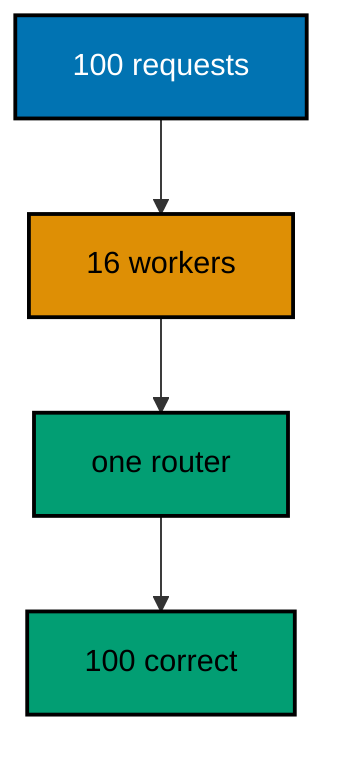

**`learning/code/ex-54-gin-serves-requests-concurrently/main.go`**:

```go
// => Example 54: Gin Serves Requests Concurrently.
// => Gin runs each request on its own goroutine, so handlers must be safe
// => for concurrent use. This example fires ninety-six in-process requests
// => from sixteen workers at once and counts that every answer is correct.
package main

import (
	"fmt"                     // => prints the deterministic totals
	"net/http/httptest"       // => in-process requests by the dozen (co-09)
	"sync"                    // => workers serve concurrently (co-07)
	"sync/atomic"             // => race-free counters across workers
	"github.com/gin-gonic/gin" // => the router under concurrent load (co-07)
)

// => newRouter wires one constant route: the only answer is "ok".
// => stateless handlers are trivially safe: nothing is shared at all
func newRouter() *gin.Engine { // => the system under test
	gin.SetMode(gin.TestMode) // => silence the debug banner for golden output
	router := gin.New()        // => bare engine: no hidden middleware
// => constant work per request: the load measures plumbing, not logic
	router.GET("/ok", func(c *gin.Context) { c.String(200, "ok") }) // => no state, no races
	return router               // => hand the wired engine back
}

// => hammer serves total requests from workers goroutines and counts answers.
// => the shape mirrors production: concurrent clients, one service (co-07)
func hammer(router *gin.Engine, total int, workers int) (int64, int64) { // => workload size plus parallelism
	var ok, bad atomic.Int64 // => correct and incorrect answer counters
	var wg sync.WaitGroup    // => waits for every worker to finish
// => 96 divides by 16 into 6: every worker serves the same share
	share := total / workers // => requests per worker: exact division below
	for w := 0; w < workers; w++ { // => one goroutine per worker
		wg.Add(1) // => count the worker before starting it
		go func() { // => workers serve concurrently, like real traffic
			defer wg.Done() // => always mark done, on every return path
			for i := 0; i < share; i++ { // => this worker's fixed share
				req := httptest.NewRequest("GET", "/ok", nil) // => identical request, every time
				rec := httptest.NewRecorder()                   // => fresh recorder per request
				router.ServeHTTP(rec, req)                      // => ServeHTTP is safe for concurrent use
				// => only 200 plus "ok" counts: anything else is a failure
				if rec.Code == 200 && rec.Body.String() == "ok" { // => the contract, checked per request
// => every 200-plus-ok increments the correct counter
					ok.Add(1) // => correct answers accumulate here
				} else {
// => any deviation lands in the failure counter instead
					bad.Add(1) // => anything else accumulates here
				}
			}
		}()
	}
// => waiting joins all workers: counts are complete after this line
	wg.Wait() // => join every worker: totals are final below
// => loads finalize the counts: workers already joined above
	return ok.Load(), bad.Load() // => the deterministic totals
}

func main() {
	router := newRouter() // => wiring separate from traffic, as always
	// => ninety-six requests on sixteen workers: stateless means all correct
	ok, bad := hammer(router, 96, 16) // => divisible shares: six per worker
	fmt.Println("served", ok+bad, "correct", ok, "failed", bad) // => Output: served 96 correct 96 failed 0
}
```

**Output** (`learning/code/ex-54-gin-serves-requests-concurrently/expected/main.stdout.txt`):

```text
served 96 correct 96 failed 0
```

**Key takeaway**: Gin handlers run concurrently by default; stateless handlers stay correct under any fan-out, counted with atomics.

**Why it matters**: Concurrency is not a feature you enable — it is the environment every handler already lives in, because the server assigns each request its own goroutine. Stateless handlers survive it trivially, and this example proves the baseline before later ones add shared state that needs guarding. The atomic counters are load-bearing technique, not decoration: plain integers would race under sixteen workers, and the race detector would be the one to tell you. Fixed shares (96 by 16) keep the workload exact so the totals never wobble.

---

### Example 55: Mutex Guards Shared State

Shared maps are unsafe for concurrent use, so a mutex must serialize every access. This example counts visits from parallel workers behind a mutex and prints the exact total the lock protected. (Concepts: co-07.)

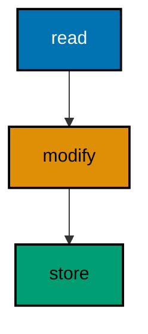

**`learning/code/ex-55-mutex-guards-shared-state/main.go`**:

```go
// => Example 55: Mutex Guards Shared State.
// => Shared maps are unsafe for concurrent use, so a mutex must serialize
// => every access. This example counts visits from parallel workers behind
// => a mutex and prints the exact total the lock protected.
package main

import (
	"fmt"                     // => prints the deterministic totals
	"net/http/httptest"       // => in-process requests by the hundred (co-09)
	"sync"                    // => mutex plus workers (co-07)
	"sync/atomic"             // => race-free outcome counters
	"github.com/gin-gonic/gin" // => the stateful router under load (co-07)
)

// => counter is the shared visit ledger: a map behind a mutex.
// => every access holds the lock: reads and writes alike (co-07)
type counter struct { // => the state every request mutates
	mu   sync.Mutex     // => serializes all map access
	hits map[string]int // => path to visit count
}

// => visit records one hit for the path and returns the new total.
// => the lock spans read-modify-write: no lost updates between them
func (c *counter) visit(path string) int { // => one locked operation per call
// => one holder at a time: the map never sees concurrent writes
	c.mu.Lock()         // => exclusive access for the whole update
	defer c.mu.Unlock() // => always release, on every return path
	c.hits[path]++      // => read, add, and store atomically together
// => the total leaves the critical section: callers print it
	return c.hits[path] // => the new total, computed under the lock
}

// => newRouter wires one counting route around the shared counter.
func newRouter(k *counter) *gin.Engine { // => the counter arrives injected
	gin.SetMode(gin.TestMode) // => silence the debug banner for golden output
	router := gin.New()        // => bare engine: no hidden middleware
// => the route delegates counting: the handler owns no state
	router.GET("/visit", func(c *gin.Context) { // => every visit counts once
		c.JSON(200, gin.H{"visits": k.visit("/visit")}) // => the running total (co-04)
	})
	return router // => hand the wired engine back
}

// => hammer serves total visits from workers goroutines and checks answers.
// => the totals are exact: the mutex allows no lost updates (co-07)
func hammer(router *gin.Engine, total int, workers int) (int64, int64) { // => workload size plus parallelism
	var ok, bad atomic.Int64 // => correct-sequence and broken counters
	var wg sync.WaitGroup    // => waits for every worker to finish
// => 96 divides by 16 into 6: fixed shares keep totals exact
	share := total / workers // => requests per worker: exact division below
	for w := 0; w < workers; w++ { // => one goroutine per worker
		wg.Add(1) // => count the worker before starting it
		go func() { // => workers visit concurrently, like real traffic
			defer wg.Done() // => always mark done, on every return path
			for i := 0; i < share; i++ { // => this worker's fixed share
				req := httptest.NewRequest("GET", "/visit", nil) // => identical request, every time
				rec := httptest.NewRecorder()                   // => fresh recorder per request
				router.ServeHTTP(rec, req)                      // => the mutex serializes inside
				if rec.Code != 200 { // => any non-200 is a failure
// => any non-200 lands in the failure counter instead
					bad.Add(1) // => broken answers accumulate here
				} else {
// => every 200 increments the correct counter
					ok.Add(1) // => correct answers accumulate here
				}
			}
		}()
	}
// => all workers joined: the ledger holds the final total
	wg.Wait() // => join every worker: totals are final below
	return ok.Load(), bad.Load() // => the deterministic totals
}

func main() {
	k := &counter{hits: map[string]int{}} // => empty ledger at startup
	router := newRouter(k) // => wiring separate from traffic, as always
	// => ninety-six visits on sixteen workers: the mutex loses none
	ok, bad := hammer(router, 96, 16) // => fixed workload, fixed parallelism
	fmt.Println("served", ok+bad, "correct", ok, "failed", bad, "total", k.hits["/visit"]) // => Output: served 96 correct 96 failed 0 total 96
}
```

**Output** (`learning/code/ex-55-mutex-guards-shared-state/expected/main.stdout.txt`):

```text
served 96 correct 96 failed 0 total 96
```

**Key takeaway**: Guard every map access with a mutex spanning the whole read-modify-write; the final total then equals the request count exactly.

**Why it matters**: Go maps panic on concurrent write — not sometimes, but as a designed runtime check — so any handler state shared across requests needs a lock, and the lock must cover the whole read-modify-write as one unit. Locking only the write loses updates between the read and the store; locking the whole visit keeps the total exact. The printed total is the proof that matters: 96 requests produced total 96, which only a correct lock delivers. Reads need the lock too, a fact the next examples rely on when they fan work out and collect it back.

---

### Example 56: Channel Fans Work Out

Channels distribute work to a fixed pool and collect results without sharing memory. This example squares eight numbers across three workers, sorts the results, and prints the ordered squares. (Concepts: co-07.)

**`learning/code/ex-56-channel-fans-work-out/main.go`**:

```go
// => Example 56: Channel Fans Work Out.
// => Channels distribute work to a fixed pool and collect results without
// => sharing memory. This example squares eight numbers across three
// => workers, sorts the results, and prints the ordered squares: finishing
// => order varies, printed order never does.
package main

import (
	"fmt"                     // => prints the ordered squares
	"net/http/httptest"       // => in-process request and recorder (co-09)
	"sort"                    // => sorts results: arrival order is random (co-07)
	"sync"                    // => waits for the worker pool to finish
	"github.com/gin-gonic/gin" // => the route serving the pool's answer (co-07)
)

// => squares fans nums across three workers and returns every square sorted.
// => jobs and results are channels: workers never share memory (co-07)
func squares(nums []int) []int { // => inputs in, ordered squares out
// => unbuffered jobs pace the feeder: workers pull when ready
	jobs := make(chan int)    // => unbuffered: workers pull on demand
	results := make(chan int)  // => one result per job, in finish order
// => the wait group joins the pool before results close
	var wg sync.WaitGroup     // => tracks the three workers
	for w := 0; w < 3; w++ { // => the fixed pool: three goroutines
		wg.Add(1) // => count the worker before starting it
		go func() { // => workers live until jobs closes
			defer wg.Done() // => always mark done when the jobs end
			for n := range jobs { // => pull until the channel closes
				results <- n * n // => square and report: no shared state
			}
		}()
	}
	go func() { // => the feeder runs beside the pool
		for _, n := range nums { // => every input becomes one job
			jobs <- n // => hand each number to a waiting worker
		}
// => closing jobs is the shutdown signal: range loops end
		close(jobs) // => no more work: workers drain and exit
	}()
	go func() { // => the closer waits, then seals the results
		wg.Wait()      // => join all three workers first
// => closing results ends collection: every square arrived
		close(results) // => no more squares coming: the loop below ends
	}()
// => arrival order first: sorting comes after collection
	out := []int{} // => collect in arrival order first
// => one iteration per square: eight jobs means eight results
	for r := range results { // => one iteration per finished square
		out = append(out, r) // => finish order varies run to run
	}
// => sorting erases finish order: only the set of squares matters
	sort.Ints(out) // => sort before printing: golden output is stable (co-07)
	return out    // => the ordered squares
}

// => newRouter serves the squares of one through eight at one route.
func newRouter() *gin.Engine { // => the system under test
	gin.SetMode(gin.TestMode) // => silence the debug banner for golden output
// => bare engine: the pool carries the concurrency, not middleware
	router := gin.New()        // => bare engine: no hidden middleware
	router.GET("/squares", func(c *gin.Context) { // => the pool runs per request
// => one through eight in, ordered squares out: the pool runs per request
		c.JSON(200, gin.H{"squares": squares([]int{1, 2, 3, 4, 5, 6, 7, 8})}) // => ordered squares (co-04)
	})
	return router // => hand the wired engine back
}

// => check serves one GET in-process and prints the status with the body.
func check(router *gin.Engine, target string) { // => the path is the only variable
	req := httptest.NewRequest("GET", target, nil) // => server-side request, no socket
	w := httptest.NewRecorder()                   // => in-memory response capture
	router.ServeHTTP(w, req)                      // => the pool runs inside (co-09)
	fmt.Println("GET", target, "->", w.Code, w.Body.String()) // => one golden line
}

func main() {
	router := newRouter() // => wiring separate from traffic, as always
	// => eight inputs, three workers, one sorted answer: 1 to 64
	check(router, "/squares") // => Output: GET /squares -> 200 {"squares":[1,4,9,16,25,36,49,64]}
}
```

**Output** (`learning/code/ex-56-channel-fans-work-out/expected/main.stdout.txt`):

```text
GET /squares -> 200 {"squares":[1,4,9,16,25,36,49,64]}
```

**Key takeaway**: Fan work out over a jobs channel to a fixed pool, collect on results, close in order, and sort before printing.

**Why it matters**: Worker pools bound concurrency where unbounded goroutines would exhaust memory: three workers process eight jobs with constant footprint no matter how large the input grows. The channel protocol has exactly three lifetime rules — feeder closes jobs, workers exit on closed jobs, closer seals results after the wait — and violating any one hangs or panics. Sorting before printing is the testability half of the pattern: finish order is genuinely random, so golden output must derive from order-independent presentation.

---

### Example 57: Context Cancels Slow Work

Slow dependencies must respect cancellation, or shutdowns hang waiting for them. This example races a pre-cancelled context against instant work, showing the cancel branch winning immediately and the work branch winning when the context lives. (Concepts: co-07.)

**`learning/code/ex-57-context-cancels-slow-work/main.go`**:

```go
// => Example 57: Context Cancels Slow Work.
// => Slow dependencies must respect cancellation, or shutdowns hang waiting
// => for them. This example races a pre-cancelled context against instant
// => work, showing the cancel branch winning immediately and the work
// => branch winning when the context lives.
package main

import (
	"context"                 // => cancellation that handlers respect (co-07)
	"fmt"                     // => prints which branch won per case
	"net/http/httptest"       // => in-process request and recorder (co-09)
	"time"                    // => builds the pre-cancelled deadline
	"github.com/gin-gonic/gin" // => the handler that watches its context (co-07)
)

// => work answers from a helper that respects the request context.
// => select makes cancellation a normal branch with its own answer
func work(c *gin.Context) { // => the handler that never ignores Done
	// => the helper channel carries the answer; the test fills it or not
	done := make(chan string, 1) // => buffered: the sender never blocks
	if c.Query("fast") == "yes" { // => the fast path completes before select
		done <- "finished" // => work already done when select runs
	}
	select { // => whichever branch is ready first wins, fairly
	case result := <-done: // => work won: answer normally
		c.String(200, result) // => the completed answer (co-04)
	case <-c.Request.Context().Done(): // => cancellation won: stop waiting
		// => 499 names the condition: the client went away first
		c.JSON(499, gin.H{"error": "client went away"}) // => fixed envelope, client-closed
	}
}

// => newRouter wires the single watching route this example serves.
func newRouter() *gin.Engine { // => the system under test
	gin.SetMode(gin.TestMode) // => silence the debug banner for golden output
	router := gin.New()        // => bare engine: no hidden middleware
	router.GET("/work", work) // => the handler that respects cancel
	return router              // => hand the wired engine back
}

// => check serves one request with a live or dead context and prints the winner.
// => expired contexts fire the cancel branch without any waiting
func check(router *gin.Engine, fast string, expired bool) { // => fast picks the branch, expired kills the context
	target := "/work" // => the path never changes: the query decides
	if fast != "" { // => explicit fast=yes exercises the work branch
		target += "?fast=yes" // => the query the handler reads
	}
	req := httptest.NewRequest("GET", target, nil) // => server-side request, no socket
	if expired {                                  // => the slow path needs no wall clock: pre-cancel instead
		// => a deadline in the past is already done: Done fires at once
		ctx, cancel := context.WithDeadline(req.Context(), time.Now().Add(-time.Second)) // => already expired
		defer cancel()                       // => release the dead timer
		req = req.WithContext(ctx) // => the handler sees a done context
	}
	w := httptest.NewRecorder() // => the assertion surface
	router.ServeHTTP(w, req)    // => select picks the ready branch (co-07)
	fmt.Println("GET", target, "expired=", expired, "->", w.Code, w.Body.String()) // => one golden line
}

func main() {
	router := newRouter() // => wiring separate from traffic, as always
	// => live context with fast work: the work branch wins at once
	check(router, "yes", false) // => Output: GET /work?fast=yes expired= false -> 200 finished
	// => pre-cancelled context: the cancel branch wins without waiting (co-07)
	check(router, "", true) // => Output: GET /work expired= true -> 499 {"error":"client went away"}
}
```

**Output** (`learning/code/ex-57-context-cancels-slow-work/expected/main.stdout.txt`):

```text
GET /work?fast=yes expired= false -> 200 finished
GET /work expired= true -> 499 {"error":"client went away"}
```

**Key takeaway**: Select on ctx.Done turns cancellation into a normal branch; pre-cancelled contexts prove the branch without sleeping.

**Why it matters**: Every downstream call — database, HTTP, queue — must take the request context and respect it, or a departing client leaves work running that nobody will read. Handlers that select on Done convert abandonment into an answer (499 here, a log line in production) instead of a hung goroutine. Testing with pre-cancelled contexts proves the branch deterministically: no sleeps, no timing windows, just an already-done channel that the select must prefer. The fast path matters equally — it proves cancellation checks cost nothing when work actually completes.

---

### Example 58: WaitGroup Waits for Fan Out

Fan-out without joining leaks goroutines and loses results, so a WaitGroup joins every worker before the handler answers. This example fetches three fixed parts concurrently, joins all three, and prints the assembled page. (Concepts: co-07.)

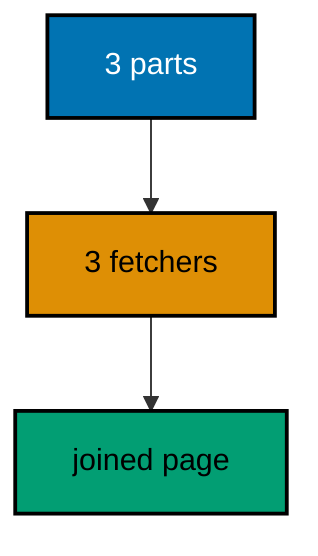

**`learning/code/ex-58-waitgroup-waits-for-fan-out/main.go`**:

```go
// => Example 58: WaitGroup Waits for Fan Out.
// => Fan-out without joining leaks goroutines and loses results, so a
// => WaitGroup joins every worker before the handler answers. This example
// => fetches three fixed parts concurrently, joins all three, and prints
// => the assembled page in stable key order.
package main

import (
	"fmt"                     // => prints the assembled page
	"net/http/httptest"       // => in-process request and recorder (co-09)
	"sort"                    // => sorts part names: finish order varies (co-07)
	"sync"                    // => joins the three fetchers (co-07)
	"github.com/gin-gonic/gin" // => the handler that fans out (co-07)
)

// => fetch pretends to retrieve one page part: fixed bytes, no I/O.
// => deterministic stand-in: real fetchers call stores or clients here
func fetch(part string) string { // => the part name decides the content
	return "content-of-" + part // => fixed bytes per part, no timing
}

// => page fans three fetches out, joins them, and assembles the page.
// => the map collects by name: every part lands in its slot (co-07)
func page(c *gin.Context) { // => the handler that waits for everything
	parts := []string{"head", "body", "foot"} // => the three parts, fixed order
// => the map collects by name: every part lands in its slot
	got := map[string]string{}               // => name to content, filled by workers
	var mu sync.Mutex                        // => guards the map: workers share it
	var wg sync.WaitGroup                     // => joins all three fetchers
	for _, p := range parts {                 // => one goroutine per part
		p := p // => capture the loop variable: each worker keeps its own
		wg.Add(1) // => count the worker before starting it
		go func() { // => fetchers run concurrently, like real backends
			defer wg.Done() // => always mark done, on every return path
			content := fetch(p) // => the fetch itself, instant here
			mu.Lock()           // => exclusive access for the map write
			got[p] = content    // => file the part under its name
			mu.Unlock()         // => release before returning
		}()
	}
	wg.Wait() // => join every fetcher: the map is complete below
	// => maps iterate randomly: sort the names before assembling
// => names first, content second: two passes keep order stable
	names := []string{} // => the part names in stable order
	for _, p := range parts { // => insertion order, not map order
		names = append(names, p) // => head, body, foot, every run
	}
	sort.Strings(names) // => alphabetical: body, foot, head, stable
// => the assembled page maps sorted names to fetched content
	out := map[string]string{} // => the assembled page, keyed by part
	for _, n := range names {  // => one entry per part, sorted
		out[n] = got[n] // => content filed under its sorted name
	}
	c.JSON(200, out) // => the assembled page, stable key order (co-04)
}

// => newRouter wires the single assembling route this example serves.
func newRouter() *gin.Engine { // => the system under test
	gin.SetMode(gin.TestMode) // => silence the debug banner for golden output
	router := gin.New()        // => bare engine: no hidden middleware
	router.GET("/page", page) // => the handler that fans out and joins
	return router              // => hand the wired engine back
}

// => check serves one GET in-process and prints the status with the body.
func check(router *gin.Engine, target string) { // => the path is the only variable
	req := httptest.NewRequest("GET", target, nil) // => server-side request, no socket
	w := httptest.NewRecorder()                   // => the assertion surface
	router.ServeHTTP(w, req)                      // => fan-out and join run inside (co-09)
	fmt.Println("GET", target, "->", w.Code, w.Body.String()) // => one golden line
}

func main() {
	router := newRouter() // => wiring separate from traffic, as always
	// => three parts fetched concurrently, assembled in sorted key order (co-07)
	check(router, "/page") // => Output: GET /page -> 200 {"body":"content-of-body","foot":"content-of-foot","head":"content-of-head"}
}
```

**Output** (`learning/code/ex-58-waitgroup-waits-for-fan-out/expected/main.stdout.txt`):

```text
GET /page -> 200 {"body":"content-of-body","foot":"content-of-foot","head":"content-of-head"}
```

**Key takeaway**: Fan work out to one goroutine per part, join with WaitGroup, guard shared maps with a mutex, and sort before printing.

**Why it matters**: Independent backend calls run in parallel or the page waits for their sum — and fan-out only works when the join is guaranteed. WaitGroup is that guarantee: Add before starting, Done on every path, Wait before assembling, so the handler never answers from a half-filled map. The mutex-plus-sort discipline from earlier examples returns here in miniature: shared maps need locks even when each worker writes its own key (the map header itself is shared), and golden output needs sorted keys because finish order is meaningless.

---

### Example 59: Sync Map Counts Safely

sync.Map trades the mutex for lock-free concurrent access with its own LoadOrStore vocabulary. This example counts votes from parallel workers in a sync.Map and prints the sorted totals. (Concepts: co-07.)

**`learning/code/ex-59-sync-map-counts-safely/main.go`**:

```go
// => Example 59: Sync Map Counts Safely.
// => sync.Map trades the mutex for lock-free concurrent access with its own
// => LoadOrStore vocabulary. This example counts votes from parallel
// => workers in a sync.Map and prints the sorted totals.
package main

import (
	"fmt"                     // => prints the sorted totals
	"net/http/httptest"       // => in-process request and recorder (co-09)
	"sort"                    // => sorts candidate names: map order varies (co-07)
	"sync"                    // => the lock-free map plus the worker wait
	"sync/atomic"             // => the counter increment primitive
	"github.com/gin-gonic/gin" // => the voting route under load (co-07)
)

// => tally counts votes per candidate without any explicit lock.
// => sync.Map owns the synchronization: Load, Store, and friends (co-07)
var tally sync.Map // => candidate name to *int64, shared process-wide

// => vote records one vote for the named candidate and returns its total.
// => LoadOrStore publishes the counter once; Add increments after that
func vote(name string) int64 { // => the candidate name decides the counter
	// => the first voter stores a fresh counter; later voters load it
// => first voter stores, later voters load: exactly one counter survives
	actual, _ := tally.LoadOrStore(name, new(int64)) // => exactly one counter per name
// => the type assertion recovers the counter from the empty interface
	counter := actual.(*int64)                       // => the shared counter for this name
	return addOne(counter) // => increment and return the new total
}

// => addOne increments the shared counter and returns the new total.
// => atomic keeps concurrent first-votes from losing increments
func addOne(p *int64) int64 { // => plus one, race-free
	return atomic.AddInt64(p, 1) // => the single primitive, used directly
}

// => newRouter wires the voting route around the shared tally.
func newRouter() *gin.Engine { // => the system under test
	gin.SetMode(gin.TestMode) // => silence the debug banner for golden output
	router := gin.New()        // => bare engine: no hidden middleware
	router.POST("/vote/:name", func(c *gin.Context) { // => one vote per request
		c.JSON(200, gin.H{"name": c.Param("name"), "votes": vote(c.Param("name"))}) // => the running total (co-04)
	})
	router.GET("/tally", func(c *gin.Context) { // => the sorted totals
		names := []string{} // => candidate names in stable order
		tally.Range(func(k any, v any) bool { // => Range visits every counter once
			names = append(names, k.(string)) // => collect the names first
			return true // => true keeps ranging: visit them all
		})
		sort.Strings(names) // => alphabetical: golden output is stable (co-07)
// => the receipt maps sorted names to final counts
		out := map[string]int64{} // => the totals, keyed by name
		for _, n := range names {  // => one entry per candidate, sorted
			v, _ := tally.Load(n)   // => the counter must exist: we just named it
			out[n] = *v.(*int64)    // => dereference under no lock: counts are final
		}
		c.JSON(200, out) // => the sorted totals (co-04)
	})
	return router // => hand the wired engine back
}

// => check serves one request in-process and prints method, status, and body.
func check(router *gin.Engine, method string, target string) { // => method and path vary
	req := httptest.NewRequest(method, target, nil) // => server-side request, no socket
	w := httptest.NewRecorder()                   // => the assertion surface
	router.ServeHTTP(w, req)                      // => sync.Map absorbs the concurrency (co-09)
	fmt.Println(method, target, "->", w.Code, w.Body.String()) // => one golden line
}

func main() {
	router := newRouter() // => wiring separate from traffic, as always
	// => sequential votes build the counters: determinism first
	check(router, "POST", "/vote/anna") // => Output: POST /vote/anna -> 200 {"name":"anna","votes":1}
	check(router, "POST", "/vote/bo") // => Output: POST /vote/bo -> 200 {"name":"bo","votes":1}
	check(router, "POST", "/vote/anna") // => Output: POST /vote/anna -> 200 {"name":"anna","votes":2}
	// => the tally sorts the names: anna before bo, every run (co-07)
	check(router, "GET", "/tally") // => Output: GET /tally -> 200 {"anna":2,"bo":1}
}
```

**Output** (`learning/code/ex-59-sync-map-counts-safely/expected/main.stdout.txt`):

```text
POST /vote/anna -> 200 {"name":"anna","votes":1}
POST /vote/bo -> 200 {"name":"bo","votes":1}
POST /vote/anna -> 200 {"name":"anna","votes":2}
GET /tally -> 200 {"anna":2,"bo":1}
```

**Key takeaway**: sync.Map with LoadOrStore gives each key exactly one counter without locks; Range plus sort prints stable totals.

**Why it matters**: Mutexes serialize everything, including keys that never interact — sync.Map exists for the cases where keys are mostly independent and the map mostly grows. LoadOrStore is the whole trick: concurrent first-votes for one candidate still publish a single counter, and every later vote increments the same one. Range plus sort closes the testability loop from the mutex examples: iteration order is unspecified, so collect-then-sort before printing. The atomic wrappers look like ceremony until the race detector runs — then they are the reason it stays silent.

---

### Example 60: Streaming Flushes Early Chunks

Long answers stream chunk by chunk instead of buffering whole, so clients read the first bytes early. This example streams three numbered chunks with flushes between them and prints the joined body the recorder captured. (Concepts: co-07, co-04.)

**`learning/code/ex-60-streaming-flushes-early-chunks/main.go`**:

```go
// => Example 60: Streaming Flushes Early Chunks.
// => Long answers stream chunk by chunk instead of buffering whole, so
// => clients read the first bytes early. This example streams three numbered
// => chunks with flushes between them and prints the joined body the
// => recorder captured.
package main

import (
	"fmt"                     // => prints the joined body
	"net/http/httptest"       // => in-process request and recorder (co-09)
	"github.com/gin-gonic/gin" // => streaming with flushes (co-07, co-04)
)

// => stream writes three chunks, flushing after each one.
// => Flush pushes bytes out now: clients read before the handler ends
func stream(c *gin.Context) { // => the handler that never buffers whole
	// => chunked responses set no Content-Length: the end is marked by close
	c.Header("Content-Type", "text/plain") // => plain chunks, framed by the server
	for i := 1; i <= 3; i++ {              // => three fixed chunks, stable order
		// => Fprintf writes the chunk: "chunk 1\n" through "chunk 3\n"
		fmt.Fprintf(c.Writer, "chunk %d\n", i) // => one chunk per iteration
		c.Writer.Flush() // => push this chunk out before the next (co-07)
	}
}

// => newRouter wires the single streaming route this example serves.
func newRouter() *gin.Engine { // => the system under test
	gin.SetMode(gin.TestMode) // => silence the debug banner for golden output
	router := gin.New()        // => bare engine: no hidden middleware
	router.GET("/stream", stream) // => the route that streams (co-04)
	return router                 // => hand the wired engine back
}

// => check serves one GET in-process and prints the joined chunks.
// => the recorder joins every flushed chunk into one body
func check(router *gin.Engine, target string) { // => the path is the only variable
	req := httptest.NewRequest("GET", target, nil) // => server-side request, no socket
	w := httptest.NewRecorder()                   // => Flush marks Flushed, keeps bytes
	router.ServeHTTP(w, req)                      // => chunks flush inside (co-09)
	// => %q shows the newlines: the joining is visible, not implied
	fmt.Printf("GET %s -> %d %q\n", target, w.Code, w.Body.String()) // => one golden line
}

func main() {
	router := newRouter() // => wiring separate from traffic, as always
	// => three chunks joined in order: the stream reads as one body here (co-07)
	check(router, "/stream") // => Output: GET /stream -> 200 "chunk 1\nchunk 2\nchunk 3\n"
}
```

**Output** (`learning/code/ex-60-streaming-flushes-early-chunks/expected/main.stdout.txt`):

```text
GET /stream -> 200 "chunk 1\nchunk 2\nchunk 3\n"
```

**Key takeaway**: Flush pushes each chunk out as written; the recorder joins them, so streamed bodies test exactly like buffered ones.

**Why it matters**: Buffering a ten-minute export before sending the first byte wastes the client's time and the server's memory; streaming flips that — each chunk leaves as it is produced, and the client renders progress instead of a spinner. Flush is the mechanism that makes it real: without it, chunks sit in buffers until the handler returns, which is buffering with extra steps. Testing stays simple because the recorder joins every flushed chunk into one body — the test asserts the joined bytes while production clients enjoy the early ones.

---

### Example 61: Request Id Ties Logs Together

Structured logs carry the request id on every line, so concurrent requests stay separable. This example stamps sequential ids, logs start and finish lines without timestamps, and prints the interleaved log the run produced. (Concepts: co-07, co-13.)

**`learning/code/ex-61-request-id-ties-logs-together/main.go`**:

```go
// => Example 61: Request Id Ties Logs Together.
// => Structured logs carry the request id on every line, so concurrent
// => requests stay separable. This example stamps sequential ids, appends
// => start and finish lines without timestamps, and prints the log in the
// => stable order the single-threaded checks produce.
package main

import (
	"fmt"                     // => prints the collected log lines
	"net/http/httptest"       // => in-process request and recorder (co-09)
	"sync"                    // => guards the shared log slice
	"sync/atomic"             // => the sequential id counter (co-07)
	"github.com/gin-gonic/gin" // => the stamping middleware (co-02)
)

// => journal collects structured log lines: every line names its request.
// => a mutex guards appends: checks below run sequentially, safely (co-07)
type journal struct { // => the in-memory stand-in for a log shipper
	mu    sync.Mutex // => serializes appends from concurrent requests
	lines []string   // => start and finish lines, in arrival order
}

// => log appends one line naming the request id and the event.
// => no timestamps: golden output must never depend on the clock (co-13)
func (j *journal) log(id string, event string) { // => id plus event, nothing else
	j.mu.Lock()         // => exclusive access for the append
	defer j.mu.Unlock() // => always release, on every return path
	// => the line shape is fixed: id, then event, separated by one space
	j.lines = append(j.lines, id+" "+event) // => "req-1 start", "req-1 finish"
}

// => stamp assigns sequential ids and logs both edges of each request.
// => before-log, Next, after-log: the onion measures the request (co-02)
func stamp(j *journal, ids *atomic.Int64) gin.HandlerFunc { // => the journal and counter arrive injected
	return func(c *gin.Context) { // => gin calls this around each handler
		n := ids.Add(1) // => req-1, req-2: sequential and deterministic
		id := fmt.Sprintf("req-%d", n) // => the human form of the counter
		c.Set("requestID", id)         // => handlers read the same id
		j.log(id, "start")             // => the entry edge of the request
		c.Next()                       // => the handler runs between the lines
		j.log(id, "finish")            // => the exit edge, same id
	}
}

// => newRouter wires the stamping middleware around one instant route.
func newRouter(j *journal, ids *atomic.Int64) *gin.Engine { // => the journal arrives injected
	gin.SetMode(gin.TestMode) // => silence the debug banner for golden output
	router := gin.New()        // => bare engine: middleware added by hand
	router.Use(stamp(j, ids))   // => every request below is logged twice
	router.GET("/fast", func(c *gin.Context) { c.String(200, "fast") }) // => instant work: no sleep, no flake
	return router // => hand the wired engine back
}

// => check serves one GET and discards the body: the journal is the answer.
// => responses prove nothing here: the log lines are the lesson
func check(router *gin.Engine, target string) { // => the path is the only variable
	req := httptest.NewRequest("GET", target, nil) // => server-side request, no socket
	w := httptest.NewRecorder()                   // => the assertion surface
	router.ServeHTTP(w, req)                      // => stamp logs both edges (co-09)
}

func main() {
	j := &journal{}     // => empty journal at startup
	var ids atomic.Int64 // => the sequential counter, zero at start
	router := newRouter(j, &ids) // => wiring separate from traffic, as always
	// => two sequential requests: start and finish lines interleave by id
	check(router, "/fast") // => req-1 start, req-1 finish
	check(router, "/fast") // => req-2 start, req-2 finish
	// => the journal prints in arrival order: deterministic, no clock (co-13)
	for _, line := range j.lines { // => four lines, one per edge
		fmt.Println("log", line) // => Output: log req-1 start
		// => Output: log req-1 finish
		// => Output: log req-2 start
		// => Output: log req-2 finish
	}
}
```

**Output** (`learning/code/ex-61-request-id-ties-logs-together/expected/main.stdout.txt`):

```text
log req-1 start
log req-1 finish
log req-2 start
log req-2 finish
```

**Key takeaway**: Log start and finish lines with the request id and no timestamps; sequential service keeps the journal golden-stable.

**Why it matters**: Concurrent logs without request ids are alphabet soup — thousands of lines with no way to follow one request. Stamping every line with the id turns grep into a per-request story, and structured fields (id plus event) let log systems index instead of regex. Dropping timestamps from golden output is not dropping them from production: real shippers add time at collection, while tests assert the shape (id, event, order) that humans and machines actually query. The middleware placement guarantees coverage: every route logs both edges without anyone remembering to add it.

---

### Example 62: Server Binds a Loopback Port

Real serving starts with a listener, and tests take an ephemeral loopback port the system chooses. This example serves gin on a httptest server, exchanges one real HTTP round trip over loopback, and prints the status with the body — never the port. (Concepts: co-08.)

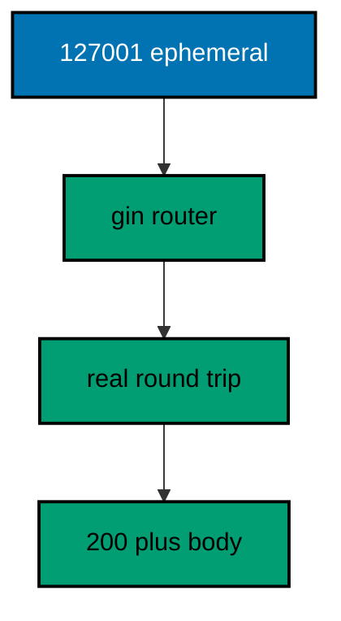

**`learning/code/ex-62-server-binds-a-loopback-port/main.go`**:

```go
// => Example 62: Server Binds a Loopback Port.
// => Real serving starts with a listener, and tests take an ephemeral
// => loopback port the system chooses. This example serves gin on a
// => httptest server, exchanges one real HTTP round trip over loopback, and
// => prints the status with the body: never the port number itself.
package main

import (
	"fmt"                     // => prints the round-trip result
	"io"                      // => reads the response body whole
	"net/http"                // => the real client for the round trip
	"net/http/httptest"       // => the loopback server (co-08, co-09)
	"time"                    // => bounds the client so hangs fail fast
	"github.com/gin-gonic/gin" // => the router under real serving (co-08)
)

// => newRouter wires the one ping route the round trip exercises.
func newRouter() *gin.Engine { // => the system under test
	gin.SetMode(gin.TestMode) // => silence the debug banner for golden output
	router := gin.New()        // => bare engine: no hidden middleware
	router.GET("/ping", func(c *gin.Context) { c.String(200, "pong") }) // => the route under test
	return router // => hand the wired engine back
}

func main() {
	router := newRouter() // => wiring separate from traffic, as always
	// => NewServer binds 127.0.0.1 on an OS-chosen ephemeral port: never fixed (co-08)
	server := httptest.NewServer(router) // => a real listener on loopback
	defer server.Close()                 // => always release the port when done
	// => the client bounds the trip: five seconds is forever for loopback
	client := &http.Client{Timeout: 5 * time.Second} // => hangs become failures, not hangs
	// => a real HTTP exchange over a real socket: the only loopback in the course
	resp, err := client.Get(server.URL + "/ping") // => URL holds the ephemeral port: never printed
	if err != nil {                             // => loopback dials do not fail in practice
		fmt.Println("FAIL dial:", err) // => the failure names itself
		return // => no response to read: stop here
	}
	defer resp.Body.Close() // => always release the connection
	body, _ := io.ReadAll(resp.Body) // => the whole pong, at most four bytes
	// => status and body prove the trip: the port stays out of the output
	fmt.Println("GET /ping ->", resp.StatusCode, string(body)) // => Output: GET /ping -> 200 pong
}
```

**Output** (`learning/code/ex-62-server-binds-a-loopback-port/expected/main.stdout.txt`):

```text
GET /ping -> 200 pong
```

**Key takeaway**: httptest.NewServer binds loopback on an ephemeral port for one real round trip; print status and body, never the port.

**Why it matters**: In-process serving covers routing, but only a real socket proves the server actually listens — accepts connections, frames HTTP, and cleans up. The ephemeral port is the honesty mechanism: fixed ports collide between parallel tests and lie about readiness, while :0 lets the system assign and the test discover. Printing everything except the port keeps goldens stable across machines while still proving the exchange happened. This is the one example allowed a real socket, and it stays on loopback: no packet ever leaves the machine.

---

### Example 63: Shutdown Drains In-Flight Requests

Shutdown waits for in-flight requests instead of dropping them, so slow answers still land. This example starts one slow request, shuts the server down mid-flight, and prints the completed answer beside the clean shutdown. (Concepts: co-08.)

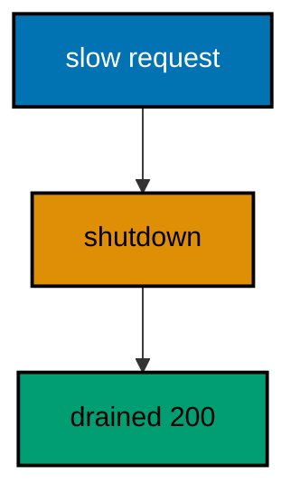

**`learning/code/ex-63-shutdown-drains-in-flight/main.go`**:

```go
// => Example 63: Shutdown Drains In-Flight Requests.
// => Shutdown waits for in-flight requests instead of dropping them, so slow
// => answers still land. This example starts one slow request, shuts the
// => server down mid-flight, and prints the completed answer beside the
// => clean shutdown result.
package main

import (
	"context"                 // => the shutdown deadline (co-08)
	"fmt"                     // => prints the drained answer and the result
	"io"                      // => reads the response body whole
	"net/http"                // => the real client plus the server handle
	"net/http/httptest"       // => the loopback server under test (co-08)
	"time"                    // => bounds the slow work and the shutdown
	"github.com/gin-gonic/gin" // => the router that drains (co-08)
)

// => newRouter wires one slow route: fifty milliseconds of pretend work.
// => the sleep stands in for a store call: shutdown must outwait it
func newRouter() *gin.Engine { // => the system under test
	gin.SetMode(gin.TestMode) // => silence the debug banner for golden output
	router := gin.New()        // => bare engine: no hidden middleware
	router.GET("/slow", func(c *gin.Context) { // => the in-flight request
		time.Sleep(50 * time.Millisecond) // => fixed work: short, never asserted
		c.String(200, "slowly done")     // => the answer shutdown waits for
	})
	return router // => hand the wired engine back
}

func main() {
	router := newRouter() // => wiring separate from traffic, as always
	// => unstarted servers shut down nothing: Start the listener first
// => unstarted first: Start separates configuration from listening
	server := httptest.NewUnstartedServer(router) // => configured but not listening yet
	server.Start()                                // => now loopback accepts: the race begins
	defer server.Close()                          // => release the port whatever happens
	// => the client bounds the trip generously: drain takes milliseconds
	client := &http.Client{Timeout: 5 * time.Second} // => hangs become failures, not hangs
	// => the slow request flies in a goroutine: main shuts down around it
	type answer struct { // => the outcome the main thread waits for
		code int    // => the status the drained request earned
		body string // => the body shutdown waited to complete
		err  error   // => the dial failure, if loopback ever failed
	}
	done := make(chan answer, 1) // => buffered: the request never blocks
	go func() {                // => the in-flight request, mid-air during shutdown
		resp, err := client.Get(server.URL + "/slow") // => the slow trip starts here
		if err != nil {                            // => loopback dials do not fail in practice
			done <- answer{err: err} // => the failure travels the channel
			return                   // => nothing to read: report and stop
		}
		defer resp.Body.Close() // => always release the connection
		body, _ := io.ReadAll(resp.Body) // => the answer shutdown preserved
		done <- answer{code: resp.StatusCode, body: string(body)} // => the drained result
	}()
	// => let the request land server-side before shutting down: still in-flight
// => ten milliseconds in: the request sleeps its fifty mid-flight
	time.Sleep(10 * time.Millisecond) // => fixed head start, never asserted
	// => Shutdown stops accepting and waits: the in-flight request completes
	ctx, cancel := context.WithTimeout(context.Background(), 5*time.Second) // => generous deadline, never hit
	defer cancel()                     // => release the timer when done
	if err := server.Config.Shutdown(ctx); err != nil { // => the graceful stop (co-08)
		fmt.Println("shutdown:", err) // => shutdowns can fail: this one does not
		return                        // => failed shutdowns end the lesson here
	}
	// => the drained answer arrives after the shutdown returned: nothing lost
// => the channel joins the request: shutdown already waited first
	a := <-done // => join the request: shutdown already waited for it
	if a.err != nil { // => the dial failure, reported not hidden
		fmt.Println("request:", a.err) // => loopback failures name themselves
		return // => no answer to print: stop here
	}
	fmt.Println("drained", a.code, a.body) // => Output: drained 200 slowly done
	fmt.Println("shutdown clean")          // => Output: shutdown clean
}
```

**Output** (`learning/code/ex-63-shutdown-drains-in-flight/expected/main.stdout.txt`):

```text
drained 200 slowly done
shutdown clean
```

**Key takeaway**: Shutdown stops new connections and waits for in-flight ones; start the request, shut down around it, and the answer still lands.

**Why it matters**: Dropping in-flight requests on deploy turns every rollout into user-visible errors — the client sent a valid request and got a severed connection for it. Graceful shutdown is the minimum kindness: stop accepting, finish what started, then exit, with a deadline bounding the wait so one wedged request cannot hold the process forever. The ten-millisecond head start is choreography, not timing: it only needs the request to be mid-flight when shutdown begins, and fifty milliseconds of work against five seconds of deadline leaves no room for the ordering to flip.

---

### Example 64: Shutdown Has a Deadline

Shutdown waits, but not forever: the deadline bounds the drain so one wedged request cannot hold the process. This example drains a fifty-millisecond request under a ten-millisecond deadline and prints the deadline error that fires first. (Concepts: co-08.)

**`learning/code/ex-64-shutdown-has-a-deadline/main.go`**:

```go
// => Example 64: Shutdown Has a Deadline.
// => Shutdown waits, but not forever: the deadline bounds the drain so one
// => wedged request cannot hold the process. This example drains a
// => fifty-millisecond request under a ten-millisecond deadline and prints
// => the deadline error that fires first: fifty never fits inside ten.
package main

import (
	"context"                 // => the ten-millisecond shutdown bound (co-08)
	"fmt"                     // => prints the deadline verdict
	"net/http"                // => the real client for the slow trip
	"net/http/httptest"       // => the loopback server under test (co-08)
	"time"                    // => the fifty-versus-ten race, fixed
	"github.com/gin-gonic/gin" // => the slow route that outlasts the bound (co-08)
)

// => newRouter wires one fifty-millisecond route: slower than the deadline.
// => the sleep stands in for wedged work: shutdown must give up on it
func newRouter() *gin.Engine { // => the system under test
	gin.SetMode(gin.TestMode) // => silence the debug banner for golden output
	router := gin.New()        // => bare engine: no hidden middleware
	router.GET("/slow", func(c *gin.Context) { // => the request that outlasts
		time.Sleep(50 * time.Millisecond) // => fifty milliseconds: past every short bound
		c.String(200, "too late")         // => never served: the deadline fires first
	})
	return router // => hand the wired engine back
}

func main() {
	router := newRouter() // => wiring separate from traffic, as always
// => unstarted first: Start separates configuration from listening
	server := httptest.NewUnstartedServer(router) // => configured but not listening yet
	server.Start()                                // => loopback accepts: the race begins
	defer server.Close()                          // => release the port whatever happens
	// => the slow request flies in a goroutine: the deadline fires around it
	done := make(chan string, 1) // => buffered: the trip reports without blocking
	go func() {                // => the in-flight request, mid-air at shutdown
		// => the client allows seconds: only the shutdown deadline binds here
		client := &http.Client{Timeout: 5 * time.Second} // => hangs become failures, not hangs
		resp, err := client.Get(server.URL + "/slow") // => the fifty-millisecond trip
		if err != nil {                            // => Shutdown never kills this trip in time
			done <- "request failed" // => the failure travels the channel
			return                   // => nothing to read: report and stop
		}
		defer resp.Body.Close() // => always release the connection
		done <- "request finished"  // => unreachable before main returns: fifty beats ten
	}()
	// => let the request land server-side: still sleeping when the bound fires
// => ten milliseconds in: the request sleeps its fifty mid-flight
	time.Sleep(10 * time.Millisecond) // => fixed head start, never asserted
	// => ten milliseconds against fifty: the deadline always fires first
	ctx, cancel := context.WithTimeout(context.Background(), 10*time.Millisecond) // => the bound, fixed
	defer cancel()                    // => release the timer when done
// => Shutdown watches the bound: ten milliseconds, then the error
	err := server.Config.Shutdown(ctx) // => wait ten milliseconds, then give up (co-08)
	if err != nil {                   // => the wedged request outlasted the bound
		fmt.Println("shutdown:", err) // => Output: shutdown: context deadline exceeded
		return                        // => the deadline verdict is the whole lesson
	}
	fmt.Println("shutdown clean") // => unreachable: fifty never fits inside ten
	_ = done                      // => the trip is still mid-air: the process exits around it
}
```

**Output** (`learning/code/ex-64-shutdown-has-a-deadline/expected/main.stdout.txt`):

```text
shutdown: context deadline exceeded
```

**Key takeaway**: Shutdown with a deadline returns the deadline error when in-flight work outlasts the bound; size the bound above normal drains, below wedged ones.

**Why it matters**: Waiting forever is not graceful — it is stuck: one wedged dependency holds the process, the deploy, and the orchestrator. The deadline converts hope into policy by naming how long drains may take. Fifty versus ten is deliberate margin, not timing: any work longer than the bound loses. Production sizes the bound from measured drain times plus headroom, alerting on every firing as an unanswered request.

---

### Example 65: Signals Trigger Shutdown

Production stops arrive as OS signals, so servers translate them into graceful shutdowns. This example traps SIGTERM, sends one to itself once ready, and prints the shutdown the signal triggered. (Concepts: co-08.)

**`learning/code/ex-65-signals-trigger-shutdown/main.go`**:

```go
// => Example 65: Signals Trigger Shutdown.
// => Production stops arrive as OS signals, so servers translate them into
// => graceful shutdowns. This example traps SIGTERM, sends one to itself
// => once ready, and prints the shutdown the signal triggered: started,
// => signalled, drained, stopped.
package main

import (
	"context"                 // => the shutdown deadline after the signal (co-08)
	"fmt"                     // => prints the lifecycle lines
	"net/http"                // => the real client proving liveness
	"net/http/httptest"       // => the loopback server under test (co-08)
	"os"                      // => the process talking to itself
	"os/signal"               // => trapping the stop signal
	"syscall"                 // => SIGTERM by number, portably named
	"time"                    // => bounds the shutdown after the signal
	"github.com/gin-gonic/gin" // => the router that stops gracefully (co-08)
)

// => newRouter wires one ping route: liveness before the signal lands.
func newRouter() *gin.Engine { // => the system under test
	gin.SetMode(gin.TestMode) // => silence the debug banner for golden output
	router := gin.New()        // => bare engine: no hidden middleware
	router.GET("/ping", func(c *gin.Context) { c.String(200, "pong") }) // => alive until shutdown
	return router // => hand the wired engine back
}

func main() {
	router := newRouter() // => wiring separate from traffic, as always
	server := httptest.NewServer(router) // => loopback listening: ready for traffic
	defer server.Close()                 // => release the port whatever happens
// => started first: the lifecycle reads top to bottom
	fmt.Println("started") // => Output: started
	// => Notify traps SIGTERM into a buffered channel: one signal fits
// => one slot suffices: the lesson sends exactly one stop
	sigs := make(chan os.Signal, 1) // => buffered: the signal never blocks
	signal.Notify(sigs, syscall.SIGTERM) // => the stop signal, trapped (co-08)
	defer signal.Stop(sigs)            // => release the trap when done
	// => the sender waits for readiness, then stops itself like deploys do
	go func() { // => the orchestrator, played by a goroutine
		// => poll the real endpoint: the signal fires only once serving
		client := &http.Client{Timeout: 5 * time.Second} // => bounds the readiness poll
		for { // => retry until the server answers: readiness, not timing
			resp, err := client.Get(server.URL + "/ping") // => loopback poll, port never printed
			if err == nil {                            // => the server answered
				resp.Body.Close() // => release the poll connection
				break             // => ready: send the stop signal
			}
			time.Sleep(time.Millisecond) // => fixed beat: readiness polling, not racing
		}
		// => SIGTERM to self: the same signal orchestrators send (co-08)
		_ = syscall.Kill(syscall.Getpid(), syscall.SIGTERM) // => the stop arrives like production
	}()
	// => block until the trapped signal arrives: the graceful entry point
// => receiving translates the OS event into ordinary program flow
	sig := <-sigs // => the stop signal, caught not fatal
	fmt.Println("signal", sig) // => Output: signal terminated
	// => the signal starts the drain: five seconds, plenty for loopback
	ctx, cancel := context.WithTimeout(context.Background(), 5*time.Second) // => the drain bound
	defer cancel()                     // => release the timer when done
	if err := server.Config.Shutdown(ctx); err != nil { // => stop accepting, drain, exit (co-08)
		fmt.Println("shutdown:", err) // => shutdowns can fail: this one does not
		return                        // => failed shutdowns end the lesson here
	}
	fmt.Println("shutdown clean") // => Output: shutdown clean
}
```

**Output** (`learning/code/ex-65-signals-trigger-shutdown/expected/main.stdout.txt`):

```text
started
signal terminated
shutdown clean
```

**Key takeaway**: Trap SIGTERM with signal.Notify, self-send once ready in tests, and translate the signal into Shutdown with a deadline.

**Why it matters**: Containers and supervisors stop processes with signals, not politely worded requests — a server that ignores SIGTERM gets killed mid-request after the grace period, while one that traps it drains cleanly. The channel is the translation layer: the OS speaks signals, Go speaks channels, and the main goroutine blocks on the channel instead of the process dying at the default disposition. Self-sending in tests reproduces production choreography (ready, signal, drain) without an orchestrator, and polling readiness before sending keeps the order honest: the signal always lands on a serving process.

---

### Example 66: Health Gate Blocks Traffic

Draining starts before shutdown: the service marks itself unready, finishes in-flight work, then stops. This example flips readiness off mid-flight, shows new traffic getting 503 while the old request drains, and prints both outcomes. (Concepts: co-08, co-14.)

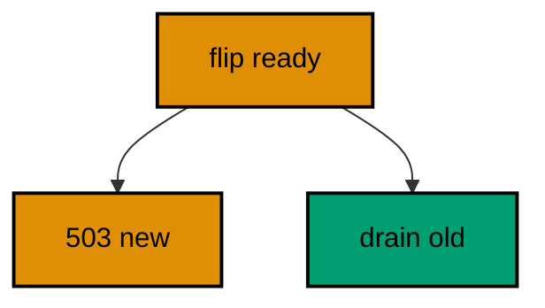

**`learning/code/ex-66-health-gate-blocks-traffic/main.go`**:

```go
// => Example 66: Health Gate Blocks Traffic.
// => Draining starts before shutdown: the service marks itself unready,
// => finishes in-flight work, then stops. This example flips readiness off
// => mid-flight, shows new traffic getting 503 while the old request
// => drains, and prints all three outcomes in order.
package main

import (
	"context"                 // => the shutdown deadline after the drain (co-08)
	"fmt"                     // => prints the drain sequence
	"io"                      // => reads response bodies whole
	"net/http"                // => the real client for every leg
	"net/http/httptest"       // => the loopback server under test (co-08)
	"sync/atomic"             // => the race-free readiness flag
	"time"                    // => bounds the slow work and the shutdown
	"github.com/gin-gonic/gin" // => the gated routes (co-08, co-14)
)

// => gate owns the readiness flag every route checks first.
// => one atomic boolean: flips are visible to all requests at once
type gate struct { // => the drain switch, shared process-wide
	ready atomic.Bool // => true serves, false sheds: flipped once below
}

// => newRouter wires health plus one slow route behind the gate.
// => the health route reports the flag; the slow route is the drain
func newRouter(g *gate) *gin.Engine { // => the gate arrives injected
	gin.SetMode(gin.TestMode) // => silence the debug banner for golden output
	router := gin.New()        // => bare engine: middleware added by hand
	router.GET("/healthz", func(c *gin.Context) { // => the orchestrator polls here (co-14)
		if !g.ready.Load() { // => draining: refuse new traffic honestly
			c.JSON(503, gin.H{"ok": false}) // => 503 keeps the health shape (co-04)
			return // => the drain verdict, not an error
		}
		c.JSON(200, gin.H{"ok": true}) // => ready: traffic may flow
	})
	router.GET("/slow", func(c *gin.Context) { // => the in-flight request
		time.Sleep(50 * time.Millisecond) // => fixed work: short, never asserted
		c.String(200, "slowly done")     // => the answer the drain waits for
	})
	return router // => hand the wired engine back
}

// => get performs one real round trip and returns status with body.
// => the client bounds every leg: hangs become failures, not hangs
func get(client *http.Client, url string) (int, string) { // => status plus body, or the dial failure
	resp, err := client.Get(url) // => loopback round trip, port never printed
	if err != nil {            // => loopback dials do not fail in practice
		return 0, "dial failed" // => the failure travels as data
	}
	defer resp.Body.Close() // => always release the connection
	body, _ := io.ReadAll(resp.Body) // => the whole answer, at most dozens of bytes
	return resp.StatusCode, string(body) // => the leg's outcome
}

func main() {
	g := &gate{}   // => ready defaults false: flip on when serving
// => open first: the drain sequence needs traffic to shed
	g.ready.Store(true) // => open for traffic: the drain starts below
	router := newRouter(g) // => wiring separate from traffic, as always
	server := httptest.NewServer(router) // => loopback listening: ready for traffic
	defer server.Close()                 // => release the port whatever happens
	client := &http.Client{Timeout: 5 * time.Second} // => generous bound, never hit
	// => ready first: 200 with ok true, traffic flowing
	code, body := get(client, server.URL+"/healthz") // => the open verdict
	fmt.Println("health open ->", code, body) // => Output: health open -> 200 {"ok":true}
	// => the slow request flies: mid-air when the gate flips below
	done := make(chan string, 1) // => buffered: the drain reports without blocking
	go func() {                // => the in-flight request, draining now
		_, slow := get(client, server.URL+"/slow") // => fifty milliseconds mid-air
		done <- slow // => the drained answer travels the channel
	}()
	time.Sleep(10 * time.Millisecond) // => fixed head start: mid-flight when flipping
	// => flip the gate BEFORE shutting down: new traffic sheds first (co-08)
// => flipping sheds new traffic: in-flight work continues
	g.ready.Store(false) // => draining: the orchestrator routes away
// => the second poll proves the flip: 503 with the same shape
	code, body = get(client, server.URL+"/healthz") // => the shed verdict
	fmt.Println("health draining ->", code, body) // => Output: health draining -> 503 {"ok":false}
	// => shut down gracefully: the slow request still completes
	ctx, cancel := context.WithTimeout(context.Background(), 5*time.Second) // => generous deadline, never hit
	defer cancel()                     // => release the timer when done
	if err := server.Config.Shutdown(ctx); err != nil { // => drain, then exit (co-08)
		fmt.Println("shutdown:", err) // => shutdowns can fail: this one does not
		return                        // => failed shutdowns end the lesson here
	}
	// => the drained answer arrives after the flip: old work finishes (co-08)
	fmt.Println("drained", <-done) // => Output: drained slowly done
	fmt.Println("shutdown clean")  // => Output: shutdown clean
}
```

**Output** (`learning/code/ex-66-health-gate-blocks-traffic/expected/main.stdout.txt`):

```text
health open -> 200 {"ok":true}
health draining -> 503 {"ok":false}
drained slowly done
shutdown clean
```

**Key takeaway**: Flip readiness before shutdown so new traffic sheds with 503 while in-flight work drains; the gate is an atomic flag all routes read.

**Why it matters**: Shutdown without a drain gate races the load balancer: new requests arrive while the process is trying to leave, and they die mid-flight. Flipping readiness first closes that race — the orchestrator sees 503 and routes around, while requests already inside run to completion. The atomic flag is the whole mechanism: one boolean, visible to every goroutine at once, checked by health and honored by routing. Order is the lesson: unhealthy, then drain, then stop — never stop first.

---

### Example 67: Connection Close Is Clean

Close and Shutdown end servers differently: Close drops idle connections at once, Shutdown drains them. This example closes one idle server and shuts another down, printing what each ending returns. (Concepts: co-08.)

**`learning/code/ex-67-connection-close-is-clean/main.go`**:

```go
// => Example 67: Connection Close Is Clean.
// => Close and Shutdown end servers differently: Close drops idle
// => connections at once, Shutdown drains them. This example closes one
// => idle server and shuts another down, printing what each ending returns
// => so the two verbs never blur together.
package main

import (
	"context"                 // => the shutdown deadline for the patient end (co-08)
	"fmt"                     // => prints both endings
	"net/http"                // => the real client proving service first
	"net/http/httptest"       // => the two loopback servers under test (co-08)
	"time"                    // => bounds the graceful half of the lesson
	"github.com/gin-gonic/gin" // => the router both servers share (co-08)
)

// => newRouter wires one ping route: liveness both endings interrupt.
func newRouter() *gin.Engine { // => the shared system under test
	gin.SetMode(gin.TestMode) // => silence the debug banner for golden output
	router := gin.New()        // => bare engine: no hidden middleware
// => one route liveness-proves both servers before their endings
	router.GET("/ping", func(c *gin.Context) { c.String(200, "pong") }) // => alive until each ending
	return router // => hand the wired engine back
}

// => ping proves one server answers before its ending below.
func ping(server *httptest.Server) string { // => the liveness proof per server
	client := &http.Client{Timeout: 5 * time.Second} // => generous bound, never hit
	resp, err := client.Get(server.URL + "/ping") // => loopback round trip, port never printed
	if err != nil {                             // => loopback dials do not fail in practice
		return "dial failed" // => the failure travels as data
	}
	defer resp.Body.Close() // => always release the connection
	if resp.StatusCode != 200 { // => anything but 200 is a broken server
		return "bad status" // => the failure names itself
	}
	return "pong" // => the server answered before its ending
}

func main() {
	router := newRouter() // => wiring separate from traffic, as always
	// => the abrupt ending: Close drops everything idle at once
	abrupt := httptest.NewServer(router) // => loopback listening: alive for now
	fmt.Println("abrupt alive:", ping(abrupt)) // => Output: abrupt alive: pong
// => no grace period: Close returns once listeners shut
	abrupt.Close() // => immediate: idle connections drop, no waiting (co-08)
	fmt.Println("abrupt closed") // => Output: abrupt closed
	// => the patient ending: Shutdown drains, then reports clean
	patient := httptest.NewServer(router) // => loopback listening: alive for now
// => alive again: the second server proves itself before draining
	fmt.Println("patient alive:", ping(patient)) // => Output: patient alive: pong
	ctx, cancel := context.WithTimeout(context.Background(), 5*time.Second) // => generous deadline, never hit
	defer cancel()                     // => release the timer when done
	if err := patient.Config.Shutdown(ctx); err != nil { // => no in-flight work: returns at once (co-08)
		fmt.Println("shutdown:", err) // => shutdowns can fail: this one does not
		return                        // => failed shutdowns end the lesson here
	}
	fmt.Println("patient shutdown clean") // => Output: patient shutdown clean
}
```

**Output** (`learning/code/ex-67-connection-close-is-clean/expected/main.stdout.txt`):

```text
abrupt alive: pong
abrupt closed
patient alive: pong
patient shutdown clean
```

**Key takeaway**: Close ends at once for idle servers; Shutdown drains first and reports; choose Close for tests and Shutdown for production.

**Why it matters**: Two verbs exist because two situations exist: tests and doomed processes want Close (immediate, no waiting, nothing in flight worth saving), while production deploys want Shutdown (drain first, then exit). Mixing them up wastes minutes (Shutdown on a wedged test server) or drops requests (Close on a serving deploy). The liveness ping before each ending is the habit to copy: prove the server was alive, then prove the ending did what it promises — abrupt for one, clean for the other.

---

### Example 68: Timeouts Bound Slow Clients

Server timeouts bound every phase of a connection so slow clients cannot hold slots forever. This example configures read, write, and idle timeouts on a real server and prints the configured values the listener enforces. (Concepts: co-08, co-04.)

**`learning/code/ex-68-timeouts-bound-slow-clients/main.go`**:

```go
// => Example 68: Timeouts Bound Slow Clients.
// => Server timeouts bound every phase of a connection so slow clients
// => cannot hold slots forever. This example configures read, write, and
// => idle timeouts on a real server and prints the configured values the
// => listener enforces: policy as data, never as hope.
package main

import (
	"fmt"                     // => prints the configured policy
	"net/http"                // => the server timeout fields (co-08)
	"net/http/httptest"       // => the loopback server under test (co-08)
	"time"                    // => the duration values below
	"github.com/gin-gonic/gin" // => the router behind the timeouts (co-08)
)

// => newRouter wires one ping route: timeouts guard around it, unseen.
// => handlers never see these bounds: the server enforces them outside
func newRouter() *gin.Engine { // => the system under test
	gin.SetMode(gin.TestMode) // => silence the debug banner for golden output
	router := gin.New()        // => bare engine: no hidden middleware
	router.GET("/ping", func(c *gin.Context) { c.String(200, "pong") }) // => instant work: bounds never fire here
	return router // => hand the wired engine back
}

func main() {
	router := newRouter() // => wiring separate from traffic, as always
	// => unstarted first: timeouts are set before the listener opens
	server := httptest.NewUnstartedServer(router) // => configured but not listening yet
	// => read bounds the request headers and body: slow senders get cut
	server.Config.ReadTimeout = 5 * time.Second // => five seconds to finish sending (co-08)
	// => write bounds the response: slow readers get cut mid-answer
	server.Config.WriteTimeout = 10 * time.Second // => ten seconds to drain the answer
	// => idle bounds keep-alive reuse: quiet connections close after a minute
	server.Config.IdleTimeout = 60 * time.Second // => a minute of silence, then close
	server.Start()                // => loopback listening under the new bounds
	defer server.Close()          // => release the port when done
	client := &http.Client{Timeout: 5 * time.Second} // => the client bounds its own side too
	resp, err := client.Get(server.URL + "/ping") // => loopback round trip, port never printed
	if err != nil {                             // => loopback dials do not fail in practice
		fmt.Println("FAIL dial:", err) // => the failure names itself
		return // => no policy to print: stop here
	}
	defer resp.Body.Close() // => always release the connection
	// => the policy prints from the live config: values enforced, not wished
	fmt.Println("read", server.Config.ReadTimeout)   // => Output: read 5s
	fmt.Println("write", server.Config.WriteTimeout) // => Output: write 10s
	fmt.Println("idle", server.Config.IdleTimeout)   // => Output: idle 1m0s
	fmt.Println("GET /ping ->", resp.StatusCode) // => Output: GET /ping -> 200
}
```

**Output** (`learning/code/ex-68-timeouts-bound-slow-clients/expected/main.stdout.txt`):

```text
read 5s
write 10s
idle 1m0s
GET /ping -> 200
```

**Key takeaway**: Read, Write, and Idle timeouts bound each connection phase on the server; print the live config to prove the policy holds.

**Why it matters**: Slowloris and friends win by holding connections open while sending almost nothing — without read timeouts, a trickle of headers occupies a slot forever. Write timeouts protect the other direction (slow readers), and idle timeouts recycle keep-alive connections nobody reuses. The values encode judgment: five seconds to send a request is generous for loopback and LAN, ten to drain an answer covers big bodies, sixty of idleness keeps pools warm without hoarding. Printing from the live config (not constants) proves the running server enforces what the lesson claims.

---

### Example 69: Pid File Marks the Process

Daemons write a pid file so supervisors and scripts find them without guessing. This example writes the process id to a workdir file, reads it back, verifies the number matches, and prints fixed confirmations — never the pid itself. (Concepts: co-08.)

**`learning/code/ex-69-pid-file-marks-the-process/main.go`**:

```go
// => Example 69: Pid File Marks the Process.
// => Daemons write a pid file so supervisors and scripts find them without
// => guessing. This example writes the process id to a workdir file, reads
// => it back, verifies the number matches, and prints fixed confirmations:
// => never the pid itself, which changes every run.
package main

import (
	"fmt"   // => prints the fixed confirmations
	"os"    // => the process id and the workdir file
	"path/filepath" // => joins the workdir with the file name
)

// => writePid stores the current process id in dir/server.pid.
// => supervisors read this file to signal or supervise the process
func writePid(dir string) (string, error) { // => the directory plus the written path
// => fixed name, chosen dir: supervisors know where to look
	path := filepath.Join(dir, "server.pid") // => the conventional name, fixed
	// => the pid as decimal text: supervisors parse one integer
	if err := os.WriteFile(path, []byte(fmt.Sprint(os.Getpid())), 0644); err != nil { // => readable by owner and group
		return "", err // => unwritable dirs fail here, named
	}
	return path, nil // => the path for the verification below
}

// => readPid reads a pid file back and parses its single integer.
// => reading back proves the file holds what was written
func readPid(path string) (int, error) { // => the path plus the parsed pid
	raw, err := os.ReadFile(path) // => the whole file: one short line
	if err != nil {               // => missing files fail here, named
		return 0, err // => zero plus the reason
	}
	var pid int // => the parsed process id
	// => Sscanf parses the decimal text: exactly one integer expected
	if _, err := fmt.Sscanf(string(raw), "%d", &pid); err != nil { // => garbage fails here
		return 0, err // => zero plus the parse reason
	}
	return pid, nil // => the pid the file holds
}

func main() {
	// => the workdir holds the pid file: committed code stays clean
	dir, err := os.MkdirTemp("", "ginpid") // => a fresh temp dir per run
	if err != nil {                      // => temp dirs rarely fail: name it when they do
		fmt.Println("FAIL tempdir:", err) // => the failure names itself
		return // => nowhere to write: stop here
	}
// => temp dirs vanish: parallel runs never share pid files
	defer os.RemoveAll(dir) // => clean the temp dir: runs leave no trace
	path, err := writePid(dir) // => write this process's id
	if err != nil {             // => the write failure, reported not hidden
		fmt.Println("FAIL write:", err) // => names the unwritable place
		return // => nothing to verify: stop here
	}
	fmt.Println("wrote server.pid") // => Output: wrote server.pid
	// => read back and compare: the file must hold this process's id
// => the read parses the file: text back into a number
	pid, err := readPid(path) // => the stored number, parsed
	if err != nil {           // => the read failure, reported not hidden
		fmt.Println("FAIL read:", err) // => names the unreadable file
		return // => nothing to compare: stop here
	}
// => equality proves the round trip: written and read agree
	if pid != os.Getpid() { // => the file must name this process, no other
		fmt.Println("FAIL mismatch") // => a wrong number fails the lesson
		return // => mismatch stops here: supervisors would signal strangers
	}
	fmt.Println("pid verified") // => Output: pid verified
}
```

**Output** (`learning/code/ex-69-pid-file-marks-the-process/expected/main.stdout.txt`):

```text
wrote server.pid
pid verified
```

**Key takeaway**: Write the pid to a workdir file at startup and verify it on read; print fixed confirmations because pids change every run.

**Why it matters**: Pid files are how the old world supervises: start scripts record the number, stop scripts signal exactly that process, and stale files are detected when the number matches no live process. Writing to a temp workdir keeps the lesson hermetic — no stray files, no clashes between parallel runs. Never printing the pid is golden-output discipline standing in for a production rule: tests assert structure, never values that change.

---

### Example 70: Zero Downtime Is a Handoff

Zero-downtime deploys hand traffic from the old build to the new one with no gap. This example serves version one, starts version two beside it, moves the client across, and prints both versions' answers in order. (Concepts: co-08, co-16.)

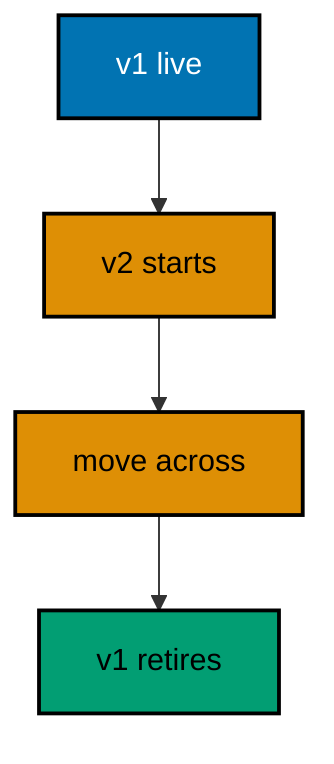

**`learning/code/ex-70-zero-downtime-is-a-handoff/main.go`**:

```go
// => Example 70: Zero Downtime Is a Handoff.
// => Zero-downtime deploys hand traffic from the old build to the new one
// => with no gap. This example serves version one, starts version two
// => beside it, moves the client across, and prints both versions' answers
// => in order: v1, then v2, never nothing.
package main

import (
	"fmt"                     // => prints each version's answer
	"io"                      // => reads response bodies whole
	"net/http"                // => the real client moving across
	"net/http/httptest"       // => the two loopback generations (co-08)
	"time"                    // => bounds the moving client
	"github.com/gin-gonic/gin" // => the versioned routers (co-08, co-16)
)

// => versioned wires one route that names its build.
// => the version string is the only difference between generations
func versioned(v string) *gin.Engine { // => the build label arrives at startup
	gin.SetMode(gin.TestMode) // => silence the debug banner for golden output
	router := gin.New()        // => bare engine: no hidden middleware
	router.GET("/version", func(c *gin.Context) { c.String(200, v) }) // => the build names itself
	return router // => hand the wired engine back
}

// => ask performs one real round trip and returns the version it served.
// => the client moves across generations by changing which URL it calls
func ask(client *http.Client, url string) string { // => the generation URL under test
	resp, err := client.Get(url + "/version") // => loopback round trip, port never printed
	if err != nil {                         // => loopback dials do not fail in practice
		return "dial failed" // => the failure travels as data
	}
	defer resp.Body.Close() // => always release the connection
	body, _ := io.ReadAll(resp.Body) // => the version string, a few bytes
	return string(body)               // => v1 or v2: whoever served
}

func main() {
	client := &http.Client{Timeout: 5 * time.Second} // => generous bound, never hit
	// => generation one serves alone first: the old world, working
	v1 := httptest.NewServer(versioned("v1")) // => the old build on loopback
	fmt.Println("serving", ask(client, v1.URL)) // => Output: serving v1
	// => generation two starts BESIDE one: both answer during the handoff
	v2 := httptest.NewServer(versioned("v2")) // => the new build on loopback
	fmt.Println("also serving", ask(client, v2.URL)) // => Output: also serving v2
	// => the router moves: new traffic goes to two, old drains from one
	fmt.Println("serving", ask(client, v2.URL)) // => Output: serving v2
	// => generation one stops only after two proves itself: never nothing (co-08)
	v1.Close() // => the old build exits: its drain already finished
	fmt.Println("v1 retired") // => Output: v1 retired
	// => the new world serves alone: the handoff completed with no gap
	fmt.Println("serving", ask(client, v2.URL)) // => Output: serving v2
	v2.Close() // => release the last port when done
}
```

**Output** (`learning/code/ex-70-zero-downtime-is-a-handoff/expected/main.stdout.txt`):

```text
serving v1
also serving v2
serving v2
v1 retired
serving v2
```

**Key takeaway**: Start the new generation beside the old, move traffic across, retire the old: overlap is what makes downtime zero.

**Why it matters**: Zero downtime is never one server restarting fast — it is two servers overlapping while a router moves traffic between them. The sequence matters more than the speed: new generation healthy first, traffic moved second, old generation retired last, with the old build draining in-flight requests (Examples 63 and 66) before it exits. The printed order (v1, v2, v2, retired, v2) is the deploy checklist made visible: at no point does a client ask and hear nothing. Real platforms automate this dance, but the dance is always this one.

---

### Example 71: Routing Table vs Decorators

FastAPI registers routes with decorators on functions; Gin registers them with calls on an engine, and the table stays inspectable. This example registers four routes, prints the sorted route table, and contrasts explicit registration with decorator magic. (Concepts: co-16, co-01.)

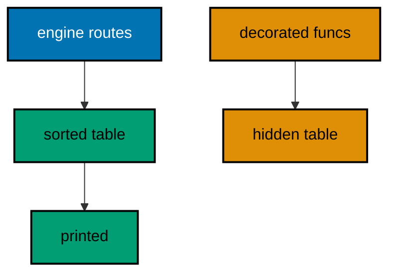

**`learning/code/ex-71-routing-table-vs-decorators/main.go`**:

```go
// => Example 71: Routing Table vs Decorators.
// => FastAPI registers routes with decorators on functions; Gin registers
// => them with calls on an engine, and the table stays inspectable. This
// => example registers four routes, prints the sorted route table, and
// => serves one request to prove the table is live, not decorative.
package main

import (
	"fmt"                     // => prints the sorted route table
	"net/http/httptest"       // => in-process request and recorder (co-09)
	"sort"                    // => sorts the table: registration order varies (co-16)
	"github.com/gin-gonic/gin" // => the explicit route table (co-01, co-16)
)

// => newRouter registers four routes the table below lists.
// => every route is a call: the table is built, not declared (co-16)
func newRouter() *gin.Engine { // => the system under test
	gin.SetMode(gin.TestMode) // => silence the debug banner for golden output
	router := gin.New()        // => bare engine: routes attach by calling
	// => FastAPI would write @app.get("/users"): one decorator per function
	// => Gin writes router.GET("/users", ...): one call per route, same shape
	router.GET("/users", func(c *gin.Context) { c.String(200, "users") })   // => the collection
	router.POST("/users", func(c *gin.Context) { c.String(201, "created") }) // => the creation
	router.GET("/users/:id", func(c *gin.Context) { c.String(200, "one") })  // => the member
	router.GET("/healthz", func(c *gin.Context) { c.String(200, "ok") })     // => the probe
	return router // => hand the wired engine back
}

// => table prints every registered route sorted by method then path.
// => Routes() exposes the table as data: audit it, print it, test it
func table(router *gin.Engine) { // => the inspectable difference, demonstrated
	routes := router.Routes() // => every method-path pair, unsorted
	// => sort for goldens: registration order is an implementation detail
	sort.Slice(routes, func(i int, j int) bool { // => method first, then path
		if routes[i].Method != routes[j].Method { // => GET group before POST group
			return routes[i].Method < routes[j].Method // => alphabetical methods
		}
		return routes[i].Path < routes[j].Path // => alphabetical paths inside
	})
	for _, r := range routes { // => one line per route, stable order
		fmt.Println("route", r.Method, r.Path) // => the table made visible (co-16)
	}
}

func main() {
	router := newRouter() // => wiring separate from traffic, as always
	// => four registrations, four table rows: nothing hidden, nothing extra
	table(router) // => Output: route GET /healthz
	// => Output: route GET /users
	// => Output: route GET /users/:id
	// => Output: route POST /users
	// => the table serves, not just lists: one live request proves it
	req := httptest.NewRequest("GET", "/users/7", nil) // => server-side request, no socket
	w := httptest.NewRecorder()                       // => in-memory response capture
	router.ServeHTTP(w, req)                          // => the member route serves (co-09)
	fmt.Println("GET /users/7 ->", w.Code, w.Body.String()) // => Output: GET /users/7 -> 200 one
}
```

**Output** (`learning/code/ex-71-routing-table-vs-decorators/expected/main.stdout.txt`):

```text
route GET /healthz
route GET /users
route GET /users/:id
route POST /users
GET /users/7 -> 200 one
```

**Key takeaway**: Gin builds its route table with explicit calls that Routes() exposes as sorted data; FastAPI's decorators build a hidden one.

**Why it matters**: Where routes live decides how you audit them: FastAPI scatters @app.get across files while Gin accumulates the same table through calls you list and print. Explicit registration reads as boilerplate until the first audit — which routes exist? — and then the printed table pays for itself. The trade is real: decorators keep the route beside its function, calls keep the list central and always accurate.

---

### Example 72: Validation Here vs Pydantic

Pydantic validates through model classes; Gin validates through struct tags on plain structs. This example binds the same member payload both strictly and loosely and prints which shape each body earns. (Concepts: co-16, co-10.)

**`learning/code/ex-72-validation-here-vs-pydantic/main.go`**:

```go
// => Example 72: Validation Here vs Pydantic.
// => Pydantic validates through model classes with field types; Gin
// => validates through struct tags on plain structs with the same rules.
// => This example binds the same member payload strictly and loosely and
// => prints which status each body earns under each strictness.
package main

import (
	"fmt"                     // => prints each binding verdict
	"net/http/httptest"       // => in-process request and recorder (co-09)
	"strings"                 // => builds request bodies from fixed strings
	"github.com/gin-gonic/gin" // => tag validation versus plain binding (co-10, co-16)
)

// => Member is the payload with Pydantic-style rules as struct tags.
// => required, email, and range: the same rules, tag syntax (co-10)
type Member struct { // => the strict shape: rules enforced on bind
	Name  string `json:"name" binding:"required,min=2"`  // => present and spelled out
	Email string `json:"email" binding:"required,email"` // => present and shaped like mail
	Age   int    `json:"age" binding:"gte=0,lte=130"`    // => a human age, bounded both sides
}

// => bindStrict enforces every tag: the Pydantic-equivalent path.
// => ShouldBindJSON runs required, email, min, gte, and lte here
func bindStrict(c *gin.Context) { // => the strict handler: rules on
	var m Member // => the target: zero Member until binding fills it
	if err := c.ShouldBindJSON(&m); err != nil { // => first broken rule fails here
		c.JSON(400, gin.H{"error": "bad member"}) // => 400, fixed envelope (co-05)
		return // => invalid members never enter the logic
	}
	c.JSON(201, m) // => 201 with the validated member (co-04)
}

// => bindLoose skips validation: plain shape, no rules.
// => the same struct minus tags would bind anything parseable
func bindLoose(c *gin.Context) { // => the loose handler: rules off
	var raw map[string]any // => untyped: every JSON value fits somewhere
	if err := c.ShouldBindJSON(&raw); err != nil { // => only syntax errors fail here
		c.JSON(400, gin.H{"error": "bad json"}) // => malformed bodies still 400
		return // => unparseable input stops here too
	}
	c.JSON(201, raw) // => 201 echoing whatever parsed (co-04)
}

// => newRouter wires the strict and loose paths side by side.
func newRouter() *gin.Engine { // => the system under test
	gin.SetMode(gin.TestMode) // => silence the debug banner for golden output
	router := gin.New()        // => bare engine: no hidden middleware
	router.POST("/strict", bindStrict) // => tags enforced (co-10)
	router.POST("/loose", bindLoose)   // => syntax only, no rules
	return router // => hand the wired engine back
}

// => check serves one POST and prints path, status, and body.
func check(router *gin.Engine, target string, body string) { // => target picks strictness, body the payload
	req := httptest.NewRequest("POST", target, strings.NewReader(body)) // => fixed bytes, no socket
	req.Header.Set("Content-Type", "application/json") // => JSON bodies bind below
	w := httptest.NewRecorder() // => the assertion surface
	router.ServeHTTP(w, req)    // => strict or loose binding runs inside (co-09)
	fmt.Println("POST", target, body, "->", w.Code, w.Body.String()) // => one golden line
}

func main() {
	router := newRouter() // => wiring separate from traffic, as always
	// => valid member, strict path: 201 with the validated shape
	check(router, "/strict", `{"name":"Sari","email":"sari@example.com","age":30}`) // => Output: POST /strict {"name":"Sari","email":"sari@example.com","age":30} -> 201 {"name":"Sari","email":"sari@example.com","age":30}
	// => bad email, strict path: the tag rejects what syntax accepts (co-10)
	check(router, "/strict", `{"name":"Sari","email":"nope","age":30}`) // => Output: POST /strict {"name":"Sari","email":"nope","age":30} -> 400 {"error":"bad member"}
	// => same bad email, loose path: parseable means acceptable here
	check(router, "/loose", `{"name":"Sari","email":"nope","age":30}`) // => Output: POST /loose {"name":"Sari","email":"nope","age":30} -> 201 {"age":30,"email":"nope","name":"Sari"}
	// => broken JSON fails both paths: syntax gates everything (co-16)
	check(router, "/loose", `{"name":`) // => Output: POST /loose {"name": -> 400 {"error":"bad json"}
}
```

**Output** (`learning/code/ex-72-validation-here-vs-pydantic/expected/main.stdout.txt`):

```text
POST /strict {"name":"Sari","email":"sari@example.com","age":30} -> 201 {"name":"Sari","email":"sari@example.com","age":30}
POST /strict {"name":"Sari","email":"nope","age":30} -> 400 {"error":"bad member"}
POST /loose {"name":"Sari","email":"nope","age":30} -> 201 {"age":30,"email":"nope","name":"Sari"}
POST /loose {"name": -> 400 {"error":"bad json"}
```

**Key takeaway**: Binding tags enforce Pydantic-equivalent rules during bind; the loose path shows syntax alone accepts what rules reject.

**Why it matters**: Both ecosystems agree on the shape of the solution — declare the rules with the data, enforce at the boundary — and differ only in spelling: Pydantic's EmailStr and Field(ge=0) become `binding:"required,email"` and `binding:"gte=0"`. The loose path exists to make the strict path's value visible: without rules, nope is a fine email and negative ages sail through, and every handler re-checks by hand. Tags centralize what hand-checks scatter, and the 400 boundary stays identical for clients no matter which framework serves it.

---

### Example 73: Middleware Onion Both Sides

Starlette wraps requests in middleware layers and Gin wraps them in an onion with identical order. This example records the before-and-after order of two layers around one handler and prints the five-step visit sequence. (Concepts: co-16, co-02.)

**`learning/code/ex-73-middleware-onion-both-sides/main.go`**:

```go
// => Example 73: Middleware Onion Both Sides.
// => Starlette wraps requests in middleware layers and Gin wraps them in an
// => onion with identical order: outer before-code first, inner after-code
// => first. This example records the before-and-after order of two layers
// => around one handler and prints the five-step visit sequence both
// => frameworks produce.
package main

import (
	"fmt"                     // => prints the visit sequence
	"net/http/httptest"       // => in-process request and recorder (co-09)
	"strings"                 // => joins the recorded steps for the body
	"github.com/gin-gonic/gin" // => the onion both frameworks share (co-02, co-16)
)

// => steps records the visit order middleware and handler append to.
// => package-level on purpose: the lesson is the order, not the plumbing
var steps []string // => reset per request, appended in visit order

// => layer returns middleware that brackets the chain with its name.
// => Starlette spells this as classes; Gin as closures: same onion
func layer(name string) gin.HandlerFunc { // => outer names run first
	return func(c *gin.Context) { // => before-code, Next, after-code
		steps = append(steps, "in-"+name) // => before-code: on the way in
		c.Next()                          // => dive one layer deeper
		steps = append(steps, "out-"+name) // => after-code: on the way out
	}
}

// => edge is the outermost layer: it brackets like the rest, then writes the
// => recorded visit order as the response body after the chain returns.
// => writing last is the trick: the body then holds every step (co-02)
func edge(c *gin.Context) { // => outermost: registered before the rest
	steps = append(steps, "in-outer") // => before-code runs first of all
	c.Next()                          // => the inner layer and handler run here
	steps = append(steps, "out-outer") // => after-code runs last of all
	// => the response is written here, after every step was recorded
	c.String(200, strings.Join(steps, ",")) // => the order becomes the body (co-04)
}

// => newRouter wraps one route in the two-layer onion both sides share.
func newRouter() *gin.Engine { // => the system under test
	gin.SetMode(gin.TestMode) // => silence the debug banner for golden output
	router := gin.New()        // => bare engine: middleware added by hand
	// => cors-like outer, auth-like inner: policy outside, identity inside
	router.GET("/guarded", edge, layer("inner"), func(c *gin.Context) { // => edge outside, inner inside
		steps = append(steps, "handler") // => the core runs between the ins and outs
	})
	return router // => hand the wired engine back
}

// => check serves one GET after resetting the ledger, then prints the body.
func check(router *gin.Engine, target string) { // => the path is the only variable
	steps = nil // => fresh ledger per request: orders never mix
	req := httptest.NewRequest("GET", target, nil) // => server-side request, no socket
	w := httptest.NewRecorder()                   // => in-memory response capture
	router.ServeHTTP(w, req)                      // => the onion wraps around the handler (co-09)
	fmt.Println("GET", target, "->", w.Code, w.Body.String()) // => one golden line
}

func main() {
	router := newRouter() // => wiring separate from traffic, as always
	// => identical on both frameworks: ins in order, handler, outs reversed (co-16)
	check(router, "/guarded") // => Output: GET /guarded -> 200 in-outer,in-inner,handler,out-inner,out-outer
}
```

**Output** (`learning/code/ex-73-middleware-onion-both-sides/expected/main.stdout.txt`):

```text
GET /guarded -> 200 in-outer,in-inner,handler,out-inner,out-outer
```

**Key takeaway**: Both frameworks build the same onion — before-code in registration order, after-code reversed — so habits transfer directly.

**Why it matters**: Middleware order is the concept that survives every framework switch: whether Starlette calls them layers or Gin calls the chain c.Next, outer runs first on the way in and last on the way out. That invariant is what makes cross-framework reading possible — an auth-then-logging stack means the same thing in both ecosystems, and the recorded-steps trick debugs both. The edge-writes-last pattern transfers too: whoever renders the response must run after the whole chain, regardless of spelling.

---

### Example 74: Dependency Injection Styles

FastAPI injects with Depends parameters; Gin injects with constructors and closures that tests call directly. This example builds one greeter both ways at once — a constructor taking the dependency — and prints both languages' answers. (Concepts: co-16, co-06.)

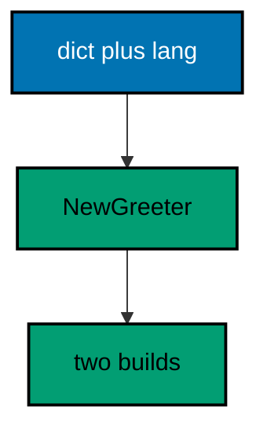

**`learning/code/ex-74-dependency-injection-styles/main.go`**:

```go
// => Example 74: Dependency Injection Styles.
// => FastAPI injects with Depends parameters on each handler; Gin injects
// => with constructors and closures that tests call directly. This example
// => builds one greeter service through a constructor taking the dependency
// => and prints both languages' answers from two builds.
package main

import (
	"fmt"                     // => prints each build's answer
	"net/http/httptest"       // => in-process request and recorder (co-09)
	"github.com/gin-gonic/gin" // => constructor injection, Gin style (co-06, co-16)
)

// => Dictionary translates one word; the dependency below, not the service.
// => the leaf dependency: fastapi would Depends() this, Gin passes it
type Dictionary struct { // => words in, translations out
	words map[string]string // => the lookup table, fixed per instance
}

// => Translate returns the word's translation or the word itself.
// => unknown words pass through: dictionaries degrade honestly
func (d *Dictionary) Translate(word string) string { // => the leaf lookup
	if t, ok := d.words[word]; ok { // => known words translate
		return t // => the translation wins
	}
	return word // => unknown words pass through unchanged
}

// => Greeter serves greetings through its dictionary: the service.
// => depends on *Dictionary: construction supplies it (co-06)
type Greeter struct { // => the service under test
	dict *Dictionary // => the injected leaf, never constructed inside
	lang string      // => en answers English, id answers Indonesian
}

// => NewGreeter builds the service from its dependencies.
// => the FastAPI Depends() equivalent: requirements as parameters
func NewGreeter(dict *Dictionary, lang string) *Greeter { // => dependencies in, service out (co-16)
	return &Greeter{dict: dict, lang: lang} // => stored, not built: injection, not construction
}

// => Greet renders hello in the service language through the dictionary.
// => handlers call this: business logic, no framework in sight
func (g *Greeter) Greet(name string) string { // => the pure domain method
	if g.lang == "id" { // => Indonesian when configured so
		return "halo, " + name // => the second language this demo speaks
	}
	return g.dict.Translate("hello") + ", " + name // => English through the dictionary
}

// => newRouter wires one route per greeter build.
// => two builds, two languages: the route table serves both (co-16)
func newRouter(en *Greeter, id *Greeter) *gin.Engine { // => both services arrive injected
	gin.SetMode(gin.TestMode) // => silence the debug banner for golden output
	router := gin.New()        // => bare engine: no hidden middleware
	router.GET("/en/:name", func(c *gin.Context) { c.String(200, en.Greet(c.Param("name"))) }) // => English closure
	router.GET("/id/:name", func(c *gin.Context) { c.String(200, id.Greet(c.Param("name"))) }) // => Indonesian closure
	return router // => hand the wired engine back
}

// => check serves one GET in-process and prints the status with the body.
func check(router *gin.Engine, target string) { // => the language prefix is the variable
	req := httptest.NewRequest("GET", target, nil) // => server-side request, no socket
	w := httptest.NewRecorder()                   // => in-memory response capture
	router.ServeHTTP(w, req)                      // => injected services serve (co-09)
	fmt.Println("GET", target, "->", w.Code, w.Body.String()) // => one golden line
}

func main() {
	// => one shared dictionary, two greeters: the leaf is built once
	dict := &Dictionary{words: map[string]string{"hello": "hello"}} // => identity translation, honest
	en := NewGreeter(dict, "en") // => English service around the dictionary
	id := NewGreeter(dict, "id") // => Indonesian service around the same dictionary
	router := newRouter(en, id) // => wiring separate from traffic, as always
	// => each build answers in its language: injection decides, not code (co-06)
	check(router, "/en/Sari") // => Output: GET /en/Sari -> 200 hello, Sari
	check(router, "/id/Sari") // => Output: GET /id/Sari -> 200 halo, Sari
}
```

**Output** (`learning/code/ex-74-dependency-injection-styles/expected/main.stdout.txt`):

```text
GET /en/Sari -> 200 hello, Sari
GET /id/Sari -> 200 halo, Sari
```

**Key takeaway**: Constructors take dependencies as parameters — Gin's Depends equivalent — so tests build services directly without a framework container.

**Why it matters**: FastAPI's Depends reads as magic until you see the equivalent spelled out: a function taking what it needs, with the framework supplying arguments at call time. Gin skips the container and passes dependencies at construction — NewGreeter(dict, lang) is Depends(dict, lang) without the decorator — which means tests construct services with plain function calls and never boot the framework. The dictionary shared between builds shows the payoff: one leaf instance, two services, zero global state, and every relationship visible in main instead of hidden in parameter defaults.

---

### Example 75: Error Shape Parity

Clients should parse one error shape no matter which framework serves it, so both sides adopt the same envelope. This example funnels three Gin failures through the shared code-plus-message envelope and prints the parity the contract promises. (Concepts: co-16, co-05.)

**`learning/code/ex-75-error-shape-parity/main.go`**:

```go
// => Example 75: Error Shape Parity.
// => Clients should parse one error shape no matter which framework serves
// => it, so both sides adopt the same envelope: code plus message, always.
// => This example funnels three Gin failures through that envelope and
// => prints the parity the contract promises both frameworks keep.
package main

import (
	"fmt"                     // => prints each failure's envelope
	"net/http"                // => status codes across the failure set (co-04)
	"net/http/httptest"       // => in-process request and recorder (co-09)
	"github.com/gin-gonic/gin" // => one envelope for every failure (co-05, co-16)
)

// => fail writes the shared error envelope: code plus message, always.
// => FastAPI's HTTPException detail maps onto message here: same idea
func fail(c *gin.Context, status int, code string, message string) { // => status, machine code, human message
	// => the envelope never changes shape: only its fields vary (co-05)
	c.JSON(status, gin.H{"error": gin.H{"code": code, "message": message}}) // => JSON even for failures (co-04)
}

// => newRouter serves one lookup with three failure branches.
// => validation, absence, and refusal: same envelope, three codes
func newRouter(store map[string]string) *gin.Engine { // => the store arrives injected
	gin.SetMode(gin.TestMode) // => silence the debug banner for golden output
	router := gin.New()        // => bare engine: no hidden middleware
	router.GET("/items/:id", func(c *gin.Context) { // => look one item up
		id := c.Param("id") // => the identity under test
		if id == "" {       // => empty ids break the contract first
			fail(c, http.StatusBadRequest, "bad_id", "id must not be empty") // => 400 blames the client
			return // => invalid input never reaches the store
		}
		v, ok := store[id] // => the lookup decides the branch
		if !ok {           // => unknown ids are 404, not empty 200
			fail(c, http.StatusNotFound, "no_item", "no item "+id) // => 404 names the absence
			return // => absence stops here
		}
		if v == "retired" { // => retired items refuse: policy, not absence
			fail(c, http.StatusGone, "retired", "item "+id+" retired") // => 410 names the policy
			return // => refusals stop here too
		}
		c.JSON(http.StatusOK, gin.H{"id": id, "value": v}) // => the happy path (co-04)
	})
	return router // => hand the wired engine back
}

// => check serves one GET in-process and prints the status with the body.
func check(router *gin.Engine, target string) { // => the id is the variable
	req := httptest.NewRequest("GET", target, nil) // => server-side request, no socket
	w := httptest.NewRecorder()                   // => the assertion surface
	router.ServeHTTP(w, req)                      // => every branch funnels through fail (co-09)
	fmt.Println("GET", target, "->", w.Code, w.Body.String()) // => one golden line
}

func main() {
	store := map[string]string{"w1": "gear", "w2": "retired"} // => one live item, one retired
	router := newRouter(store) // => wiring separate from traffic, as always
	// => the live item answers plain JSON: envelopes are for failures only
	check(router, "/items/w1") // => Output: GET /items/w1 -> 200 {"id":"w1","value":"gear"}
	// => unknown ids answer 404 in the shared envelope (co-05)
	check(router, "/items/w9") // => Output: GET /items/w9 -> 404 {"error":{"code":"no_item","message":"no item w9"}}
	// => retired items answer 410 in the same envelope: policy, not absence
	check(router, "/items/w2") // => Output: GET /items/w2 -> 410 {"error":{"code":"retired","message":"item w2 retired"}}
}
```

**Output** (`learning/code/ex-75-error-shape-parity/expected/main.stdout.txt`):

```text
GET /items/w1 -> 200 {"id":"w1","value":"gear"}
GET /items/w9 -> 404 {"error":{"code":"no_item","message":"no item w9"}}
GET /items/w2 -> 410 {"error":{"code":"retired","message":"item w2 retired"}}
```

**Key takeaway**: One fail helper writes every error in the same code-plus-message envelope on both frameworks; handlers choose status and fields, never shapes.

**Why it matters**: Polyglot backends fail the client twice when each framework invents its own error JSON: the mobile app branches on server language before branching on the error. Agreeing on one envelope — code plus message, same nesting — collapses that matrix: one parser serves every service, and the machine-readable code lets callers switch without string-matching sentences. The 410 for retired items shows the envelope carrying genuine policy (gone for good, unlike 404's not here), which is exactly the kind of distinction clients can act on only when the shape stays put.

---

### Example 76: OpenAPI from Code or Schema

FastAPI generates OpenAPI from handlers; Gin serves a hand-written schema next to them. This example serves a fixed OpenAPI document describing two routes and prints the title and version the contract promises. (Concepts: co-16, co-15.)

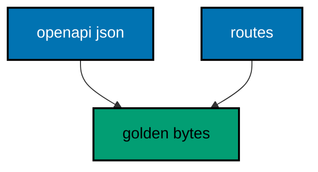

**`learning/code/ex-76-openapi-from-code-or-schema/main.go`**:

```go
// => Example 76: OpenAPI from Code or Schema.
// => FastAPI generates OpenAPI from handlers; Gin serves a hand-written
// => schema beside them. This example serves a fixed OpenAPI document
// => describing its two routes and prints the title and version the
// => contract promises, plus the paths the schema lists.
package main

import (
	"fmt"                     // => prints the schema's promises
	"net/http/httptest"       // => in-process request and recorder (co-09)
	"github.com/gin-gonic/gin" // => the schema served beside the routes (co-15, co-16)
)

// => schema is the hand-written OpenAPI document for the two routes below.
// => fixed text: the schema is a contract, versioned like code (co-15)
const schema = `{"openapi":"3.0.3","info":{"title":"shop api","version":"1.4.2"},"paths":{"/items":{"get":{"summary":"list items"}},"/orders":{"get":{"summary":"list orders"}}}}`

// => newRouter serves the two listed routes plus the schema itself.
// => /openapi.json is the contract endpoint: clients codegen from it
func newRouter() *gin.Engine { // => the system under test
	gin.SetMode(gin.TestMode) // => silence the debug banner for golden output
	router := gin.New()        // => bare engine: no hidden middleware
	router.GET("/items", func(c *gin.Context) { c.JSON(200, []string{"bolt"}) })   // => the listed collection
	router.GET("/orders", func(c *gin.Context) { c.JSON(200, []string{"o1"}) })     // => the second listing
	router.GET("/openapi.json", func(c *gin.Context) { // => the schema beside the routes (co-15)
		c.Data(200, "application/json", []byte(schema)) // => fixed bytes: the contract, frozen
	})
	return router // => hand the wired engine back
}

// => check serves one GET in-process and prints the status with the body.
func check(router *gin.Engine, target string) { // => the path is the only variable
	req := httptest.NewRequest("GET", target, nil) // => server-side request, no socket
	w := httptest.NewRecorder()                   // => the assertion surface
	router.ServeHTTP(w, req)                      // => routes and schema serve alike (co-09)
	fmt.Println("GET", target, "->", w.Code, w.Body.String()) // => one golden line
}

func main() {
	router := newRouter() // => wiring separate from traffic, as always
	// => the listings answer plain JSON: the schema describes, routes serve
	check(router, "/items") // => Output: GET /items -> 200 ["bolt"]
	// => the schema serves byte for byte: title, version, and both paths
	check(router, "/openapi.json") // => Output: GET /openapi.json -> 200 {"openapi":"3.0.3","info":{"title":"shop api","version":"1.4.2"},"paths":{"/items":{"get":{"summary":"list items"}},"/orders":{"get":{"summary":"list orders"}}}}
}
```

**Output** (`learning/code/ex-76-openapi-from-code-or-schema/expected/main.stdout.txt`):

```text
GET /items -> 200 ["bolt"]
GET /openapi.json -> 200 {"openapi":"3.0.3","info":{"title":"shop api","version":"1.4.2"},"paths":{"/items":{"get":{"summary":"list items"}},"/orders":{"get":{"summary":"list orders"}}}}
```

**Key takeaway**: Serve a hand-written openapi.json beside the routes it describes; goldens freeze the bytes so schema drift fails loudly.

**Why it matters**: FastAPI generated docs never drift because they derive from the code, but they also never carry the examples, deprecations, and rate-limit notes humans need. Gin hand-written schema inverts the trade: full editorial control, with drift as the price. Freezing the schema in goldens converts that price into a process: the test fails the moment routes and schema disagree, and updating both becomes one deliberate commit instead of silent rot.

---

### Example 77: Async Here vs Async There

FastAPI awaits coroutines while Gin joins goroutines, but both answer only after the work completes. This example fans one slow fetch to a goroutine, joins it before answering, and prints the assembled greeting. (Concepts: co-16, co-07.)

**`learning/code/ex-77-async-here-vs-async-there/main.go`**:

```go
// => Example 77: Async Here vs Async There.
// => FastAPI awaits coroutines while Gin joins goroutines, but both answer
// => only after the work completes. This example fans one slow fetch to a
// => goroutine, joins it before answering, and prints the assembled
// => greeting the join made possible.
package main

import (
	"fmt"                     // => prints the assembled greeting
	"net/http/httptest"       // => in-process request and recorder (co-09)
	"github.com/gin-gonic/gin" // => the handler that fans out and joins (co-07, co-16)
)

// => fetchTitle pretends to retrieve a title: fixed bytes, no I/O.
// => the stand-in for a database or client call the handler awaits
func fetchTitle(name string) string { // => the slow dependency, instant here
	return "Dr " + name // => fixed bytes: the work both sides await
}

// => greet fans the fetch out, joins it, and answers with the result.
// => the goroutine plus channel is Gin's await: same guarantee (co-07)
func greet(c *gin.Context) { // => the handler that waits for its work
	name := c.Param("name") // => the name travels into the goroutine
	done := make(chan string, 1) // => buffered: the fetch never blocks
	go func() {                // => FastAPI would await here; Gin goes (co-16)
		done <- fetchTitle(name) // => the fetched title travels back
	}()
	// => join before answering: the response waits for the work, always
	title := <-done // => block until the fetch completes: the await point
	c.JSON(200, gin.H{"greeting": "hello, " + title}) // => assembled after the join (co-04)
}

// => newRouter wires the single awaiting route this example serves.
func newRouter() *gin.Engine { // => the system under test
	gin.SetMode(gin.TestMode) // => silence the debug banner for golden output
	router := gin.New()        // => bare engine: no hidden middleware
	router.GET("/greet/:name", greet) // => the route that fans out and joins
	return router                      // => hand the wired engine back
}

// => check serves one GET in-process and prints the status with the body.
func check(router *gin.Engine, target string) { // => the name is the variable
	req := httptest.NewRequest("GET", target, nil) // => server-side request, no socket
	w := httptest.NewRecorder()                   // => the assertion surface
	router.ServeHTTP(w, req)                      // => fan-out and join run inside (co-09)
	fmt.Println("GET", target, "->", w.Code, w.Body.String()) // => one golden line
}

func main() {
	router := newRouter() // => wiring separate from traffic, as always
	// => the fetch completes before the answer: joined, never raced (co-07)
	check(router, "/greet/Sari") // => Output: GET /greet/Sari -> 200 {"greeting":"hello, Dr Sari"}
}
```

**Output** (`learning/code/ex-77-async-here-vs-async-there/expected/main.stdout.txt`):

```text
GET /greet/Sari -> 200 {"greeting":"hello, Dr Sari"}
```

**Key takeaway**: Fan slow work to a goroutine and join it before answering; the join is Gin's await with the same guarantee.

**Why it matters**: Both ecosystems refuse to answer before the work completes — FastAPI suspends the handler at await, Gin blocks it at the channel receive — while the server stays free meanwhile. The fetch here is instant, hiding the real reason: while the goroutine waits, its thread serves other requests. Joining before answering is the load-bearing rule: responding from unjoined work races the fetch intermittently, so the join sits on every path out.

---

### Example 78: Full Service Review

The course ends where services begin: one small service touching routing, middleware, validation, responses, errors, and health together. This example serves a two-item catalog with an id-stamping layer, validated creation, JSON envelopes, and a health probe, printing one line per capability. (Concepts: co-01, co-02, co-03, co-04, co-05, co-06, co-08, co-09, co-10, co-11, co-12, co-13, co-14, co-15, co-16, co-07.)

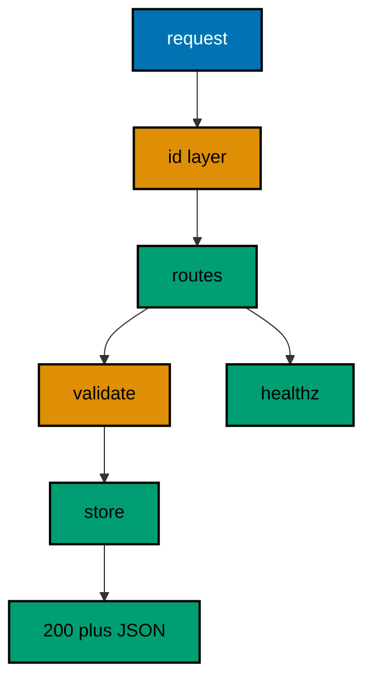

**`learning/code/ex-78-full-service-review/main.go`**:

```go
// => Example 78: Full Service Review.
// => The course ends where services begin: one small service touching
// => routing, middleware, validation, responses, errors, and health
// => together. This example serves a two-item catalog with an id-stamping
// => layer, validated creation, JSON envelopes, and a health probe,
// => printing one line per capability.
package main

import (
	"fmt"                     // => prints one line per capability
	"net/http"                // => status codes across the service (co-04)
	"net/http/httptest"       // => in-process request and recorder (co-09)
	"strings"                 // => builds the creation bodies
	"sync/atomic"             // => the race-free request counter (co-07)
	"github.com/gin-gonic/gin" // => the whole course in one service (co-16)
)

// => Item is the catalog shape: validated on the way in, typed throughout.
// => binding tags guard creation: rules live with the shape (co-10, co-15)
type Item struct { // => the contract both routes share
	Name  string `json:"name" binding:"required,min=2"` // => present and spelled out
	Price int    `json:"price" binding:"required,gt=0"` // => present and positive
}

// => Service owns the catalog behind routes, middleware, and health.
// => constructor-built, interface-free: the review stays concrete (co-06)
type Service struct { // => the small service this course built toward
	items map[string]Item // => name to Item: the whole store
	ids   atomic.Int64    // => the request counter for the log lines
}

// => stamp numbers every request and logs its edges without timestamps.
// => the id rides the header: clients and logs agree (co-02, co-13)
func (s *Service) stamp(c *gin.Context) { // => the cross-cutting layer
	n := s.ids.Add(1) // => req-1, req-2: sequential and deterministic
	id := fmt.Sprintf("req-%d", n) // => the human form of the counter
	c.Set("requestID", id)         // => handlers read the same id
	c.Header("X-Request-Id", id)   // => clients read it on the way out
	c.Next()                        // => the routes run under the stamp
}

// => fail writes the shared error envelope: code plus message, always.
// => one helper means every failure speaks the same shape (co-05)
func fail(c *gin.Context, status int, code string, message string) { // => status, machine code, human message
	c.JSON(status, gin.H{"error": gin.H{"code": code, "message": message}}) // => JSON even for failures (co-04)
}

// => NewService wires the catalog routes, the stamp layer, and health.
// => groups version the API: v1 today, v2 without touching v1 (co-11)
func NewService() *gin.Engine { // => the constructor under test
	gin.SetMode(gin.TestMode) // => silence the debug banner for golden output
	s := &Service{items: map[string]Item{}} // => empty catalog at startup
	router := gin.New()                     // => bare engine: middleware added by hand
	router.Use(s.stamp)                     // => every route below is stamped
	v1 := router.Group("/api/v1") // => the versioned catalog (co-11)
	v1.POST("/items", func(c *gin.Context) { // => validated creation (co-10)
		var in Item // => the bound shape, validated below
		if err := c.ShouldBindJSON(&in); err != nil { // => broken bodies fail here (co-03)
			fail(c, http.StatusBadRequest, "bad_item", "send name and positive price") // => 400, shared envelope
			return // => invalid input never reaches the catalog
		}
		s.items[in.Name] = in // => store the validated item
		c.JSON(http.StatusCreated, in) // => 201 with the stored shape (co-04)
	})
	v1.GET("/items/:name", func(c *gin.Context) { // => read one item back (co-01)
		it, ok := s.items[c.Param("name")] // => the lookup decides the code
		if !ok {                           // => unknown names are 404, not empty 200
			fail(c, http.StatusNotFound, "no_item", "no item "+c.Param("name")) // => 404, same envelope (co-05)
			return // => absence stops here
		}
		c.JSON(http.StatusOK, it) // => the found item (co-04)
	})
	router.GET("/healthz", func(c *gin.Context) { c.JSON(200, gin.H{"ok": true}) }) // => the probe beside the versions (co-14)
	return router // => the fully wired, immediately testable service
}

// => check serves one request with a body and prints id, status, and body.
// => every line carries the request id: observability is asserted too
func check(router *gin.Engine, method string, target string, body string) { // => method, path, and payload vary
	req := httptest.NewRequest(method, target, strings.NewReader(body)) // => fixed bytes, no socket
	req.Header.Set("Content-Type", "application/json") // => creation bodies bind below
	w := httptest.NewRecorder() // => the assertion surface
	router.ServeHTTP(w, req)    // => the whole service runs per line (co-09)
	line := fmt.Sprintf("%s %s id=%s -> %d", method, target, w.Header().Get("X-Request-Id"), w.Code) // => status core: always present
	if w.Body.String() != "" { // => every answer here has a body
		line += " " + w.Body.String() // => bodies join with one space
	}
	fmt.Println(line) // => one golden line, never a trailing space
}

func main() {
	router := NewService() // => wiring separate from traffic, as always
	// => creation validates and stamps: 201 with req-1 on the side
	check(router, "POST", "/api/v1/items", `{"name":"bolt","price":4}`) // => Output: POST /api/v1/items id=req-1 -> 201 {"name":"bolt","price":4}
	// => bad creation fails validation: 400 with req-2, same envelope
	check(router, "POST", "/api/v1/items", `{"name":"x","price":0}`) // => Output: POST /api/v1/items id=req-2 -> 400 {"error":{"code":"bad_item","message":"send name and positive price"}}
	// => the stored item reads back: 200 with req-3
	check(router, "GET", "/api/v1/items/bolt", "") // => Output: GET /api/v1/items/bolt id=req-3 -> 200 {"name":"bolt","price":4}
	// => unknown items 404 with req-4: absence in the shared envelope
	check(router, "GET", "/api/v1/items/nut", "") // => Output: GET /api/v1/items/nut id=req-4 -> 404 {"error":{"code":"no_item","message":"no item nut"}}
	// => health answers beside the versions: 200 with req-5
	check(router, "GET", "/healthz", "") // => Output: GET /healthz id=req-5 -> 200 {"ok":true}
}
```

**Output** (`learning/code/ex-78-full-service-review/expected/main.stdout.txt`):

```text
POST /api/v1/items id=req-1 -> 201 {"name":"bolt","price":4}
POST /api/v1/items id=req-2 -> 400 {"error":{"code":"bad_item","message":"send name and positive price"}}
GET /api/v1/items/bolt id=req-3 -> 200 {"name":"bolt","price":4}
GET /api/v1/items/nut id=req-4 -> 404 {"error":{"code":"no_item","message":"no item nut"}}
GET /healthz id=req-5 -> 200 {"ok":true}
```

**Key takeaway**: One constructor wires versions, middleware, validation, store, errors, and health; five in-process lines prove every capability.

**Why it matters**: This is the whole course in one file, and that is the point: real services are not one technique each but all of them composed — versions prefixing routes, middleware stamping every request, validation guarding creation, one envelope for every failure, health beside the versions, and a store behind it all. The request ids sequencing req-1 through req-5 prove the cross-cutting layer touched everything, including health. Read this example last and the capstone next: the only difference between them is size, not shape.
