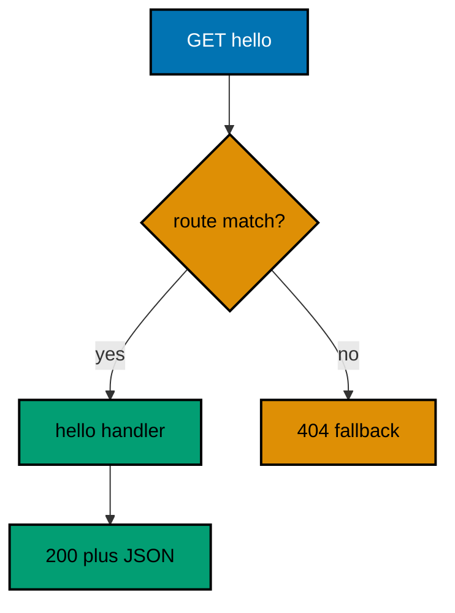
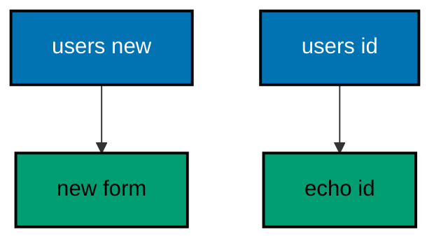
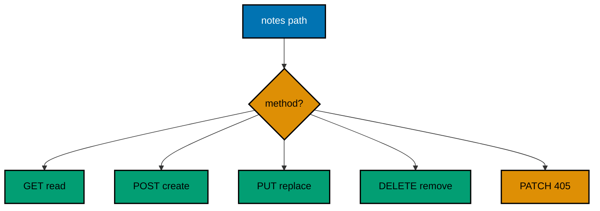
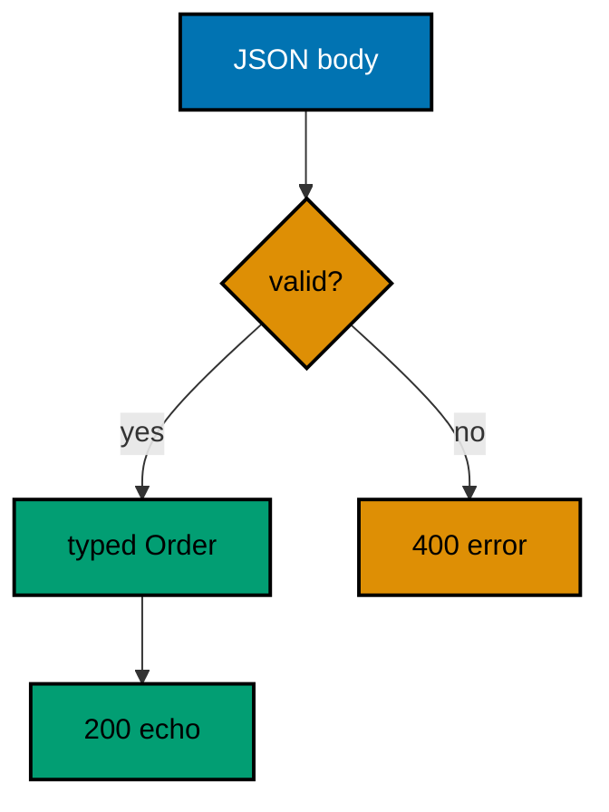
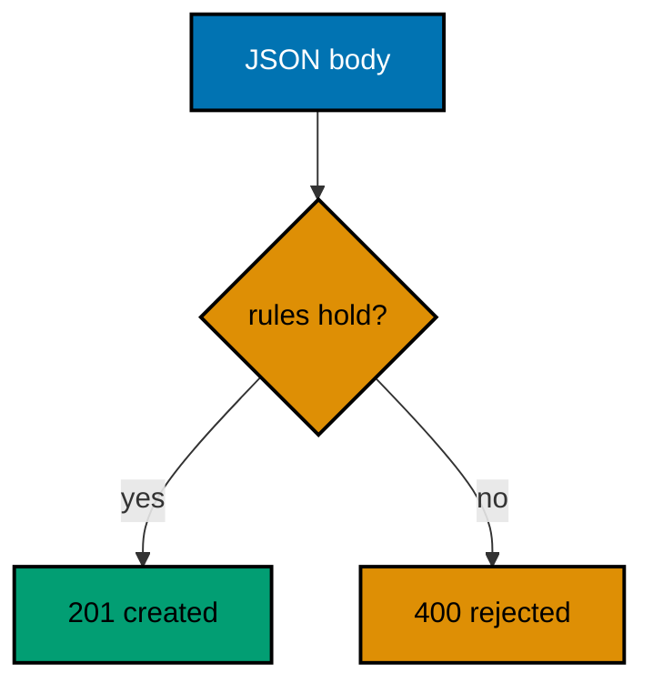
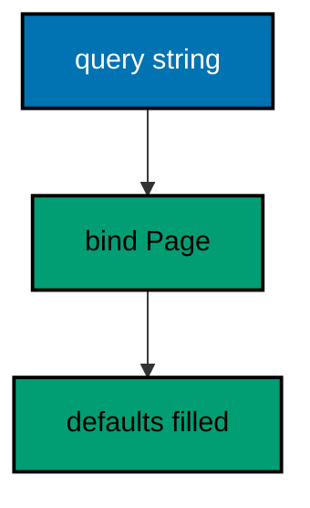
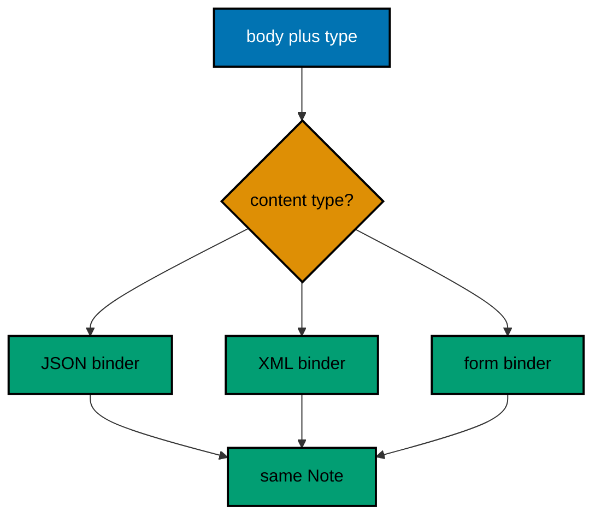
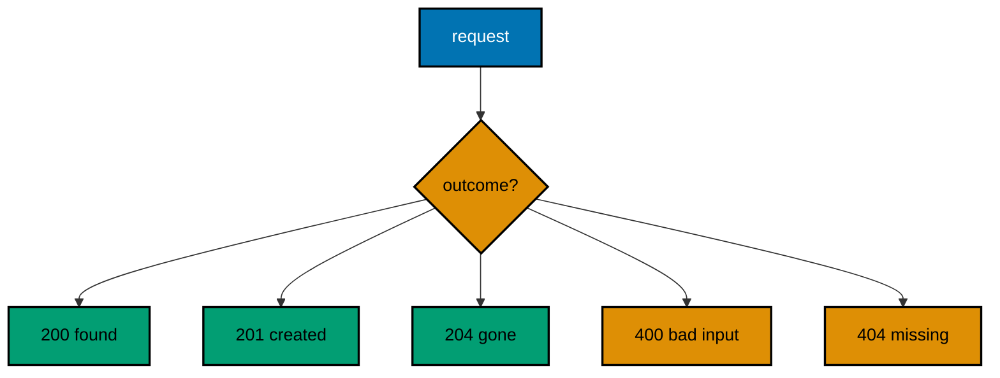
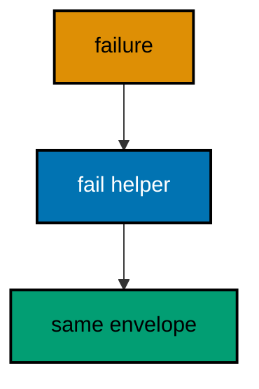
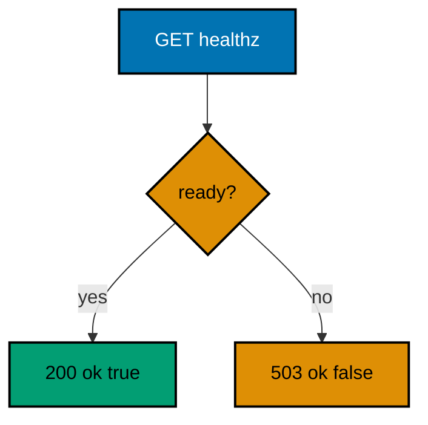

Examples 1-25 build the Gin service skeleton from the ground up: routes and handlers first (Examples 1-8), mapping methods and paths to small functions that return JSON; then request parsing and validation (Examples 9-17), reading path, query, header, and body data into typed values and rejecting malformed input; finally response shaping and status codes (Examples 18-25), producing consistent statuses, formats, and envelopes including a health check. Every example is a complete, runnable Go module vendoring Gin under `learning/code/`; run each with the command in its own `run.yaml`.

---

### Example 1: Hello Route Returns JSON

A single route is a contract: this method plus this path always produces that shape. This example registers `GET /hello`, serves it in-process without a socket, and prints the status with the body, plus the 404 an unknown path falls through to. (Concepts: co-01, co-04.)



**`learning/code/ex-01-hello-route-returns-json/main.go`**:

```go
// => Example 1: Hello Route Returns JSON.
// => A Gin route maps one method plus one path to one handler function, and
// => the handler turns the request into a response. This example registers
// => GET /hello, calls it in-process (no socket, no network), and prints the
// => status code with the JSON body the handler wrote.
package main

import (
	"fmt"                     // => prints each in-process check result to stdout
	"net/http"                // => status codes and the request constructor (co-01)
	"net/http/httptest"       // => in-process request and recorder: no socket (co-09)
	"github.com/gin-gonic/gin" // => the web framework this course teaches (co-01)
)

// => hello writes the fixed greeting contract this example promises.
// => gin.Context carries the request in and the response out
// => the handler returns nothing: it writes through c instead
func hello(c *gin.Context) { // => c is the per-request gin context (co-01)
	// => gin.H is a shortcut map for one-off JSON objects
	// => encoding/json sorts the single key, so the body is stable
	c.JSON(http.StatusOK, gin.H{"message": "hello, gin"}) // => 200 plus the greeting body (co-04)
	// => StatusOK names 200: the code says what happened (co-04)
}

// => newRouter builds the service with every route this example serves.
// => a constructor keeps wiring in one place the tests can call (co-06)
// => returning the engine lets each check serve requests in-process (co-09)
func newRouter() *gin.Engine { // => *gin.Engine is the request multiplexer
	// => TestMode silences gin's debug banner so stdout stays golden-clean
	gin.SetMode(gin.TestMode) // => no debug output: only our prints appear
	// => New starts with no middleware: nothing hidden runs here (co-02)
	router := gin.New() // => a bare engine: routes only, no logger (co-01)
	// => GET names the method, "/hello" the path, hello the handler
	router.GET("/hello", hello) // => one method plus one path picks hello (co-01)
	return router               // => hand the wired engine back to the caller
}

// => check serves one request in-process and prints what the handler did.
// => httptest keeps the whole exchange inside this process (co-09)
// => nothing here dials a port: there is no network call at all
func check(router *gin.Engine, method string, target string) { // => method and path name the request
	// => NewRequest builds a server-side request without a client socket
	req := httptest.NewRequest(method, target, nil) // => nil body: GET carries no payload
	// => the recorder captures status, headers, and body in memory
	w := httptest.NewRecorder() // => in-memory response: nothing leaves the process
	// => ServeHTTP runs routing, handlers, and middleware exactly as live
	router.ServeHTTP(w, req) // => the full gin pipeline, minus the socket (co-09)
	// => Code is the numeric status; Body holds the exact bytes written
	fmt.Println(method, target, "->", w.Code, w.Body.String()) // => one golden line per request (co-04)
}

func main() {
	// => build once, check twice: wiring stays separate from traffic
	router := newRouter() // => the service under test, built by its constructor
	// => the known route answers 200 with the greeting contract
	check(router, "GET", "/hello") // => Output: GET /hello -> 200 {"message":"hello, gin"}
	// => unknown paths fall through to gin's 404: a defined absence (co-05)
	check(router, "GET", "/goodbye") // => Output: GET /goodbye -> 404 404 page not found
}
```

**Output** (`learning/code/ex-01-hello-route-returns-json/expected/main.stdout.txt`):

```text
GET /hello -> 200 {"message":"hello, gin"}
GET /goodbye -> 404 404 page not found
```

**Key takeaway**: A route is a method plus a path mapped to one handler; the handler writes the status and body through the context.

**Why it matters**: Every Gin service is this shape repeated: register routes on an engine, serve each request through its handler, and read the result from the recorder in tests. Building the engine in a constructor keeps wiring testable, and serving in-process keeps the feedback loop free of ports, sockets, and flaky networking. The 404 on the unknown path is part of the contract too: clients can rely on a defined absence instead of a dropped connection.

---

### Example 2: Path Parameter Names a Resource

A colon segment captures one path part into the context by name, while plain segments match literally. This example registers both side by side, serves four requests in-process, and prints the value each handler observed. (Concepts: co-01, co-03.)



**`learning/code/ex-02-path-parameter-names-a-resource/main.go`**:

```go
// => Example 2: Path Parameter Names a Resource.
// => A colon segment captures one path part into the context by name, while
// => plain segments match literally. This example registers both side by
// => side, serves four requests in-process, and prints the value each
// => handler observed.
package main

import (
	"fmt"                     // => prints each in-process check result
	"net/http/httptest"       // => in-process request and recorder (co-09)
	"github.com/gin-gonic/gin" // => routing with path parameters (co-01)
)

// => newUserForm answers the one literal path that must win over the capture.
// => static segments beat parameters: /users/new never reaches userByID
func newUserForm(c *gin.Context) { // => no params read: the path itself is the message
	c.String(200, "new user form") // => fixed body: the route, not data, answered
}

// => userByID answers /users/:id by echoing the captured value back.
// => Param reads the value the colon segment captured (co-03)
func userByID(c *gin.Context) { // => id holds whatever one segment carried
	// => "user-42" arrives intact: gin keeps hyphens, dots, and digits
	c.String(200, "user "+c.Param("id")) // => the captured value becomes the body
}

// => newRouter wires the literal route beside the parameterized one.
// => registration order never decides: the static route always wins (co-01)
func newRouter() *gin.Engine { // => the engine under test
	// => TestMode silences gin's debug banner so stdout stays golden-clean
	gin.SetMode(gin.TestMode) // => no debug output: only our prints appear
	router := gin.New()        // => bare engine: no hidden middleware
	// => the capture is registered FIRST to prove order does not matter
	router.GET("/users/:id", userByID) // => colon segment captures one value (co-01, co-03)
	// => the literal is registered SECOND and still wins its own path
	router.GET("/users/new", newUserForm) // => exact match beats capture (co-01)
	return router                         // => hand the wired engine back
}

// => check serves one GET in-process and prints the status with the body.
// => httptest keeps the whole exchange inside this process (co-09)
func check(router *gin.Engine, target string) { // => the path is the only variable
	// => NewRequest builds a server-side request without a client socket
	req := httptest.NewRequest("GET", target, nil) // => nil body: GET carries no payload
	w := httptest.NewRecorder()                   // => in-memory response capture
	router.ServeHTTP(w, req)                      // => full pipeline, minus the socket
	fmt.Println("GET", target, "->", w.Code, w.Body.String()) // => one golden line
}

func main() {
	router := newRouter() // => wiring separate from traffic, as always
	// => literal path wins even though the capture was registered first
	check(router, "/users/new") // => Output: GET /users/new -> 200 new user form
	// => the capture carries digits and hyphens untouched
	check(router, "/users/user-42") // => Output: GET /users/user-42 -> 200 user user-42
	// => two segments never match a one-segment pattern: defined absence
	check(router, "/users/a/b") // => Output: GET /users/a/b -> 404 404 page not found
	// => the bare prefix matches neither route: still a clean 404 (co-05)
	check(router, "/users/") // => Output: GET /users/ -> 404 404 page not found
}
```

**Output** (`learning/code/ex-02-path-parameter-names-a-resource/expected/main.stdout.txt`):

```text
GET /users/new -> 200 new user form
GET /users/user-42 -> 200 user user-42
GET /users/a/b -> 404 404 page not found
GET /users/ -> 404 404 page not found
```

**Key takeaway**: Colon segments capture one path part by name; literal segments always win over captures regardless of registration order.

**Why it matters**: Resource URLs carry identity in the path, so handlers must read that identity from the context instead of parsing strings by hand. Gin's static-beats-capture rule removes a whole class of ordering bugs: you can register routes in whatever order reads well, and /users/new never accidentally becomes user new. The 404s on /users/ and /users/a/b show the other half of the contract: patterns that match nothing fail loudly instead of guessing.

---

### Example 3: Query String Filters a List

Query strings carry optional filters outside the path, so one route serves many views of one collection. This example lists a fixed catalog three ways: unfiltered, filtered by a query value, and capped by a limit with a default. (Concepts: co-01, co-03.)

**`learning/code/ex-03-query-string-filters-a-list/main.go`**:

```go
// => Example 3: Query String Filters a List.
// => Query strings carry optional filters outside the path, so one route
// => serves many views of one collection. This example lists a fixed catalog
// => three ways: unfiltered, filtered by a query value, and capped by a limit
// => that falls back to a default when the client stays silent.
package main

import (
	"fmt"                     // => prints each in-process check result
	"net/http/httptest"       // => in-process request and recorder (co-09)
	"github.com/gin-gonic/gin" // => query parsing on the context (co-03)
)

// => catalog is the fixed collection every query filters: no store, no I/O.
// => package-level data keeps the example about parsing, not storage
var catalog = []string{"gin", "fiber", "echo", "chi"} // => four names, stable order

// => search answers /search by filtering the catalog on q and capping on limit.
// => DefaultQuery returns the fallback when the key is absent (co-03)
func search(c *gin.Context) { // => the query lives beside the path, not in it
	// => q selects, limit caps: two independent optional filters
	q := c.DefaultQuery("q", "")         // => empty q means no filtering at all
	limit := 10                          // => the default cap when limit is absent
	// => GetQuery reports presence, so "limit=0" differs from missing limit
	if raw, ok := c.GetQuery("limit"); ok { // => ok is false when the key is missing
		// => one fmt rule parses the cap; a bad value keeps the default
		var n int // => the parsed cap, or zero when parsing fails
		// => Sscanf reads one integer and reports how many items it filled
		if _, err := fmt.Sscanf(raw, "%d", &n); err == nil && n >= 0 { // => negative caps are rejected too
			limit = n // => the client spoke clearly: honor the cap
		}
	}
	out := []string{} // => start empty: filters only remove, never invent
	for _, name := range catalog { // => stable order: the catalog never shuffles
		// => empty q matches everything; otherwise the name must contain q
		if q == "" || contains(name, q) { // => substring match keeps the demo tiny
			out = append(out, name) // => keep what the filter allows
		}
	}
	// => the cap applies after filtering: at most limit names leave
	if len(out) > limit { // => slicing the stable order keeps output golden
		out = out[:limit] // => cap the tail off, keep the head
	}
	c.JSON(200, out) // => a bare JSON array: the filtered view (co-04)
}

// => contains reports whether sub appears inside s, reusing strings logic.
// => a three-line helper avoids importing strings for one call
func contains(s string, sub string) bool { // => both operands are plain strings
	// => slide the window: every start position gets one comparison
	for i := 0; i+len(sub) <= len(s); i++ { // => the last start still fits sub
		if s[i:i+len(sub)] == sub { // => exact slice match at this position
			return true // => one hit is enough to keep the name
		}
	}
	return false // => no window matched: the name is filtered out
}

// => newRouter wires the single search route this example serves.
func newRouter() *gin.Engine { // => the engine under test
	gin.SetMode(gin.TestMode) // => silence the debug banner for golden output
	router := gin.New()        // => bare engine: no hidden middleware
	router.GET("/search", search) // => one path, three views via the query (co-01)
	return router                // => hand the wired engine back
}

// => check serves one GET in-process and prints the status with the body.
func check(router *gin.Engine, target string) { // => the query string is the variable
	req := httptest.NewRequest("GET", target, nil) // => query rides in the URL, no body
	w := httptest.NewRecorder()                   // => in-memory response capture
	router.ServeHTTP(w, req)                      // => full pipeline, minus the socket (co-09)
	fmt.Println("GET", target, "->", w.Code, w.Body.String()) // => one golden line
}

func main() {
	router := newRouter() // => wiring separate from traffic, as always
	// => no query at all: the whole catalog in stable order
	check(router, "/search") // => Output: GET /search -> 200 ["gin","fiber","echo","chi"]
	// => q filters to names containing it: only gin survives "gi"
	check(router, "/search?q=gi") // => Output: GET /search?q=gi -> 200 ["gin"]
	// => limit caps the view after filtering: head two of four
	check(router, "/search?limit=2") // => Output: GET /search?limit=2 -> 200 ["gin","fiber"]
	// => a bad limit keeps the default instead of failing the request
	check(router, "/search?limit=many") // => Output: GET /search?limit=many -> 200 ["gin","fiber","echo","chi"]
}
```

**Output** (`learning/code/ex-03-query-string-filters-a-list/expected/main.stdout.txt`):

```text
GET /search -> 200 ["gin","fiber","echo","chi"]
GET /search?q=gi -> 200 ["gin"]
GET /search?limit=2 -> 200 ["gin","fiber"]
GET /search?limit=many -> 200 ["gin","fiber","echo","chi"]
```

**Key takeaway**: DefaultQuery and GetQuery separate absent from malformed; filters narrow a stable collection and caps apply last.

**Why it matters**: Query parsing is where absent, empty, and malformed must become three different answers: absent means the default, malformed means the default too but deliberately, and only a clear value changes behavior. GetQuery's presence flag is the tool that keeps missing limit distinct from limit set to zero. Filtering before capping matters as well: the cap applies to the view the client asked for, not to the raw collection, so pagination stays predictable as filters change.

---

### Example 4: Method and Path Pick the Handler

The method is half the address: the same path can create, read, replace, and delete depending on the verb. This example serves four methods on one notes path, switches on a 405 for the fifth, and proves each verb reaches its own handler. (Concepts: co-01.)



**`learning/code/ex-04-method-and-path-pick-the-handler/main.go`**:

```go
// => Example 4: Method and Path Pick the Handler.
// => The method is half the address: the same path can create, read, replace,
// => and delete depending on the verb. This example serves four methods on
// => one notes path, answers 405 for a fifth, and proves each verb reaches
// => its own handler.
package main

import (
	"fmt"                     // => prints each in-process check result
	"net/http/httptest"       // => in-process request and recorder (co-09)
	"github.com/gin-gonic/gin" // => method-based routing on one path (co-01)
)

// => newRouter wires four verbs on /notes plus the 405 switch for the rest.
// => one path, four handlers: the method disambiguates (co-01)
func newRouter() *gin.Engine { // => the engine under test
	gin.SetMode(gin.TestMode) // => silence the debug banner for golden output
	router := gin.New()        // => bare engine: no hidden middleware
	// => gin answers 405 instead of 404 when the path exists for others
	router.HandleMethodNotAllowed = true // => wrong verb becomes 405, not 404 (co-05)
	// => each verb gets its own small handler: no method switch inside
	router.GET("/notes", func(c *gin.Context) { c.String(200, "list notes") })       // => read the collection
	router.POST("/notes", func(c *gin.Context) { c.String(201, "note created") })    // => 201: something new exists (co-04)
	router.PUT("/notes", func(c *gin.Context) { c.String(200, "note replaced") })    // => replace the whole entry
	router.DELETE("/notes", func(c *gin.Context) { c.String(204, "") })             // => 204: gone, nothing to say
	return router // => hand the wired engine back
}

// => check serves one request in-process and prints method, status, and body.
// => the method is the variable under test here, not the path
func check(router *gin.Engine, method string) { // => four verbs plus one intruder
	// => NewRequest takes the method first: same path every time
	req := httptest.NewRequest(method, "/notes", nil) // => fixed path, varying verb
	w := httptest.NewRecorder()                       // => in-memory response capture
	router.ServeHTTP(w, req)                          // => routing picks by method plus path
	// => the body is empty for 204: only print it when something was written
	line := fmt.Sprintf("%s /notes -> %d", method, w.Code) // => status core: always present
	if w.Body.String() != "" {                             // => bodies print after a space, never a trailing one
		line += " " + w.Body.String() // => non-empty bodies join with one space
	}
	fmt.Println(line) // => one golden line, never a trailing space
}

func main() {
	router := newRouter() // => wiring separate from traffic, as always
	// => each verb reaches its own handler with its own status
	check(router, "GET") // => Output: GET /notes -> 200 list notes
	check(router, "POST") // => Output: POST /notes -> 201 note created
	check(router, "PUT") // => Output: PUT /notes -> 200 note replaced
	check(router, "DELETE") // => Output: DELETE /notes -> 204
	// => PATCH exists nowhere here: 405 names the allowed set instead (co-05)
	check(router, "PATCH") // => Output: PATCH /notes -> 405 405 method not allowed
}
```

**Output** (`learning/code/ex-04-method-and-path-pick-the-handler/expected/main.stdout.txt`):

```text
GET /notes -> 200 list notes
POST /notes -> 201 note created
PUT /notes -> 200 note replaced
DELETE /notes -> 204
PATCH /notes -> 405 405 method not allowed
```

**Key takeaway**: Register each verb on the same path separately; HandleMethodNotAllowed turns a wrong verb into a 405 that names the problem.

**Why it matters**: REST over HTTP puts the verb in the method, not in the URL, so /notes means four different operations and the handler must never switch on the method itself. Gin's default 404 for a wrong verb lies slightly — the path exists, only the verb is wrong — which is why HandleMethodNotAllowed matters: a 405 tells the client to fix the verb instead of hunting a typo in the path. Status codes do the same work per verb: 201 promises something new exists, 204 promises nothing follows.

---

### Example 5: Route Groups Share a Prefix

Groups factor a shared prefix (and later shared middleware) out of every route in a version or area. This example serves two API versions plus a nested admin group from one engine and shows an unversioned path falling through. (Concepts: co-11.)

**`learning/code/ex-05-route-groups-share-a-prefix/main.go`**:

```go
// => Example 5: Route Groups Share a Prefix.
// => Groups factor a shared prefix out of every route in a version or an
// => area. This example serves two API versions plus a nested admin group
// => from one engine, and shows an unversioned path falling through to 404.
package main

import (
	"fmt"                     // => prints each in-process check result
	"net/http/httptest"       // => in-process request and recorder (co-09)
	"github.com/gin-gonic/gin" // => grouped routing with shared prefixes (co-11)
)

// => newRouter versions the API with groups instead of repeated prefixes.
// => Group fixes the prefix once; routes inside stay short (co-11)
func newRouter() *gin.Engine { // => the engine under test
	gin.SetMode(gin.TestMode) // => silence the debug banner for golden output
	router := gin.New()        // => bare engine: no hidden middleware
	// => v1 answers the original status shape: a plain string
	v1 := router.Group("/api/v1") // => every route below starts with /api/v1
	v1.GET("/status", func(c *gin.Context) { c.String(200, "v1 ok") }) // => first version
	// => v2 answers the newer envelope without touching v1's handler
	v2 := router.Group("/api/v2") // => a second prefix, same engine
	v2.GET("/status", func(c *gin.Context) { c.JSON(200, gin.H{"ok": true}) }) // => JSON envelope (co-04)
	// => groups nest: the admin area inherits the whole /api/v1 prefix
	admin := v1.Group("/admin") // => full prefix becomes /api/v1/admin
	admin.GET("/users", func(c *gin.Context) { c.String(200, "admin users") }) // => nested area route
	return router // => hand the wired engine back
}

// => check serves one GET in-process and prints the status with the body.
func check(router *gin.Engine, target string) { // => the versioned path is the variable
	req := httptest.NewRequest("GET", target, nil) // => server-side request, no socket
	w := httptest.NewRecorder()                   // => in-memory response capture
	router.ServeHTTP(w, req)                      // => full pipeline, minus the socket
	fmt.Println("GET", target, "->", w.Code, w.Body.String()) // => one golden line
}

func main() {
	router := newRouter() // => wiring separate from traffic, as always
	// => each version answers its own shape on its own prefix
	check(router, "/api/v1/status") // => Output: GET /api/v1/status -> 200 v1 ok
	check(router, "/api/v2/status") // => Output: GET /api/v2/status -> 200 {"ok":true}
	// => the nested group composes both prefixes into one path
	check(router, "/api/v1/admin/users") // => Output: GET /api/v1/admin/users -> 200 admin users
	// => no group claims the bare path: versioning is mandatory here (co-05)
	check(router, "/status") // => Output: GET /status -> 404 404 page not found
}
```

**Output** (`learning/code/ex-05-route-groups-share-a-prefix/expected/main.stdout.txt`):

```text
GET /api/v1/status -> 200 v1 ok
GET /api/v2/status -> 200 {"ok":true}
GET /api/v1/admin/users -> 200 admin users
GET /status -> 404 404 page not found
```

**Key takeaway**: Groups compose prefixes by nesting; versions evolve side by side and unversioned paths stay undefined.

**Why it matters**: Prefixes encode policy — which version, which area — and repeating them on every route invites drift where one route lags behind a rename. Groups state the prefix once so moving a whole version costs one edit, and nesting composes areas (admin inside v1) without string surgery. The 404 on the bare path is deliberate versioning discipline: clients must name the version they tested against, so a new default never silently changes their contract.

---

### Example 6: Custom 404 for Unknown Routes

The default 404 is plain text, which breaks clients that parse every body as JSON. This example installs a JSON 404 for unknown paths and a JSON 405 for wrong methods, so every absence speaks the same envelope. (Concepts: co-05.)

**`learning/code/ex-06-custom-404-for-unknown-routes/main.go`**:

```go
// => Example 6: Custom 404 for Unknown Routes.
// => The default 404 is plain text, which breaks clients that parse every
// => body as JSON. This example installs a JSON 404 for unknown paths and a
// => JSON 405 for wrong methods, so every absence speaks the same envelope.
package main

import (
	"fmt"                     // => prints each in-process check result
	"net/http"                // => status codes for the envelopes (co-04)
	"net/http/httptest"       // => in-process request and recorder (co-09)
	"github.com/gin-gonic/gin" // => NoRoute and NoMethod hooks (co-05)
)

// => absent writes the shared error envelope with the given code and message.
// => one helper means 404 and 405 can never drift apart (co-04, co-05)
func absent(c *gin.Context, status int, code string, message string) { // => status, machine code, human message
	// => the envelope never changes shape: only its fields vary
	c.JSON(status, gin.H{"error": gin.H{"code": code, "message": message}}) // => JSON even for absences (co-04)
}

// => newRouter serves one real route and JSON envelopes for everything else.
func newRouter() *gin.Engine { // => the engine under test
	gin.SetMode(gin.TestMode) // => silence the debug banner for golden output
	router := gin.New()        // => bare engine: no hidden middleware
	// => 405 instead of 404 when the path exists under another verb
	router.HandleMethodNotAllowed = true // => wrong verb is a different absence (co-05)
	router.GET("/ping", func(c *gin.Context) { c.String(200, "pong") }) // => the one real route
	// => NoRoute fires when no pattern matches: the JSON 404 lives here
	router.NoRoute(func(c *gin.Context) { // => unknown path handler (co-05)
		absent(c, http.StatusNotFound, "not_found", "no route for "+c.Request.URL.Path) // => echo the path, fixed shape
	})
	// => NoMethod fires when the path matches but the verb does not
	router.NoMethod(func(c *gin.Context) { // => wrong verb handler (co-05)
		absent(c, http.StatusMethodNotAllowed, "method_not_allowed", "GET "+c.Request.URL.Path+" only") // => say what exists instead
	})
	return router // => hand the wired engine back
}

// => check serves one request in-process and prints method, status, and body.
func check(router *gin.Engine, method string, target string) { // => both halves of the address vary
	req := httptest.NewRequest(method, target, nil) // => server-side request, no socket
	w := httptest.NewRecorder()                   // => in-memory response capture
	router.ServeHTTP(w, req)                      // => NoRoute/NoMethod fire inside
	fmt.Println(method, target, "->", w.Code, w.Body.String()) // => one golden line
}

func main() {
	router := newRouter() // => wiring separate from traffic, as always
	// => the real route still answers in plain text: only absences change
	check(router, "GET", "/ping") // => Output: GET /ping -> 200 pong
	// => unknown path: JSON envelope naming the missing route (co-05)
	check(router, "GET", "/missing") // => Output: GET /missing -> 404 {"error":{"code":"not_found","message":"no route for /missing"}}
	// => wrong verb on a known path: JSON 405 saying what exists
	check(router, "POST", "/ping") // => Output: POST /ping -> 405 {"error":{"code":"method_not_allowed","message":"GET /ping only"}}
}
```

**Output** (`learning/code/ex-06-custom-404-for-unknown-routes/expected/main.stdout.txt`):

```text
GET /ping -> 200 pong
GET /missing -> 404 {"error":{"code":"not_found","message":"no route for /missing"}}
POST /ping -> 405 {"error":{"code":"method_not_allowed","message":"GET /ping only"}}
```

**Key takeaway**: NoRoute and NoMethod turn absences into the same JSON envelope clients already parse; the helper keeps both shapes identical.

**Why it matters**: Clients parse every response, including errors, so a plain-text 404 inside a JSON API forces every client to branch on content type before reading the error. Routing absences through the same envelope keeps one parsing path for the whole client, and the machine-readable code field lets callers switch on not_found versus method_not_allowed without string-matching human sentences. Echoing the unknown path back turns the 404 into a debugging aid: the client sees exactly which address the server could not find.

---

### Example 7: Redirect Moves a Client

A redirect is a response, not routing magic: a 3xx status plus a Location header the client follows. This example moves one GET permanently and one POST with its method preserved, then prints the status with the Location each answer carries. (Concepts: co-04.)

**`learning/code/ex-07-redirect-moves-a-client/main.go`**:

```go
// => Example 7: Redirect Moves a Client.
// => A redirect is a response, not routing magic: a 3xx status plus a
// => Location header the client follows. This example moves one GET
// => permanently and one POST with its method preserved, then prints the
// => status with the Location each answer carries.
package main

import (
	"fmt"                     // => prints each in-process check result
	"net/http"                // => redirect status codes (co-04)
	"net/http/httptest"       // => in-process request and recorder (co-09)
	"github.com/gin-gonic/gin" // => Redirect helper on the context (co-04)
)

// => newRouter wires an old address, its replacement, and a form endpoint.
func newRouter() *gin.Engine { // => the engine under test
	gin.SetMode(gin.TestMode) // => silence the debug banner for golden output
	router := gin.New()        // => bare engine: no hidden middleware
	// => the old docs page moved forever: clients should update bookmarks
	router.GET("/old-docs", func(c *gin.Context) { // => moved permanently (co-04)
		// => 301 tells caches and clients the move is permanent
		c.Redirect(http.StatusMovedPermanently, "/docs") // => Location: /docs
	})
	// => the replacement page answers normally: the redirect target exists
	router.GET("/docs", func(c *gin.Context) { c.String(200, "docs home") }) // => redirect landing page
	// => forms resubmit with 307 so the retry keeps the POST method
	router.POST("/submit", func(c *gin.Context) { // => temporary redirect, method kept (co-04)
		// => 307 repeats the POST at the new address; 302 might become GET
		c.Redirect(http.StatusTemporaryRedirect, "/received") // => Location: /received
	})
	router.POST("/received", func(c *gin.Context) { c.String(200, "received") }) // => the POST landing page
	return router // => hand the wired engine back
}

// => check serves one request in-process and prints status plus Location.
// => the Location header IS the answer for a redirect, not the body
func check(router *gin.Engine, method string, target string) { // => GET moves, POST moves too
	req := httptest.NewRequest(method, target, nil) // => server-side request, no socket
	w := httptest.NewRecorder()                   // => in-memory response capture
	router.ServeHTTP(w, req)                      // => full pipeline, minus the socket
	// => Header().Get reads the Location the redirect wrote (co-04)
	line := fmt.Sprintf("%s %s -> %d", method, target, w.Code) // => status core: always present
	if loc := w.Header().Get("Location"); loc != "" {         // => plain pages carry no Location to print
		line += " " + loc // => redirects join their target with one space
	}
	fmt.Println(line) // => one golden line, never a trailing space
}

func main() {
	router := newRouter() // => wiring separate from traffic, as always
	// => permanent move: caches may remember this one
	check(router, "GET", "/old-docs") // => Output: GET /old-docs -> 301 /docs
	// => temporary move keeping the method: the form resubmits as POST
	check(router, "POST", "/submit") // => Output: POST /submit -> 307 /received
	// => the landing pages answer directly: redirects resolve somewhere real
	check(router, "GET", "/docs") // => Output: GET /docs -> 200
}
```

**Output** (`learning/code/ex-07-redirect-moves-a-client/expected/main.stdout.txt`):

```text
GET /old-docs -> 301 /docs
POST /submit -> 307 /received
GET /docs -> 200
```

**Key takeaway**: Redirect answers 3xx with a Location header; 301 moves forever (cacheable), 307 moves now while preserving the method.

**Why it matters**: Every rename, version bump, and trailing-slash fix is a redirect decision, and the status code chooses how clients and caches treat it: 301 lets search engines and browsers forget the old address, while 302 or 307 keeps it as a detour. For forms the distinction is load-bearing — only 307 and 308 guarantee the retry repeats the POST instead of downgrading to GET and dropping the body. Checking the Location header in-process proves the move points somewhere real without ever following it over a network.

---

### Example 8: Handlers Are Small Functions

Handlers are plain functions with the same signature, so shared behavior wraps them instead of repeating inside them. This example wraps two routes in a counting decorator and prints each body with the call counts the wrapper observed. (Concepts: co-01.)

**`learning/code/ex-08-handlers-are-small-functions/main.go`**:

```go
// => Example 8: Handlers Are Small Functions.
// => Handlers are plain functions with the same signature, so shared
// => behavior wraps them instead of repeating inside them. This example
// => wraps two routes in a counting decorator and prints each body with
// => the call counts the wrapper observed.
package main

import (
	"fmt"                     // => prints each in-process check result
	"net/http/httptest"       // => in-process request and recorder (co-09)
	"github.com/gin-gonic/gin" // => handlers share one function signature (co-01)
)

// => counter records how many times each wrapped route ran.
// => a pointer receiver means every copy still writes one ledger
type counter struct { // => the shared behavior's tiny state
	hits map[string]int // => route name to call count, insertion-free
}

// => wrap decorates a handler so each call is counted before it runs.
// => middleware-shaped, but applied per route instead of globally (co-02)
func (k *counter) wrap(name string, next gin.HandlerFunc) gin.HandlerFunc { // => same signature in and out
	// => the closure remembers its name and ledger across calls
	return func(c *gin.Context) { // => gin calls this exactly like a plain handler
		k.hits[name]++ // => count first: even a failing handler was called
		next(c)         // => then run the real handler untouched
	}
}

// => newRouter wires two small handlers through one shared counter.
func newRouter() *gin.Engine { // => the engine under test
	gin.SetMode(gin.TestMode) // => silence the debug banner for golden output
	router := gin.New()        // => bare engine: no hidden middleware
	k := &counter{hits: map[string]int{}} // => one ledger for the whole engine
	// => each route names itself to the wrapper: counts stay per-route
	router.GET("/a", k.wrap("a", func(c *gin.Context) { c.String(200, "route a") })) // => small handler, wrapped
	router.GET("/b", k.wrap("b", func(c *gin.Context) { c.String(200, "route b") })) // => same wrapper, other name
	// => the ledger outlives the function: main reads it after traffic
	router.GET("/counts", func(c *gin.Context) { c.JSON(200, k.hits) }) // => expose the counts as JSON (co-04)
	return router // => hand the wired engine back
}

// => check serves one GET in-process and prints the status with the body.
func check(router *gin.Engine, target string) { // => the path is the only variable
	req := httptest.NewRequest("GET", target, nil) // => server-side request, no socket
	w := httptest.NewRecorder()                   // => in-memory response capture
	router.ServeHTTP(w, req)                      // => wrappers run around handlers
	fmt.Println("GET", target, "->", w.Code, w.Body.String()) // => one golden line
}

func main() {
	router := newRouter() // => wiring separate from traffic, as always
	// => two calls to a, one to b: the ledger must show exactly that
	check(router, "/a") // => Output: GET /a -> 200 route a
	check(router, "/a") // => Output: GET /a -> 200 route a
	check(router, "/b") // => Output: GET /b -> 200 route b
	// => encoding/json sorts map keys: a before b, every run (co-04)
	check(router, "/counts") // => Output: GET /counts -> 200 {"a":2,"b":1}
}
```

**Output** (`learning/code/ex-08-handlers-are-small-functions/expected/main.stdout.txt`):

```text
GET /a -> 200 route a
GET /a -> 200 route a
GET /b -> 200 route b
GET /counts -> 200 {"a":2,"b":1}
```

**Key takeaway**: Shared behavior wraps handlers through their common signature; the handlers stay small because the wrapper owns the cross-cutting part.

**Why it matters**: The moment two handlers repeat setup, logging, or counting, that logic wants one home with the handlers kept small. Because every Gin handler shares the same func(c \*gin.Context) shape, a decorator can wrap any of them without changing how they are registered or tested. This is the same idea middleware applies globally, scoped to exactly the routes that need it — and the counts endpoint shows the payoff: behavior you can observe is behavior you can verify.

---

### Example 9: Bind JSON into a Typed Struct

Binding parses the body into a typed struct in one call, so handlers work with fields instead of bytes. This example binds a JSON order into an Order value, serves the stored shape back, and shows the error a malformed body produces. (Concepts: co-03, co-15.)



**`learning/code/ex-09-bind-json-into-a-typed-struct/main.go`**:

```go
// => Example 9: Bind JSON into a Typed Struct.
// => Binding parses the body into a typed struct in one call, so handlers
// => work with fields instead of bytes. This example binds a JSON order into
// => an Order value, serves the stored shape back, and shows the error a
// => malformed body produces.
package main

import (
	"fmt"                     // => prints each in-process check result
	"net/http"                // => status codes for success and failure (co-04)
	"net/http/httptest"       // => in-process request and recorder (co-09)
	"strings"                 // => builds request bodies from fixed strings
	"github.com/gin-gonic/gin" // => ShouldBindJSON and typed models (co-03, co-15)
)

// => Order is the typed boundary of this example: JSON in, Order out.
// => json tags fix the wire names; the struct fixes the Go shape (co-15)
type Order struct { // => one struct is the contract both sides share
	ID    string `json:"id"`    // => the order key, echoed back untouched
	Item  string `json:"item"`  // => what was ordered, a plain string
	Count int    `json:"count"` // => how many: an int, never a string
}

// => createOrder binds the body and echoes the typed value back.
// => ShouldBindJSON picks the JSON binder from the Content-Type (co-03)
func createOrder(c *gin.Context) { // => the handler works with Order, not bytes
	var in Order // => the target: zero Order until binding fills it
	// => binding fails on malformed JSON or wrong types: 400, not 500 (co-05)
	if err := c.ShouldBindJSON(&in); err != nil { // => err names the first broken field
		c.JSON(http.StatusBadRequest, gin.H{"error": "bad order"}) // => fixed envelope, no internals (co-04)
		return // => stop here: in holds nothing trustworthy
	}
	// => past binding, the struct is real data: serve it back typed
	c.JSON(http.StatusCreated, in) // => 201 with the stored shape (co-04)
}

// => newRouter wires the single creation route this example serves.
func newRouter() *gin.Engine { // => the engine under test
	gin.SetMode(gin.TestMode) // => silence the debug banner for golden output
	router := gin.New()        // => bare engine: no hidden middleware
	router.POST("/orders", createOrder) // => one path, typed in and out (co-03, co-15)
	return router                      // => hand the wired engine back
}

// => check serves one POST with the given body and prints status with body.
// => the Content-Type header picks the binder, so it is always set here
func check(router *gin.Engine, body string) { // => the body string is the variable
	// => strings.NewReader turns the fixed body into a request stream
	req := httptest.NewRequest("POST", "/orders", strings.NewReader(body)) // => no socket, fixed bytes
	req.Header.Set("Content-Type", "application/json")                     // => JSON binder, explicitly
	w := httptest.NewRecorder() // => in-memory response capture
	router.ServeHTTP(w, req)    // => binding runs inside the handler
	fmt.Println("POST /orders", body, "->", w.Code, w.Body.String()) // => one golden line
}

func main() {
	router := newRouter() // => wiring separate from traffic, as always
	// => a well-formed body binds field by field and echoes back typed
	check(router, `{"id":"o1","item":"book","count":2}`) // => Output: POST /orders {"id":"o1","item":"book","count":2} -> 201 {"id":"o1","item":"book","count":2}
	// => count as a string breaks the int field: binding refuses, 400 (co-05)
	check(router, `{"id":"o2","item":"pen","count":"two"}`) // => Output: POST /orders {"id":"o2","item":"pen","count":"two"} -> 400 {"error":"bad order"}
	// => truncated JSON never parses: same 400, same envelope
	check(router, `{"id":"o3"`) // => Output: POST /orders {"id":"o3" -> 400 {"error":"bad order"}
}
```

**Output** (`learning/code/ex-09-bind-json-into-a-typed-struct/expected/main.stdout.txt`):

```text
POST /orders {"id":"o1","item":"book","count":2} -> 201 {"id":"o1","item":"book","count":2}
POST /orders {"id":"o2","item":"pen","count":"two"} -> 400 {"error":"bad order"}
POST /orders {"id":"o3" -> 400 {"error":"bad order"}
```

**Key takeaway**: ShouldBindJSON turns the body into a typed struct in one call; binding failures are client errors answered 400 with a fixed envelope.

**Why it matters**: Untyped maps push parsing into every handler: each one re-checks presence, converts strings, and invents its own error for the same broken body. A bound struct moves all of that to the boundary — the JSON tags declare the wire shape once, and handlers below receive values that already have the right types. The failure path matters as much as the success: answering 400 with a constant envelope keeps malformed input a routine client mistake instead of a stack trace leaking internals.

---

### Example 10: Validation Rejects a Bad Body

Binding tags declare the rules next to the fields, so malformed input never reaches business logic. This example requires a name, a well-formed email, and a positive count, then prints which rule each of three bodies breaks. (Concepts: co-10, co-03.)



**`learning/code/ex-10-validation-rejects-a-bad-body/main.go`**:

```go
// => Example 10: Validation Rejects a Bad Body.
// => Binding tags declare the rules next to the fields, so malformed input
// => never reaches business logic. This example requires a name, a
// => well-formed email, and a positive count, then prints which rule each of
// => three bodies breaks.
package main

import (
	"fmt"                     // => prints each in-process check result
	"net/http"                // => status codes for success and failure (co-04)
	"net/http/httptest"       // => in-process request and recorder (co-09)
	"strings"                 // => builds request bodies from fixed strings
	"github.com/gin-gonic/gin" // => binding tags validated on bind (co-10)
)

// => Signup is the contract with its rules attached to each field.
// => validate tags run automatically during ShouldBindJSON (co-10)
type Signup struct { // => rules live with the shape they protect
	Name  string `json:"name" binding:"required,min=2"` // => present and at least two letters
	Email string `json:"email" binding:"required,email"` // => present and shaped like a mail address
	Seats int    `json:"seats" binding:"required,gt=0"`   // => present and strictly positive
}

// => signup binds and validates, then echoes the accepted shape back.
// => binding and validation happen in the same call: one failure path
func signup(c *gin.Context) { // => the handler only sees valid signups
	var in Signup // => the target: zero Signup until binding fills it
	// => required, email, min, and gt all run here: first failure wins
	if err := c.ShouldBindJSON(&in); err != nil { // => err names the broken rule (co-10)
		c.JSON(http.StatusBadRequest, gin.H{"error": "bad signup"}) // => fixed envelope, no internals (co-04)
		return // => invalid input never reaches the logic below
	}
	c.JSON(http.StatusCreated, in) // => 201 with the accepted shape (co-04)
}

// => newRouter wires the single signup route this example serves.
func newRouter() *gin.Engine { // => the engine under test
	gin.SetMode(gin.TestMode) // => silence the debug banner for golden output
	router := gin.New()        // => bare engine: no hidden middleware
	router.POST("/signup", signup) // => one path, rules on the struct (co-10)
	return router                  // => hand the wired engine back
}

// => check serves one POST with the given body and prints status with body.
func check(router *gin.Engine, body string) { // => the body string is the variable
	req := httptest.NewRequest("POST", "/signup", strings.NewReader(body)) // => fixed bytes, no socket
	req.Header.Set("Content-Type", "application/json")                     // => JSON binder, explicitly
	w := httptest.NewRecorder() // => in-memory response capture
	router.ServeHTTP(w, req)    // => validation runs inside the handler
	fmt.Println("POST /signup", body, "->", w.Code, w.Body.String()) // => one golden line
}

func main() {
	router := newRouter() // => wiring separate from traffic, as always
	// => every rule holds: the accepted shape echoes back with 201
	check(router, `{"name":"Sari","email":"sari@example.com","seats":2}`) // => Output: POST /signup {"name":"Sari","email":"sari@example.com","seats":2} -> 201 {"name":"Sari","email":"sari@example.com","seats":2}
	// => the name is one letter: min=2 rejects it before logic runs (co-10)
	check(router, `{"name":"S","email":"sari@example.com","seats":2}`) // => Output: POST /signup {"name":"S","email":"sari@example.com","seats":2} -> 400 {"error":"bad signup"}
	// => the email has no domain and seats is zero: two rules break at once
	check(router, `{"name":"Sari","email":"not-an-email","seats":0}`) // => Output: POST /signup {"name":"Sari","email":"not-an-email","seats":0} -> 400 {"error":"bad signup"}
}
```

**Output** (`learning/code/ex-10-validation-rejects-a-bad-body/expected/main.stdout.txt`):

```text
POST /signup {"name":"Sari","email":"sari@example.com","seats":2} -> 201 {"name":"Sari","email":"sari@example.com","seats":2}
POST /signup {"name":"S","email":"sari@example.com","seats":2} -> 400 {"error":"bad signup"}
POST /signup {"name":"Sari","email":"not-an-email","seats":0} -> 400 {"error":"bad signup"}
```

**Key takeaway**: Validation tags on the struct reject bad input during binding, so handlers only ever see values that satisfy the contract.

**Why it matters**: Every service draws a line between the outside world and its logic, and validation tags put that line exactly on the struct: required fields cannot be missing, emails must parse, counts must be positive — all declared where the shape is defined. Checking the same rules by hand in each handler duplicates the contract and drifts the moment one handler forgets a check. Answering 400 keeps the blame where it belongs: the client sent a bad body, and the envelope says so without exposing which internal invariant tripped.

---

### Example 11: Custom Validator Names a Rule

Built-in tags cover common shapes, but domain rules need names of their own. This example registers a weekday validator, binds three schedules, and shows the custom rule rejecting a weekend the way min rejects a short name. (Concepts: co-10.)

**`learning/code/ex-11-custom-validator-names-a-rule/main.go`**:

```go
// => Example 11: Custom Validator Names a Rule.
// => Built-in tags cover common shapes, but domain rules need names of
// => their own. This example registers a weekday validator, binds three
// => schedules, and shows the custom rule rejecting a weekend the way min
// => rejects a short name.
package main

import (
	"fmt"                     // => prints each in-process check result
	"net/http"                // => status codes for success and failure (co-04)
	"net/http/httptest"       // => in-process request and recorder (co-09)
	"strings"                 // => builds request bodies from fixed strings
	"github.com/gin-gonic/gin" // => binding with a registered custom rule (co-10)
	"github.com/gin-gonic/gin/binding" // => reaches the underlying validator engine
	"github.com/go-playground/validator/v10" // => the rule function signature
)

// => Schedule is a delivery promise: an order on a weekday.
// => the weekday tag is custom: it names a rule this file defines (co-10)
type Schedule struct { // => domain rules sit beside built-in tags
	OrderID string `json:"order_id" binding:"required"` // => every schedule names its order
	Day     string `json:"day" binding:"required,weekday"` // => weekday is registered below
}

// => weekday rejects Saturday and Sunday by their three-letter names.
// => validator.Func receives the field and returns true when it holds
func weekday(fl validator.FieldLevel) bool { // => FieldLevel carries the field value
	switch fl.Field().String() { // => the Day string, exactly as sent
	case "Sat", "Sun": // => the two days this service never delivers
		return false // => invalid: binding fails like any built-in rule
	}
	return true // => Mon through Fri pass the custom rule
}

// => schedule binds a delivery promise with the custom rule enforced.
// => the registration below makes weekday usable in binding tags
func schedule(c *gin.Context) { // => the handler only sees weekday schedules
	var in Schedule // => the target: zero Schedule until binding fills it
	if err := c.ShouldBindJSON(&in); err != nil { // => weekday failures land here too (co-10)
		c.JSON(http.StatusBadRequest, gin.H{"error": "bad schedule"}) // => fixed envelope (co-04)
		return // => weekends never reach the logic below
	}
	c.JSON(http.StatusCreated, in) // => 201 with the accepted schedule (co-04)
}

// => newRouter registers the rule once, then wires the single route.
// => registration happens at startup: handlers only name the rule (co-10)
func newRouter() *gin.Engine { // => the engine under test
	gin.SetMode(gin.TestMode) // => silence the debug banner for golden output
	router := gin.New()        // => bare engine: no hidden middleware
	// => reach through gin to validator: the engine is shared process-wide
	if v, ok := binding.Validator.Engine().(*validator.Validate); ok { // => gin exposes its validator
		// => RegisterValidation names the function for the weekday tag
		_ = v.RegisterValidation("weekday", weekday) // => ignore dupes: registered once here
	}
	router.POST("/schedules", schedule) // => one path, custom rule on the struct
	return router                       // => hand the wired engine back
}

// => check serves one POST with the given body and prints status with body.
func check(router *gin.Engine, body string) { // => the body string is the variable
	req := httptest.NewRequest("POST", "/schedules", strings.NewReader(body)) // => fixed bytes, no socket
	req.Header.Set("Content-Type", "application/json")                        // => JSON binder, explicitly
	w := httptest.NewRecorder() // => in-memory response capture
	router.ServeHTTP(w, req)    // => the custom rule runs inside binding
	fmt.Println("POST /schedules", body, "->", w.Code, w.Body.String()) // => one golden line
}

func main() {
	router := newRouter() // => wiring separate from traffic, as always
	// => a weekday passes the custom rule like any built-in tag
	check(router, `{"order_id":"o1","day":"Mon"}`) // => Output: POST /schedules {"order_id":"o1","day":"Mon"} -> 201 {"order_id":"o1","day":"Mon"}
	// => Saturday trips weekday exactly the way min trips a short name (co-10)
	check(router, `{"order_id":"o2","day":"Sat"}`) // => Output: POST /schedules {"order_id":"o2","day":"Sat"} -> 400 {"error":"bad schedule"}
	// => a missing order still fails required: custom and built-in mix freely
	check(router, `{"day":"Tue"}`) // => Output: POST /schedules {"day":"Tue"} -> 400 {"error":"bad schedule"}
}
```

**Output** (`learning/code/ex-11-custom-validator-names-a-rule/expected/main.stdout.txt`):

```text
POST /schedules {"order_id":"o1","day":"Mon"} -> 201 {"order_id":"o1","day":"Mon"}
POST /schedules {"order_id":"o2","day":"Sat"} -> 400 {"error":"bad schedule"}
POST /schedules {"day":"Tue"} -> 400 {"error":"bad schedule"}
```

**Key takeaway**: RegisterValidation names a domain function for a tag; binding then enforces custom and built-in rules through the same failure path.

**Why it matters**: Domains always outgrow the built-in tag list: weekdays, SKUs, route codes, and loyalty tiers are business facts, not string shapes. Registering them as named validators keeps the rule beside the struct instead of scattered across handlers, and because the failure path is identical to built-in rules, clients see one consistent 400 for every rejection. The engine lookup runs once at startup — handlers never touch the validator directly, they just name the rule in the tag.

---

### Example 12: Bind Query Params with Defaults

Query binding fills a struct the way body binding does, with defaults for keys the client omits. This example binds page, size, and order into a Page struct and prints the struct each of three query strings produces. (Concepts: co-03.)



**`learning/code/ex-12-bind-query-params-with-defaults/main.go`**:

```go
// => Example 12: Bind Query Params with Defaults.
// => Query binding fills a struct the way body binding does, with defaults
// => for keys the client omits. This example binds page, size, and order into
// => a Page struct and prints the struct each of three query strings produces.
package main

import (
	"fmt"                     // => prints each in-process check result
	"net/http/httptest"       // => in-process request and recorder (co-09)
	"github.com/gin-gonic/gin" // => query binding into a typed struct (co-03)
)

// => Page is the pagination contract: all three knobs in one typed value.
// => form tags name the query keys; default tags fill absent ones (co-03)
type Page struct { // => one struct for the whole query string
	Number int    `form:"page,default=1" binding:"min=1" json:"page"`       // => absent page means one: zero never survives min=1
	Size   int    `form:"size,default=20" binding:"max=100" json:"size"`  // => absent size means twenty, capped at one hundred
	Order  string `form:"order,default=asc" binding:"oneof=asc desc" json:"order"` // => only two directions exist
}

// => list binds the query into a Page and echoes the typed result back.
// => ShouldBindQuery parses the URL query, never the body (co-03)
func list(c *gin.Context) { // => the handler works with Page, not raw strings
	var p Page // => the target: zero Page until binding fills it
	// => min, max, and oneof run here too: the query is validated input
	if err := c.ShouldBindQuery(&p); err != nil { // => page=0 or order=sideways fails here
		c.JSON(400, gin.H{"error": "bad page"}) // => fixed envelope for a bad query (co-04)
		return // => invalid pagination never reaches the logic below
	}
	c.JSON(200, p) // => the typed query, echoed as the contract (co-04)
}

// => newRouter wires the single listing route this example serves.
func newRouter() *gin.Engine { // => the engine under test
	gin.SetMode(gin.TestMode) // => silence the debug banner for golden output
	router := gin.New()        // => bare engine: no hidden middleware
	router.GET("/items", list) // => one path, typed query in and out (co-03)
	return router               // => hand the wired engine back
}

// => check serves one GET in-process and prints the query with the answer.
func check(router *gin.Engine, target string) { // => the query string is the variable
	req := httptest.NewRequest("GET", target, nil) // => query rides in the URL, no body
	w := httptest.NewRecorder()                   // => in-memory response capture
	router.ServeHTTP(w, req)                      // => query binding runs inside
	fmt.Println("GET", target, "->", w.Code, w.Body.String()) // => one golden line
}

func main() {
	router := newRouter() // => wiring separate from traffic, as always
	// => an empty query still binds: defaults fill every field (co-03)
	check(router, "/items") // => Output: GET /items -> 200 {"page":1,"size":20,"order":"asc"}
	// => explicit values override the defaults field by field
	check(router, "/items?page=3&size=5&order=desc") // => Output: GET /items?page=3&size=5&order=desc -> 200 {"page":3,"size":5,"order":"desc"}
	// => page=0 breaks min=1: a bad query is a 400 like a bad body (co-10)
	check(router, "/items?page=0") // => Output: GET /items?page=0 -> 400 {"error":"bad page"}
}
```

**Output** (`learning/code/ex-12-bind-query-params-with-defaults/expected/main.stdout.txt`):

```text
GET /items -> 200 {"page":1,"size":20,"order":"asc"}
GET /items?page=3&size=5&order=desc -> 200 {"page":3,"size":5,"order":"desc"}
GET /items?page=0 -> 400 {"error":"bad page"}
```

**Key takeaway**: ShouldBindQuery fills a struct from the URL with defaults for absent keys; validation tags guard the query like they guard bodies.

**Why it matters**: Pagination and sorting knobs arrive as strings, but handlers think in numbers and enums — binding closes that gap in one call instead of three ParseUint blocks with three error paths. Defaults deserve care: they make the common request short (/items just works) while keeping the full form available, and validation on the query stops page zero or a sideways sort order before they reach the store. The echoed struct is the contract made visible: what the server understood is exactly what it prints.

---

### Example 13: Bind URI Segments into a Struct

Path captures can bind into a struct too, which validates them like any other input. This example binds a tenant and a report id from the path, rejects a blank tenant, and prints the struct each of three paths produces. (Concepts: co-03.)

**`learning/code/ex-13-bind-uri-segments-into-a-struct/main.go`**:

```go
// => Example 13: Bind URI Segments into a Struct.
// => Path captures can bind into a struct too, which validates them like any
// => other input. This example binds a tenant and a report id from the path,
// => rejects a blank tenant, and prints the struct each of three paths
// => produces.
package main

import (
	"fmt"                     // => prints each in-process check result
	"net/http/httptest"       // => in-process request and recorder (co-09)
	"github.com/gin-gonic/gin" // => URI binding from path captures (co-03)
)

// => ReportID names one report inside one tenant, both read from the path.
// => uri tags map struct fields to colon segments by name (co-03)
type ReportID struct { // => the path becomes a typed value
	Tenant string `uri:"tenant" binding:"required"`    // => empty tenants never validate
	Number int    `uri:"number" binding:"min=1"`        // => report numbers start at one
}

// => report binds the two captures and echoes the typed identity back.
// => ShouldBindUri reads c.Params the way body binders read bytes (co-03)
func report(c *gin.Context) { // => the handler works with ReportID, not strings
	var id ReportID // => the target: zero ReportID until binding fills it
	// => number=abc fails the int conversion: a 400, not a panic (co-05)
	if err := c.ShouldBindUri(&id); err != nil { // => conversion and tags run here
		c.JSON(400, gin.H{"error": "bad report id"}) // => fixed envelope (co-04)
		return // => unparseable paths never reach the logic below
	}
	c.JSON(200, id) // => the typed identity, echoed as the contract (co-04)
}

// => newRouter wires the single report route this example serves.
func newRouter() *gin.Engine { // => the engine under test
	gin.SetMode(gin.TestMode) // => silence the debug banner for golden output
	router := gin.New()        // => bare engine: no hidden middleware
	router.GET("/tenants/:tenant/reports/:number", report) // => two captures, one struct (co-03)
	return router // => hand the wired engine back
}

// => check serves one GET in-process and prints the path with the answer.
func check(router *gin.Engine, target string) { // => the path is the variable
	req := httptest.NewRequest("GET", target, nil) // => captures ride in the URL
	w := httptest.NewRecorder()                   // => in-memory response capture
	router.ServeHTTP(w, req)                      // => URI binding runs inside
	fmt.Println("GET", target, "->", w.Code, w.Body.String()) // => one golden line
}

func main() {
	router := newRouter() // => wiring separate from traffic, as always
	// => both captures parse: the typed identity echoes back whole
	check(router, "/tenants/acme/reports/7") // => Output: GET /tenants/acme/reports/7 -> 200 {"Tenant":"acme","Number":7}
	// => number=abc is no int: the conversion fails before min runs (co-05)
	check(router, "/tenants/acme/reports/abc") // => Output: GET /tenants/acme/reports/abc -> 400 {"error":"bad report id"}
	// => number=0 parses but breaks min=1: valid shape, invalid value
	check(router, "/tenants/acme/reports/0") // => Output: GET /tenants/acme/reports/0 -> 400 {"error":"bad report id"}
}
```

**Output** (`learning/code/ex-13-bind-uri-segments-into-a-struct/expected/main.stdout.txt`):

```text
GET /tenants/acme/reports/7 -> 200 {"Tenant":"acme","Number":7}
GET /tenants/acme/reports/abc -> 400 {"error":"bad report id"}
GET /tenants/acme/reports/0 -> 400 {"error":"bad report id"}
```

**Key takeaway**: ShouldBindUri converts path captures into typed struct fields with validation, so the path is parsed input like everything else.

**Why it matters**: Handlers that read c.Param and convert by hand repeat the same two-step — get the string, parse the number — on every route with an id in it, and each copy invents its own error for abc. Binding the captures into a struct moves conversion and validation to the boundary where they belong, and the uri tags document which segment feeds which field. The JSON echo uses capital keys because the struct has no json tags: a deliberate reminder that boundary structs usually carry both, and this one shows the uri half.

---

### Example 14: Bind Headers into a Struct

Headers carry metadata like request ids and client versions, and they bind into structs with defaults. This example binds a request id and a client version, requires the id, and prints the struct two header sets produce. (Concepts: co-03.)

**`learning/code/ex-14-bind-headers-into-a-struct/main.go`**:

```go
// => Example 14: Bind Headers into a Struct.
// => Headers carry metadata like request ids and client versions, and they
// => bind into structs with defaults. This example binds a request id and a
// => client version, requires the id, and prints the struct two header sets
// => produce.
package main

import (
	"fmt"                     // => prints each in-process check result
	"net/http/httptest"       // => in-process request and recorder (co-09)
	"github.com/gin-gonic/gin" // => header binding into a typed struct (co-03)
)

// => Meta is the request metadata contract: identity plus client version.
// => header tags name the HTTP headers; canonical form is handled (co-03)
type Meta struct { // => metadata becomes data instead of string lookups
	RequestID string `header:"X-Request-Id" binding:"required"`    // => every request must carry identity
	Version   string `header:"X-Client-Version,default=v1"`        // => absent version means the first one
}

// => meta binds the headers and echoes the typed metadata back.
// => ShouldBindHeader reads the request headers, never the body (co-03)
func meta(c *gin.Context) { // => the handler works with Meta, not Get calls
	var m Meta // => the target: zero Meta until binding fills it
	// => a missing request id fails required: anonymous requests stop here
	if err := c.ShouldBindHeader(&m); err != nil { // => header rules run here
		c.JSON(400, gin.H{"error": "bad headers"}) // => fixed envelope (co-04)
		return // => metadata-less requests never reach the logic below
	}
	c.JSON(200, m) // => the typed metadata, echoed as the contract (co-04)
}

// => newRouter wires the single metadata route this example serves.
func newRouter() *gin.Engine { // => the engine under test
	gin.SetMode(gin.TestMode) // => silence the debug banner for golden output
	router := gin.New()        // => bare engine: no hidden middleware
	router.GET("/meta", meta) // => one path, headers bound beside it (co-03)
	return router              // => hand the wired engine back
}

// => check serves one GET with the given headers and prints the answer.
// => headers ride on the request: two calls differ only in metadata
func check(router *gin.Engine, id string, version string) { // => id empty means the header is absent
	req := httptest.NewRequest("GET", "/meta", nil) // => fixed path, varying headers
	// => only set the headers the caller names: empty stays absent
	if id != "" { // => presence is meaningful: required watches it
		req.Header.Set("X-Request-Id", id) // => the identity under test
	}
	if version != "" { // => absent version exercises the default
		req.Header.Set("X-Client-Version", version) // => the version under test
	}
	w := httptest.NewRecorder() // => in-memory response capture
	router.ServeHTTP(w, req)    // => header binding runs inside
	fmt.Println("GET /meta id=", id, "version=", version, "->", w.Code, w.Body.String()) // => one golden line
}

func main() {
	// => both headers set: the struct echoes exactly what arrived
	router := newRouter() // => wiring separate from traffic, as always
	check(router, "req-1", "v2") // => Output: GET /meta id= req-1 version= v2 -> 200 {"RequestID":"req-1","Version":"v2"}
	// => version absent: the default fills v1 without the client asking
	check(router, "req-2", "") // => Output: GET /meta id= req-2 version=  -> 200 {"RequestID":"req-2","Version":"v1"}
	// => id absent: required fails and the fixed envelope answers (co-10)
	check(router, "", "v2") // => Output: GET /meta id=  version= v2 -> 400 {"error":"bad headers"}
}
```

**Output** (`learning/code/ex-14-bind-headers-into-a-struct/expected/main.stdout.txt`):

```text
GET /meta id= req-1 version= v2 -> 200 {"RequestID":"req-1","Version":"v2"}
GET /meta id= req-2 version=  -> 200 {"RequestID":"req-2","Version":"v1"}
GET /meta id=  version= v2 -> 400 {"error":"bad headers"}
```

**Key takeaway**: ShouldBindHeader turns request metadata into a validated struct with defaults, so handlers never call Header.Get by hand.

**Why it matters**: Request ids, client versions, and tokens arrive on every request, and scattering Header.Get calls through handlers hides which metadata each route actually needs. A bound struct lists the requirement in one place — required ids, defaulted versions — and the echo proves the server understood exactly what the client sent. Defaults on headers are versioning policy made executable: old clients that never heard of X-Client-Version keep working because the server assumes v1 instead of rejecting them.

---

### Example 15: Multipart Form Carries a File

File uploads arrive as multipart forms: fields plus file parts under one content type. This example hand-crafts a multipart body with a fixed boundary, saves the file part in memory, and prints its name with its size. (Concepts: co-03.)

**`learning/code/ex-15-multipart-form-carries-a-file/main.go`**:

```go
// => Example 15: Multipart Form Carries a File.
// => File uploads arrive as multipart forms: fields plus file parts under one
// => content type. This example hand-crafts a multipart body with a fixed
// => boundary, reads the file part in memory, and prints its name with its
// => size and the text field beside it.
package main

import (
	"fmt"                     // => prints each in-process check result
	"net/http/httptest"       // => in-process request and recorder (co-09)
	"strings"                 // => builds the fixed multipart body
	"github.com/gin-gonic/gin" // => FormFile reads the uploaded part (co-03)
)

// => upload reads one text field and one file part from a multipart body.
// => FormFile opens the part; Open and Read stay in memory here (co-03)
func upload(c *gin.Context) { // => the handler sees fields and files, not bytes
	// => the text field rides beside the file: one form, two kinds of data
	title := c.PostForm("title") // => plain field, empty when absent
	// => FormFile looks up the part by its form name: "avatar" here
	part, err := c.FormFile("avatar") // => the uploaded file's handle
	if err != nil {                   // => missing part or broken body fails here
		c.JSON(400, gin.H{"error": "bad upload"}) // => fixed envelope (co-04)
		return // => half-formed uploads never reach the logic below
	}
	// => Open streams the part content; this example reads it whole
	src, err := part.Open() // => the part as a readable stream
	if err != nil {       // => unreadable parts fail the same way
		c.JSON(400, gin.H{"error": "bad upload"}) // => same envelope, same status
		return // => nothing half-read leaves this handler
	}
	defer src.Close() // => streams close even on the happy path
	// => a small buffer is enough: the fixture below is eleven bytes
	buf := make([]byte, 64) // => fixed buffer, no size guessing
	n, _ := src.Read(buf)     // => one read takes the whole fixture
	// => Filename, Size, and content prove the part arrived intact
	c.JSON(200, gin.H{"title": title, "name": part.Filename, "size": part.Size, "head": string(buf[:n])}) // => the receipt (co-04)
}

// => newRouter wires the single upload route this example serves.
func newRouter() *gin.Engine { // => the engine under test
	gin.SetMode(gin.TestMode) // => silence the debug banner for golden output
	router := gin.New()        // => bare engine: no hidden middleware
	router.POST("/upload", upload) // => one path, multipart body in (co-03)
	return router                  // => hand the wired engine back
}

// => body builds the fixed multipart payload both checks share.
// => a literal boundary keeps the bytes golden-stable across runs
func body() string { // => the same body builds both requests
	// => boundary "FIXED" never changes: writers usually randomize it
	b := "FIXED" // => deterministic boundary for golden output
	var s strings.Builder // => assemble the body part by part
	// => the text field comes first: disposition plus value, CRLF-framed
	s.WriteString("--" + b + "\r\n") // => opening boundary line
	s.WriteString("Content-Disposition: form-data; name=\"title\"\r\n\r\n") // => field header and blank line
	s.WriteString("portrait\r\n") // => the field value itself
	// => the file part names its filename: the server echoes it back
	s.WriteString("--" + b + "\r\n") // => part boundary line
	s.WriteString("Content-Disposition: form-data; name=\"avatar\"; filename=\"me.png\"\r\n") // => file header
	s.WriteString("Content-Type: image/png\r\n\r\n") // => part content type and blank line
	s.WriteString("PNG CONTENTS\r\n") // => eleven bytes of fixture content
	s.WriteString("--" + b + "--\r\n") // => closing boundary line
	return s.String() // => the whole body as one fixed string
}

// => check serves one POST: full body or empty, and prints the answer.
func check(router *gin.Engine, full bool) { // => full picks the fixture or nothing
	var reqBody string // => empty body exercises the missing-part path
	contentType := "multipart/form-data; boundary=FIXED" // => must name the same boundary
	if full {                                            // => the happy path carries the fixture
		reqBody = body() // => fixed bytes, fixed boundary
	}
	// => even the empty body needs the content type: the binder reads it
	req := httptest.NewRequest("POST", "/upload", strings.NewReader(reqBody)) // => no socket, fixed bytes
	req.Header.Set("Content-Type", contentType) // => multipart with our boundary
	w := httptest.NewRecorder() // => in-memory response capture
	router.ServeHTTP(w, req)    // => multipart parsing runs inside
	fmt.Println("POST /upload full=", full, "->", w.Code, w.Body.String()) // => one golden line
}

func main() {
	router := newRouter() // => wiring separate from traffic, as always
	// => the full fixture parses: name, size, and content all echo back
	check(router, true) // => Output: POST /upload full= true -> 200 {"head":"PNG CONTENTS","name":"me.png","size":12,"title":"portrait"}
	// => the empty body has no avatar part: the same 400 envelope (co-05)
	check(router, false) // => Output: POST /upload full= false -> 400 {"error":"bad upload"}
}
```

**Output** (`learning/code/ex-15-multipart-form-carries-a-file/expected/main.stdout.txt`):

```text
POST /upload full= true -> 200 {"head":"PNG CONTENTS","name":"me.png","size":12,"title":"portrait"}
POST /upload full= false -> 400 {"error":"bad upload"}
```

**Key takeaway**: FormFile reads one named file part from a multipart body; hand-set boundaries keep fixtures deterministic in tests.

**Why it matters**: Uploads mix two data kinds — small text fields and large file streams — in one body, and the handler must treat them differently: fields read whole into strings, files stream so a gigabyte never sits in memory at once. Real multipart writers randomize the boundary, which would poison golden output; fixing the boundary in tests keeps the bytes stable while exercising the identical parser. The receipt pattern (name, size, head) matters beyond tests: it proves the server stored what the client sent before acknowledging it.

---

### Example 16: Content Type Picks the Binder

One handler can accept JSON, XML, or form bodies when the Content-Type chooses the binder. This example binds the same Note struct three ways and prints the struct each content type produces. (Concepts: co-03, co-12.)



**`learning/code/ex-16-content-type-picks-the-binder/main.go`**:

```go
// => Example 16: Content Type Picks the Binder.
// => One handler can accept JSON, XML, or form bodies when the Content-Type
// => chooses the binder. This example binds the same Note struct three ways
// => and prints the struct each content type produces.
package main

import (
	"fmt"                     // => prints each in-process check result
	"net/http/httptest"       // => in-process request and recorder (co-09)
	"strings"                 // => builds request bodies from fixed strings
	"github.com/gin-gonic/gin" // => ShouldBind selects by Content-Type (co-03, co-12)
)

// => Note is the shared shape: three wire formats, one Go struct.
// => every format tag names the same two fields in its own syntax (co-15)
type Note struct { // => one struct, three spellings
	Title string `json:"title" xml:"title" form:"title" binding:"required"` // => all three binders fill Title
	Body  string `json:"body" xml:"body" form:"body"`                       // => Body stays optional everywhere
}

// => create binds whatever the Content-Type names and echoes the Note back.
// => ShouldBind (no suffix) switches on the request content type (co-12)
func create(c *gin.Context) { // => the handler never names a format
	var in Note // => the target: zero Note until binding fills it
	// => JSON, XML, and form all land in the same struct through one call
	if err := c.ShouldBind(&in); err != nil { // => a missing title fails every format alike
		c.JSON(400, gin.H{"error": "bad note"}) // => fixed envelope (co-04)
		return // => unparseable bodies never reach the logic below
	}
	c.JSON(200, in) // => always JSON out: one response shape (co-04)
}

// => newRouter wires the single creation route this example serves.
func newRouter() *gin.Engine { // => the engine under test
	gin.SetMode(gin.TestMode) // => silence the debug banner for golden output
	router := gin.New()        // => bare engine: no hidden middleware
	router.POST("/notes", create) // => one path, three body formats in (co-12)
	return router                 // => hand the wired engine back
}

// => check serves one POST with a body and type, then prints the answer.
// => the Content-Type is the binder switch: same handler, three paths
func check(router *gin.Engine, contentType string, body string) { // => type plus body vary together
	req := httptest.NewRequest("POST", "/notes", strings.NewReader(body)) // => fixed bytes, no socket
	req.Header.Set("Content-Type", contentType) // => this header picks the binder
	w := httptest.NewRecorder()               // => in-memory response capture
	router.ServeHTTP(w, req)                  // => ShouldBind switches inside
	fmt.Println(contentType, "->", w.Code, w.Body.String()) // => one golden line
}

func main() {
	router := newRouter() // => wiring separate from traffic, as always
	// => JSON names fields with braces: the native tongue of this course
	check(router, "application/json", `{"title":"groceries","body":"milk"}`) // => Output: application/json -> 200 {"title":"groceries","body":"milk"}
	// => XML names the same fields with tags: the binder translates (co-12)
	check(router, "application/xml", `<Note><title>groceries</title><body>milk</body></Note>`) // => Output: application/xml -> 200 {"title":"groceries","body":"milk"}
	// => forms encode flatly: title=milk pairs, no nesting at all
	check(router, "application/x-www-form-urlencoded", `title=groceries&body=milk`) // => Output: application/x-www-form-urlencoded -> 200 {"title":"groceries","body":"milk"}
}
```

**Output** (`learning/code/ex-16-content-type-picks-the-binder/expected/main.stdout.txt`):

```text
application/json -> 200 {"title":"groceries","body":"milk"}
application/xml -> 200 {"title":"groceries","body":"milk"}
application/x-www-form-urlencoded -> 200 {"title":"groceries","body":"milk"}
```

**Key takeaway**: ShouldBind switches on Content-Type so one handler accepts JSON, XML, or form into the same struct; the response stays one shape.

**Why it matters**: Clients do not all speak JSON: browsers submit forms, legacy systems emit XML, and mobile apps send JSON, yet the server-side shape is one Note. Switching binders by hand means three parsing blocks with three error paths for one struct; ShouldBind collapses that into a single call where the Content-Type header does the dispatching. The response stays JSON regardless — accepting broadly while answering narrowly keeps the contract small even as the client base diversifies.

---

### Example 17: Query Array Collects Repeats

Repeated keys express lists in a query string, and they bind into slices. This example binds tag=a&tag=b into a []string, prints the collected tags, and shows a missing repeated key binding to an empty slice. (Concepts: co-03.)

**`learning/code/ex-17-query-array-collects-repeats/main.go`**:

```go
// => Example 17: Query Array Collects Repeats.
// => Repeated keys express lists in a query string, and they bind into
// => slices. This example binds tag=a&tag=b into a []string, prints the
// => collected tags, and shows a missing repeated key binding to an empty
// => slice.
package main

import (
	"fmt"                     // => prints each in-process check result
	"net/http/httptest"       // => in-process request and recorder (co-09)
	"github.com/gin-gonic/gin" // => repeated keys bind into slices (co-03)
)

// => Filter is the search contract: one optional list of tags.
// => a slice field collects every repetition of its key (co-03)
type Filter struct { // => lists ride in the query without brackets
	Tags []string `form:"tag" json:"tags"` // => tag=a&tag=b becomes two elements
}

// => filter binds the repeated keys and echoes the collected slice back.
// => absent keys bind to nil, which marshals as JSON null (co-04)
func filter(c *gin.Context) { // => the handler works with the slice, not the query
	var f Filter // => the target: nil slice until binding fills it
	// => no validation tags here: any list, including empty, is legal
	if err := c.ShouldBindQuery(&f); err != nil { // => repeated keys rarely fail to bind
		c.JSON(400, gin.H{"error": "bad filter"}) // => fixed envelope, kept for symmetry (co-04)
		return // => unreachable in practice, but the path stays total
	}
	// => nil would print as null: normalize to [] so clients see one shape
	if f.Tags == nil { // => absent keys leave the slice nil
		f.Tags = []string{} // => empty array serializes as [], never null
	}
	c.JSON(200, f) // => the collected tags, in arrival order (co-04)
}

// => newRouter wires the single filter route this example serves.
func newRouter() *gin.Engine { // => the engine under test
	gin.SetMode(gin.TestMode) // => silence the debug banner for golden output
	router := gin.New()        // => bare engine: no hidden middleware
	router.GET("/search", filter) // => one path, a list in the query (co-03)
	return router                 // => hand the wired engine back
}

// => check serves one GET in-process and prints the query with the answer.
func check(router *gin.Engine, target string) { // => the query string is the variable
	req := httptest.NewRequest("GET", target, nil) // => repeats ride in the URL
	w := httptest.NewRecorder()                   // => in-memory response capture
	router.ServeHTTP(w, req)                      // => slice binding runs inside
	fmt.Println("GET", target, "->", w.Code, w.Body.String()) // => one golden line
}

func main() {
	router := newRouter() // => wiring separate from traffic, as always
	// => two tag keys collect into a two-element slice, order kept
	check(router, "/search?tag=go&tag=web") // => Output: GET /search?tag=go&tag=web -> 200 {"tags":["go","web"]}
	// => one tag collects into a one-element slice: same shape, shorter
	check(router, "/search?tag=go") // => Output: GET /search?tag=go -> 200 {"tags":["go"]}
	// => no tags at all: the normalized empty array, never null (co-04)
	check(router, "/search") // => Output: GET /search -> 200 {"tags":[]}
}
```

**Output** (`learning/code/ex-17-query-array-collects-repeats/expected/main.stdout.txt`):

```text
GET /search?tag=go&tag=web -> 200 {"tags":["go","web"]}
GET /search?tag=go -> 200 {"tags":["go"]}
GET /search -> 200 {"tags":[]}
```

**Key takeaway**: Repeated query keys bind into a slice in arrival order; normalize nil to an empty slice so clients always see an array.

**Why it matters**: Checkbox groups, multi-selects, and faceted filters all submit the same key many times, and the server must collect rather than keep only the last value. Binding into a slice preserves every repetition in order, which matters when the client sorted them deliberately. The nil normalization is a small contract kindness with outsized payoff: clients parse one shape (an array) instead of branching on null versus [], and that branch is where mobile crashes hide.

---

### Example 18: Status Code Says What Happened

The status code is the one-line summary every client reads first, so each outcome needs its own. This example serves the five most common outcomes — 200, 201, 204, 400, 404 — on one resource and prints the code each request earns. (Concepts: co-04.)



**`learning/code/ex-18-status-code-says-what-happened/main.go`**:

```go
// => Example 18: Status Code Says What Happened.
// => The status code is the one-line summary every client reads first, so
// => each outcome needs its own. This example serves the five most common
// => outcomes on one resource and prints the code each request earns.
package main

import (
	"fmt"                     // => prints each in-process check result
	"net/http"                // => the status code vocabulary (co-04)
	"net/http/httptest"       // => in-process request and recorder (co-09)
	"strings"                 // => builds the creation body from a fixed string
	"github.com/gin-gonic/gin" // => one resource, five outcomes (co-04)
)

// => newRouter wires one widget resource with a code per outcome.
// => the map is the store; the codes are the lesson (co-04)
func newRouter() *gin.Engine { // => the engine under test
	gin.SetMode(gin.TestMode) // => silence the debug banner for golden output
	router := gin.New()        // => bare engine: no hidden middleware
	store := map[string]string{"w1": "gear"} // => one widget exists from the start
	// => reading what exists is 200 with the value in the body
	router.GET("/widgets/:id", func(c *gin.Context) { // => read one widget
		v, ok := store[c.Param("id")] // => the lookup decides the code
		if !ok {                      // => missing ids are not empty 200s
			c.JSON(http.StatusNotFound, gin.H{"error": "no widget"}) // => 404 names the absence (co-05)
			return // => nothing to serve: stop at the code
		}
		c.JSON(http.StatusOK, gin.H{"id": c.Param("id"), "value": v}) // => 200 with the found shape
	})
	// => creating with a blank value is a 400: the client sent nonsense
	router.POST("/widgets", func(c *gin.Context) { // => create one widget
		var in struct { // => the creation shape lives inline: id plus value
			ID    string `json:"id" binding:"required"`    // => identity is mandatory
			Value string `json:"value" binding:"required"` // => so is the payload
		}
		// => binding failures are client mistakes: 400 with the envelope
		if err := c.ShouldBindJSON(&in); err != nil { // => missing fields fail here (co-10)
			c.JSON(http.StatusBadRequest, gin.H{"error": "bad widget"}) // => 400, fixed shape (co-05)
			return // => invalid input never touches the store
		}
		store[in.ID] = in.Value // => the store gains the widget
		c.JSON(http.StatusCreated, gin.H{"id": in.ID, "value": in.Value}) // => 201: something new exists
	})
	// => deleting what exists is 204: success with nothing to say
	router.DELETE("/widgets/:id", func(c *gin.Context) { // => remove one widget
		// => deleting twice still succeeds: the end state is identical
		delete(store, c.Param("id")) // => absent keys delete silently
		c.Status(http.StatusNoContent) // => 204: gone, no body follows
	})
	return router // => hand the wired engine back
}

// => check serves one request in-process and prints method, status, and body.
// => bodies print only when present: 204 leaves no trailing space
func check(router *gin.Engine, method string, target string, body string) { // => method, path, and payload vary
	r := httptest.NewRequest(method, target, strings.NewReader(body)) // => fixed bytes, no socket
	r.Header.Set("Content-Type", "application/json") // => JSON bodies bind below
	w := httptest.NewRecorder() // => in-memory response capture
	router.ServeHTTP(w, r)      // => the outcome code is the lesson
	line := fmt.Sprintf("%s %s -> %d", method, target, w.Code) // => status core: always present
	if w.Body.String() != "" {                                 // => 204 prints the code alone
		line += " " + w.Body.String() // => bodies join with one space
	}
	fmt.Println(line) // => one golden line, never a trailing space
}

func main() {
	router := newRouter() // => wiring separate from traffic, as always
	// => the stored widget reads back 200 with its shape intact
	check(router, "GET", "/widgets/w1", "") // => Output: GET /widgets/w1 -> 200 {"id":"w1","value":"gear"}
	// => no widget w9 exists: 404 names the absence instead of an empty 200 (co-05)
	check(router, "GET", "/widgets/w9", "") // => Output: GET /widgets/w9 -> 404 {"error":"no widget"}
	// => a complete body creates: 201 promises the widget now exists
	check(router, "POST", "/widgets", `{"id":"w2","value":"spring"}`) // => Output: POST /widgets -> 201 {"id":"w2","value":"spring"}
	// => a blank value breaks required: 400 blames the body, not the store
	check(router, "POST", "/widgets", `{"id":"w3","value":""}`) // => Output: POST /widgets -> 400 {"error":"bad widget"}
	// => deleting answers 204 with no body at all: gone is the message
	check(router, "DELETE", "/widgets/w1", "") // => Output: DELETE /widgets/w1 -> 204
}
```

**Output** (`learning/code/ex-18-status-code-says-what-happened/expected/main.stdout.txt`):

```text
GET /widgets/w1 -> 200 {"id":"w1","value":"gear"}
GET /widgets/w9 -> 404 {"error":"no widget"}
POST /widgets -> 201 {"id":"w2","value":"spring"}
POST /widgets -> 400 {"error":"bad widget"}
DELETE /widgets/w1 -> 204
```

**Key takeaway**: 200 found, 201 created, 204 gone, 400 bad input, 404 missing: each outcome owns its code and clients switch on it.

**Why it matters**: Status codes are the API's first language — clients, proxies, and monitoring read them before parsing any body, so reusing 200 for every outcome forces everyone to open the payload to learn what happened. Giving creation 201, deletion 204, bad input 400, and absence 404 lets intermediaries cache, retry, and alert correctly without understanding your envelope. The delete-twice-still-succeeds rule shows the deeper principle: codes describe the end state (gone), not the transition (was it there?), which keeps retries safe.

---

### Example 19: JSON Keys Follow a Contract

JSON tags decide exactly which keys leave the server, hiding internals and renaming fields for clients. This example serves a user with a hidden password hash and renamed keys, then prints the contracted shape. (Concepts: co-04, co-15.)

**`learning/code/ex-19-json-keys-follow-a-contract/main.go`**:

```go
// => Example 19: JSON Keys Follow a Contract.
// => JSON tags decide exactly which keys leave the server, hiding internals
// => and renaming fields for clients. This example serves a user with a
// => hidden password hash and renamed keys, then prints the contracted shape
// => beside the raw struct.
package main

import (
	"fmt"                     // => prints each in-process check result
	"net/http/httptest"       // => in-process request and recorder (co-09)
	"github.com/gin-gonic/gin" // => JSON rendering of tagged structs (co-04, co-15)
)

// => User is the stored shape: everything the service knows, not what it says.
// => unexported fields never serialize; tags rename the exported ones (co-15)
type User struct { // => storage and wire are two different contracts
	ID           string // => no tag: the key stays "ID", stable and short
	DisplayName  string `json:"name"`            // => clients see name, not DisplayName
	Email        string `json:"email,omitempty"` // => empty emails vanish from the body
	passwordHash string // => unexported: encoding/json cannot see it at all
}

// => user serves the stored user through its JSON contract.
// => the same struct serves storage and wire: tags draw the line (co-15)
func user(c *gin.Context) { // => the handler assembles the stored value
	// => the hash exists in memory but never crosses the boundary
	u := User{ID: "u1", DisplayName: "Sari", Email: "", passwordHash: "sha256:secret"} // => full stored shape
	c.JSON(200, u) // => tags decide the keys: ID, name, and no email (co-04)
}

// => newRouter wires the single user route this example serves.
func newRouter() *gin.Engine { // => the engine under test
	gin.SetMode(gin.TestMode) // => silence the debug banner for golden output
	router := gin.New()        // => bare engine: no hidden middleware
	router.GET("/users/u1", user) // => one path, contracted JSON out (co-04)
	return router                  // => hand the wired engine back
}

// => check serves one GET in-process and prints the status with the body.
func check(router *gin.Engine, target string) { // => the path is the only variable
	req := httptest.NewRequest("GET", target, nil) // => server-side request, no socket
	w := httptest.NewRecorder()                   // => in-memory response capture
	router.ServeHTTP(w, req)                      // => full pipeline, minus the socket
	fmt.Println("GET", target, "->", w.Code, w.Body.String()) // => one golden line
}

func main() {
	router := newRouter() // => wiring separate from traffic, as always
	// => name is renamed, email is omitted when empty, the hash never leaves (co-15)
	check(router, "/users/u1") // => Output: GET /users/u1 -> 200 {"ID":"u1","name":"Sari"}
}
```

**Output** (`learning/code/ex-19-json-keys-follow-a-contract/expected/main.stdout.txt`):

```text
GET /users/u1 -> 200 {"ID":"u1","name":"Sari"}
```

**Key takeaway**: JSON tags rename fields for clients, omitempty drops empty ones, and unexported fields never serialize: the struct is the contract.

**Why it matters**: Leaking a password hash is a one-tag mistake — a struct without tags serializes everything exported, including fields clients must never see. Tags turn the struct into an explicit allowlist: renamed keys decouple the Go field names from the public API so either can evolve, omitempty keeps payloads small and honest about missing data, and unexported storage stays invisible by construction rather than by review discipline. The contract is visible in the type, not in a wiki page.

---

### Example 20: XML and YAML Renders

Not every client parses JSON, so responses render in the format each client negotiates. This example serves the same release record as JSON, XML, and YAML from three routes and prints each rendering. (Concepts: co-04, co-12.)

**`learning/code/ex-20-xml-and-yaml-renders/main.go`**:

```go
// => Example 20: XML and YAML Renders.
// => Not every client parses JSON, so responses render in the format each
// => client negotiates. This example serves the same release record as JSON,
// => XML, and YAML from three routes and prints each rendering.
package main

import (
	"fmt"                     // => prints each in-process check result
	"net/http/httptest"       // => in-process request and recorder (co-09)
	"github.com/gin-gonic/gin" // => format-specific renderers (co-04, co-12)
)

// => Release is the shared record: one struct, three wire spellings.
// => xml tags shape elements; yaml tags shape keys beside json (co-15)
type Release struct { // => the record every renderer shares
	Name    string `json:"name" xml:"name" yaml:"name"`       // => same field, three syntaxes
	Version string `json:"version" xml:"version" yaml:"version"` // => version travels everywhere
	Stable  bool   `json:"stable" xml:"stable" yaml:"stable"`   // => booleans spell alike in all three
}

// => release is the fixed record every renderer serves below.
func release() Release { // => one constructor: formats never invent data
	return Release{Name: "gin", Version: "1.12.0", Stable: true} // => fixed record, golden bytes
}

// => newRouter wires one route per format around the same record.
// => separate routes keep this example explicit; content negotiation
// => by Accept header is the production refinement of the same idea
func newRouter() *gin.Engine { // => the engine under test
	gin.SetMode(gin.TestMode) // => silence the debug banner for golden output
	router := gin.New()        // => bare engine: no hidden middleware
	router.GET("/json", func(c *gin.Context) { c.JSON(200, release()) }) // => the default tongue (co-04)
	router.GET("/xml", func(c *gin.Context) { c.XML(200, release()) })   // => elements for XML clients (co-12)
	router.GET("/yaml", func(c *gin.Context) { c.YAML(200, release()) }) // => mappings for YAML clients (co-12)
	return router // => hand the wired engine back
}

// => check serves one GET in-process and prints the format with the body.
func check(router *gin.Engine, target string) { // => the format suffix is the variable
	req := httptest.NewRequest("GET", target, nil) // => server-side request, no socket
	w := httptest.NewRecorder()                   // => in-memory response capture
	router.ServeHTTP(w, req)                      // => the renderer runs inside
	fmt.Println("GET", target, "->", w.Code, w.Body.String()) // => one golden line
}

func main() {
	router := newRouter() // => wiring separate from traffic, as always
	// => JSON braces: the compact default every earlier example speaks
	check(router, "/json") // => Output: GET /json -> 200 {"name":"gin","version":"1.12.0","stable":true}
	// => XML root plus elements: legacy clients parse this shape (co-12)
	check(router, "/xml") // => Output: GET /xml -> 200 <Release><name>gin</name><version>1.12.0</version><stable>true</stable></Release>
	// => YAML mappings: config-shaped clients read this best (co-12)
	check(router, "/yaml") // => Output: GET /yaml -> 200 name: gin
	// => YAML continues on the next lines: version and stable follow
	// => Output: version: 1.12.0
	// => Output: stable: true
}
```

**Output** (`learning/code/ex-20-xml-and-yaml-renders/expected/main.stdout.txt`):

```text
GET /json -> 200 {"name":"gin","version":"1.12.0","stable":true}
GET /xml -> 200 <Release><name>gin</name><version>1.12.0</version><stable>true</stable></Release>
GET /yaml -> 200 name: gin
version: 1.12.0
stable: true

```

**Key takeaway**: c.JSON, c.XML, and c.YAML render the same struct into three syntaxes; the struct tags shape each one.

**Why it matters**: Format support is a compatibility decision, not a rewrite: the record stays one struct while each renderer spells it for its audience. Keeping one route per format makes the example explicit, but production services usually negotiate from a single route via the Accept header — the difference is routing, not rendering. The trailing Output comments document YAML's multi-line reality inside a one-line-per-check harness: golden lines stay comparable while the comment admits the body spans lines.

---

### Example 21: Headers Shape Caching

Cache headers let clients and proxies skip work they already did. This example serves a versioned document with an ETag, answers full content on a miss, and answers 304 with no body when the client's copy is current. (Concepts: co-04.)

**`learning/code/ex-21-headers-shape-caching/main.go`**:

```go
// => Example 21: Headers Shape Caching.
// => Cache headers let clients and proxies skip work they already did. This
// => example serves a versioned document with an ETag, answers full content
// => on a miss, and answers 304 with no body when the client's copy matches.
package main

import (
	"crypto/sha256"           // => stable content hash for the ETag (co-04)
	"fmt"                     // => prints each in-process check result
	"net/http/httptest"       // => in-process request and recorder (co-09)
	"github.com/gin-gonic/gin" // => conditional responses with headers (co-04)
)

// => document is the fixed content every check negotiates about.
// => constant bytes mean a constant ETag: caching stays deterministic
var document = []byte("the quick brown fox") // => eighteen bytes, never edited

// => etagOf hashes content into the quoted form ETags require.
// => sha256 is stable: same bytes, same tag, every run (co-04)
func etagOf(body []byte) string { // => hex in quotes, per the HTTP rule
	// => Sum256 returns thirty-two bytes: hex prints sixty-four digits
	return fmt.Sprintf("%q", fmt.Sprintf("%x", sha256.Sum256(body))) // => "hash" with quotes
}

// => doc serves the document, or 304 when the client already holds it.
// => If-None-Match carries the client's copy: match means skip the body
func doc(c *gin.Context) { // => one route, two outcomes by header
	tag := etagOf(document) // => recomputed per request: cheap and always fresh
	// => Cache-Control names the policy: an hour of public caching
	c.Header("Cache-Control", "public, max-age=3600") // => proxies may store this
	// => the client's tag matches ours: nothing new to send
	if c.GetHeader("If-None-Match") == tag { // => exact match, quotes included
		c.Status(304) // => not modified: headers only, no body (co-04)
		return // => the client's copy is current: stop here
	}
	// => miss or no tag: serve the body with its ETag attached
	c.Header("ETag", tag) // => the client stores this for next time
	c.Data(200, "text/plain", document) // => full content on first sight (co-04)
}

// => newRouter wires the single document route this example serves.
func newRouter() *gin.Engine { // => the engine under test
	gin.SetMode(gin.TestMode) // => silence the debug banner for golden output
	router := gin.New()        // => bare engine: no hidden middleware
	router.GET("/doc", doc) // => one path, conditional responses (co-04)
	return router            // => hand the wired engine back
}

// => check serves one GET with an optional ETag and prints the answer.
// => the tag travels in If-None-Match: empty means a first visit
func check(router *gin.Engine, tag string) { // => empty tag exercises the miss path
	req := httptest.NewRequest("GET", "/doc", nil) // => fixed path, varying header
	if tag != "" {                               // => absent header means no cached copy
		req.Header.Set("If-None-Match", tag) // => the client's stored copy
	}
	w := httptest.NewRecorder() // => in-memory response capture
	router.ServeHTTP(w, req)    // => conditional logic runs inside
	// => the ETag response header matters on a miss: print it beside the body
	line := fmt.Sprintf("GET /doc tag=%s -> %d etag=%s", short(tag), w.Code, short(w.Header().Get("ETag"))) // => both tags trimmed for the log
	if w.Body.String() != "" {                                                                      // => 304 carries no body
		line += " " + w.Body.String() // => misses join their eighteen bytes
	}
	fmt.Println(line) // => one golden line, never a trailing space
}

// => short trims a tag for the log line: full hashes would drown the lesson.
// => first eight hex digits identify the tag without printing sixty-four
func short(tag string) string { // => empty stays empty: the miss path shows tag=
	if len(tag) > 10 { // => quoted hashes are long: trim inside the quotes
		return tag[:9] + "..." // => opening quote plus eight digits
	}
	return tag // => empty and short tags print as they are
}

func main() {
	router := newRouter() // => wiring separate from traffic, as always
	// => first visit, no tag: full body with its ETag and cache policy
	check(router, "") // => Output: GET /doc tag= -> 200 etag="9ecb3656... the quick brown fox
	// => same tag back: 304 with no body and no ETag repeat (co-04)
	check(router, `"9ecb36561341d18eb65484e833efea61edc74b84cf5e6ae1b81c63533e25fc8f"`) // => Output: GET /doc tag="9ecb3656... -> 304 etag=
	// => a stale tag mismatches: full body again, like a first visit
	check(router, `"stale"`) // => Output: GET /doc tag="stale" -> 200 etag="9ecb3656... the quick brown fox
}
```

**Output** (`learning/code/ex-21-headers-shape-caching/expected/main.stdout.txt`):

```text
GET /doc tag= -> 200 etag="9ecb3656... the quick brown fox
GET /doc tag="9ecb3656... -> 304 etag=
GET /doc tag="stale" -> 200 etag="9ecb3656... the quick brown fox
```

**Key takeaway**: ETag plus If-None-Match turns repeat visits into 304s with no body; Cache-Control tells proxies how long the answer stays fresh.

**Why it matters**: Bandwidth and latency both shrink when unchanged content is never re-sent: the client stores the ETag, returns it on the next visit, and the server answers 304 without touching the body. Hashing the content (rather than versioning by hand) keeps the tag honest automatically — any edit changes the hash, so stale copies are impossible by construction. Printing only the tag prefix in the lesson is presentation honesty: the full sixty-four digits are in the header the test asserts, while the log line stays readable.

---

### Example 22: Cookies Carry a Session

Cookies keep client state across requests without a server store. This example logs a user in by setting a signed session cookie, greets the holder on the next request, and answers 401 when the cookie is absent. (Concepts: co-04.)

**`learning/code/ex-22-cookies-carry-a-session/main.go`**:

```go
// => Example 22: Cookies Carry a Session.
// => Cookies keep client state across requests without a server store. This
// => example logs a user in by setting a session cookie, greets the holder
// => on the next request, and answers 401 when the cookie is absent.
package main

import (
	"fmt"                     // => prints each in-process check result
	"net/http"                // => cookie attributes and status codes (co-04)
	"net/http/httptest"       // => in-process request and recorder (co-09)
	"github.com/gin-gonic/gin" // => SetCookie and Cookie helpers (co-04)
)

// => login sets the session cookie for one fixed user.
// => the cookie value names the user: a real service would sign it
func login(c *gin.Context) { // => the login endpoint owns the cookie
	// => HttpOnly keeps scripts away; Path=/ sends it on every route
	c.SetCookie("session", "sari", 3600, "/", "", false, true) // => one hour, this host, no JS (co-04)
	c.String(http.StatusOK, "logged in as sari")                // => the receipt names the holder
}

// => greet reads the session cookie and answers only when it is present.
// => Cookie returns ErrNoCookie for anonymous requests: 401, not 500
func greet(c *gin.Context) { // => the guarded endpoint trusts the cookie
	who, err := c.Cookie("session") // => empty string plus an error when absent
	if err != nil || who == "" {    // => anonymous requests stop here
		c.JSON(http.StatusUnauthorized, gin.H{"error": "login first"}) // => 401 names the fix (co-05)
		return // => no cookie, no greeting
	}
	c.String(http.StatusOK, "hello, "+who) // => the holder is greeted by name
}

// => newRouter wires the login and greeting routes this example serves.
func newRouter() *gin.Engine { // => the engine under test
	gin.SetMode(gin.TestMode) // => silence the debug banner for golden output
	router := gin.New()        // => bare engine: no hidden middleware
	router.POST("/login", login) // => POST because logging in changes state
	router.GET("/hello", greet)  // => GET because greeting only reads
	return router                // => hand the wired engine back
}

// => check serves one request with an optional cookie and prints the answer.
// => the cookie travels in the Cookie header exactly like a browser sends
func check(router *gin.Engine, method string, target string, cookie string) { // => empty cookie means anonymous
	req := httptest.NewRequest(method, target, nil) // => server-side request, no socket
	if cookie != "" {                             // => named holders send their session
		req.Header.Set("Cookie", cookie) // => the browser's half of the contract
	}
	w := httptest.NewRecorder() // => in-memory response capture
	router.ServeHTTP(w, req)    // => cookie logic runs inside
	// => the Set-Cookie header matters on login: print it beside the body
	line := fmt.Sprintf("%s %s cookie=%s -> %d set=%s", method, target, short(cookie), w.Code, short(w.Header().Get("Set-Cookie"))) // => status core: always present
	if w.Body.String() != "" {                                                                                                      // => every answer here has a body
		line += " " + w.Body.String() // => bodies join with one space
	}
	fmt.Println(line) // => one golden line, never a trailing space
}

// => short trims long header values for the log line.
// => cookies carry attributes: only the name=value head is printed
func short(v string) string { // => empty stays empty: anonymous shows cookie=
	if len(v) > 14 { // => session=sari plus attributes exceeds the window
		return v[:14] + "..." // => the head identifies the value
	}
	return v // => short values print whole
}

func main() {
	router := newRouter() // => wiring separate from traffic, as always
	// => anonymous greeting fails: no cookie, no name, 401 (co-05)
	check(router, "GET", "/hello", "") // => Output: GET /hello cookie= -> 401 set= {"error":"login first"}
	// => login sets the session: the Set-Cookie head proves the attributes
	check(router, "POST", "/login", "") // => Output: POST /login cookie= -> 200 set=session=sari; ... logged in as sari
	// => the holder returns with the cookie: greeted by name
	check(router, "GET", "/hello", "session=sari") // => Output: GET /hello cookie=session=sari -> 200 set= hello, sari
}
```

**Output** (`learning/code/ex-22-cookies-carry-a-session/expected/main.stdout.txt`):

```text
GET /hello cookie= -> 401 set= {"error":"login first"}
POST /login cookie= -> 200 set=session=sari; ... logged in as sari
GET /hello cookie=session=sari -> 200 set= hello, sari
```

**Key takeaway**: SetCookie writes session state to the client; Cookie reads it back, and anonymous requests get a 401 that says what to do.

**Why it matters**: Stateless servers scale because any instance can serve any request, and cookies are how the client carries the one fact that makes requests personal: who this is. The attributes do quiet security work — HttpOnly keeps cross-site scripts from reading the token, Path scopes where it travels, and the expiry bounds the damage of a stolen one. Answering 401 with login first turns rejection into instruction: the client learns the exact next step instead of guessing why the greeting never came.

---

### Example 23: File Download Names Itself

Downloads need a filename and a content type, or browsers guess both badly. This example serves a fixed report as an attachment with its name and type set, and prints the headers with the body. (Concepts: co-04.)

**`learning/code/ex-23-file-download-names-itself/main.go`**:

```go
// => Example 23: File Download Names Itself.
// => Downloads need a filename and a content type, or browsers guess both
// => badly. This example serves a fixed report as an attachment with its
// => name and type set, and prints the headers with the body.
package main

import (
	"fmt"                     // => prints each in-process check result
	"net/http/httptest"       // => in-process request and recorder (co-09)
	"github.com/gin-gonic/gin" // => attachment disposition plus data (co-04)
)

// => report is the fixed file content every download serves.
// => constant bytes keep the size and body golden-stable
var report = []byte("month,total\njan,40\nfeb,55\n") // => three CSV lines, twenty-four bytes

// => download serves the report as a named attachment.
// => Content-Disposition names the file; the type names the bytes (co-04)
func download(c *gin.Context) { // => the handler owns the download contract
	// => attachment forces a save dialog; filename fills the suggested name
	c.Header("Content-Disposition", `attachment; filename="report.csv"`) // => save as report.csv
	// => Data writes status, type, and bytes in one call: no file I/O here
	c.Data(200, "text/csv", report) // => the type tells the OS which app opens it
}

// => newRouter wires the single download route this example serves.
func newRouter() *gin.Engine { // => the engine under test
	gin.SetMode(gin.TestMode) // => silence the debug banner for golden output
	router := gin.New()        // => bare engine: no hidden middleware
	router.GET("/report", download) // => one path, a file out (co-04)
	return router                   // => hand the wired engine back
}

// => check serves one GET and prints headers with the body.
// => the disposition and type ARE the answer here, not just the bytes
func check(router *gin.Engine, target string) { // => the path is the only variable
	req := httptest.NewRequest("GET", target, nil) // => server-side request, no socket
	w := httptest.NewRecorder()                   // => in-memory response capture
	router.ServeHTTP(w, req)                      // => full pipeline, minus the socket
	// => one line carries status, disposition, type, and body together
	fmt.Println("GET", target, "->", w.Code, w.Header().Get("Content-Disposition"), w.Header().Get("Content-Type"), w.Body.String()) // => one golden line
}

func main() {
	router := newRouter() // => wiring separate from traffic, as always
	// => the attachment names itself: type, filename, and bytes all agree (co-04)
	check(router, "/report") // => Output: GET /report -> 200 attachment; filename="report.csv" text/csv month,total
	// => Output: jan,40
	// => Output: feb,55
}
```

**Output** (`learning/code/ex-23-file-download-names-itself/expected/main.stdout.txt`):

```text
GET /report -> 200 attachment; filename="report.csv" text/csv month,total
jan,40
feb,55

```

**Key takeaway**: Content-Disposition names the downloaded file and Content-Type names its bytes; c.Data serves both with fixed content.

**Why it matters**: A download without a filename arrives as download.bin and the user renames it by hand; a download without a content type opens in the wrong app. Setting both headers is a two-line courtesy that removes the two most common support questions about exports. Serving from memory with c.Data keeps the example about headers rather than disk I/O — production swaps in c.File for the same headers over real files, and the contract the client sees never changes.

---

### Example 24: Error Envelope Stays Consistent

Every failure must arrive in the same envelope, or clients parse errors by status code instead of by shape. This example funnels validation, missing, and internal failures through one helper and prints the shared envelope each produces. (Concepts: co-05, co-04.)



**`learning/code/ex-24-error-envelope-stays-consistent/main.go`**:

```go
// => Example 24: Error Envelope Stays Consistent.
// => Every failure must arrive in the same envelope, or clients parse errors
// => by status code instead of by shape. This example funnels validation,
// => missing, and internal failures through one helper and prints the shared
// => envelope each produces.
package main

import (
	"fmt"                     // => prints each in-process check result
	"net/http"                // => status codes for the three failures (co-04)
	"net/http/httptest"       // => in-process request and recorder (co-09)
	"strings"                 // => builds request bodies from fixed strings
	"github.com/gin-gonic/gin" // => one envelope helper for every failure (co-05)
)

// => fail writes the shared error envelope: code plus message, always.
// => one helper means no handler invents its own error shape (co-05)
func fail(c *gin.Context, status int, code string, message string) { // => status, machine code, human message
	// => the envelope never changes shape: only its fields vary
	c.JSON(status, gin.H{"error": gin.H{"code": code, "message": message}}) // => JSON even for failures (co-04)
}

// => divide divides a by b from the path, failing three different ways.
// => each branch funnels through fail: the shape stays identical (co-05)
func divide(c *gin.Context) { // => one handler, three failure modes
	var in struct { // => the operands arrive as path-shaped JSON
		A float64 `json:"a"`
		B float64 `json:"b"`
	}
	// => failure one: the body does not parse at all (co-03)
	if err := c.ShouldBindJSON(&in); err != nil { // => malformed JSON fails here
		fail(c, http.StatusBadRequest, "bad_input", "send numbers a and b") // => 400 blames the body
		return // => unparseable input never reaches the math
	}
	// => failure two: division by zero is a client mistake, not a crash
	if in.B == 0 { // => the denominator decides this branch
		fail(c, http.StatusUnprocessableEntity, "zero_divisor", "b must not be zero") // => 422: valid shape, bad value
		return // => the math below would panic: stop first
	}
	// => failure three: a negative dividend trips a made-up business rule
	if in.A < 0 { // => the rule: this service divides positives only
		fail(c, http.StatusForbidden, "negative_dividend", "a must not be negative") // => 403: refused by policy
		return // => policy failures answer before computing
	}
	c.JSON(http.StatusOK, gin.H{"result": in.A / in.B}) // => the happy path: one number (co-04)
}

// => newRouter wires the single division route this example serves.
func newRouter() *gin.Engine { // => the engine under test
	gin.SetMode(gin.TestMode) // => silence the debug banner for golden output
	router := gin.New()        // => bare engine: no hidden middleware
	router.POST("/divide", divide) // => one path, four envelopes out (co-05)
	return router                  // => hand the wired engine back
}

// => check serves one POST with the given body and prints status with body.
func check(router *gin.Engine, body string) { // => the body string is the variable
	req := httptest.NewRequest("POST", "/divide", strings.NewReader(body)) // => fixed bytes, no socket
	req.Header.Set("Content-Type", "application/json")                     // => JSON binder, explicitly
	w := httptest.NewRecorder() // => in-memory response capture
	router.ServeHTTP(w, req)    // => each branch funnels through fail
	fmt.Println("POST /divide", body, "->", w.Code, w.Body.String()) // => one golden line
}

func main() {
	router := newRouter() // => wiring separate from traffic, as always
	// => valid operands divide: the happy path skips the envelope
	check(router, `{"a":7,"b":2}`) // => Output: POST /divide {"a":7,"b":2} -> 200 {"result":3.5}
	// => broken JSON fails binding: same envelope, 400 (co-05)
	check(router, `{"a":7,`) // => Output: POST /divide {"a":7, -> 400 {"error":{"code":"bad_input","message":"send numbers a and b"}}
	// => zero divisor is shape-valid but meaningless: 422, same envelope
	check(router, `{"a":7,"b":0}`) // => Output: POST /divide {"a":7,"b":0} -> 422 {"error":{"code":"zero_divisor","message":"b must not be zero"}}
	// => negative dividends break policy: 403, same envelope again
	check(router, `{"a":-7,"b":2}`) // => Output: POST /divide {"a":-7,"b":2} -> 403 {"error":{"code":"negative_dividend","message":"a must not be negative"}}
}
```

**Output** (`learning/code/ex-24-error-envelope-stays-consistent/expected/main.stdout.txt`):

```text
POST /divide {"a":7,"b":2} -> 200 {"result":3.5}
POST /divide {"a":7, -> 400 {"error":{"code":"bad_input","message":"send numbers a and b"}}
POST /divide {"a":7,"b":0} -> 422 {"error":{"code":"zero_divisor","message":"b must not be zero"}}
POST /divide {"a":-7,"b":2} -> 403 {"error":{"code":"negative_dividend","message":"a must not be negative"}}
```

**Key takeaway**: One fail helper writes every error in the same code-plus-message envelope; handlers choose status and fields, never shapes.

**Why it matters**: Clients switch on the envelope first and the status second: when every failure carries code and message in the same nesting, one parsing path serves the whole API and the machine-readable code lets callers react programmatically. Letting each handler invent its own error JSON creates a combinatorial client — one branch per endpoint per failure — that breaks silently whenever a message is reworded. The status still matters (400 versus 422 versus 403 tells retry logic what to do), but the shape never varies.

---

### Example 25: Health Check Reports Readiness

Orchestrators decide traffic by polling one route, so it must answer fast with a fixed shape. This example serves a health endpoint reporting version and readiness, flips readiness off, and prints the shape each state produces. (Concepts: co-14, co-04.)



**`learning/code/ex-25-health-check-reports-readiness/main.go`**:

```go
// => Example 25: Health Check Reports Readiness.
// => Orchestrators decide traffic by polling one route, so it must answer
// => fast with a fixed shape. This example serves a health endpoint
// => reporting version and readiness, flips readiness off, and prints the
// => shape each state produces.
package main

import (
	"fmt"                     // => prints each in-process check result
	"net/http"                // => 200 for ready, 503 for draining (co-04)
	"net/http/httptest"       // => in-process request and recorder (co-09)
	"github.com/gin-gonic/gin" // => the health endpoint and its switch (co-14)
)

// => health owns the readiness flag the checks flip below.
// => a pointer means flips and reads share one flag (co-14)
type health struct { // => the whole dependency of this example
	ready   bool   // => false during startup and shutdown: no traffic then
	version string // => the build the orchestrator is polling
}

// => check routes the same /healthz path to the readiness-aware answer.
// => ready means 200; draining means 503 with the same shape (co-14)
func (h *health) check(c *gin.Context) { // => the method closes over the flag
	// => the shape never changes: only ok flips and the status follows
	if !h.ready { // => draining or starting: refuse traffic honestly
		c.JSON(http.StatusServiceUnavailable, gin.H{"ok": false, "version": h.version}) // => 503 keeps the shape (co-04)
		return // => the orchestrator reads ok:false and routes away
	}
	c.JSON(http.StatusOK, gin.H{"ok": true, "version": h.version}) // => 200 with the same keys (co-04)
}

// => newRouter wires health beside one real route sharing the flag.
// => /healthz answers from memory: no store, no latency, no failure
func newRouter(h *health) *gin.Engine { // => the flag arrives pre-set by the caller
	gin.SetMode(gin.TestMode) // => silence the debug banner for golden output
	router := gin.New()        // => bare engine: no hidden middleware
	router.GET("/healthz", h.check) // => the orchestrator polls exactly here (co-14)
	router.GET("/ping", func(c *gin.Context) { c.String(200, "pong") }) // => the real route beside it
	return router // => hand the wired engine back
}

// => check serves one GET in-process and prints the status with the body.
func check(router *gin.Engine, target string) { // => the path is the only variable
	req := httptest.NewRequest("GET", target, nil) // => server-side request, no socket
	w := httptest.NewRecorder()                   // => in-memory response capture
	router.ServeHTTP(w, req)                      // => readiness logic runs inside
	fmt.Println("GET", target, "->", w.Code, w.Body.String()) // => one golden line
}

func main() {
	// => ready from the start: traffic flows with 200 and ok:true
	h := &health{ready: true, version: "1.4.2"} // => the flag the checks share
	router := newRouter(h) // => the engine reads the same flag
	check(router, "/healthz") // => Output: GET /healthz -> 200 {"ok":true,"version":"1.4.2"}
	// => shutdown flips readiness first: 503 with the identical shape
	h.ready = false // => drain: the orchestrator must route away (co-14)
	check(router, "/healthz") // => Output: GET /healthz -> 503 {"ok":false,"version":"1.4.2"}
	// => the real route is untouched by the flag: health and traffic differ
	check(router, "/ping") // => Output: GET /ping -> 200 pong
}
```

**Output** (`learning/code/ex-25-health-check-reports-readiness/expected/main.stdout.txt`):

```text
GET /healthz -> 200 {"ok":true,"version":"1.4.2"}
GET /healthz -> 503 {"ok":false,"version":"1.4.2"}
GET /ping -> 200 pong
```

**Key takeaway**: Health answers one fixed shape fast; readiness flips the status between 200 and 503 without changing the keys.

**Why it matters**: Load balancers and orchestrators cannot read your mind — they poll /healthz and route by the code, so the endpoint must be the cheapest route in the service: no database, no downstream calls, nothing that can fail except the process itself. Keeping the shape identical across 200 and 503 lets monitors parse one schema while alerting on the status, and flipping readiness before shutdown drains traffic gracefully instead of killing requests mid-flight. The version field turns the same endpoint into a deployment audit: every poll records which build is serving.
