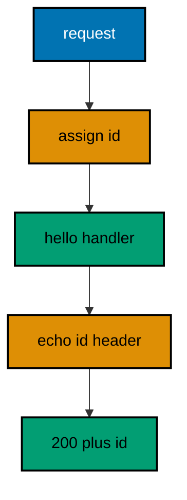
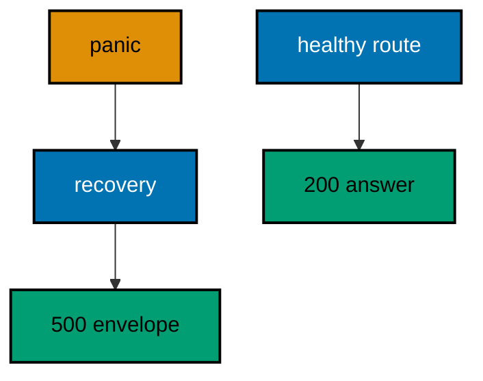
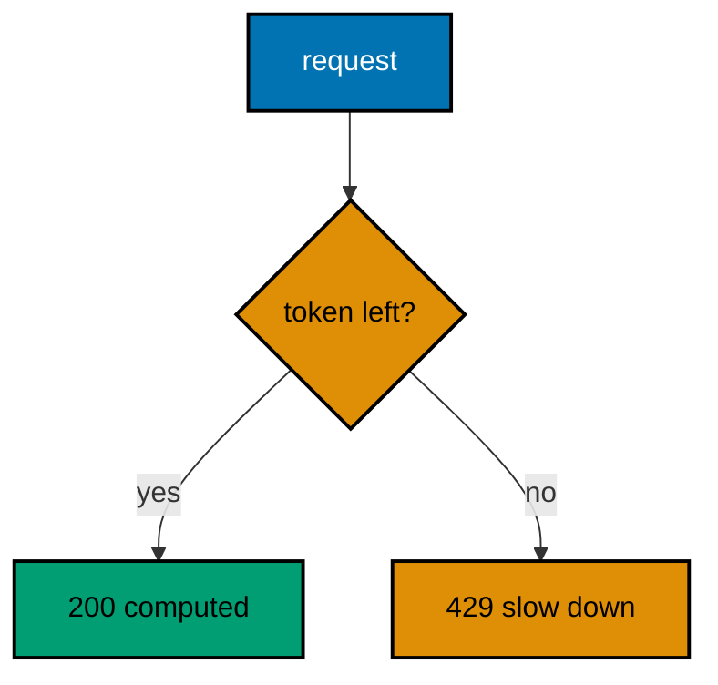
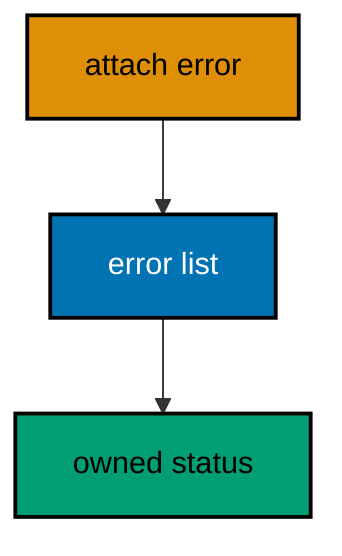
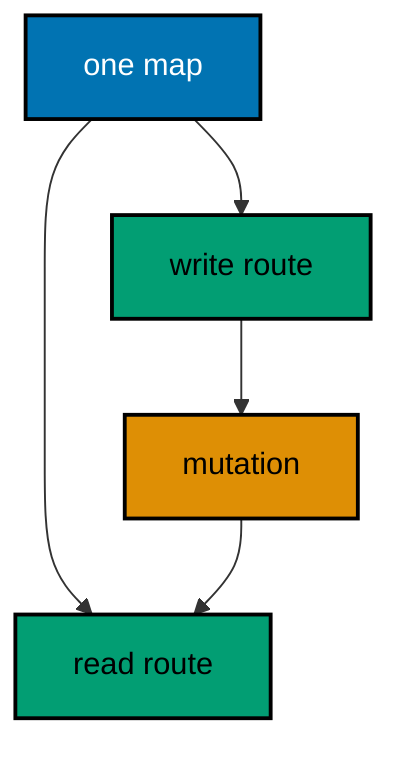
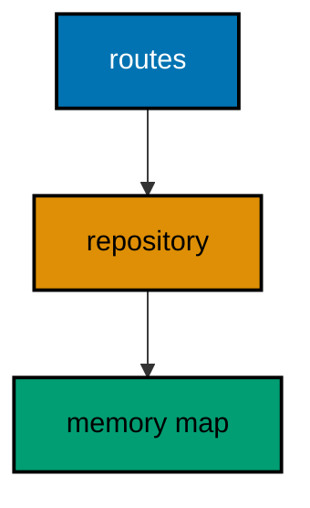
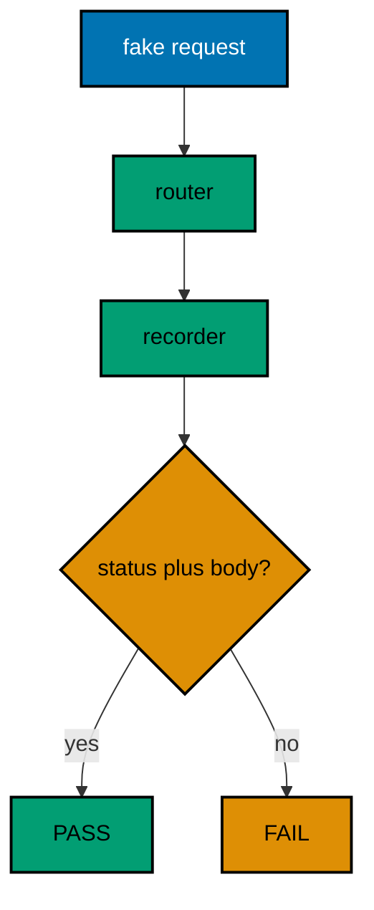
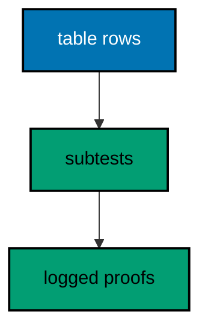
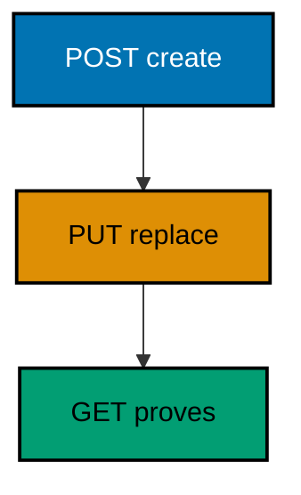
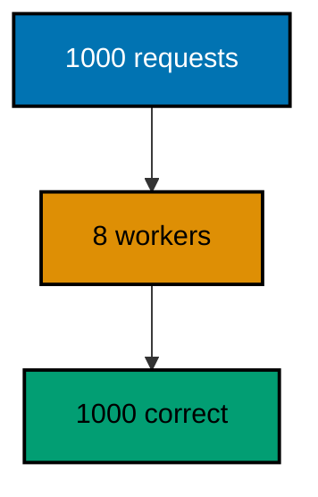

Examples 26-53 turn a pile of routes into a service: middleware and error handling first (Examples 26-34), wrapping every request in authentication, recovery, and consistent error envelopes; then dependency injection (Examples 35-44), supplying handlers with the stores and services they need instead of globals; finally testing without a real network call (Examples 45-53), proving routes, middleware, and errors in-process with table tests and golden responses. Every example is a complete, runnable Go module vendoring Gin under `learning/code/`; run each with the command in its own `run.yaml`.

---

### Example 26: Middleware Wraps Every Request

Middleware runs before and after each handler, so cross-cutting work lives in one place. This example stamps every request with a sequential id, echoes the id in a header and the body, and prints both requests with their ids. (Concepts: co-02.)



**`learning/code/ex-26-middleware-wraps-every-request/main.go`**:

```go
// => Example 26: Middleware Wraps Every Request.
// => Middleware runs before and after each handler, so cross-cutting work
// => lives in one place. This example stamps every request with a sequential
// => id, echoes the id in a header and the body, and prints both requests
// => with their ids.
package main

import (
	"fmt"                     // => prints each in-process check result
	"net/http/httptest"       // => in-process request and recorder (co-09)
	"sync/atomic"             // => race-free counter for the id sequence (co-07)
	"github.com/gin-gonic/gin" // => middleware around every handler (co-02)
)

// => ids hands out request ids: req-1, req-2, and so on, forever.
// => atomic keeps concurrent requests from sharing an id (co-07)
var ids atomic.Int64 // => process-wide counter, zero at startup

// => requestID stamps each request before the handler and echoes after.
// => c.Next runs the chain; code after it runs on the way out (co-02)
func requestID(c *gin.Context) { // => middleware shares the handler signature
	// => Add returns the new value: first request becomes 1
	n := ids.Add(1) // => req-1, req-2: sequential and deterministic
	id := fmt.Sprintf("req-%d", n) // => the human form of the counter
	c.Set("requestID", id)         // => handlers read the id from the context
	c.Header("X-Request-Id", id)   // => clients read the same id on the way out
	c.Next() // => run the handler and everything after it in the chain
	// => nothing needed on the way out here: the header already carries it
}

// => hello answers with the id the middleware assigned.
// => handlers stay small: stamping lives in the middleware (co-02)
func hello(c *gin.Context) { // => the handler reads what middleware wrote
	id, _ := c.Get("requestID") // => the stamp, or nothing when unwrapped
	c.JSON(200, gin.H{"message": "hello", "requestID": id}) // => body echoes the id (co-04)
}

// => newRouter wraps every route in the id middleware.
// => Use applies to all routes registered after it on this engine (co-02)
func newRouter() *gin.Engine { // => the engine under test
	gin.SetMode(gin.TestMode) // => silence the debug banner for golden output
	router := gin.New()        // => bare engine: middleware added by hand
	router.Use(requestID)       // => every request below gets stamped
	router.GET("/hello", hello) // => one route, wrapped (co-02)
	router.GET("/goodbye", hello) // => a second route proves every route is wrapped
	return router // => hand the wired engine back
}

// => check serves one GET and prints the id header with the body.
// => the id must match in the header and the JSON: same stamp, two places
func check(router *gin.Engine, target string) { // => the path is the only variable
	req := httptest.NewRequest("GET", target, nil) // => server-side request, no socket
	w := httptest.NewRecorder()                   // => in-memory response capture
	router.ServeHTTP(w, req)                      // => middleware runs around the handler
	fmt.Println("GET", target, "->", w.Code, w.Header().Get("X-Request-Id"), w.Body.String()) // => one golden line
}

func main() {
	router := newRouter() // => wiring separate from traffic, as always
	// => first request through the chain: stamped req-1 in both places
	check(router, "/hello") // => Output: GET /hello -> 200 req-1 {"message":"hello","requestID":"req-1"}
	// => the counter never resets: the second request is req-2
	check(router, "/goodbye") // => Output: GET /goodbye -> 200 req-2 {"message":"hello","requestID":"req-2"}
}
```

**Output** (`learning/code/ex-26-middleware-wraps-every-request/expected/main.stdout.txt`):

```text
GET /hello -> 200 req-1 {"message":"hello","requestID":"req-1"}
GET /goodbye -> 200 req-2 {"message":"hello","requestID":"req-2"}
```

**Key takeaway**: Use registers middleware for every route; c.Next runs the chain while code before and after it wraps each request.

**Why it matters**: Request ids turn a pile of interleaved log lines into per-request stories: grep the id and the whole journey appears. Stamping in middleware (rather than in each handler) guarantees every route — including ones added next month — carries the id without anyone remembering to add it. The sequential counter is a teaching stand-in for random ids: production uses crypto-random values, but counters keep golden output stable while demonstrating the identical wrapping mechanics.

---

### Example 27: Abort Stops the Chain

Auth middleware answers 401 itself when the credential is missing, so the handler never runs for strangers. This example guards one route with a bearer check, prints the blocked request, and prints the admitted one. (Concepts: co-02.)

**`learning/code/ex-27-abort-stops-the-chain/main.go`**:

```go
// => Example 27: Abort Stops the Chain.
// => Auth middleware answers 401 itself when the credential is missing, so
// => the handler never runs for strangers. This example guards one route
// => with a bearer check, prints the blocked request and the admitted one,
// => and leaves a public route unwrapped.
package main

import (
	"fmt"                     // => prints each in-process check result
	"net/http/httptest"       // => in-process request and recorder (co-09)
	"github.com/gin-gonic/gin" // => aborting middleware (co-02)
)

// => requireUser blocks requests without the fixed bearer token.
// => AbortWithStatusJSON answers here: later handlers never run (co-02)
func requireUser(c *gin.Context) { // => the guard every private route names
	// => the Authorization header carries "Bearer <token>" by convention
	if c.GetHeader("Authorization") != "Bearer s3cret" { // => one fixed token for the demo
		// => Abort stops the chain AND writes the answer in one call
		c.AbortWithStatusJSON(401, gin.H{"error": "missing or bad token"}) // => 401 with the envelope (co-04, co-05)
		return // => the handler below never runs for strangers
	}
	c.Set("user", "sari") // => admitted requests carry their identity onward
	c.Next()              // => the chain continues to the handler
}

// => profile answers with the identity the guard admitted.
// => reaching this handler proves the token was valid (co-02)
func profile(c *gin.Context) { // => guards run first, handlers trust after
	who, _ := c.Get("user") // => set by requireUser, never by strangers
	c.JSON(200, gin.H{"user": who}) // => the private answer (co-04)
}

// => newRouter guards one route and leaves one public.
// => middleware applies per route: only secrets need guards (co-02)
func newRouter() *gin.Engine { // => the engine under test
	gin.SetMode(gin.TestMode) // => silence the debug banner for golden output
	router := gin.New()        // => bare engine: middleware added by hand
	// => the guard sits between the method and the handler: in that order
	router.GET("/profile", requireUser, profile) // => guarded: strangers stop here
	router.GET("/public", func(c *gin.Context) { c.String(200, "everyone") }) // => public: no guard at all
	return router // => hand the wired engine back
}

// => check serves one GET with an optional token and prints the answer.
// => the token travels in Authorization: empty means a stranger
func check(router *gin.Engine, target string, token string) { // => empty token exercises the block
	req := httptest.NewRequest("GET", target, nil) // => server-side request, no socket
	if token != "" {                             // => named holders send their bearer
		req.Header.Set("Authorization", "Bearer "+token) // => the credential under test
	}
	w := httptest.NewRecorder() // => in-memory response capture
	router.ServeHTTP(w, req)    // => the guard runs before the handler
	fmt.Println("GET", target, "token=", token, "->", w.Code, w.Body.String()) // => one golden line
}

func main() {
	router := newRouter() // => wiring separate from traffic, as always
	// => no token: the guard aborts and the handler never runs (co-02)
	check(router, "/profile", "") // => Output: GET /profile token=  -> 401 {"error":"missing or bad token"}
	// => wrong token: same 401, same envelope, no hint about the secret
	check(router, "/profile", "guess") // => Output: GET /profile token= guess -> 401 {"error":"missing or bad token"}
	// => the fixed token admits: the guard sets the identity onward
	check(router, "/profile", "s3cret") // => Output: GET /profile token= s3cret -> 200 {"user":"sari"}
	// => the public route answers everyone: guards wrap only secrets
	check(router, "/public", "") // => Output: GET /public token=  -> 200 everyone
}
```

**Output** (`learning/code/ex-27-abort-stops-the-chain/expected/main.stdout.txt`):

```text
GET /profile token=  -> 401 {"error":"missing or bad token"}
GET /profile token= guess -> 401 {"error":"missing or bad token"}
GET /profile token= s3cret -> 200 {"user":"sari"}
GET /public token=  -> 200 everyone
```

**Key takeaway**: AbortWithStatusJSON answers from middleware and stops the chain; the handler only runs for admitted requests.

**Why it matters**: Guards belong before handlers, not inside them: when every private handler re-checks the token, one forgotten check opens a hole, and the check logic drifts across copies. Centralizing auth in middleware means the route table shows the policy at a glance — guarded routes name the guard, public ones do not — and Abort guarantees strangers never reach handler code. Answering 401 with the same envelope as every other error keeps the client's error path single, while the fixed message avoids leaking whether the token was missing or merely wrong.

---

### Example 28: Middleware Order Is Outer to Inner

Middleware forms an onion: each layer runs its before-code, calls inward, then runs its after-code. This example wraps one route in two named layers that record their steps, and prints the exact visit order. (Concepts: co-02.)

**`learning/code/ex-28-middleware-order-is-outer-to-inner/main.go`**:

```go
// => Example 28: Middleware Order Is Outer to Inner.
// => Middleware forms an onion: each layer runs its before-code, calls
// => inward, then runs its after-code. This example wraps one route in two
// => named layers that record their steps, and prints the exact visit order
// => the onion produces.
package main

import (
	"fmt"                     // => prints each in-process check result
	"net/http/httptest"       // => in-process request and recorder (co-09)
	"strings"                 // => joins the recorded steps for the body
	"github.com/gin-gonic/gin" // => layered middleware (co-02)
)

// => steps records the visit order both layers and the handler append to.
// => package-level on purpose: the lesson is the order, not the plumbing
var steps []string // => reset per request below, appended in visit order

// => layer returns middleware that brackets the chain with its name.
// => the returned func closes over name: inner layers share one shape
func layer(name string) gin.HandlerFunc { // => inner layers only bracket
	return func(c *gin.Context) { // => gin calls this in registration order
		steps = append(steps, "in-"+name) // => before-code: on the way in
		c.Next()                          // => dive one layer deeper
		steps = append(steps, "out-"+name) // => after-code: on the way out
	}
}

// => edge is the outermost layer: it brackets like the rest, then writes the
// => recorded visit order as the response body after the chain returns.
// => writing last is the trick: the body then holds every step (co-02)
func edge(c *gin.Context) { // => outermost: registered before the rest
	steps = append(steps, "in-outer") // => before-code runs first of all
	c.Next()                          // => the inner layer and handler run here
	steps = append(steps, "out-outer") // => after-code runs last of all
	// => the response is written here, after every step was recorded
	c.String(200, strings.Join(steps, ",")) // => the order becomes the body (co-04)
}

// => newRouter wraps one route in outer then inner, in that order.
// => registration order IS the onion order: first registered, outermost
func newRouter() *gin.Engine { // => the engine under test
	gin.SetMode(gin.TestMode) // => silence the debug banner for golden output
	router := gin.New()        // => bare engine: middleware added by hand
	// => outer first, inner second: the call order mirrors this line
	router.GET("/onion", edge, layer("inner"), func(c *gin.Context) { // => edge outside, inner inside
		steps = append(steps, "handler") // => the core runs between the ins and outs
	})
	return router // => hand the wired engine back
}

// => check serves one GET after resetting the ledger, then prints the body.
func check(router *gin.Engine, target string) { // => the path is the only variable
	steps = nil // => fresh ledger per request: orders never mix
	req := httptest.NewRequest("GET", target, nil) // => server-side request, no socket
	w := httptest.NewRecorder()                   // => in-memory response capture
	router.ServeHTTP(w, req)                      // => the onion wraps around the handler
	fmt.Println("GET", target, "->", w.Code, w.Body.String()) // => one golden line
}

func main() {
	router := newRouter() // => wiring separate from traffic, as always
	// => in-outer, in-inner, handler, out-inner, out-outer: the onion order (co-02)
	check(router, "/onion") // => Output: GET /onion -> 200 in-outer,in-inner,handler,out-inner,out-outer
}
```

**Output** (`learning/code/ex-28-middleware-order-is-outer-to-inner/expected/main.stdout.txt`):

```text
GET /onion -> 200 in-outer,in-inner,handler,out-inner,out-outer
```

**Key takeaway**: Registration order builds the onion: first registered runs first on the way in and last on the way out.

**Why it matters**: Every cross-cutting concern — logging, auth, timing, recovery — is a layer, and layers compose only when their order is predictable. The onion rule (before-code in registration order, after-code reversed) lets each layer assume what already ran: auth can trust the request id the outer layer stamped, and the timing layer measures everything inside it. Getting this backwards silently breaks those assumptions, so the recorded-steps pattern in this example doubles as a debugging technique: when behavior surprises you, log the onion order first.

---

### Example 29: Recovery Turns Panics into 500

Panics must never escape as dropped connections; recovery middleware converts them into 500 answers. This example panics on one route, recovers with a JSON envelope, and prints the 500 beside a healthy route. (Concepts: co-02, co-05.)



**`learning/code/ex-29-recovery-turns-panics-into-500/main.go`**:

```go
// => Example 29: Recovery Turns Panics into 500.
// => Panics must never escape as dropped connections; recovery middleware
// => converts them into 500 answers. This example panics on one route,
// => recovers with a JSON envelope, and prints the 500 beside a healthy
// => route that never panics.
package main

import (
	"fmt"                     // => prints each in-process check result
	"net/http/httptest"       // => in-process request and recorder (co-09)
	"github.com/gin-gonic/gin" // => recovery middleware (co-02, co-05)
)

// => newRouter recovers panics into a JSON envelope for every route.
// => CustomRecoveryWithWriter discards the stack log: goldens stay clean
func newRouter() *gin.Engine { // => the engine under test
	gin.SetMode(gin.TestMode) // => silence the debug banner for golden output
	router := gin.New()        // => bare engine: recovery added by hand
	// => the recovery handler answers 500 in the shared error shape
	router.Use(gin.CustomRecoveryWithWriter(discard{}, func(c *gin.Context, _ any) { // => stack trace goes nowhere
		c.AbortWithStatusJSON(500, gin.H{"error": "internal failure"}) // => same envelope, every panic
	}))
	// => this handler panics on purpose: the lesson needs a real panic
	router.GET("/boom", func(c *gin.Context) { panic("planned detonation") }) // => recovered into 500, never a drop (co-05)
	router.GET("/fine", func(c *gin.Context) { c.String(200, "still standing") }) // => healthy routes ignore recovery
	return router // => hand the wired engine back
}

// => discard swallows the stack trace recovery would otherwise log.
// => golden output must hold only our prints: logs would poison it
type discard struct{} // => an io.Writer that keeps nothing

// => Write drops every byte and reports success: the trace vanishes.
func (discard) Write(p []byte) (int, error) { // => keep the Writer contract, drop the content
	return len(p), nil // => pretend everything was written
}

// => check serves one GET in-process and prints the status with the body.
func check(router *gin.Engine, target string) { // => the panicking path is the variable
	req := httptest.NewRequest("GET", target, nil) // => server-side request, no socket
	w := httptest.NewRecorder()                   // => in-memory response capture
	router.ServeHTTP(w, req)                      // => recovery runs around the panic
	fmt.Println("GET", target, "->", w.Code, w.Body.String()) // => one golden line
}

func main() {
	router := newRouter() // => wiring separate from traffic, as always
	// => the panic becomes a 500 envelope: the connection survives (co-05)
	check(router, "/boom") // => Output: GET /boom -> 500 {"error":"internal failure"}
	// => healthy routes never notice the middleware: 200 as usual
	check(router, "/fine") // => Output: GET /fine -> 200 still standing
}
```

**Output** (`learning/code/ex-29-recovery-turns-panics-into-500/expected/main.stdout.txt`):

```text
GET /boom -> 500 {"error":"internal failure"}
GET /fine -> 200 still standing
```

**Key takeaway**: Recovery middleware converts panics into 500 envelopes so one bad handler cannot drop connections; stack traces go to logs, never bodies.

**Why it matters**: A panic without recovery kills the connection mid-response — and in production, takes down whatever the process was doing alongside it. Recovery draws the boundary: bugs still crash the request, but the server answers 500 and keeps serving everyone else. The envelope matters as much as the status: clients parse one error shape, while the stack trace (discarded from golden output here, shipped to real logs in production) stays an operator artifact, never a leak of file paths and internals to strangers.

---

### Example 30: Rate Limit Guards a Route

Rate limiting answers 429 when a client spends its budget, protecting the service from floods. This example guards an expensive route with a two-token bucket, spends both tokens, and prints the 429 on the third call. (Concepts: co-02.)



**`learning/code/ex-30-rate-limit-guards-a-route/main.go`**:

```go
// => Example 30: Rate Limit Guards a Route.
// => Rate limiting answers 429 when a client spends its budget, protecting
// => the service from floods. This example guards an expensive route with a
// => two-token bucket, spends both tokens, and prints the 429 on the third
// => sequential call.
package main

import (
	"fmt"                     // => prints each in-process check result
	"net/http/httptest"       // => in-process request and recorder (co-09)
	"sync"                    // => the bucket lock: middleware runs concurrently (co-07)
	"time"                    // => refill arithmetic on the token clock
	"github.com/gin-gonic/gin" // => limiting middleware (co-02)
)

// => bucket is a two-token bucket with a very slow refill.
// => the hour-long window means no refill happens during the test run
type bucket struct { // => capacity, stock, and the last refill instant
	mu     sync.Mutex // => guards tokens: checks run on many goroutines (co-07)
	tokens float64     // => fractional stock smooths the refill math
	last   time.Time  // => when the stock was last topped up
}

// => take removes one token when the stock allows it.
// => false means the budget is spent: the caller answers 429
func (b *bucket) take() bool { // => one token per call, or none
	b.mu.Lock()         // => stock and clock update atomically
	defer b.mu.Unlock() // => always release, on every return path
	// => an hour per token: effectively no refill inside this example
	since := time.Since(b.last).Hours() // => fractional hours since topping up
	b.tokens += since / 1.0           // => one token per hour trickles back
	if b.tokens > 2 {                 // => the bucket never holds more than two
		b.tokens = 2 // => cap the stock at capacity
	}
	b.last = time.Now() // => the clock restarts at every check
	if b.tokens < 1 {   // => less than one whole token means empty
		return false // => budget spent: the caller answers 429
	}
	b.tokens-- // => spend one whole token on this request
	return true // => admitted: a token was spent
}

// => limit guards the expensive route with the shared bucket.
// => 429 names the condition: slow down and retry later (co-04)
func limit(b *bucket) gin.HandlerFunc { // => the bucket arrives pre-filled
	return func(c *gin.Context) { // => gin calls this before the handler
		if !b.take() { // => no token left for this request
			// => AbortWithStatusJSON answers here: the handler never runs
			c.AbortWithStatusJSON(429, gin.H{"error": "slow down"}) // => 429 with the envelope (co-05)
			return // => the expensive work below is skipped
		}
		c.Next() // => a token was spent: the request proceeds
	}
}

// => newRouter guards one expensive route with a two-token bucket.
func newRouter() *gin.Engine { // => the engine under test
	gin.SetMode(gin.TestMode) // => silence the debug banner for golden output
	router := gin.New()        // => bare engine: middleware added by hand
	b := &bucket{tokens: 2, last: time.Now()} // => full bucket at startup
	// => the guard sits before the handler: no token, no work
	router.GET("/expensive", limit(b), func(c *gin.Context) { c.String(200, "computed") }) // => guarded route (co-02)
	return router // => hand the wired engine back
}

// => check serves one GET in-process and prints the status with the body.
func check(router *gin.Engine, target string) { // => the path is the only variable
	req := httptest.NewRequest("GET", target, nil) // => server-side request, no socket
	w := httptest.NewRecorder()                   // => in-memory response capture
	router.ServeHTTP(w, req)                      // => the bucket spends per call
	fmt.Println("GET", target, "->", w.Code, w.Body.String()) // => one golden line
}

func main() {
	router := newRouter() // => wiring separate from traffic, as always
	// => two tokens, two admissions: the expensive work runs twice
	check(router, "/expensive") // => Output: GET /expensive -> 200 computed
	check(router, "/expensive") // => Output: GET /expensive -> 200 computed
	// => the bucket is empty now: 429 without running the handler (co-02)
	check(router, "/expensive") // => Output: GET /expensive -> 429 {"error":"slow down"}
}
```

**Output** (`learning/code/ex-30-rate-limit-guards-a-route/expected/main.stdout.txt`):

```text
GET /expensive -> 200 computed
GET /expensive -> 200 computed
GET /expensive -> 429 {"error":"slow down"}
```

**Key takeaway**: A token bucket in middleware spends one token per request and answers 429 when empty, so floods never reach handlers.

**Why it matters**: Every service has a most expensive route — the report, the search, the export — and without a guard, one enthusiastic client (or one loop bug) spends the whole budget. A token bucket makes the policy explicit and local: capacity two means bursts of two are fine, the third waits, and the 429 tells the client to back off instead of timing out mysteriously. The hour-long refill keeps the test deterministic; production shortens the window to seconds and sizes capacity from load tests, but the middleware shape never changes.

---

### Example 31: CORS Headers Unlock Browsers

Browsers block cross-origin reads unless the server opts in with CORS headers. This example answers preflight OPTIONS with the allowed origin, methods, and headers, then serves the real GET with the origin echoed. (Concepts: co-02, co-04.)

**`learning/code/ex-31-cors-headers-unlock-browsers/main.go`**:

```go
// => Example 31: CORS Headers Unlock Browsers.
// => Browsers block cross-origin reads unless the server opts in with CORS
// => headers. This example answers preflight OPTIONS with the allowed
// => origin, methods, and headers, then serves the real GET with the origin
// => echoed back.
package main

import (
	"fmt"                     // => prints each in-process check result
	"net/http/httptest"       // => in-process request and recorder (co-09)
	"github.com/gin-gonic/gin" // => CORS middleware for browser clients (co-02)
)

// => cors grants one trusted origin the methods and headers it needs.
// => preflight OPTIONS short-circuits here: no handler runs for it
func cors(c *gin.Context) { // => every response below carries these headers
	origin := "https://app.example.com" // => the one trusted web client
	// => the browser sends Origin: echo it back only when it matches
	if c.GetHeader("Origin") == origin { // => unlisted origins get no grant
		c.Header("Access-Control-Allow-Origin", origin) // => this origin may read the answer
	}
	// => preflight asks permission: methods and headers are the grant
	c.Header("Access-Control-Allow-Methods", "GET, POST") // => what the client may call
	c.Header("Access-Control-Allow-Headers", "Content-Type, Authorization") // => what the client may send
	if c.Request.Method == "OPTIONS" { // => preflight never reaches a handler
		c.AbortWithStatus(204) // => empty 204: permission granted, nothing more (co-04)
		return                 // => the chain stops at the grant
	}
	c.Next() // => real requests proceed to their handlers
}

// => newRouter wraps every route in the CORS layer.
func newRouter() *gin.Engine { // => the engine under test
	gin.SetMode(gin.TestMode) // => silence the debug banner for golden output
	router := gin.New()        // => bare engine: middleware added by hand
	router.Use(cors)            // => every answer carries the grant (co-02)
	router.GET("/data", func(c *gin.Context) { c.JSON(200, gin.H{"rows": 3}) }) // => the guarded resource
	return router // => hand the wired engine back
}

// => check serves one request with an origin and prints headers with body.
// => the Origin header decides whether the grant appears at all
func check(router *gin.Engine, method string, origin string) { // => method plus origin vary
	req := httptest.NewRequest(method, "/data", nil) // => fixed path, varying method
	if origin != "" {                              // => server-to-server calls send no Origin
		req.Header.Set("Origin", origin) // => the browser's address under test
	}
	w := httptest.NewRecorder() // => in-memory response capture
	router.ServeHTTP(w, req)    // => CORS runs around everything
	// => the grant header IS the answer for preflight: print it with the body
	line := fmt.Sprintf("%s /data origin=%s -> %d allow=%s", method, origin, w.Code, w.Header().Get("Access-Control-Allow-Origin")) // => status core: always present
	if w.Body.String() != "" {                                                                                                       // => preflight carries no body
		line += " " + w.Body.String() // => real answers join their JSON
	}
	fmt.Println(line) // => one golden line, never a trailing space
}

func main() {
	router := newRouter() // => wiring separate from traffic, as always
	// => trusted preflight: 204 with the origin granted, no body
	check(router, "OPTIONS", "https://app.example.com") // => Output: OPTIONS /data origin=https://app.example.com -> 204 allow=https://app.example.com
	// => trusted GET: the grant rides beside the real answer
	check(router, "GET", "https://app.example.com") // => Output: GET /data origin=https://app.example.com -> 200 allow=https://app.example.com {"rows":3}
	// => unlisted origin: answered, but granted nothing (co-05)
	check(router, "GET", "https://evil.example.com") // => Output: GET /data origin=https://evil.example.com -> 200 allow= {"rows":3}
}
```

**Output** (`learning/code/ex-31-cors-headers-unlock-browsers/expected/main.stdout.txt`):

```text
OPTIONS /data origin=https://app.example.com -> 204 allow=https://app.example.com
GET /data origin=https://app.example.com -> 200 allow=https://app.example.com {"rows":3}
GET /data origin=https://evil.example.com -> 200 allow= {"rows":3}
```

**Key takeaway**: CORS middleware echoes trusted origins and answers preflight OPTIONS with a 204; unlisted origins get answers without grants.

**Why it matters**: The same-origin policy makes the browser the enforcer and your headers the permission slip: without Access-Control-Allow-Origin, a perfectly good JSON answer is unreadable to web clients. Preflight exists so the browser can ask before sending credentials or unusual headers, and answering OPTIONS with 204 keeps that handshake cheap. Echoing only listed origins (never \*) when credentials are involved closes the hole where any site could read user data — the middleware shape makes the allowlist one constant instead of a per-handler afterthought.

---

### Example 32: Timeout Middleware Bounds a Handler

Slow handlers must not hold connections forever, so middleware bounds them with a context deadline. This example wraps a patient handler in a 50-millisecond limit, lets a fast call through, and prints the 504 the expired call produces. (Concepts: co-02, co-07.)

**`learning/code/ex-32-timeout-middleware-bounds-a-handler/main.go`**:

```go
// => Example 32: Timeout Middleware Bounds a Handler.
// => Slow handlers must not hold connections forever, so middleware bounds
// => them with a context deadline. This example wraps a patient handler in a
// => limit the checks control: a live context passes through, an expired one
// => fails immediately with a 504.
package main

import (
	"context"                 // => deadlines and cancellation (co-07)
	"fmt"                     // => prints each in-process check result
	"net/http/httptest"       // => in-process request and recorder (co-09)
	"time"                    // => the 50-millisecond bound below
	"github.com/gin-gonic/gin" // => timeout middleware (co-02)
)

// => withTimeout bounds every handler with a 50-millisecond deadline.
// => the deadline rides the request context: handlers select on it (co-07)
func withTimeout(c *gin.Context) { // => the bound every route below shares
	// => WithTimeout derives a child context that expires after 50ms
	ctx, cancel := context.WithTimeout(c.Request.Context(), 50*time.Millisecond) // => the bound, fixed
	defer cancel()              // => release the timer when the chain returns
	c.Request = c.Request.WithContext(ctx) // => handlers below see the deadline
	c.Next() // => the handler runs under the bound
}

// => patient waits for either work or the deadline, whichever comes first.
// => select makes the deadline a first-class outcome, not a crash (co-07)
func patient(c *gin.Context) { // => the handler that respects the bound
	// => work finishes through this channel; the test controls when
	work := make(chan string, 1) // => buffered: the sender never blocks
	if c.Query("fast") == "yes" { // => the fast path completes immediately
		work <- "done" // => work already finished before select runs
	}
	select { // => whichever branch is ready first wins, fairly
	case result := <-work: // => work won: answer normally
		c.String(200, result) // => the fast answer (co-04)
	case <-c.Request.Context().Done(): // => the deadline won: stop waiting
		// => 504 names the condition: the server gave up in time (co-05)
		c.JSON(504, gin.H{"error": "handler timed out"}) // => fixed envelope, gateway timeout
	}
}

// => newRouter wraps the patient handler in the timeout bound.
func newRouter() *gin.Engine { // => the engine under test
	gin.SetMode(gin.TestMode) // => silence the debug banner for golden output
	router := gin.New()        // => bare engine: middleware added by hand
	router.Use(withTimeout)     // => every route below runs bounded (co-02)
	router.GET("/patient", patient) // => the handler that watches the clock
	return router                  // => hand the wired engine back
}

// => check serves one GET and prints the status with the body.
// => the fast flag picks the immediate branch or the waiting one
func check(router *gin.Engine, fast string) { // => yes passes, empty waits out the clock
	target := "/patient" // => the path never changes: the query decides
	if fast != "" {    // => explicit fast=yes exercises the work branch
		target += "?fast=yes" // => the query the handler reads
	}
	req := httptest.NewRequest("GET", target, nil) // => server-side request, no socket
	// => expire the context before serving: the deadline branch fires at once
	if fast == "" { // => the slow path needs no wall clock: pre-cancel instead
		ctx, cancel := context.WithDeadline(req.Context(), time.Now().Add(-time.Second)) // => already expired
		defer cancel()                      // => release the dead timer
		req = req.WithContext(ctx) // => the middleware derives from an expired parent
	}
	w := httptest.NewRecorder() // => in-memory response capture
	router.ServeHTTP(w, req)    // => 50ms of real waiting would also work; this is instant
	fmt.Println("GET", target, "->", w.Code, w.Body.String()) // => one golden line
}

func main() {
	router := newRouter() // => wiring separate from traffic, as always
	// => fast=yes completes before any deadline: the work branch wins
	check(router, "yes") // => Output: GET /patient?fast=yes -> 200 done
	// => pre-expired context: the deadline branch answers 504 at once (co-07)
	check(router, "") // => Output: GET /patient -> 504 {"error":"handler timed out"}
}
```

**Output** (`learning/code/ex-32-timeout-middleware-bounds-a-handler/expected/main.stdout.txt`):

```text
GET /patient?fast=yes -> 200 done
GET /patient -> 504 {"error":"handler timed out"}
```

**Key takeaway**: Timeout middleware derives a deadline context per request; handlers select on Done so expiry becomes a 504 answer instead of a stuck connection.

**Why it matters**: Upstream callers budget milliseconds, not good intentions: a handler that waits forever on a wedged dependency holds its connection, its goroutine, and eventually the whole server. Deriving a deadline per request bounds the damage — the context propagates the same limit to every downstream call that respects it — and select turns expiry into a normal branch with a proper status. Pre-expiring the context in tests proves the failure path without sleeping: the 50-millisecond production bound never appears in golden output, only in the middleware one tests trust.

---

### Example 33: Errors Carry Status Codes

Domain errors know their own status, so handlers return them instead of mapping codes by hand. This example defines a status-carrying error, funnels it through gin's error list, and prints the code each failure owns. (Concepts: co-05.)



**`learning/code/ex-33-errors-carry-status-codes/main.go`**:

```go
// => Example 33: Errors Carry Status Codes.
// => Domain errors know their own status, so handlers return them instead of
// => mapping codes by hand. This example defines a status-carrying error,
// => attaches it to gin's error list, and lets one middleware turn every
// => such error into its owned status with the shared envelope.
package main

import (
	"fmt"                     // => prints each in-process check result
	"net/http/httptest"       // => in-process request and recorder (co-09)
	"strings"                 // => splits the owned-status assertion below
	"github.com/gin-gonic/gin" // => the context error list (co-05)
)

// => appError is a domain failure that owns its HTTP status.
// => code travels with the error: handlers never switch on types (co-05)
type appError struct { // => status core: always present with the message
	status  int    // => the HTTP status this failure owns
	code    string // => the machine-readable name clients switch on
	message string // => the human sentence operators read
}

// => Error makes appError a real error: it prints as its message.
// => the error interface needs exactly this one method
func (e *appError) Error() string { // => message only: status travels beside, not inside
	return e.message // => logs read the sentence; clients read the envelope
}

// => missingWidget is the 404 this store raises for unknown ids.
func missingWidget(id string) *appError { // => constructors name failures at creation
	return &appError{status: 404, code: "no_widget", message: "no widget " + id} // => the absence owns 404 (co-05)
}

// => emptyName is the 422 this store raises for blank widget names.
func emptyName() *appError { // => policy failures own 422, not 400
	return &appError{status: 422, code: "empty_name", message: "name must not be empty"} // => valid shape, bad value
}

// => jsonErrors turns the last attached error into its owned response.
// => one middleware owns the mapping: handlers only attach (co-02, co-05)
func jsonErrors(c *gin.Context) { // => registered after the routes below? No: order matters
	c.Next() // => handlers run first and attach their failures
	if len(c.Errors) == 0 { // => the happy path leaves the list empty
		return // => nothing failed: the handler already answered
	}
	// => Last surfaces the most recent failure: handlers attach in order
	last := c.Errors.Last() // => the error this request should answer
	if ae, ok := last.Err.(*appError); ok { // => domain errors own their status
		c.JSON(ae.status, gin.H{"error": gin.H{"code": ae.code, "message": ae.message}}) // => owned code, shared shape (co-04)
		return // => answered from the error itself
	}
	// => unknown error kinds fall back to 500: never leak, never guess
	c.JSON(500, gin.H{"error": gin.H{"code": "internal", "message": "internal failure"}}) // => the safe default
}

// => show looks up one widget, attaching its absence instead of answering.
// => handlers describe failure; the middleware translates it (co-05)
func show(store map[string]string) gin.HandlerFunc { // => the store arrives pre-filled
	return func(c *gin.Context) { // => gin calls this per request
		v, ok := store[c.Param("id")] // => the lookup decides the branch
		if !ok {                      // => unknown ids attach, never answer here
			_ = c.Error(missingWidget(c.Param("id"))) // => attach and return: middleware answers
			return // => the response is written by jsonErrors after Next
		}
		c.JSON(200, gin.H{"id": c.Param("id"), "value": v}) // => the happy path answers inline (co-04)
	}
}

// => create validates one name, attaching policy failures the same way.
func create(store map[string]string) gin.HandlerFunc { // => the store mutates across calls
	return func(c *gin.Context) { // => gin calls this per request
		name := strings.TrimSpace(c.PostForm("name")) // => surrounding spaces never count
		if name == "" {                               // => blank names break policy
			_ = c.Error(emptyName()) // => attach the 422 and stop
			return // => middleware answers after Next returns
		}
		store[name] = name // => the store gains the widget
		c.JSON(201, gin.H{"id": name, "value": name}) // => 201 with the stored shape (co-04)
	}
}

// => newRouter wires jsonErrors FIRST so it wraps every handler below.
// => middleware registered first runs first: errors need the outer seat
func newRouter(store map[string]string) *gin.Engine { // => the store arrives pre-filled
	gin.SetMode(gin.TestMode) // => silence the debug banner for golden output
	router := gin.New()        // => bare engine: middleware added by hand
	router.Use(jsonErrors)     // => outer layer: translates after handlers run (co-02)
	router.GET("/widgets/:id", show(store)) // => absence attaches a 404
	router.POST("/widgets", create(store))  // => blank names attach a 422
	return router // => hand the wired engine back
}

// => check serves one request with form fields and prints the answer.
// => form bodies exercise the policy branch without JSON
func check(router *gin.Engine, method string, target string, form string) { // => empty form means no fields
	reader := strings.NewReader(form) // => fixed bytes, no socket
	req := httptest.NewRequest(method, target, reader) // => server-side request, fixed body
	req.Header.Set("Content-Type", "application/x-www-form-urlencoded") // => form binder, explicitly
	w := httptest.NewRecorder() // => in-memory response capture
	router.ServeHTTP(w, req)    // => attach-then-translate runs inside
	fmt.Println(method, target, "form=", form, "->", w.Code, w.Body.String()) // => one golden line
}

func main() {
	store := map[string]string{"w1": "gear"} // => one widget exists from the start
	router := newRouter(store) // => wiring separate from traffic, as always
	// => present widgets answer inline: the error list stays empty
	check(router, "GET", "/widgets/w1", "") // => Output: GET /widgets/w1 form=  -> 200 {"id":"w1","value":"gear"}
	// => unknown ids attach missingWidget: the middleware answers 404 (co-05)
	check(router, "GET", "/widgets/w9", "") // => Output: GET /widgets/w9 form=  -> 404 {"error":{"code":"no_widget","message":"no widget w9"}}
	// => blank names attach emptyName: the middleware answers 422
	check(router, "POST", "/widgets", "name=+") // => Output: POST /widgets form= name=+ -> 422 {"error":{"code":"empty_name","message":"name must not be empty"}}
}
```

**Output** (`learning/code/ex-33-errors-carry-status-codes/expected/main.stdout.txt`):

```text
GET /widgets/w1 form=  -> 200 {"id":"w1","value":"gear"}
GET /widgets/w9 form=  -> 404 {"error":{"code":"no_widget","message":"no widget w9"}}
POST /widgets form= name=+ -> 422 {"error":{"code":"empty_name","message":"name must not be empty"}}
```

**Key takeaway**: Domain errors carry their own status; handlers attach them to the context and one middleware renders every failure.

**Why it matters**: Status mapping scattered across handlers drifts: the same empty name answers 400 in one handler and 422 in another, and clients cannot rely on either. Giving the error its status at construction moves the decision to the one place that understands the failure — the domain — while the middleware guarantees the envelope. gin's error list is the channel between the two: handlers attach without writing, middleware renders without deciding. The 500 fallback completes the contract: even an error nobody classified answers in the same shape.

---

### Example 34: Problem Details for Clients

RFC 7807 gives errors a standard shape — type, title, status, detail, instance — that any client can parse. This example answers a missing order and a bad filter with problem+json bodies and prints both. (Concepts: co-05, co-04.)

**`learning/code/ex-34-problem-details-for-clients/main.go`**:

```go
// => Example 34: Problem Details for Clients.
// => RFC 7807 gives errors a standard shape that any client can parse: type,
// => title, status, detail, and instance. This example answers a missing
// => order and a bad filter with problem+json bodies and prints both beside
// => the happy path.
package main

import (
	"fmt"                     // => prints each in-process check result
	"net/http/httptest"       // => in-process request and recorder (co-09)
	"github.com/gin-gonic/gin" // => problem+json error responses (co-05)
)

// => problem writes one RFC 7807 body with the shared five keys.
// => type names the failure class; instance names this occurrence (co-05)
func problem(c *gin.Context, status int, typ string, title string, detail string) { // => status core: always set
	// => application/problem+json tells generic clients how to parse this
	c.Header("Content-Type", "application/problem+json") // => the standard media type
	c.JSON(status, gin.H{ // => the five keys every problem carries
		"type":     typ,                    // => stable URI for the failure class
		"title":    title,                  // => short human summary
		"status":   status,                 // => the code, repeated inside
		"detail":   detail,                 // => what happened this time
		"instance": c.Request.URL.Path,     // => which request failed
	})
}

// => newRouter serves one order lookup with two problem branches.
// => missing orders and bad filters fail differently but shape alike
func newRouter(store map[string]string) *gin.Engine { // => the store arrives pre-filled
	gin.SetMode(gin.TestMode) // => silence the debug banner for golden output
	router := gin.New()        // => bare engine: no hidden middleware
	router.GET("/orders/:id", func(c *gin.Context) { // => look one order up
		v, ok := store[c.Param("id")] // => the lookup decides the branch
		if !ok {                      // => unknown ids are problems, not panics
			// => out-of-band type URI: the class of failure, namespaced
			problem(c, 404, "https://api.example.com/problems/no-order", "No such order", "order "+c.Param("id")+" does not exist") // => 404 problem (co-05)
			return // => the problem is the whole answer
		}
		c.JSON(200, gin.H{"id": c.Param("id"), "item": v}) // => the happy path stays plain JSON (co-04)
	})
	router.GET("/orders", func(c *gin.Context) { // => list with an optional status filter
		// => only open and shut exist: anything else is a bad filter
		if s := c.Query("status"); s != "" && s != "open" && s != "shut" { // => unknown filters fail here
			problem(c, 400, "https://api.example.com/problems/bad-filter", "Bad status filter", "status must be open or shut") // => 400 problem
			return // => the problem replaces the listing
		}
		c.JSON(200, []string{"o1"}) // => the fixed listing (co-04)
	})
	return router // => hand the wired engine back
}

// => check serves one GET in-process and prints the status with the body.
func check(router *gin.Engine, target string) { // => the path plus query is the variable
	req := httptest.NewRequest("GET", target, nil) // => server-side request, no socket
	w := httptest.NewRecorder()                   // => in-memory response capture
	// => the problem media type rides the response: print it beside the body
	router.ServeHTTP(w, req) // => problem branches run inside
	fmt.Println("GET", target, "->", w.Code, w.Body.String()) // => one golden line
}

func main() {
	store := map[string]string{"o1": "book"} // => one order exists from the start
	router := newRouter(store) // => wiring separate from traffic, as always
	// => present orders answer plain JSON: problems are for failures only
	check(router, "/orders/o1") // => Output: GET /orders/o1 -> 200 {"id":"o1","item":"book"}
	// => unknown ids answer a 404 problem with all five keys (co-05)
	check(router, "/orders/o9") // => Output: GET /orders/o9 -> 404 {"detail":"order o9 does not exist","instance":"/orders/o9","status":404,"title":"No such order","type":"https://api.example.com/problems/no-order"}
	// => bad filters answer a 400 problem: same keys, different values
	check(router, "/orders?status=lost") // => Output: GET /orders?status=lost -> 400 {"detail":"status must be open or shut","instance":"/orders","status":400,"title":"Bad status filter","type":"https://api.example.com/problems/bad-filter"}
}
```

**Output** (`learning/code/ex-34-problem-details-for-clients/expected/main.stdout.txt`):

```text
GET /orders/o1 -> 200 {"id":"o1","item":"book"}
GET /orders/o9 -> 404 {"detail":"order o9 does not exist","instance":"/orders/o9","status":404,"title":"No such order","type":"https://api.example.com/problems/no-order"}
GET /orders?status=lost -> 400 {"detail":"status must be open or shut","instance":"/orders","status":400,"title":"Bad status filter","type":"https://api.example.com/problems/bad-filter"}
```

**Key takeaway**: Problem+json answers failures with type, title, status, detail, and instance: a standard shape every client library already parses.

**Why it matters**: Homegrown error envelopes work until two services meet: each invents code and message with slightly different nesting, and the gateway between them translates by hand. RFC 7807 ends that negotiation — type URIs namespace failure classes so docs can define them once, instance points at the exact request, and generic problem parsers in every language handle the shape without custom code. The happy path stays plain JSON on purpose: problems describe failures, and mixing the shapes would force clients to detect which envelope each 200 carries.

---

### Example 35: Handler Closure Captures a Store

Handlers need state, and a closure over a store is the smallest honest way to supply it. This example closes two routes over one map, mutates through one of them, and prints the mutation the other one reads. (Concepts: co-06.)



**`learning/code/ex-35-handler-closure-captures-a-store/main.go`**:

```go
// => Example 35: Handler Closure Captures a Store.
// => Handlers need state, and a closure over a store is the smallest honest
// => way to supply it. This example closes two routes over one map, mutates
// => through one of them, and prints the mutation the other one reads.
package main

import (
	"fmt"                     // => prints each in-process check result
	"net/http/httptest"       // => in-process request and recorder (co-09)
	"github.com/gin-gonic/gin" // => closures as handlers (co-06)
)

// => newRouter closes both routes over the same map.
// => the map is created once and captured twice: one state, two views
func newRouter(store map[string]int) *gin.Engine { // => the store arrives pre-made (co-06)
	gin.SetMode(gin.TestMode) // => silence the debug banner for golden output
	router := gin.New()        // => bare engine: no hidden middleware
	// => the closure reads the captured map at request time: always fresh
	router.GET("/stock/:sku", func(c *gin.Context) { // => read through the closure
		c.JSON(200, gin.H{"sku": c.Param("sku"), "qty": store[c.Param("sku")]}) // => missing keys read zero (co-04)
	})
	// => the same map, written through the sibling route
	router.POST("/stock/:sku/add/:n", func(c *gin.Context) { // => write through the closure
		n := 0 // => the parsed amount, or zero when unparseable
		// => Sscanf parses the count; failure keeps zero deliberately
		fmt.Sscanf(c.Param("n"), "%d", &n) // => one integer from the path (co-03)
		store[c.Param("sku")] += n         // => mutate the shared map
		c.JSON(201, gin.H{"sku": c.Param("sku"), "qty": store[c.Param("sku")]}) // => 201 with the new total (co-04)
	})
	return router // => hand the wired engine back
}

// => check serves one request in-process and prints method, status, and body.
func check(router *gin.Engine, method string, target string) { // => method and path vary
	req := httptest.NewRequest(method, target, nil) // => server-side request, no socket
	w := httptest.NewRecorder()                   // => in-memory response capture
	router.ServeHTTP(w, req)                      // => closures run over the shared map
	line := fmt.Sprintf("%s %s -> %d", method, target, w.Code) // => status core: always present
	if w.Body.String() != "" {                                 // => every answer here has a body
		line += " " + w.Body.String() // => bodies join with one space
	}
	fmt.Println(line) // => one golden line, never a trailing space
}

func main() {
	store := map[string]int{"bolt": 4} // => one SKU exists with four on hand
	router := newRouter(store) // => both routes close over this map (co-06)
	// => the stored SKU reads four: closure state is live, not copied
	check(router, "GET", "/stock/bolt") // => Output: GET /stock/bolt -> 200 {"qty":4,"sku":"bolt"}
	// => adding three mutates the shared map: the total becomes seven
	check(router, "POST", "/stock/bolt/add/3") // => Output: POST /stock/bolt/add/3 -> 201 {"qty":7,"sku":"bolt"}
	// => the read route sees the mutation: same map, new total (co-06)
	check(router, "GET", "/stock/bolt") // => Output: GET /stock/bolt -> 200 {"qty":7,"sku":"bolt"}
}
```

**Output** (`learning/code/ex-35-handler-closure-captures-a-store/expected/main.stdout.txt`):

```text
GET /stock/bolt -> 200 {"qty":4,"sku":"bolt"}
POST /stock/bolt/add/3 -> 201 {"qty":7,"sku":"bolt"}
GET /stock/bolt -> 200 {"qty":7,"sku":"bolt"}
```

**Key takeaway**: Closing handlers over a shared store supplies state without globals; reads and writes through different routes see the same map.

**Why it matters**: State has to live somewhere, and a closure names exactly where: the map is created in one place, captured by the routes that need it, and invisible to everything else. This beats package globals (which every test shares and no test can reset) and beats threading the store through every signature (which litters routing code with plumbing). The mutation-through-one-route pattern also previews testing: a test can build the store, run traffic, and read the map directly to assert what happened.

---

### Example 36: Interface Store Swaps Cleanly

Closures hard-wire one map type, but an interface lets memory, disk, or test doubles swap behind it. This example serves counts from a Store interface with a memory implementation, then prints the same answers a stub would give. (Concepts: co-06.)

**`learning/code/ex-36-interface-store-swaps-cleanly/main.go`**:

```go
// => Example 36: Interface Store Swaps Cleanly.
// => Closures hard-wire one map type, but an interface lets memory, disk, or
// => test doubles swap behind it. This example serves counts from a Store
// => interface backed by memory, and the route table never names the
// => implementation.
package main

import (
	"fmt"                     // => prints each in-process check result
	"net/http/httptest"       // => in-process request and recorder (co-09)
	"github.com/gin-gonic/gin" // => handlers depend on the interface (co-06)
)

// => Store is the counting contract: implementations decide where counts live.
// => handlers name Store, never the map: swaps touch one line (co-06)
type Store interface { // => the seam every test double implements
	Get(sku string) int      // => read the current count, zero when absent
	Add(sku string, n int) int // => add n and return the new total
}

// => memory is the map-backed Store for development and these checks.
// => production swaps this for SQL without touching handlers (co-06)
type memory struct { // => the simplest implementation that works
	stock map[string]int // => the same map closures used, now behind methods
}

// => Get reads one SKU, answering zero for unknown ones.
func (m *memory) Get(sku string) int { // => pointer receiver: the map is shared
	return m.stock[sku] // => missing keys read zero, like before
}

// => Add grows one SKU and returns the new total.
func (m *memory) Add(sku string, n int) int { // => mutation behind the interface
	m.stock[sku] += n // => the map still does the real work
	return m.stock[sku] // => callers print the total without re-reading
}

// => newRouter wires count routes against the Store interface.
// => Store (not *memory) is the parameter: any implementation fits (co-06)
func newRouter(s Store) *gin.Engine { // => the seam is the signature
	gin.SetMode(gin.TestMode) // => silence the debug banner for golden output
	router := gin.New()        // => bare engine: no hidden middleware
	router.GET("/stock/:sku", func(c *gin.Context) { // => read through the interface
		c.JSON(200, gin.H{"sku": c.Param("sku"), "qty": s.Get(c.Param("sku"))}) // => zero for unknown SKUs (co-04)
	})
	router.POST("/stock/:sku/add/:n", func(c *gin.Context) { // => write through the interface
		n := 0 // => the parsed amount, or zero when unparseable
		fmt.Sscanf(c.Param("n"), "%d", &n) // => one integer from the path (co-03)
		c.JSON(201, gin.H{"sku": c.Param("sku"), "qty": s.Add(c.Param("sku"), n)}) // => 201 with the new total (co-04)
	})
	return router // => hand the wired engine back
}

// => check serves one request in-process and prints method, status, and body.
func check(router *gin.Engine, method string, target string) { // => method and path vary
	req := httptest.NewRequest(method, target, nil) // => server-side request, no socket
	w := httptest.NewRecorder()                   // => in-memory response capture
	router.ServeHTTP(w, req)                      // => the interface serves every call
	fmt.Println(method, target, "->", w.Code, w.Body.String()) // => one golden line
}

func main() {
	// => the implementation is chosen once, at the edge: memory here
	s := &memory{stock: map[string]int{"bolt": 4}} // => one SKU with four on hand
	router := newRouter(s) // => handlers see Store, never *memory (co-06)
	// => reads cross the interface: same answers as the closure version
	check(router, "GET", "/stock/bolt") // => Output: GET /stock/bolt -> 200 {"qty":4,"sku":"bolt"}
	// => writes cross it too: the total becomes seven behind the seam
	check(router, "POST", "/stock/bolt/add/3") // => Output: POST /stock/bolt/add/3 -> 201 {"qty":7,"sku":"bolt"}
	// => unknown SKUs read zero through the interface, exactly as before
	check(router, "GET", "/stock/nut") // => Output: GET /stock/nut -> 200 {"qty":0,"sku":"nut"}
}
```

**Output** (`learning/code/ex-36-interface-store-swaps-cleanly/expected/main.stdout.txt`):

```text
GET /stock/bolt -> 200 {"qty":4,"sku":"bolt"}
POST /stock/bolt/add/3 -> 201 {"qty":7,"sku":"bolt"}
GET /stock/nut -> 200 {"qty":0,"sku":"nut"}
```

**Key takeaway**: Handlers depend on a Store interface while main chooses the implementation; swapping memory for SQL touches one line.

**Why it matters**: The closure version works until the second implementation arrives — then every handler signature names the map type and all of them must change together. An interface draws the seam once: handlers program against Get and Add, tests inject stubs that fail on purpose, and production injects SQL without re-reading a single route. The cost is one small type and its methods, paid a single time; the payoff arrives with every new implementation that slots in without touching the routes.

---

### Example 37: Services Live on Context

Middleware can inject the service each request needs, so handlers pull dependencies from the context instead of globals. This example injects a greeter service for every request and prints the greeting it renders. (Concepts: co-06.)

**`learning/code/ex-37-services-live-on-context/main.go`**:

```go
// => Example 37: Services Live on Context.
// => Middleware can inject the service each request needs, so handlers pull
// => dependencies from the context instead of globals. This example injects
// => a greeter service for every request and prints the greeting it renders
// => for two languages.
package main

import (
	"fmt"                     // => prints each in-process check result
	"net/http/httptest"       // => in-process request and recorder (co-09)
	"github.com/gin-gonic/gin" // => middleware injection into the context (co-06)
)

// => greeter renders hello in one language per instance.
// => a service with state (the language) and one method using it
type greeter struct { // => small services beat big frameworks
	lang string // => en or id: chosen once per instance
}

// => hello renders the greeting for a name in the service language.
func (g *greeter) hello(name string) string { // => the method handlers call
	if g.lang == "id" { // => Indonesian when configured so
		return "halo, " + name // => the second language this demo speaks
	}
	return "hello, " + name // => English by default
}

// => inject stores one greeter on every request context.
// => c.Set publishes the service; handlers MustGet it below (co-06)
func inject(g *greeter) gin.HandlerFunc { // => the service arrives pre-built
	return func(c *gin.Context) { // => gin calls this before each handler
		c.Set("greeter", g) // => publish under a fixed key
		c.Next()            // => handlers run with the service available
	}
}

// => greet pulls the injected greeter and renders its answer.
// => MustGet panics when the key is missing: wiring bugs surface fast
func greet(c *gin.Context) { // => the handler assumes the service exists
	// => the type assertion recovers the concrete service from any
	g := c.MustGet("greeter").(*greeter) // => panics loudly when unwired (co-06)
	c.String(200, g.hello(c.Param("name"))) // => the service renders, the handler serves
}

// => newRouter injects one greeter for every route it wires.
// => swapping "en" for "id" here re-languages the whole service
func newRouter(lang string) *gin.Engine { // => the language arrives at startup
	gin.SetMode(gin.TestMode) // => silence the debug banner for golden output
	router := gin.New()        // => bare engine: middleware added by hand
	g := &greeter{lang: lang} // => the one shared service instance
	router.Use(inject(g))       // => every request below carries it (co-06)
	router.GET("/hello/:name", greet) // => one route, service-rendered
	return router // => hand the wired engine back
}

// => check serves one GET in-process and prints the status with the body.
func check(router *gin.Engine, target string) { // => the name is the variable
	req := httptest.NewRequest("GET", target, nil) // => server-side request, no socket
	w := httptest.NewRecorder()                   // => in-memory response capture
	router.ServeHTTP(w, req)                      // => injection runs before the handler
	fmt.Println("GET", target, "->", w.Code, w.Body.String()) // => one golden line
}

func main() {
	// => English service: every answer renders in English
	en := newRouter("en") // => one instance, one language
	check(en, "/hello/Sari") // => Output: GET /hello/Sari -> 200 hello, Sari
	// => Indonesian service: identical wiring, different tongue (co-06)
	id := newRouter("id") // => the same constructor, another instance
	check(id, "/hello/Sari") // => Output: GET /hello/Sari -> 200 halo, Sari
}
```

**Output** (`learning/code/ex-37-services-live-on-context/expected/main.stdout.txt`):

```text
GET /hello/Sari -> 200 hello, Sari
GET /hello/Sari -> 200 halo, Sari
```

**Key takeaway**: Middleware injects services into the request context; handlers pull them by key, and the constructor decides the implementation.

**Why it matters**: Globals make every handler depend on everything and make tests order-dependent; parameters make routing code noisy. Context injection splits the difference: the route table stays clean, handlers declare their needs by reading keys, and swapping implementations means building a different service at the edge. MustGet (rather than Get) is deliberate strictness — a missing service is a wiring bug, and panicking in tests beats serving with a nil dependency in production. Recovery middleware from Example 29 would turn even that panic into a 500.

---

### Example 38: Constructor Builds the Router

A NewRouter function takes every dependency and returns a wired engine, so tests build the service without main. This example constructs the same router twice with different stores and prints each build's isolated answers. (Concepts: co-06.)

**`learning/code/ex-38-constructor-builds-the-router/main.go`**:

```go
// => Example 38: Constructor Builds the Router.
// => A NewRouter function takes every dependency and returns a wired engine,
// => so tests build the service without main. This example constructs the
// => same router twice with different stores and prints each build's
// => isolated answers.
package main

import (
	"fmt"                     // => prints each in-process check result
	"net/http/httptest"       // => in-process request and recorder (co-09)
	"github.com/gin-gonic/gin" // => the engine the constructor returns (co-06)
)

// => Deps names everything NewRouter needs: the store, nothing else.
// => a struct keeps the signature stable as dependencies grow (co-06)
type Deps struct { // => one parameter, many fields, zero globals
	Stock map[string]int // => the only dependency this service has
}

// => NewRouter wires the whole service from its dependencies.
// => exported so other packages (and tests) can build it too
func NewRouter(d Deps) *gin.Engine { // => dependencies in, engine out
	gin.SetMode(gin.TestMode) // => silence the debug banner for golden output
	router := gin.New()        // => bare engine: middleware added by hand
	// => the closure captures d.Stock: construction owns the wiring (co-06)
	router.GET("/stock/:sku", func(c *gin.Context) { // => read through the deps
		c.JSON(200, gin.H{"sku": c.Param("sku"), "qty": d.Stock[c.Param("sku")]}) // => zero for unknown SKUs (co-04)
	})
	return router // => the fully wired, immediately testable engine
}

// => check serves one GET in-process and prints the status with the body.
func check(router *gin.Engine, target string) { // => the path is the only variable
	req := httptest.NewRequest("GET", target, nil) // => server-side request, no socket
	w := httptest.NewRecorder()                   // => in-memory response capture
	router.ServeHTTP(w, req)                      // => full pipeline, minus the socket
	fmt.Println("GET", target, "->", w.Code, w.Body.String()) // => one golden line
}

func main() {
	// => two builds, two stores: construction isolates them completely
	shopA := NewRouter(Deps{Stock: map[string]int{"bolt": 4}}) // => shop A stocks bolts
	shopB := NewRouter(Deps{Stock: map[string]int{"nut": 9}}) // => shop B stocks nuts
	// => each build answers from its own store: no shared state (co-06)
	check(shopA, "/stock/bolt") // => Output: GET /stock/bolt -> 200 {"qty":4,"sku":"bolt"}
	check(shopA, "/stock/nut") // => Output: GET /stock/nut -> 200 {"qty":0,"sku":"nut"}
	check(shopB, "/stock/nut") // => Output: GET /stock/nut -> 200 {"qty":9,"sku":"nut"}
	check(shopB, "/stock/bolt") // => Output: GET /stock/bolt -> 200 {"qty":0,"sku":"bolt"}
}
```

**Output** (`learning/code/ex-38-constructor-builds-the-router/expected/main.stdout.txt`):

```text
GET /stock/bolt -> 200 {"qty":4,"sku":"bolt"}
GET /stock/nut -> 200 {"qty":0,"sku":"nut"}
GET /stock/nut -> 200 {"qty":9,"sku":"nut"}
GET /stock/bolt -> 200 {"qty":0,"sku":"bolt"}
```

**Key takeaway**: NewRouter takes a Deps struct and returns a wired engine; two builds with different stores never share state.

**Why it matters**: When main builds the router inline, tests cannot reuse it — they copy the wiring or, worse, start the real server. A constructor inverts that: the same function serves production and tests, and the Deps struct keeps the signature flat as dependencies grow from one store to five services. The two-shop demonstration is the isolation proof that matters for testing: builds do not leak state into each other, so tests can construct, traffic, and discard services freely.

---

### Example 39: Config Struct Tunes the Server

Ports, names, and limits belong in one config struct, not scattered literals. This example builds the same router with two configs and prints how the service name and item limit change the answers. (Concepts: co-06, co-15.)

**`learning/code/ex-39-config-struct-tunes-the-server/main.go`**:

```go
// => Example 39: Config Struct Tunes the Server.
// => Ports, names, and limits belong in one config struct, not scattered
// => literals. This example builds the same router with two configs and
// => prints how the service name and item limit change the answers.
package main

import (
	"fmt"                     // => prints each in-process check result
	"net/http/httptest"       // => in-process request and recorder (co-09)
	"github.com/gin-gonic/gin" // => config-driven routes (co-06, co-15)
)

// => Config names every knob the service reads: identity plus limits.
// => one struct, JSON-tagged: files and flags fill the same shape (co-15)
type Config struct { // => literals become fields with defaults
	ServiceName string `json:"serviceName"` // => who answers: shown on the status route
	MaxItems    int    `json:"maxItems"`    // => how many the catalog lists: the cap
}

// => newRouter wires the catalog routes around one config.
// => the config arrives built: handlers only read it (co-06)
func newRouter(cfg Config) *gin.Engine { // => tuning in, engine out
	gin.SetMode(gin.TestMode) // => silence the debug banner for golden output
	router := gin.New()        // => bare engine: middleware added by hand
	items := []string{"bolt", "nut", "washer", "pin", "ring"} // => five items, always
	// => the status route names the build: operators read this first
	router.GET("/status", func(c *gin.Context) { c.JSON(200, gin.H{"service": cfg.ServiceName}) }) // => identity from config (co-04)
	// => the catalog caps at MaxItems: staging shows two, prod shows all
	router.GET("/items", func(c *gin.Context) { // => the limit is a field, not a literal
		list := items // => start with everything, then cap
		if len(list) > cfg.MaxItems { // => the config decides the view
			list = list[:cfg.MaxItems] // => head slice: stable order kept
		}
		c.JSON(200, gin.H{"service": cfg.ServiceName, "items": list}) // => name plus capped list (co-04)
	})
	return router // => hand the wired engine back
}

// => check serves one GET in-process and prints the status with the body.
func check(router *gin.Engine, target string) { // => the path is the only variable
	req := httptest.NewRequest("GET", target, nil) // => server-side request, no socket
	w := httptest.NewRecorder()                   // => in-memory response capture
	router.ServeHTTP(w, req)                      // => config shapes every answer
	fmt.Println("GET", target, "->", w.Code, w.Body.String()) // => one golden line
}

func main() {
	// => staging config: two items under a staging name
	staging := newRouter(Config{ServiceName: "shop-staging", MaxItems: 2}) // => small view, test name
	check(staging, "/status") // => Output: GET /status -> 200 {"service":"shop-staging"}
	check(staging, "/items") // => Output: GET /items -> 200 {"items":["bolt","nut"],"service":"shop-staging"}
	// => production config: the full catalog under the real name (co-06)
	prod := newRouter(Config{ServiceName: "shop", MaxItems: 10}) // => full view, real name
	check(prod, "/status") // => Output: GET /status -> 200 {"service":"shop"}
	check(prod, "/items") // => Output: GET /items -> 200 {"items":["bolt","nut","washer","pin","ring"],"service":"shop"}
}
```

**Output** (`learning/code/ex-39-config-struct-tunes-the-server/expected/main.stdout.txt`):

```text
GET /status -> 200 {"service":"shop-staging"}
GET /items -> 200 {"items":["bolt","nut"],"service":"shop-staging"}
GET /status -> 200 {"service":"shop"}
GET /items -> 200 {"items":["bolt","nut","washer","pin","ring"],"service":"shop"}
```

**Key takeaway**: A Config struct gathers every tunable in one typed value; two configs build two behaviors from one constructor.

**Why it matters**: Scattered literals (port 8080 here, limit 20 there, name hardcoded in a third place) make staging differ from production in ways nobody can audit. A config struct turns environment differences into data: the same binary, two JSON files, and code review sees exactly what staging changes. JSON tags keep the file format and the Go shape in sync, and constructors that take Config never grow a seventh positional parameter — the struct absorbs new knobs without changing call sites.

---

### Example 40: Repository Pattern Hides Maps

A repository interface hides whether orders live in a map, a file, or a database. This example serves full CRUD through an OrderRepository with a memory implementation, printing each operation's result. (Concepts: co-06.)



**`learning/code/ex-40-repository-pattern-hides-maps/main.go`**:

```go
// => Example 40: Repository Pattern Hides Maps.
// => A repository interface hides whether orders live in a map, a file, or a
// => database. This example serves full order CRUD through an
// => OrderRepository with a memory implementation, printing each
// => operation's answer.
package main

import (
	"fmt"                     // => prints each in-process check result
	"net/http"                // => status codes across the CRUD set (co-04)
	"net/http/httptest"       // => in-process request and recorder (co-09)
	"strings"                 // => builds request bodies from fixed strings
	"github.com/gin-gonic/gin" // => CRUD routes over the repository (co-06)
)

// => Order is the stored shape: id, item, and count.
// => the repository trades in Orders, never in JSON or maps (co-15)
type Order struct { // => the domain type every layer shares
	ID    string `json:"id"`
	Item  string `json:"item"`
	Count int    `json:"count"`
}

// => OrderRepository is the persistence contract: four operations, no storage.
// => SQL implements this tomorrow; handlers never change (co-06)
type OrderRepository interface { // => the seam around all storage
	List() []Order            // => every order, stable order
	Get(id string) (Order, bool) // => one order plus whether it exists
	Save(o Order) Order       // => insert or replace, then echo
	Delete(id string) bool    // => remove, reporting whether one was there
}

// => memoryOrders keeps orders in a map behind the repository contract.
// => maps are the honest test double: fast, resettable, in-process
type memoryOrders struct { // => the implementation handlers never name
	rows map[string]Order // => id to Order, insertion order untracked
	keys []string         // => insertion order, kept beside the map
}

// => List returns every order in insertion order.
// => sorting by insertion keeps golden output stable across runs
func (m *memoryOrders) List() []Order { // => the full collection, ordered
	out := []Order{} // => empty slice, never nil: clients see []
	// => nil would marshal as null: the literal keeps the array shape
// => maps iterate randomly: keys restores the order rows were saved
	for _, k := range m.keys { // => insertion order, not map order
		out = append(out, m.rows[k]) // => stable sequence every run
	}
	return out // => the ordered collection
}

// => Get returns one order and whether it exists.
// => Lifting the comma-ok idiom keeps handlers free of map mechanics.
func (m *memoryOrders) Get(id string) (Order, bool) { // => the comma-ok idiom, lifted up
	o, ok := m.rows[id] // => map lookup with presence
	return o, ok       // => callers branch on ok, like maps do
}

// => Save inserts or replaces one order, tracking new ids in order.
// => One verb for both keeps the route table small: POST means store.
func (m *memoryOrders) Save(o Order) Order { // => upsert: create and update are one call
	if _, ok := m.rows[o.ID]; !ok { // => first sight of this id
		m.keys = append(m.keys, o.ID) // => remember the arrival order
	}
	m.rows[o.ID] = o // => store (or overwrite) the order
	// => maps forget insertion: keys remembers what rows cannot
	return o          // => echo what was stored
}

// => Delete removes one order, reporting whether one was there.
// => The boolean lets the handler choose 204 from 404 directly.
func (m *memoryOrders) Delete(id string) bool { // => true removed something, false was absent
	if _, ok := m.rows[id]; !ok { // => absent ids delete nothing
		return false // => the handler answers 404 from this
	}
	delete(m.rows, id) // => remove the row itself
	// => keys still names the id: rebuild the order without it
	kept := []string{} // => rebuild the order without the id
	for _, k := range m.keys { // => stable order survives deletion
// => the deleted id drops out: survivors keep their relative order
		if k != id { // => every other id stays
			kept = append(kept, k) // => keep the survivors in order
		}
	}
	m.keys = kept // => the order forgets the id too
	return true   // => something was removed
}

// => newRouter wires CRUD routes against the repository interface.
// => OrderRepository (not *memoryOrders) is the parameter (co-06)
func newRouter(r OrderRepository) *gin.Engine { // => storage arrives behind the seam
	gin.SetMode(gin.TestMode) // => silence the debug banner for golden output
	router := gin.New()        // => bare engine: no hidden middleware
	router.GET("/orders", func(c *gin.Context) { c.JSON(200, r.List()) }) // => the ordered listing (co-04)
	router.POST("/orders", func(c *gin.Context) { // => create or replace
		var o Order // => the bound shape, validated below
		if err := c.ShouldBindJSON(&o); err != nil || o.ID == "" { // => malformed or id-less fails
			c.JSON(http.StatusBadRequest, gin.H{"error": "bad order"}) // => 400, fixed envelope (co-05)
			return // => invalid input never reaches the repository
		}
		// => Save echoes the stored shape: the receipt matches the shelf
		c.JSON(http.StatusCreated, r.Save(o)) // => 201 with the stored order
	})
	router.GET("/orders/:id", func(c *gin.Context) { // => read one order
		o, ok := r.Get(c.Param("id")) // => presence decides the code
		if !ok {                      // => unknown ids are 404, not empty 200
			c.JSON(http.StatusNotFound, gin.H{"error": "no order"}) // => 404, fixed envelope (co-05)
			return // => absence stops here
		}
		c.JSON(200, o) // => the found order (co-04)
	})
	router.DELETE("/orders/:id", func(c *gin.Context) { // => remove one order
		if !r.Delete(c.Param("id")) { // => false means nothing was there
			c.JSON(http.StatusNotFound, gin.H{"error": "no order"}) // => same 404 as the read path
			return // => absence stops here too
		}
		c.Status(http.StatusNoContent) // => 204: gone, nothing to say
	})
	return router // => hand the wired engine back
}

// => check serves one request with a body and prints method, status, body.
// => bodies print only when present: 204 leaves no trailing space
func check(router *gin.Engine, method string, target string, body string) { // => method, path, and payload vary
	req := httptest.NewRequest(method, target, strings.NewReader(body)) // => fixed bytes, no socket
	req.Header.Set("Content-Type", "application/json") // => JSON bodies bind below
	w := httptest.NewRecorder() // => in-memory response capture
	router.ServeHTTP(w, req)    // => repository CRUD runs inside
	line := fmt.Sprintf("%s %s -> %d", method, target, w.Code) // => status core: always present
	if w.Body.String() != "" {                                 // => 204 prints the code alone
		line += " " + w.Body.String() // => bodies join with one space
	}
	fmt.Println(line) // => one golden line, never a trailing space
}

func main() {
	repo := &memoryOrders{rows: map[string]Order{}, keys: []string{}} // => empty store at startup
	router := newRouter(repo) // => handlers see the interface only (co-06)
	// => the empty store lists []: an array, never null
	check(router, "GET", "/orders", "") // => Output: GET /orders -> 200 []
	// => saving creates: 201 with the stored order
	check(router, "POST", "/orders", `{"id":"o1","item":"book","count":2}`) // => Output: POST /orders -> 201 {"id":"o1","item":"book","count":2}
	// => saving again replaces: same id, new count (upsert, not duplicate)
	check(router, "POST", "/orders", `{"id":"o1","item":"book","count":5}`) // => Output: POST /orders -> 201 {"id":"o1","item":"book","count":5}
	// => the listing holds one order: insertion order, stable output
	check(router, "GET", "/orders", "") // => Output: GET /orders -> 200 [{"id":"o1","item":"book","count":5}]
	// => deleting answers 204 with no body: gone is the message
	check(router, "DELETE", "/orders/o1", "") // => Output: DELETE /orders/o1 -> 204
	// => deleting again finds nothing: the same 404 as the read path
	check(router, "DELETE", "/orders/o1", "") // => Output: DELETE /orders/o1 -> 404 {"error":"no order"}
}
```

**Output** (`learning/code/ex-40-repository-pattern-hides-maps/expected/main.stdout.txt`):

```text
GET /orders -> 200 []
POST /orders -> 201 {"id":"o1","item":"book","count":2}
POST /orders -> 201 {"id":"o1","item":"book","count":5}
GET /orders -> 200 [{"id":"o1","item":"book","count":5}]
DELETE /orders/o1 -> 204
DELETE /orders/o1 -> 404 {"error":"no order"}
```

**Key takeaway**: A repository interface owns all storage decisions; handlers call List, Get, Save, and Delete while memory stands in for SQL.

**Why it matters**: Storage details (map versus SQL, insertion order versus indexes) leak into handlers without a seam, and then every route knows how orders are kept. The repository draws the line: handlers speak four verbs, implementations choose the machinery, and the keys slice preserves the one map property tests actually need — stable order. Upsert-on-Save is a deliberate simplification for the lesson (real stores separate create from update for conflict handling), and the 404-on-second-delete keeps removal idempotent in outcome if not in code.

---

### Example 41: In-Memory Store Resets Between Tests

Tests need fresh state, so each check builds its own store instead of sharing one. This example runs the same write-then-read scenario against two separately built stores and prints both isolated results. (Concepts: co-06, co-09.)

**`learning/code/ex-41-in-memory-store-resets-between-tests/main.go`**:

```go
// => Example 41: In-Memory Store Resets Between Tests.
// => Tests need fresh state, so each check builds its own store instead of
// => sharing one. This example runs the same write-then-read scenario
// => against two separately built services and prints both isolated
// => results: the second starts empty even after the first wrote.
package main

import (
	"fmt"                     // => prints each in-process check result
	"net/http/httptest"       // => in-process request and recorder (co-09)
	"strings"                 // => builds request bodies from fixed strings
	"github.com/gin-gonic/gin" // => constructor-built services (co-06)
)

// => build wires a counting service around a FRESH store every call.
// => calling build twice yields two isolated worlds: no shared state
func build() *gin.Engine { // => the test fixture constructor (co-09)
	gin.SetMode(gin.TestMode) // => silence the debug banner for golden output
	router := gin.New()        // => bare engine: no hidden middleware
	stock := map[string]int{}  // => fresh map per build: tests never collide
	router.POST("/stock/:sku/add/:n", func(c *gin.Context) { // => write through the closure
		n := 0 // => the parsed amount, or zero when unparseable
		fmt.Sscanf(c.Param("n"), "%d", &n) // => one integer from the path (co-03)
		stock[c.Param("sku")] += n         // => mutate this build's map only
		c.JSON(201, gin.H{"qty": stock[c.Param("sku")]}) // => 201 with the new total (co-04)
	})
	router.GET("/stock/:sku", func(c *gin.Context) { // => read through the same closure
		c.JSON(200, gin.H{"qty": stock[c.Param("sku")]}) // => zero for unknown SKUs (co-04)
	})
	return router // => the isolated service under test
}

// => scenario writes three to bolt, then reads it back, printing both lines.
// => one scenario, run twice: isolation means identical answers
func scenario(router *gin.Engine, tag string) { // => tag names the world under test
	post := httptest.NewRequest("POST", "/stock/bolt/add/3", strings.NewReader("")) // => fixed write, no socket
	w := httptest.NewRecorder() // => in-memory response capture
	router.ServeHTTP(w, post)   // => write three into this world's store
	fmt.Println(tag, "write ->", w.Code, w.Body.String()) // => the write receipt
	get := httptest.NewRequest("GET", "/stock/bolt", nil) // => read the same SKU back
	w2 := httptest.NewRecorder()                          // => second capture, same world
	router.ServeHTTP(w2, get) // => the read must see the write above
	fmt.Println(tag, "read ->", w2.Code, w2.Body.String()) // => the read proves isolation
}

func main() {
	// => world one writes three and reads three: its own private store
	scenario(build(), "world-one") // => Output: world-one write -> 201 {"qty":3}
	// => Output: world-one read -> 200 {"qty":3}
	// => world two starts empty: world one's three never leaks across (co-09)
	scenario(build(), "world-two") // => Output: world-two write -> 201 {"qty":3}
	// => Output: world-two read -> 200 {"qty":3}
}
```

**Output** (`learning/code/ex-41-in-memory-store-resets-between-tests/expected/main.stdout.txt`):

```text
world-one write -> 201 {"qty":3}
world-one read -> 200 {"qty":3}
world-two write -> 201 {"qty":3}
world-two read -> 200 {"qty":3}
```

**Key takeaway**: Build a fresh service per test so state never leaks between scenarios; identical scenarios then print identical answers.

**Why it matters**: Shared test state is the classic order-dependent suite: each test passes alone and the suite fails together, because leftovers from one scenario poison the next. Building the service inside a constructor makes freshness the default — every scenario starts from an empty store without a reset step anyone can forget. The two-world demonstration is the pattern to copy: when in doubt, build twice and assert both, because a test that cannot fail from leftover state is a test you can trust.

---

### Example 42: Stub Store Fails on Purpose

Happy paths are half the suite; a stub that always fails proves the error branch answers correctly. This example injects a failing stock service, prints the 503 it produces, and contrasts it with the working service. (Concepts: co-06, co-09.)

**`learning/code/ex-42-stub-store-fails-on-purpose/main.go`**:

```go
// => Example 42: Stub Store Fails on Purpose.
// => Happy paths are half the suite; a stub that always fails proves the
// => error branch answers correctly. This example injects a failing stock
// => service, prints the 503 it produces, and contrasts it with the working
// => service beside it.
package main

import (
	"errors"                  // => the stub's fixed failure value
	"fmt"                     // => prints each in-process check result
	"net/http/httptest"       // => in-process request and recorder (co-09)
	"github.com/gin-gonic/gin" // => error-branch coverage in-process (co-09)
)

// => stocker counts stock: implementations succeed or fail by design.
// => one method is enough to show both branches of the handler
type stocker interface { // => the seam the stub and the real thing share
	Count(sku string) (int, error) // => count or the reason it is unknown
}

// => real counts from a fixed map: the happy-path implementation.
type real struct { // => the production-shaped stand-in
	stock map[string]int // => fixed data, no failure modes
}

// => Count reads the map, failing only for unknown SKUs.
func (r *real) Count(sku string) (int, error) { // => unknown SKUs are real failures too
	q, ok := r.stock[sku] // => the lookup decides the branch
	if !ok {              // => absent SKUs fail, like a real miss
		return 0, errors.New("unknown sku") // => fixed failure, no internals
	}
	return q, nil // => the stored count, no error
}

// => broken always fails: the stub that exercises the error branch.
// => stubs implement the interface with canned answers, good or bad
type broken struct{} // => no state: failure is the whole behavior

// => Count returns the outage for every SKU: the branch under test.
func (broken) Count(string) (int, error) { // => every SKU fails identically
	return 0, errors.New("warehouse unreachable") // => the outage under test (co-06)
}

// => newRouter wires the stock route against any stocker.
// => stocker (not *real) is the parameter: stubs fit the same slot
func newRouter(s stocker) *gin.Engine { // => the implementation arrives injected
	gin.SetMode(gin.TestMode) // => silence the debug banner for golden output
	router := gin.New()        // => bare engine: no hidden middleware
	router.GET("/stock/:sku", func(c *gin.Context) { // => one route, two outcomes
		q, err := s.Count(c.Param("sku")) // => the seam decides success or failure
		if err != nil {                   // => the error branch under test
			// => 503 names the condition: try again later, nothing is wrong with the request
			c.JSON(503, gin.H{"error": "stock unavailable"}) // => fixed envelope, no internals (co-05)
			return // => the failure is the whole answer
		}
		c.JSON(200, gin.H{"sku": c.Param("sku"), "qty": q}) // => the happy path (co-04)
	})
	return router // => hand the wired engine back
}

// => check serves one GET and prints which service answered with what.
func check(tag string, router *gin.Engine, target string) { // => tag names the implementation
	req := httptest.NewRequest("GET", target, nil) // => server-side request, no socket
	w := httptest.NewRecorder()                   // => in-memory response capture
	router.ServeHTTP(w, req)                      // => the stub or the real thing serves
	fmt.Println(tag, "GET", target, "->", w.Code, w.Body.String()) // => one golden line
}

func main() {
	// => the working service answers counts: the branch everyone tests first
	check("real", newRouter(&real{stock: map[string]int{"bolt": 4}}), "/stock/bolt") // => Output: real GET /stock/bolt -> 200 {"qty":4,"sku":"bolt"}
	// => the broken stub answers 503 for everything: the branch this example exists for (co-09)
	check("broken", newRouter(broken{}), "/stock/bolt") // => Output: broken GET /stock/bolt -> 503 {"error":"stock unavailable"}
	// => even unknown SKUs fail through the stub: failure is total here
	check("broken", newRouter(broken{}), "/stock/nut") // => Output: broken GET /stock/nut -> 503 {"error":"stock unavailable"}
}
```

**Output** (`learning/code/ex-42-stub-store-fails-on-purpose/expected/main.stdout.txt`):

```text
real GET /stock/bolt -> 200 {"qty":4,"sku":"bolt"}
broken GET /stock/bolt -> 503 {"error":"stock unavailable"}
broken GET /stock/nut -> 503 {"error":"stock unavailable"}
```

**Key takeaway**: A failing stub injected through the interface proves the error branch answers 503 without needing a real outage.

**Why it matters**: Error branches rot first because nothing exercises them: the warehouse outage path works on day one and breaks silently on day ninety when someone renames the envelope. A stub that always fails keeps that branch green in every run, without staging an actual outage or mocking a network. The 503 (not 500) is deliberate vocabulary — the request was fine, the dependency was not — and because the stub fits the same interface slot, the test proves the wiring too, not just the handler logic.

---

### Example 43: Request Scoped Values Ride Context

Request ids and deadlines travel on the standard context, crossing handler and goroutine boundaries alike. This example carries a request id from middleware through a helper goroutine and prints the id every layer observed. (Concepts: co-06, co-07.)

**`learning/code/ex-43-request-scoped-values-ride-context/main.go`**:

```go
// => Example 43: Request Scoped Values Ride Context.
// => Request ids and deadlines travel on the standard context, crossing
// => handler and goroutine boundaries alike. This example carries a request
// => id from middleware through a helper goroutine and prints the id every
// => layer observed.
package main

import (
	"context"                 // => request-scoped values ride here (co-07)
	"fmt"                     // => prints each in-process check result
	"net/http/httptest"       // => in-process request and recorder (co-09)
	"github.com/gin-gonic/gin" // => middleware sets values handlers read (co-06)
)

// => idKey is the context key type for request ids.
// => an unexported struct type can never collide with other packages
type idKey struct{} // => keys are types, not strings: collisions are impossible

// => stamp stores a fixed request id on every request context.
// => middleware owns the stamping: handlers only read (co-06)
func stamp(c *gin.Context) { // => the first layer every request crosses
	// => WithValue derives a child context carrying req-7 for this request
	ctx := context.WithValue(c.Request.Context(), idKey{}, "req-7") // => fixed id, golden-stable
	c.Request = c.Request.WithContext(ctx) // => handlers and helpers see the value
	c.Next()                               // => the chain runs under the value
}

// => lookup reads the request id back out, defaulting when absent.
// => helpers take ctx so they work in handlers and goroutines alike
func lookup(ctx context.Context) string { // => the standard context, not gin's
	if id, ok := ctx.Value(idKey{}).(string); ok { // => type-assert the value back out
		return id // => the stamped id travels with the request
	}
	return "no-id" // => unstamped contexts degrade honestly
}

// => fetch simulates a helper that needs the id far from the handler.
// => real helpers query stores; this one only proves the value arrives
func fetch(ctx context.Context) string { // => ctx crosses the goroutine boundary
	done := make(chan string, 1) // => buffered: the helper never blocks
	go func() {                // => the value rides into the goroutine (co-07)
		done <- lookup(ctx) // => same id on the other side of go
	}()
	return <-done // => wait for the helper: deterministic join
}

// => who answers with the id seen at three layers: middleware, handler, helper.
// => all three must agree: the value crossed every boundary intact
func who(c *gin.Context) { // => the handler reads at its own layer
	handlerID := lookup(c.Request.Context()) // => the handler's own view
	helperID := fetch(c.Request.Context())  // => the helper's view, via goroutine
	c.JSON(200, gin.H{"handler": handlerID, "helper": helperID}) // => both views, one body (co-04)
}

// => newRouter stamps every request, then serves the id back three ways.
func newRouter() *gin.Engine { // => the engine under test
	gin.SetMode(gin.TestMode) // => silence the debug banner for golden output
	router := gin.New()        // => bare engine: middleware added by hand
	router.Use(stamp)           // => every request below carries req-7 (co-06)
	router.GET("/who", who)    // => one route, three agreeing views
	return router               // => hand the wired engine back
}

// => check serves one GET in-process and prints the status with the body.
func check(router *gin.Engine, target string) { // => the path is the only variable
	req := httptest.NewRequest("GET", target, nil) // => server-side request, no socket
	w := httptest.NewRecorder()                   // => in-memory response capture
	router.ServeHTTP(w, req)                      // => stamp, handler, and helper run
	fmt.Println("GET", target, "->", w.Code, w.Body.String()) // => one golden line
}

func main() {
	router := newRouter() // => wiring separate from traffic, as always
	// => handler and helper agree on req-7: the value crossed intact (co-07)
	check(router, "/who") // => Output: GET /who -> 200 {"handler":"req-7","helper":"req-7"}
}
```

**Output** (`learning/code/ex-43-request-scoped-values-ride-context/expected/main.stdout.txt`):

```text
GET /who -> 200 {"handler":"req-7","helper":"req-7"}
```

**Key takeaway**: Standard context values carry request ids across middleware, handlers, and goroutines; typed keys keep them collision-free.

**Why it matters**: Request ids must follow the request everywhere — into helpers, across goroutine boundaries, down to the store call — and function parameters cannot carry them without touching every signature. The standard context is the designated channel: middleware stamps it, helpers accept it, and the typed key makes collisions a compile-time impossibility rather than a string-convention hope. The goroutine hop in this example is the critical proof: values ride context.WithValue across go statements, which is exactly how real trace ids reach background work.

---

### Example 44: Graceful Wiring Scales Handlers

Route tables grow, so wiring loops over a service list instead of repeating blocks. This example registers three resources from one slice of route descriptors and prints one answer from each. (Concepts: co-06, co-11.)

**`learning/code/ex-44-graceful-wiring-scales-handlers/main.go`**:

```go
// => Example 44: Graceful Wiring Scales Handlers.
// => Route tables grow, so wiring loops over a service list instead of
// => repeating blocks. This example registers three resources from one slice
// => of route descriptors and prints one answer from each.
package main

import (
	"fmt"                     // => prints each in-process check result
	"net/http/httptest"       // => in-process request and recorder (co-09)
	"github.com/gin-gonic/gin" // => loop-driven route registration (co-06, co-11)
)

// => resource describes one servable thing: its path and its fixed answer.
// => data drives wiring: adding a resource appends one line (co-11)
type resource struct { // => the route table as data, not code
	path   string // => the URL prefix this resource owns
	answer string // => the fixed body its routes serve
}

// => newRouter registers every resource's read routes from the one list.
// => the loop is the wiring: N resources cost N lines of data
func newRouter(all []resource) *gin.Engine { // => the catalog arrives at startup (co-11)
	gin.SetMode(gin.TestMode) // => silence the debug banner for golden output
	router := gin.New()        // => bare engine: middleware added by hand
	for _, r := range all {    // => one pass per resource, same shape each time
		r := r // => capture the loop variable: every closure keeps its own
		// => each resource gets a group: /bolts, /nuts, /washers (co-11)
		g := router.Group("/" + r.path) // => the group owns the prefix
		g.GET("", func(c *gin.Context) { // => list lives at the bare prefix
			c.JSON(200, gin.H{"resource": r.path, "answer": r.answer}) // => data-driven answer (co-04)
		})
		g.GET("/ping", func(c *gin.Context) { // => every resource answers ping too
			c.String(200, r.path+" ok") // => the name proves which group served
		})
	}
	return router // => hand the wired engine back
}

// => check serves one GET in-process and prints the status with the body.
func check(router *gin.Engine, target string) { // => the path is the only variable
	req := httptest.NewRequest("GET", target, nil) // => server-side request, no socket
	w := httptest.NewRecorder()                   // => in-memory response capture
	router.ServeHTTP(w, req)                      // => loop-wired routes serve
	fmt.Println("GET", target, "->", w.Code, w.Body.String()) // => one golden line
}

func main() {
	// => three resources, six routes, one loop: data scales the table
	catalog := []resource{{"bolts", "hex"}, {"nuts", "wing"}, {"washers", "flat"}} // => the whole API as data (co-11)
	router := newRouter(catalog) // => wiring separate from traffic, as always
	// => each group's list answers from the descriptor: no per-route code
	check(router, "/bolts")   // => Output: GET /bolts -> 200 {"answer":"hex","resource":"bolts"}
	check(router, "/nuts")    // => Output: GET /nuts -> 200 {"answer":"wing","resource":"nuts"}
	check(router, "/washers") // => Output: GET /washers -> 200 {"answer":"flat","resource":"washers"}
	// => ping proves the group prefix composes: resource plus suffix (co-06)
	check(router, "/nuts/ping") // => Output: GET /nuts/ping -> 200 nuts ok
}
```

**Output** (`learning/code/ex-44-graceful-wiring-scales-handlers/expected/main.stdout.txt`):

```text
GET /bolts -> 200 {"answer":"hex","resource":"bolts"}
GET /nuts -> 200 {"answer":"wing","resource":"nuts"}
GET /washers -> 200 {"answer":"flat","resource":"washers"}
GET /nuts/ping -> 200 nuts ok
```

**Key takeaway**: Describe resources as data and loop the registration; adding a resource appends a line instead of a code block.

**Why it matters**: Route tables of fifty resources written by hand drift: one forgets the ping route, another misspells its prefix, and review cannot see the pattern for the repetition. Data-driven wiring makes the pattern the code and the resources the data — every group gets the same routes with the same shape, and the catalog slice reads as the API's table of contents. The loop-variable capture (r := r) is the classic Go gotcha this shape must respect: without it every closure would serve the last resource, and the answers would agree with each other instead of with their paths.

---

### Example 45: First In-Process Test

The whole testing cluster rests on one move: serve a request through the router without a socket and assert on the recorder. This example checks a hello route's status and body in-process and prints both verdicts. (Concepts: co-09.)



**`learning/code/ex-45-first-in-process-test/main.go`**:

```go
// => Example 45: First In-Process Test.
// => The whole testing cluster rests on one move: serve a request through
// => the router without a socket and assert on the recorder. This example
// => checks a hello route's status and body in-process and prints both
// => verdicts: PASS or FAIL, never maybe.
package main

import (
	"fmt"                     // => prints each assertion verdict
	"net/http/httptest"       // => the in-process test double (co-09)
	"strings"                 // => checks the body contains the greeting
	"github.com/gin-gonic/gin" // => the router under test (co-09)
)

// => newRouter wires the one hello route every assertion below serves.
func newRouter() *gin.Engine { // => the system under test
	gin.SetMode(gin.TestMode) // => silence the debug banner for golden output
	router := gin.New()        // => bare engine: no hidden middleware
	router.GET("/hello/:name", func(c *gin.Context) { // => the route under test
		c.JSON(200, gin.H{"message": "hello, " + c.Param("name")}) // => the contract under test (co-04)
	})
	return router // => hand the wired engine back
}

// => verdict serves one request and prints PASS or FAIL with the reason.
// => assertions compare the recorder against the expected contract
func verdict(router *gin.Engine, target string, wantCode int, wantBody string) { // => path plus expectations
	req := httptest.NewRequest("GET", target, nil) // => server-side request, no socket
	w := httptest.NewRecorder()                   // => the assertion surface
	router.ServeHTTP(w, req)                      // => the full pipeline, minus the network (co-09)
	// => status first: the cheapest assertion fails fastest
	if w.Code != wantCode { // => wrong code means stop: the body cannot redeem it
		fmt.Println("FAIL", target, "status", w.Code, "want", wantCode) // => the code verdict, with both sides
		return // => one failure per check keeps verdicts readable
	}
	// => then the body: exact match, no substrings, no excuses
	if strings.TrimSpace(w.Body.String()) != wantBody { // => whitespace-trimmed, then exact
		fmt.Println("FAIL", target, "body", w.Body.String(), "want", wantBody) // => the body verdict, both sides shown
		return // => mismatch recorded: the contract changed
	}
	fmt.Println("PASS", target) // => both assertions held: the contract stands
}

func main() {
	router := newRouter() // => wiring separate from traffic, as always
	// => the contract holds: 200 with the exact greeting body
	verdict(router, "/hello/Sari", 200, `{"message":"hello, Sari"}`) // => Output: PASS /hello/Sari
	// => the wrong expectation fails loudly: Sari is not Budi
	verdict(router, "/hello/Sari", 200, `{"message":"hello, Budi"}`) // => Output: FAIL /hello/Sari body {"message":"hello, Sari"} want {"message":"hello, Budi"}
	// => unknown paths fail the code assertion first: 404, not 200
	verdict(router, "/goodbye", 200, `404 page not found`) // => Output: FAIL /goodbye status 404 want 200
}
```

**Output** (`learning/code/ex-45-first-in-process-test/expected/main.stdout.txt`):

```text
PASS /hello/Sari
FAIL /hello/Sari body {"message":"hello, Sari"} want {"message":"hello, Budi"}
FAIL /goodbye status 404 want 200
```

**Key takeaway**: Serve through the router into a recorder and assert status plus exact body; PASS or FAIL prints per case with both sides shown.

**Why it matters**: This is the only testing move the cluster teaches, repeated at every scale: build a request, serve it in-process, compare the recorder against the contract. No test server to start, no port to find, no network flake to explain away — the feedback loop is milliseconds and the failure output shows both sides. The deliberately failing cases matter as much as the passing one: a suite that cannot show FAIL is a suite that cannot prove it checks anything.

---

### Example 46: Table Tests Cover Routes

One assertion proves one case; a table proves the route. This example lists five method-path-status-body cases in a slice, serves each in-process, and prints a PASS or FAIL line per row. (Concepts: co-09.)

**`learning/code/ex-46-table-tests-cover-routes/main.go`**:

```go
// => Example 46: Table Tests Cover Routes.
// => One assertion proves one case; a table proves the route. This example
// => lists five method-path-status-body cases in a slice, serves each
// => in-process, and prints a PASS or FAIL line per row.
package main

import (
	"fmt"                     // => prints one verdict per table row
	"net/http/httptest"       // => in-process request and recorder (co-09)
	"strings"                 // => builds write bodies and compares answers
	"github.com/gin-gonic/gin" // => the router every row serves (co-09)
)

// => row is one test case: the request plus the answer it must produce.
// => tables turn five copy-pasted checks into five data lines (co-09)
type row struct { // => the case shape every row shares
	name   string // => what the row proves, printed with its verdict
	method string // => GET or POST: the verb under test
	target string // => path plus query: the address under test
	body   string // => write payload, empty for reads
	code   int    // => the expected status
	answer string // => the expected body, exact
}

// => newRouter wires a tiny catalog with read and write routes.
// => One liveness route, one capture, one echo: the rows below cover all three.
func newRouter() *gin.Engine { // => the system under test
	gin.SetMode(gin.TestMode) // => silence the debug banner for golden output
	router := gin.New()        // => bare engine: no hidden middleware
	router.GET("/ping", func(c *gin.Context) { c.String(200, "pong") }) // => the liveness row
	router.GET("/users/:id", func(c *gin.Context) { // => the capture row (co-03)
		c.JSON(200, gin.H{"id": c.Param("id")}) // => echo the captured id
	})
	router.POST("/echo", func(c *gin.Context) { // => the write row
		var in struct { // => the tiny bound shape
			Say string `json:"say" binding:"required"` // => say is mandatory
		}
		if err := c.ShouldBindJSON(&in); err != nil { // => missing say fails here
			c.JSON(400, gin.H{"error": "say something"}) // => 400, fixed envelope (co-05)
			return // => invalid input never echoes
		}
		c.JSON(200, gin.H{"said": in.Say}) // => echo the said word
	})
	return router // => hand the wired engine back
}

// => run serves one row and prints its verdict with both sides on failure.
// => the loop below calls this per row: the table drives the traffic
func run(router *gin.Engine, r row) { // => one row in, one verdict out
	// => the body rides a reader: empty string means no payload
	req := httptest.NewRequest(r.method, r.target, strings.NewReader(r.body)) // => method, path, body from the row
	if r.body != "" {                                                        // => write rows declare JSON
		req.Header.Set("Content-Type", "application/json") // => the binder reads this
	}
// => the recorder is the assertion surface: status, headers, body
	w := httptest.NewRecorder() // => the assertion surface
// => ServeHTTP runs routing plus middleware exactly as live traffic would
	router.ServeHTTP(w, req)    // => full pipeline, minus the network (co-09)
	// => code and body must both match: either mismatch fails the row
	if w.Code != r.code || strings.TrimSpace(w.Body.String()) != r.answer { // => exact on both halves
		fmt.Println("FAIL", r.name, "got", w.Code, w.Body.String()) // => the row name plus what happened
		return // => failure recorded: the next row still runs
	}
	fmt.Println("PASS", r.name) // => the row held: name the proof
}

func main() {
	router := newRouter() // => wiring separate from traffic, as always
	// => five rows, five proofs: reads, captures, writes, and failures
	cases := []row{ // => the table: data, not five copied checks
// => liveness first: a dead service fails every row after it
		{"ping answers pong", "GET", "/ping", "", 200, "pong"},                                // => liveness holds
		{"capture echoes id", "GET", "/users/7", "", 200, `{"id":"7"}`},                        // => path params echo
		{"echo repeats say", "POST", "/echo", `{"say":"hi"}`, 200, `{"said":"hi"}`},              // => writes bind and echo
		{"missing say is 400", "POST", "/echo", `{}`, 400, `{"error":"say something"}`},          // => validation fails loudly
		{"unknown path is 404", "GET", "/nope", "", 404, "404 page not found"},                   // => absence is defined
	}
// => the loop serves every row in order: failures never stop the table
// => order is stable: verdicts print in table order every run
	for _, tc := range cases { // => the loop serves every row in order
// => every row reports: five verdicts per run, stable order
		run(router, tc) // => one verdict per row, stable order
	}
}
```

**Output** (`learning/code/ex-46-table-tests-cover-routes/expected/main.stdout.txt`):

```text
PASS ping answers pong
PASS capture echoes id
PASS echo repeats say
PASS missing say is 400
PASS unknown path is 404
```

**Key takeaway**: List cases as data rows of request plus expected answer; one loop serves each and prints PASS or FAIL per row.

**Why it matters**: Copy-pasted test functions rot into five slightly different assertions with five slightly different failure messages; a table keeps one assertion and varies only the data. Adding a case becomes appending a line, and reviewing coverage becomes reading the table — every row names what it proves. The loop must never stop at the first failure: a run that reports all five verdicts shows the full damage in one pass instead of one fix per cycle.

---

### Example 47: Go Test Checks a Router

The go test toolchain runs table cases with subtests, logging each verdict verbosely. This example checks a greeting router with three subtests in-process and logs the contract each case proves. (Concepts: co-09.)



**`learning/code/ex-47-go-test-checks-a-router/app.go`**:

```go
// => Example 47: Go Test Checks a Router (application).
// => The router under test lives here, built by a constructor the test file
// => calls. Keeping it in app.go means go test compiles the service without
// => a main function: the test binary supplies its own entry point.
package main

import (
	"github.com/gin-gonic/gin" // => the router under test (co-09)
)

// => NewRouter wires the greeting route the test cases serve.
// => exported so the test in app_test.go builds it directly
func NewRouter() *gin.Engine { // => the system under test
	gin.SetMode(gin.TestMode) // => silence the debug banner for test output
	router := gin.New()        // => bare engine: no hidden middleware
	router.GET("/hello/:name", func(c *gin.Context) { // => the route under test
		c.JSON(200, gin.H{"message": "hello, " + c.Param("name")}) // => the contract under test (co-04)
	})
	return router // => hand the wired engine back
}
```

**`learning/code/ex-47-go-test-checks-a-router/app_test.go`**:

```go
// => Example 47: Go Test Checks a Router (tests).
// => Three subtests serve three requests through NewRouter in-process and
// => log the contract each proves. Run with go test -v: the timing the tool
// => prints is normalized away before the golden comparison.
package main

import (
	"net/http/httptest" // => in-process request and recorder (co-09)
	"testing"            // => the test toolchain: Run, Logf, Errorf
)

// => TestGreeting serves the contract table through one shared router.
// => subtests isolate cases: each logs its own proof line (co-09)
func TestGreeting(t *testing.T) { // => the single test with three cases
// => construction is not under test: build once, serve thrice
	router := NewRouter() // => built once: construction is not under test
	cases := []struct {   // => the table: path in, status and body out
		name string // => the subtest name, shown in verbose output
		path string // => the request path under test
		code int    // => the expected status
		body string // => the expected body, exact
	}{ // => three rows: two greetings and one absence
		{"sari is greeted", "/hello/Sari", 200, `{"message":"hello, Sari"}`}, // => the basic contract
		{"budi is greeted", "/hello/Budi", 200, `{"message":"hello, Budi"}`}, // => the name travels through
		{"unknown is 404", "/goodbye", 404, "404 page not found"},             // => absences are defined too
	}
	for _, tc := range cases { // => one subtest per row, in table order
// => parallel subtests would share tc: capture keeps each case separate
		tc := tc // => capture the loop variable: subtests keep their own
// => the name shows in -v output: failures point at their row
		t.Run(tc.name, func(t *testing.T) { // => the subtest: named, isolated
			req := httptest.NewRequest("GET", tc.path, nil) // => server-side request, no socket
			w := httptest.NewRecorder()                   // => the assertion surface
			router.ServeHTTP(w, req)                      // => full pipeline, minus the network
			if w.Code != tc.code {                        // => the status must match first
				t.Errorf("status = %d, want %d", w.Code, tc.code) // => both sides on failure
			}
			if w.Body.String() != tc.body { // => then the exact body
				t.Errorf("body = %s, want %s", w.Body.String(), tc.body) // => both sides on failure
			}
// => the proof line names path, code, and body: the whole contract
			t.Logf("contract holds: %s -> %d %s", tc.path, tc.code, tc.body) // => the proof line per case
		})
	}
}
```

**Output** (`learning/code/ex-47-go-test-checks-a-router/expected/test.stdout.txt`):

```text
=== RUN   TestGreeting
=== RUN   TestGreeting/sari_is_greeted
    app_test.go:42: contract holds: /hello/Sari -> 200 {"message":"hello, Sari"}
=== RUN   TestGreeting/budi_is_greeted
    app_test.go:42: contract holds: /hello/Budi -> 200 {"message":"hello, Budi"}
=== RUN   TestGreeting/unknown_is_404
    app_test.go:42: contract holds: /goodbye -> 404 404 page not found
--- PASS: TestGreeting
    --- PASS: TestGreeting/sari_is_greeted
    --- PASS: TestGreeting/budi_is_greeted
    --- PASS: TestGreeting/unknown_is_404
PASS
```

**Key takeaway**: go test runs table subtests against NewRouter in-process; t.Logf records each proven contract and t.Errorf shows both sides on failure.

**Why it matters**: The main-with-verdicts pattern teaches the move, but go test is where teams live: subtests isolate failures, -run selects one case during debugging, and CI understands the exit code without parsing prose. Timing normalization (stripping the seconds, dropping the ok line) keeps tool output golden-stable — engineers read the proof lines, not the stopwatch. Splitting app.go from app_test.go is the deeper habit: the service builds without a main, so tests own the entry point and production main stays a thin wrapper.

---

### Example 48: Test Helpers Build Requests

Repeated request construction belongs in one helper, so cases stay one line each. This example centralizes JSON request building in a perform helper and prints the verdicts for a create and two failures. (Concepts: co-09.)

**`learning/code/ex-48-test-helpers-build-requests/main.go`**:

```go
// => Example 48: Test Helpers Build Requests.
// => Repeated request construction belongs in one helper, so cases stay one
// => line each. This example centralizes JSON request building in a perform
// => helper and prints the verdicts for one creation and two failures.
package main

import (
	"bytes"                   // => buffers the JSON body for the request
	"fmt"                     // => prints one verdict per case
	"net/http/httptest"       // => in-process request and recorder (co-09)
	"github.com/gin-gonic/gin" // => the router every case serves (co-09)
)

// => item is the tiny stored shape: name only, validated.
type item struct { // => the contract under test
	Name string `json:"name" binding:"required"` // => blank names fail (co-10)
}

// => newRouter wires one creation route around a fixed store.
func newRouter(store map[string]bool) *gin.Engine { // => the store arrives injected
	gin.SetMode(gin.TestMode) // => silence the debug banner for golden output
	router := gin.New()        // => bare engine: no hidden middleware
	router.POST("/items", func(c *gin.Context) { // => create one item
		var in item // => the bound shape, validated below
		if err := c.ShouldBindJSON(&in); err != nil { // => missing name fails here
			c.JSON(400, gin.H{"error": "bad item"}) // => 400, fixed envelope (co-05)
			return // => invalid input never reaches the store
		}
		if store[in.Name] { // => duplicates conflict: the store already has it
			c.JSON(409, gin.H{"error": "duplicate"}) // => 409 names the conflict (co-04)
			return // => the second write loses
		}
// => the map remembers: second creation of the same name conflicts
		store[in.Name] = true // => remember the name
		c.JSON(201, gin.H{"name": in.Name}) // => 201 with the stored shape
	})
	return router // => hand the wired engine back
}

// => perform builds a JSON request, serves it, and returns the recorder.
// => every case calls this: construction lives in exactly one place (co-09)
func perform(router *gin.Engine, method string, target string, body string) *httptest.ResponseRecorder { // => method, path, payload in
	// => bytes.Buffer turns the fixed string into a request stream
	req := httptest.NewRequest(method, target, bytes.NewBufferString(body)) // => no socket, fixed bytes
	req.Header.Set("Content-Type", "application/json") // => JSON bodies bind below
// => the recorder captures status and body for the verdict
	w := httptest.NewRecorder() // => the assertion surface
	router.ServeHTTP(w, req)    // => full pipeline, minus the network
	return w                    // => callers assert on status and body
}

// => verdict serves one case through perform and prints PASS or FAIL.
// => the helper builds, this function judges: two jobs, two functions
func verdict(tag string, w *httptest.ResponseRecorder, wantCode int, wantBody string) { // => tag names the case
	// => code and body must both match: either mismatch fails the case
	if w.Code != wantCode || w.Body.String() != wantBody { // => exact on both halves
		fmt.Println("FAIL", tag, "got", w.Code, w.Body.String()) // => the tag plus what happened
		return // => failure recorded: the next case still runs
	}
	fmt.Println("PASS", tag) // => the case held: name the proof
}

func main() {
	store := map[string]bool{} // => empty store at startup
	router := newRouter(store) // => wiring separate from traffic, as always
	// => the helper compresses each case to one serve plus one verdict
	verdict("create bolt", perform(router, "POST", "/items", `{"name":"bolt"}`), 201, `{"name":"bolt"}`) // => Output: PASS create bolt
	verdict("bolt twice conflicts", perform(router, "POST", "/items", `{"name":"bolt"}`), 409, `{"error":"duplicate"}`) // => Output: PASS bolt twice conflicts
// => empty names prove required: the tag rejects blank strings
	verdict("blank name is 400", perform(router, "POST", "/items", `{"name":""}`), 400, `{"error":"bad item"}`) // => Output: PASS blank name is 400
}
```

**Output** (`learning/code/ex-48-test-helpers-build-requests/expected/main.stdout.txt`):

```text
PASS create bolt
PASS bolt twice conflicts
PASS blank name is 400
```

**Key takeaway**: A perform helper builds and serves every JSON request in one call; cases reduce to serve plus verdict.

**Why it matters**: Request construction is pure boilerplate — method, target, body, content-type header, recorder, serve — and repeating it in every test means every test can get it subtly wrong. Centralizing it in perform leaves cases as single expressive lines, and when the setup needs to change (a new required header, a different recorder), exactly one function changes. Splitting build (perform) from judge (verdict) keeps each helper honest about its one job, which is what makes both reusable across the whole suite.

---

### Example 49: Golden Responses Freeze Contracts

Exact-body comparison freezes the contract: any byte change fails loudly. This example serves a versioned status document, compares three responses against frozen strings, and prints which byte drifted. (Concepts: co-09.)

**`learning/code/ex-49-golden-responses-freeze-contracts/main.go`**:

```go
// => Example 49: Golden Responses Freeze Contracts.
// => Exact-body comparison freezes the contract: any byte change fails
// => loudly. This example serves a versioned status document, compares
// => three responses against frozen strings, and prints the verdict each
// => comparison earns.
package main

import (
	"fmt"                     // => prints one verdict per golden
	"net/http/httptest"       // => in-process request and recorder (co-09)
	"github.com/gin-gonic/gin" // => the status document under test (co-09)
)

// => newRouter serves one versioned status document and one greeting.
// => the document is the contract: goldens freeze it byte for byte
func newRouter() *gin.Engine { // => the system under test
	gin.SetMode(gin.TestMode) // => silence the debug banner for golden output
	router := gin.New()        // => bare engine: no hidden middleware
	router.GET("/status", func(c *gin.Context) { // => the frozen document
		c.JSON(200, gin.H{"service": "shop", "version": "1.4.2", "ok": true}) // => every key frozen below (co-04)
	})
	router.GET("/hello/:name", func(c *gin.Context) { // => the greeting beside it
		c.JSON(200, gin.H{"message": "hello, " + c.Param("name")}) // => one moving part: the name
	})
	return router // => hand the wired engine back
}

// => checkGolden serves one GET and compares the body against its frozen string.
// => goldens live in the test, not in files: three small contracts inline
func checkGolden(router *gin.Engine, tag string, target string, golden string) { // => tag names the contract
	req := httptest.NewRequest("GET", target, nil) // => server-side request, no socket
	w := httptest.NewRecorder()                   // => the assertion surface
	router.ServeHTTP(w, req)                      // => full pipeline, minus the network (co-09)
	// => exact match on status and body: goldens forgive nothing
	if w.Code != 200 || w.Body.String() != golden { // => any drift fails the contract
		fmt.Println("FAIL", tag, "got", w.Code, w.Body.String()) // => the tag plus the drifted bytes
		return // => drift recorded: the contract changed somewhere
	}
	fmt.Println("PASS", tag) // => byte-identical: the contract stands
}

func main() {
	router := newRouter() // => wiring separate from traffic, as always
	// => the status document matches its frozen bytes exactly
	checkGolden(router, "status frozen", "/status", `{"ok":true,"service":"shop","version":"1.4.2"}`) // => Output: PASS status frozen
	// => greetings freeze per name: Sari's bytes are Sari's alone
	checkGolden(router, "sari frozen", "/hello/Sari", `{"message":"hello, Sari"}`) // => Output: PASS sari frozen
	// => Budi's bytes differ from Sari's golden: the drift fails loudly
	checkGolden(router, "budi vs sari golden", "/hello/Budi", `{"message":"hello, Sari"}`) // => Output: FAIL budi vs sari golden got 200 {"message":"hello, Budi"}
}
```

**Output** (`learning/code/ex-49-golden-responses-freeze-contracts/expected/main.stdout.txt`):

```text
PASS status frozen
PASS sari frozen
FAIL budi vs sari golden got 200 {"message":"hello, Budi"}
```

**Key takeaway**: Compare response bytes against frozen golden strings; any drift — even one character — fails the contract loudly.

**Why it matters**: Structural assertions (status is 200, body has a message key) pass through contract drift that breaks real clients: a renamed key, a reordered field, an added wrapper. Byte-exact goldens catch all of it, because the test holds the last known-good bytes and the server must reproduce them. The cost is maintenance — intentional changes require golden updates — but that friction is the point: every contract change becomes a deliberate, reviewed act instead of an accidental side effect of a refactor.

---

### Example 50: Post and Put Round Trip

Writes need round-trip tests: create, replace, then read back to prove the store holds both. This example posts a note, replaces it with put, reads it back, and prints each leg of the trip. (Concepts: co-09.)



**`learning/code/ex-50-post-and-put-round-trip/main.go`**:

```go
// => Example 50: Post and Put Round Trip.
// => Writes need round-trip tests: create, replace, then read back to prove
// => the store holds both. This example posts a note, replaces it with put,
// => reads it back, and prints each leg of the trip.
package main

import (
	"fmt"                     // => prints each round-trip leg
	"net/http"                // => status codes across the trip (co-04)
	"net/http/httptest"       // => in-process request and recorder (co-09)
	"strings"                 // => builds write bodies from fixed strings
	"github.com/gin-gonic/gin" // => write then read routes (co-09)
)

// => newRouter wires one note resource with create, replace, and read.
// => POST creates, PUT replaces whole, GET reads: the REST triangle
func newRouter(store map[string]string) *gin.Engine { // => the store arrives injected
	gin.SetMode(gin.TestMode) // => silence the debug banner for golden output
	router := gin.New()        // => bare engine: no hidden middleware
// => create stores the posted text under the posted id
	router.POST("/notes", func(c *gin.Context) { // => create one note
		var in struct { // => the creation shape, id included
			ID   string `json:"id" binding:"required"` // => identity is mandatory
			Text string `json:"text"`                  // => text may start empty
		}
		if err := c.ShouldBindJSON(&in); err != nil { // => missing id fails here (co-10)
			c.JSON(http.StatusBadRequest, gin.H{"error": "bad note"}) // => 400, fixed envelope (co-05)
			return // => invalid input never reaches the store
		}
// => create overwrites silently: same call serves first and repeat posts
		store[in.ID] = in.Text // => create stores the text
		c.JSON(http.StatusCreated, gin.H{"id": in.ID, "text": in.Text}) // => 201 with the stored note (co-04)
	})
// => replace overwrites whatever the id held before
	router.PUT("/notes/:id", func(c *gin.Context) { // => replace one note whole
		var in struct { // => the replacement shape: text only
			Text string `json:"text" binding:"required"` // => replacements need text
		}
		if err := c.ShouldBindJSON(&in); err != nil { // => missing text fails here
			c.JSON(http.StatusBadRequest, gin.H{"error": "bad note"}) // => same 400, same envelope
			return // => invalid input never touches the store
		}
// => replace needs no existence check: the trip overwrites by design
		store[c.Param("id")] = in.Text // => replace stores the new text
		c.JSON(http.StatusOK, gin.H{"id": c.Param("id"), "text": in.Text}) // => 200 with the replaced note (co-04)
	})
// => read proves the writes: the trip needs this leg
	router.GET("/notes/:id", func(c *gin.Context) { // => read one note back
// => the lookup decides: found prints, missing 404s
		text, ok := store[c.Param("id")] // => the read proves the writes
		if !ok {                         // => unknown ids are 404, not empty 200
			c.JSON(http.StatusNotFound, gin.H{"error": "no note"}) // => 404, fixed envelope (co-05)
			return // => absence stops here
		}
// => the read echoes id plus text: the receipt mirrors the write
		c.JSON(http.StatusOK, gin.H{"id": c.Param("id"), "text": text}) // => the stored text, read back
	})
	return router // => hand the wired engine back
}

// => leg serves one request and prints method, status, and body.
// => every leg of the trip prints: the sequence is the proof
func leg(router *gin.Engine, method string, target string, body string) { // => method, path, and payload vary
	req := httptest.NewRequest(method, target, strings.NewReader(body)) // => fixed bytes, no socket
	req.Header.Set("Content-Type", "application/json") // => write bodies bind below
	w := httptest.NewRecorder() // => the assertion surface
	router.ServeHTTP(w, req)    // => writes mutate, reads observe (co-09)
	line := fmt.Sprintf("%s %s -> %d", method, target, w.Code) // => status core: always present
	if w.Body.String() != "" {                                 // => every leg here has a body
		line += " " + w.Body.String() // => bodies join with one space
	}
	fmt.Println(line) // => one golden line, never a trailing space
}

func main() {
	router := newRouter(map[string]string{}) // => empty store at startup
	// => create stores the first text: 201 with the note
	leg(router, "POST", "/notes", `{"id":"n1","text":"first"}`) // => Output: POST /notes -> 201 {"id":"n1","text":"first"}
	// => replace overwrites whole: the read must show the second text
	leg(router, "PUT", "/notes/n1", `{"text":"second"}`) // => Output: PUT /notes/n1 -> 200 {"id":"n1","text":"second"}
	// => the read proves both writes: second, not first (co-09)
	leg(router, "GET", "/notes/n1", "") // => Output: GET /notes/n1 -> 200 {"id":"n1","text":"second"}
	// => unknown ids read 404: the trip ends at absence too
	leg(router, "GET", "/notes/n9", "") // => Output: GET /notes/n9 -> 404 {"error":"no note"}
}
```

**Output** (`learning/code/ex-50-post-and-put-round-trip/expected/main.stdout.txt`):

```text
POST /notes -> 201 {"id":"n1","text":"first"}
PUT /notes/n1 -> 200 {"id":"n1","text":"second"}
GET /notes/n1 -> 200 {"id":"n1","text":"second"}
GET /notes/n9 -> 404 {"error":"no note"}
```

**Key takeaway**: Round trips prove writes: POST creates, PUT replaces, GET reads back, and the sequence shows the store holds each step.

**Why it matters**: Testing writes without reading back proves the status code, not the write — a handler that answers 201 while dropping the data passes every assertion that stops at the code. The round trip closes that gap: create, replace, then read, with the read asserting the final text is the second one, not the first. Ordering matters in the assertions too — the replace leg must run before the read leg — which is why round trips read as scenarios (leg after leg) rather than isolated cases.

---

### Example 51: Auth Middleware Tested Alone

Middleware deserves tests without handlers, so the test serves a spy handler that records whether it ran. This example checks the auth guard with three tokens and prints whether each request reached the spy. (Concepts: co-09, co-02.)

**`learning/code/ex-51-auth-middleware-tested-alone/main.go`**:

```go
// => Example 51: Auth Middleware Tested Alone.
// => Middleware deserves tests without handlers, so the test serves a spy
// => handler that records whether it ran. This example checks the auth guard
// => with three tokens and prints whether each request reached the spy or
// => stopped at the guard.
package main

import (
	"fmt"                     // => prints the spy report per case
	"net/http/httptest"       // => in-process request and recorder (co-09)
	"github.com/gin-gonic/gin" // => the guard under test (co-02)
)

// => spy records whether the chain reached the handler.
// => a boolean plus a name: reached means the guard admitted (co-09)
type spy struct { // => the test double at the end of the chain
	reached bool   // => true once any request passes the guard
	name   string // => the identity the guard admitted last
}

// => handler is the end of the test chain: it records the call.
// => real handlers do work; this one only proves it ran
func (s *spy) handler(c *gin.Context) { // => registered after the guard
	s.reached = true // => the guard admitted: the chain is complete
	who, _ := c.Get("user") // => the identity the guard set
	s.name, _ = who.(string)  // => stored for the report line
	c.String(200, "served") // => the answer only admitted requests see
}

// => guard is the bearer check under test: identical in shape to production.
// => copied small on purpose: the lesson is the spy, not the guard
func guard(c *gin.Context) { // => the middleware under test (co-02)
	if c.GetHeader("Authorization") != "Bearer s3cret" { // => one fixed token
		c.AbortWithStatusJSON(401, gin.H{"error": "no entry"}) // => strangers stop here (co-05)
		return // => the spy never runs for strangers
	}
	c.Set("user", "sari") // => admitted requests carry identity onward
	c.Next()              // => the spy runs next
}

// => newRouter chains the guard before the spy for every check.
func newRouter(s *spy) *gin.Engine { // => the spy arrives injected
	gin.SetMode(gin.TestMode) // => silence the debug banner for golden output
	router := gin.New()        // => bare engine: middleware added by hand
	router.GET("/vault", guard, s.handler) // => guard first, spy last (co-02)
	return router // => hand the wired engine back
}

// => check serves one request with a token and prints the spy report.
// => the report names the outcome: blocked, or served as whom
func check(s *spy, router *gin.Engine, token string) { // => empty token exercises the block
	s.reached = false // => reset per case: each report stands alone
	s.name = ""       // => the previous identity must not leak across
	req := httptest.NewRequest("GET", "/vault", nil) // => fixed path, varying token
	if token != "" {                               // => named holders send their bearer
		req.Header.Set("Authorization", "Bearer "+token) // => the credential under test
	}
	w := httptest.NewRecorder() // => the assertion surface
	router.ServeHTTP(w, req)    // => guard runs, spy maybe runs (co-09)
	// => reached decides the report: served-as, or blocked-at-guard
	if s.reached { // => the chain completed: the guard admitted
		fmt.Println("token=", token, "->", w.Code, "served as", s.name) // => the admission report
		return // => served: the spy saw the request
	}
	fmt.Println("token=", token, "->", w.Code, "blocked at guard", w.Body.String()) // => the block report with the envelope
}

func main() {
	s := &spy{}            // => one spy for every case, reset per check
	router := newRouter(s) // => wiring separate from traffic, as always
	// => no token: blocked at the guard, the spy never runs
	check(s, router, "") // => Output: token=  -> 401 blocked at guard {"error":"no entry"}
	// => wrong token: same block, same envelope, spy still silent
	check(s, router, "guess") // => Output: token= guess -> 401 blocked at guard {"error":"no entry"}
	// => the fixed token admits: the spy runs and reports sari (co-02)
	check(s, router, "s3cret") // => Output: token= s3cret -> 200 served as sari
}
```

**Output** (`learning/code/ex-51-auth-middleware-tested-alone/expected/main.stdout.txt`):

```text
token=  -> 401 blocked at guard {"error":"no entry"}
token= guess -> 401 blocked at guard {"error":"no entry"}
token= s3cret -> 200 served as sari
```

**Key takeaway**: Test middleware with a spy handler that records whether the chain completed; reset the spy per case and report reached-or-blocked.

**Why it matters**: Middleware tested through real handlers confuses two failure sources: did the guard misbehave, or did the handler? A spy removes the handler from the equation — it records reached plus identity and answers a fixed string, so every verdict speaks only about the guard. Resetting the spy per case keeps reports independent, and the reached-or-blocked vocabulary turns guard behavior into a readable log: strangers stop at the guard, holders pass through as themselves.

---

### Example 52: Not Found and Method Not Allowed

Absences come in two flavors — no such path versus wrong verb — and the matrix of both is the test. This example serves a two-verb resource and prints all four cells: two hits, one 404, one 405. (Concepts: co-09, co-05.)

**`learning/code/ex-52-not-found-and-method-not-allowed/main.go`**:

```go
// => Example 52: Not Found and Method Not Allowed.
// => Absences come in two flavors: no such path versus wrong verb on a real
// => path. This example serves a two-verb resource and prints all four cells
// => of the matrix: two hits, one 404, and one 405.
package main

import (
	"fmt"                     // => prints one verdict per matrix cell
	"net/http/httptest"       // => in-process request and recorder (co-09)
	"github.com/gin-gonic/gin" // => the absence matrix under test (co-05)
)

// => newRouter serves GET and POST on /items with 405 switched on.
// => HandleMethodNotAllowed separates wrong-verb from unknown-path (co-05)
func newRouter() *gin.Engine { // => the system under test
	gin.SetMode(gin.TestMode) // => silence the debug banner for golden output
	router := gin.New()        // => bare engine: no hidden middleware
	router.HandleMethodNotAllowed = true // => wrong verb becomes 405, not 404
	router.GET("/items", func(c *gin.Context) { c.String(200, "listed") })   // => the read cell
	router.POST("/items", func(c *gin.Context) { c.String(201, "stored") })   // => the write cell
	return router // => hand the wired engine back
}

// => cell serves one method-path combination and prints status with body.
// => the matrix varies both halves: four cells, four lines
func cell(router *gin.Engine, method string, target string) { // => verb plus path vary together
	req := httptest.NewRequest(method, target, nil) // => server-side request, no socket
	w := httptest.NewRecorder()                   // => the assertion surface
	router.ServeHTTP(w, req)                      // => absence logic runs inside (co-09)
	fmt.Println(method, target, "->", w.Code, w.Body.String()) // => one golden line
}

func main() {
	router := newRouter() // => wiring separate from traffic, as always
	// => both verbs on the real path hit: the two happy cells
	cell(router, "GET", "/items") // => Output: GET /items -> 200 listed
	cell(router, "POST", "/items") // => Output: POST /items -> 201 stored
	// => unknown path misses everything: 404, plain and stable
	cell(router, "GET", "/nope") // => Output: GET /nope -> 404 404 page not found
	// => real path, wrong verb: 405 names the method problem (co-05)
	cell(router, "DELETE", "/items") // => Output: DELETE /items -> 405 405 method not allowed
}
```

**Output** (`learning/code/ex-52-not-found-and-method-not-allowed/expected/main.stdout.txt`):

```text
GET /items -> 200 listed
POST /items -> 201 stored
GET /nope -> 404 404 page not found
DELETE /items -> 405 405 method not allowed
```

**Key takeaway**: Test the full absence matrix: hits per verb, 404 for unknown paths, 405 for wrong verbs on known paths.

**Why it matters**: Absence tests are the ones teams skip and clients need most: a renamed route that answers 404 instead of hanging, a verb typo that gets 405 instead of a confusing 404. The matrix habit — every verb times every representative path — turns those hopes into four printed lines. HandleMethodNotAllowed is what makes the 405 cell possible; without it the wrong-verb case collapses into 404 and the test cannot tell a missing path from a mistaken method.

---

### Example 53: Measure with a Fixed Workload

Benchmarks prove performance, but timing never belongs in golden output. This example serves a fixed thousand-request workload in-process, asserts every answer, and prints only the deterministic totals. (Concepts: co-09, co-07.)



**`learning/code/ex-53-measure-with-a-fixed-workload/main.go`**:

```go
// => Example 53: Measure with a Fixed Workload.
// => Benchmarks prove performance, but timing never belongs in golden
// => output. This example serves a fixed thousand-request workload
// => in-process, asserts every answer, and prints only deterministic
// => totals: requests served, all correct, zero failures.
package main

import (
	"fmt"                     // => prints the deterministic totals
	"net/http/httptest"       // => in-process requests by the thousand (co-09)
	"sync"                    // => workers serve the workload concurrently (co-07)
	"sync/atomic"             // => race-free counters across workers
	"github.com/gin-gonic/gin" // => the router under load (co-07)
)

// => newRouter wires one fast route: the workload below hammers exactly this.
func newRouter() *gin.Engine { // => the system under test
	gin.SetMode(gin.TestMode) // => silence the debug banner for golden output
	router := gin.New()        // => bare engine: no hidden middleware
// => constant work per request: the workload measures plumbing, not logic
	router.GET("/fast", func(c *gin.Context) { c.String(200, "fast") }) // => constant work per request
	return router // => hand the wired engine back
}

// => workload serves total requests across workers and counts the outcomes.
// => workers divide the requests; atomics merge the counts safely (co-07)
func workload(router *gin.Engine, total int, workers int) (int64, int64) { // => workload size plus parallelism
// => two counters, zero locks: atomics merge worker results
	var ok, bad atomic.Int64 // => served-correct and served-wrong counters
	var wg sync.WaitGroup    // => waits for every worker to finish
// => 1000 divides by 8 into 125: every worker serves the same share
	share := total / workers // => requests per worker, exact division below
	for w := 0; w < workers; w++ { // => one goroutine per worker
		wg.Add(1) // => count the worker before starting it
		go func() { // => workers serve concurrently, like real traffic (co-07)
			defer wg.Done() // => always mark done, on every return path
			for i := 0; i < share; i++ { // => this worker's fixed share
				req := httptest.NewRequest("GET", "/fast", nil) // => identical request, every time
				rec := httptest.NewRecorder()                   // => fresh recorder per request
				router.ServeHTTP(rec, req)                      // => full pipeline, minus the network (co-09)
				// => only 200 plus "fast" counts as correct: anything else is a failure
				if rec.Code == 200 && rec.Body.String() == "fast" { // => the contract, checked per request
					ok.Add(1) // => correct answers accumulate here
				} else {
					bad.Add(1) // => anything else accumulates here
				}
			}
		}()
	}
// => waiting joins all workers: counts are complete after this line
	wg.Wait() // => join every worker: totals are final below
	return ok.Load(), bad.Load() // => the deterministic totals
}

func main() {
	router := newRouter() // => wiring separate from traffic, as always
	// => a thousand requests on eight workers: every one 200 plus fast
	ok, bad := workload(router, 1000, 8) // => fixed workload, fixed parallelism
	fmt.Println("served", ok+bad, "correct", ok, "failed", bad) // => Output: served 1000 correct 1000 failed 0
}
```

**Output** (`learning/code/ex-53-measure-with-a-fixed-workload/expected/main.stdout.txt`):

```text
served 1000 correct 1000 failed 0
```

**Key takeaway**: Serve a fixed workload concurrently, assert every answer, and print only totals — never timings — so load proof stays golden-stable.

**Why it matters**: Real benchmarks measure nanoseconds, but golden tests cannot contain them: timing varies run to run, so this example measures correctness under concurrency instead of speed. A thousand requests across eight workers with zero failures proves the route is race-free and stable under parallel traffic — the property that matters before optimization begins. Production benchmarking (go test -bench, profiling, load rigs) answers how fast; this shape answers whether it is correct when busy, and that answer never changes between runs.
