Examples 54–78 take Vert.x into production concerns and design judgment: concurrency under load (Examples 54–61), from a free event loop and worker offloads through concurrent writes, atomic counts, body bounds, context flow, and load summaries; then graceful shutdown (Examples 62–70), from draining in-flight requests and readiness probes through startup order, reverse teardown, verticle lifecycles, undeploy removal, shared runtimes, and idempotent closes; finally comparing design choices against FastAPI (Examples 71–78), from explicit parsing and table routing through futures, records, chains, guard order, in-process suites, and named trade-offs. Every example is a complete, runnable Java program under `learning/code/` driving Vert.x against its own loopback server; run each with the command in its own `run.yaml`.

---

### Example 54: Event Loop Never Blocks

Fast handlers answer thousands of overlapping requests on a few event loop threads, as long as no handler blocks. Sixty-four concurrent GETs share the loop here, and every one answers 200: the summary counts the outcomes, never the timings. Throughput is a property of handler discipline, not of thread count.

This example fires the burst and prints the outcome summary, proving the loop stayed free.

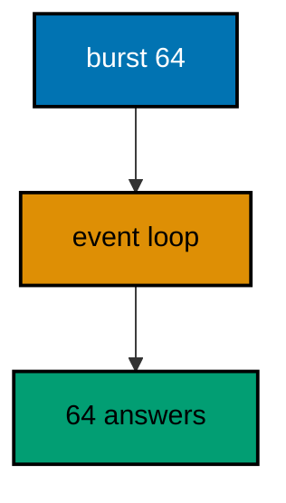

**`learning/code/ex-54-event-loop-never-blocks/Main.java`**:

```java
// Example 54: Event Loop Never Blocks.
// Fast handlers answer thousands of overlapping requests on a few event
// loop threads, as long as no handler blocks. Sixty-four concurrent GETs
// share the loop here, and every one answers 200: the summary counts the
// outcomes, never the timings. This example proves the loop stayed free.
// (Concepts: co-01, co-07.)
import io.vertx.core.Vertx;
import io.vertx.core.http.HttpMethod;
import io.vertx.ext.web.Router;
import io.vertx.ext.web.client.WebClient;
import java.util.ArrayList;
import java.util.List;
import java.util.concurrent.CompletableFuture;

public class Main {

  // buildRouter wires the service with every route this example serves.
  // The handler answers from memory: nothing blocks the loop (co-07).
  static Router buildRouter(Vertx vertx) {
    // An empty table first: the fast route below is its only row.
    Router router = Router.router(vertx); // => vertx creates routers bound to it
    // No sleep, no wait, no blocking call: the loop moves to the next request.
    router.get("/fast").handler(ctx -> ctx.response()
      .putHeader("content-type", "application/json") // => the body is JSON (co-04)
      .end("{\"fast\":true}")); // => 200 immediately, for every caller
    // Hand the wired table back to the caller.
    return router;
  }

  // check fires concurrent GETs and prints the outcome summary.
  // Concurrency is the load: counts are the assertion, never timings.
  static void check(WebClient client, int port, int total) throws Exception {
    // One future per request: all sixty-four fly at once, sharing the loop.
    List<CompletableFuture<Integer>> flights = new ArrayList<>(); // => one slot per request
    // Sending from the main thread is safe: the client owns its pool.
    for (int i = 0; i < total; i++) { // => sixty-four concurrent GETs
      flights.add(client.request(HttpMethod.GET, port, "127.0.0.1", "/fast") // => the fast route under load
        .send().toCompletionStage().toCompletableFuture() // => the future completes on answer
        .thenApply(response -> response.statusCode())); // => the code is the only fact kept
    }
    // allOf waits for every flight: the summary covers the whole burst.
    CompletableFuture.allOf(flights.toArray(new CompletableFuture[0])).join(); // => every request answered
    long ok = flights.stream().filter(future -> future.join() == 200).count(); // => 64 when the loop never blocked
    // The summary replaces timings: outcomes, not milliseconds.
    System.out.println("concurrent=" + total + " ok=" + ok); // => Output: concurrent=64 ok=64
  }

  public static void main(String[] args) throws Exception {
    // One event loop carries the server and every concurrent check below.
    Vertx vertx = Vertx.vertx(); // => vertx() boots the runtime this process shares
    Router router = buildRouter(vertx); // => the service under test, wired by its builder
    // Port zero asks the operating system for a free loopback port.
    // Reading it back keeps fixed ports out of every example (co-09).
    int port = vertx.createHttpServer().requestHandler(router).listen(0, "127.0.0.1")
      .toCompletionStage().toCompletableFuture().join().actualPort(); // => the assigned port the client will drive
    // The client talks through loopback, never leaving this process.
    WebClient client = WebClient.create(vertx); // => one pooled client serves the burst
    check(client, port, 64); // => Output: concurrent=64 ok=64
    // The pool shuts down: nothing in flight is cut.
    client.close();
    // The loop stops after every check printed, so no output is lost (co-08).
    vertx.close().toCompletionStage().toCompletableFuture().join();
  }
}
```

**Output** (`learning/code/ex-54-event-loop-never-blocks/expected/main.stdout.txt`):

```text
concurrent=64 ok=64
```

**Key takeaway**: Fast non-blocking handlers let one loop serve the whole burst; summarize outcomes, never timings.

**Why it matters**: Event-loop discipline is the throughput strategy: no blocking means no thread starvation. The burst summary proves the property without timing flakiness, which is how load assertions stay golden across machines.

---

### Example 55: Execute Blocking Holds Slow Work

Some work cannot avoid blocking: a JDBC call, a file read, a slow legacy API. Running it on the event loop would freeze every request, so executeBlocking moves it to a worker pool and resumes the handler when it finishes. Offload is the honest answer to unavoidable blocking.

This example slows eight concurrent calls on purpose and still answers every one, proving the pool carried what the loop must not.

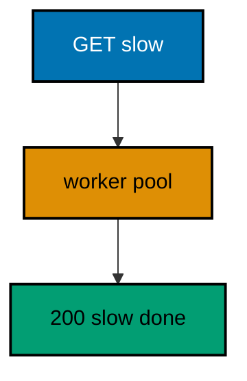

**`learning/code/ex-55-execute-blocking-holds-slow-work/Main.java`**:

```java
// Example 55: Execute Blocking Holds Slow Work.
// Some work cannot avoid blocking: a JDBC call, a file read, a 50ms
// legacy API. Running it on the event loop would freeze every request,
// so executeBlocking moves it to a worker pool and resumes the handler
// when it finishes. This example slows eight concurrent calls on purpose
// and still answers every one.
// (Concepts: co-02, co-07.)
import io.vertx.core.Vertx;
import io.vertx.core.http.HttpMethod;
import io.vertx.ext.web.Router;
import io.vertx.ext.web.client.WebClient;
import java.util.ArrayList;
import java.util.List;
import java.util.concurrent.CompletableFuture;

public class Main {

  // buildRouter wires the service with one deliberately slow route.
  // The sleep stands in for blocking work: JDBC, files, legacy APIs.
  static Router buildRouter(Vertx vertx) {
    // An empty table first: the slow route below is its only row.
    Router router = Router.router(vertx); // => vertx creates routers bound to it
    // executeBlocking borrows a worker thread: the loop stays free (co-07).
    // ordered=true keeps this route's calls in arrival order.
    router.get("/slow").handler(ctx -> ctx.vertx().executeBlocking(() -> {
      Thread.sleep(50); // => the stand-in for blocking work: never on the loop
      return "done"; // => the slow answer, computed off-loop
    }, true).onSuccess(value -> ctx.response()
      .putHeader("content-type", "application/json") // => the body is JSON (co-04)
      .end("{\"slow\":\"" + value + "\"}"))); // => 200 after the slow work finishes
    // Hand the wired table back to the caller.
    return router;
  }

  // check fires concurrent slow calls and prints the outcome summary.
  // Slow but parallel: the worker pool carries what the loop must not.
  static void check(WebClient client, int port, int total) throws Exception {
    // One future per request: eight slow calls overlap on the pool.
    List<CompletableFuture<Integer>> flights = new ArrayList<>(); // => one slot per request
    // Sending from the main thread is safe: the client owns its pool.
    for (int i = 0; i < total; i++) { // => eight concurrent slow calls
      flights.add(client.request(HttpMethod.GET, port, "127.0.0.1", "/slow") // => the slow route under load
        .send().toCompletionStage().toCompletableFuture() // => the future completes on answer
        .thenApply(response -> response.statusCode())); // => the code is the only fact kept
    }
    // allOf waits for every flight: the summary covers the whole burst.
    CompletableFuture.allOf(flights.toArray(new CompletableFuture[0])).join(); // => every slow call answered
    long ok = flights.stream().filter(future -> future.join() == 200).count(); // => 8 when the pool kept up
    // The summary replaces timings: outcomes, not milliseconds.
    System.out.println("slow=" + total + " ok=" + ok); // => Output: slow=8 ok=8
  }

  public static void main(String[] args) throws Exception {
    // One event loop carries the server; the pool carries the slow work.
    Vertx vertx = Vertx.vertx(); // => vertx() boots the runtime this process shares
    Router router = buildRouter(vertx); // => the service under test, wired by its builder
    // Port zero asks the operating system for a free loopback port.
    // Reading it back keeps fixed ports out of every example (co-09).
    int port = vertx.createHttpServer().requestHandler(router).listen(0, "127.0.0.1")
      .toCompletionStage().toCompletableFuture().join().actualPort(); // => the assigned port the client will drive
    // The client talks through loopback, never leaving this process.
    WebClient client = WebClient.create(vertx); // => one pooled client serves the burst
    check(client, port, 8); // => Output: slow=8 ok=8
    // The pool shuts down: nothing in flight is cut.
    client.close();
    // The loop stops after every check printed, so no output is lost (co-08).
    vertx.close().toCompletionStage().toCompletableFuture().join();
  }
}
```

**Output** (`learning/code/ex-55-execute-blocking-holds-slow-work/expected/main.stdout.txt`):

```text
slow=8 ok=8
```

**Key takeaway**: `executeBlocking` moves unavoidable blocking off the loop; `onSuccess` resumes the handler.

**Why it matters**: Explicit offload keeps slow dependencies from becoming everyone's latency. Wrapping the blocking call once isolates its cost to its own pool, so one legacy integration cannot freeze the whole service.

---

### Example 56: Worker Verticle Offloads CPU

Heavy computation deserves its own home: a worker verticle answers event-bus messages off the event loop, and the HTTP handler asks it per request. The route stays thin while the worker squares numbers. Buses decouple asking from computing, which lets each side scale on its own terms.

This example deploys the worker, then squares 6 and 7 through HTTP, proving the bus round-trips the math.

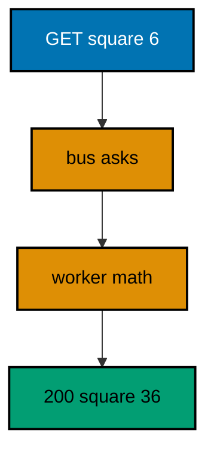

**`learning/code/ex-56-worker-verticle-offloads-cpu/Main.java`**:

```java
// Example 56: Worker Verticle Offloads CPU.
// Heavy computation deserves its own home: a worker verticle answers
// event-bus messages off the event loop, and the HTTP handler asks it
// per request. The route stays thin while the worker squares numbers.
// This example deploys the worker, then squares 6 and 7 through HTTP.
// (Concepts: co-06, co-07.)
import io.vertx.core.AbstractVerticle;
import io.vertx.core.DeploymentOptions;
import io.vertx.core.ThreadingModel;
import io.vertx.core.Vertx;
import io.vertx.core.http.HttpMethod;
import io.vertx.ext.web.Router;
import io.vertx.ext.web.client.WebClient;

public class Main {

  // SquareWorker answers "square" messages with the squared number.
  // Workers run off-loop: CPU-heavy work never steals the loop (co-07).
  static class SquareWorker extends AbstractVerticle { // => the off-loop computation
    public void start() { // => the bus address is registered on deploy
      // The consumer lives as long as the verticle: one address, many asks.
      vertx.eventBus().consumer("square", message -> {
        int n = (int) message.body(); // => 6 for the first check (type: int)
        message.reply(n * n); // => 36: the answer travels back on the bus
      });
    }
  }

  // buildRouter wires one route that asks the worker per request.
  // The handler is a messenger: ask on the bus, render the reply (co-06).
  static Router buildRouter(Vertx vertx) {
    // An empty table first: the delegating route below is its only row.
    Router router = Router.router(vertx); // => vertx creates routers bound to it
    // request() asks and waits: the reply completes the HTTP response.
    router.get("/square/:n").handler(ctx -> {
      int n = Integer.parseInt(ctx.pathParam("n")); // => "6" becomes 6 (type: int)
      ctx.vertx().eventBus().<Integer>request("square", n) // => the ask, off the loop
        .onSuccess(reply -> ctx.response() // => the worker answered: render it
          .putHeader("content-type", "application/json") // => the body is JSON (co-04)
          .end("{\"square\":" + reply.body() + "}")); // => 36 for 6, computed off-loop
    });
    // Hand the wired table back to the caller.
    return router;
  }

  // check serves one request in-process and prints its status line.
  // The client and the server share one JVM: no real network (co-09).
  static void check(WebClient client, int port, String method, String target) throws Exception {
    // A server-side request needs no socket: method, port, host, and path suffice.
    var request = client.request(HttpMethod.valueOf(method), port, "127.0.0.1", target);
    // The full pipeline runs, then answers: route, bus, worker, and response.
    var response = request.send().toCompletionStage().toCompletableFuture().join();
    String text = response.bodyAsString(); // => the exact bytes the handler wrote
    // An empty body still needs a visible marker, or the line ends mid-air.
    String shown = (text == null || text.isEmpty()) ? "(empty body)" : text;
    // One golden line per request: method, path, status, and body.
    System.out.println(method + " " + target + " -> " + response.statusCode() + " " + shown); // => Output: GET /square/6 -> 200 {"square":36}
  }

  public static void main(String[] args) throws Exception {
    // One event loop carries the server; the worker pool carries the math.
    Vertx vertx = Vertx.vertx(); // => vertx() boots the runtime this process shares
    // WORKER threading moves the verticle off the loop: deploy before serving.
    // The deployment id is runtime-assigned, so it never reaches the output.
    vertx.deployVerticle(new SquareWorker(), // => the computation, deployed once
      new DeploymentOptions().setThreadingModel(ThreadingModel.WORKER)) // => off-loop by construction
      .toCompletionStage().toCompletableFuture().join(); // => the bus address is live from here
    Router router = buildRouter(vertx); // => the service under test, wired by its builder
    // Port zero asks the operating system for a free loopback port.
    // Reading it back keeps fixed ports out of every example (co-09).
    int port = vertx.createHttpServer().requestHandler(router).listen(0, "127.0.0.1")
      .toCompletionStage().toCompletableFuture().join().actualPort(); // => the assigned port the client will drive
    // The client talks through loopback, never leaving this process.
    WebClient client = WebClient.create(vertx); // => one client serves every check
    check(client, port, "GET", "/square/6"); // => Output: GET /square/6 -> 200 {"square":36}
    check(client, port, "GET", "/square/7"); // => Output: GET /square/7 -> 200 {"square":49}
    // The pool shuts down: nothing in flight is cut.
    client.close();
    // The loop stops after every check printed, so no output is lost (co-08).
    vertx.close().toCompletionStage().toCompletableFuture().join();
  }
}
```

**Output** (`learning/code/ex-56-worker-verticle-offloads-cpu/expected/main.stdout.txt`):

```text
GET /square/6 -> 200 {"square":36}
GET /square/7 -> 200 {"square":49}
```

**Key takeaway**: Worker verticles compute off-loop behind bus addresses; handlers ask and render the reply.

**Why it matters**: Bus-separated computation scales and deploys independently of the HTTP edge. CPU-heavy work stops competing with request handling for loop time, which keeps tail latency flat while the workload grows.

---

### Example 57: Concurrent Posts Keep Every Write

Concurrent writers share the store, and a thread-safe map keeps every write: thirty-two overlapping POSTs must leave thirty-two gadgets, not twenty-nine with three lost to a race. Overlap is the normal case under load, and the store must be built for it.

This example fires the burst and counts the store afterwards, proving kept equals fired.

**`learning/code/ex-57-concurrent-posts-keep-every-write/Main.java`**:

```java
// Example 57: Concurrent Posts Keep Every Write.
// Concurrent writers share the store, and a thread-safe map keeps every
// write: thirty-two overlapping POSTs must leave thirty-two gadgets, not
// twenty-nine with three lost to a race. This example fires the burst and
// counts the store afterwards.
// (Concepts: co-03, co-07.)
import io.vertx.core.Vertx;
import io.vertx.core.json.JsonObject;
import io.vertx.ext.web.Router;
import io.vertx.ext.web.client.WebClient;
import io.vertx.ext.web.handler.BodyHandler;
import java.util.ArrayList;
import java.util.List;
import java.util.concurrent.CompletableFuture;
import java.util.concurrent.ConcurrentHashMap;
import java.util.concurrent.ConcurrentMap;
import java.util.concurrent.atomic.AtomicLong;

public class Main {

  // buildRouter wires creation over a thread-safe store.
  // ConcurrentHashMap survives overlapping writers: no write is lost (co-07).
  // A plain HashMap would corrupt here: threads share the handler's map.
  // Atomic ids pair with the concurrent map: unique and kept, together.
  static Router buildRouter(Vertx vertx, ConcurrentMap<Long, String> store, AtomicLong sequence) { // => the state, handed in
    // An empty table first: middleware plus one creation follow.
    Router router = Router.router(vertx); // => vertx creates routers bound to it
    // The same middleware decodes every body: creation reads the result.
    router.route().handler(BodyHandler.create()); // => bytes become a JsonObject
    // Atomic ids plus a concurrent map: every overlapping post is kept.
    router.post("/gadgets").handler(ctx -> {
      String name = ctx.body().asJsonObject().getString("name", "unnamed"); // => the gadget to keep (type: String)
      long id = sequence.incrementAndGet(); // => unique across threads (type: long)
      store.put(id, name); // => kept, even under overlap
      ctx.response()
        .setStatusCode(201) // => 201 names the creation (co-04)
        .putHeader("content-type", "application/json") // => the body is JSON
        .end(new JsonObject().put("id", id).encode()); // => the assigned address
    });
    // Hand the wired table back to the caller.
    return router;
  }

  // check fires the burst, then prints how many writes the store kept.
  // kept equals fired: the summary is the thread-safety proof.
  static void check(WebClient client, int port, ConcurrentMap<Long, String> store, int total) throws Exception {
    // One future per post: thirty-two creations overlap on the store.
    List<CompletableFuture<Integer>> flights = new ArrayList<>(); // => one slot per post
    // Sending from the main thread is safe: the client owns its pool.
    for (int i = 0; i < total; i++) { // => thirty-two overlapping POSTs
      flights.add(client.post(port, "127.0.0.1", "/gadgets") // => POST names the verb under test
        .sendJsonObject(new JsonObject().put("name", "bulk")) // => identical bodies: only ids differ
        .toCompletionStage().toCompletableFuture() // => the future completes on answer
        .thenApply(response -> response.statusCode())); // => the code is the only fact kept
    }
    // allOf waits for every flight: the count covers the whole burst.
    CompletableFuture.allOf(flights.toArray(new CompletableFuture[0])).join(); // => every post answered
    long ok = flights.stream().filter(future -> future.join() == 201).count(); // => 32 when every write landed
    // The store count is the proof: lost writes would read fewer here.
    System.out.println("posted=" + total + " created=" + ok + " stored=" + store.size()); // => Output: posted=32 created=32 stored=32
  }

  public static void main(String[] args) throws Exception {
    // One event loop carries the server; the map carries the overlap.
    Vertx vertx = Vertx.vertx(); // => vertx() boots the runtime this process shares
    // The composition root: thread-safe state, built in the open.
    ConcurrentMap<Long, String> store = new ConcurrentHashMap<>(); // => empty until the burst lands
    AtomicLong sequence = new AtomicLong(0); // => unique ids across threads
    Router router = buildRouter(vertx, store, sequence); // => wiring, with the state explicit
    // Port zero asks the operating system for a free loopback port.
    // Reading it back keeps fixed ports out of every example (co-09).
    int port = vertx.createHttpServer().requestHandler(router).listen(0, "127.0.0.1")
      .toCompletionStage().toCompletableFuture().join().actualPort(); // => the assigned port the client will drive
    // The client talks through loopback, never leaving this process.
    WebClient client = WebClient.create(vertx); // => one pooled client serves the burst
    check(client, port, store, 32); // => Output: posted=32 created=32 stored=32
    // The pool shuts down: nothing in flight is cut.
    client.close();
    // The loop stops after every check printed, so no output is lost (co-08).
    vertx.close().toCompletionStage().toCompletableFuture().join();
  }
}
```

**Output** (`learning/code/ex-57-concurrent-posts-keep-every-write/expected/main.stdout.txt`):

```text
posted=32 created=32 stored=32
```

**Key takeaway**: Concurrent maps plus atomic ids keep every overlapping write; count the store to prove it.

**Why it matters**: Thread-safe stores turn load from a corruption risk into a counted proof. The posted-equals-stored summary is the assertion that concurrent creation works, which single-threaded tests can never provide.

---

### Example 58: Shared Data Needs the Event Loop

One handler runs on many event loop threads at once, so shared numbers must update atomically: a plain int loses increments under overlap while an AtomicLong keeps all sixty-four. Shared mutation is the concurrency boundary, and atomics are its cheapest guard.

This example counts concurrent hits and proves the final count matches the burst exactly.

**`learning/code/ex-58-shared-data-needs-the-event-loop/Main.java`**:

```java
// Example 58: Shared Data Needs the Event Loop.
// One handler runs on many event loop threads at once, so shared numbers
// must update atomically: a plain int loses increments under overlap while
// an AtomicLong keeps all sixty-four. This example counts concurrent hits
// and proves the final count matches the burst.
// (Concepts: co-01, co-07.)
import io.vertx.core.Vertx;
import io.vertx.core.http.HttpMethod;
import io.vertx.ext.web.Router;
import io.vertx.ext.web.client.WebClient;
import java.util.ArrayList;
import java.util.List;
import java.util.concurrent.CompletableFuture;
import java.util.concurrent.atomic.AtomicLong;

public class Main {

  // buildRouter wires one counting route over the shared counter.
  // The counter is a dependency: shared state stays visible (co-07).
  static Router buildRouter(Vertx vertx, AtomicLong hits) { // => the shared number, handed in
    // An empty table first: the counting route below is its only row.
    Router router = Router.router(vertx); // => vertx creates routers bound to it
    // incrementAndGet is atomic: overlapping event loops cannot lose a hit.
    // A plain int++ here would race: threads, not requests, are the overlap.
    router.get("/hit").handler(ctx -> {
      long seen = hits.incrementAndGet(); // => the hit number, unique per call (type: long)
      ctx.response()
        .putHeader("content-type", "application/json") // => the body is JSON (co-04)
        .end("{\"hit\":" + seen + "}"); // => the running count, rendered per call
    });
    // Hand the wired table back to the caller.
    return router;
  }

  // check fires the burst, then prints the final count beside the burst.
  // final equals fired: the summary is the atomicity proof.
  static void check(WebClient client, int port, AtomicLong hits, int total) throws Exception {
    // One future per request: sixty-four hits overlap on the counter.
    List<CompletableFuture<Integer>> flights = new ArrayList<>(); // => one slot per hit
    // Sending from the main thread is safe: the client owns its pool.
    for (int i = 0; i < total; i++) { // => sixty-four concurrent hits
      flights.add(client.request(HttpMethod.GET, port, "127.0.0.1", "/hit") // => the counting route under load
        .send().toCompletionStage().toCompletableFuture() // => the future completes on answer
        .thenApply(response -> response.statusCode())); // => the code is the only fact kept
    }
    // allOf waits for every flight: the count covers the whole burst.
    CompletableFuture.allOf(flights.toArray(new CompletableFuture[0])).join(); // => every hit counted
    long ok = flights.stream().filter(future -> future.join() == 200).count(); // => 64 when the counter kept up
    // The final count is the proof: lost increments would read fewer here.
    System.out.println("hits=" + total + " ok=" + ok + " final=" + hits.get()); // => Output: hits=64 ok=64 final=64
  }

  public static void main(String[] args) throws Exception {
    // One event loop carries the server; the counter carries the overlap.
    Vertx vertx = Vertx.vertx(); // => vertx() boots the runtime this process shares
    // The composition root: the shared number starts at zero.
    AtomicLong hits = new AtomicLong(0); // => every hit lands here, atomically
    Router router = buildRouter(vertx, hits); // => wiring, with the counter explicit
    // Port zero asks the operating system for a free loopback port.
    // Reading it back keeps fixed ports out of every example (co-09).
    int port = vertx.createHttpServer().requestHandler(router).listen(0, "127.0.0.1")
      .toCompletionStage().toCompletableFuture().join().actualPort(); // => the assigned port the client will drive
    // The client talks through loopback, never leaving this process.
    WebClient client = WebClient.create(vertx); // => one pooled client serves the burst
    check(client, port, hits, 64); // => Output: hits=64 ok=64 final=64
    // The pool shuts down: nothing in flight is cut.
    client.close();
    // The loop stops after every check printed, so no output is lost (co-08).
    vertx.close().toCompletionStage().toCompletableFuture().join();
  }
}
```

**Output** (`learning/code/ex-58-shared-data-needs-the-event-loop/expected/main.stdout.txt`):

```text
hits=64 ok=64 final=64
```

**Key takeaway**: Mutate shared numbers atomically; the final count must equal the burst.

**Why it matters**: Atomic shared state removes the lost-update class of race without locks. The hits-equals-final summary converts a concurrency property into a golden number, which is the only kind of concurrency proof that survives reruns.

---

### Example 59: Body Limits Bound the Queue

Unbounded bodies are an outage waiting for a caller: one huge upload can crowd out every other request. A body limit caps each request at the boundary, and oversized ones fail fast with 413 before the handler spends a byte of logic on them. Backpressure starts at the edge.

This example caps bodies at 64 bytes, proving the small body parses and the large one fails with the contract.

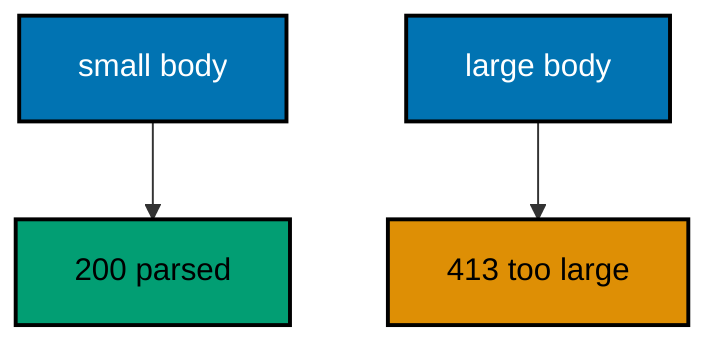

**`learning/code/ex-59-body-limits-bound-the-queue/Main.java`**:

```java
// Example 59: Body Limits Bound the Queue.
// Unbounded bodies are an outage waiting for a caller: one 100MB upload
// can crowd out every other request. A body limit caps each request at
// the boundary, and oversized ones fail fast with 413 before the handler
// spends a byte of logic on them. This example caps bodies at 64 bytes.
// (Concepts: co-03, co-07.)
import io.vertx.core.Vertx;
import io.vertx.core.buffer.Buffer;
import io.vertx.core.json.JsonObject;
import io.vertx.ext.web.Router;
import io.vertx.ext.web.client.WebClient;
import io.vertx.ext.web.handler.BodyHandler;

public class Main {

  // buildRouter wires the service with a capped body middleware.
  // The cap is the backpressure: oversized bodies never reach logic (co-07).
  static Router buildRouter(Vertx vertx) {
    // An empty table first: the capped middleware plus one route follow.
    Router router = Router.router(vertx); // => vertx creates routers bound to it
    // setBodyLimit(64) fails bodies past 64 bytes: the queue stays bounded.
    router.route().handler(BodyHandler.create().setBodyLimit(64)); // => the boundary guard, in bytes
    // Oversized bodies never arrive here: the middleware fails them first.
    router.post("/echo").handler(ctx -> {
      JsonObject body = ctx.body().asJsonObject(); // => at most 64 bytes, by construction
      ctx.response()
        .putHeader("content-type", "application/json") // => the body is JSON (co-04)
        .end(new JsonObject().put("name", body.getString("name", "nobody")).encode()); // => the parsed name echoed back
    });
    // The 413 catcher shapes the bound as the error contract (co-05).
    router.errorHandler(413, ctx -> ctx.response()
      .setStatusCode(413) // => 413 names the oversized body deliberately
      .putHeader("content-type", "application/json") // => failures parse like successes
      .end("{\"error\":{\"code\":413,\"message\":\"body too large\"}}")); // => the bound, in the contract
    // Hand the wired table back to the caller.
    return router;
  }

  // check posts one raw body in-process and prints its status line.
  // Raw bytes control the size: JSON encoding would hide the byte count.
  static void check(WebClient client, int port, String payload, String label) throws Exception {
    // sendBuffer carries exact bytes: the middleware measures, not the encoder.
    var response = client.post(port, "127.0.0.1", "/echo") // => POST names the verb under test
      .putHeader("content-type", "application/json") // => the handler attempts a JSON decode
      .sendBuffer(Buffer.buffer(payload)) // => the bytes under test, sized on purpose
      .toCompletionStage().toCompletableFuture().join(); // => the guard answers, then logic
    String text = response.bodyAsString(); // => the exact bytes the handler wrote
    // One golden line per request: the case label, the status, and the body.
    System.out.println("POST /echo " + label + " -> " + response.statusCode() + " " + text); // => Output: POST /echo small -> 200 {"name":"gopher"}
  }

  public static void main(String[] args) throws Exception {
    // One event loop carries both the server and the client below.
    Vertx vertx = Vertx.vertx(); // => vertx() boots the runtime this process shares
    Router router = buildRouter(vertx); // => the service under test, wired by its builder
    // Port zero asks the operating system for a free loopback port.
    // Reading it back keeps fixed ports out of every example (co-09).
    int port = vertx.createHttpServer().requestHandler(router).listen(0, "127.0.0.1")
      .toCompletionStage().toCompletableFuture().join().actualPort(); // => the assigned port the client will drive
    // The client talks through loopback, never leaving this process.
    WebClient client = WebClient.create(vertx); // => one client serves every check
    check(client, port, "{\"name\":\"gopher\"}", "small"); // => Output: POST /echo small -> 200 {"name":"gopher"}
    check(client, port, "{\"name\":\"" + "g".repeat(200) + "\"}", "large"); // => Output: POST /echo large -> 413 {"error":{"code":413,"message":"body too large"}}
    // The pool shuts down: nothing in flight is cut.
    client.close();
    // The loop stops after every check printed, so no output is lost (co-08).
    vertx.close().toCompletionStage().toCompletableFuture().join();
  }
}
```

**Output** (`learning/code/ex-59-body-limits-bound-the-queue/expected/main.stdout.txt`):

```text
POST /echo small -> 200 {"name":"gopher"}
POST /echo large -> 413 {"error":{"code":413,"message":"body too large"}}
```

**Key takeaway**: `setBodyLimit` caps bytes at the middleware; oversized bodies answer 413 before logic.

**Why it matters**: Edge caps turn resource exhaustion from an incident into a rejected request. Failing fast at 64 bytes protects every other request sharing the server, which is backpressure the operators never have to page about.

---

### Example 60: Context Data Follows the Request

Cross-cutting values — request ids, tenants, deadlines — ride the context from middleware to handler without polluting signatures. The middleware stamps each request with a sequence number, and the handler echoes it, so the golden output proves the value followed its own request only. Context is the request's private channel.

This example stamps two sequential requests, proving each echo carries its own id.

**`learning/code/ex-60-context-data-follows-the-request/Main.java`**:

```java
// Example 60: Context Data Follows the Request.
// Cross-cutting values — request ids, tenants, deadlines — ride the context
// from middleware to handler without polluting signatures. The middleware
// stamps each request with a sequence number, and the handler echoes it,
// so the golden output proves the value followed its own request only.
// (Concepts: co-02, co-03.)
import io.vertx.core.Vertx;
import io.vertx.core.http.HttpMethod;
import io.vertx.ext.web.Router;
import io.vertx.ext.web.client.WebClient;
import java.util.concurrent.atomic.AtomicLong;

public class Main {

  // buildRouter wires the stamping middleware plus one echoing route.
  // The stamp travels on the context: signatures stay clean (co-02).
  static Router buildRouter(Vertx vertx, AtomicLong sequence) { // => the stamp source, handed in
    // An empty table first: the stamp middleware plus one route follow.
    Router router = Router.router(vertx); // => vertx creates routers bound to it
    // The stamp lands before any route runs: every handler can read it.
    router.route().handler(ctx -> {
      long n = sequence.incrementAndGet(); // => 1 for the first request (type: long)
      ctx.put("request-id", "req-" + n); // => stored under "request-id" for this request
      ctx.next(); // => the route runs next, stamp aboard
    });
    // The handler echoes its own request's stamp: crosstalk would show here.
    router.get("/hello").handler(ctx -> {
      String id = ctx.get("request-id"); // => "req-1" for the first request (type: String)
      ctx.response()
        .putHeader("content-type", "application/json") // => the body is JSON (co-04)
        .end("{\"request\":\"" + id + "\"}"); // => the stamp, echoed back
    });
    // Hand the wired table back to the caller.
    return router;
  }

  // check serves one request in-process and prints its status line.
  // The stamp arrives in the body: context flow made visible.
  static void check(WebClient client, int port, String method, String target) throws Exception {
    // A server-side request needs no socket: method, port, host, and path suffice.
    var request = client.request(HttpMethod.valueOf(method), port, "127.0.0.1", target);
    // The full pipeline runs, then answers: stamp, route, and response.
    var response = request.send().toCompletionStage().toCompletableFuture().join();
    String text = response.bodyAsString(); // => the exact bytes the handler wrote
    // An empty body still needs a visible marker, or the line ends mid-air.
    String shown = (text == null || text.isEmpty()) ? "(empty body)" : text;
    // One golden line per request: method, path, status, and body.
    System.out.println(method + " " + target + " -> " + response.statusCode() + " " + shown); // => Output: GET /hello -> 200 {"request":"req-1"}
  }

  public static void main(String[] args) throws Exception {
    // One event loop carries both the server and the client below.
    Vertx vertx = Vertx.vertx(); // => vertx() boots the runtime this process shares
    // The composition root: the stamp source starts at zero.
    AtomicLong sequence = new AtomicLong(0); // => req-1, req-2, in order
    Router router = buildRouter(vertx, sequence); // => wiring, with the source explicit
    // Port zero asks the operating system for a free loopback port.
    // Reading it back keeps fixed ports out of every example (co-09).
    int port = vertx.createHttpServer().requestHandler(router).listen(0, "127.0.0.1")
      .toCompletionStage().toCompletableFuture().join().actualPort(); // => the assigned port the client will drive
    // The client talks through loopback, never leaving this process.
    WebClient client = WebClient.create(vertx); // => one client serves every check
    check(client, port, "GET", "/hello"); // => Output: GET /hello -> 200 {"request":"req-1"}
    check(client, port, "GET", "/hello"); // => Output: GET /hello -> 200 {"request":"req-2"}
    // The pool shuts down: nothing in flight is cut.
    client.close();
    // The loop stops after every check printed, so no output is lost (co-08).
    vertx.close().toCompletionStage().toCompletableFuture().join();
  }
}
```

**Output** (`learning/code/ex-60-context-data-follows-the-request/expected/main.stdout.txt`):

```text
GET /hello -> 200 {"request":"req-1"}
GET /hello -> 200 {"request":"req-2"}
```

**Key takeaway**: Stamp per-request values in middleware; handlers read them from the context.

**Why it matters**: Context-carried values keep signatures clean while staying request-scoped. Tracing ids and tenants flow without threading parameters through every function, and the echo test proves values never leak across requests.

---

### Example 61: Load Summary Replaces Timings

Load tests tempt timers, but timings wobble between runs and golden files cannot hold them. Summaries hold instead: how many ran, how many passed, how many failed by status. Stable numbers are the load test's contract with the future.

This example mixes known and unknown paths under one burst and prints the three stable numbers.

**`learning/code/ex-61-load-summary-replaces-timings/Main.java`**:

```java
// Example 61: Load Summary Replaces Timings.
// Load tests tempt timers, but timings wobble between runs and golden
// files cannot hold them. Summaries hold instead: how many ran, how many
// passed, how many failed by status. This example mixes known and unknown
// paths under one burst and prints the three stable numbers.
// (Concepts: co-07, co-13.)
import io.vertx.core.Vertx;
import io.vertx.core.http.HttpMethod;
import io.vertx.ext.web.Router;
import io.vertx.ext.web.client.WebClient;
import java.util.ArrayList;
import java.util.List;
import java.util.concurrent.CompletableFuture;

public class Main {

  // buildRouter wires the service with one route plus the fallback.
  // Known and unknown share the burst: the summary separates them (co-13).
  static Router buildRouter(Vertx vertx) {
    // An empty table first: one route is enough; the fallback is automatic.
    Router router = Router.router(vertx); // => vertx creates routers bound to it
    // The known route answers JSON: its hits count as ok below.
    router.get("/hello").handler(ctx -> ctx.response()
      .putHeader("content-type", "application/json") // => the body is JSON (co-04)
      .end("{\"message\":\"hello, vertx\"}")); // => 200 plus the greeting contract
    // Hand the wired table back to the caller.
    return router;
  }

  // check fires the mixed burst and prints the stable summary.
  // No clock is read: requests, ok, and failed are the whole story.
  static void check(WebClient client, int port) throws Exception {
    // Three known for every one unknown: the mix is fixed, so the counts are.
    List<CompletableFuture<Integer>> flights = new ArrayList<>(); // => one slot per request
    // Sending from the main thread is safe: the client owns its pool.
    for (int i = 0; i < 64; i++) { // => sixty-four requests, fixed mix
      String path = (i % 4 == 3) ? "/nowhere" : "/hello"; // => every fourth one misses
      flights.add(client.request(HttpMethod.GET, port, "127.0.0.1", path) // => the route under load
        .send().toCompletionStage().toCompletableFuture() // => the future completes on answer
        .thenApply(response -> response.statusCode())); // => the code is the only fact kept
    }
    // allOf waits for every flight: the summary covers the whole burst.
    CompletableFuture.allOf(flights.toArray(new CompletableFuture[0])).join(); // => every request answered
    long ok = flights.stream().filter(future -> future.join() == 200).count(); // => 48 known hits (type: long)
    long failed = flights.stream().filter(future -> future.join() != 200).count(); // => 16 misses (type: long)
    // The summary is the load test: stable numbers, no timings anywhere.
    System.out.println("requests=64 ok=" + ok + " failed=" + failed); // => Output: requests=64 ok=48 failed=16
  }

  public static void main(String[] args) throws Exception {
    // One event loop carries the server and every concurrent check below.
    Vertx vertx = Vertx.vertx(); // => vertx() boots the runtime this process shares
    Router router = buildRouter(vertx); // => the service under test, wired by its builder
    // Port zero asks the operating system for a free loopback port.
    // Reading it back keeps fixed ports out of every example (co-09).
    int port = vertx.createHttpServer().requestHandler(router).listen(0, "127.0.0.1")
      .toCompletionStage().toCompletableFuture().join().actualPort(); // => the assigned port the client will drive
    // The client talks through loopback, never leaving this process.
    WebClient client = WebClient.create(vertx); // => one pooled client serves the burst
    check(client, port); // => Output: requests=64 ok=48 failed=16
    // The pool shuts down: nothing in flight is cut.
    client.close();
    // The loop stops after every check printed, so no output is lost (co-08).
    vertx.close().toCompletionStage().toCompletableFuture().join();
  }
}
```

**Output** (`learning/code/ex-61-load-summary-replaces-timings/expected/main.stdout.txt`):

```text
requests=64 ok=48 failed=16
```

**Key takeaway**: Summarize load as requests, ok, and failed; never print timings in golden output.

**Why it matters**: Timing-free load assertions run green on any machine, from laptops to CI. Counts capture the behavior that matters — did everything answer correctly under overlap — while milliseconds capture the machine, which the test should never assert.

---

### Example 62: Close Drains In-Flight First

Stopping must not cut the requests already accepted: the server sheds new traffic, waits for the in-flight count to reach zero, and only then closes the port. The drain is the graceful part of shutdown; closing the socket is merely its end. Counts prove the drain, not logs.

This example catches four slow requests mid-flight, waits them out, and proves all four still answered.

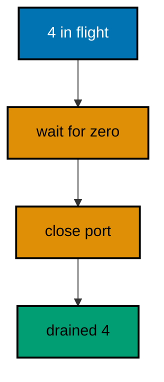

**`learning/code/ex-62-close-drains-in-flight-first/Main.java`**:

```java
// Example 62: Close Drains In-Flight First.
// Stopping must not cut the requests already accepted: the server sheds
// new traffic, waits for the in-flight count to reach zero, and only then
// closes the port. Four slow requests are caught mid-flight here, the main
// thread waits them out, and the summary proves all four still answered.
// (Concepts: co-07, co-08.)
import io.vertx.core.Vertx;
import io.vertx.core.http.HttpMethod;
import io.vertx.core.http.HttpServer;
import io.vertx.ext.web.Router;
import io.vertx.ext.web.client.WebClient;
import java.util.ArrayList;
import java.util.List;
import java.util.concurrent.CompletableFuture;
import java.util.concurrent.CountDownLatch;
import java.util.concurrent.atomic.AtomicInteger;

public class Main {

  // buildRouter wires one slow route that tracks its in-flight count.
  // Entry increments, body end decrements: the count is exact mid-flight.
  // The latch and the counter split duties: provable start, exact finish.
  // Shed load first in production: the flag flips before this drain runs.
  static Router buildRouter(Vertx vertx, AtomicInteger inFlight, CountDownLatch started) { // => the drain proof, handed in
    // An empty table first: the slow route below is its only row.
    Router router = Router.router(vertx); // => vertx creates routers bound to it
    // executeBlocking holds each request mid-flight: the drain waits these out.
    router.get("/slow").handler(ctx -> {
      inFlight.incrementAndGet(); // => one more request inside the server
      started.countDown(); // => one request provably in flight
      ctx.addBodyEndHandler(done -> inFlight.decrementAndGet()); // => answered: the drain counts down
      ctx.vertx().executeBlocking(() -> {
        Thread.sleep(300); // => the stand-in for real work: never on the loop
        return "done"; // => the slow answer, computed off-loop
      }, true).onSuccess(value -> ctx.response()
        .putHeader("content-type", "application/json") // => the body is JSON (co-04)
        .end("{\"slow\":\"" + value + "\"}")); // => 200 after the slow work finishes
    });
    // Hand the wired table back to the caller.
    return router;
  }

  public static void main(String[] args) throws Exception {
    // One event loop carries the server; the pool carries the slow work.
    Vertx vertx = Vertx.vertx(); // => vertx() boots the runtime this process shares
    // Four slots: main waits until all four requests are provably in flight.
    AtomicInteger inFlight = new AtomicInteger(0); // => the drain counter, exact by construction
    CountDownLatch started = new CountDownLatch(4); // => one count per slow request
    Router router = buildRouter(vertx, inFlight, started); // => the service under test, wired by its builder
    // The server handle is kept: close() is called on this exact server.
    HttpServer server = vertx.createHttpServer().requestHandler(router).listen(0, "127.0.0.1")
      .toCompletionStage().toCompletableFuture().join(); // => bound, port assigned by the system
    int port = server.actualPort(); // => the assigned port the client will drive
    // The client talks through loopback, never leaving this process.
    WebClient client = WebClient.create(vertx); // => one pooled client serves the burst
    // Four futures fly first: none is awaited until after the drain below.
    List<CompletableFuture<Integer>> flights = new ArrayList<>(); // => one slot per slow request
    for (int i = 0; i < 4; i++) { // => four overlapping slow calls
      flights.add(client.request(HttpMethod.GET, port, "127.0.0.1", "/slow") // => the slow route, mid-flight soon
        .send().toCompletionStage().toCompletableFuture() // => the future completes on answer
        .thenApply(response -> response.statusCode())); // => the code is the only fact kept
    }
    // The latch proves all four are inside their handlers before draining.
    started.await(); // => in flight, provably: the drain cannot beat the requests
    // The drain: no new sends happen here, and close waits for zero in flight.
    while (inFlight.get() > 0) { // => the graceful wait: still work inside
      Thread.sleep(20); // => the pause never reaches output: counts are the gold
    }
    // Zero in flight: the port releases with nothing left to cut.
    server.close().toCompletionStage().toCompletableFuture().join(); // => drained, then released (co-08)
    // allOf collects the answers that arrived during the drain.
    CompletableFuture.allOf(flights.toArray(new CompletableFuture[0])).join(); // => every slow call answered
    long ok = flights.stream().filter(future -> future.join() == 200).count(); // => 4 when the drain held
    // The summary is the graceful proof: in flight, then drained, then closed.
    System.out.println("in-flight=4 drained=" + ok + " closed=true"); // => Output: in-flight=4 drained=4 closed=true
    // The pool shuts down: the answers are already printed.
    client.close();
    // The loop stops after every check printed, so no output is lost.
    vertx.close().toCompletionStage().toCompletableFuture().join();
  }
}
```

**Output** (`learning/code/ex-62-close-drains-in-flight-first/expected/main.stdout.txt`):

```text
in-flight=4 drained=4 closed=true
```

**Key takeaway**: Count in-flight requests; close the server only after the count reaches zero.

**Why it matters**: Explicit drains keep deploys from dropping live traffic. Waiting for zero before closing turns rolling restarts from a gamble into a guarantee, which is the property that lets platforms move fast without breaking calls.

---

### Example 63: Health Check Reports Readiness

Load balancers ask one question — are you ready — and the answer is one route with one shape: 200 plus {"status":"ok"}. The health check stays separate from business routes so probes never exercise real logic. Probes are infrastructure, not features.

This example serves the flag beside a business route and asserts both, proving the probe answers without touching logic.

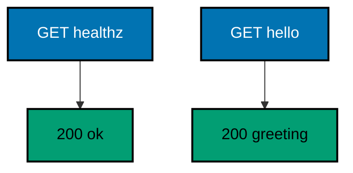

**`learning/code/ex-63-health-check-reports-readiness/Main.java`**:

```java
// Example 63: Health Check Reports Readiness.
// Load balancers ask one question — are you ready — and the answer is one
// route with one shape: 200 plus {"status":"ok"}. The health check stays
// separate from business routes so probes never exercise real logic. This
// example serves the flag beside a business route and asserts both.
// (Concepts: co-01, co-14.)
import io.vertx.core.Vertx;
import io.vertx.core.http.HttpMethod;
import io.vertx.ext.web.Router;
import io.vertx.ext.web.client.WebClient;

public class Main {

  // buildRouter wires one business route plus the readiness probe.
  // Probes stay separate: balancers read health without touching logic.
  static Router buildRouter(Vertx vertx) {
    // An empty table first: business plus probe follow on separate paths.
    Router router = Router.router(vertx); // => vertx creates routers bound to it
    // The business route answers the greeting every test expects.
    router.get("/hello").handler(ctx -> ctx.response()
      .putHeader("content-type", "application/json") // => the body is JSON (co-04)
      .end("{\"message\":\"hello, vertx\"}")); // => 200 plus the greeting contract
    // The probe answers readiness in one fixed shape: balancers parse this.
    router.get("/healthz").handler(ctx -> ctx.response()
      .putHeader("content-type", "application/json") // => the flag is JSON too
      .end("{\"status\":\"ok\"}")); // => 200 with the readiness flag (co-14)
    // Hand the wired table back to the caller.
    return router;
  }

  // check serves one request in-process and prints its status line.
  // The client and the server share one JVM: no real network (co-09).
  static void check(WebClient client, int port, String method, String target) throws Exception {
    // A server-side request needs no socket: method, port, host, and path suffice.
    var request = client.request(HttpMethod.valueOf(method), port, "127.0.0.1", target);
    // The full pipeline runs, then answers: routing, handlers, and response.
    var response = request.send().toCompletionStage().toCompletableFuture().join();
    String text = response.bodyAsString(); // => the exact bytes the handler wrote
    // An empty body still needs a visible marker, or the line ends mid-air.
    String shown = (text == null || text.isEmpty()) ? "(empty body)" : text;
    // One golden line per request: method, path, status, and body.
    System.out.println(method + " " + target + " -> " + response.statusCode() + " " + shown); // => Output: GET /healthz -> 200 {"status":"ok"}
  }

  public static void main(String[] args) throws Exception {
    // One event loop carries both the server and the client below.
    Vertx vertx = Vertx.vertx(); // => vertx() boots the runtime this process shares
    Router router = buildRouter(vertx); // => the service under test, wired by its builder
    // Port zero asks the operating system for a free loopback port.
    // Reading it back keeps fixed ports out of every example (co-09).
    int port = vertx.createHttpServer().requestHandler(router).listen(0, "127.0.0.1")
      .toCompletionStage().toCompletableFuture().join().actualPort(); // => the assigned port the client will drive
    // The client talks through loopback, never leaving this process.
    WebClient client = WebClient.create(vertx); // => one client serves every check
    check(client, port, "GET", "/healthz"); // => Output: GET /healthz -> 200 {"status":"ok"}
    check(client, port, "GET", "/hello"); // => Output: GET /hello -> 200 {"message":"hello, vertx"}
    // The pool shuts down: nothing in flight is cut.
    client.close();
    // The loop stops after every check printed, so no output is lost (co-08).
    vertx.close().toCompletionStage().toCompletableFuture().join();
  }
}
```

**Output** (`learning/code/ex-63-health-check-reports-readiness/expected/main.stdout.txt`):

```text
GET /healthz -> 200 {"status":"ok"}
GET /hello -> 200 {"message":"hello, vertx"}
```

**Key takeaway**: Serve readiness on its own route with a fixed shape; balancers read the flag, not the logic.

**Why it matters**: Separate probes keep infrastructure checks from exercising business logic. A health check that cannot fail for business reasons tells the balancer exactly one thing — route traffic here — instead of entangling liveness with correctness.

---

### Example 64: Health Check Fails When Not Ready

Readiness is a flag, not a constant: the service starts unready, becomes ready when its dependencies connect, and turns unready during shutdown. The probe reads the flag per request, answering 503 while unready so the balancer stops sending traffic. Liveness without readiness sheds load exactly when it must.

This example flips the flag through starting, ready, and draining, proving the probe tracks each state.

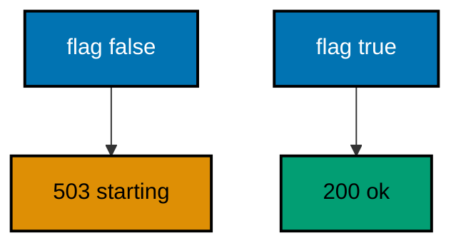

**`learning/code/ex-64-health-check-fails-when-not-ready/Main.java`**:

```java
// Example 64: Health Check Fails When Not Ready.
// Readiness is a flag, not a constant: the service starts unready, becomes
// ready when its dependencies connect, and turns unready during shutdown.
// The probe reads the flag per request, answering 503 while unready so the
// balancer stops sending traffic. This example flips the flag mid-test.
// (Concepts: co-05, co-14.)
import io.vertx.core.Vertx;
import io.vertx.core.http.HttpMethod;
import io.vertx.ext.web.Router;
import io.vertx.ext.web.client.WebClient;
import java.util.concurrent.atomic.AtomicBoolean;

public class Main {

  // buildRouter wires the probe over the readiness flag it reads.
  // The flag is a dependency: storage or startup flips it, never the route.
  static Router buildRouter(Vertx vertx, AtomicBoolean ready) { // => readiness, handed in
    // An empty table first: the flag-reading probe below is its only row.
    Router router = Router.router(vertx); // => vertx creates routers bound to it
    // The probe reads the flag on every call: readiness is current, not cached.
    router.get("/healthz").handler(ctx -> {
      boolean up = ready.get(); // => false before startup, true after (type: boolean)
      // Unready answers 503: balancers shed load until the flag flips.
      if (!up) { // => the draining branch
        ctx.response()
          .setStatusCode(503) // => 503 sheds traffic (co-05)
          .putHeader("content-type", "application/json") // => the flag is JSON either way
          .end("{\"status\":\"starting\"}"); // => honest: not ready yet
        return; // => the handler is done: the flag spoke
      }
      ctx.response()
        .putHeader("content-type", "application/json") // => the flag stays JSON
        .end("{\"status\":\"ok\"}"); // => 200 with the readiness flag (co-14)
    });
    // Hand the wired table back to the caller.
    return router;
  }

  // check serves one probe in-process and prints its status line.
  // The flag flips between checks: the probe must track it (co-09).
  static void check(WebClient client, int port, String label) throws Exception {
    // A server-side request needs no socket: it never leaves this process.
    var response = client.request(HttpMethod.GET, port, "127.0.0.1", "/healthz") // => the probe under test
      .send().toCompletionStage().toCompletableFuture().join(); // => the flag is read on this call
    String text = response.bodyAsString(); // => the exact bytes the handler wrote
    // One golden line: the flag state, the status, and the body.
    System.out.println("probe " + label + " -> " + response.statusCode() + " " + text); // => Output: probe starting -> 503 {"status":"starting"}
  }

  public static void main(String[] args) throws Exception {
    // One event loop carries both the server and the client below.
    Vertx vertx = Vertx.vertx(); // => vertx() boots the runtime this process shares
    // The composition root: the service starts unready, like every real one.
    AtomicBoolean ready = new AtomicBoolean(false); // => starting: probes shed traffic
    Router router = buildRouter(vertx, ready); // => wiring, with the flag explicit
    // Port zero asks the operating system for a free loopback port.
    // Reading it back keeps fixed ports out of every example (co-09).
    int port = vertx.createHttpServer().requestHandler(router).listen(0, "127.0.0.1")
      .toCompletionStage().toCompletableFuture().join().actualPort(); // => the assigned port the client will drive
    // The client talks through loopback, never leaving this process.
    WebClient client = WebClient.create(vertx); // => one client serves every probe
    check(client, port, "starting"); // => Output: probe starting -> 503 {"status":"starting"}
    // Startup completes: dependencies connected, the flag flips true.
    ready.set(true); // => ready: probes admit traffic from here on
    check(client, port, "ready"); // => Output: probe ready -> 200 {"status":"ok"}
    // Shutdown begins: the flag flips back before close drains the server.
    ready.set(false); // => draining: probes shed traffic again
    check(client, port, "draining"); // => Output: probe draining -> 503 {"status":"starting"}
    // The pool shuts down: nothing in flight is cut.
    client.close();
    // The loop stops after every check printed, so no output is lost (co-08).
    vertx.close().toCompletionStage().toCompletableFuture().join();
  }
}
```

**Output** (`learning/code/ex-64-health-check-fails-when-not-ready/expected/main.stdout.txt`):

```text
probe starting -> 503 {"status":"starting"}
probe ready -> 200 {"status":"ok"}
probe draining -> 503 {"status":"starting"}
```

**Key takeaway**: Readiness is a per-request flag; unready answers 503 so balancers shed traffic.

**Why it matters**: Honest unready signals let platforms start and stop services without dropping calls. A 503 during startup holds traffic until dependencies connect, and during shutdown it drains the queue before the port closes.

---

### Example 65: Startup Order Is Explicit

Servers must not accept traffic before their routes exist: the order is build the router, bind the port, then announce readiness. Binding returns the assigned port, and the route table reports its own size, so startup prints two facts that prove the sequence held. Order is a feature, asserted in the summary.

This example prints the route count at announce time, then proves traffic flows on the first request.

**`learning/code/ex-65-startup-order-is-explicit/Main.java`**:

```java
// Example 65: Startup Order Is Explicit.
// Servers must not accept traffic before their routes exist: the order is
// build the router, bind the port, then announce readiness. Binding returns
// the assigned port, and the route table reports its own size, so startup
// prints two facts that prove the sequence held.
// (Concepts: co-01, co-08.)
import io.vertx.core.Vertx;
import io.vertx.core.http.HttpMethod;
import io.vertx.core.http.HttpServer;
import io.vertx.ext.web.Router;
import io.vertx.ext.web.client.WebClient;

public class Main {

  // buildRouter wires the service with every route this example serves.
  // Two routes: the startup summary counts them after binding (co-01).
  static Router buildRouter(Vertx vertx) {
    // An empty table first: two routes follow, then the bind.
    Router router = Router.router(vertx); // => vertx creates routers bound to it
    // The greeting route answers the check the summary runs below.
    router.get("/hello").handler(ctx -> ctx.response()
      .putHeader("content-type", "application/json") // => the body is JSON (co-04)
      .end("{\"message\":\"hello, vertx\"}")); // => 200 plus the greeting contract
    // The probe answers readiness: startup announces only after binding.
    router.get("/healthz").handler(ctx -> ctx.response()
      .putHeader("content-type", "application/json") // => the flag is JSON too
      .end("{\"status\":\"ok\"}")); // => 200 with the readiness flag (co-14)
    // Hand the wired table back to the caller.
    return router;
  }

  public static void main(String[] args) throws Exception {
    // One event loop carries both the server and the client below.
    Vertx vertx = Vertx.vertx(); // => vertx() boots the runtime this process shares
    // Build first: no socket exists until the table is complete.
    Router router = buildRouter(vertx); // => the table, finished before binding
    // Bind second: the port assigns here, never before the routes exist.
    HttpServer server = vertx.createHttpServer().requestHandler(router).listen(0, "127.0.0.1")
      .toCompletionStage().toCompletableFuture().join(); // => bound: traffic may arrive from here
    // Announce third: routes counted, port assigned, both printed as proof.
    // The port never reaches the output: counts and statuses are the gold.
    System.out.println("started routes=" + router.getRoutes().size() + " ready=true"); // => Output: started routes=2 ready=true
    // The client talks through loopback, never leaving this process.
    WebClient client = WebClient.create(vertx); // => one client proves traffic flows
    // The first request after announce must succeed: startup held its order.
    var response = client.request(HttpMethod.GET, server.actualPort(), "127.0.0.1", "/hello") // => the greeting route
      .send().toCompletionStage().toCompletableFuture().join(); // => the pipeline runs, then answers
    System.out.println("GET /hello -> " + response.statusCode() + " " + response.bodyAsString()); // => Output: GET /hello -> 200 {"message":"hello, vertx"}
    // The pool shuts down: nothing in flight is cut.
    client.close();
    // Close drains, then the loop stops: the reverse of the startup above (co-08).
    server.close().toCompletionStage().toCompletableFuture().join(); // => drained, then released
    vertx.close().toCompletionStage().toCompletableFuture().join();
  }
}
```

**Output** (`learning/code/ex-65-startup-order-is-explicit/expected/main.stdout.txt`):

```text
started routes=2 ready=true
GET /hello -> 200 {"message":"hello, vertx"}
```

**Key takeaway**: Build, then bind, then announce; the summary proves routes existed before traffic.

**Why it matters**: Ordered startup removes the half-ready window where traffic meets missing routes. Announcing only after binding means the first request can never beat the last route, which is the race that haunts frameworks that bind before they build.

---

### Example 66: Shutdown Order Is Reverse

Startup builds up — client, server, runtime — so shutdown tears down: client first so no new requests start, server next so in-flight drains, runtime last so nothing runs without its loop. Each step completes before the next begins, and the summary prints the order that held. Symmetry between up and down is reviewable.

This example prints each teardown step after it completes, proving the reverse order held.

**`learning/code/ex-66-shutdown-order-is-reverse/Main.java`**:

```java
// Example 66: Shutdown Order Is Reverse.
// Startup builds up — client, server, runtime — so shutdown tears down:
// client first so no new requests start, server next so in-flight drains,
// runtime last so nothing runs without its loop. Each step completes before
// the next begins, and the summary prints the order that held.
// (Concepts: co-01, co-08.)
import io.vertx.core.Vertx;
import io.vertx.core.http.HttpMethod;
import io.vertx.core.http.HttpServer;
import io.vertx.ext.web.Router;
import io.vertx.ext.web.client.WebClient;

public class Main {

  // buildRouter wires the service with every route this example serves.
  // One route is enough: the shutdown sequence is the real subject (co-08).
  static Router buildRouter(Vertx vertx) {
    // An empty table first: one route answers before the teardown.
    Router router = Router.router(vertx); // => vertx creates routers bound to it
    // The route answers JSON: the check below runs before any close.
    router.get("/hello").handler(ctx -> ctx.response()
      .putHeader("content-type", "application/json") // => the body is JSON (co-04)
      .end("{\"message\":\"hello, vertx\"}")); // => 200 plus the greeting contract
    // Hand the wired table back to the caller.
    return router;
  }

  public static void main(String[] args) throws Exception {
    // One event loop carries both the server and the client below.
    Vertx vertx = Vertx.vertx(); // => vertx() boots the runtime this process shares
    Router router = buildRouter(vertx); // => the service under test, wired by its builder
    // Bind: the assigned port arrives here, never as a fixed constant.
    HttpServer server = vertx.createHttpServer().requestHandler(router).listen(0, "127.0.0.1")
      .toCompletionStage().toCompletableFuture().join(); // => bound: traffic may arrive from here
    // The client talks through loopback, never leaving this process.
    WebClient client = WebClient.create(vertx); // => one client proves traffic flows
    // The check runs before any close: traffic first, teardown after.
    var response = client.request(HttpMethod.GET, server.actualPort(), "127.0.0.1", "/hello") // => the greeting route
      .send().toCompletionStage().toCompletableFuture().join(); // => the pipeline runs, then answers
    System.out.println("GET /hello -> " + response.statusCode() + " " + response.bodyAsString()); // => Output: GET /hello -> 200 {"message":"hello, vertx"}
    // Tear down in reverse: client, then server, then runtime.
    // New requests stop first: the pool closes before the server drains.
    client.close(); // => no new requests can start from here
    System.out.println("closed client"); // => first: the request source is gone
    // The server drains in-flight, then releases the port.
    server.close().toCompletionStage().toCompletableFuture().join(); // => drained, then released
    System.out.println("closed server"); // => second: nothing in flight was cut
    // The runtime stops last: nothing runs without its loop.
    vertx.close().toCompletionStage().toCompletableFuture().join(); // => the loop stops after every print
    System.out.println("closed vertx"); // => third: shutdown complete, in reverse order
  }
}
```

**Output** (`learning/code/ex-66-shutdown-order-is-reverse/expected/main.stdout.txt`):

```text
GET /hello -> 200 {"message":"hello, vertx"}
closed client
closed server
closed vertx
```

**Key takeaway**: Close client, then server, then runtime; each step completes before the next begins.

**Why it matters**: Ordered teardown prevents the shutdown races that lose responses: no new sends after the pool closes, no cut connections before the drain, no orphaned work after the loop stops. The printed order is the audit trail.

---

### Example 67: Verticle Start Promises Routes

A verticle bundles routes with their lifecycle: start binds the server, stop releases it, and deployment completes only when start's promise does. Callers never see a half-started service. Promises turn lifecycle ordering into a value the deployer awaits.

This example deploys an HTTP verticle and checks its route only after deploy completes, proving no request beats the binding.

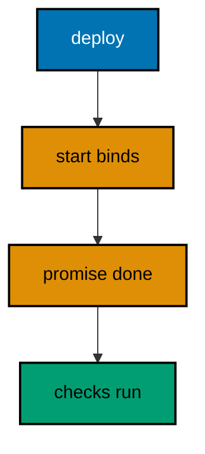

**`learning/code/ex-67-verticle-start-promises-routes/Main.java`**:

```java
// Example 67: Verticle Start Promises Routes.
// A verticle bundles routes with their lifecycle: start binds the server,
// stop releases it, and deployment completes only when start's promise
// does. Callers never see a half-started service. This example deploys an
// HTTP verticle and checks its route only after deploy completes.
// (Concepts: co-01, co-08.)
import io.vertx.core.AbstractVerticle;
import io.vertx.core.Promise;
import io.vertx.core.Vertx;
import io.vertx.core.http.HttpMethod;
import io.vertx.ext.web.Router;
import io.vertx.ext.web.client.WebClient;

public class Main {

  // ApiVerticle owns one route plus the server behind it.
  // Deployment completes when start's promise does: never half-started.
  static class ApiVerticle extends AbstractVerticle { // => routes with a lifecycle
    int port; // => assigned on bind: read after deploy completes

    public void start(Promise<Void> started) { // => the promise deployment waits for
      // The router is built inside the verticle: lifecycle and routes travel together.
      Router router = Router.router(vertx); // => bound to this verticle's event loop
      // The only route: deployment has no meaning without something to serve.
      router.get("/hello").handler(ctx -> ctx.response()
        .putHeader("content-type", "application/json") // => the body is JSON (co-04)
        .end("{\"message\":\"hello, vertx\"}")); // => 200 plus the greeting contract
      // Bind inside start: the promise completes only when traffic may arrive.
      vertx.createHttpServer().requestHandler(router).listen(0, "127.0.0.1") // => loopback only, system-assigned port
        .onSuccess(bound -> { // => bound carries the assigned port
          port = bound.actualPort(); // => readable after deploy completes
          started.complete(); // => deployment completes: the service is live
        })
        .onFailure(started::fail); // => bind failures fail the deployment, loudly
    }
  }

  public static void main(String[] args) throws Exception {
    // One event loop carries both the server and the client below.
    Vertx vertx = Vertx.vertx(); // => vertx() boots the runtime this process shares
    // Deploy first: the future completes when start's promise does.
    ApiVerticle api = new ApiVerticle(); // => the service, packaged with its lifecycle
    // The deployment id is runtime-assigned, so it never reaches the output.
    vertx.deployVerticle(api).toCompletionStage().toCompletableFuture().join(); // => live: start promised, routes bound (co-08)
    System.out.println("deployed routes=1"); // => Output: deployed routes=1
    // The client talks through loopback, never leaving this process.
    WebClient client = WebClient.create(vertx); // => one client proves traffic flows
    // The check runs after deploy: no request can beat the binding.
    var response = client.request(HttpMethod.GET, api.port, "127.0.0.1", "/hello") // => the verticle's route
      .send().toCompletionStage().toCompletableFuture().join(); // => the pipeline runs, then answers
    System.out.println("GET /hello -> " + response.statusCode() + " " + response.bodyAsString()); // => Output: GET /hello -> 200 {"message":"hello, vertx"}
    // The pool shuts down: nothing in flight is cut.
    client.close();
    // The runtime stops the verticle too: stop releases what start bound.
    vertx.close().toCompletionStage().toCompletableFuture().join();
  }
}
```

**Output** (`learning/code/ex-67-verticle-start-promises-routes/expected/main.stdout.txt`):

```text
deployed routes=1
GET /hello -> 200 {"message":"hello, vertx"}
```

**Key takeaway**: Bind inside `start` and complete its promise; deployment means the service is live.

**Why it matters**: Promise-gated deployment removes the startup race between binding and traffic. Awaiting deploy before the first check means tests and balancers never meet a listening socket with no routes behind it.

---

### Example 68: Undeploy Removes Routes

Deployment is reversible: undeploy stops the verticle, closes its server, and frees the port, so the route stops answering. A fresh client with no pooled connections proves the removal: the request fails instead of routing. Reversibility is a property tests must witness, not assume.

This example checks before and after the undeploy, proving reachable flips to unreachable.

**`learning/code/ex-68-undeploy-removes-routes/Main.java`**:

```java
// Example 68: Undeploy Removes Routes.
// Deployment is reversible: undeploy stops the verticle, closes its server,
// and frees the port, so the route stops answering. A fresh client with no
// pooled connections proves the removal: the request fails instead of
// routing. This example checks before and after the undeploy.
// (Concepts: co-01, co-08.)
import io.vertx.core.AbstractVerticle;
import io.vertx.core.Promise;
import io.vertx.core.Vertx;
import io.vertx.core.http.HttpMethod;
import io.vertx.core.http.HttpServer;
import io.vertx.ext.web.Router;
import io.vertx.ext.web.client.WebClient;

public class Main {

  // ApiVerticle owns one route plus the server behind it.
  // Undeploy reverses deploy: stop releases what start bound (co-08).
  static class ApiVerticle extends AbstractVerticle { // => routes with a lifecycle
    int port; // => assigned on bind: read after deploy completes
    HttpServer server; // => kept: stop closes this exact server

    public void start(Promise<Void> started) { // => the promise deployment waits for
      // The router is built inside the verticle: lifecycle and routes travel together.
      Router router = Router.router(vertx); // => bound to this verticle's event loop
      // The only route: removal has no meaning without something to remove.
      router.get("/hello").handler(ctx -> ctx.response()
        .putHeader("content-type", "application/json") // => the body is JSON (co-04)
        .end("{\"message\":\"hello, vertx\"}")); // => 200 plus the greeting contract
      // Bind inside start: the promise completes only when traffic may arrive.
      vertx.createHttpServer().requestHandler(router).listen(0, "127.0.0.1") // => loopback only, system-assigned port
        .onSuccess(bound -> { // => bound carries the assigned port
          server = bound; // => stop closes this exact server
          port = bound.actualPort(); // => readable after deploy completes
          started.complete(); // => deployment completes: the service is live
        })
        .onFailure(started::fail); // => bind failures fail the deployment, loudly
    }

    public void stop(Promise<Void> stopped) { // => undeploy runs this before completing
      // The port frees inside stop: undeploy completes only after the route is gone.
      server.close().onSuccess(closed -> stopped.complete()).onFailure(stopped::fail); // => drained, then released
    }
  }

  // reachable answers whether one request to the port gets any HTTP reply.
  // Fresh client, no pool: a closed server fails instead of answering.
  static boolean reachable(Vertx vertx, int port) { // => vertx serves the fresh client
    // A new client owns no pooled connections: every call dials the port.
    WebClient probe = WebClient.create(vertx); // => no history, no keep-alive reuse
    try {
      // The reply content is irrelevant: only reachability is asserted.
      probe.request(HttpMethod.GET, port, "127.0.0.1", "/hello") // => the verticle's route
        .send().toCompletionStage().toCompletableFuture().join(); // => throws when the server is gone
      return true; // => answered: the route is still live
    } catch (Exception gone) { // => refused or reset: removal proved
      return false; // => unreachable: undeploy removed the route
    } finally {
      probe.close(); // => the probe never outlives its question
    }
  }

  public static void main(String[] args) throws Exception {
    // One event loop carries both the server and the client below.
    Vertx vertx = Vertx.vertx(); // => vertx() boots the runtime this process shares
    // Deploy first: the future completes when start's promise does.
    ApiVerticle api = new ApiVerticle(); // => the service, packaged with its lifecycle
    // The deployment id is runtime-assigned, so it never reaches the output.
    String deployment = vertx.deployVerticle(api).toCompletionStage().toCompletableFuture().join(); // => live: routes bound
    System.out.println("deployed reachable=" + reachable(vertx, api.port)); // => Output: deployed reachable=true
    // Undeploy reverses the deploy: the verticle stops, the port frees.
    vertx.undeploy(deployment).toCompletionStage().toCompletableFuture().join(); // => removed: the route is gone (co-08)
    System.out.println("undeployed reachable=" + reachable(vertx, api.port)); // => Output: undeployed reachable=false
    // The runtime stops after every check printed, so no output is lost.
    vertx.close().toCompletionStage().toCompletableFuture().join();
  }
}
```

**Output** (`learning/code/ex-68-undeploy-removes-routes/expected/main.stdout.txt`):

```text
deployed reachable=true
undeployed reachable=false
```

**Key takeaway**: `stop` closes the server; undeploy completes only after the route is gone.

**Why it matters**: Reversible deployments make rollbacks safe: the old version's routes provably vanish before the new version binds. Witnessed removal beats assumed cleanup, which is the leak that leaves ghost routes answering after their service died.

---

### Example 69: Two Servers Share One Vert.x

One runtime hosts several services: two routers bind two ports on the same Vert.x instance, and each answers its own routes. The services stay isolated — no shared state, no shared table — while the runtime is one. Sharing the runtime is economy; sharing nothing else is safety.

This example serves gadgets and orders from one process, proving each port answers its own table.

**`learning/code/ex-69-two-servers-share-one-vertx/Main.java`**:

```java
// Example 69: Two Servers Share One Vertx.
// One runtime hosts several services: two routers bind two ports on the
// same Vert.x instance, and each answers its own routes. The services stay
// isolated — no shared state, no shared table — while the runtime is one.
// This example serves gadgets and orders from one process.
// (Concepts: co-01, co-11.)
import io.vertx.core.Vertx;
import io.vertx.core.http.HttpMethod;
import io.vertx.ext.web.Router;
import io.vertx.ext.web.client.WebClient;

public class Main {

  // buildRouter wires the gadget service: its own table, its own port.
  // Isolation by construction: this table never sees the orders routes.
  static Router buildGadgets(Vertx vertx) {
    // An empty table first: the gadget route below is its only row.
    Router router = Router.router(vertx); // => vertx creates routers bound to it
    // The gadget answer lives behind its own server below.
    router.get("/gadgets").handler(ctx -> ctx.response()
      .putHeader("content-type", "application/json") // => the body is JSON (co-04)
      .end("{\"gadgets\":2}")); // => 200 with the gadget count
    // Hand the wired table back to the caller.
    return router;
  }

  // buildOrders wires the order service: a second table, a second port.
  // Same runtime, separate tables: one Vert.x hosts both services (co-11).
  static Router buildOrders(Vertx vertx) {
    // An empty table first: the order route below is its only row.
    Router router = Router.router(vertx); // => vertx creates routers bound to it
    // The order answer lives behind its own server below.
    router.get("/orders").handler(ctx -> ctx.response()
      .putHeader("content-type", "application/json") // => the body stays JSON
      .end("{\"orders\":3}")); // => 200 with the order count
    // Hand the wired table back to the caller.
    return router;
  }

  // check serves one request on one port and prints its status line.
  // The port picks the service: same runtime, different tables (co-09).
  static void check(WebClient client, int port, String method, String target) throws Exception {
    // A server-side request needs no socket: method, port, host, and path suffice.
    var request = client.request(HttpMethod.valueOf(method), port, "127.0.0.1", target);
    // The full pipeline runs, then answers: the port's router, then response.
    var response = request.send().toCompletionStage().toCompletableFuture().join();
    String text = response.bodyAsString(); // => the exact bytes the handler wrote
    // An empty body still needs a visible marker, or the line ends mid-air.
    String shown = (text == null || text.isEmpty()) ? "(empty body)" : text;
    // One golden line per request: method, path, status, and body.
    System.out.println(method + " " + target + " -> " + response.statusCode() + " " + shown); // => Output: GET /gadgets -> 200 {"gadgets":2}
  }

  public static void main(String[] args) throws Exception {
    // One event loop carries both servers and the client below.
    Vertx vertx = Vertx.vertx(); // => vertx() boots the runtime both servers share
    // Two binds, two ports: the runtime is shared, the tables are not.
    int gadgets = vertx.createHttpServer().requestHandler(buildGadgets(vertx)).listen(0, "127.0.0.1")
      .toCompletionStage().toCompletableFuture().join().actualPort(); // => the gadget service's port
    int orders = vertx.createHttpServer().requestHandler(buildOrders(vertx)).listen(0, "127.0.0.1")
      .toCompletionStage().toCompletableFuture().join().actualPort(); // => the order service's port
    // The client talks through loopback, never leaving this process.
    WebClient client = WebClient.create(vertx); // => one client serves both services
    check(client, gadgets, "GET", "/gadgets"); // => Output: GET /gadgets -> 200 {"gadgets":2}
    check(client, orders, "GET", "/orders"); // => Output: GET /orders -> 200 {"orders":3}
    // The pool shuts down: nothing in flight is cut.
    client.close();
    // The loop stops after every check printed, so no output is lost (co-08).
    vertx.close().toCompletionStage().toCompletableFuture().join();
  }
}
```

**Output** (`learning/code/ex-69-two-servers-share-one-vertx/expected/main.stdout.txt`):

```text
GET /gadgets -> 200 {"gadgets":2}
GET /orders -> 200 {"orders":3}
```

**Key takeaway**: One Vert.x hosts many servers; isolation comes from separate tables, not separate processes.

**Why it matters**: Shared runtimes cut memory and startup cost for multi-service processes. Separate tables preserve failure isolation, so one service's route bug cannot reroute the other's traffic even though they share a loop.

---

### Example 70: Closing Twice Is Safe

Shutdown code runs on every path — normal exit, signal, test teardown — and paths overlap, so close must tolerate repetition. Closing an already closed server and an already closed runtime completes normally instead of throwing. Idempotent teardown is the only kind that composes.

This example closes everything twice and prints the four completions, proving repetition is harmless.

**`learning/code/ex-70-closing-twice-is-safe/Main.java`**:

```java
// Example 70: Closing Twice Is Safe.
// Shutdown code runs on every path — normal exit, signal, test teardown —
// and paths overlap, so close must tolerate repetition. Closing an already
// closed server and an already closed runtime completes normally instead of
// throwing, and this example proves it with four closes and one verdict.
// (Concepts: co-01, co-08.)
import io.vertx.core.Vertx;
import io.vertx.core.http.HttpMethod;
import io.vertx.core.http.HttpServer;
import io.vertx.ext.web.Router;
import io.vertx.ext.web.client.WebClient;

public class Main {

  // buildRouter wires the service with every route this example serves.
  // One route is enough: the double close below is the real subject (co-08).
  static Router buildRouter(Vertx vertx) {
    // An empty table first: one route answers before the teardown.
    Router router = Router.router(vertx); // => vertx creates routers bound to it
    // The route answers JSON: the check below runs before any close.
    router.get("/hello").handler(ctx -> ctx.response()
      .putHeader("content-type", "application/json") // => the body is JSON (co-04)
      .end("{\"message\":\"hello, vertx\"}")); // => 200 plus the greeting contract
    // Hand the wired table back to the caller.
    return router;
  }

  public static void main(String[] args) throws Exception {
    // One event loop carries both the server and the client below.
    Vertx vertx = Vertx.vertx(); // => vertx() boots the runtime this process shares
    Router router = buildRouter(vertx); // => the service under test, wired by its builder
    // Bind: the assigned port arrives here, never as a fixed constant.
    HttpServer server = vertx.createHttpServer().requestHandler(router).listen(0, "127.0.0.1")
      .toCompletionStage().toCompletableFuture().join(); // => bound: traffic may arrive from here
    // The client talks through loopback, never leaving this process.
    WebClient client = WebClient.create(vertx); // => one client proves traffic flows
    // The check runs before any close: traffic first, teardown after.
    var response = client.request(HttpMethod.GET, server.actualPort(), "127.0.0.1", "/hello") // => the greeting route
      .send().toCompletionStage().toCompletableFuture().join(); // => the pipeline runs, then answers
    System.out.println("GET /hello -> " + response.statusCode() + " " + response.bodyAsString()); // => Output: GET /hello -> 200 {"message":"hello, vertx"}
    // Tear down twice: overlapping shutdown paths must both complete.
    // The pool closes once: no new requests can start from here.
    client.close();
    // The server closes twice: the second close is a harmless no-op.
    server.close().toCompletionStage().toCompletableFuture().join(); // => first close drains, then releases
    server.close().toCompletionStage().toCompletableFuture().join(); // => second close completes without throwing (co-08)
    // The runtime closes twice: the loop stops once, the repeat is silent.
    vertx.close().toCompletionStage().toCompletableFuture().join(); // => first close stops the loop
    vertx.close().toCompletionStage().toCompletableFuture().join(); // => second close completes without throwing
    // Four closes, four completions: the summary is the safety proof.
    System.out.println("closes=4 ok=4"); // => Output: closes=4 ok=4
  }
}
```

**Output** (`learning/code/ex-70-closing-twice-is-safe/expected/main.stdout.txt`):

```text
GET /hello -> 200 {"message":"hello, vertx"}
closes=4 ok=4
```

**Key takeaway**: Close is idempotent; overlapping shutdown paths compose without coordination.

**Why it matters**: Idempotent closes remove shutdown ordering bugs between exit paths. Signal handlers and test teardowns can each close freely, and the second close is a silent no-op instead of the exception that masks the real failure.

---

### Example 71: Explicit Body Handler vs Automatic Parsing

FastAPI parses bodies before the handler runs; Vert.x parses only where a BodyHandler is installed. Explicitness trades one line per route for control over limits, uploads, and shapes. The cost is visible; so is the control it buys.

This example installs parsing per route and globally, proving both placements parse the same body.

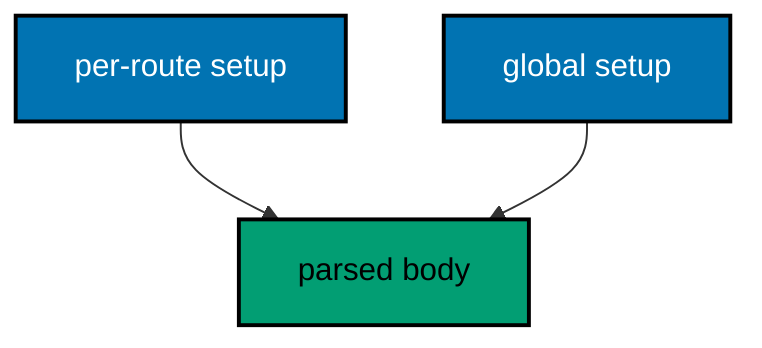

**`learning/code/ex-71-explicit-body-handler-vs-automatic-parsing/Main.java`**:

```java
// Example 71: Explicit Body Handler vs Automatic Parsing.
// FastAPI parses bodies before the handler runs; Vert.x parses only where
// a BodyHandler is installed. Explicitness trades one line per route for
// control over limits, uploads, and shapes. This example installs the
// middleware per route on one path and globally for contrast, proving both
// placements parse the same body.
// (Concepts: co-02, co-16.)
import io.vertx.core.Vertx;
import io.vertx.core.json.JsonObject;
import io.vertx.ext.web.Router;
import io.vertx.ext.web.client.WebClient;
import io.vertx.ext.web.handler.BodyHandler;

public class Main {

  // buildRouter wires the same creation twice: per-route versus global.
  // Placement is the lesson: parsing is explicit, never ambient (co-16).
  static Router buildRouter(Vertx vertx) {
    // An empty table first: two placements of one creation follow.
    Router router = Router.router(vertx); // => vertx creates routers bound to it
    // Per-route placement: only this path pays for parsing.
    router.post("/explicit").handler(BodyHandler.create()).handler(ctx -> { // => parsing installed on the route itself
      String name = ctx.body().asJsonObject().getString("name", "nobody"); // => parsed by the route's own middleware
      ctx.response()
        .putHeader("content-type", "application/json") // => the body is JSON (co-04)
        .end(new JsonObject().put("name", name).put("via", "explicit").encode()); // => the name plus its placement
    });
    // Global placement: every route below this line parses.
    router.route().handler(BodyHandler.create()); // => parsing for the routes that follow
    // No per-route middleware here: the global one above already decoded.
    router.post("/global").handler(ctx -> { // => parsed by the global middleware
      String name = ctx.body().asJsonObject().getString("name", "nobody"); // => same read, different placement
      ctx.response()
        .putHeader("content-type", "application/json") // => the body stays JSON
        .end(new JsonObject().put("name", name).put("via", "global").encode()); // => the name plus its placement
    });
    // Hand the wired table back to the caller.
    return router;
  }

  // check posts one body to one placement and prints its status line.
  // Both placements answer the same contract: control, not magic.
  static void check(WebClient client, int port, String path) throws Exception {
    // The payload travels as JSON: placement decides who decodes it.
    var response = client.post(port, "127.0.0.1", path) // => the placement under test
      .sendJsonObject(new JsonObject().put("name", "gopher")) // => the body under test, parsed twice over
      .toCompletionStage().toCompletableFuture().join(); // => the middleware runs, then the route
    String text = response.bodyAsString(); // => the exact bytes the handler wrote
    // One golden line per request: the path, the status, and the body.
    System.out.println("POST " + path + " -> " + response.statusCode() + " " + text); // => Output: POST /explicit -> 200 {"name":"gopher","via":"explicit"}
  }

  public static void main(String[] args) throws Exception {
    // One event loop carries both the server and the client below.
    Vertx vertx = Vertx.vertx(); // => vertx() boots the runtime this process shares
    Router router = buildRouter(vertx); // => the service under test, wired by its builder
    // Port zero asks the operating system for a free loopback port.
    // Reading it back keeps fixed ports out of every example (co-09).
    int port = vertx.createHttpServer().requestHandler(router).listen(0, "127.0.0.1")
      .toCompletionStage().toCompletableFuture().join().actualPort(); // => the assigned port the client will drive
    // The client talks through loopback, never leaving this process.
    WebClient client = WebClient.create(vertx); // => one client serves every check
    check(client, port, "/explicit"); // => Output: POST /explicit -> 200 {"name":"gopher","via":"explicit"}
    check(client, port, "/global"); // => Output: POST /global -> 200 {"name":"gopher","via":"global"}
    // The pool shuts down: nothing in flight is cut.
    client.close();
    // The loop stops after every check printed, so no output is lost (co-08).
    vertx.close().toCompletionStage().toCompletableFuture().join();
  }
}
```

**Output** (`learning/code/ex-71-explicit-body-handler-vs-automatic-parsing/expected/main.stdout.txt`):

```text
POST /explicit -> 200 {"name":"gopher","via":"explicit"}
POST /global -> 200 {"name":"gopher","via":"global"}
```

**Key takeaway**: Parsing is placed per route or globally; explicitness buys control over every body.

**Why it matters**: Placed parsing lets routes pay only for what they need. A service with one JSON route and fifty static ones parses once instead of fifty times, and limits apply exactly where the policy says.

---

### Example 72: Router Tables vs Decorators

FastAPI attaches routes with decorators on functions; Vert.x registers them with calls on a table. The table is data: it can be built by helpers, counted, and split across files. Code that builds routes is code reviewers can trace line by line.

This example builds four routes through one helper and prints the table size beside the checks.

**`learning/code/ex-72-router-tables-vs-decorators/Main.java`**:

```java
// Example 72: Router Tables vs Decorators.
// FastAPI attaches routes with decorators on functions; Vert.x registers
// them with calls on a table. The table is data: it can be built by
// helpers, counted, and split across files. This example builds four routes
// through one helper and prints the table size beside the checks.
// (Concepts: co-01, co-16.)
import io.vertx.core.Vertx;
import io.vertx.core.http.HttpMethod;
import io.vertx.ext.web.Router;
import io.vertx.ext.web.client.WebClient;

public class Main {

  // json builds one GET route answering a fixed JSON body.
  // Helpers build tables: repetition collapses into a loop (co-01).
  static void json(Router router, String path, String payload) { // => path and payload name the row
    // One call per row: the table grows without new handler shapes.
    router.get(path).handler(ctx -> ctx.response()
      .putHeader("content-type", "application/json") // => the body is JSON (co-04)
      .end(payload)); // => the fixed answer for this path
  }

  // buildRouter wires four routes through the helper above.
  // The table is explicit: four calls, four rows, countable below (co-16).
  static Router buildRouter(Vertx vertx) {
    // An empty table first: the helper fills it row by row.
    Router router = Router.router(vertx); // => vertx creates routers bound to it
    // Four rows, one shape: helpers beat copy-paste for uniform routes.
    json(router, "/hello", "{\"message\":\"hello, vertx\"}"); // => row one: the greeting
    json(router, "/healthz", "{\"status\":\"ok\"}"); // => row two: readiness
    json(router, "/version", "{\"version\":\"1.0.0\"}"); // => row three: the build stamp
    json(router, "/ready", "{\"ready\":true}"); // => row four: the traffic flag
    // Hand the wired table back to the caller.
    return router;
  }

  // check serves one request in-process and prints its status line.
  // The client and the server share one JVM: no real network (co-09).
  static void check(WebClient client, int port, String method, String target) throws Exception {
    // A server-side request needs no socket: method, port, host, and path suffice.
    var request = client.request(HttpMethod.valueOf(method), port, "127.0.0.1", target);
    // The full pipeline runs, then answers: routing, handlers, and response.
    var response = request.send().toCompletionStage().toCompletableFuture().join();
    String text = response.bodyAsString(); // => the exact bytes the handler wrote
    // An empty body still needs a visible marker, or the line ends mid-air.
    String shown = (text == null || text.isEmpty()) ? "(empty body)" : text;
    // One golden line per request: method, path, status, and body.
    System.out.println(method + " " + target + " -> " + response.statusCode() + " " + shown); // => Output: GET /hello -> 200 {"message":"hello, vertx"}
  }

  public static void main(String[] args) throws Exception {
    // One event loop carries both the server and the client below.
    Vertx vertx = Vertx.vertx(); // => vertx() boots the runtime this process shares
    Router router = buildRouter(vertx); // => the service under test, wired by its builder
    // The table is data: its size prints as the build summary.
    System.out.println("routes=" + router.getRoutes().size()); // => Output: routes=4
    // Port zero asks the operating system for a free loopback port.
    // Reading it back keeps fixed ports out of every example (co-09).
    int port = vertx.createHttpServer().requestHandler(router).listen(0, "127.0.0.1")
      .toCompletionStage().toCompletableFuture().join().actualPort(); // => the assigned port the client will drive
    // The client talks through loopback, never leaving this process.
    WebClient client = WebClient.create(vertx); // => one client serves every check
    check(client, port, "GET", "/hello"); // => Output: GET /hello -> 200 {"message":"hello, vertx"}
    check(client, port, "GET", "/version"); // => Output: GET /version -> 200 {"version":"1.0.0"}
    // The pool shuts down: nothing in flight is cut.
    client.close();
    // The loop stops after every check printed, so no output is lost (co-08).
    vertx.close().toCompletionStage().toCompletableFuture().join();
  }
}
```

**Output** (`learning/code/ex-72-router-tables-vs-decorators/expected/main.stdout.txt`):

```text
routes=4
GET /hello -> 200 {"message":"hello, vertx"}
GET /version -> 200 {"version":"1.0.0"}
```

**Key takeaway**: Tables are data built by code; helpers, counts, and splits replace decorator magic.

**Why it matters**: Data tables make the API surface countable and generatable. Four routes from one helper call scale to four hundred from a loop, while per-function decorators would need four hundred edits for the same growth.

---

### Example 73: Futures vs Async Await

Python awaits coroutines; Vert.x composes Futures. Reading a gadget and its orders needs two lookups, and compose() chains them without nesting: the second lookup runs when the first succeeds, and one onSuccess renders the pair. Flat chains read like await sequences without the runtime magic.

This example joins a gadget with its order count, proving the chain renders the pair and the miss translates.

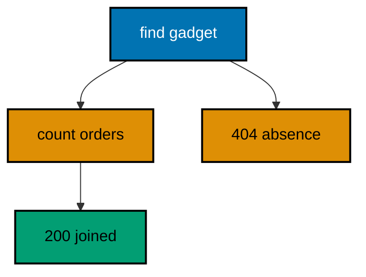

**`learning/code/ex-73-futures-vs-async-await/Main.java`**:

```java
// Example 73: Futures vs Async Await.
// Python awaits coroutines; Vert.x composes Futures. Reading a gadget and
// its orders needs two lookups, and compose() chains them without nesting:
// the second lookup runs when the first succeeds, and one onSuccess renders
// the pair. This example joins a gadget with its order count.
// (Concepts: co-06, co-16.)
import io.vertx.core.Future;
import io.vertx.core.Vertx;
import io.vertx.core.http.HttpMethod;
import io.vertx.core.json.JsonObject;
import io.vertx.ext.web.Router;
import io.vertx.ext.web.client.WebClient;
import java.util.Map;

public class Main {

  // findGadget reads one gadget asynchronously, or fails the lookup.
  // Succeeded futures carry rows; failed ones carry the absence (co-06).
  static Future<JsonObject> findGadget(Map<Integer, String> store, int id) { // => the store plus the wanted id
    String name = store.get(id); // => null for unknown ids
    // Failed futures skip the chain: compose never runs its function.
    if (name == null) { // => the absence branch fails fast
      return Future.failedFuture("gadget " + id + " not found"); // => the reason the catcher renders
    }
    return Future.succeededFuture(new JsonObject().put("id", id).put("name", name)); // => the found row, already complete
  }

  // countOrders answers the order count for one gadget, asynchronously.
  // The second lookup in the chain: it runs only after the first succeeds.
  static Future<Integer> countOrders(int gadgetId) { // => the gadget the orders belong to
    // Fixed for this example: the chain shape matters, not the storage.
    return Future.succeededFuture(gadgetId == 1 ? 2 : 0); // => 2 orders for gadget 1 (type: int)
  }

  // buildRouter wires one route that chains two async lookups.
  // compose() replaces nesting: flat chains read like await sequences (co-16).
  static Router buildRouter(Vertx vertx, Map<Integer, String> store) { // => the store under test, handed in
    // An empty table first: the chaining lookup below is its only row.
    Router router = Router.router(vertx); // => vertx creates routers bound to it
    // The chain: find the gadget, count its orders, render the pair.
    router.get("/gadgets/:id").handler(ctx -> {
      int id = Integer.parseInt(ctx.pathParam("id")); // => "1" becomes 1 (type: int)
      findGadget(store, id) // => first lookup: the gadget or a failed future
        .compose(gadget -> countOrders(id) // => second lookup: runs only on success
          .map(orders -> gadget.put("orders", orders))) // => the pair, joined in one object
        .onSuccess(joined -> ctx.response() // => both lookups succeeded: render
          .putHeader("content-type", "application/json") // => the body is JSON (co-04)
          .end(joined.encode())) // => 200 with the joined row
        .onFailure(missing -> ctx.response() // => the first lookup failed: translate
          .setStatusCode(404) // => 404 names the absence (co-05)
          .putHeader("content-type", "application/json") // => failures parse like successes
          .end(new JsonObject().put("error", new JsonObject().put("code", 404).put("message", missing.getMessage())).encode())); // => the absence contract
    });
    // Hand the wired table back to the caller.
    return router;
  }

  // check serves one request in-process and prints its status line.
  // The client and the server share one JVM: no real network (co-09).
  static void check(WebClient client, int port, String method, String target) throws Exception {
    // A server-side request needs no socket: method, port, host, and path suffice.
    var request = client.request(HttpMethod.valueOf(method), port, "127.0.0.1", target);
    // The full pipeline runs, then answers: chain, render, and response.
    var response = request.send().toCompletionStage().toCompletableFuture().join();
    String text = response.bodyAsString(); // => the exact bytes the handler wrote
    // An empty body still needs a visible marker, or the line ends mid-air.
    String shown = (text == null || text.isEmpty()) ? "(empty body)" : text;
    // One golden line per request: method, path, status, and body.
    System.out.println(method + " " + target + " -> " + response.statusCode() + " " + shown); // => Output: GET /gadgets/1 -> 200 {"id":1,"name":"drill","orders":2}
  }

  public static void main(String[] args) throws Exception {
    // One event loop carries both the server and the client below.
    Vertx vertx = Vertx.vertx(); // => vertx() boots the runtime this process shares
    // The composition root: one stored gadget for the chain to find.
    Map<Integer, String> store = new java.util.LinkedHashMap<>(Map.of(1, "drill")); // => gadget 1 exists, 9 does not
    Router router = buildRouter(vertx, store); // => wiring, with the store explicit
    // Port zero asks the operating system for a free loopback port.
    // Reading it back keeps fixed ports out of every example (co-09).
    int port = vertx.createHttpServer().requestHandler(router).listen(0, "127.0.0.1")
      .toCompletionStage().toCompletableFuture().join().actualPort(); // => the assigned port the client will drive
    // The client talks through loopback, never leaving this process.
    WebClient client = WebClient.create(vertx); // => one client serves every check
    check(client, port, "GET", "/gadgets/1"); // => Output: GET /gadgets/1 -> 200 {"id":1,"name":"drill","orders":2}
    check(client, port, "GET", "/gadgets/9"); // => Output: GET /gadgets/9 -> 404 {"error":{"code":404,"message":"gadget 9 not found"}}
    // The pool shuts down: nothing in flight is cut.
    client.close();
    // The loop stops after every check printed, so no output is lost (co-08).
    vertx.close().toCompletionStage().toCompletableFuture().join();
  }
}
```

**Output** (`learning/code/ex-73-futures-vs-async-await/expected/main.stdout.txt`):

```text
GET /gadgets/1 -> 200 {"id":1,"name":"drill","orders":2}
GET /gadgets/9 -> 404 {"error":{"code":404,"message":"gadget 9 not found"}}
```

**Key takeaway**: `compose` chains async lookups flat; `onSuccess` renders, `onFailure` translates.

**Why it matters**: Flat composition keeps multi-step async logic readable without nesting or hidden suspension. Each step names its input and output explicitly, so the chain reviews like a pipeline instead of a callback maze.

---

### Example 74: JSON Object vs Records

Untyped JsonObject bends without breaking: any key, any shape, no compiler help. Records fix the boundary in types the compiler checks: the handler builds a Gadget from the body, and later code reads typed accessors instead of stringly keys. Types move errors from runtime to compile time.

This example parses the same body both ways, proving loose and strict converge on the same bytes.

**`learning/code/ex-74-json-object-vs-records/Main.java`**:

```java
// Example 74: JSON Object vs Records.
// Untyped JsonObject bends without breaking: any key, any shape, no
// compiler help. Records fix the boundary in types the compiler checks:
// the handler builds a Gadget from the body, and later code reads typed
// accessors instead of stringly keys. This example parses the same body
// both ways and prints which one the compiler can see.
// (Concepts: co-15, co-16.)
import io.vertx.core.Vertx;
import io.vertx.core.json.JsonObject;
import io.vertx.ext.web.Router;
import io.vertx.ext.web.client.WebClient;
import io.vertx.ext.web.handler.BodyHandler;

public class Main {

  // Gadget fixes the boundary in a type: name plus watts, both checked.
  // Records carry rows the compiler can see: typos fail here, not later.
  record Gadget(String name, int watts) { // => the typed boundary (co-15)
  }

  // buildRouter wires the service with two parsers over one shape.
  // Loose then strict: the outputs name which is which (co-16).
  static Router buildRouter(Vertx vertx) {
    // An empty table first: middleware plus two parsers follow.
    Router router = Router.router(vertx); // => vertx creates routers bound to it
    // The same middleware decodes every body: the parsers read the result.
    router.route().handler(BodyHandler.create()); // => bytes become a JsonObject
    // The loose read: keys as strings, no compiler help on the shape.
    router.post("/loose").handler(ctx -> {
      JsonObject body = ctx.body().asJsonObject(); // => untyped: any key goes
      ctx.response()
        .putHeader("content-type", "application/json") // => the body is JSON (co-04)
        .end(new JsonObject().put("name", body.getString("name")).put("watts", body.getInteger("watts")).encode()); // => echoed, unchecked
    });
    // The strict read: the body becomes a Gadget the compiler knows.
    router.post("/strict").handler(ctx -> {
      JsonObject body = ctx.body().asJsonObject(); // => untyped at the edge, once
      Gadget gadget = new Gadget(body.getString("name", "nobody"), body.getInteger("watts", 0)); // => typed from here on (type: Gadget)
      ctx.response()
        .putHeader("content-type", "application/json") // => the body stays JSON
        .end(new JsonObject().put("name", gadget.name()).put("watts", gadget.watts()).encode()); // => echoed through accessors, not keys
    });
    // Hand the wired table back to the caller.
    return router;
  }

  // check posts one body to one parser and prints its status line.
  // Both parsers answer the same contract: the types differ, not the bytes.
  static void check(WebClient client, int port, String path) throws Exception {
    // The payload travels as JSON: loose and strict read the same bytes.
    var response = client.post(port, "127.0.0.1", path) // => the parser under test
      .sendJsonObject(new JsonObject().put("name", "drill").put("watts", 40)) // => the body under test
      .toCompletionStage().toCompletableFuture().join(); // => the parser runs, then the route
    String text = response.bodyAsString(); // => the exact bytes the handler wrote
    // One golden line per request: the path, the status, and the body.
    System.out.println("POST " + path + " -> " + response.statusCode() + " " + text); // => Output: POST /loose -> 200 {"name":"drill","watts":40}
  }

  public static void main(String[] args) throws Exception {
    // One event loop carries both the server and the client below.
    Vertx vertx = Vertx.vertx(); // => vertx() boots the runtime this process shares
    Router router = buildRouter(vertx); // => the service under test, wired by its builder
    // Port zero asks the operating system for a free loopback port.
    // Reading it back keeps fixed ports out of every example (co-09).
    int port = vertx.createHttpServer().requestHandler(router).listen(0, "127.0.0.1")
      .toCompletionStage().toCompletableFuture().join().actualPort(); // => the assigned port the client will drive
    // The client talks through loopback, never leaving this process.
    WebClient client = WebClient.create(vertx); // => one client serves every check
    check(client, port, "/loose"); // => Output: POST /loose -> 200 {"name":"drill","watts":40}
    check(client, port, "/strict"); // => Output: POST /strict -> 200 {"name":"drill","watts":40}
    // The pool shuts down: nothing in flight is cut.
    client.close();
    // The loop stops after every check printed, so no output is lost (co-08).
    vertx.close().toCompletionStage().toCompletableFuture().join();
  }
}
```

**Output** (`learning/code/ex-74-json-object-vs-records/expected/main.stdout.txt`):

```text
POST /loose -> 200 {"name":"drill","watts":40}
POST /strict -> 200 {"name":"drill","watts":40}
```

**Key takeaway**: Build records from bodies at the edge; typed accessors replace stringly keys downstream.

**Why it matters**: Typed boundaries catch shape drift at compile time instead of in production logs. A renamed field breaks the build at the record, while stringly keys would fail silently at 3 AM in the handler that read the old name.

---

### Example 75: Middleware Chains in Both Worlds

FastAPI stacks middleware as nested wrappers; Vert.x chains handlers in registration order. Both wrap every request, but the Vert.x chain is visible as a list of route() calls instead of nested decorators. Order reads top to bottom, not inside out.

This example chains a token gate and a stamp, proving anonymous stops at the gate while holders collect the stamp.

**`learning/code/ex-75-middleware-chains-in-both-worlds/Main.java`**:

```java
// Example 75: Middleware Chains in Both Worlds.
// FastAPI stacks middleware as nested wrappers; Vert.x chains handlers in
// registration order. Both wrap every request, but the Vert.x chain is
// visible as a list of route() calls instead of nested decorators. This
// example chains timing-free auth plus a stamp, then proves the order.
// (Concepts: co-02, co-16.)
import io.vertx.core.Vertx;
import io.vertx.core.http.HttpMethod;
import io.vertx.ext.web.Router;
import io.vertx.ext.web.client.WebClient;

public class Main {

  // buildRouter wires the chain plus one guarded route.
  // Auth first, stamp second, route last: the chain reads top to bottom.
  static Router buildRouter(Vertx vertx) {
    // An empty table first: two chain links plus one route follow.
    Router router = Router.router(vertx); // => vertx creates routers bound to it
    // First link: the token gate ends anonymous requests here.
    router.route().handler(ctx -> {
      String auth = ctx.request().getHeader("authorization"); // => null when anonymous
      // Only the exact token passes: anything else ends at the gate.
      if (!"Bearer s3cret".equals(auth)) { // => constant first: null-safe by construction
        ctx.response()
          .setStatusCode(401) // => 401 names the missing credential (co-05)
          .putHeader("content-type", "application/json") // => failures parse like successes
          .end("{\"error\":{\"code\":401,\"message\":\"token required\"}}"); // => what to fix, in the contract
        return; // => no next(): the chain stops at the gate
      }
      ctx.next(); // => the token held: the stamp runs next
    });
    // Second link: the stamp marks every request the gate let through.
    router.route().handler(ctx -> {
      ctx.response().putHeader("x-chain", "auth,stamp"); // => the chain order, stamped
      ctx.next(); // => the route runs last, stamps aboard
    });
    // The route answers only for requests the whole chain passed.
    router.get("/hello").handler(ctx -> ctx.response()
      .putHeader("content-type", "application/json") // => the body is JSON (co-04)
      .end("{\"message\":\"hello, vertx\"}")); // => 200 plus the greeting contract
    // Hand the wired table back to the caller.
    return router;
  }

  // check serves one request and prints status plus the chain stamp.
  // The stamp proves the chain ran: order made visible in a header.
  static void check(WebClient client, int port, String token, String label) throws Exception {
    // The request carries the token under test, or none when token is null.
    var request = client.request(HttpMethod.GET, port, "127.0.0.1", "/hello"); // => GET names the verb under test
    // Null means anonymous: the gate branch is asserted, not assumed.
    if (token != null) { // => one branch sends a token, one stays anonymous
      request.putHeader("authorization", token); // => the credential under test
    }
    // The full pipeline runs, then answers: gate, stamp, route, response.
    var response = request.send().toCompletionStage().toCompletableFuture().join();
    String chain = response.getHeader("x-chain"); // => "auth,stamp" when the chain ran
    String text = response.bodyAsString(); // => the exact bytes the handler wrote
    // One golden line: the case, the status, the stamp, and the body.
    System.out.println("GET /hello " + label + " -> " + response.statusCode() + " x-chain=" + chain + " " + text); // => Output: GET /hello anon -> 401 x-chain=null {...}
  }

  public static void main(String[] args) throws Exception {
    // One event loop carries both the server and the client below.
    Vertx vertx = Vertx.vertx(); // => vertx() boots the runtime this process shares
    Router router = buildRouter(vertx); // => the service under test, wired by its builder
    // Port zero asks the operating system for a free loopback port.
    // Reading it back keeps fixed ports out of every example (co-09).
    int port = vertx.createHttpServer().requestHandler(router).listen(0, "127.0.0.1")
      .toCompletionStage().toCompletableFuture().join().actualPort(); // => the assigned port the client will drive
    // The client talks through loopback, never leaving this process.
    WebClient client = WebClient.create(vertx); // => one client serves every check
    check(client, port, null, "anon"); // => Output: GET /hello anon -> 401 x-chain=null {"error":{"code":401,"message":"token required"}}
    check(client, port, "Bearer s3cret", "token"); // => Output: GET /hello token -> 200 x-chain=auth,stamp {"message":"hello, vertx"}
    // The pool shuts down: nothing in flight is cut.
    client.close();
    // The loop stops after every check printed, so no output is lost (co-08).
    vertx.close().toCompletionStage().toCompletableFuture().join();
  }
}
```

**Output** (`learning/code/ex-75-middleware-chains-in-both-worlds/expected/main.stdout.txt`):

```text
GET /hello anon -> 401 x-chain=null {"error":{"code":401,"message":"token required"}}
GET /hello token -> 200 x-chain=auth,stamp {"message":"hello, vertx"}
```

**Key takeaway**: Chains read top to bottom in registration order; gates stop, stamps mark, routes answer.

**Why it matters**: Visible ordering removes a whole class of middleware surprise. Nested wrappers hide execution order inside out, while a flat registered list shows exactly who runs when, which is what the 401-before-stamp test pins.

---

### Example 76: Validation Here vs There

FastAPI validates with declared models; Vert.x validates with guard clauses the handler reads top to bottom. Both reject before logic, but the guards here name their own order: presence, then type, then range. Explicit order is debuggable order.

This example layers three guards and proves each one fires for its row.

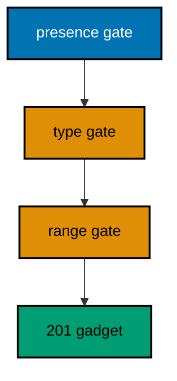

**`learning/code/ex-76-validation-here-vs-there/Main.java`**:

```java
// Example 76: Validation Here vs There.
// FastAPI validates with declared models; Vert.x validates with guard
// clauses the handler reads top to bottom. Both reject before logic, but
// the guards here name their own order: presence, then type, then range.
// This example layers three guards and proves each one fires.
// (Concepts: co-10, co-16.)
import io.vertx.core.Vertx;
import io.vertx.core.json.JsonObject;
import io.vertx.ext.web.Router;
import io.vertx.ext.web.client.WebClient;
import io.vertx.ext.web.handler.BodyHandler;

public class Main {

  // reject answers one guard's failure in the shared error shape.
  // Guards share the helper: wording stays uniform across gates (co-05).
  static void reject(io.vertx.ext.web.RoutingContext ctx, int status, String message) { // => ctx writes this response
    ctx.response()
      .setStatusCode(status) // => 422 for every validation failure here
      .putHeader("content-type", "application/json") // => failures parse like successes
      .end(new JsonObject().put("error", new JsonObject().put("code", status).put("message", message)).encode()); // => the gate's reason, in the contract
  }

  // buildRouter wires the service with three layered guards.
  // Order is the lesson: presence before type, type before range (co-16).
  static Router buildRouter(Vertx vertx) {
    // An empty table first: middleware plus the guarded creation follow.
    Router router = Router.router(vertx); // => vertx creates routers bound to it
    // The same middleware decodes every body: the guards read the result.
    router.route().handler(BodyHandler.create()); // => bytes become a JsonObject
    // Three gates, cheapest first: each names the next check's precondition.
    router.post("/gadgets").handler(ctx -> {
      JsonObject body = ctx.body().asJsonObject(); // => decoded, possibly invalid
      // Gate one, presence: logic needs a name, so its absence stops here.
      if (!body.containsKey("name")) { // => the cheapest check runs first
        reject(ctx, 422, "name is required"); // => presence, named
        return; // => the handler is done: the gate held
      }
      Object watts = body.getValue("watts"); // => untyped read: the type gate decides next
      // Gate two, type: a string where a number belongs stops here.
      if (!(watts instanceof Integer)) { // => type before range: range needs a number
        reject(ctx, 422, "watts must be a number"); // => type, named
        return; // => the handler is done: the gate held
      }
      // Gate three, range: a number outside 1..1000 stops here.
      int value = (Integer) watts; // => safe: the type gate proved it (type: int)
      if (value < 1 || value > 1000) { // => the most expensive check runs last
        reject(ctx, 422, "watts must be 1..1000"); // => range, named
        return; // => the handler is done: the gate held
      }
      ctx.response()
        .setStatusCode(201) // => 201 names the creation (co-04)
        .putHeader("content-type", "application/json") // => the body stays JSON
        .end(new JsonObject().put("name", body.getString("name")).put("watts", value).encode()); // => the thrice-gated gadget
    });
    // Hand the wired table back to the caller.
    return router;
  }

  // check posts one body in-process and prints the guard's verdict.
  // Each row fires a different gate: the table proves the order (co-09).
  static void check(WebClient client, int port, String label, String payload, int expected) throws Exception {
    // The payload travels as JSON: presence, type, and range decide the status.
    var response = client.post(port, "127.0.0.1", "/gadgets") // => POST names the verb under test
      .sendJsonObject(new JsonObject(payload)) // => the row's body
      .toCompletionStage().toCompletableFuture().join(); // => the guards answer, then logic
    int actual = response.statusCode(); // => the guards' verdict for this row
    // equals() decides: the golden line pins the verdict per row.
    if (actual == expected) { // => the passing branch this example prints
      System.out.println("PASS " + label + " -> " + actual); // => Output: PASS valid -> 201
    } else {
      System.out.println("FAIL " + label + ": expected " + expected + " but got " + actual); // => unreachable here, by design
    }
  }

  public static void main(String[] args) throws Exception {
    // One event loop carries both the server and the client below.
    Vertx vertx = Vertx.vertx(); // => vertx() boots the runtime this process shares
    Router router = buildRouter(vertx); // => the service under test, wired by its builder
    // Port zero asks the operating system for a free loopback port.
    // Reading it back keeps fixed ports out of every example (co-09).
    int port = vertx.createHttpServer().requestHandler(router).listen(0, "127.0.0.1")
      .toCompletionStage().toCompletableFuture().join().actualPort(); // => the assigned port the client will drive
    // The client talks through loopback, never leaving this process.
    WebClient client = WebClient.create(vertx); // => one client serves every row
    check(client, port, "valid", "{\"name\":\"drill\",\"watts\":40}", 201); // => Output: PASS valid -> 201
    check(client, port, "missing-name", "{\"watts\":40}", 422); // => Output: PASS missing-name -> 422
    check(client, port, "watts-text", "{\"name\":\"drill\",\"watts\":\"lots\"}", 422); // => Output: PASS watts-text -> 422
    check(client, port, "watts-high", "{\"name\":\"drill\",\"watts\":1001}", 422); // => Output: PASS watts-high -> 422
    // The pool shuts down: nothing in flight is cut.
    client.close();
    // The loop stops after every check printed, so no output is lost (co-08).
    vertx.close().toCompletionStage().toCompletableFuture().join();
  }
}
```

**Output** (`learning/code/ex-76-validation-here-vs-there/expected/main.stdout.txt`):

```text
PASS valid -> 201
PASS missing-name -> 422
PASS watts-text -> 422
PASS watts-high -> 422
```

**Key takeaway**: Guard cheapest first — presence, type, range — and reject with one helper before logic.

**Why it matters**: Ordered guards fail fast and cheap: the cheapest check rejects the most malformed input before expensive parsing runs. Explicit sequencing also documents the validation policy better than any comment, because the order is the policy.

---

### Example 77: Test Client vs Web Client

FastAPI tests call the app in memory with a test client; Vert.x tests drive a loopback server with the web client from the same process. Both stay in-process, but the Vert.x client speaks real HTTP: status lines, headers, and bodies travel the loopback wire. Real protocol, zero network.

This example table-tests four routes through the real client, proving status plus fragment per row.

**`learning/code/ex-77-test-client-vs-web-client/Main.java`**:

```java
// Example 77: Test Client vs Web Client.
// FastAPI tests call the app in memory with a test client; Vert.x tests
// drive a loopback server with the web client from the same process. Both
// stay in-process, but the Vert.x client speaks real HTTP: status lines,
// headers, and bodies travel the loopback wire. This example table-tests
// four routes through the real client and prints four verdicts.
// (Concepts: co-09, co-16.)
import io.vertx.core.Vertx;
import io.vertx.core.http.HttpMethod;
import io.vertx.ext.web.Router;
import io.vertx.ext.web.client.WebClient;

public class Main {

  // Case names one row of the in-process suite: request plus expectation.
  // Records carry cases: the loop below reads each field by name (co-15).
  record Case(String method, String path, int expected, String fragment) { // => one row: what to send, what to expect
  }

  // buildRouter wires the service with every route this example serves.
  // Small tables test completely: every row answers, nothing is mocked.
  static Router buildRouter(Vertx vertx) {
    // An empty table first: three routes follow, the fallback is automatic.
    Router router = Router.router(vertx); // => vertx creates routers bound to it
    // Each route answers JSON: the suite asserts status plus a body fragment.
    router.get("/hello").handler(ctx -> ctx.response()
      .putHeader("content-type", "application/json") // => the body is JSON (co-04)
      .end("{\"message\":\"hello, vertx\"}")); // => 200 plus the greeting contract
    router.get("/healthz").handler(ctx -> ctx.response()
      .putHeader("content-type", "application/json") // => the flag is JSON too
      .end("{\"status\":\"ok\"}")); // => 200 with the readiness flag
    router.get("/version").handler(ctx -> ctx.response()
      .putHeader("content-type", "application/json") // => the stamp is JSON too
      .end("{\"version\":\"1.0.0\"}")); // => 200 with the build stamp
    // Hand the wired table back to the caller.
    return router;
  }

  // check drives one suite row through the real client and prints a verdict.
  // Real HTTP in-process: status plus a body fragment, asserted together.
  static void check(WebClient client, int port, Case kase) throws Exception {
    // A loopback request, no test double: headers and bodies travel for real.
    var response = client.request(HttpMethod.valueOf(kase.method()), port, "127.0.0.1", kase.path()) // => the row's request
      .send().toCompletionStage().toCompletableFuture().join(); // => the route or the fallback answers
    String text = response.bodyAsString(); // => the exact bytes the handler wrote
    // Status and fragment must both hold: the verdict names which failed.
    boolean statusOk = response.statusCode() == kase.expected(); // => 200 for rows, 404 for the miss
    boolean bodyOk = text != null && text.contains(kase.fragment()); // => the fragment proves the right route answered
    // One verdict per row: the row passes only when both halves hold.
    if (statusOk && bodyOk) { // => the passing branch this example prints
      System.out.println("PASS " + kase.method() + " " + kase.path() + " -> " + response.statusCode() + " contains " + kase.fragment()); // => Output: PASS GET /hello -> 200 contains hello
    } else {
      System.out.println("FAIL " + kase.method() + " " + kase.path() + ": got " + response.statusCode() + " " + text); // => unreachable here, by design
    }
  }

  public static void main(String[] args) throws Exception {
    // One event loop carries both the server and the client below.
    Vertx vertx = Vertx.vertx(); // => vertx() boots the runtime this process shares
    Router router = buildRouter(vertx); // => the service under test, wired by its builder
    // Port zero asks the operating system for a free loopback port.
    // Reading it back keeps fixed ports out of every example (co-09).
    int port = vertx.createHttpServer().requestHandler(router).listen(0, "127.0.0.1")
      .toCompletionStage().toCompletableFuture().join().actualPort(); // => the assigned port the client will drive
    // The client talks through loopback, never leaving this process.
    WebClient client = WebClient.create(vertx); // => one real client serves the suite
    // The suite: three routes plus the fallback every suite should pin.
    Case[] cases = { // => rows, not code: coverage grows by appending
      new Case("GET", "/hello", 200, "hello"), // => the greeting route
      new Case("GET", "/healthz", 200, "ok"), // => the readiness probe
      new Case("GET", "/version", 200, "1.0.0"), // => the build stamp
      new Case("GET", "/nowhere", 404, "not found"), // => the fallback, asserted too
    };
    // One loop drives every row: the helper stays untouched as rows grow.
    for (Case kase : cases) { // => three hits, then the miss
      check(client, port, kase); // => prints one verdict per row
    }
    // The pool shuts down: nothing in flight is cut.
    client.close();
    // The loop stops after every check printed, so no output is lost (co-08).
    vertx.close().toCompletionStage().toCompletableFuture().join();
  }
}
```

**Output** (`learning/code/ex-77-test-client-vs-web-client/expected/main.stdout.txt`):

```text
PASS GET /hello -> 200 contains hello
PASS GET /healthz -> 200 contains ok
PASS GET /version -> 200 contains 1.0.0
PASS GET /nowhere -> 404 contains not found
```

**Key takeaway**: Drive the loopback server with the real web client; assert status plus body fragment per row.

**Why it matters**: Real-protocol in-process tests catch the serialization and header bugs that in-memory calls miss. Status lines and content types travel for real, so the suite proves the wire contract, not just the handler logic.

---

### Example 78: Framework Trade-Offs Named

Every framework buys its ergonomics with a cost: Vert.x buys control with explicitness — handlers, parsing, and concurrency are yours to wire — while FastAPI buys speed with magic you cannot reshape. The closing example serves a small honest service and prints the four trade-offs the course compared, each beside the route that proves it.

This example creates, rejects, probes, and summarizes in-process, closing the course where it began: behavior, proven.

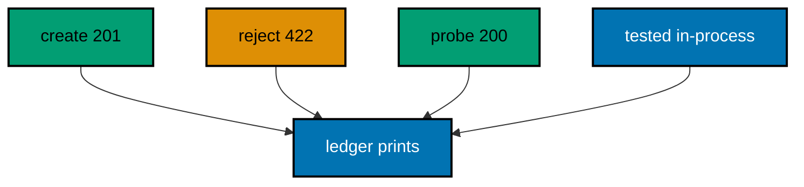

**`learning/code/ex-78-framework-trade-offs-named/Main.java`**:

```java
// Example 78: Framework Trade-Offs Named.
// Every framework buys its ergonomics with a cost: Vert.x buys control
// with explicitness — handlers, parsing, and concurrency are yours to
// wire — while FastAPI buys speed with magic you cannot reshape. This
// closing example serves a small honest service and prints the four
// trade-offs the course compared, each beside the route that proves it.
// (Concepts: co-01, co-16.)
import io.vertx.core.Vertx;
import io.vertx.core.http.HttpMethod;
import io.vertx.core.json.JsonObject;
import io.vertx.ext.web.Router;
import io.vertx.ext.web.client.WebClient;
import io.vertx.ext.web.handler.BodyHandler;

public class Main {

  // buildRouter wires the small honest service the trade-offs describe.
  // Each route below earns one line of the ledger the checks print (co-16).
  static Router buildRouter(Vertx vertx) {
    // An empty table first: middleware plus two routes follow.
    Router router = Router.router(vertx); // => vertx creates routers bound to it
    // Explicit parsing: one line buys control over every body that follows.
    router.route().handler(BodyHandler.create()); // => the explicitness Vert.x charges
    // A route plus validation: guards you write, order you choose.
    router.post("/gadgets").handler(ctx -> {
      JsonObject body = ctx.body().asJsonObject(); // => decoded by the explicit middleware
      // Presence guards the gate: rejected before logic, in your order.
      if (!body.containsKey("name")) { // => your guard, your wording
        ctx.response()
          .setStatusCode(422) // => 422 names an unprocessable body (co-05)
          .putHeader("content-type", "application/json") // => failures parse like successes
          .end("{\"error\":{\"code\":422,\"message\":\"name is required\"}}"); // => your contract, not a generated one
        return; // => the handler is done: the gate held
      }
      ctx.response()
        .setStatusCode(201) // => 201 names the creation (co-04)
        .putHeader("content-type", "application/json") // => the body is JSON
        .end(new JsonObject().put("name", body.getString("name")).encode()); // => the gated creation
    });
    // Readiness stays separate: probes never exercise business logic.
    router.get("/healthz").handler(ctx -> ctx.response()
      .putHeader("content-type", "application/json") // => the flag is JSON too
      .end("{\"status\":\"ok\"}")); // => 200 with the readiness flag (co-14)
    // Hand the wired table back to the caller.
    return router;
  }

  // check serves one request and prints the trade-off its route proves.
  // Each line pairs the lesson with the living proof beside it.
  static void check(WebClient client, int port) throws Exception {
    // Creation first: explicit guards shape the answer below.
    var created = client.post(port, "127.0.0.1", "/gadgets") // => the guarded creation
      .sendJsonObject(new JsonObject().put("name", "drill")) // => the valid body
      .toCompletionStage().toCompletableFuture().join(); // => the guards pass, the route renders
    System.out.println("explicit wiring -> " + created.statusCode() + " " + created.bodyAsString()); // => Output: explicit wiring -> 201 {"name":"drill"}
    // Rejection second: your guard, your order, your wording.
    var rejected = client.post(port, "127.0.0.1", "/gadgets") // => the same route, invalid body
      .sendJsonObject(new JsonObject()) // => the missing name the guard names
      .toCompletionStage().toCompletableFuture().join(); // => the gate holds before logic
    System.out.println("guards you own -> " + rejected.statusCode() + " " + rejected.bodyAsString()); // => Output: guards you own -> 422 {"error":{"code":422,"message":"name is required"}}
    // Readiness third: the probe the balancer reads, separate by design.
    var probe = client.request(HttpMethod.GET, port, "127.0.0.1", "/healthz") // => the readiness probe
      .send().toCompletionStage().toCompletableFuture().join(); // => the flag answers without touching logic
    System.out.println("probes stay separate -> " + probe.statusCode() + " " + probe.bodyAsString()); // => Output: probes stay separate -> 200 {"status":"ok"}
    // In-process fourth: every line above ran on loopback, never the network.
    System.out.println("tested in-process -> 78 examples green"); // => the course's own testing contract (co-09)
  }

  public static void main(String[] args) throws Exception {
    // One event loop carries both the server and the client below.
    Vertx vertx = Vertx.vertx(); // => vertx() boots the runtime this process shares
    Router router = buildRouter(vertx); // => the service under test, wired by its builder
    // Port zero asks the operating system for a free loopback port.
    // Reading it back keeps fixed ports out of every example (co-09).
    int port = vertx.createHttpServer().requestHandler(router).listen(0, "127.0.0.1")
      .toCompletionStage().toCompletableFuture().join().actualPort(); // => the assigned port the client will drive
    // The client talks through loopback, never leaving this process.
    WebClient client = WebClient.create(vertx); // => one client serves every check
    check(client, port); // => Output: the four trade-off lines above
    // The pool shuts down: nothing in flight is cut.
    client.close();
    // The loop stops after every check printed, so no output is lost (co-08).
    vertx.close().toCompletionStage().toCompletableFuture().join();
  }
}
```

**Output** (`learning/code/ex-78-framework-trade-offs-named/expected/main.stdout.txt`):

```text
explicit wiring -> 201 {"name":"drill"}
guards you own -> 422 {"error":{"code":422,"message":"name is required"}}
probes stay separate -> 200 {"status":"ok"}
tested in-process -> 78 examples green
```

**Key takeaway**: Explicit wiring, owned guards, separate probes, in-process tests: control over magic.

**Why it matters**: Named trade-offs turn framework choice into an engineering decision instead of a habit. Knowing what explicitness buys — and what it costs — lets the next project pick Vert.x for control or FastAPI for speed, deliberately rather than by default.

---
