Examples 1–25 build Vert.x fluency from the ground up: routes and handlers (Examples 1–8), from a first JSON route and path parameters through query strings, verbs, sub-routers, custom 404 pages, redirects, and small composable handlers; then request parsing and validation (Examples 9–17), from typed query values and headers through JSON and form bodies, malformed payloads, required fields, bounds, content types, and total defaults; finally response shaping and status codes (Examples 18–25), from 201 and 204 through envelopes, headers, empty bodies, error contracts, negotiation, cookies, and HTML pages. Every example is a complete, runnable Java program under `learning/code/` driving Vert.x against its own loopback server; run each with the command in its own `run.yaml`.

---

### Example 1: Hello Route Returns JSON

A route maps one HTTP method plus one path to one handler, and the handler turns the request into a response. Hand-written servers hide that mapping behind configuration, but Vert.x keeps it visible: `router.get("/hello")` reads as the contract it is. The handler writes through the routing context instead of returning a value, which keeps the response lifecycle in one place.

This example registers GET /hello, serves it in-process on a loopback port, and prints the status code with the JSON body the handler wrote. The unknown path beside it proves the table is exact: only registered routes answer.

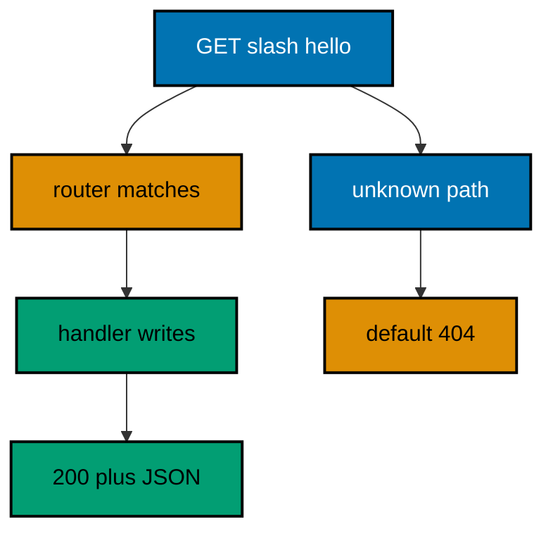

**`learning/code/ex-01-hello-route-returns-json/Main.java`**:

```java
// Example 1: Hello Route Returns JSON.
// A route maps one method plus one path to one handler, and the handler
// turns the request into a response. This example registers GET /hello,
// serves it in-process on a loopback port, and prints the status code with
// the JSON body the handler wrote.
// (Concepts: co-01, co-04.)
import io.vertx.core.Vertx;
import io.vertx.core.http.HttpMethod;
import io.vertx.ext.web.Router;
import io.vertx.ext.web.client.WebClient;

public class Main {

  // buildRouter wires the service with every route this example serves.
  // A builder keeps wiring in one place the checks can reuse (co-06).
  // Returning the router lets each check serve requests in-process (co-09).
  static Router buildRouter(Vertx vertx) {
    // An empty table first: routes are added below, none exists yet.
    Router router = Router.router(vertx); // => vertx creates routers bound to it
    // GET names the method, "/hello" the path, the lambda the handler.
    // The handler writes through the context instead of returning (co-01).
    router.get("/hello").handler(ctx ->
      ctx
        .response()
        .putHeader("content-type", "application/json") // => the body is JSON (co-04)
        .end("{\"message\":\"hello, vertx\"}")
    ); // => 200 plus the greeting contract
    // Hand the wired table back to the caller.
    return router;
  }

  // check serves one request in-process and prints its status line.
  // The client and the server share one JVM: no real network (co-09).
  // Nothing here dials a fixed port: the port arrives as an argument.
  static void check(WebClient client, int port, String method, String target) throws Exception {
    // A server-side request needs no socket: method, port, host, and path suffice.
    var request = client.request(HttpMethod.valueOf(method), port, "127.0.0.1", target);
    // The full pipeline runs, then answers: routing, handlers, and response.
    var response = request.send().toCompletionStage().toCompletableFuture().join();
    String text = response.bodyAsString(); // => the exact bytes the handler wrote
    // An empty body still needs a visible marker, or the line ends mid-air.
    String shown = text == null || text.isEmpty() ? "(empty body)" : text;
    // One golden line per request: method, path, status, and body.
    System.out.println(method + " " + target + " -> " + response.statusCode() + " " + shown); // => Output: GET /hello -> 200 {"message":"hello, vertx"}
  }

  public static void main(String[] args) throws Exception {
    // One event loop carries both the server and the client below.
    Vertx vertx = Vertx.vertx(); // => vertx() boots the runtime this process shares
    Router router = buildRouter(vertx); // => the service under test, wired by its builder
    // Port zero asks the operating system for a free loopback port.
    // Reading it back keeps fixed ports out of every example (co-09).
    int port = vertx
      .createHttpServer()
      .requestHandler(router)
      .listen(0, "127.0.0.1")
      .toCompletionStage()
      .toCompletableFuture()
      .join()
      .actualPort(); // => the assigned port the client will drive
    // The client talks through loopback, never leaving this process.
    WebClient client = WebClient.create(vertx); // => one client serves every check
    check(client, port, "GET", "/hello"); // => Output: GET /hello -> 200 {"message":"hello, vertx"}
    check(client, port, "GET", "/goodbye"); // => Output: GET /goodbye -> 404 with the default not-found page
    // The pool shuts down: nothing in flight is cut.
    client.close();
    // The loop stops after every check printed, so no output is lost (co-08).
    vertx.close().toCompletionStage().toCompletableFuture().join();
  }
}
```

**Output** (`learning/code/ex-01-hello-route-returns-json/expected/main.stdout.txt`):

```text
GET /hello -> 200 {"message":"hello, vertx"}
GET /goodbye -> 404 <html><body><h1>Resource not found</h1></body></html>
```

**Key takeaway**: Method plus path picks the handler; the handler writes the response through the context.

**Why it matters**: Visible routing tables are reviewable contracts. When every route is one readable line, a reviewer can audit the whole API surface without running the service, and a missing route is a missing line rather than a missing annotation discovered in production.

---

### Example 2: Path Parameter Names a Resource

One route serves many resources when part of the path is a variable. A colon in the path declares the parameter, and the handler reads it back by name, so `/users/42` and `/users/7` share one handler with different values. Separate routes per resource would multiply the table with the data; a parameter keeps the table fixed while the resources grow.

This example registers GET /users/:id and proves the mapping with two ids, printing each echoed value beside its status.

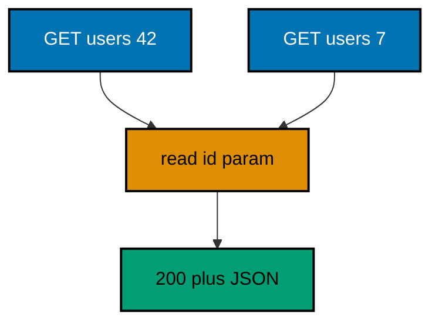

**`learning/code/ex-02-path-parameter-names-a-resource/Main.java`**:

```java
// Example 2: Path Parameter Names a Resource.
// One route serves many resources when part of the path is a variable.
// A colon in the path declares the parameter, and the handler reads it
// back by name, so /users/42 and /users/7 share one handler with
// different values. This example proves the mapping with two ids.
// (Concepts: co-01, co-03.)
import io.vertx.core.Vertx;
import io.vertx.core.http.HttpMethod;
import io.vertx.ext.web.Router;
import io.vertx.ext.web.client.WebClient;

public class Main {

  // buildRouter wires the service with every route this example serves.
  // One parameterized route replaces one route per resource (co-01).
  static Router buildRouter(Vertx vertx) {
    // An empty table first: routes are added below, none exists yet.
    Router router = Router.router(vertx); // => vertx creates routers bound to it
    // ":id" declares the variable segment of the path.
    // pathParam reads the segment the request actually carried (co-03).
    router.get("/users/:id").handler(ctx -> {
      String id = ctx.pathParam("id"); // => "42" for /users/42 (type: String)
      ctx.response()
        .putHeader("content-type", "application/json") // => the body is JSON (co-04)
        .end("{\"id\":\"" + id + "\"}"); // => the id echoed back as the contract
    });
    // Hand the wired table back to the caller.
    return router;
  }

  // check serves one request in-process and prints its status line.
  // The client and the server share one JVM: no real network (co-09).
  static void check(WebClient client, int port, String method, String target) throws Exception {
    // A server-side request needs no socket: method, port, host, and path suffice.
    var request = client.request(HttpMethod.valueOf(method), port, "127.0.0.1", target);
    // The full pipeline runs, then answers: routing, handlers, and response.
    var response = request.send().toCompletionStage().toCompletableFuture().join();
    String text = response.bodyAsString(); // => the exact bytes the handler wrote
    // An empty body still needs a visible marker, or the line ends mid-air.
    String shown = (text == null || text.isEmpty()) ? "(empty body)" : text;
    // One golden line per request: method, path, status, and body.
    System.out.println(method + " " + target + " -> " + response.statusCode() + " " + shown); // => Output: GET /users/42 -> 200 {"id":"42"}
  }

  public static void main(String[] args) throws Exception {
    // One event loop carries both the server and the client below.
    Vertx vertx = Vertx.vertx(); // => vertx() boots the runtime this process shares
    Router router = buildRouter(vertx); // => the service under test, wired by its builder
    // Port zero asks the operating system for a free loopback port.
    // Reading it back keeps fixed ports out of every example (co-09).
    int port = vertx.createHttpServer().requestHandler(router).listen(0, "127.0.0.1")
      .toCompletionStage().toCompletableFuture().join().actualPort(); // => the assigned port the client will drive
    // The client talks through loopback, never leaving this process.
    WebClient client = WebClient.create(vertx); // => one client serves every check
    check(client, port, "GET", "/users/42"); // => Output: GET /users/42 -> 200 {"id":"42"}
    check(client, port, "GET", "/users/7"); // => Output: GET /users/7 -> 200 {"id":"7"}
    // The pool shuts down: nothing in flight is cut.
    client.close();
    // The loop stops after every check printed, so no output is lost (co-08).
    vertx.close().toCompletionStage().toCompletableFuture().join();
  }
}
```

**Output** (`learning/code/ex-02-path-parameter-names-a-resource/expected/main.stdout.txt`):

```text
GET /users/42 -> 200 {"id":"42"}
GET /users/7 -> 200 {"id":"7"}
```

**Key takeaway**: Colon segments declare parameters; `pathParam` reads the value the request carried.

**Why it matters**: Parameterized routes separate the stable table from growing data. The route count stays flat as resources multiply, which keeps routing reviews short and prevents the copy-paste drift that per-resource routes invite.

---

### Example 3: Query String Filters a List

List endpoints stay one route while the query string varies the answer. The handler reads named parameters off the request, falling back to a default when the caller omits one, so `/items` and `/items?type=book` share one handler with different results. Query strings are the caller's vocabulary for filtering; the route stays the noun.

This example registers GET /items with optional type filtering and prints the echoed filter for a bare call and a filtered call.

**`learning/code/ex-03-query-string-filters-a-list/Main.java`**:

```java
// Example 3: Query String Filters a List.
// List endpoints stay one route while the query string varies the answer.
// The handler reads named parameters off the request, falling back to a
// default when the caller omits one, so /items and /items?type=book share
// one handler with different results. This example filters by type.
// (Concepts: co-01, co-03.)
import io.vertx.core.Vertx;
import io.vertx.core.http.HttpMethod;
import io.vertx.ext.web.Router;
import io.vertx.ext.web.client.WebClient;

public class Main {

  // buildRouter wires the service with every route this example serves.
  // The query string varies the answer; the route table stays fixed (co-03).
  static Router buildRouter(Vertx vertx) {
    // An empty table first: routes are added below, none exists yet.
    Router router = Router.router(vertx); // => vertx creates routers bound to it
    // getParam reads one named query value, defaulting when it is absent.
    // The default keeps the handler total: no parameter is mandatory (co-03).
    router.get("/items").handler(ctx -> {
      String type = ctx.queryParam("type").isEmpty() ? "all" : ctx.queryParam("type").get(0); // => "all" for /items (type: String)
      ctx.response()
        .putHeader("content-type", "application/json") // => the body is JSON (co-04)
        .end("{\"type\":\"" + type + "\"}"); // => the filter echoed back as the contract
    });
    // Hand the wired table back to the caller.
    return router;
  }

  // check serves one request in-process and prints its status line.
  // The client and the server share one JVM: no real network (co-09).
  static void check(WebClient client, int port, String method, String target) throws Exception {
    // A server-side request needs no socket: method, port, host, and path suffice.
    var request = client.request(HttpMethod.valueOf(method), port, "127.0.0.1", target);
    // The full pipeline runs, then answers: routing, handlers, and response.
    var response = request.send().toCompletionStage().toCompletableFuture().join();
    String text = response.bodyAsString(); // => the exact bytes the handler wrote
    // An empty body still needs a visible marker, or the line ends mid-air.
    String shown = (text == null || text.isEmpty()) ? "(empty body)" : text;
    // One golden line per request: method, path, status, and body.
    System.out.println(method + " " + target + " -> " + response.statusCode() + " " + shown); // => Output: GET /items -> 200 {"type":"all"}
  }

  public static void main(String[] args) throws Exception {
    // One event loop carries both the server and the client below.
    Vertx vertx = Vertx.vertx(); // => vertx() boots the runtime this process shares
    Router router = buildRouter(vertx); // => the service under test, wired by its builder
    // Port zero asks the operating system for a free loopback port.
    // Reading it back keeps fixed ports out of every example (co-09).
    int port = vertx.createHttpServer().requestHandler(router).listen(0, "127.0.0.1")
      .toCompletionStage().toCompletableFuture().join().actualPort(); // => the assigned port the client will drive
    // The client talks through loopback, never leaving this process.
    WebClient client = WebClient.create(vertx); // => one client serves every check
    check(client, port, "GET", "/items"); // => Output: GET /items -> 200 {"type":"all"}
    check(client, port, "GET", "/items?type=book"); // => Output: GET /items?type=book -> 200 {"type":"book"}
    // The pool shuts down: nothing in flight is cut.
    client.close();
    // The loop stops after every check printed, so no output is lost (co-08).
    vertx.close().toCompletionStage().toCompletableFuture().join();
  }
}
```

**Output** (`learning/code/ex-03-query-string-filters-a-list/expected/main.stdout.txt`):

```text
GET /items -> 200 {"type":"all"}
GET /items?type=book -> 200 {"type":"book"}
```

**Key takeaway**: `queryParam` reads named values with a default, keeping optional parameters total.

**Why it matters**: Defaults keep handlers single-pathed instead of forked on presence. Every optional parameter with a sane fallback is one fewer branch to test, and callers learn that omitting a filter means the whole list rather than an error.

---

### Example 4: Method and Path Pick the Handler

The same path serves different verbs, and Vert.x routes each pair separately. GET reads the resource while POST replaces it, so one path hosts two handlers with no if-statements on the method. Verb dispatch belongs in the table, not in handler branches that every reader must re-derive.

This example registers GET and POST on /notes and prints what each verb answers, including the 201 that names the creation.

**`learning/code/ex-04-method-and-path-pick-the-handler/Main.java`**:

```java
// Example 4: Method and Path Pick the Handler.
// The same path can serve different verbs, and Vert.x routes each pair
// separately. GET reads the resource while POST replaces it, so one path
// hosts two handlers with no if-statements. This example registers both
// verbs on /notes and prints what each one answers.
// (Concepts: co-01, co-04.)
import io.vertx.core.Vertx;
import io.vertx.core.http.HttpMethod;
import io.vertx.ext.web.Router;
import io.vertx.ext.web.client.WebClient;

public class Main {

  // buildRouter wires the service with every route this example serves.
  // Method plus path picks the handler: GET and POST diverge here (co-01).
  static Router buildRouter(Vertx vertx) {
    // An empty table first: routes are added below, none exists yet.
    Router router = Router.router(vertx); // => vertx creates routers bound to it
    // GET /notes reads: the handler answers what the collection holds.
    router.get("/notes").handler(ctx -> ctx.response()
      .putHeader("content-type", "application/json") // => the body is JSON (co-04)
      .end("{\"notes\":[]}")); // => 200 with the empty collection
    // POST /notes writes: same path, different verb, different handler.
    router.post("/notes").handler(ctx -> ctx.response()
      .setStatusCode(201) // => 201 names the creation, not a bare 200 (co-04)
      .putHeader("content-type", "application/json") // => the body stays JSON
      .end("{\"created\":true}")); // => the creation receipt
    // Hand the wired table back to the caller.
    return router;
  }

  // check serves one request in-process and prints its status line.
  // The client and the server share one JVM: no real network (co-09).
  static void check(WebClient client, int port, String method, String target) throws Exception {
    // A server-side request needs no socket: method, port, host, and path suffice.
    var request = client.request(HttpMethod.valueOf(method), port, "127.0.0.1", target);
    // The full pipeline runs, then answers: routing, handlers, and response.
    var response = request.send().toCompletionStage().toCompletableFuture().join();
    String text = response.bodyAsString(); // => the exact bytes the handler wrote
    // An empty body still needs a visible marker, or the line ends mid-air.
    String shown = (text == null || text.isEmpty()) ? "(empty body)" : text;
    // One golden line per request: method, path, status, and body.
    System.out.println(method + " " + target + " -> " + response.statusCode() + " " + shown); // => Output: GET /notes -> 200 {"notes":[]}
  }

  public static void main(String[] args) throws Exception {
    // One event loop carries both the server and the client below.
    Vertx vertx = Vertx.vertx(); // => vertx() boots the runtime this process shares
    Router router = buildRouter(vertx); // => the service under test, wired by its builder
    // Port zero asks the operating system for a free loopback port.
    // Reading it back keeps fixed ports out of every example (co-09).
    int port = vertx.createHttpServer().requestHandler(router).listen(0, "127.0.0.1")
      .toCompletionStage().toCompletableFuture().join().actualPort(); // => the assigned port the client will drive
    // The client talks through loopback, never leaving this process.
    WebClient client = WebClient.create(vertx); // => one client serves every check
    check(client, port, "GET", "/notes"); // => Output: GET /notes -> 200 {"notes":[]}
    check(client, port, "POST", "/notes"); // => Output: POST /notes -> 201 {"created":true}
    // The pool shuts down: nothing in flight is cut.
    client.close();
    // The loop stops after every check printed, so no output is lost (co-08).
    vertx.close().toCompletionStage().toCompletableFuture().join();
  }
}
```

**Output** (`learning/code/ex-04-method-and-path-pick-the-handler/expected/main.stdout.txt`):

```text
GET /notes -> 200 {"notes":[]}
POST /notes -> 201 {"created":true}
```

**Key takeaway**: The pair of method and path is the route key; different verbs on one path are different routes.

**Why it matters**: Verb-specific handlers keep reads and writes from sharing code by accident. A GET that cannot mutate is provable from the table alone, which is exactly the guarantee caches and reviewers rely on.

---

### Example 5: Route Groups Share a Prefix

Related routes share a prefix, and a sub-router keeps their paths short. The main router mounts the group at /api, so handlers inside declare /users while the outside world calls /api/users. Prefixes stop being repeated strings and become one mount line that versions or moves whole families at once.

This example mounts a two-route group at /api and proves the prefix resolves for both members.

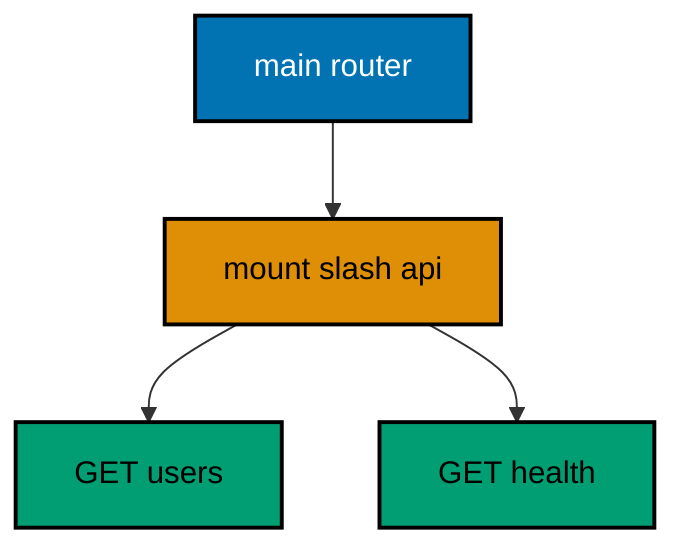

**`learning/code/ex-05-route-groups-share-a-prefix/Main.java`**:

```java
// Example 5: Route Groups Share a Prefix.
// Related routes share a prefix, and a sub-router keeps their paths short.
// The main router mounts the group at /api, so handlers inside declare
// /users while the outside world calls /api/users. This example mounts
// two group routes and proves the prefix resolves for both.
// (Concepts: co-01, co-11.)
import io.vertx.core.Vertx;
import io.vertx.core.http.HttpMethod;
import io.vertx.ext.web.Router;
import io.vertx.ext.web.client.WebClient;

public class Main {

  // buildApi wires the group with short paths: the prefix is added by mounting.
  // Handlers inside a group never repeat the shared prefix (co-11).
  static Router buildApi(Vertx vertx) {
    // A plain router first: it becomes a group only once mounted.
    Router api = Router.router(vertx); // => a second table for the /api family
    // Short path here: the mount point supplies the /api prefix.
    api.get("/users").handler(ctx -> ctx.response()
      .putHeader("content-type", "application/json") // => the body is JSON (co-04)
      .end("{\"users\":[]}")); // => 200 with the empty collection
    // A second group member proves the prefix is shared, not per-route.
    api.get("/health").handler(ctx -> ctx.response()
      .putHeader("content-type", "application/json") // => the body stays JSON
      .end("{\"ok\":true}")); // => 200 with the group health flag
    // Hand the group back: the caller mounts it under its prefix.
    return api;
  }

  // buildRouter wires the service: the group mounts at /api, nothing else.
  // Mounting composes tables: the group stays testable on its own (co-11).
  static Router buildRouter(Vertx vertx) {
    // An empty table first: the mount below is its only route.
    Router router = Router.router(vertx); // => vertx creates routers bound to it
    // "/*" forwards the whole subtree; the group strips the prefix itself.
    router.route("/api/*").subRouter(buildApi(vertx)); // => /api/users reaches the group
    // Hand the wired table back to the caller.
    return router;
  }

  // check serves one request in-process and prints its status line.
  // The client and the server share one JVM: no real network (co-09).
  static void check(WebClient client, int port, String method, String target) throws Exception {
    // A server-side request needs no socket: method, port, host, and path suffice.
    var request = client.request(HttpMethod.valueOf(method), port, "127.0.0.1", target);
    // The full pipeline runs, then answers: routing, handlers, and response.
    var response = request.send().toCompletionStage().toCompletableFuture().join();
    String text = response.bodyAsString(); // => the exact bytes the handler wrote
    // An empty body still needs a visible marker, or the line ends mid-air.
    String shown = (text == null || text.isEmpty()) ? "(empty body)" : text;
    // One golden line per request: method, path, status, and body.
    System.out.println(method + " " + target + " -> " + response.statusCode() + " " + shown); // => Output: GET /api/users -> 200 {"users":[]}
  }

  public static void main(String[] args) throws Exception {
    // One event loop carries both the server and the client below.
    Vertx vertx = Vertx.vertx(); // => vertx() boots the runtime this process shares
    Router router = buildRouter(vertx); // => the service under test, wired by its builder
    // Port zero asks the operating system for a free loopback port.
    // Reading it back keeps fixed ports out of every example (co-09).
    int port = vertx.createHttpServer().requestHandler(router).listen(0, "127.0.0.1")
      .toCompletionStage().toCompletableFuture().join().actualPort(); // => the assigned port the client will drive
    // The client talks through loopback, never leaving this process.
    WebClient client = WebClient.create(vertx); // => one client serves every check
    check(client, port, "GET", "/api/users"); // => Output: GET /api/users -> 200 {"users":[]}
    check(client, port, "GET", "/api/health"); // => Output: GET /api/health -> 200 {"ok":true}
    // The pool shuts down: nothing in flight is cut.
    client.close();
    // The loop stops after every check printed, so no output is lost (co-08).
    vertx.close().toCompletionStage().toCompletableFuture().join();
  }
}
```

**Output** (`learning/code/ex-05-route-groups-share-a-prefix/expected/main.stdout.txt`):

```text
GET /api/users -> 200 {"users":[]}
GET /api/health -> 200 {"ok":true}
```

**Key takeaway**: `subRouter` mounts a short-pathed group under one prefix; the group stays testable alone.

**Why it matters**: Mounted groups version and relocate without touching handlers. Moving a whole family from /api to /v2 is one mount edit, which beats the find-and-replace across dozens of path strings that flat tables demand.

---

### Example 6: Custom 404 for Unknown Routes

An unmatched path should answer in the API's own shape, not the framework's default page. An error handler for status 404 replaces the HTML fallback with a JSON contract, so clients parse failures the same way they parse successes. Absence is a designed response, not an accident the framework reports for you.

This example serves one real route and one JSON 404 handler, asserting the known path answers 200 and the unknown path answers the contract.

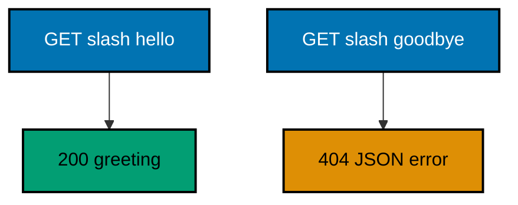

**`learning/code/ex-06-custom-404-for-unknown-routes/Main.java`**:

```java
// Example 6: Custom 404 for Unknown Routes.
// An unmatched path should answer in the API's own shape, not the
// framework's default page. An error handler for status 404 replaces the
// HTML fallback with a JSON contract, so clients parse failures the same
// way they parse successes. This example asserts both shapes differ.
// (Concepts: co-04, co-05.)
import io.vertx.core.Vertx;
import io.vertx.core.http.HttpMethod;
import io.vertx.ext.web.Router;
import io.vertx.ext.web.client.WebClient;

public class Main {

  // buildRouter wires the service with every route this example serves.
  // The error handler below owns every unmatched path at once (co-05).
  static Router buildRouter(Vertx vertx) {
    // An empty table first: one route plus one error handler follow.
    Router router = Router.router(vertx); // => vertx creates routers bound to it
    // The only real route: everything else must fall through to 404.
    router.get("/hello").handler(ctx -> ctx.response()
      .putHeader("content-type", "application/json") // => the body is JSON (co-04)
      .end("{\"message\":\"hello, vertx\"}")); // => 200 plus the greeting contract
    // errorHandler(404) replaces the default HTML page with JSON.
    // The status is set explicitly: the contract owns its code (co-05).
    router.errorHandler(404, ctx -> ctx.response()
      .setStatusCode(404) // => 404 names the absence, as the client expects
      .putHeader("content-type", "application/json") // => failures parse like successes
      .end("{\"error\":{\"code\":404,\"message\":\"not found\"}}")); // => the stable error contract
    // Hand the wired table back to the caller.
    return router;
  }

  // check serves one request in-process and prints its status line.
  // The client and the server share one JVM: no real network (co-09).
  static void check(WebClient client, int port, String method, String target) throws Exception {
    // A server-side request needs no socket: method, port, host, and path suffice.
    var request = client.request(HttpMethod.valueOf(method), port, "127.0.0.1", target);
    // The full pipeline runs, then answers: routing, handlers, and response.
    var response = request.send().toCompletionStage().toCompletableFuture().join();
    String text = response.bodyAsString(); // => the exact bytes the handler wrote
    // An empty body still needs a visible marker, or the line ends mid-air.
    String shown = (text == null || text.isEmpty()) ? "(empty body)" : text;
    // One golden line per request: method, path, status, and body.
    System.out.println(method + " " + target + " -> " + response.statusCode() + " " + shown); // => Output: GET /goodbye -> 404 {"error":{...}}
  }

  public static void main(String[] args) throws Exception {
    // One event loop carries both the server and the client below.
    Vertx vertx = Vertx.vertx(); // => vertx() boots the runtime this process shares
    Router router = buildRouter(vertx); // => the service under test, wired by its builder
    // Port zero asks the operating system for a free loopback port.
    // Reading it back keeps fixed ports out of every example (co-09).
    int port = vertx.createHttpServer().requestHandler(router).listen(0, "127.0.0.1")
      .toCompletionStage().toCompletableFuture().join().actualPort(); // => the assigned port the client will drive
    // The client talks through loopback, never leaving this process.
    WebClient client = WebClient.create(vertx); // => one client serves every check
    check(client, port, "GET", "/hello"); // => Output: GET /hello -> 200 {"message":"hello, vertx"}
    check(client, port, "GET", "/goodbye"); // => Output: GET /goodbye -> 404 {"error":{"code":404,"message":"not found"}}
    // The pool shuts down: nothing in flight is cut.
    client.close();
    // The loop stops after every check printed, so no output is lost (co-08).
    vertx.close().toCompletionStage().toCompletableFuture().join();
  }
}
```

**Output** (`learning/code/ex-06-custom-404-for-unknown-routes/expected/main.stdout.txt`):

```text
GET /hello -> 200 {"message":"hello, vertx"}
GET /goodbye -> 404 {"error":{"code":404,"message":"not found"}}
```

**Key takeaway**: `errorHandler(404, ...)` replaces the default page with the API's own absence contract.

**Why it matters**: Uniform failure shapes let clients parse every answer with one code path. A JSON 404 that matches the success envelope means error handling is a branch on status rather than a second parser for HTML the framework leaked.

---

### Example 7: Redirect Moves a Client

A redirect answers with a status and a Location header instead of a body. The old path stays reachable forever as a pointer, never as duplicated content, while the canonical route holds the real answer. Moved resources keep their inbound links working without serving two copies of the truth.

This example points /welcome at /hello with a 302 and asserts both the pointer contract and the canonical body.

**`learning/code/ex-07-redirect-moves-a-client/Main.java`**:

```java
// Example 7: Redirect Moves a Client.
// A redirect answers with a status and a Location header instead of a body.
// The client decides whether to follow; this example reads the contract
// directly, printing the status plus the destination the server named.
// The old path stays reachable forever as a pointer, never as content.
// (Concepts: co-01, co-04.)
import io.vertx.core.Vertx;
import io.vertx.core.http.HttpMethod;
import io.vertx.ext.web.Router;
import io.vertx.ext.web.client.WebClient;
import io.vertx.ext.web.client.WebClientOptions;

public class Main {

  // buildRouter wires the service with every route this example serves.
  // The old path is a pointer; the new path holds the content (co-01).
  static Router buildRouter(Vertx vertx) {
    // An empty table first: a pointer route plus a content route follow.
    Router router = Router.router(vertx); // => vertx creates routers bound to it
    // redirect ends the response with 302 and a Location header, no body.
    // Callers learn the new address without the server duplicating content.
    router.get("/welcome").handler(ctx -> ctx.redirect("/hello")); // => 302 to the canonical path
    // The canonical route holds the real greeting every pointer names.
    router.get("/hello").handler(ctx -> ctx.response()
      .putHeader("content-type", "application/json") // => the body is JSON (co-04)
      .end("{\"message\":\"hello, vertx\"}")); // => 200 plus the greeting contract
    // Hand the wired table back to the caller.
    return router;
  }

  // check serves one request in-process and prints status plus location.
  // Headers are asserted like bodies: the redirect lives in them (co-04).
  static void check(WebClient client, int port, String method, String target) throws Exception {
    // A server-side request needs no socket: method, port, host, and path suffice.
    var request = client.request(HttpMethod.valueOf(method), port, "127.0.0.1", target);
    // The full pipeline runs, then answers: routing, handlers, and response.
    var response = request.send().toCompletionStage().toCompletableFuture().join();
    String location = response.getHeader("location"); // => "/hello" for the pointer (type: String)
    String text = response.bodyAsString(); // => the greeting bytes on the canonical route
    // The printed line names the move when one exists, else the body itself.
    String shown = (location == null) ? text : "location=" + location; // => pointers carry headers, content carries bodies
    System.out.println(method + " " + target + " -> " + response.statusCode() + " " + shown); // => Output: GET /welcome -> 302 location=/hello
  }

  public static void main(String[] args) throws Exception {
    // One event loop carries both the server and the client below.
    Vertx vertx = Vertx.vertx(); // => vertx() boots the runtime this process shares
    Router router = buildRouter(vertx); // => the service under test, wired by its builder
    // Port zero asks the operating system for a free loopback port.
    // Reading it back keeps fixed ports out of every example (co-09).
    int port = vertx.createHttpServer().requestHandler(router).listen(0, "127.0.0.1")
      .toCompletionStage().toCompletableFuture().join().actualPort(); // => the assigned port the client will drive
    // The client talks through loopback, never leaving this process.
    // Redirects stay unread: the check asserts the 302 contract itself.
    WebClient client = WebClient.create(vertx, new WebClientOptions().setFollowRedirects(false)); // => one client serves every check
    check(client, port, "GET", "/welcome"); // => Output: GET /welcome -> 302 location=/hello
    check(client, port, "GET", "/hello"); // => Output: GET /hello -> 200 {"message":"hello, vertx"}
    // The pool shuts down: nothing in flight is cut.
    client.close();
    // The loop stops after every check printed, so no output is lost (co-08).
    vertx.close().toCompletionStage().toCompletableFuture().join();
  }
}
```

**Output** (`learning/code/ex-07-redirect-moves-a-client/expected/main.stdout.txt`):

```text
GET /welcome -> 302 location=/hello
GET /hello -> 200 {"message":"hello, vertx"}
```

**Key takeaway**: `redirect` ends the response with 302 plus Location; the client decides whether to follow.

**Why it matters**: Pointers preserve link equity across moves without content duplication. One redirect line retires an old path gracefully, while deleting it would break every client that cached the address.

---

### Example 8: Handlers Are Small Functions

Big handlers mix routing, logic, and rendering until nothing is reusable. Small handlers each do one job — one reads state, one shapes the answer — so the route table reads like a table of contents. The context carries values between handlers, which keeps signatures clean while the chain stays explicit.

This example splits one endpoint into a loading handler and a rendering handler sharing the context, proving the composition answers twice identically.

**`learning/code/ex-08-handlers-are-small-functions/Main.java`**:

```java
// Example 8: Handlers Are Small Functions.
// Big handlers mix routing, logic, and rendering until nothing is reusable.
// Small handlers each do one job — one reads state, one shapes the answer —
// so the route table reads like a table of contents. This example splits
// one endpoint across two focused handlers sharing the context.
// (Concepts: co-01, co-03.)
import io.vertx.core.Vertx;
import io.vertx.core.http.HttpMethod;
import io.vertx.ext.web.Router;
import io.vertx.ext.web.RoutingContext;
import io.vertx.ext.web.client.WebClient;

public class Main {

  // loadGreeting reads the state the answer needs and stores it on the context.
  // Handlers share the context map instead of passing arguments (co-01).
  static void loadGreeting(RoutingContext ctx) { // => ctx is the per-request scratch space
    // The value could come from a service; a literal keeps this example small.
    ctx.put("greeting", "hello, vertx"); // => stored under "greeting" for the next handler
    // next() passes control down the matching handler chain.
    ctx.next(); // => without this call the chain stops here
  }

  // writeGreeting shapes the answer from state the earlier handler stored.
  // Rendering stays separate from reading: each handler has one job (co-04).
  static void writeGreeting(RoutingContext ctx) { // => runs after loadGreeting stored its value
    String greeting = ctx.get("greeting"); // => "hello, vertx" (type: String)
    ctx.response()
      .putHeader("content-type", "application/json") // => the body is JSON (co-04)
      .end("{\"message\":\"" + greeting + "\"}"); // => 200 plus the greeting contract
  }

  // buildRouter wires the service with every route this example serves.
  // One route, two handlers: the chain is the composition (co-01).
  static Router buildRouter(Vertx vertx) {
    // An empty table first: the two-handler route below is its only row.
    Router router = Router.router(vertx); // => vertx creates routers bound to it
    // Handlers run in registration order: read first, render second.
    router.get("/hello").handler(Main::loadGreeting).handler(Main::writeGreeting); // => the chain in one line
    // Hand the wired table back to the caller.
    return router;
  }

  // check serves one request in-process and prints its status line.
  // The client and the server share one JVM: no real network (co-09).
  static void check(WebClient client, int port, String method, String target) throws Exception {
    // A server-side request needs no socket: method, port, host, and path suffice.
    var request = client.request(HttpMethod.valueOf(method), port, "127.0.0.1", target);
    // The full pipeline runs, then answers: routing, handlers, and response.
    var response = request.send().toCompletionStage().toCompletableFuture().join();
    String text = response.bodyAsString(); // => the exact bytes the handler wrote
    // An empty body still needs a visible marker, or the line ends mid-air.
    String shown = (text == null || text.isEmpty()) ? "(empty body)" : text;
    // One golden line per request: method, path, status, and body.
    System.out.println(method + " " + target + " -> " + response.statusCode() + " " + shown); // => Output: GET /hello -> 200 {"message":"hello, vertx"}
  }

  public static void main(String[] args) throws Exception {
    // One event loop carries both the server and the client below.
    Vertx vertx = Vertx.vertx(); // => vertx() boots the runtime this process shares
    Router router = buildRouter(vertx); // => the service under test, wired by its builder
    // Port zero asks the operating system for a free loopback port.
    // Reading it back keeps fixed ports out of every example (co-09).
    int port = vertx.createHttpServer().requestHandler(router).listen(0, "127.0.0.1")
      .toCompletionStage().toCompletableFuture().join().actualPort(); // => the assigned port the client will drive
    // The client talks through loopback, never leaving this process.
    WebClient client = WebClient.create(vertx); // => one client serves every check
    check(client, port, "GET", "/hello"); // => Output: GET /hello -> 200 {"message":"hello, vertx"}
    check(client, port, "GET", "/hello"); // => Output: the same greeting again: handlers hold no state
    // The pool shuts down: nothing in flight is cut.
    client.close();
    // The loop stops after every check printed, so no output is lost (co-08).
    vertx.close().toCompletionStage().toCompletableFuture().join();
  }
}
```

**Output** (`learning/code/ex-08-handlers-are-small-functions/expected/main.stdout.txt`):

```text
GET /hello -> 200 {"message":"hello, vertx"}
GET /hello -> 200 {"message":"hello, vertx"}
```

**Key takeaway**: Chains of small handlers compose with `next()`; the context carries state between them.

**Why it matters**: Single-job handlers are independently testable and reusable across routes. A rendering handler that reads from the context can serve any loading handler, which turns route construction into composition instead of copy-paste.

---

### Example 9: Read Query Parameters Typed

Query values arrive as strings, but handlers need numbers and flags. Parsing with a default keeps the handler total: missing or broken values fall back to a sane page instead of throwing. The parsing helper owns the fallback policy once, so every route reads the same way.

This example pages a fixed list with integer limit and offset, proving defaults hold for bare calls, values hold for callers, and garbage degrades to defaults.

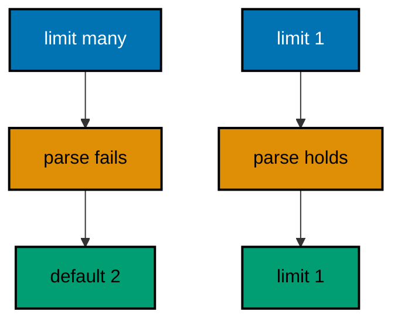

**`learning/code/ex-09-read-query-parameters-typed/Main.java`**:

```java
// Example 9: Read Query Parameters Typed.
// Query values arrive as strings, but handlers need numbers and flags.
// Parsing with a default keeps the handler total: missing or blank values
// fall back to a sane page instead of throwing. This example pages a
// fixed list with limit and offset read as integers.
// (Concepts: co-03, co-10.)
import io.vertx.core.Vertx;
import io.vertx.core.http.HttpMethod;
import io.vertx.ext.web.Router;
import io.vertx.ext.web.client.WebClient;

public class Main {

  // parseInt reads one named query value as an integer with a fallback.
  // Blank and broken input both fall back: the handler never throws (co-10).
  static int parseInt(java.util.List<String> values, int fallback) { // => values hold the raw strings
    // Empty means absent: the caller omitted the parameter entirely.
    if (values == null || values.isEmpty()) { // => no value arrived
      return fallback; // => the sane default stands in
    }
    try {
      return Integer.parseInt(values.get(0)); // => "3" becomes 3 (type: int)
    } catch (NumberFormatException bad) { // => "abc" cannot become a number
      return fallback; // => broken input degrades to the default, not a 500
    }
  }

  // buildRouter wires the service with every route this example serves.
  // limit and offset page a fixed list: parsing decides the window (co-03).
  static Router buildRouter(Vertx vertx) {
    // An empty table first: the paging route below is its only row.
    Router router = Router.router(vertx); // => vertx creates routers bound to it
    // Defaults of 2 and 0 keep /items total: no parameter is mandatory.
    router.get("/items").handler(ctx -> {
      int limit = parseInt(ctx.queryParam("limit"), 2); // => 2 for /items (type: int)
      int offset = parseInt(ctx.queryParam("offset"), 0); // => 0 for /items (type: int)
      ctx.response()
        .putHeader("content-type", "application/json") // => the body is JSON (co-04)
        .end("{\"limit\":" + limit + ",\"offset\":" + offset + "}"); // => the parsed window echoed back
    });
    // Hand the wired table back to the caller.
    return router;
  }

  // check serves one request in-process and prints its status line.
  // The client and the server share one JVM: no real network (co-09).
  static void check(WebClient client, int port, String method, String target) throws Exception {
    // A server-side request needs no socket: method, port, host, and path suffice.
    var request = client.request(HttpMethod.valueOf(method), port, "127.0.0.1", target);
    // The full pipeline runs, then answers: routing, handlers, and response.
    var response = request.send().toCompletionStage().toCompletableFuture().join();
    String text = response.bodyAsString(); // => the exact bytes the handler wrote
    // An empty body still needs a visible marker, or the line ends mid-air.
    String shown = (text == null || text.isEmpty()) ? "(empty body)" : text;
    // One golden line per request: method, path, status, and body.
    System.out.println(method + " " + target + " -> " + response.statusCode() + " " + shown); // => Output: GET /items -> 200 {"limit":2,"offset":0}
  }

  public static void main(String[] args) throws Exception {
    // One event loop carries both the server and the client below.
    Vertx vertx = Vertx.vertx(); // => vertx() boots the runtime this process shares
    Router router = buildRouter(vertx); // => the service under test, wired by its builder
    // Port zero asks the operating system for a free loopback port.
    // Reading it back keeps fixed ports out of every example (co-09).
    int port = vertx.createHttpServer().requestHandler(router).listen(0, "127.0.0.1")
      .toCompletionStage().toCompletableFuture().join().actualPort(); // => the assigned port the client will drive
    // The client talks through loopback, never leaving this process.
    WebClient client = WebClient.create(vertx); // => one client serves every check
    check(client, port, "GET", "/items"); // => Output: GET /items -> 200 {"limit":2,"offset":0}
    check(client, port, "GET", "/items?limit=1&offset=2"); // => Output: GET /items?limit=1&offset=2 -> 200 {"limit":1,"offset":2}
    check(client, port, "GET", "/items?limit=many"); // => Output: GET /items?limit=many -> 200 {"limit":2,"offset":0}
    // The pool shuts down: nothing in flight is cut.
    client.close();
    // The loop stops after every check printed, so no output is lost (co-08).
    vertx.close().toCompletionStage().toCompletableFuture().join();
  }
}
```

**Output** (`learning/code/ex-09-read-query-parameters-typed/expected/main.stdout.txt`):

```text
GET /items -> 200 {"limit":2,"offset":0}
GET /items?limit=1&offset=2 -> 200 {"limit":1,"offset":2}
GET /items?limit=many -> 200 {"limit":2,"offset":0}
```

**Key takeaway**: Parse query strings once through a defaulting helper; handlers receive typed values.

**Why it matters**: Defaulting helpers turn hostile input into boring defaults at the boundary. Callers can omit or mistype parameters without breaking the handler, which keeps list endpoints forgiving while the contract stays strict where it counts.

---

### Example 10: Read Request Headers

Headers carry metadata the body should not: correlation ids, callers, and capabilities. The handler reads them off the request like query values, defaulting when a caller omits one. Metadata rides beside the content so the body keeps only what the resource means.

This example echoes the X-Caller header back, proving a named caller round-trips and an anonymous one defaults.

**`learning/code/ex-10-read-request-headers/Main.java`**:

```java
// Example 10: Read Request Headers.
// Headers carry metadata the body should not: correlation ids, callers,
// and capabilities. The handler reads them off the request like query
// values, defaulting when a caller omits one. This example echoes the
// caller back so the header round-trips through the golden output.
// (Concepts: co-03, co-13.)
import io.vertx.core.Vertx;
import io.vertx.core.http.HttpMethod;
import io.vertx.ext.web.Router;
import io.vertx.ext.web.client.WebClient;

public class Main {

  // buildRouter wires the service with every route this example serves.
  // X-Caller names the caller; the handler echoes it for tracing (co-03).
  static Router buildRouter(Vertx vertx) {
    // An empty table first: the echo route below is its only row.
    Router router = Router.router(vertx); // => vertx creates routers bound to it
    // Headers arrive as strings: absent means the caller sent none.
    router.get("/whoami").handler(ctx -> {
      String caller = ctx.request().getHeader("x-caller"); // => null when omitted (type: String)
      // A default keeps the contract total: every response names a caller.
      String shown = (caller == null) ? "anonymous" : caller; // => "anonymous" for bare calls
      ctx.response()
        .putHeader("content-type", "application/json") // => the body is JSON (co-04)
        .end("{\"caller\":\"" + shown + "\"}"); // => the caller echoed back
    });
    // Hand the wired table back to the caller.
    return router;
  }

  // check sends one request with headers and prints its status line.
  // Header checks ride the same helper shape as body checks (co-09).
  static void check(WebClient client, int port, String caller) throws Exception {
    // The request carries the header under test, or none when caller is null.
    var request = client.request(HttpMethod.GET, port, "127.0.0.1", "/whoami"); // => GET names the verb under test
    // Null means omission: the default branch is asserted, not just the happy one.
    if (caller != null) { // => one branch sends the header, one skips it
      request.putHeader("x-caller", caller); // => the value the handler will echo
    }
    // The full pipeline runs, then answers: routing, handlers, and response.
    var response = request.send().toCompletionStage().toCompletableFuture().join();
    String text = response.bodyAsString(); // => the exact bytes the handler wrote
    // One golden line per request: the sent header, the status, and the body.
    System.out.println("GET /whoami x-caller=" + caller + " -> " + response.statusCode() + " " + text); // => Output: GET /whoami x-caller=atlas -> 200 {"caller":"atlas"}
  }

  public static void main(String[] args) throws Exception {
    // One event loop carries both the server and the client below.
    Vertx vertx = Vertx.vertx(); // => vertx() boots the runtime this process shares
    Router router = buildRouter(vertx); // => the service under test, wired by its builder
    // Port zero asks the operating system for a free loopback port.
    // Reading it back keeps fixed ports out of every example (co-09).
    int port = vertx.createHttpServer().requestHandler(router).listen(0, "127.0.0.1")
      .toCompletionStage().toCompletableFuture().join().actualPort(); // => the assigned port the client will drive
    // The client talks through loopback, never leaving this process.
    WebClient client = WebClient.create(vertx); // => one client serves every check
    check(client, port, "atlas"); // => Output: GET /whoami x-caller=atlas -> 200 {"caller":"atlas"}
    check(client, port, null); // => Output: GET /whoami x-caller=null -> 200 {"caller":"anonymous"}
    // The pool shuts down: nothing in flight is cut.
    client.close();
    // The loop stops after every check printed, so no output is lost (co-08).
    vertx.close().toCompletionStage().toCompletableFuture().join();
  }
}
```

**Output** (`learning/code/ex-10-read-request-headers/expected/main.stdout.txt`):

```text
GET /whoami x-caller=atlas -> 200 {"caller":"atlas"}
GET /whoami x-caller=null -> 200 {"caller":"anonymous"}
```

**Key takeaway**: `getHeader` reads metadata by name; absent headers default so the contract stays total.

**Why it matters**: Header metadata enables tracing and capability negotiation without polluting bodies. A caller id echoed by every route turns a fleet of services into one traceable conversation instead of isolated logs.

---

### Example 11: Parse JSON Body into Typed Values

Bodies arrive as bytes; handlers need typed fields. A BodyHandler reads the bytes once, and the handler pulls typed getters off the resulting JsonObject: strings, integers, and nested objects. The boundary is where untyped input becomes typed data, and that conversion happens exactly once per request.

This example creates a gadget from a JSON body and echoes its typed fields back, proving full bodies parse and empty ones default.

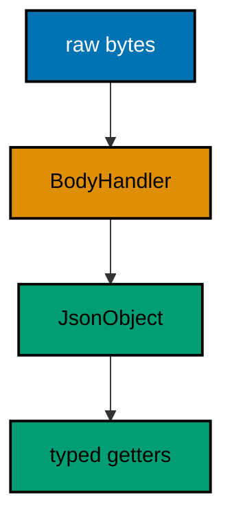

**`learning/code/ex-11-parse-json-body-into-typed-values/Main.java`**:

```java
// Example 11: Parse JSON Body into Typed Values.
// Bodies arrive as bytes; handlers need typed fields. A BodyHandler reads
// the bytes once, and the handler pulls typed getters off the resulting
// JsonObject: strings, integers, and nested objects. This example creates
// a gadget from a JSON body and echoes its typed fields back.
// (Concepts: co-03, co-15.)
import io.vertx.core.Vertx;
import io.vertx.core.json.JsonObject;
import io.vertx.ext.web.Router;
import io.vertx.ext.web.client.WebClient;
import io.vertx.ext.web.handler.BodyHandler;

public class Main {

  // buildRouter wires the service with every route this example serves.
  // BodyHandler runs first so the body is parsed before logic reads it.
  static Router buildRouter(Vertx vertx) {
    // An empty table first: middleware plus one route follow.
    Router router = Router.router(vertx); // => vertx creates routers bound to it
    // Without this line ctx.body() is empty: parsing is opt-in, not magic.
    router.route().handler(BodyHandler.create()); // => reads the bytes into a JsonObject
    // Typed getters replace stringly parsing: the boundary is typed (co-15).
    router.post("/gadgets").handler(ctx -> {
      JsonObject body = ctx.body().asJsonObject(); // => {"name":"...","watts":...} (type: JsonObject)
      String name = body.getString("name", "unnamed"); // => "unnamed" when absent (type: String)
      int watts = body.getInteger("watts", 0); // => 0 when absent (type: int)
      ctx.response()
        .putHeader("content-type", "application/json") // => the body is JSON (co-04)
        .end(new JsonObject().put("name", name).put("watts", watts).encode()); // => the typed fields echoed back
    });
    // Hand the wired table back to the caller.
    return router;
  }

  // check posts one JSON body in-process and prints its status line.
  // sendJsonObject sets the content type the handler expects (co-09).
  static void check(WebClient client, int port, String payload) throws Exception {
    // The payload travels as JSON: the handler parses, never string-splits.
    var response = client.post(port, "127.0.0.1", "/gadgets") // => POST names the verb under test
      .sendJsonObject(new JsonObject(payload)) // => the body under test, parsed once
      .toCompletionStage().toCompletableFuture().join(); // => the pipeline runs, then answers
    String text = response.bodyAsString(); // => the exact bytes the handler wrote
    // One golden line per request: the sent payload, the status, and the body.
    System.out.println("POST /gadgets " + payload + " -> " + response.statusCode() + " " + text); // => Output: POST /gadgets {"name":"drill","watts":40} -> 200 {...}
  }

  public static void main(String[] args) throws Exception {
    // One event loop carries both the server and the client below.
    Vertx vertx = Vertx.vertx(); // => vertx() boots the runtime this process shares
    Router router = buildRouter(vertx); // => the service under test, wired by its builder
    // Port zero asks the operating system for a free loopback port.
    // Reading it back keeps fixed ports out of every example (co-09).
    int port = vertx.createHttpServer().requestHandler(router).listen(0, "127.0.0.1")
      .toCompletionStage().toCompletableFuture().join().actualPort(); // => the assigned port the client will drive
    // The client talks through loopback, never leaving this process.
    WebClient client = WebClient.create(vertx); // => one client serves every check
    check(client, port, "{\"name\":\"drill\",\"watts\":40}"); // => Output: POST /gadgets {"name":"drill","watts":40} -> 200 {"name":"drill","watts":40}
    check(client, port, "{}"); // => Output: POST /gadgets {} -> 200 {"name":"unnamed","watts":0}
    // The pool shuts down: nothing in flight is cut.
    client.close();
    // The loop stops after every check printed, so no output is lost (co-08).
    vertx.close().toCompletionStage().toCompletableFuture().join();
  }
}
```

**Output** (`learning/code/ex-11-parse-json-body-into-typed-values/expected/main.stdout.txt`):

```text
POST /gadgets {"name":"drill","watts":40} -> 200 {"name":"drill","watts":40}
POST /gadgets {} -> 200 {"name":"unnamed","watts":0}
```

**Key takeaway**: `BodyHandler` decodes once; typed getters on the JsonObject convert bytes to values.

**Why it matters**: Single-point decoding keeps parsing policy in one middleware instead of scattered across handlers. When every handler reads from the same decoded body, content-type handling and size limits apply uniformly rather than per-route.

---

### Example 12: Form Body Carries Fields

Not every client speaks JSON: browsers submit forms. Form fields arrive URL-encoded, and the same BodyHandler decodes them into attributes the handler reads by name. One endpoint can serve both browser forms and API clients by reading whichever shape arrived.

This example logs in with a form body and echoes the decoded username back, proving the full form and the empty form both stay total.

**`learning/code/ex-12-form-body-carries-fields/Main.java`**:

```java
// Example 12: Form Body Carries Fields.
// Not every client speaks JSON: browsers submit forms. Form fields arrive
// URL-encoded, and the same BodyHandler decodes them into attributes the
// handler reads by name. This example logs in with a form and echoes the
// decoded username back.
// (Concepts: co-03, co-10.)
import io.vertx.core.MultiMap;
import io.vertx.core.Vertx;
import io.vertx.ext.web.Router;
import io.vertx.ext.web.client.WebClient;
import io.vertx.ext.web.handler.BodyHandler;

public class Main {

  // buildRouter wires the service with every route this example serves.
  // Forms decode into attributes: one reader per content type (co-03).
  static Router buildRouter(Vertx vertx) {
    // An empty table first: middleware plus one route follow.
    Router router = Router.router(vertx); // => vertx creates routers bound to it
    // The same middleware decodes forms and JSON: the handler picks the reader.
    router.route().handler(BodyHandler.create()); // => form fields land in attributes
    // getAttribute reads one decoded form field by its HTML name.
    router.post("/login").handler(ctx -> {
      MultiMap form = ctx.request().formAttributes(); // => {username=..., password=...} (type: MultiMap)
      String username = form.get("username"); // => null when the field is missing (type: String)
      // A missing field is a client error, never a null-pointer crash.
      String shown = (username == null) ? "nobody" : username; // => "nobody" for empty forms
      ctx.response()
        .putHeader("content-type", "application/json") // => the body is JSON (co-04)
        .end("{\"user\":\"" + shown + "\"}"); // => the decoded username echoed back
    });
    // Hand the wired table back to the caller.
    return router;
  }

  // check posts one form in-process and prints its status line.
  // sendForm encodes the fields exactly like a browser would (co-09).
  static void check(WebClient client, int port, MultiMap form, String label) throws Exception {
    // The label names the case in the golden line: the fields stay readable.
    var response = client.post(port, "127.0.0.1", "/login") // => POST names the verb under test
      .sendForm(form) // => url-encoded body, browser-style
      .toCompletionStage().toCompletableFuture().join(); // => the pipeline runs, then answers
    String text = response.bodyAsString(); // => the exact bytes the handler wrote
    // One golden line per request: the case label, the status, and the body.
    System.out.println("POST /login " + label + " -> " + response.statusCode() + " " + text); // => Output: POST /login full -> 200 {"user":"gopher"}
  }

  public static void main(String[] args) throws Exception {
    // One event loop carries both the server and the client below.
    Vertx vertx = Vertx.vertx(); // => vertx() boots the runtime this process shares
    Router router = buildRouter(vertx); // => the service under test, wired by its builder
    // Port zero asks the operating system for a free loopback port.
    // Reading it back keeps fixed ports out of every example (co-09).
    int port = vertx.createHttpServer().requestHandler(router).listen(0, "127.0.0.1")
      .toCompletionStage().toCompletableFuture().join().actualPort(); // => the assigned port the client will drive
    // The client talks through loopback, never leaving this process.
    WebClient client = WebClient.create(vertx); // => one client serves every check
    // MultiMap.of builds the field list: an even count of names and values.
    check(client, port, MultiMap.caseInsensitiveMultiMap().add("username", "gopher").add("password", "s3cret"), "full"); // => Output: POST /login full -> 200 {"user":"gopher"}
    check(client, port, MultiMap.caseInsensitiveMultiMap(), "empty"); // => Output: POST /login empty -> 200 {"user":"nobody"}
    // The pool shuts down: nothing in flight is cut.
    client.close();
    // The loop stops after every check printed, so no output is lost (co-08).
    vertx.close().toCompletionStage().toCompletableFuture().join();
  }
}
```

**Output** (`learning/code/ex-12-form-body-carries-fields/expected/main.stdout.txt`):

```text
POST /login full -> 200 {"user":"gopher"}
POST /login empty -> 200 {"user":"nobody"}
```

**Key takeaway**: Form fields decode into request attributes; one reader per content type keeps shapes separate.

**Why it matters**: Browser-compatible endpoints widen the client base without a second service. Forms and JSON sharing one route means the login page and the API client exercise the same logic, so fixes land once for both.

---

### Example 13: Reject Malformed JSON with 400

Broken bytes reach every public API eventually, and a handler that assumes valid JSON throws a 500 on the caller's mistake. Catching the decode failure turns it into a 400 with the error contract, so the client learns what to fix. Blame belongs with the sender, and the status code is how the server assigns it.

This example posts one broken body and one valid body, proving the broken one answers 400 with the contract while the valid one passes through.

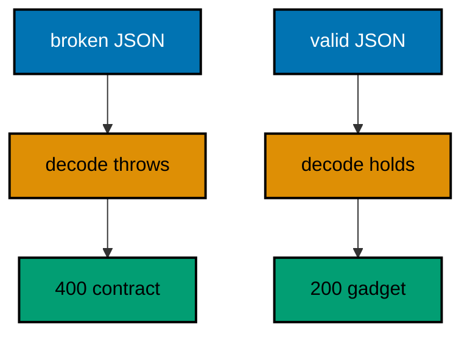

**`learning/code/ex-13-reject-malformed-json-with-400/Main.java`**:

```java
// Example 13: Reject Malformed JSON with 400.
// Broken bytes reach every public API eventually, and a handler that
// assumes valid JSON throws a 500 on the caller's mistake. Catching the
// decode failure turns it into a 400 with the error contract, so the
// client learns what to fix. This example posts one broken body.
// (Concepts: co-05, co-10.)
import io.vertx.core.Vertx;
import io.vertx.core.json.DecodeException;
import io.vertx.core.json.JsonObject;
import io.vertx.ext.web.Router;
import io.vertx.ext.web.client.WebClient;
import io.vertx.ext.web.handler.BodyHandler;

public class Main {

  // buildRouter wires the service with every route this example serves.
  // The try around decoding is the whole validation story here (co-10).
  static Router buildRouter(Vertx vertx) {
    // An empty table first: middleware plus one route follow.
    Router router = Router.router(vertx); // => vertx creates routers bound to it
    // BodyHandler reads the bytes; decoding happens in the handler below.
    router.route().handler(BodyHandler.create()); // => raw bytes land in the body buffer
    // A broken body is a client bug: 400 names it, 500 would blame the server.
    router.post("/gadgets").handler(ctx -> {
      JsonObject body; // => assigned below, or the handler returns early
      // Decoding is the risky step: it throws where parsing would merely default.
      try {
        body = ctx.body().asJsonObject(); // => throws DecodeException on broken JSON
      // The catch answers in the error contract: 400, JSON, and what to fix.
      } catch (DecodeException broken) { // => the caller's bytes, not our bug
        ctx.response()
          .setStatusCode(400) // => 400 blames the request, never the service (co-05)
          .putHeader("content-type", "application/json") // => failures parse like successes
          .end("{\"error\":{\"code\":400,\"message\":\"malformed json\"}}"); // => the stable error contract
        return; // => the handler is done: no gadget is created
      }
      ctx.response()
        .putHeader("content-type", "application/json") // => the body is JSON (co-04)
        .end(new JsonObject().put("name", body.getString("name", "unnamed")).encode()); // => the parsed name echoed back
    });
    // Hand the wired table back to the caller.
    return router;
  }

  // check posts raw bytes in-process and prints the status line.
  // Raw bytes reach the handler exactly as a broken client would send them.
  static void check(WebClient client, int port, String payload, String label) throws Exception {
    // sendBuffer skips JSON encoding: the bytes travel untouched, flaws included.
    var response = client.post(port, "127.0.0.1", "/gadgets") // => POST names the verb under test
      .putHeader("content-type", "application/json") // => the handler attempts a JSON decode
      .sendBuffer(io.vertx.core.buffer.Buffer.buffer(payload)) // => broken on purpose for one case
      .toCompletionStage().toCompletableFuture().join(); // => the pipeline runs, then answers
    String text = response.bodyAsString(); // => the exact bytes the handler wrote
    // One golden line per request: the case label, the status, and the body.
    System.out.println("POST /gadgets " + label + " -> " + response.statusCode() + " " + text); // => Output: POST /gadgets broken -> 400 {"error":{"code":400,"message":"malformed json"}}
  }

  public static void main(String[] args) throws Exception {
    // One event loop carries both the server and the client below.
    Vertx vertx = Vertx.vertx(); // => vertx() boots the runtime this process shares
    Router router = buildRouter(vertx); // => the service under test, wired by its builder
    // Port zero asks the operating system for a free loopback port.
    // Reading it back keeps fixed ports out of every example (co-09).
    int port = vertx.createHttpServer().requestHandler(router).listen(0, "127.0.0.1")
      .toCompletionStage().toCompletableFuture().join().actualPort(); // => the assigned port the client will drive
    // The client talks through loopback, never leaving this process.
    WebClient client = WebClient.create(vertx); // => one client serves every check
    check(client, port, "{\"name\":", "broken"); // => Output: POST /gadgets broken -> 400 {"error":{"code":400,"message":"malformed json"}}
    check(client, port, "{\"name\":\"drill\"}", "valid"); // => Output: POST /gadgets valid -> 200 {"name":"drill"}
    // The pool shuts down: nothing in flight is cut.
    client.close();
    // The loop stops after every check printed, so no output is lost (co-08).
    vertx.close().toCompletionStage().toCompletableFuture().join();
  }
}
```

**Output** (`learning/code/ex-13-reject-malformed-json-with-400/expected/main.stdout.txt`):

```text
POST /gadgets broken -> 400 {"error":{"code":400,"message":"malformed json"}}
POST /gadgets valid -> 200 {"name":"drill"}
```

**Key takeaway**: Catch decode failures and answer 400; malformed input is a client bug, never a 500.

**Why it matters**: Precise client-error statuses turn debugging from archaeology into reading. A 400 with a named cause tells the caller exactly which bytes to fix, while a 500 sends them hunting through server logs they cannot see.

---

### Example 14: Require Fields Before Logic

Valid JSON can still miss the fields the logic needs, and reading them with defaults hides the caller's mistake. Checking presence first turns a missing name into a 422 with the error contract, before any business logic runs. Validation is a gate, not a fallback: absent data stops the request.

This example rejects a gadget without a name while accepting a complete one, proving the gate runs before creation.

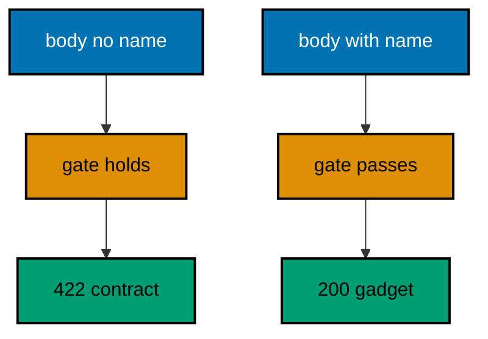

**`learning/code/ex-14-require-fields-before-logic/Main.java`**:

```java
// Example 14: Require Fields Before Logic.
// Valid JSON can still miss the fields the logic needs, and reading them
// with defaults hides the caller's mistake. Checking presence first turns
// a missing name into a 422 with the error contract, before any business
// logic runs. This example rejects a gadget without a name.
// (Concepts: co-05, co-10.)
import io.vertx.core.Vertx;
import io.vertx.core.json.JsonObject;
import io.vertx.ext.web.Router;
import io.vertx.ext.web.client.WebClient;
import io.vertx.ext.web.handler.BodyHandler;

public class Main {

  // buildRouter wires the service with every route this example serves.
  // Validation guards the gate: logic only sees complete bodies (co-10).
  static Router buildRouter(Vertx vertx) {
    // An empty table first: middleware plus one route follow.
    Router router = Router.router(vertx); // => vertx creates routers bound to it
    // The same middleware decodes every body: validation reads the result.
    router.route().handler(BodyHandler.create()); // => bytes become a JsonObject
    // containsKey asks about presence; getString would silently default.
    router.post("/gadgets").handler(ctx -> {
      JsonObject body = ctx.body().asJsonObject(); // => decoded, possibly incomplete
      // A missing name stops the handler: no gadget is built from half a body.
      if (!body.containsKey("name")) { // => presence, not value, is the question
        ctx.response()
          .setStatusCode(422) // => 422 names an unprocessable body (co-05)
          .putHeader("content-type", "application/json") // => failures parse like successes
          .end("{\"error\":{\"code\":422,\"message\":\"name is required\"}}"); // => what to fix, in the contract
        return; // => the handler is done: the gate held
      }
      ctx.response()
        .putHeader("content-type", "application/json") // => the body is JSON (co-04)
        .end(new JsonObject().put("name", body.getString("name")).encode()); // => the required field echoed back
    });
    // Hand the wired table back to the caller.
    return router;
  }

  // check posts one JSON body in-process and prints its status line.
  // sendJsonObject sets the content type the handler expects (co-09).
  static void check(WebClient client, int port, String payload) throws Exception {
    // The payload travels as JSON: presence is decided by its keys.
    var response = client.post(port, "127.0.0.1", "/gadgets") // => POST names the verb under test
      .sendJsonObject(new JsonObject(payload)) // => the body under test, parsed once
      .toCompletionStage().toCompletableFuture().join(); // => the pipeline runs, then answers
    String text = response.bodyAsString(); // => the exact bytes the handler wrote
    // One golden line per request: the sent payload, the status, and the body.
    System.out.println("POST /gadgets " + payload + " -> " + response.statusCode() + " " + text); // => Output: POST /gadgets {"watts":40} -> 422 {...}
  }

  public static void main(String[] args) throws Exception {
    // One event loop carries both the server and the client below.
    Vertx vertx = Vertx.vertx(); // => vertx() boots the runtime this process shares
    Router router = buildRouter(vertx); // => the service under test, wired by its builder
    // Port zero asks the operating system for a free loopback port.
    // Reading it back keeps fixed ports out of every example (co-09).
    int port = vertx.createHttpServer().requestHandler(router).listen(0, "127.0.0.1")
      .toCompletionStage().toCompletableFuture().join().actualPort(); // => the assigned port the client will drive
    // The client talks through loopback, never leaving this process.
    WebClient client = WebClient.create(vertx); // => one client serves every check
    check(client, port, "{\"name\":\"drill\"}"); // => Output: POST /gadgets {"name":"drill"} -> 200 {"name":"drill"}
    check(client, port, "{\"watts\":40}"); // => Output: POST /gadgets {"watts":40} -> 422 {"error":{"code":422,"message":"name is required"}}
    // The pool shuts down: nothing in flight is cut.
    client.close();
    // The loop stops after every check printed, so no output is lost (co-08).
    vertx.close().toCompletionStage().toCompletableFuture().join();
  }
}
```

**Output** (`learning/code/ex-14-require-fields-before-logic/expected/main.stdout.txt`):

```text
POST /gadgets {"name":"drill"} -> 200 {"name":"drill"}
POST /gadgets {"watts":40} -> 422 {"error":{"code":422,"message":"name is required"}}
```

**Key takeaway**: Check presence with `containsKey` before logic; missing fields answer 422 through the contract.

**Why it matters**: Presence gates keep invalid data from ever reaching storage, which is where it becomes expensive to remove. Rejecting early is cheaper than rolling back, and the 422 names exactly which field the caller forgot.

---

### Example 15: Validate Numbers Inside Bounds

A present field can still be nonsense: negative watts, a page size of a million. Range checks reject out-of-bounds values with 422 before the logic trusts them. Bounds are business rules, and the boundary is where business rules are cheapest to enforce.

This example bounds watts between 1 and 1000, proving the middle passes while both edges fail with the contract.

**`learning/code/ex-15-validate-numbers-inside-bounds/Main.java`**:

```java
// Example 15: Validate Numbers Inside Bounds.
// A present field can still be nonsense: negative watts, a page size of a
// million. Range checks reject out-of-bounds values with 422 before the
// logic trusts them. This example bounds watts between 1 and 1000.
// (Concepts: co-05, co-10.)
import io.vertx.core.Vertx;
import io.vertx.core.json.JsonObject;
import io.vertx.ext.web.Router;
import io.vertx.ext.web.client.WebClient;
import io.vertx.ext.web.handler.BodyHandler;

public class Main {

  // inRange answers whether a value sits inside an inclusive bound.
  // One predicate serves every ranged field in the handler below (co-10).
  static boolean inRange(int value, int low, int high) { // => value is the parsed field
    return value >= low && value <= high; // => inclusive on both ends, by contract
  }

  // buildRouter wires the service with every route this example serves.
  // Bounds are business rules: they live at the boundary, not in storage.
  static Router buildRouter(Vertx vertx) {
    // An empty table first: middleware plus one route follow.
    Router router = Router.router(vertx); // => vertx creates routers bound to it
    // The same middleware decodes every body: validation reads the result.
    router.route().handler(BodyHandler.create()); // => bytes become a JsonObject
    // Watts outside 1..1000 stop here: the store never sees nonsense.
    router.post("/gadgets").handler(ctx -> {
      JsonObject body = ctx.body().asJsonObject(); // => decoded, possibly out of bounds
      int watts = body.getInteger("watts", 0); // => 0 when absent: absent is also out of bounds
      // The bound is inclusive: exactly 1 and exactly 1000 both pass.
      if (!inRange(watts, 1, 1000)) { // => business rule, checked before logic
        ctx.response()
          .setStatusCode(422) // => 422 names an unprocessable body (co-05)
          .putHeader("content-type", "application/json") // => failures parse like successes
          .end("{\"error\":{\"code\":422,\"message\":\"watts must be 1..1000\"}}"); // => the bound, in the contract
        return; // => the handler is done: the gate held
      }
      ctx.response()
        .putHeader("content-type", "application/json") // => the body is JSON (co-04)
        .end(new JsonObject().put("watts", watts).encode()); // => the accepted value echoed back
    });
    // Hand the wired table back to the caller.
    return router;
  }

  // check posts one JSON body in-process and prints its status line.
  // sendJsonObject sets the content type the handler expects (co-09).
  static void check(WebClient client, int port, String payload) throws Exception {
    // The payload travels as JSON: bounds are decided by its values.
    var response = client.post(port, "127.0.0.1", "/gadgets") // => POST names the verb under test
      .sendJsonObject(new JsonObject(payload)) // => the body under test, parsed once
      .toCompletionStage().toCompletableFuture().join(); // => the pipeline runs, then answers
    String text = response.bodyAsString(); // => the exact bytes the handler wrote
    // One golden line per request: the sent payload, the status, and the body.
    System.out.println("POST /gadgets " + payload + " -> " + response.statusCode() + " " + text); // => Output: POST /gadgets {"watts":40} -> 200 {"watts":40}
  }

  public static void main(String[] args) throws Exception {
    // One event loop carries both the server and the client below.
    Vertx vertx = Vertx.vertx(); // => vertx() boots the runtime this process shares
    Router router = buildRouter(vertx); // => the service under test, wired by its builder
    // Port zero asks the operating system for a free loopback port.
    // Reading it back keeps fixed ports out of every example (co-09).
    int port = vertx.createHttpServer().requestHandler(router).listen(0, "127.0.0.1")
      .toCompletionStage().toCompletableFuture().join().actualPort(); // => the assigned port the client will drive
    // The client talks through loopback, never leaving this process.
    WebClient client = WebClient.create(vertx); // => one client serves every check
    check(client, port, "{\"watts\":40}"); // => Output: POST /gadgets {"watts":40} -> 200 {"watts":40}
    check(client, port, "{\"watts\":0}"); // => Output: POST /gadgets {"watts":0} -> 422 {"error":{"code":422,"message":"watts must be 1..1000"}}
    check(client, port, "{\"watts\":1001}"); // => Output: POST /gadgets {"watts":1001} -> 422, the upper bound holding too
    // The pool shuts down: nothing in flight is cut.
    client.close();
    // The loop stops after every check printed, so no output is lost (co-08).
    vertx.close().toCompletionStage().toCompletableFuture().join();
  }
}
```

**Output** (`learning/code/ex-15-validate-numbers-inside-bounds/expected/main.stdout.txt`):

```text
POST /gadgets {"watts":40} -> 200 {"watts":40}
POST /gadgets {"watts":0} -> 422 {"error":{"code":422,"message":"watts must be 1..1000"}}
POST /gadgets {"watts":1001} -> 422 {"error":{"code":422,"message":"watts must be 1..1000"}}
```

**Key takeaway**: Range predicates run after presence; out-of-bounds values answer 422 with the bound named.

**Why it matters**: Bounds protect capacity and correctness at once: no million-row pages, no negative quantities. Naming the bound in the error teaches the caller the rule, so the next request arrives valid instead of merely rejected.

---

### Example 16: Content Type Selects the Parser

One endpoint can accept several body shapes when each declares its own content type. A consumes guard routes JSON to the JSON reader and forms to the form reader, instead of one handler guessing. Shape dispatch belongs in the table beside method dispatch, not in branches that sniff bytes.

This example takes a name from either shape and answers the same contract, proving JSON and form converge on one greeting.

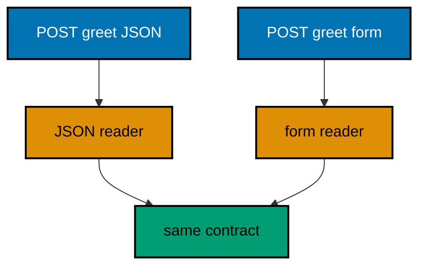

**`learning/code/ex-16-content-type-selects-the-parser/Main.java`**:

```java
// Example 16: Content Type Selects the Parser.
// One endpoint can accept several body shapes when each declares its own
// content type. A consumes guard routes JSON to the JSON reader and forms
// to the form reader, instead of one handler guessing. This example takes
// a name from either shape and answers the same contract.
// (Concepts: co-03, co-10.)
import io.vertx.core.MultiMap;
import io.vertx.core.Vertx;
import io.vertx.core.json.JsonObject;
import io.vertx.ext.web.Router;
import io.vertx.ext.web.client.WebClient;
import io.vertx.ext.web.handler.BodyHandler;

public class Main {

  // buildRouter wires the service with every route this example serves.
  // consumes() splits one path by content type: no guessing inside (co-03).
  static Router buildRouter(Vertx vertx) {
    // An empty table first: middleware plus two shaped routes follow.
    Router router = Router.router(vertx); // => vertx creates routers bound to it
    // The same middleware decodes every body: the route picks the reader.
    router.route().handler(BodyHandler.create()); // => bytes decoded per content type
    // The JSON shape answers only for application/json callers.
    router.post("/greet").consumes("application/json").handler(ctx -> {
      String name = ctx.body().asJsonObject().getString("name", "nobody"); // => JSON reader (type: String)
      ctx.response()
        .putHeader("content-type", "application/json") // => the body is JSON (co-04)
        .end("{\"hello\":\"" + name + "\"}"); // => the same contract for both shapes
    });
    // The form shape answers only for url-encoded callers.
    router.post("/greet").consumes("application/x-www-form-urlencoded").handler(ctx -> {
      String name = ctx.request().getFormAttribute("name"); // => form reader (type: String)
      // A missing field defaults: the contract stays total for both shapes.
      String shown = (name == null) ? "nobody" : name; // => "nobody" for empty forms
      ctx.response()
        .putHeader("content-type", "application/json") // => the body stays JSON
        .end("{\"hello\":\"" + shown + "\"}"); // => the same contract for both shapes
    });
    // Hand the wired table back to the caller.
    return router;
  }

  // check posts one shaped body in-process and prints its status line.
  // Each shape sets the content type its route consumes (co-09).
  static void check(WebClient client, int port) throws Exception {
    // JSON first: the consumes guard routes it to the JSON reader.
    var json = client.post(port, "127.0.0.1", "/greet") // => POST names the verb under test
      .sendJsonObject(new JsonObject().put("name", "gopher")) // => the JSON shape
      .toCompletionStage().toCompletableFuture().join(); // => the pipeline runs, then answers
    System.out.println("POST /greet json -> " + json.statusCode() + " " + json.bodyAsString()); // => Output: POST /greet json -> 200 {"hello":"gopher"}
    // Then the form: the same path, the url-encoded reader.
    var form = client.post(port, "127.0.0.1", "/greet") // => same path, different shape
      .sendForm(MultiMap.caseInsensitiveMultiMap().add("name", "gopher")) // => the form shape
      .toCompletionStage().toCompletableFuture().join(); // => the other route answers
    System.out.println("POST /greet form -> " + form.statusCode() + " " + form.bodyAsString()); // => Output: POST /greet form -> 200 {"hello":"gopher"}
  }

  public static void main(String[] args) throws Exception {
    // One event loop carries both the server and the client below.
    Vertx vertx = Vertx.vertx(); // => vertx() boots the runtime this process shares
    Router router = buildRouter(vertx); // => the service under test, wired by its builder
    // Port zero asks the operating system for a free loopback port.
    // Reading it back keeps fixed ports out of every example (co-09).
    int port = vertx.createHttpServer().requestHandler(router).listen(0, "127.0.0.1")
      .toCompletionStage().toCompletableFuture().join().actualPort(); // => the assigned port the client will drive
    // The client talks through loopback, never leaving this process.
    WebClient client = WebClient.create(vertx); // => one client serves every check
    check(client, port); // => runs the JSON case then the form case
    // The pool shuts down: nothing in flight is cut.
    client.close();
    // The loop stops after every check printed, so no output is lost (co-08).
    vertx.close().toCompletionStage().toCompletableFuture().join();
  }
}
```

**Output** (`learning/code/ex-16-content-type-selects-the-parser/expected/main.stdout.txt`):

```text
POST /greet json -> 200 {"hello":"gopher"}
POST /greet form -> 200 {"hello":"gopher"}
```

**Key takeaway**: `consumes` splits one path by content type; each shape gets its own handler.

**Why it matters**: Shape-specific handlers keep parsing total without guessing. A JSON reader never sees form bytes, so neither parser needs defensive branches for the other's encoding, and new shapes add routes instead of complicating old ones.

---

### Example 17: Query Defaults Keep Handlers Total

Optional parameters should not fork the handler into present and absent branches at every use. Reading each value once through a defaulting helper keeps one straight path from request to response. The handler states its assumptions up front, in the defaults, instead of discovering them mid-logic.

This example greets in a language the caller picks, defaulting to English, proving both the bare call and the Indonesian call answer.

**`learning/code/ex-17-query-defaults-keep-handlers-total/Main.java`**:

```java
// Example 17: Query Defaults Keep Handlers Total.
// Optional parameters should not fork the handler into present and absent
// branches at every use. Reading each value once through a defaulting
// helper keeps one straight path from request to response. This example
// greets in a language the caller picks, defaulting to English.
// (Concepts: co-03, co-10.)
import io.vertx.core.Vertx;
import io.vertx.core.http.HttpMethod;
import io.vertx.ext.web.Router;
import io.vertx.ext.web.client.WebClient;

public class Main {

  // firstOf reads one named query value, defaulting when it is absent.
  // Callers pass the fallback that fits their contract (co-03).
  static String firstOf(java.util.List<String> values, String fallback) { // => values hold the raw strings
    // Empty means absent: the caller omitted the parameter entirely.
    if (values == null || values.isEmpty()) { // => no value arrived
      return fallback; // => the default stands in, no branch in the handler
    }
    return values.get(0); // => the caller's value wins when present (type: String)
  }

  // buildRouter wires the service with every route this example serves.
  // The language parameter is optional: the handler stays single-pathed.
  static Router buildRouter(Vertx vertx) {
    // An empty table first: the greeting route below is its only row.
    Router router = Router.router(vertx); // => vertx creates routers bound to it
    // One read with a default: no if-statements fork the handler below.
    router.get("/greet").handler(ctx -> {
      String lang = firstOf(ctx.queryParam("lang"), "en"); // => "en" for /greet (type: String)
      String hello = lang.equals("id") ? "halo" : "hello"; // => two languages, one line
      ctx.response()
        .putHeader("content-type", "application/json") // => the body is JSON (co-04)
        .end("{\"hello\":\"" + hello + "\"}"); // => the greeting in the chosen language
    });
    // Hand the wired table back to the caller.
    return router;
  }

  // check serves one request in-process and prints its status line.
  // The client and the server share one JVM: no real network (co-09).
  static void check(WebClient client, int port, String method, String target) throws Exception {
    // A server-side request needs no socket: method, port, host, and path suffice.
    var request = client.request(HttpMethod.valueOf(method), port, "127.0.0.1", target);
    // The full pipeline runs, then answers: routing, handlers, and response.
    var response = request.send().toCompletionStage().toCompletableFuture().join();
    String text = response.bodyAsString(); // => the exact bytes the handler wrote
    // An empty body still needs a visible marker, or the line ends mid-air.
    String shown = (text == null || text.isEmpty()) ? "(empty body)" : text;
    // One golden line per request: method, path, status, and body.
    System.out.println(method + " " + target + " -> " + response.statusCode() + " " + shown); // => Output: GET /greet -> 200 {"hello":"hello"}
  }

  public static void main(String[] args) throws Exception {
    // One event loop carries both the server and the client below.
    Vertx vertx = Vertx.vertx(); // => vertx() boots the runtime this process shares
    Router router = buildRouter(vertx); // => the service under test, wired by its builder
    // Port zero asks the operating system for a free loopback port.
    // Reading it back keeps fixed ports out of every example (co-09).
    int port = vertx.createHttpServer().requestHandler(router).listen(0, "127.0.0.1")
      .toCompletionStage().toCompletableFuture().join().actualPort(); // => the assigned port the client will drive
    // The client talks through loopback, never leaving this process.
    WebClient client = WebClient.create(vertx); // => one client serves every check
    check(client, port, "GET", "/greet"); // => Output: GET /greet -> 200 {"hello":"hello"}
    check(client, port, "GET", "/greet?lang=id"); // => Output: GET /greet?lang=id -> 200 {"hello":"halo"}
    // The pool shuts down: nothing in flight is cut.
    client.close();
    // The loop stops after every check printed, so no output is lost (co-08).
    vertx.close().toCompletionStage().toCompletableFuture().join();
  }
}
```

**Output** (`learning/code/ex-17-query-defaults-keep-handlers-total/expected/main.stdout.txt`):

```text
GET /greet -> 200 {"hello":"hello"}
GET /greet?lang=id -> 200 {"hello":"halo"}
```

**Key takeaway**: Default every optional value at the read site; handlers stay single-pathed.

**Why it matters**: Single-pathed handlers are trivially reviewable: one path means one behavior to verify. Defaults declared at the boundary also document the API's assumptions better than any prose, because they are executable.

---

### Example 18: Status Codes Say What Happened

The status code is the first thing a client reads: 201 means a resource was created, 204 means the delete worked and there is nothing to show. Handlers set the code explicitly instead of leaving every answer at 200. Statuses are the API's verbs, and precise verbs prevent misreading.

This example creates and deletes one gadget, printing the 201 with its receipt and the 204 with its deliberate silence.

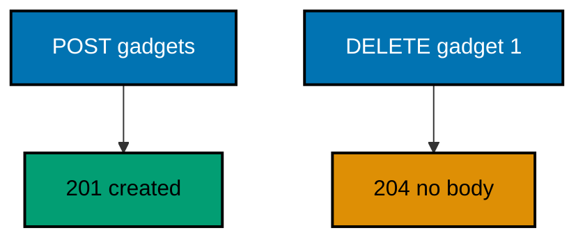

**`learning/code/ex-18-status-codes-say-what-happened/Main.java`**:

```java
// Example 18: Status Codes Say What Happened.
// The status code is the first thing a client reads: 201 means a resource
// was created, 204 means the delete worked and there is nothing to show.
// Handlers set the code explicitly instead of leaving every answer at 200.
// This example creates and deletes one gadget, printing both codes.
// (Concepts: co-01, co-04.)
import io.vertx.core.Vertx;
import io.vertx.core.http.HttpMethod;
import io.vertx.ext.web.Router;
import io.vertx.ext.web.client.WebClient;

public class Main {

  // buildRouter wires the service with every route this example serves.
  // Each verb owns its success code: creation differs from deletion (co-04).
  static Router buildRouter(Vertx vertx) {
    // An empty table first: one creation plus one deletion follow.
    Router router = Router.router(vertx); // => vertx creates routers bound to it
    // 201 Created: the response names the new resource in its body.
    router.post("/gadgets").handler(ctx -> ctx.response()
      .setStatusCode(201) // => 201 means created, not a bare 200 (co-04)
      .putHeader("content-type", "application/json") // => the body is JSON
      .end("{\"id\":1}")); // => the new resource, addressable from here
    // 204 No Content: success with nothing to show must still say so.
    router.delete("/gadgets/1").handler(ctx -> ctx.response()
      .setStatusCode(204) // => 204 means deleted, with an empty body (co-04)
      .end()); // => no body: the code carries the whole answer
    // Hand the wired table back to the caller.
    return router;
  }

  // check serves one request in-process and prints its status line.
  // The client and the server share one JVM: no real network (co-09).
  static void check(WebClient client, int port, String method, String target) throws Exception {
    // A server-side request needs no socket: method, port, host, and path suffice.
    var request = client.request(HttpMethod.valueOf(method), port, "127.0.0.1", target);
    // The full pipeline runs, then answers: routing, handlers, and response.
    var response = request.send().toCompletionStage().toCompletableFuture().join();
    String text = response.bodyAsString(); // => the exact bytes the handler wrote
    // An empty body still needs a visible marker, or the line ends mid-air.
    String shown = (text == null || text.isEmpty()) ? "(empty body)" : text; // => the 204 case lands here
    // One golden line per request: method, path, status, and body.
    System.out.println(method + " " + target + " -> " + response.statusCode() + " " + shown); // => Output: POST /gadgets -> 201 {"id":1}
  }

  public static void main(String[] args) throws Exception {
    // One event loop carries both the server and the client below.
    Vertx vertx = Vertx.vertx(); // => vertx() boots the runtime this process shares
    Router router = buildRouter(vertx); // => the service under test, wired by its builder
    // Port zero asks the operating system for a free loopback port.
    // Reading it back keeps fixed ports out of every example (co-09).
    int port = vertx.createHttpServer().requestHandler(router).listen(0, "127.0.0.1")
      .toCompletionStage().toCompletableFuture().join().actualPort(); // => the assigned port the client will drive
    // The client talks through loopback, never leaving this process.
    WebClient client = WebClient.create(vertx); // => one client serves every check
    check(client, port, "POST", "/gadgets"); // => Output: POST /gadgets -> 201 {"id":1}
    check(client, port, "DELETE", "/gadgets/1"); // => Output: DELETE /gadgets/1 -> 204 (empty body)
    // The pool shuts down: nothing in flight is cut.
    client.close();
    // The loop stops after every check printed, so no output is lost (co-08).
    vertx.close().toCompletionStage().toCompletableFuture().join();
  }
}
```

**Output** (`learning/code/ex-18-status-codes-say-what-happened/expected/main.stdout.txt`):

```text
POST /gadgets -> 201 {"id":1}
DELETE /gadgets/1 -> 204 (empty body)
```

**Key takeaway**: Set 201 for creation and 204 for silent success; codes carry the outcome before the body.

**Why it matters**: Explicit statuses let clients branch without parsing bodies. A cache, a retry policy, and a monitoring dashboard all read codes first, so precise codes propagate correct behavior to every layer that never sees the payload.

---

### Example 19: JSON Envelope Shapes Every Reply

Clients parse faster when every reply shares one shape: a data field on success, an error field on failure, never a bare value that changes type. One envelope helper keeps the contract uniform across routes. Shape discipline is a promise the whole API keeps together.

This example wraps a found gadget and a missing gadget in the same envelope, proving success and failure parse alike.

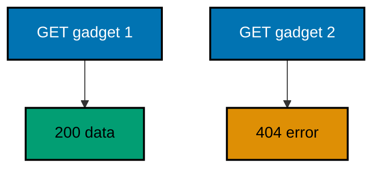

**`learning/code/ex-19-json-envelope-shapes-every-reply/Main.java`**:

```java
// Example 19: JSON Envelope Shapes Every Reply.
// Clients parse faster when every reply shares one shape: a data field on
// success, an error field on failure, never a bare value that changes type.
// One envelope helper keeps the contract uniform across routes. This
// example wraps a gadget read and a missing gadget in the same envelope.
// (Concepts: co-04, co-05.)
import io.vertx.core.Vertx;
import io.vertx.core.http.HttpMethod;
import io.vertx.core.json.JsonObject;
import io.vertx.ext.web.Router;
import io.vertx.ext.web.client.WebClient;

public class Main {

  // ok wraps a success payload in the shared envelope shape.
  // Every success answers {"data": ...}: the client learns one shape (co-04).
  static String ok(JsonObject payload) { // => payload holds the route's answer
    return new JsonObject().put("data", payload).encode(); // => the uniform success shape
  }

  // fail wraps a failure in the same envelope with the error beside it.
  // Errors answer {"error": {...}}: parsing never branches on shape (co-05).
  static String fail(int code, String message) { // => code and message name the failure
    return new JsonObject().put("error", new JsonObject().put("code", code).put("message", message)).encode(); // => the uniform failure shape
  }

  // buildRouter wires the service with every route this example serves.
  // Both branches use the envelope: success and failure look alike (co-04).
  static Router buildRouter(Vertx vertx) {
    // An empty table first: one present gadget plus one absent gadget follow.
    Router router = Router.router(vertx); // => vertx creates routers bound to it
    // The envelope helper keeps this handler to two lines of real logic.
    router.get("/gadgets/1").handler(ctx -> ctx.response()
      .putHeader("content-type", "application/json") // => the body is JSON
      .end(ok(new JsonObject().put("id", 1).put("name", "drill")))); // => 200 with the data envelope
    // The missing gadget answers 404, still inside the envelope.
    router.get("/gadgets/2").handler(ctx -> ctx.response()
      .setStatusCode(404) // => 404 names the absence (co-05)
      .putHeader("content-type", "application/json") // => failures parse like successes
      .end(fail(404, "gadget 2 not found"))); // => 404 with the error envelope
    // Hand the wired table back to the caller.
    return router;
  }

  // check serves one request in-process and prints its status line.
  // The client and the server share one JVM: no real network (co-09).
  static void check(WebClient client, int port, String method, String target) throws Exception {
    // A server-side request needs no socket: method, port, host, and path suffice.
    var request = client.request(HttpMethod.valueOf(method), port, "127.0.0.1", target);
    // The full pipeline runs, then answers: routing, handlers, and response.
    var response = request.send().toCompletionStage().toCompletableFuture().join();
    String text = response.bodyAsString(); // => the exact bytes the handler wrote
    // An empty body still needs a visible marker, or the line ends mid-air.
    String shown = (text == null || text.isEmpty()) ? "(empty body)" : text;
    // One golden line per request: method, path, status, and body.
    System.out.println(method + " " + target + " -> " + response.statusCode() + " " + shown); // => Output: GET /gadgets/1 -> 200 {"data":{"id":1,...}}
  }

  public static void main(String[] args) throws Exception {
    // One event loop carries both the server and the client below.
    Vertx vertx = Vertx.vertx(); // => vertx() boots the runtime this process shares
    Router router = buildRouter(vertx); // => the service under test, wired by its builder
    // Port zero asks the operating system for a free loopback port.
    // Reading it back keeps fixed ports out of every example (co-09).
    int port = vertx.createHttpServer().requestHandler(router).listen(0, "127.0.0.1")
      .toCompletionStage().toCompletableFuture().join().actualPort(); // => the assigned port the client will drive
    // The client talks through loopback, never leaving this process.
    WebClient client = WebClient.create(vertx); // => one client serves every check
    check(client, port, "GET", "/gadgets/1"); // => Output: GET /gadgets/1 -> 200 {"data":{"id":1,"name":"drill"}}
    check(client, port, "GET", "/gadgets/2"); // => Output: GET /gadgets/2 -> 404 {"error":{"code":404,"message":"gadget 2 not found"}}
    // The pool shuts down: nothing in flight is cut.
    client.close();
    // The loop stops after every check printed, so no output is lost (co-08).
    vertx.close().toCompletionStage().toCompletableFuture().join();
  }
}
```

**Output** (`learning/code/ex-19-json-envelope-shapes-every-reply/expected/main.stdout.txt`):

```text
GET /gadgets/1 -> 200 {"data":{"id":1,"name":"drill"}}
GET /gadgets/2 -> 404 {"error":{"code":404,"message":"gadget 2 not found"}}
```

**Key takeaway**: Wrap successes in data and failures in error; one helper keeps the shape uniform.

**Why it matters**: Uniform envelopes collapse client parsing to one shape with a status branch. Consumers write one deserializer for the whole API, which removes the per-route parsing bugs that free-form bodies breed.

---

### Example 20: Headers Carry Metadata

Bodies carry content; headers carry metadata about the content. A total count lets a client page without another round trip, and a request id echoed back lets operators trace one call across services. Metadata rides beside the content so the body keeps only what the resource means.

This example asserts both headers beside the JSON body, proving counts and traces travel with the collection.

**`learning/code/ex-20-headers-carry-metadata/Main.java`**:

```java
// Example 20: Headers Carry Metadata.
// Bodies carry content; headers carry metadata about the content. A total
// count lets a client page without another round trip, and a request id
// echoed back lets operators trace one call across services. This example
// asserts both headers beside the JSON body.
// (Concepts: co-03, co-04.)
import io.vertx.core.Vertx;
import io.vertx.core.http.HttpMethod;
import io.vertx.ext.web.Router;
import io.vertx.ext.web.client.WebClient;

public class Main {

  // buildRouter wires the service with every route this example serves.
  // Metadata rides headers so the body keeps only the content (co-04).
  static Router buildRouter(Vertx vertx) {
    // An empty table first: the counted collection below is its only row.
    Router router = Router.router(vertx); // => vertx creates routers bound to it
    // X-Total-Count names the collection size without a second request.
    // X-Request-Id echoes the caller's id for cross-service tracing.
    router.get("/gadgets").handler(ctx -> {
      String requestId = ctx.request().getHeader("x-request-id"); // => null when the caller sends none
      String echoed = (requestId == null) ? "none" : requestId; // => "none" keeps the contract total
      ctx.response()
        .putHeader("content-type", "application/json") // => the body is JSON (co-04)
        .putHeader("x-total-count", "2") // => the collection size, as metadata
        .putHeader("x-request-id", echoed) // => the caller's id, echoed for tracing
        .end("{\"gadgets\":[{\"id\":1},{\"id\":2}]}"); // => the content itself
    });
    // Hand the wired table back to the caller.
    return router;
  }

  // check serves one request with headers and prints status plus headers.
  // Headers are asserted like bodies: the contract lives in them too.
  static void check(WebClient client, int port) throws Exception {
    // The request carries the id the handler is expected to echo.
    var response = client.request(HttpMethod.GET, port, "127.0.0.1", "/gadgets") // => GET names the verb under test
      .putHeader("x-request-id", "trace-1") // => the id under test
      .send().toCompletionStage().toCompletableFuture().join(); // => the pipeline runs, then answers
    // Each header is read by name: the golden line pins the metadata.
    String total = response.getHeader("x-total-count"); // => "2" (type: String)
    String echoed = response.getHeader("x-request-id"); // => "trace-1" (type: String)
    String text = response.bodyAsString(); // => the exact bytes the handler wrote
    // One golden line: status, metadata headers, then the body.
    System.out.println("GET /gadgets -> " + response.statusCode() + " x-total-count=" + total + " x-request-id=" + echoed + " " + text); // => Output: GET /gadgets -> 200 x-total-count=2 x-request-id=trace-1 {...}
  }

  public static void main(String[] args) throws Exception {
    // One event loop carries both the server and the client below.
    Vertx vertx = Vertx.vertx(); // => vertx() boots the runtime this process shares
    Router router = buildRouter(vertx); // => the service under test, wired by its builder
    // Port zero asks the operating system for a free loopback port.
    // Reading it back keeps fixed ports out of every example (co-09).
    int port = vertx.createHttpServer().requestHandler(router).listen(0, "127.0.0.1")
      .toCompletionStage().toCompletableFuture().join().actualPort(); // => the assigned port the client will drive
    // The client talks through loopback, never leaving this process.
    WebClient client = WebClient.create(vertx); // => one client serves every check
    check(client, port); // => Output: GET /gadgets -> 200 x-total-count=2 x-request-id=trace-1 {"gadgets":[...]}
    // The pool shuts down: nothing in flight is cut.
    client.close();
    // The loop stops after every check printed, so no output is lost (co-08).
    vertx.close().toCompletionStage().toCompletableFuture().join();
  }
}
```

**Output** (`learning/code/ex-20-headers-carry-metadata/expected/main.stdout.txt`):

```text
GET /gadgets -> 200 x-total-count=2 x-request-id=trace-1 {"gadgets":[{"id":1},{"id":2}]}
```

**Key takeaway**: Stamp counts and trace ids in headers; assert them like bodies.

**Why it matters**: Header metadata saves round trips and enables tracing without body pollution. A total count removes the extra request pagination would need, and an echoed request id stitches one call's logs across every service it touched.

---

### Example 21: Empty Body Means No Content

Some answers have nothing to say: a delete that worked, a heartbeat with no news. A 204 answers with headers only, and the client must not wait for a body that never comes. Silence is a designed answer, distinct from a missing handler or a hung request.

This example deletes and heartbeats, printing the empty marker for both to prove silence arrives as a decision.

**`learning/code/ex-21-empty-body-means-no-content/Main.java`**:

```java
// Example 21: Empty Body Means No Content.
// Some answers have nothing to say: a delete that worked, a heartbeat
// with no news. A 204 answers with headers only, and the client must not
// wait for a body that never comes. This example deletes and heartbeats,
// printing the empty marker for both.
// (Concepts: co-01, co-04.)
import io.vertx.core.Vertx;
import io.vertx.core.http.HttpMethod;
import io.vertx.ext.web.Router;
import io.vertx.ext.web.client.WebClient;

public class Main {

  // buildRouter wires the service with every route this example serves.
  // Both routes succeed with silence: the status is the answer (co-04).
  static Router buildRouter(Vertx vertx) {
    // An empty table first: deletion plus heartbeat follow.
    Router router = Router.router(vertx); // => vertx creates routers bound to it
    // end() with no argument closes the response with an empty body.
    router.delete("/gadgets/1").handler(ctx -> ctx.response()
      .setStatusCode(204) // => 204 means deleted, with an empty body (co-04)
      .end()); // => the status carries the whole answer
    // A heartbeat with no news answers the same silent way.
    router.get("/ping").handler(ctx -> ctx.response()
      .setStatusCode(204) // => alive, and nothing to report
      .end()); // => no body follows the headers
    // Hand the wired table back to the caller.
    return router;
  }

  // check serves one request in-process and prints its status line.
  // The client and the server share one JVM: no real network (co-09).
  static void check(WebClient client, int port, String method, String target) throws Exception {
    // A server-side request needs no socket: method, port, host, and path suffice.
    var request = client.request(HttpMethod.valueOf(method), port, "127.0.0.1", target);
    // The full pipeline runs, then answers: routing, handlers, and response.
    var response = request.send().toCompletionStage().toCompletableFuture().join();
    String text = response.bodyAsString(); // => the exact bytes the handler wrote
    // An empty body still needs a visible marker, or the line ends mid-air.
    String shown = (text == null || text.isEmpty()) ? "(empty body)" : text; // => both checks land here
    // One golden line per request: method, path, status, and body.
    System.out.println(method + " " + target + " -> " + response.statusCode() + " " + shown); // => Output: DELETE /gadgets/1 -> 204 (empty body)
  }

  public static void main(String[] args) throws Exception {
    // One event loop carries both the server and the client below.
    Vertx vertx = Vertx.vertx(); // => vertx() boots the runtime this process shares
    Router router = buildRouter(vertx); // => the service under test, wired by its builder
    // Port zero asks the operating system for a free loopback port.
    // Reading it back keeps fixed ports out of every example (co-09).
    int port = vertx.createHttpServer().requestHandler(router).listen(0, "127.0.0.1")
      .toCompletionStage().toCompletableFuture().join().actualPort(); // => the assigned port the client will drive
    // The client talks through loopback, never leaving this process.
    WebClient client = WebClient.create(vertx); // => one client serves every check
    check(client, port, "DELETE", "/gadgets/1"); // => Output: DELETE /gadgets/1 -> 204 (empty body)
    check(client, port, "GET", "/ping"); // => Output: GET /ping -> 204 (empty body)
    // The pool shuts down: nothing in flight is cut.
    client.close();
    // The loop stops after every check printed, so no output is lost (co-08).
    vertx.close().toCompletionStage().toCompletableFuture().join();
  }
}
```

**Output** (`learning/code/ex-21-empty-body-means-no-content/expected/main.stdout.txt`):

```text
DELETE /gadgets/1 -> 204 (empty body)
GET /ping -> 204 (empty body)
```

**Key takeaway**: `end()` with no argument closes the response empty; 204 makes the silence explicit.

**Why it matters**: Explicit empty responses distinguish success-with-nothing-to-say from broken connections. Clients that can tell 204 apart from a timeout retry correctly instead of duplicating deletes that already worked.

---

### Example 22: Error Envelope Carries Code and Detail

Every failure answers three questions: what code, what happened, and what to fix. A two-field error object answers all three in one shape, so clients branch on code and humans read message. One helper builds every error, which keeps wording uniform as failures multiply.

This example fails a lookup and a validation, proving both wear the same envelope with different codes.

**`learning/code/ex-22-error-envelope-carries-code-and-detail/Main.java`**:

```java
// Example 22: Error Envelope Carries Code and Detail.
// Every failure answers three questions: what code, what happened, and
// what to fix. A two-field error object answers all three in one shape,
// so clients branch on code and humans read message. This example fails
// a lookup and a validation, both inside the same envelope.
// (Concepts: co-04, co-05.)
import io.vertx.core.Vertx;
import io.vertx.core.http.HttpMethod;
import io.vertx.core.json.JsonObject;
import io.vertx.ext.web.Router;
import io.vertx.ext.web.client.WebClient;

public class Main {

  // error answers a failure inside the shared envelope with a status.
  // Code for machines, message for humans: one object serves both (co-05).
  static void error(io.vertx.ext.web.RoutingContext ctx, int status, String message) { // => ctx writes this response
    ctx.response()
      .setStatusCode(status) // => the HTTP code matches the envelope code
      .putHeader("content-type", "application/json") // => failures parse like successes
      .end(new JsonObject() // => the envelope, built in one expression
        .put("error", new JsonObject().put("code", status).put("message", message)).encode()); // => code plus what to fix
  }

  // buildRouter wires the service with every route this example serves.
  // Both failures share the helper: the contract cannot drift (co-05).
  static Router buildRouter(Vertx vertx) {
    // An empty table first: one missing gadget plus one bad request follow.
    Router router = Router.router(vertx); // => vertx creates routers bound to it
    // The absent gadget fails with where to look next.
    router.get("/gadgets/9").handler(ctx -> error(ctx, 404, "gadget 9 not found")); // => lookup failure in the envelope
    // The bad request fails with what to fix.
    router.get("/gadgets").handler(ctx -> error(ctx, 400, "limit must be a number")); // => validation failure, same shape
    // Hand the wired table back to the caller.
    return router;
  }

  // check serves one request in-process and prints its status line.
  // The client and the server share one JVM: no real network (co-09).
  static void check(WebClient client, int port, String method, String target) throws Exception {
    // A server-side request needs no socket: method, port, host, and path suffice.
    var request = client.request(HttpMethod.valueOf(method), port, "127.0.0.1", target);
    // The full pipeline runs, then answers: routing, handlers, and response.
    var response = request.send().toCompletionStage().toCompletableFuture().join();
    String text = response.bodyAsString(); // => the exact bytes the handler wrote
    // An empty body still needs a visible marker, or the line ends mid-air.
    String shown = (text == null || text.isEmpty()) ? "(empty body)" : text;
    // One golden line per request: method, path, status, and body.
    System.out.println(method + " " + target + " -> " + response.statusCode() + " " + shown); // => Output: GET /gadgets/9 -> 404 {"error":{...}}
  }

  public static void main(String[] args) throws Exception {
    // One event loop carries both the server and the client below.
    Vertx vertx = Vertx.vertx(); // => vertx() boots the runtime this process shares
    Router router = buildRouter(vertx); // => the service under test, wired by its builder
    // Port zero asks the operating system for a free loopback port.
    // Reading it back keeps fixed ports out of every example (co-09).
    int port = vertx.createHttpServer().requestHandler(router).listen(0, "127.0.0.1")
      .toCompletionStage().toCompletableFuture().join().actualPort(); // => the assigned port the client will drive
    // The client talks through loopback, never leaving this process.
    WebClient client = WebClient.create(vertx); // => one client serves every check
    check(client, port, "GET", "/gadgets/9"); // => Output: GET /gadgets/9 -> 404 {"error":{"code":404,"message":"gadget 9 not found"}}
    check(client, port, "GET", "/gadgets"); // => Output: GET /gadgets -> 400 {"error":{"code":400,"message":"limit must be a number"}}
    // The pool shuts down: nothing in flight is cut.
    client.close();
    // The loop stops after every check printed, so no output is lost (co-08).
    vertx.close().toCompletionStage().toCompletableFuture().join();
  }
}
```

**Output** (`learning/code/ex-22-error-envelope-carries-code-and-detail/expected/main.stdout.txt`):

```text
GET /gadgets/9 -> 404 {"error":{"code":404,"message":"gadget 9 not found"}}
GET /gadgets -> 400 {"error":{"code":400,"message":"limit must be a number"}}
```

**Key takeaway**: One error helper builds every failure: code for machines, message for humans, always enveloped.

**Why it matters**: Shared error builders keep failure wording uniform as the API grows. New failures inherit the contract automatically, so clients written against the first error keep parsing the fiftieth without changes.

---

### Example 23: Content Negotiation Picks JSON or Text

One resource can speak several formats when the client names one in the Accept header. The handler reads the header and answers JSON or plain text, defaulting to JSON when the caller names nothing. Negotiation serves machines and humans from one route instead of forking the API by tongue.

This example serves a gadget status in both tongues from one route, asserting each tongue by header and body.

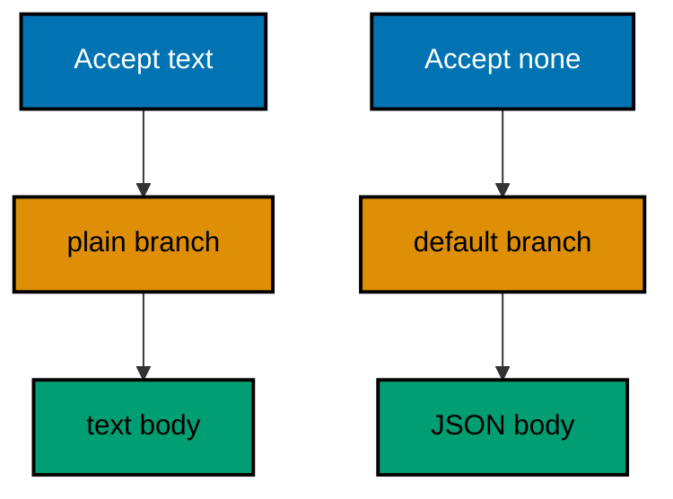

**`learning/code/ex-23-content-negotiation-picks-json-or-text/Main.java`**:

```java
// Example 23: Content Negotiation Picks JSON or Text.
// One resource can speak several formats when the client names one in the
// Accept header. The handler reads the header and answers JSON or plain
// text, defaulting to JSON when the caller names nothing. This example
// serves a gadget status in both tongues from one route.
// (Concepts: co-04, co-12.)
import io.vertx.core.Vertx;
import io.vertx.core.http.HttpMethod;
import io.vertx.ext.web.Router;
import io.vertx.ext.web.client.WebClient;

public class Main {

  // buildRouter wires the service with every route this example serves.
  // Accept picks the tongue: the resource stays one route (co-12).
  static Router buildRouter(Vertx vertx) {
    // An empty table first: the negotiating route below is its only row.
    Router router = Router.router(vertx); // => vertx creates routers bound to it
    // contains() tolerates "text/plain; charset=utf-8": matching stays loose.
    router.get("/status").handler(ctx -> {
      String accept = ctx.request().getHeader("accept"); // => null when the caller names nothing
      String wants = (accept == null) ? "" : accept; // => "" defaults to JSON below
      // Text for text callers, JSON for everyone else: one resource, two tongues.
      if (wants.contains("text/plain")) { // => the plain-text branch
        ctx.response()
          .putHeader("content-type", "text/plain") // => the tongue the caller asked for
          .end("gadget 1 is ok"); // => 200 in plain words
      } else {
        ctx.response()
          .putHeader("content-type", "application/json") // => the default tongue (co-04)
          .end("{\"gadget\":1,\"status\":\"ok\"}"); // => 200 in JSON
      }
    });
    // Hand the wired table back to the caller.
    return router;
  }

  // check serves one request with an Accept header and prints its line.
  // The header under test rides the same helper shape as the rest (co-09).
  static void check(WebClient client, int port, String accept) throws Exception {
    // The request names the tongue, or nothing when accept is null.
    var request = client.request(HttpMethod.GET, port, "127.0.0.1", "/status"); // => GET names the verb under test
    // Null means omission: the default branch is asserted, not assumed.
    if (accept != null) { // => one branch names a tongue, one stays silent
      request.putHeader("accept", accept); // => the tongue under test
    }
    // The full pipeline runs, then answers: routing, handlers, and response.
    var response = request.send().toCompletionStage().toCompletableFuture().join();
    String text = response.bodyAsString(); // => the exact bytes the handler wrote
    String type = response.getHeader("content-type"); // => the tongue the handler chose
    // One golden line: the requested tongue, the status, the served tongue, the body.
    System.out.println("GET /status accept=" + accept + " -> " + response.statusCode() + " " + type + " " + text); // => Output: GET /status accept=text/plain -> 200 text/plain gadget 1 is ok
  }

  public static void main(String[] args) throws Exception {
    // One event loop carries both the server and the client below.
    Vertx vertx = Vertx.vertx(); // => vertx() boots the runtime this process shares
    Router router = buildRouter(vertx); // => the service under test, wired by its builder
    // Port zero asks the operating system for a free loopback port.
    // Reading it back keeps fixed ports out of every example (co-09).
    int port = vertx.createHttpServer().requestHandler(router).listen(0, "127.0.0.1")
      .toCompletionStage().toCompletableFuture().join().actualPort(); // => the assigned port the client will drive
    // The client talks through loopback, never leaving this process.
    WebClient client = WebClient.create(vertx); // => one client serves every check
    check(client, port, "text/plain"); // => Output: GET /status accept=text/plain -> 200 text/plain gadget 1 is ok
    check(client, port, null); // => Output: GET /status accept=null -> 200 application/json {"gadget":1,"status":"ok"}
    // The pool shuts down: nothing in flight is cut.
    client.close();
    // The loop stops after every check printed, so no output is lost (co-08).
    vertx.close().toCompletionStage().toCompletableFuture().join();
  }
}
```

**Output** (`learning/code/ex-23-content-negotiation-picks-json-or-text/expected/main.stdout.txt`):

```text
GET /status accept=text/plain -> 200 text/plain gadget 1 is ok
GET /status accept=null -> 200 application/json {"gadget":1,"status":"ok"}
```

**Key takeaway**: Read Accept and branch tongues in one handler; default to JSON when nothing is named.

**Why it matters**: Negotiated routes serve debuggers and machines from one path. A human can curl for text while the client parses JSON, and both exercise the same logic, so fixes land once for every tongue.

---

### Example 24: Cookies Remember the Client

HTTP forgets every request, so servers hand the client a cookie to bring back next time. The handler sets the cookie with a Set-Cookie header, and reads it back from the Cookie header on later calls. The server itself stays stateless; the memory travels with the caller.

This example visits twice, proving the first visit is unknown and the second returns remembered.

**`learning/code/ex-24-cookies-remember-the-client/Main.java`**:

```java
// Example 24: Cookies Remember the Client.
// HTTP forgets every request, so servers hand the client a cookie to bring
// back next time. The handler sets the cookie with a Set-Cookie header,
// and reads it back from the Cookie header on later calls. This example
// visits twice: unknown first, remembered second.
// (Concepts: co-03, co-04.)
import io.vertx.core.Vertx;
import io.vertx.core.http.HttpMethod;
import io.vertx.ext.web.Router;
import io.vertx.ext.web.client.WebClient;

public class Main {

  // buildRouter wires the service with every route this example serves.
  // The cookie is the memory: the server itself stays stateless (co-03).
  static Router buildRouter(Vertx vertx) {
    // An empty table first: the remembering route below is its only row.
    Router router = Router.router(vertx); // => vertx creates routers bound to it
    // No cookie means a first visit: the server hands one over.
    // A cookie means a return: the server reads who is back.
    router.get("/visit").handler(ctx -> {
      String cookie = ctx.request().getHeader("cookie"); // => null on the first visit
      // contains() tolerates extra cookies: the check stays loose on purpose.
      boolean known = cookie != null && cookie.contains("visitor=gopher"); // => false first, true later
      // Set-Cookie on every answer keeps the memory fresh for the next call.
      ctx.response()
        .putHeader("content-type", "application/json") // => the body is JSON (co-04)
        .putHeader("set-cookie", "visitor=gopher; Path=/"); // => the memory the client carries
      // The body names the visit: first or returning, exactly one is true.
      ctx.response().end(known ? "{\"visit\":\"returning\"}" : "{\"visit\":\"first\"}"); // => the memory read back
    });
    // Hand the wired table back to the caller.
    return router;
  }

  // check visits with or without a cookie and prints the status line.
  // The cookie jar is manual: the helper passes the header through (co-09).
  static void check(WebClient client, int port, String cookie) throws Exception {
    // The request carries the cookie, or none on the very first visit.
    var request = client.request(HttpMethod.GET, port, "127.0.0.1", "/visit"); // => GET names the verb under test
    // Null means a first visit: the unknown branch is asserted, not assumed.
    if (cookie != null) { // => one branch remembers, one arrives fresh
      request.putHeader("cookie", cookie); // => the memory under test
    }
    // The full pipeline runs, then answers: routing, handlers, and response.
    var response = request.send().toCompletionStage().toCompletableFuture().join();
    String text = response.bodyAsString(); // => the exact bytes the handler wrote
    String set = response.getHeader("set-cookie"); // => the memory handed over (type: String)
    // One golden line: the sent cookie, the status, the new cookie, the body.
    System.out.println("GET /visit cookie=" + cookie + " -> " + response.statusCode() + " set-cookie=" + set + " " + text); // => Output: GET /visit cookie=null -> 200 set-cookie=visitor=gopher; Path=/ {...}
  }

  public static void main(String[] args) throws Exception {
    // One event loop carries both the server and the client below.
    Vertx vertx = Vertx.vertx(); // => vertx() boots the runtime this process shares
    Router router = buildRouter(vertx); // => the service under test, wired by its builder
    // Port zero asks the operating system for a free loopback port.
    // Reading it back keeps fixed ports out of every example (co-09).
    int port = vertx.createHttpServer().requestHandler(router).listen(0, "127.0.0.1")
      .toCompletionStage().toCompletableFuture().join().actualPort(); // => the assigned port the client will drive
    // The client talks through loopback, never leaving this process.
    WebClient client = WebClient.create(vertx); // => one client serves every check
    check(client, port, null); // => Output: GET /visit cookie=null -> 200 set-cookie=visitor=gopher; Path=/ {"visit":"first"}
    check(client, port, "visitor=gopher"); // => Output: GET /visit cookie=visitor=gopher -> 200 set-cookie=visitor=gopher; Path=/ {"visit":"returning"}
    // The pool shuts down: nothing in flight is cut.
    client.close();
    // The loop stops after every check printed, so no output is lost (co-08).
    vertx.close().toCompletionStage().toCompletableFuture().join();
  }
}
```

**Output** (`learning/code/ex-24-cookies-remember-the-client/expected/main.stdout.txt`):

```text
GET /visit cookie=null -> 200 set-cookie=visitor=gopher; Path=/ {"visit":"first"}
GET /visit cookie=visitor=gopher -> 200 set-cookie=visitor=gopher; Path=/ {"visit":"returning"}
```

**Key takeaway**: Set cookies with Set-Cookie, read them from Cookie; stateless servers remember through the client.

**Why it matters**: Client-carried memory scales without server affinity: any replica can serve the return visit. Stateless handlers behind a load balancer stay interchangeable, which is the property that lets traffic spread instead of stick.

---

### Example 25: HTML Page Renders for Browsers

Not every route serves machines: a status page renders HTML a human can read. The handler sets the HTML content type and writes a small page, proving one router serves both APIs and pages. Internal dashboards deserve routes too, beside the JSON the clients consume.

This example loads the dashboard and asserts its title rendered, proving the page tongue works through the same table.

**`learning/code/ex-25-html-page-renders-for-browsers/Main.java`**:

```java
// Example 25: HTML Page Renders for Browsers.
// Not every route serves machines: a status page renders HTML a human can
// read. The handler sets the HTML content type and writes a small page,
// proving one router serves both APIs and pages. This example loads the
// dashboard and asserts its title made it into the body.
// (Concepts: co-04, co-12.)
import io.vertx.core.Vertx;
import io.vertx.core.http.HttpMethod;
import io.vertx.ext.web.Router;
import io.vertx.ext.web.client.WebClient;

public class Main {

  // buildRouter wires the service with every route this example serves.
  // The same router serves pages and JSON: only the tongue differs (co-12).
  static Router buildRouter(Vertx vertx) {
    // An empty table first: the page route below is its only row.
    Router router = Router.router(vertx); // => vertx creates routers bound to it
    // text/html tells the browser to render, not to download.
    router.get("/dashboard").handler(ctx -> ctx.response()
      .putHeader("content-type", "text/html") // => the page tongue (co-04)
      .end("<html><body><h1>Gadget Dashboard</h1></body></html>")); // => the smallest honest page
    // Hand the wired table back to the caller.
    return router;
  }

  // check loads one page in-process and prints its status line.
  // Pages assert like APIs: the body carries the proof (co-09).
  static void check(WebClient client, int port, String method, String target) throws Exception {
    // A server-side request needs no socket: method, port, host, and path suffice.
    var request = client.request(HttpMethod.valueOf(method), port, "127.0.0.1", target);
    // The full pipeline runs, then answers: routing, handlers, and response.
    var response = request.send().toCompletionStage().toCompletableFuture().join();
    String text = response.bodyAsString(); // => the exact bytes the handler wrote
    String type = response.getHeader("content-type"); // => "text/html" (type: String)
    // The title check proves the page rendered: contains, not equality, on purpose.
    boolean titled = text != null && text.contains("<h1>Gadget Dashboard</h1>"); // => true for this page
    // One golden line: status, tongue, whether the title rendered, and the body.
    System.out.println(method + " " + target + " -> " + response.statusCode() + " " + type + " titled=" + titled); // => Output: GET /dashboard -> 200 text/html titled=true
  }

  public static void main(String[] args) throws Exception {
    // One event loop carries both the server and the client below.
    Vertx vertx = Vertx.vertx(); // => vertx() boots the runtime this process shares
    Router router = buildRouter(vertx); // => the service under test, wired by its builder
    // Port zero asks the operating system for a free loopback port.
    // Reading it back keeps fixed ports out of every example (co-09).
    int port = vertx.createHttpServer().requestHandler(router).listen(0, "127.0.0.1")
      .toCompletionStage().toCompletableFuture().join().actualPort(); // => the assigned port the client will drive
    // The client talks through loopback, never leaving this process.
    WebClient client = WebClient.create(vertx); // => one client serves every check
    check(client, port, "GET", "/dashboard"); // => Output: GET /dashboard -> 200 text/html titled=true
    // The pool shuts down: nothing in flight is cut.
    client.close();
    // The loop stops after every check printed, so no output is lost (co-08).
    vertx.close().toCompletionStage().toCompletableFuture().join();
  }
}
```

**Output** (`learning/code/ex-25-html-page-renders-for-browsers/expected/main.stdout.txt`):

```text
GET /dashboard -> 200 text/html titled=true
```

**Key takeaway**: Set `text/html` and write the page; browsers and APIs share one router with different tongues.

**Why it matters**: Co-located dashboards stay honest because they read the same services the API serves. An operator page beside the JSON routes shows live state without a second deployment, which keeps operational visibility cheap and current.

---
