Examples 26–53 cross from handling requests to engineering services: middleware and error handling (Examples 26–34), from stamping middleware and ordered chains through body unlocking, auth gates, thrown errors, local and status catchers, JSON request logs, and CORS stamps; then dependency injection without a container (Examples 35–44), from constructor wiring and stateful services through many-service routers, fakes, configs, repositories, frozen clocks, ordered ids, translated errors, and one builder; finally testing without a real network call (Examples 45–53), from the check helper and verdict tables through 404 coverage, round-trip proofs, validation tables, header assertions, repeated passes, and diff-printing failures. Every example is a complete, runnable Java program under `learning/code/` driving Vert.x against its own loopback server; run each with the command in its own `run.yaml`.

---

### Example 26: Middleware Runs Before Handlers

Middleware is a handler registered without a path: it runs for every request before the route handler does. A global handler can stamp every response with a header, and the route handler never notices. Cross-cutting behavior lives outside routes, which keeps route handlers focused on their resource.

This example stamps x-handler on a route that knows nothing about it, asserting the stamp beside the greeting.

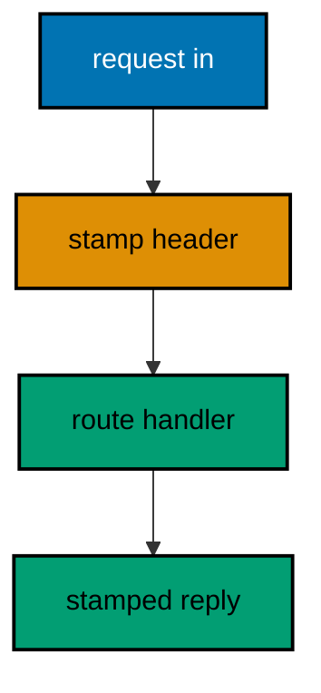

**`learning/code/ex-26-middleware-runs-before-handlers/Main.java`**:

```java
// Example 26: Middleware Runs Before Handlers.
// Middleware is a handler registered without a path: it runs for every
// request before the route handler does. A global handler can stamp every
// response with a header, and the route handler never notices. This example
// stamps x-handler on a route that knows nothing about it.
// (Concepts: co-01, co-02.)
import io.vertx.core.Vertx;
import io.vertx.core.http.HttpMethod;
import io.vertx.ext.web.Router;
import io.vertx.ext.web.client.WebClient;

public class Main {

  // buildRouter wires the service with middleware plus one route.
  // router.route() with no path matches everything: that is middleware (co-02).
  static Router buildRouter(Vertx vertx) {
    // An empty table first: one middleware plus one route follow.
    Router router = Router.router(vertx); // => vertx creates routers bound to it
    // Global handlers run first: registration order is execution order.
    // next() passes control down; without it the route below never runs.
    router.route().handler(ctx -> {
      ctx.response().putHeader("x-handler", "greet"); // => stamped before the route runs
      ctx.next(); // => the route handler runs after this returns
    });
    // The route stays clean: stamping lives in the middleware above.
    router.get("/hello").handler(ctx -> ctx.response()
      .putHeader("content-type", "application/json") // => the body is JSON (co-04)
      .end("{\"message\":\"hello, vertx\"}")); // => 200 plus the greeting contract
    // Hand the wired table back to the caller.
    return router;
  }

  // check serves one request and prints status plus the stamped header.
  // The middleware proof lives in the header, not in the body.
  static void check(WebClient client, int port) throws Exception {
    // A plain request: no header is sent, yet one must come back stamped.
    var response = client.request(HttpMethod.GET, port, "127.0.0.1", "/hello") // => GET names the verb under test
      .send().toCompletionStage().toCompletableFuture().join(); // => middleware runs, then the route
    String stamped = response.getHeader("x-handler"); // => "greet" (type: String)
    String text = response.bodyAsString(); // => the exact bytes the handler wrote
    // One golden line: status, the stamped header, then the body.
    System.out.println("GET /hello -> " + response.statusCode() + " x-handler=" + stamped + " " + text); // => Output: GET /hello -> 200 x-handler=greet {"message":"hello, vertx"}
  }

  public static void main(String[] args) throws Exception {
    // One event loop carries both the server and the client below.
    Vertx vertx = Vertx.vertx(); // => vertx() boots the runtime this process shares
    Router router = buildRouter(vertx); // => the service under test, wired by its builder
    // Port zero asks the operating system for a free loopback port.
    // Reading it back keeps fixed ports out of every example (co-09).
    int port = vertx.createHttpServer().requestHandler(router).listen(0, "127.0.0.1")
      .toCompletionStage().toCompletableFuture().join().actualPort(); // => the assigned port the client will drive
    // The client talks through loopback, never leaving this process.
    WebClient client = WebClient.create(vertx); // => one client serves every check
    check(client, port); // => Output: GET /hello -> 200 x-handler=greet {"message":"hello, vertx"}
    // The pool shuts down: nothing in flight is cut.
    client.close();
    // The loop stops after every check printed, so no output is lost (co-08).
    vertx.close().toCompletionStage().toCompletableFuture().join();
  }
}
```

**Output** (`learning/code/ex-26-middleware-runs-before-handlers/expected/main.stdout.txt`):

```text
GET /hello -> 200 x-handler=greet {"message":"hello, vertx"}
```

**Key takeaway**: Pathless `route()` handlers are middleware; `next()` passes control down the chain.

**Why it matters**: Middleware centralizes cross-cutting behavior that routes should not repeat. Stamping, tracing, and auth in one place means one fix updates every route, instead of hunting the same three lines across dozens of handlers.

---

### Example 27: Middleware Order Is the Contract

Several middleware share one chain, and registration order decides who runs first. Each one appends its name to a list on the context, so the final handler prints the exact visit order. Order is behavior: swapping two middleware can change the answer, and the test pins the sequence.

This example proves first, second, then the route ran in that order, twice identically.

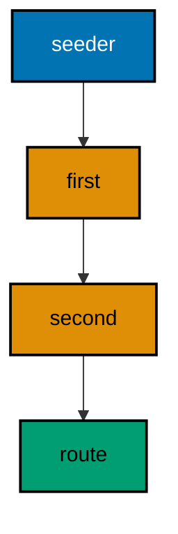

**`learning/code/ex-27-middleware-order-is-the-contract/Main.java`**:

```java
// Example 27: Middleware Order Is the Contract.
// Several middleware share one chain, and registration order decides who
// runs first. Each one appends its name to a list seeded on the context,
// so the final handler prints the exact visit order. This example proves
// first, second, then the route ran in that order.
// (Concepts: co-02, co-03.)
import io.vertx.core.Vertx;
import io.vertx.core.http.HttpMethod;
import io.vertx.ext.web.Router;
import io.vertx.ext.web.client.WebClient;
import java.util.ArrayList;
import java.util.List;

public class Main {

  // buildRouter wires the service with three middleware plus one route.
  // Registration order is execution order: the list below proves it (co-02).
  // Every middleware runs for this request: no path filters narrow the chain.
  // The seeder must run first: recorders assume the list already exists.
  static Router buildRouter(Vertx vertx) {
    // An empty table first: a seeder, two recorders, and one route follow.
    // The seeder carries no name: setup stays invisible in the golden order.
    Router router = Router.router(vertx); // => vertx creates routers bound to it
    // The seeder runs before every recorder: the list exists from here on.
    router.route().handler(ctx -> {
      ctx.put("order", new ArrayList<String>()); // => the visit log, empty for now
      ctx.next(); // => the first recorder runs after this returns
    });
    // First registered recorder, first recorded: the name lands at position zero.
    router.route().handler(ctx -> {
      ctx.<List<String>>get("order").add("first"); // => recorded before "second"
      ctx.next(); // => the second recorder runs after this returns
    });
    // Second registered recorder, second recorded: chains compose by appending.
    router.route().handler(ctx -> {
      ctx.<List<String>>get("order").add("second"); // => recorded before "handler"
      ctx.next(); // => the route handler runs after this returns
    });
    // The route reads the visit order the middleware recorded.
    // Reading last proves the route ran after every middleware above.
    router.get("/order").handler(ctx -> {
      List<String> order = ctx.get("order"); // => ["first", "second"] so far (type: List)
      order.add("handler"); // => the route runs last, as registered last
      ctx.response()
        .putHeader("content-type", "application/json") // => the body is JSON (co-04)
        .end("[\"" + String.join("\",\"", order) + "\"]"); // => the visit order as the contract
    });
    // Hand the wired table back to the caller.
    return router;
  }

  // check serves one request in-process and prints its status line.
  // The visit order arrives in the body: registration order made visible.
  static void check(WebClient client, int port, String method, String target) throws Exception {
    // A server-side request needs no socket: method, port, host, and path suffice.
    var request = client.request(HttpMethod.valueOf(method), port, "127.0.0.1", target);
    // The full pipeline runs, then answers: routing, handlers, and response.
    var response = request.send().toCompletionStage().toCompletableFuture().join();
    String text = response.bodyAsString(); // => the exact bytes the handler wrote
    // An empty body still needs a visible marker, or the line ends mid-air.
    String shown = (text == null || text.isEmpty()) ? "(empty body)" : text;
    // One golden line per request: method, path, status, and body.
    System.out.println(method + " " + target + " -> " + response.statusCode() + " " + shown); // => Output: GET /order -> 200 ["first","second","handler"]
  }

  public static void main(String[] args) throws Exception {
    // One event loop carries both the server and the client below.
    Vertx vertx = Vertx.vertx(); // => vertx() boots the runtime this process shares
    Router router = buildRouter(vertx); // => the service under test, wired by its builder
    // Port zero asks the operating system for a free loopback port.
    // Reading it back keeps fixed ports out of every example (co-09).
    int port = vertx.createHttpServer().requestHandler(router).listen(0, "127.0.0.1")
      .toCompletionStage().toCompletableFuture().join().actualPort(); // => the assigned port the client will drive
    // The client talks through loopback, never leaving this process.
    WebClient client = WebClient.create(vertx); // => one client serves every check
    check(client, port, "GET", "/order"); // => Output: GET /order -> 200 ["first","second","handler"]
    check(client, port, "GET", "/order"); // => Output: the seed runs per request, so the order repeats exactly
    // The pool shuts down: nothing in flight is cut.
    client.close();
    // The loop stops after every check printed, so no output is lost (co-08).
    vertx.close().toCompletionStage().toCompletableFuture().join();
  }
}
```

**Output** (`learning/code/ex-27-middleware-order-is-the-contract/expected/main.stdout.txt`):

```text
GET /order -> 200 ["first","second","handler"]
GET /order -> 200 ["first","second","handler"]
```

**Key takeaway**: Chain order equals registration order; later middleware sees earlier middleware's work.

**Why it matters**: Explicit ordering replaces hidden framework magic with a readable list. When auth must precede logging, the file order says so plainly, and the test fails the moment someone swaps two lines that must not move.

---

### Example 28: Body Handler Unlocks JSON Parsing

Reading a body is opt-in: without BodyHandler the bytes never reach the handler, and parsing sees nothing. Two routers prove the difference — one with the middleware, one without — serving the same path on two ports and printing how many body bytes each one saw. Absence is not emptiness: the body is missing, not blank.

This example prints the parsed name for the equipped router and the empty marker for the blind one.

**`learning/code/ex-28-body-handler-unlocks-json-parsing/Main.java`**:

```java
// Example 28: BodyHandler Unlocks JSON Parsing.
// Reading a body is opt-in: without BodyHandler the bytes never reach the
// handler, and parsing sees nothing. Two routers prove the difference —
// one with the middleware, one without — serving the same path on two
// ports and printing how many body bytes each one saw.
// (Concepts: co-02, co-03.)
import io.vertx.core.Vertx;
import io.vertx.core.http.HttpMethod;
import io.vertx.core.json.JsonObject;
import io.vertx.ext.web.Router;
import io.vertx.ext.web.client.WebClient;
import io.vertx.ext.web.handler.BodyHandler;

public class Main {

  // echo answers with how many body bytes the handler could see.
  // The count is the proof: parsing on versus parsing off (co-03).
  // Without the middleware the body is absent, not empty: buffer() is null.
  static void echo(io.vertx.ext.web.RoutingContext ctx, String label) { // => label names the router under test
    int seen = ctx.body().available() ? ctx.body().buffer().length() : 0; // => 17 with the handler, 0 without
    String name = seen == 0 ? "(empty)" : ctx.body().asJsonObject().getString("name", "(empty)"); // => parsed only when bytes exist
    ctx.response()
      .putHeader("content-type", "application/json") // => the body is JSON (co-04)
      .end(new JsonObject().put("router", label).put("body-bytes", seen).put("name", name).encode()); // => the bytes seen, as the contract
  }

  // buildRouter wires one router, with or without the body middleware.
  // The flag is the whole difference: parsing is opt-in, not magic (co-02).
  static Router buildRouter(Vertx vertx, boolean withBody, String label) { // => label travels into the echo
    // An empty table first: optional middleware plus one route follow.
    Router router = Router.router(vertx); // => vertx creates routers bound to it
    // Only the "with" router decodes: the other reads raw, empty bytes.
    if (withBody) { // => the opt-in branch installs the middleware
      router.route().handler(BodyHandler.create()); // => bytes decoded into the body
    }
    // Both routers share the echo: the middleware decides what it sees.
    router.post("/echo").handler(ctx -> echo(ctx, label)); // => same path, different sight
    // Hand the wired table back to the caller.
    return router;
  }

  // check posts one JSON body to one port and prints its status line.
  // The port picks the router: with middleware or without (co-09).
  static void check(WebClient client, int port, String payload) throws Exception {
    // The payload travels as JSON: sight depends on the router, not the bytes.
    var response = client.post(port, "127.0.0.1", "/echo") // => POST names the verb under test
      .sendJsonObject(new JsonObject(payload)) // => the body under test, parsed once
      .toCompletionStage().toCompletableFuture().join(); // => the pipeline runs, then answers
    String text = response.bodyAsString(); // => the exact bytes the handler wrote
    // One golden line per request: the payload, the status, and the body.
    System.out.println("POST /echo " + payload + " -> " + response.statusCode() + " " + text); // => Output: POST /echo {"name":"gopher"} -> 200 {...}
  }

  public static void main(String[] args) throws Exception {
    // One event loop carries both servers and the client below.
    Vertx vertx = Vertx.vertx(); // => vertx() boots the runtime this process shares
    // Two routers, two ports: the middleware is the only difference.
    int with = vertx.createHttpServer().requestHandler(buildRouter(vertx, true, "with")).listen(0, "127.0.0.1")
      .toCompletionStage().toCompletableFuture().join().actualPort(); // => the parsing router's port
    int without = vertx.createHttpServer().requestHandler(buildRouter(vertx, false, "without")).listen(0, "127.0.0.1")
      .toCompletionStage().toCompletableFuture().join().actualPort(); // => the blind router's port
    // The client talks through loopback, never leaving this process.
    WebClient client = WebClient.create(vertx); // => one client serves every check
    check(client, with, "{\"name\":\"gopher\"}"); // => Output: POST /echo {"name":"gopher"} -> 200 {"router":"with","body-bytes":17,"name":"gopher"}
    check(client, without, "{\"name\":\"gopher\"}"); // => Output: POST /echo {"name":"gopher"} -> 200 {"router":"without","body-bytes":0,"name":"(empty)"}
    // The pool shuts down: nothing in flight is cut.
    client.close();
    // The loop stops after every check printed, so no output is lost (co-08).
    vertx.close().toCompletionStage().toCompletableFuture().join();
  }
}
```

**Output** (`learning/code/ex-28-body-handler-unlocks-json-parsing/expected/main.stdout.txt`):

```text
POST /echo {"name":"gopher"} -> 200 {"router":"with","body-bytes":17,"name":"gopher"}
POST /echo {"name":"gopher"} -> 200 {"router":"without","body-bytes":0,"name":"(empty)"}
```

**Key takeaway**: No BodyHandler means no body; `available()` tells absent apart from empty.

**Why it matters**: Opt-in parsing keeps unwanted bytes out of handlers that never asked for them. Routes without bodies stay cheap and total, while body routes declare their need explicitly instead of paying for parsing they never use.

---

### Example 29: Auth Middleware Gates Routes

Public routes stay open while private ones check a token first. A gating middleware reads the Authorization header and either passes control down or ends the request with 401, so route handlers never see anonymous callers. Authorization is a precondition, not a branch inside every handler.

This example opens /public and gates /private/notes, asserting the anonymous 401 beside the tokened 200.

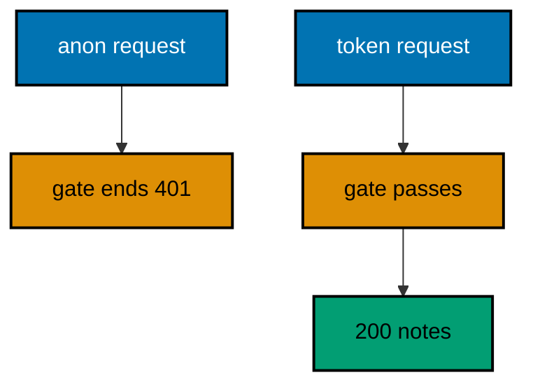

**`learning/code/ex-29-auth-middleware-gates-routes/Main.java`**:

```java
// Example 29: Auth Middleware Gates Routes.
// Public routes stay open while private ones check a token first. A gating
// middleware reads the Authorization header and either passes control down
// or ends the request with 401, so route handlers never see anonymous
// callers. This example opens /public and gates /private behind a token.
// (Concepts: co-02, co-05.)
import io.vertx.core.Vertx;
import io.vertx.core.http.HttpMethod;
import io.vertx.ext.web.Router;
import io.vertx.ext.web.client.WebClient;

public class Main {

  // buildRouter wires the service with a gate plus two routes.
  // The gate runs before the private route only: public stays open (co-02).
  static Router buildRouter(Vertx vertx) {
    // An empty table first: one open route, one gate, one gated route follow.
    Router router = Router.router(vertx); // => vertx creates routers bound to it
    // Open by design: no middleware runs before this handler.
    router.get("/public").handler(ctx -> ctx.response()
      .putHeader("content-type", "application/json") // => the body is JSON (co-04)
      .end("{\"open\":true}")); // => 200 for everyone, token or not
    // The gate ends anonymous requests here: gated handlers trust the caller.
    router.route("/private/*").handler(ctx -> {
      String auth = ctx.request().getHeader("authorization"); // => null when anonymous
      // Only the exact token passes: anything else is anonymous by definition.
      if (!"Bearer s3cret".equals(auth)) { // => constant first: null-safe by construction
        ctx.response()
          .setStatusCode(401) // => 401 names the missing credential (co-05)
          .putHeader("content-type", "application/json") // => failures parse like successes
          .end("{\"error\":{\"code\":401,\"message\":\"token required\"}}"); // => what to fix, in the contract
        return; // => no next(): the gated handler never runs
      }
      ctx.next(); // => the token held: the gated handler runs next
    });
    // Anonymous callers never reach this line: the gate ended them above.
    router.get("/private/notes").handler(ctx -> ctx.response()
      .putHeader("content-type", "application/json") // => the body stays JSON
      .end("{\"notes\":[]}")); // => 200 for token holders only
    // Hand the wired table back to the caller.
    return router;
  }

  // check serves one request with or without a token and prints its line.
  // The token rides the header: presence decides the branch (co-09).
  static void check(WebClient client, int port, String target, String token) throws Exception {
    // The request carries the token under test, or none when token is null.
    var request = client.request(HttpMethod.GET, port, "127.0.0.1", target); // => GET names the verb under test
    // Null means anonymous: the 401 branch is asserted, not just the happy one.
    if (token != null) { // => one branch sends a token, one stays anonymous
      request.putHeader("authorization", token); // => the credential under test
    }
    // The full pipeline runs, then answers: gate, handlers, and response.
    var response = request.send().toCompletionStage().toCompletableFuture().join();
    String text = response.bodyAsString(); // => the exact bytes the handler wrote
    // One golden line: the path, the token sent, the status, and the body.
    System.out.println("GET " + target + " token=" + token + " -> " + response.statusCode() + " " + text); // => Output: GET /private/notes token=null -> 401 {...}
  }

  public static void main(String[] args) throws Exception {
    // One event loop carries both the server and the client below.
    Vertx vertx = Vertx.vertx(); // => vertx() boots the runtime this process shares
    Router router = buildRouter(vertx); // => the service under test, wired by its builder
    // Port zero asks the operating system for a free loopback port.
    // Reading it back keeps fixed ports out of every example (co-09).
    int port = vertx.createHttpServer().requestHandler(router).listen(0, "127.0.0.1")
      .toCompletionStage().toCompletableFuture().join().actualPort(); // => the assigned port the client will drive
    // The client talks through loopback, never leaving this process.
    WebClient client = WebClient.create(vertx); // => one client serves every check
    check(client, port, "/public", null); // => Output: GET /public token=null -> 200 {"open":true}
    check(client, port, "/private/notes", null); // => Output: GET /private/notes token=null -> 401 {"error":{"code":401,"message":"token required"}}
    check(client, port, "/private/notes", "Bearer s3cret"); // => Output: GET /private/notes token=Bearer s3cret -> 200 {"notes":[]}
    // The pool shuts down: nothing in flight is cut.
    client.close();
    // The loop stops after every check printed, so no output is lost (co-08).
    vertx.close().toCompletionStage().toCompletableFuture().join();
  }
}
```

**Output** (`learning/code/ex-29-auth-middleware-gates-routes/expected/main.stdout.txt`):

```text
GET /public token=null -> 200 {"open":true}
GET /private/notes token=null -> 401 {"error":{"code":401,"message":"token required"}}
GET /private/notes token=Bearer s3cret -> 200 {"notes":[]}
```

**Key takeaway**: Gate middleware ends anonymous requests with 401; gated handlers trust their callers.

**Why it matters**: Centralized gates keep authorization reviewable in one place instead of scattered across handlers. A new private route inherits protection by sitting behind the gate, which removes the forgotten-check vulnerability that per-handler auth invites.

---

### Example 30: Error Handler Turns Throws into JSON

Handlers throw: a bug, a down dependency, a poisoned input that slipped past validation. An uncaught throw must still answer in the error contract, never in a stack trace. A failure handler for 500 shapes the throw, so the client gets a contract instead of a crash dump.

This example throws on purpose and proves the 500 answers JSON with a generic message.

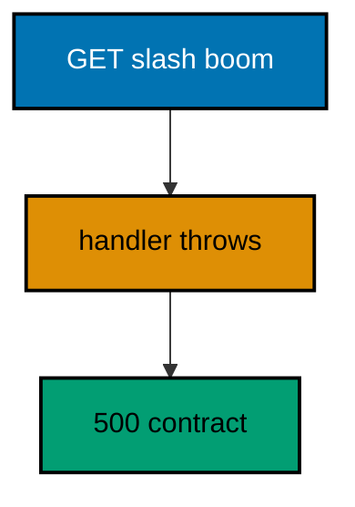

**`learning/code/ex-30-error-handler-turns-throws-into-json/Main.java`**:

```java
// Example 30: Error Handler Turns Throws into JSON.
// Handlers throw: a bug, a down dependency, a poisoned input that slipped
// past validation. An uncaught throw must still answer in the error
// contract, never in a stack trace. A failure handler for 500 catches the
// throw and shapes it, and this example proves it with one boom.
// (Concepts: co-02, co-05.)
import io.vertx.core.Vertx;
import io.vertx.core.http.HttpMethod;
import io.vertx.ext.web.Router;
import io.vertx.ext.web.client.WebClient;

public class Main {

  // buildRouter wires the service with one booming route plus its catcher.
  // Throws travel to failure handlers: the contract survives bugs (co-05).
  static Router buildRouter(Vertx vertx) {
    // An empty table first: one route plus one failure handler follow.
    Router router = Router.router(vertx); // => vertx creates routers bound to it
    // The throw escapes the handler: Vert.x routes it to the failure chain.
    router.get("/boom").handler(ctx -> {
      throw new RuntimeException("boom"); // => the bug under test, on purpose
    });
    // failureHandler(500) shapes the throw: code for machines, no stack trace.
    router.route().failureHandler(ctx -> ctx.response()
      .setStatusCode(500) // => 500 blames the service, never the caller (co-05)
      .putHeader("content-type", "application/json") // => failures parse like successes
      .end("{\"error\":{\"code\":500,\"message\":\"internal error\"}}")); // => the message stays generic on purpose
    // Hand the wired table back to the caller.
    return router;
  }

  // check serves one request in-process and prints its status line.
  // The client and the server share one JVM: no real network (co-09).
  static void check(WebClient client, int port, String method, String target) throws Exception {
    // A server-side request needs no socket: method, port, host, and path suffice.
    var request = client.request(HttpMethod.valueOf(method), port, "127.0.0.1", target);
    // The throw runs inside the pipeline: the failure handler answers, not the bug.
    var response = request.send().toCompletionStage().toCompletableFuture().join();
    String text = response.bodyAsString(); // => the exact bytes the handler wrote
    // An empty body still needs a visible marker, or the line ends mid-air.
    String shown = (text == null || text.isEmpty()) ? "(empty body)" : text;
    // One golden line per request: method, path, status, and body.
    System.out.println(method + " " + target + " -> " + response.statusCode() + " " + shown); // => Output: GET /boom -> 500 {"error":{"code":500,"message":"internal error"}}
  }

  public static void main(String[] args) throws Exception {
    // One event loop carries both the server and the client below.
    Vertx vertx = Vertx.vertx(); // => vertx() boots the runtime this process shares
    Router router = buildRouter(vertx); // => the service under test, wired by its builder
    // Port zero asks the operating system for a free loopback port.
    // Reading it back keeps fixed ports out of every example (co-09).
    int port = vertx.createHttpServer().requestHandler(router).listen(0, "127.0.0.1")
      .toCompletionStage().toCompletableFuture().join().actualPort(); // => the assigned port the client will drive
    // The client talks through loopback, never leaving this process.
    WebClient client = WebClient.create(vertx); // => one client serves every check
    check(client, port, "GET", "/boom"); // => Output: GET /boom -> 500 {"error":{"code":500,"message":"internal error"}}
    // The pool shuts down: nothing in flight is cut.
    client.close();
    // The loop stops after every check printed, so no output is lost (co-08).
    vertx.close().toCompletionStage().toCompletableFuture().join();
  }
}
```

**Output** (`learning/code/ex-30-error-handler-turns-throws-into-json/expected/main.stdout.txt`):

```text
GET /boom -> 500 {"error":{"code":500,"message":"internal error"}}
```

**Key takeaway**: Failure handlers catch throws and shape 500s; stack traces never reach clients.

**Why it matters**: Contract-shaped crashes keep clients parsing instead of panicking. A generic 500 preserves the API's shape under bugs the tests never imagined, while the real diagnostics stay in server logs where operators read them.

---

### Example 31: Route Failure Handler Is Local

A global failure handler is the last resort, but one sensitive route can own its failure shape: a payment route says try again, a lookup says not found. A per-route failureHandler overrides the global one for its route only. Locality lets sensitive failures speak carefully while ordinary ones stay generic.

This example fails a payment route with a retryable 502 and a lookup with the generic 404, proving each catcher owns its route.

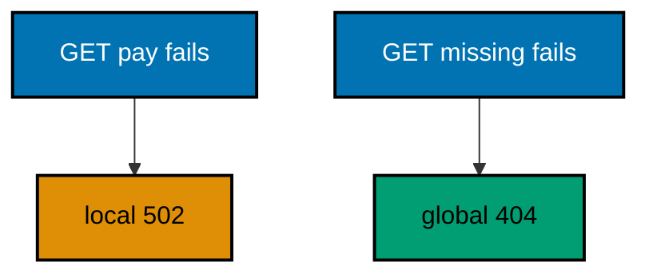

**`learning/code/ex-31-route-failure-handler-is-local/Main.java`**:

```java
// Example 31: Route Failure Handler Is Local.
// A global failure handler is the last resort, but one sensitive route can
// own its failure shape: a payment route says "try again", a lookup says
// "not found". A per-route failureHandler overrides the global one for its
// route only. This example fails two routes and prints both contracts.
// (Concepts: co-02, co-05.)
import io.vertx.core.Vertx;
import io.vertx.core.http.HttpMethod;
import io.vertx.ext.web.Router;
import io.vertx.ext.web.client.WebClient;

public class Main {

  // buildRouter wires the service with two failing routes and two catchers.
  // Local beats global: the payment route owns its failure shape (co-05).
  // The global guard checks ended(): answered failures must not print twice.
  // Route-level catchers run before global ones: locality decides first.
  static Router buildRouter(Vertx vertx) {
    // An empty table first: two routes plus two failure handlers follow.
    Router router = Router.router(vertx); // => vertx creates routers bound to it
    // The payment route fails with a retryable contract, local to this route.
    router.get("/pay").handler(ctx -> {
      ctx.fail(502); // => the dependency failed, not the caller (co-05)
    }).failureHandler(ctx -> ctx.response()
      .setStatusCode(502) // => 502 names the bad gateway behind us
      .putHeader("content-type", "application/json") // => failures parse like successes
      .end("{\"error\":{\"code\":502,\"message\":\"retry later\"}}")); // => the local contract: retryable
    // The lookup route fails with no local catcher: the global one answers.
    router.get("/missing").handler(ctx -> {
      ctx.fail(404); // => absent, routed to the global catcher below
    });
    // Global last resort: every failure without a local catcher lands here.
    // A local catcher ends the response first, so the guard skips answered ones.
    router.route().failureHandler(ctx -> {
      if (ctx.response().ended()) { // => the local contract already went out
        return; // => answered: the global catcher stays silent
      }
      ctx.response()
        .setStatusCode(ctx.statusCode()) // => the status the handler named above
        .putHeader("content-type", "application/json") // => the body stays JSON
        .end("{\"error\":{\"code\":" + ctx.statusCode() + ",\"message\":\"failed\"}}"); // => the generic fallback contract
    });
    // Hand the wired table back to the caller.
    return router;
  }

  // check serves one request in-process and prints its status line.
  // The client and the server share one JVM: no real network (co-09).
  static void check(WebClient client, int port, String method, String target) throws Exception {
    // A server-side request needs no socket: method, port, host, and path suffice.
    var request = client.request(HttpMethod.valueOf(method), port, "127.0.0.1", target);
    // The fail() call runs inside the pipeline: the catcher answers, not the bug.
    var response = request.send().toCompletionStage().toCompletableFuture().join();
    String text = response.bodyAsString(); // => the exact bytes the handler wrote
    // An empty body still needs a visible marker, or the line ends mid-air.
    String shown = (text == null || text.isEmpty()) ? "(empty body)" : text;
    // One golden line per request: method, path, status, and body.
    System.out.println(method + " " + target + " -> " + response.statusCode() + " " + shown); // => Output: GET /pay -> 502 {"error":{"code":502,"message":"retry later"}}
  }

  public static void main(String[] args) throws Exception {
    // One event loop carries both the server and the client below.
    Vertx vertx = Vertx.vertx(); // => vertx() boots the runtime this process shares
    Router router = buildRouter(vertx); // => the service under test, wired by its builder
    // Port zero asks the operating system for a free loopback port.
    // Reading it back keeps fixed ports out of every example (co-09).
    int port = vertx.createHttpServer().requestHandler(router).listen(0, "127.0.0.1")
      .toCompletionStage().toCompletableFuture().join().actualPort(); // => the assigned port the client will drive
    // The client talks through loopback, never leaving this process.
    WebClient client = WebClient.create(vertx); // => one client serves every check
    check(client, port, "GET", "/pay"); // => Output: GET /pay -> 502 {"error":{"code":502,"message":"retry later"}}
    check(client, port, "GET", "/missing"); // => Output: GET /missing -> 404 {"error":{"code":404,"message":"failed"}}
    // The pool shuts down: nothing in flight is cut.
    client.close();
    // The loop stops after every check printed, so no output is lost (co-08).
    vertx.close().toCompletionStage().toCompletableFuture().join();
  }
}
```

**Output** (`learning/code/ex-31-route-failure-handler-is-local/expected/main.stdout.txt`):

```text
GET /pay -> 502 {"error":{"code":502,"message":"retry later"}}
GET /missing -> 404 {"error":{"code":404,"message":"failed"}}
```

**Key takeaway**: Per-route `failureHandler` overrides the global catcher for its route; the global guards the rest.

**Why it matters**: Local failure shapes let sensitive operations communicate retryability and care. A payment failure that says try again preserves revenue that a generic failed would abandon, while ordinary routes keep the simple fallback.

---

### Example 32: Error Handler by Status Code

Different failures deserve different contracts: a missing route is a client typo worth a hint, a crash is a server fault worth an apology. Error handlers registered per status code own each shape separately, so 404 and 500 never share wording. The code routes to its catcher the way paths route to handlers.

This example triggers a crash and a miss, proving the 500 apologizes while the 404 hints.

**`learning/code/ex-32-error-handler-by-status-code/Main.java`**:

```java
// Example 32: Error Handler by Status Code.
// Different failures deserve different contracts: a missing route is a
// client typo worth a hint, a crash is a server fault worth an apology.
// errorHandler registered per status code owns each shape separately, so
// 404 and 500 never share wording. This example triggers both.
// (Concepts: co-04, co-05.)
import io.vertx.core.Vertx;
import io.vertx.core.http.HttpMethod;
import io.vertx.ext.web.Router;
import io.vertx.ext.web.client.WebClient;

public class Main {

  // buildRouter wires the service with one crashing route plus two catchers.
  // Status codes route to catchers: each failure owns its wording (co-05).
  static Router buildRouter(Vertx vertx) {
    // An empty table first: one route plus two status catchers follow.
    Router router = Router.router(vertx); // => vertx creates routers bound to it
    // The crash becomes a 500: the status catcher below shapes it.
    router.get("/boom").handler(ctx -> {
      throw new RuntimeException("boom"); // => the bug under test, on purpose
    });
    // 404 answers the typo: a hint, not an apology.
    router.errorHandler(404, ctx -> ctx.response()
      .setStatusCode(404) // => 404 names the absence, as the client expects
      .putHeader("content-type", "application/json") // => failures parse like successes
      .end("{\"error\":{\"code\":404,\"message\":\"check the path\"}}")); // => the hint for typos
    // 500 answers the crash: an apology, never a stack trace.
    router.errorHandler(500, ctx -> ctx.response()
      .setStatusCode(500) // => 500 blames the service, never the caller
      .putHeader("content-type", "application/json") // => the body stays JSON
      .end("{\"error\":{\"code\":500,\"message\":\"we are on it\"}}")); // => the apology, generic on purpose
    // Hand the wired table back to the caller.
    return router;
  }

  // check serves one request in-process and prints its status line.
  // The client and the server share one JVM: no real network (co-09).
  static void check(WebClient client, int port, String method, String target) throws Exception {
    // A server-side request needs no socket: method, port, host, and path suffice.
    var request = client.request(HttpMethod.valueOf(method), port, "127.0.0.1", target);
    // The crash or the miss runs inside the pipeline: the catcher answers.
    var response = request.send().toCompletionStage().toCompletableFuture().join();
    String text = response.bodyAsString(); // => the exact bytes the handler wrote
    // An empty body still needs a visible marker, or the line ends mid-air.
    String shown = (text == null || text.isEmpty()) ? "(empty body)" : text;
    // One golden line per request: method, path, status, and body.
    System.out.println(method + " " + target + " -> " + response.statusCode() + " " + shown); // => Output: GET /boom -> 500 {"error":{"code":500,"message":"we are on it"}}
  }

  public static void main(String[] args) throws Exception {
    // One event loop carries both the server and the client below.
    Vertx vertx = Vertx.vertx(); // => vertx() boots the runtime this process shares
    Router router = buildRouter(vertx); // => the service under test, wired by its builder
    // Port zero asks the operating system for a free loopback port.
    // Reading it back keeps fixed ports out of every example (co-09).
    int port = vertx.createHttpServer().requestHandler(router).listen(0, "127.0.0.1")
      .toCompletionStage().toCompletableFuture().join().actualPort(); // => the assigned port the client will drive
    // The client talks through loopback, never leaving this process.
    WebClient client = WebClient.create(vertx); // => one client serves every check
    check(client, port, "GET", "/boom"); // => Output: GET /boom -> 500 {"error":{"code":500,"message":"we are on it"}}
    check(client, port, "GET", "/nowhere"); // => Output: GET /nowhere -> 404 {"error":{"code":404,"message":"check the path"}}
    // The pool shuts down: nothing in flight is cut.
    client.close();
    // The loop stops after every check printed, so no output is lost (co-08).
    vertx.close().toCompletionStage().toCompletableFuture().join();
  }
}
```

**Output** (`learning/code/ex-32-error-handler-by-status-code/expected/main.stdout.txt`):

```text
GET /boom -> 500 {"error":{"code":500,"message":"we are on it"}}
GET /nowhere -> 404 {"error":{"code":404,"message":"check the path"}}
```

**Key takeaway**: `errorHandler(code, ...)` owns each status shape; typos get hints, crashes get apologies.

**Why it matters**: Status-specific contracts teach callers the right next step per failure. A hint on 404 fixes the caller's path while an apology on 500 sets expectations, and neither leaks into the other's wording.

---

### Example 33: Request Logger Emits JSON Lines

Operators read logs with machines, so each request becomes one JSON object on its own line: method, path, and status, never timestamps or thread names. A middleware appends the entry after the route answers, and the check prints the collected lines as the golden output. Logs are data, formatted for parsers first.

This example serves two routes and prints the two-line journal, proving each line holds only request facts.

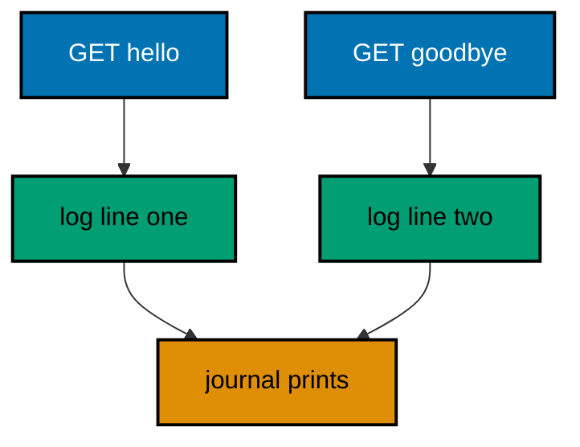

**`learning/code/ex-33-request-logger-emits-json-lines/Main.java`**:

```java
// Example 33: Request Logger Emits JSON Lines.
// Operators read logs with machines, so each request becomes one JSON
// object on its own line: method, path, and status, never timestamps or
// thread names. A middleware appends the entry after the route answers,
// and the check prints the collected lines as the golden output.
// (Concepts: co-02, co-13.)
import io.vertx.core.Vertx;
import io.vertx.core.http.HttpMethod;
import io.vertx.core.json.JsonObject;
import io.vertx.ext.web.Router;
import io.vertx.ext.web.client.WebClient;
import java.util.ArrayList;
import java.util.List;

public class Main {

  // log appends one JSON line per request to the shared journal.
  // No clock, no thread: the line holds only request facts (co-13).
  static void log(List<String> journal, String method, String path, int status) { // => the facts of one request
    // JsonObject.encode() fixes key order: the bytes are stable across runs.
    journal.add(new JsonObject().put("method", method).put("path", path).put("status", status).encode()); // => one machine-readable line
  }

  // buildRouter wires the service with a logging middleware plus two routes.
  // The logger runs after the route: it records the status the route set.
  static Router buildRouter(Vertx vertx, List<String> journal) { // => the journal the middleware writes
    // An empty table first: logging middleware plus two routes follow.
    Router router = Router.router(vertx); // => vertx creates routers bound to it
    // addBodyEndHandler runs when the response ends: the status is final then.
    router.route().handler(ctx -> {
      String method = ctx.request().method().name(); // => "GET" (type: String)
      String path = ctx.request().path(); // => "/hello" (type: String)
      ctx.addBodyEndHandler(done -> log(journal, method, path, ctx.response().getStatusCode())); // => logged at response end
      ctx.next(); // => the route runs next; logging waits for its end
    });
    // Two routes give the journal two lines: the order matches the checks.
    router.get("/hello").handler(ctx -> ctx.response()
      .putHeader("content-type", "application/json") // => the body is JSON (co-04)
      .end("{\"message\":\"hello, vertx\"}")); // => 200 plus the greeting contract
    router.get("/goodbye").handler(ctx -> ctx.response()
      .setStatusCode(404) // => 404 names the absence deliberately
      .putHeader("content-type", "application/json") // => failures parse like successes
      .end("{\"error\":{\"code\":404,\"message\":\"not found\"}}")); // => 404 inside the error contract
    // Hand the wired table back to the caller.
    return router;
  }

  // check serves one request in-process; the journal holds the proof.
  // The golden lines come from the journal, not from the responses.
  static void check(WebClient client, int port, String method, String target) throws Exception {
    // A server-side request needs no socket: method, port, host, and path suffice.
    var request = client.request(HttpMethod.valueOf(method), port, "127.0.0.1", target);
    // The response body is discarded: this example asserts the log, not the reply.
    request.send().toCompletionStage().toCompletableFuture().join(); // => the middleware logs at response end
  }

  public static void main(String[] args) throws Exception {
    // One event loop carries both the server and the client below.
    Vertx vertx = Vertx.vertx(); // => vertx() boots the runtime this process shares
    List<String> journal = new ArrayList<>(); // => the machine-readable log, two lines by the end
    Router router = buildRouter(vertx, journal); // => the service under test, wired by its builder
    // Port zero asks the operating system for a free loopback port.
    // Reading it back keeps fixed ports out of every example (co-09).
    int port = vertx.createHttpServer().requestHandler(router).listen(0, "127.0.0.1")
      .toCompletionStage().toCompletableFuture().join().actualPort(); // => the assigned port the client will drive
    // The client talks through loopback, never leaving this process.
    WebClient client = WebClient.create(vertx); // => one client serves every check
    check(client, port, "GET", "/hello"); // => logged: {"method":"GET","path":"/hello","status":200}
    check(client, port, "GET", "/goodbye"); // => logged: {"method":"GET","path":"/goodbye","status":404}
    // The journal prints after both requests: log order matches check order.
    for (String line : journal) { // => two lines, one per request above
      System.out.println("log " + line); // => Output: log {"method":"GET","path":"/hello","status":200}
    }
    // The pool shuts down: nothing in flight is cut.
    client.close();
    // The loop stops after every check printed, so no output is lost (co-08).
    vertx.close().toCompletionStage().toCompletableFuture().join();
  }
}
```

**Output** (`learning/code/ex-33-request-logger-emits-json-lines/expected/main.stdout.txt`):

```text
log {"method":"GET","path":"/hello","status":200}
log {"method":"GET","path":"/goodbye","status":404}
```

**Key takeaway**: Log one JSON object per request at response end; facts only, never clocks or threads.

**Why it matters**: Machine-readable logs turn operations into queries instead of archaeology. Method, path, and status per line let dashboards count, alert, and trace without parsing prose, while the absence of timestamps keeps tests deterministic.

---

### Example 34: CORS Headers Open the API

Browsers block cross-origin reads unless the server opts in, and the opt-in is three headers: origin, methods, and headers. A middleware stamps them on every answer and short-circuits preflight OPTIONS with 204, so browser clients pass the check. The API declares its guests explicitly.

This example asserts the stamps on both preflight and real calls, proving browsers see permission either way.

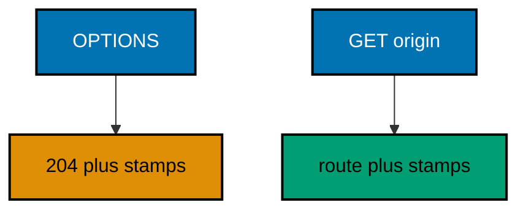

**`learning/code/ex-34-cors-headers-open-the-api/Main.java`**:

```java
// Example 34: CORS Headers Open the API.
// Browsers block cross-origin reads unless the server opts in, and the
// opt-in is three headers: origin, methods, and headers. A middleware
// stamps them on every answer and short-circuits preflight OPTIONS with
// 204, so browser clients pass the check. This example asserts the stamps.
// (Concepts: co-02, co-04.)
import io.vertx.core.Vertx;
import io.vertx.core.http.HttpMethod;
import io.vertx.ext.web.Router;
import io.vertx.ext.web.client.WebClient;

public class Main {

  // buildRouter wires the service with CORS middleware plus one route.
  // The stamps ride every response: preflight and real calls alike (co-02).
  static Router buildRouter(Vertx vertx) {
    // An empty table first: the stamp middleware plus one route follow.
    Router router = Router.router(vertx); // => vertx creates routers bound to it
    // Preflight never reaches the route: OPTIONS ends here with 204.
    router.route().handler(ctx -> {
      ctx.response()
        .putHeader("access-control-allow-origin", "*") // => every origin may read (co-04)
        .putHeader("access-control-allow-methods", "GET,POST,OPTIONS") // => the verbs this API speaks
        .putHeader("access-control-allow-headers", "content-type,authorization"); // => the headers callers may send
      // OPTIONS asks permission; other verbs ask for content.
      if (ctx.request().method() == HttpMethod.OPTIONS) { // => the preflight branch
        ctx.response().setStatusCode(204).end(); // => permission granted, no body
        return; // => no next(): the route stays silent for preflight
      }
      ctx.next(); // => real calls continue to the route below
    });
    // The route answers content: the stamps were added before it ran.
    router.get("/gadgets").handler(ctx -> ctx.response()
      .putHeader("content-type", "application/json") // => the body is JSON (co-04)
      .end("{\"gadgets\":[]}")); // => 200 with the empty collection
    // Hand the wired table back to the caller.
    return router;
  }

  // check serves one request and prints status plus the CORS stamps.
  // The stamps are the contract: browsers enforce them, tests pin them.
  static void check(WebClient client, int port, String method) throws Exception {
    // The browser's preflight carries an Origin the server must bless.
    var response = client.request(HttpMethod.valueOf(method), port, "127.0.0.1", "/gadgets") // => OPTIONS or GET under test
      .putHeader("origin", "https://app.example") // => the foreign origin under test
      .send().toCompletionStage().toCompletableFuture().join(); // => the middleware stamps, then answers
    String origin = response.getHeader("access-control-allow-origin"); // => "*" (type: String)
    String methods = response.getHeader("access-control-allow-methods"); // => "GET,POST,OPTIONS" (type: String)
    // One golden line: the verb, the status, and the two stamps that matter.
    System.out.println(method + " /gadgets -> " + response.statusCode() + " allow-origin=" + origin + " allow-methods=" + methods); // => Output: OPTIONS /gadgets -> 204 allow-origin=* allow-methods=GET,POST,OPTIONS
  }

  public static void main(String[] args) throws Exception {
    // One event loop carries both the server and the client below.
    Vertx vertx = Vertx.vertx(); // => vertx() boots the runtime this process shares
    Router router = buildRouter(vertx); // => the service under test, wired by its builder
    // Port zero asks the operating system for a free loopback port.
    // Reading it back keeps fixed ports out of every example (co-09).
    int port = vertx.createHttpServer().requestHandler(router).listen(0, "127.0.0.1")
      .toCompletionStage().toCompletableFuture().join().actualPort(); // => the assigned port the client will drive
    // The client talks through loopback, never leaving this process.
    WebClient client = WebClient.create(vertx); // => one client serves every check
    check(client, port, "OPTIONS"); // => Output: OPTIONS /gadgets -> 204 allow-origin=* allow-methods=GET,POST,OPTIONS
    check(client, port, "GET"); // => Output: GET /gadgets -> 200 allow-origin=* allow-methods=GET,POST,OPTIONS
    // The pool shuts down: nothing in flight is cut.
    client.close();
    // The loop stops after every check printed, so no output is lost (co-08).
    vertx.close().toCompletionStage().toCompletableFuture().join();
  }
}
```

**Output** (`learning/code/ex-34-cors-headers-open-the-api/expected/main.stdout.txt`):

```text
OPTIONS /gadgets -> 204 allow-origin=* allow-methods=GET,POST,OPTIONS
GET /gadgets -> 200 allow-origin=* allow-methods=GET,POST,OPTIONS
```

**Key takeaway**: Stamp allow-origin, allow-methods, and allow-headers on every answer; end preflight with 204.

**Why it matters**: Explicit CORS turns browser security from a wall into a guest list. Declared origins keep the API open to its own frontends while staying closed to strangers, and the stamps make the policy testable instead of tribal.

---

### Example 35: Constructor Wires a Service

Handlers stay thin when the logic lives in a service the route receives. The builder takes the service as a parameter — no globals, no lookups — so the same handler serves any service handed to it. Dependencies arrive through the door, visible in the signature.

This example greets through a service instead of a literal, proving the handler renders whatever the service answers.

**`learning/code/ex-35-constructor-wires-a-service/Main.java`**:

```java
// Example 35: Constructor Wires a Service.
// Handlers stay thin when the logic lives in a service the route receives.
// The builder takes the service as a parameter — no globals, no lookups —
// so the same handler serves any service handed to it. This example greets
// through a service instead of a literal.
// (Concepts: co-01, co-06.)
import io.vertx.core.Vertx;
import io.vertx.core.http.HttpMethod;
import io.vertx.ext.web.Router;
import io.vertx.ext.web.client.WebClient;

public class Main {

  // GadgetService owns the greeting the handler serves.
  // Logic lives here; the handler below only translates HTTP (co-06).
  static class GadgetService { // => the dependency the route receives
    // The message is fixed for this course: services still own their data.
    String greet() { // => no arguments: the service holds what it needs
      return "hello, vertx"; // => the greeting every route serves (type: String)
    }
  }

  // buildRouter wires the service with the service it needs.
  // Parameters carry dependencies: nothing is looked up or global (co-06).
  static Router buildRouter(Vertx vertx, GadgetService service) { // => the service under test, handed in
    // An empty table first: the service-backed route below is its only row.
    Router router = Router.router(vertx); // => vertx creates routers bound to it
    // The handler translates: HTTP in, service call, JSON out.
    router.get("/hello").handler(ctx -> ctx.response()
      .putHeader("content-type", "application/json") // => the body is JSON (co-04)
      .end("{\"message\":\"" + service.greet() + "\"}")); // => the service answer, rendered
    // Hand the wired table back to the caller.
    return router;
  }

  // check serves one request in-process and prints its status line.
  // The client and the server share one JVM: no real network (co-09).
  static void check(WebClient client, int port, String method, String target) throws Exception {
    // A server-side request needs no socket: method, port, host, and path suffice.
    var request = client.request(HttpMethod.valueOf(method), port, "127.0.0.1", target);
    // The full pipeline runs, then answers: routing, service, and response.
    var response = request.send().toCompletionStage().toCompletableFuture().join();
    String text = response.bodyAsString(); // => the exact bytes the handler wrote
    // An empty body still needs a visible marker, or the line ends mid-air.
    String shown = (text == null || text.isEmpty()) ? "(empty body)" : text;
    // One golden line per request: method, path, status, and body.
    System.out.println(method + " " + target + " -> " + response.statusCode() + " " + shown); // => Output: GET /hello -> 200 {"message":"hello, vertx"}
  }

  public static void main(String[] args) throws Exception {
    // One event loop carries both the server and the client below.
    Vertx vertx = Vertx.vertx(); // => vertx() boots the runtime this process shares
    // The composition root: services are built here, then handed to routers.
    GadgetService service = new GadgetService(); // => the one service this example needs
    Router router = buildRouter(vertx, service); // => wiring, with the dependency explicit
    // Port zero asks the operating system for a free loopback port.
    // Reading it back keeps fixed ports out of every example (co-09).
    int port = vertx.createHttpServer().requestHandler(router).listen(0, "127.0.0.1")
      .toCompletionStage().toCompletableFuture().join().actualPort(); // => the assigned port the client will drive
    // The client talks through loopback, never leaving this process.
    WebClient client = WebClient.create(vertx); // => one client serves every check
    check(client, port, "GET", "/hello"); // => Output: GET /hello -> 200 {"message":"hello, vertx"}
    // The pool shuts down: nothing in flight is cut.
    client.close();
    // The loop stops after every check printed, so no output is lost (co-08).
    vertx.close().toCompletionStage().toCompletableFuture().join();
  }
}
```

**Output** (`learning/code/ex-35-constructor-wires-a-service/expected/main.stdout.txt`):

```text
GET /hello -> 200 {"message":"hello, vertx"}
```

**Key takeaway**: Pass services as builder parameters; handlers translate HTTP while services own logic.

**Why it matters**: Explicit wiring makes dependencies reviewable and replaceable. A signature that names its service tells the next reader what the route needs, and tests swap the service without touching the route.

---

### Example 36: Service Holds the State

Routes translate; services remember. An in-memory store behind the service keeps gadgets across requests, so a POST followed by a GET proves the state survived the round trip. State lives behind the seam, never in the handler, which keeps routes stateless while the service remembers.

This example creates gadget 1 and reads it back through the same store, proving the write landed where reads find it.

**`learning/code/ex-36-service-holds-the-state/Main.java`**:

```java
// Example 36: Service Holds the State.
// Routes translate; services remember. An in-memory store behind the
// service keeps gadgets across requests, so a POST followed by a GET
// proves the state survived the round trip. This example creates gadget 1
// and reads it back through the same service instance.
// (Concepts: co-03, co-06.)
import io.vertx.core.Vertx;
import io.vertx.core.http.HttpMethod;
import io.vertx.core.json.JsonObject;
import io.vertx.ext.web.Router;
import io.vertx.ext.web.client.WebClient;
import io.vertx.ext.web.handler.BodyHandler;
import java.util.LinkedHashMap;
import java.util.Map;

public class Main {

  // GadgetStore remembers gadgets by id across requests.
  // LinkedHashMap keeps insertion order: listings read oldest first (co-06).
  static class GadgetStore { // => the state the service owns
    private final Map<Integer, String> gadgets = new LinkedHashMap<>(); // => id to name, in creation order

    // create stores one gadget under the next id and returns that id.
    // Size plus one is the next id: single-threaded tests keep it exact.
    int create(String name) { // => name arrives validated from the handler
      int id = gadgets.size() + 1; // => 1 for the first gadget (type: int)
      gadgets.put(id, name); // => remembered across requests from here on
      return id; // => the address the handler renders
    }

    // byId reads one gadget back, or null when no gadget owns the id.
    // Null means absent: the handler turns it into a 404 (co-05).
    String byId(int id) { // => id arrives parsed from the path
      return gadgets.get(id); // => the name, or null for unknown ids
    }
  }

  // buildRouter wires the service with the store it needs.
  // Two routes share one store: state lives behind both (co-06).
  static Router buildRouter(Vertx vertx, GadgetStore store) { // => the state under test, handed in
    // An empty table first: middleware plus creation and lookup follow.
    Router router = Router.router(vertx); // => vertx creates routers bound to it
    // The same middleware decodes every body: creation reads the result.
    router.route().handler(BodyHandler.create()); // => bytes become a JsonObject
    // Creation stores through the service, then renders the new address.
    router.post("/gadgets").handler(ctx -> {
      String name = ctx.body().asJsonObject().getString("name", "unnamed"); // => the gadget to remember (type: String)
      int id = store.create(name); // => 1 for the first gadget (type: int)
      ctx.response()
        .setStatusCode(201) // => 201 names the creation (co-04)
        .putHeader("content-type", "application/json") // => the body is JSON
        .end(new JsonObject().put("id", id).encode()); // => the new address
    });
    // Lookup reads through the same store: POST then GET round-trips state.
    router.get("/gadgets/:id").handler(ctx -> {
      int id = Integer.parseInt(ctx.pathParam("id")); // => "1" becomes 1 (type: int)
      String name = store.byId(id); // => "drill" after the creation above
      // Absent means 404: the store's null becomes the HTTP absence.
      if (name == null) { // => unknown ids land here
        ctx.response()
          .setStatusCode(404) // => 404 names the absence (co-05)
          .putHeader("content-type", "application/json") // => failures parse like successes
          .end("{\"error\":{\"code\":404,\"message\":\"not found\"}}"); // => the stable error contract
        return; // => the handler is done: nothing is rendered below
      }
      ctx.response()
        .putHeader("content-type", "application/json") // => the body stays JSON
        .end(new JsonObject().put("id", id).put("name", name).encode()); // => the remembered gadget
    });
    // Hand the wired table back to the caller.
    return router;
  }

  // check posts or gets through the store and prints the status line.
  // Creation then lookup proves state survived the round trip (co-09).
  static void check(WebClient client, int port) throws Exception {
    // Creation first: the store is empty until this call lands.
    var created = client.post(port, "127.0.0.1", "/gadgets") // => POST names the verb under test
      .sendJsonObject(new JsonObject().put("name", "drill")) // => the gadget to remember
      .toCompletionStage().toCompletableFuture().join(); // => the store holds one gadget now
    System.out.println("POST /gadgets -> " + created.statusCode() + " " + created.bodyAsString()); // => Output: POST /gadgets -> 201 {"id":1}
    // Lookup second: the same store answers through the GET route.
    var found = client.get(port, "127.0.0.1", "/gadgets/1") // => GET reads the remembered gadget
      .send().toCompletionStage().toCompletableFuture().join(); // => the round trip completes here
    System.out.println("GET /gadgets/1 -> " + found.statusCode() + " " + found.bodyAsString()); // => Output: GET /gadgets/1 -> 200 {"id":1,"name":"drill"}
  }

  public static void main(String[] args) throws Exception {
    // One event loop carries both the server and the client below.
    Vertx vertx = Vertx.vertx(); // => vertx() boots the runtime this process shares
    // The composition root: one store built here, shared by both routes.
    GadgetStore store = new GadgetStore(); // => empty until the POST lands
    Router router = buildRouter(vertx, store); // => wiring, with the state explicit
    // Port zero asks the operating system for a free loopback port.
    // Reading it back keeps fixed ports out of every example (co-09).
    int port = vertx.createHttpServer().requestHandler(router).listen(0, "127.0.0.1")
      .toCompletionStage().toCompletableFuture().join().actualPort(); // => the assigned port the client will drive
    // The client talks through loopback, never leaving this process.
    WebClient client = WebClient.create(vertx); // => one client serves every check
    check(client, port); // => runs creation then lookup against one store
    // The pool shuts down: nothing in flight is cut.
    client.close();
    // The loop stops after every check printed, so no output is lost (co-08).
    vertx.close().toCompletionStage().toCompletableFuture().join();
  }
}
```

**Output** (`learning/code/ex-36-service-holds-the-state/expected/main.stdout.txt`):

```text
POST /gadgets -> 201 {"id":1}
GET /gadgets/1 -> 200 {"id":1,"name":"drill"}
```

**Key takeaway**: Services own state across requests; POST writes and GET reads prove the seam holds.

**Why it matters**: Stateful services behind stateless routes separate memory from translation. The split lets storage evolve — map today, database tomorrow — without touching a single route, because handlers only ever speak the seam.

---

### Example 37: One Router, Many Services

Real services compose several domains, each with its own service. The builder takes both and mounts each under its group, so gadgets and orders evolve independently behind one router. Domains stay separate while the table stays one, which keeps cross-domain review possible without cross-domain coupling.

This example serves both groups from two services through one table, proving each domain answers its own count.

**`learning/code/ex-37-one-router-many-services/Main.java`**:

```java
// Example 37: One Router, Many Services.
// Real services compose several domains, each with its own service. The
// builder takes both and mounts each under its group, so gadgets and orders
// evolve independently behind one router. This example serves both groups
// from two services through one table.
// (Concepts: co-06, co-11.)
import io.vertx.core.Vertx;
import io.vertx.core.http.HttpMethod;
import io.vertx.ext.web.Router;
import io.vertx.ext.web.client.WebClient;

public class Main {

  // GadgetService answers the gadget group with a fixed collection.
  // One domain, one service: groups evolve without touching each other.
  static class GadgetService { // => the gadget domain, standing alone
    // count names how many gadgets the group reports.
    int count() { // => no arguments: the service holds its answer
      return 2; // => the fixed collection size (type: int)
    }
  }

  // OrderService answers the order group with a fixed collection.
  // A second domain proves the router composes services, not routes (co-06).
  static class OrderService { // => the order domain, standing alone
    // count names how many orders the group reports.
    int count() { // => no arguments: the service holds its answer
      return 3; // => the fixed collection size (type: int)
    }
  }

  // buildRouter wires the service with both services it needs.
  // Groups mount per service: domains stay separate behind one table (co-11).
  static Router buildRouter(Vertx vertx, GadgetService gadgets, OrderService orders) { // => both domains, handed in
    // An empty table first: two groups mount below, nothing else.
    Router router = Router.router(vertx); // => vertx creates routers bound to it
    // The gadget group serves the gadget service's answer.
    Router api = Router.router(vertx); // => the group both domains share below
    api.get("/gadgets").handler(ctx -> ctx.response()
      .putHeader("content-type", "application/json") // => the body is JSON (co-04)
      .end("{\"gadgets\":" + gadgets.count() + "}")); // => 2, from the gadget service
    // The order group serves the order service's answer.
    api.get("/orders").handler(ctx -> ctx.response()
      .putHeader("content-type", "application/json") // => the body stays JSON
      .end("{\"orders\":" + orders.count() + "}")); // => 3, from the order service
    // One mount carries both groups: composition at the table level.
    router.route("/api/*").subRouter(api); // => /api/gadgets and /api/orders resolve
    // Hand the wired table back to the caller.
    return router;
  }

  // check serves one request in-process and prints its status line.
  // The client and the server share one JVM: no real network (co-09).
  static void check(WebClient client, int port, String method, String target) throws Exception {
    // A server-side request needs no socket: method, port, host, and path suffice.
    var request = client.request(HttpMethod.valueOf(method), port, "127.0.0.1", target);
    // The full pipeline runs, then answers: routing, services, and response.
    var response = request.send().toCompletionStage().toCompletableFuture().join();
    String text = response.bodyAsString(); // => the exact bytes the handler wrote
    // An empty body still needs a visible marker, or the line ends mid-air.
    String shown = (text == null || text.isEmpty()) ? "(empty body)" : text;
    // One golden line per request: method, path, status, and body.
    System.out.println(method + " " + target + " -> " + response.statusCode() + " " + shown); // => Output: GET /api/gadgets -> 200 {"gadgets":2}
  }

  public static void main(String[] args) throws Exception {
    // One event loop carries both the server and the client below.
    Vertx vertx = Vertx.vertx(); // => vertx() boots the runtime this process shares
    // The composition root: one service per domain, built side by side.
    GadgetService gadgets = new GadgetService(); // => the gadget domain
    OrderService orders = new OrderService(); // => the order domain
    Router router = buildRouter(vertx, gadgets, orders); // => wiring, with both dependencies explicit
    // Port zero asks the operating system for a free loopback port.
    // Reading it back keeps fixed ports out of every example (co-09).
    int port = vertx.createHttpServer().requestHandler(router).listen(0, "127.0.0.1")
      .toCompletionStage().toCompletableFuture().join().actualPort(); // => the assigned port the client will drive
    // The client talks through loopback, never leaving this process.
    WebClient client = WebClient.create(vertx); // => one client serves every check
    check(client, port, "GET", "/api/gadgets"); // => Output: GET /api/gadgets -> 200 {"gadgets":2}
    check(client, port, "GET", "/api/orders"); // => Output: GET /api/orders -> 200 {"orders":3}
    // The pool shuts down: nothing in flight is cut.
    client.close();
    // The loop stops after every check printed, so no output is lost (co-08).
    vertx.close().toCompletionStage().toCompletableFuture().join();
  }
}
```

**Output** (`learning/code/ex-37-one-router-many-services/expected/main.stdout.txt`):

```text
GET /api/gadgets -> 200 {"gadgets":2}
GET /api/orders -> 200 {"orders":3}
```

**Key takeaway**: One builder takes every domain service; groups mount per service behind one table.

**Why it matters**: Multi-service routers let domains evolve on separate schedules while sharing infrastructure. Gadget releases stop waiting for order reviews, yet the composed table still shows the whole API to anyone auditing the surface.

---

### Example 38: Fake Service Makes Handlers Testable

Handlers behind an interface accept any implementation, including a fake that answers on rails. The test wires the fake, so the handler logic is proven without the real service's weight. Seams turn slow integration tests into fast unit proofs.

This example serves the gadget count through a fake fixed at seven, proving the handler renders whatever the seam answers.

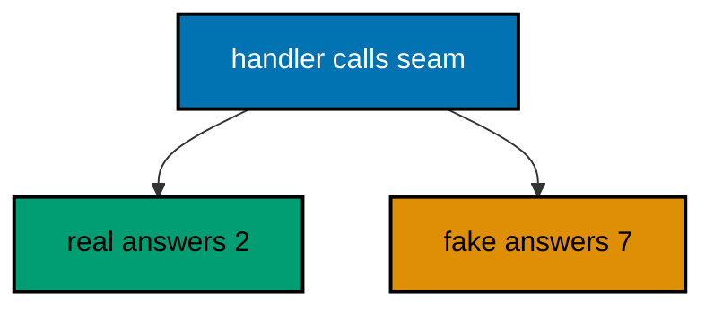

**`learning/code/ex-38-fake-service-makes-handlers-testable/Main.java`**:

```java
// Example 38: Fake Service Makes Handlers Testable.
// Handlers behind an interface accept any implementation, including a fake
// that answers on rails. The test wires the fake, so the handler logic is
// proven without the real service's weight. This example serves the gadget
// count through a fake fixed at seven.
// (Concepts: co-06, co-09.)
import io.vertx.core.Vertx;
import io.vertx.core.http.HttpMethod;
import io.vertx.ext.web.Router;
import io.vertx.ext.web.client.WebClient;

public class Main {

  // Counter names the one operation the handler needs from any service.
  // Interfaces keep handlers honest: they declare exactly what they use.
  interface Counter { // => the seam the fake implements
    // count answers how many gadgets exist right now.
    int count(); // => the handler's only need from the service
  }

  // RealCounter answers from a fixed collection, standing in for storage.
  // Production would query a database here; the shape stays identical.
  static class RealCounter implements Counter { // => the production implementation
    public int count() { // => must be public: it implements the interface
      return 2; // => the stored collection size (type: int)
    }
  }

  // FakeCounter answers on rails: seven, always, with no storage behind it.
  // Tests wire this one: handler logic is proven without a database (co-09).
  static class FakeCounter implements Counter { // => the test implementation
    public int count() { // => must be public: it implements the interface
      return 7; // => the canned answer the test asserts (type: int)
    }
  }

  // buildRouter wires the service with whatever counter it receives.
  // The handler depends on the interface: real and fake both fit (co-06).
  static Router buildRouter(Vertx vertx, Counter counter) { // => the seam, handed in
    // An empty table first: the counter-backed route below is its only row.
    Router router = Router.router(vertx); // => vertx creates routers bound to it
    // The handler calls the seam: it cannot tell real from fake.
    router.get("/gadgets").handler(ctx -> ctx.response()
      .putHeader("content-type", "application/json") // => the body is JSON (co-04)
      .end("{\"gadgets\":" + counter.count() + "}")); // => 7 through the fake, 2 through the real
    // Hand the wired table back to the caller.
    return router;
  }

  // check serves one request in-process and prints its status line.
  // The client and the server share one JVM: no real network (co-09).
  static void check(WebClient client, int port, String method, String target) throws Exception {
    // A server-side request needs no socket: method, port, host, and path suffice.
    var request = client.request(HttpMethod.valueOf(method), port, "127.0.0.1", target);
    // The full pipeline runs, then answers: routing, the fake, and response.
    var response = request.send().toCompletionStage().toCompletableFuture().join();
    String text = response.bodyAsString(); // => the exact bytes the handler wrote
    // An empty body still needs a visible marker, or the line ends mid-air.
    String shown = (text == null || text.isEmpty()) ? "(empty body)" : text;
    // One golden line per request: method, path, status, and body.
    System.out.println(method + " " + target + " -> " + response.statusCode() + " " + shown); // => Output: GET /gadgets -> 200 {"gadgets":7}
  }

  public static void main(String[] args) throws Exception {
    // One event loop carries both the server and the client below.
    Vertx vertx = Vertx.vertx(); // => vertx() boots the runtime this process shares
    // The test wires the fake: handler logic is proven without storage.
    Counter counter = new FakeCounter(); // => seven, on rails, every time
    Router router = buildRouter(vertx, counter); // => wiring, with the seam explicit
    // Port zero asks the operating system for a free loopback port.
    // Reading it back keeps fixed ports out of every example (co-09).
    int port = vertx.createHttpServer().requestHandler(router).listen(0, "127.0.0.1")
      .toCompletionStage().toCompletableFuture().join().actualPort(); // => the assigned port the client will drive
    // The client talks through loopback, never leaving this process.
    WebClient client = WebClient.create(vertx); // => one client serves every check
    check(client, port, "GET", "/gadgets"); // => Output: GET /gadgets -> 200 {"gadgets":7}
    // The pool shuts down: nothing in flight is cut.
    client.close();
    // The loop stops after every check printed, so no output is lost (co-08).
    vertx.close().toCompletionStage().toCompletableFuture().join();
  }
}
```

**Output** (`learning/code/ex-38-fake-service-makes-handlers-testable/expected/main.stdout.txt`):

```text
GET /gadgets -> 200 {"gadgets":7}
```

**Key takeaway**: Depend on interfaces; fakes prove handler logic without storage or networks.

**Why it matters**: Fakes make handler tests instant and hermetic: no database, no waiting, no flakes. Logic proven against a fake stays proven when the real service swaps in, because the handler never knew which one it called.

---

### Example 39: Config Object Carries Limits

Magic numbers scatter; a config object gathers them in one place with names. The paging limit clamps to the configured maximum, so callers asking for a million rows get the ceiling instead of an outage. Policy lives in data the root builds, not in literals handlers hide.

This example caps the page at ten through a config built at the root, proving the default holds bare and the ceiling holds giants.

**`learning/code/ex-39-config-object-carries-limits/Main.java`**:

```java
// Example 39: Config Object Carries Limits.
// Magic numbers scatter; a config object gathers them in one place with
// names. The paging limit clamps to the configured maximum, so callers
// asking for a million rows get the ceiling instead of an outage. This
// example caps the page at ten through a config built at the root.
// (Concepts: co-03, co-06.)
import io.vertx.core.Vertx;
import io.vertx.core.http.HttpMethod;
import io.vertx.ext.web.Router;
import io.vertx.ext.web.client.WebClient;

public class Main {

  // PageConfig gathers the paging rules in one named place.
  // Records carry config: immutable, transparent, and tiny (co-15).
  record PageConfig(int defaultLimit, int maxLimit) { // => the two numbers every list honors
  }

  // limitOf clamps the caller's ask to the configured ceiling.
  // Broken input falls to the default: the list stays total (co-10).
  static int limitOf(PageConfig config, java.util.List<String> values) { // => values hold the raw strings
    int asked; // => assigned below from the caller's value or the default
    try {
      asked = (values == null || values.isEmpty()) ? config.defaultLimit() : Integer.parseInt(values.get(0)); // => the caller's ask, or the default
    } catch (NumberFormatException bad) { // => "many" cannot become a number
      asked = config.defaultLimit(); // => broken input degrades to the default
    }
    // The ceiling holds for giants and negatives alike: one clamp covers both.
    return Math.min(Math.max(asked, 1), config.maxLimit()); // => within 1..maxLimit, always (type: int)
  }

  // buildRouter wires the service with the config it needs.
  // Config arrives as a parameter: routes never hard-code limits (co-06).
  static Router buildRouter(Vertx vertx, PageConfig config) { // => the limits under test, handed in
    // An empty table first: the capped list below is its only row.
    Router router = Router.router(vertx); // => vertx creates routers bound to it
    // One clamped read keeps the handler to two lines of real logic.
    router.get("/gadgets").handler(ctx -> {
      int limit = limitOf(config, ctx.queryParam("limit")); // => capped at config.maxLimit() (type: int)
      ctx.response()
        .putHeader("content-type", "application/json") // => the body is JSON (co-04)
        .end("{\"limit\":" + limit + "}"); // => the honored limit, never the raw ask
    });
    // Hand the wired table back to the caller.
    return router;
  }

  // check serves one request in-process and prints its status line.
  // The client and the server share one JVM: no real network (co-09).
  static void check(WebClient client, int port, String method, String target) throws Exception {
    // A server-side request needs no socket: method, port, host, and path suffice.
    var request = client.request(HttpMethod.valueOf(method), port, "127.0.0.1", target);
    // The full pipeline runs, then answers: routing, the clamp, and response.
    var response = request.send().toCompletionStage().toCompletableFuture().join();
    String text = response.bodyAsString(); // => the exact bytes the handler wrote
    // An empty body still needs a visible marker, or the line ends mid-air.
    String shown = (text == null || text.isEmpty()) ? "(empty body)" : text;
    // One golden line per request: method, path, status, and body.
    System.out.println(method + " " + target + " -> " + response.statusCode() + " " + shown); // => Output: GET /gadgets -> 200 {"limit":5}
  }

  public static void main(String[] args) throws Exception {
    // One event loop carries both the server and the client below.
    Vertx vertx = Vertx.vertx(); // => vertx() boots the runtime this process shares
    // The composition root: limits are decided here, honored everywhere.
    PageConfig config = new PageConfig(5, 10); // => default 5, ceiling 10
    Router router = buildRouter(vertx, config); // => wiring, with the limits explicit
    // Port zero asks the operating system for a free loopback port.
    // Reading it back keeps fixed ports out of every example (co-09).
    int port = vertx.createHttpServer().requestHandler(router).listen(0, "127.0.0.1")
      .toCompletionStage().toCompletableFuture().join().actualPort(); // => the assigned port the client will drive
    // The client talks through loopback, never leaving this process.
    WebClient client = WebClient.create(vertx); // => one client serves every check
    check(client, port, "GET", "/gadgets"); // => Output: GET /gadgets -> 200 {"limit":5}
    check(client, port, "GET", "/gadgets?limit=1000000"); // => Output: GET /gadgets?limit=1000000 -> 200 {"limit":10}
    // The pool shuts down: nothing in flight is cut.
    client.close();
    // The loop stops after every check printed, so no output is lost (co-08).
    vertx.close().toCompletionStage().toCompletableFuture().join();
  }
}
```

**Output** (`learning/code/ex-39-config-object-carries-limits/expected/main.stdout.txt`):

```text
GET /gadgets -> 200 {"limit":5}
GET /gadgets?limit=1000000 -> 200 {"limit":10}
```

**Key takeaway**: Gather policy in config objects built at the root; handlers honor limits they never hard-code.

**Why it matters**: Named config turns capacity policy into reviewable data instead of scattered literals. Raising the ceiling is one edit in one place, and every route honors it, which beats auditing every handler for its own private maximum.

---

### Example 40: Repository Hides the Map

Handlers should not know where gadgets sleep: a map today, a database tomorrow. A repository interface hides the storage, and the handler speaks only save and find. Storage decisions stay behind the seam while handlers keep their shape across migrations.

This example stores through the seam and reads back without ever naming the map, proving behavior outlives implementation.

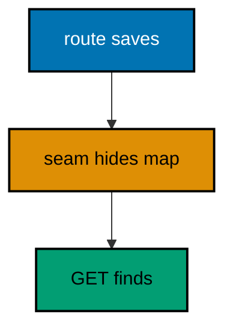

**`learning/code/ex-40-repository-hides-the-map/Main.java`**:

```java
// Example 40: Repository Hides the Map.
// Handlers should not know where gadgets sleep: a map today, a database
// tomorrow. A repository interface hides the storage, and the handler
// speaks only save and find. This example stores through the interface
// and reads back without ever naming the map.
// (Concepts: co-06, co-15.)
import io.vertx.core.Vertx;
import io.vertx.core.http.HttpMethod;
import io.vertx.core.json.JsonObject;
import io.vertx.ext.web.Router;
import io.vertx.ext.web.client.WebClient;
import io.vertx.ext.web.handler.BodyHandler;
import java.util.LinkedHashMap;
import java.util.Map;

public class Main {

  // Gadget names the stored row: id plus name, nothing else.
  // Records carry rows: the boundary type is explicit and typed (co-15).
  record Gadget(int id, String name) { // => the shape storage returns
  }

  // Gadgets names the storage seam: save one, find one by id.
  // Handlers program to this interface: maps and databases both fit.
  interface Gadgets { // => the seam storage implements
    // save stores one gadget and returns its assigned id.
    int save(String name); // => the id the handler renders

    // find reads one gadget back, or null when the id is unknown.
    Gadget find(int id); // => null means absent: the handler maps it to 404
  }

  // MemoryGadgets keeps gadgets in a map behind the seam.
  // The map is private: only the seam's two verbs are visible (co-06).
  static class MemoryGadgets implements Gadgets { // => the map-backed storage
    private final Map<Integer, String> rows = new LinkedHashMap<>(); // => id to name, oldest first

    public int save(String name) { // => must be public: it implements the seam
      int id = rows.size() + 1; // => 1 for the first gadget (type: int)
      rows.put(id, name); // => remembered behind the seam from here on
      return id; // => the assigned address
    }

    public Gadget find(int id) { // => must be public: it implements the seam
      String name = rows.get(id); // => null for unknown ids
      // Null stays null: absence is the handler's decision, not storage's.
      return (name == null) ? null : new Gadget(id, name); // => the typed row, or null
    }
  }

  // buildRouter wires the service with the repository it needs.
  // Storage hides behind the seam: the handler never names the map (co-06).
  static Router buildRouter(Vertx vertx, Gadgets gadgets) { // => the storage under test, handed in
    // An empty table first: middleware plus save and find follow.
    Router router = Router.router(vertx); // => vertx creates routers bound to it
    // The same middleware decodes every body: saving reads the result.
    router.route().handler(BodyHandler.create()); // => bytes become a JsonObject
    // Save speaks the seam: no map is named in this handler.
    router.post("/gadgets").handler(ctx -> {
      String name = ctx.body().asJsonObject().getString("name", "unnamed"); // => the gadget to store (type: String)
      int id = gadgets.save(name); // => 1 for the first gadget (type: int)
      ctx.response()
        .setStatusCode(201) // => 201 names the creation (co-04)
        .putHeader("content-type", "application/json") // => the body is JSON
        .end(new JsonObject().put("id", id).encode()); // => the new address
    });
    // Find speaks the seam too: storage could be a database tomorrow.
    router.get("/gadgets/:id").handler(ctx -> {
      int id = Integer.parseInt(ctx.pathParam("id")); // => "1" becomes 1 (type: int)
      Gadget gadget = gadgets.find(id); // => the typed row, or null
      // The seam's null becomes the HTTP absence: one mapping, in one place.
      if (gadget == null) { // => unknown ids land here
        ctx.response()
          .setStatusCode(404) // => 404 names the absence (co-05)
          .putHeader("content-type", "application/json") // => failures parse like successes
          .end("{\"error\":{\"code\":404,\"message\":\"not found\"}}"); // => the stable error contract
        return; // => the handler is done: nothing is rendered below
      }
      ctx.response()
        .putHeader("content-type", "application/json") // => the body stays JSON
        .end(new JsonObject().put("id", gadget.id()).put("name", gadget.name()).encode()); // => the typed row rendered
    });
    // Hand the wired table back to the caller.
    return router;
  }

  // check saves then finds through the seam and prints both lines.
  // Storage hides: the checks prove behavior, never the map (co-09).
  static void check(WebClient client, int port) throws Exception {
    // Save first: the seam is empty until this call lands.
    var saved = client.post(port, "127.0.0.1", "/gadgets") // => POST names the verb under test
      .sendJsonObject(new JsonObject().put("name", "drill")) // => the gadget to store
      .toCompletionStage().toCompletableFuture().join(); // => the seam holds one row now
    System.out.println("POST /gadgets -> " + saved.statusCode() + " " + saved.bodyAsString()); // => Output: POST /gadgets -> 201 {"id":1}
    // Find second: the same seam answers through the GET route.
    var found = client.get(port, "127.0.0.1", "/gadgets/1") // => GET reads the stored row
      .send().toCompletionStage().toCompletableFuture().join(); // => the round trip completes here
    System.out.println("GET /gadgets/1 -> " + found.statusCode() + " " + found.bodyAsString()); // => Output: GET /gadgets/1 -> 200 {"id":1,"name":"drill"}
  }

  public static void main(String[] args) throws Exception {
    // One event loop carries both the server and the client below.
    Vertx vertx = Vertx.vertx(); // => vertx() boots the runtime this process shares
    // The composition root: storage is built here, hidden behind the seam.
    Gadgets gadgets = new MemoryGadgets(); // => a map today, a database tomorrow
    Router router = buildRouter(vertx, gadgets); // => wiring, with the storage explicit
    // Port zero asks the operating system for a free loopback port.
    // Reading it back keeps fixed ports out of every example (co-09).
    int port = vertx.createHttpServer().requestHandler(router).listen(0, "127.0.0.1")
      .toCompletionStage().toCompletableFuture().join().actualPort(); // => the assigned port the client will drive
    // The client talks through loopback, never leaving this process.
    WebClient client = WebClient.create(vertx); // => one client serves every check
    check(client, port); // => runs save then find against one seam
    // The pool shuts down: nothing in flight is cut.
    client.close();
    // The loop stops after every check printed, so no output is lost (co-08).
    vertx.close().toCompletionStage().toCompletableFuture().join();
  }
}
```

**Output** (`learning/code/ex-40-repository-hides-the-map/expected/main.stdout.txt`):

```text
POST /gadgets -> 201 {"id":1}
GET /gadgets/1 -> 200 {"id":1,"name":"drill"}
```

**Key takeaway**: Program handlers to the repository seam; storage swaps behind an unchanged interface.

**Why it matters**: Hidden storage migrates without handler rewrites. The map-to-database move touches one class behind the seam instead of every route that ever stored a gadget, which is the difference between a weekend migration and a quarter-long rewrite.

---

### Example 41: Clock Injection Freezes Time

Handlers that read the clock print a different answer every run, and golden tests cannot pin a moving target. A clock behind a seam answers a fixed instant in tests and the real clock in production. Time becomes a dependency like any service: handed in, frozen in tests, honest in production.

This example stamps creations with a frozen instant, proving the stamp reads identical every run.

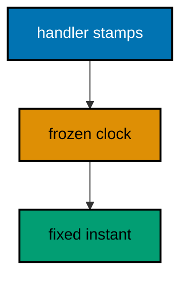

**`learning/code/ex-41-clock-injection-freezes-time/Main.java`**:

```java
// Example 41: Clock Injection Freezes Time.
// Handlers that read the clock print a different answer every run, and
// golden tests cannot pin a moving target. A clock behind a seam answers a
// fixed instant in tests and the real clock in production. This example
// stamps creations with a frozen instant, byte-identical every run.
// (Concepts: co-06, co-09.)
import io.vertx.core.Vertx;
import io.vertx.core.http.HttpMethod;
import io.vertx.core.json.JsonObject;
import io.vertx.ext.web.Router;
import io.vertx.ext.web.client.WebClient;
import io.vertx.ext.web.handler.BodyHandler;

public class Main {

  // Clock names the time seam: now answers the current instant as text.
  // Tests freeze it; production wires the real clock behind this seam.
  interface Clock { // => the seam time hides behind
    // now answers the current instant in ISO text.
    String now(); // => the stamp every creation carries
  }

  // FrozenClock answers one instant forever: the test double under test.
  // Deterministic by construction: golden output never moves (co-09).
  static class FrozenClock implements Clock { // => the test implementation
    public String now() { // => must be public: it implements the seam
      return "2026-01-01T00:00:00Z"; // => the frozen instant every creation stamps
    }
  }

  // buildRouter wires the service with the clock it needs.
  // The stamp comes from the seam: the handler never reads the clock (co-06).
  static Router buildRouter(Vertx vertx, Clock clock) { // => time, handed in
    // An empty table first: middleware plus one creation follow.
    Router router = Router.router(vertx); // => vertx creates routers bound to it
    // The same middleware decodes every body: creation reads the result.
    router.route().handler(BodyHandler.create()); // => bytes become a JsonObject
    // The stamp is a service answer, not a wall-clock read: frozen in tests.
    router.post("/gadgets").handler(ctx -> {
      String name = ctx.body().asJsonObject().getString("name", "unnamed"); // => the gadget to stamp (type: String)
      ctx.response()
        .setStatusCode(201) // => 201 names the creation (co-04)
        .putHeader("content-type", "application/json") // => the body is JSON
        .end(new JsonObject().put("name", name).put("createdAt", clock.now()).encode()); // => the frozen stamp, every run
    });
    // Hand the wired table back to the caller.
    return router;
  }

  // check creates one gadget in-process and prints its status line.
  // The stamp is asserted: frozen time makes the line golden (co-09).
  static void check(WebClient client, int port) throws Exception {
    // Creation carries the stamp: the only clock in this program is frozen.
    var response = client.post(port, "127.0.0.1", "/gadgets") // => POST names the verb under test
      .sendJsonObject(new JsonObject().put("name", "drill")) // => the gadget to stamp
      .toCompletionStage().toCompletableFuture().join(); // => the pipeline runs, then answers
    String text = response.bodyAsString(); // => the exact bytes the handler wrote
    // One golden line: status plus the body with its frozen stamp.
    System.out.println("POST /gadgets -> " + response.statusCode() + " " + text); // => Output: POST /gadgets -> 201 {"name":"drill","createdAt":"2026-01-01T00:00:00Z"}
  }

  public static void main(String[] args) throws Exception {
    // One event loop carries both the server and the client below.
    Vertx vertx = Vertx.vertx(); // => vertx() boots the runtime this process shares
    // The test wires the frozen clock: golden output never moves.
    Clock clock = new FrozenClock(); // => 2026-01-01 forever in this program
    Router router = buildRouter(vertx, clock); // => wiring, with time explicit
    // Port zero asks the operating system for a free loopback port.
    // Reading it back keeps fixed ports out of every example (co-09).
    int port = vertx.createHttpServer().requestHandler(router).listen(0, "127.0.0.1")
      .toCompletionStage().toCompletableFuture().join().actualPort(); // => the assigned port the client will drive
    // The client talks through loopback, never leaving this process.
    WebClient client = WebClient.create(vertx); // => one client serves every check
    check(client, port); // => Output: POST /gadgets -> 201 {"name":"drill","createdAt":"2026-01-01T00:00:00Z"}
    // The pool shuts down: nothing in flight is cut.
    client.close();
    // The loop stops after every check printed, so no output is lost (co-08).
    vertx.close().toCompletionStage().toCompletableFuture().join();
  }
}
```

**Output** (`learning/code/ex-41-clock-injection-freezes-time/expected/main.stdout.txt`):

```text
POST /gadgets -> 201 {"name":"drill","createdAt":"2026-01-01T00:00:00Z"}
```

**Key takeaway**: Inject clocks as seams; tests freeze time while handlers stamp from the seam.

**Why it matters**: Frozen time makes temporal behavior testable: creation stamps, expiries, and schedules assert exactly. Without the seam every time-dependent test either flakes or avoids time entirely, leaving the riskiest logic uncovered.

---

### Example 42: ID Generator Orders Creations

Creation order is data worth keeping: the first gadget is 1, the second is 2, and gaps would confuse clients. A sequence counter hands out ids in order, and the handler renders each one. Atomic counters stay correct under overlap, so concurrent creations never collide or skip.

This example creates three gadgets and prints the ordered ids, proving the sequence never repeats.

**`learning/code/ex-42-id-generator-orders-creations/Main.java`**:

```java
// Example 42: ID Generator Orders Creations.
// Creation order is data worth keeping: the first gadget is 1, the second
// is 2, and gaps would confuse clients. A sequence counter hands out ids
// in order, and the handler renders each one. This example creates three
// gadgets and prints the ordered ids.
// (Concepts: co-03, co-06.)
import io.vertx.core.Vertx;
import io.vertx.core.json.JsonObject;
import io.vertx.ext.web.Router;
import io.vertx.ext.web.client.WebClient;
import io.vertx.ext.web.handler.BodyHandler;
import java.util.concurrent.atomic.AtomicLong;

public class Main {

  // buildRouter wires the service with the sequence it needs.
  // The counter is a dependency like any service: handed in, not global.
  static Router buildRouter(Vertx vertx, AtomicLong sequence) { // => the id source, handed in
    // An empty table first: middleware plus one creation follow.
    Router router = Router.router(vertx); // => vertx creates routers bound to it
    // The same middleware decodes every body: creation reads the result.
    router.route().handler(BodyHandler.create()); // => bytes become a JsonObject
    // incrementAndGet hands the next id: atomic, so concurrent posts stay ordered.
    router.post("/gadgets").handler(ctx -> {
      String name = ctx.body().asJsonObject().getString("name", "unnamed"); // => the gadget to number (type: String)
      long id = sequence.incrementAndGet(); // => 1, then 2, then 3 in this program (type: long)
      ctx.response()
        .setStatusCode(201) // => 201 names the creation (co-04)
        .putHeader("content-type", "application/json") // => the body is JSON
        .end(new JsonObject().put("id", id).put("name", name).encode()); // => the ordered address
    });
    // Hand the wired table back to the caller.
    return router;
  }

  // check creates three gadgets in-process and prints each address.
  // Order is the contract: the ids must read 1, 2, 3 (co-09).
  static void check(WebClient client, int port) throws Exception {
    // Three creations in a row: the sequence must not skip or repeat.
    String[] names = {"alpha", "beta", "gamma"}; // => three gadgets, created in this order
    // Each creation prints its own line: the golden output is the order.
    for (String name : names) { // => alpha, then beta, then gamma
      var response = client.post(port, "127.0.0.1", "/gadgets") // => POST names the verb under test
        .sendJsonObject(new JsonObject().put("name", name)) // => the gadget to number
        .toCompletionStage().toCompletableFuture().join(); // => the sequence advances once per post
      System.out.println("POST /gadgets " + name + " -> " + response.statusCode() + " " + response.bodyAsString()); // => Output: POST /gadgets alpha -> 201 {"id":1,...}
    }
  }

  public static void main(String[] args) throws Exception {
    // One event loop carries both the server and the client below.
    Vertx vertx = Vertx.vertx(); // => vertx() boots the runtime this process shares
    // The composition root: the sequence starts at zero, first creation is 1.
    AtomicLong sequence = new AtomicLong(0); // => ordered ids from here on
    Router router = buildRouter(vertx, sequence); // => wiring, with the counter explicit
    // Port zero asks the operating system for a free loopback port.
    // Reading it back keeps fixed ports out of every example (co-09).
    int port = vertx.createHttpServer().requestHandler(router).listen(0, "127.0.0.1")
      .toCompletionStage().toCompletableFuture().join().actualPort(); // => the assigned port the client will drive
    // The client talks through loopback, never leaving this process.
    WebClient client = WebClient.create(vertx); // => one client serves every check
    check(client, port); // => Output: three creations with ids 1, 2, 3 in order
    // The pool shuts down: nothing in flight is cut.
    client.close();
    // The loop stops after every check printed, so no output is lost (co-08).
    vertx.close().toCompletionStage().toCompletableFuture().join();
  }
}
```

**Output** (`learning/code/ex-42-id-generator-orders-creations/expected/main.stdout.txt`):

```text
POST /gadgets alpha -> 201 {"id":1,"name":"alpha"}
POST /gadgets beta -> 201 {"id":2,"name":"beta"}
POST /gadgets gamma -> 201 {"id":3,"name":"gamma"}
```

**Key takeaway**: Hand out ids from an atomic sequence; creation order becomes addressable data.

**Why it matters**: Ordered gap-free ids keep clients and operators oriented: the nth creation is id n. Atomic sequences preserve that invariant under concurrency, where a size-plus-one counter would duplicate ids at the worst moment.

---

### Example 43: Service Errors Become 404s

Services speak their own errors — unknown id, duplicate name — and the handler translates each one to HTTP. A NotFound from the service becomes a 404 with the error contract, while the handler stays free of storage details. Translation lives in exactly one place per route.

This example looks up a missing gadget through the seam, proving the service absence becomes the HTTP absence.

**`learning/code/ex-43-service-errors-become-404s/Main.java`**:

```java
// Example 43: Service Errors Become 404s.
// Services speak their own errors — unknown id, duplicate name — and the
// handler translates each one to HTTP. A NotFound from the service becomes
// a 404 with the error contract, while the handler stays free of storage
// details. This example looks up a missing gadget through the seam.
// (Concepts: co-05, co-06.)
import io.vertx.core.Vertx;
import io.vertx.core.http.HttpMethod;
import io.vertx.core.json.JsonObject;
import io.vertx.ext.web.Router;
import io.vertx.ext.web.client.WebClient;

public class Main {

  // NotFound is the service's own absence: storage-agnostic by design.
  // Services throw domain errors; handlers translate them to HTTP (co-05).
  static class NotFound extends RuntimeException { // => the absence the service names
    NotFound(int id) { // => id names the gadget nobody stores
      super("gadget " + id + " not found"); // => the domain message handlers render
    }
  }

  // Gadgets names the lookup seam: find or throw, never null.
  // Throwing beats null: callers handle absence instead of forgetting it.
  interface Gadgets { // => the seam storage implements
    // find reads one gadget back, or throws NotFound when it is unknown.
    JsonObject find(int id); // => throws NotFound for unknown ids
  }

  // EmptyGadgets stores nothing: every lookup throws, by construction.
  // The smallest honest storage: absence is the only behavior to translate.
  static class EmptyGadgets implements Gadgets { // => the lookup target under test
    public JsonObject find(int id) { // => must be public: it implements the seam
      throw new NotFound(id); // => unknown, always: the store is empty
    }
  }

  // buildRouter wires the service with the storage seam it needs.
  // Translation lives in the handler: services never name HTTP codes (co-06).
  static Router buildRouter(Vertx vertx, Gadgets gadgets) { // => the seam under test, handed in
    // An empty table first: the translating lookup below is its only row.
    Router router = Router.router(vertx); // => vertx creates routers bound to it
    // The try answers the seam's error in HTTP: NotFound becomes 404.
    router.get("/gadgets/:id").handler(ctx -> {
      int id = Integer.parseInt(ctx.pathParam("id")); // => "9" becomes 9 (type: int)
      JsonObject gadget; // => assigned below, or the handler answers 404
      try {
        gadget = gadgets.find(id); // => throws NotFound for the missing gadget
      } catch (NotFound missing) { // => the service absence, translated here
        ctx.response()
          .setStatusCode(404) // => 404 names the absence (co-05)
          .putHeader("content-type", "application/json") // => failures parse like successes
          .end("{\"error\":{\"code\":404,\"message\":\"" + missing.getMessage() + "\"}}"); // => the domain message, rendered
        return; // => the handler is done: the error contract went out
      }
      ctx.response()
        .putHeader("content-type", "application/json") // => the body is JSON (co-04)
        .end(gadget.encode()); // => the found gadget, unreachable in this example
    });
    // Hand the wired table back to the caller.
    return router;
  }

  // check serves one request in-process and prints its status line.
  // The client and the server share one JVM: no real network (co-09).
  static void check(WebClient client, int port, String method, String target) throws Exception {
    // A server-side request needs no socket: method, port, host, and path suffice.
    var request = client.request(HttpMethod.valueOf(method), port, "127.0.0.1", target);
    // The seam throws inside the pipeline: the translator answers 404.
    var response = request.send().toCompletionStage().toCompletableFuture().join();
    String text = response.bodyAsString(); // => the exact bytes the handler wrote
    // An empty body still needs a visible marker, or the line ends mid-air.
    String shown = (text == null || text.isEmpty()) ? "(empty body)" : text;
    // One golden line per request: method, path, status, and body.
    System.out.println(method + " " + target + " -> " + response.statusCode() + " " + shown); // => Output: GET /gadgets/9 -> 404 {"error":{...}}
  }

  public static void main(String[] args) throws Exception {
    // One event loop carries both the server and the client below.
    Vertx vertx = Vertx.vertx(); // => vertx() boots the runtime this process shares
    // The composition root: empty storage, so the lookup must throw.
    Gadgets gadgets = new EmptyGadgets(); // => absence, by construction
    Router router = buildRouter(vertx, gadgets); // => wiring, with the seam explicit
    // Port zero asks the operating system for a free loopback port.
    // Reading it back keeps fixed ports out of every example (co-09).
    int port = vertx.createHttpServer().requestHandler(router).listen(0, "127.0.0.1")
      .toCompletionStage().toCompletableFuture().join().actualPort(); // => the assigned port the client will drive
    // The client talks through loopback, never leaving this process.
    WebClient client = WebClient.create(vertx); // => one client serves every check
    check(client, port, "GET", "/gadgets/9"); // => Output: GET /gadgets/9 -> 404 {"error":{"code":404,"message":"gadget 9 not found"}}
    // The pool shuts down: nothing in flight is cut.
    client.close();
    // The loop stops after every check printed, so no output is lost (co-08).
    vertx.close().toCompletionStage().toCompletableFuture().join();
  }
}
```

**Output** (`learning/code/ex-43-service-errors-become-404s/expected/main.stdout.txt`):

```text
GET /gadgets/9 -> 404 {"error":{"code":404,"message":"gadget 9 not found"}}
```

**Key takeaway**: Services throw domain errors; handlers translate each one to its HTTP contract.

**Why it matters**: Domain errors keep services reusable across transports: the same NotFound serves HTTP today and a queue consumer tomorrow. Translation at the handler edge means neither layer learns the other's vocabulary, which is what lets both evolve.

---

### Example 44: Wiring Lives in One Builder

Composition roots beat scattered news: one builder takes every service and returns the finished router, so main reads like a parts list. New domains add one parameter and one mount, never a hunt through handlers. Wiring is a first-class decision with a first-class home.

This example assembles gadgets plus a health check in a single builder, proving the parts list stays three lines.

**`learning/code/ex-44-wiring-lives-in-one-builder/Main.java`**:

```java
// Example 44: Wiring Lives in One Builder.
// Composition roots beat scattered news: one builder takes every service
// and returns the finished router, so main reads like a parts list. New
// domains add one parameter and one mount, never a hunt through handlers.
// This example assembles gadgets plus a health check in a single builder.
// (Concepts: co-06, co-11.)
import io.vertx.core.Vertx;
import io.vertx.core.http.HttpMethod;
import io.vertx.ext.web.Router;
import io.vertx.ext.web.client.WebClient;

public class Main {

  // GadgetService answers the gadget group with a fixed collection.
  // One domain, one service: the builder composes them below (co-06).
  static class GadgetService { // => the gadget domain, standing alone
    // count names how many gadgets the group reports.
    int count() { // => no arguments: the service holds its answer
      return 2; // => the fixed collection size (type: int)
    }
  }

  // Health answers readiness with a fixed flag: the simplest service.
  // Even one-liners are services: the builder treats every domain alike.
  static class Health { // => the readiness domain, standing alone
    // ready names whether the service accepts traffic right now.
    boolean ready() { // => no arguments: the answer is fixed here
      return true; // => ready from the first request (type: boolean)
    }
  }

  // buildRouter is the composition root: every service enters here.
  // One builder, one router: main stays a three-line parts list (co-06).
  static Router buildRouter(Vertx vertx, GadgetService gadgets, Health health) { // => every domain, handed in
    // An empty table first: groups mount below, nothing else.
    Router router = Router.router(vertx); // => vertx creates routers bound to it
    // The gadget group serves its service behind the shared prefix.
    Router api = Router.router(vertx); // => the group both domains share below
    api.get("/gadgets").handler(ctx -> ctx.response()
      .putHeader("content-type", "application/json") // => the body is JSON (co-04)
      .end("{\"gadgets\":" + gadgets.count() + "}")); // => 2, from the gadget service
    // The health endpoint is a domain too: readiness behind the same table.
    api.get("/healthz").handler(ctx -> ctx.response()
      .putHeader("content-type", "application/json") // => the body stays JSON
      .end("{\"ready\":" + health.ready() + "}")); // => true, from the health service
    // One mount carries the group: composition at the table level (co-11).
    router.route("/api/*").subRouter(api); // => /api/gadgets and /api/healthz resolve
    // Hand the wired table back to the caller.
    return router;
  }

  // check serves one request in-process and prints its status line.
  // The client and the server share one JVM: no real network (co-09).
  static void check(WebClient client, int port, String method, String target) throws Exception {
    // A server-side request needs no socket: method, port, host, and path suffice.
    var request = client.request(HttpMethod.valueOf(method), port, "127.0.0.1", target);
    // The full pipeline runs, then answers: routing, services, and response.
    var response = request.send().toCompletionStage().toCompletableFuture().join();
    String text = response.bodyAsString(); // => the exact bytes the handler wrote
    // An empty body still needs a visible marker, or the line ends mid-air.
    String shown = (text == null || text.isEmpty()) ? "(empty body)" : text;
    // One golden line per request: method, path, status, and body.
    System.out.println(method + " " + target + " -> " + response.statusCode() + " " + shown); // => Output: GET /api/gadgets -> 200 {"gadgets":2}
  }

  public static void main(String[] args) throws Exception {
    // One event loop carries both the server and the client below.
    Vertx vertx = Vertx.vertx(); // => vertx() boots the runtime this process shares
    // The parts list: one service per domain, built in the open.
    GadgetService gadgets = new GadgetService(); // => the gadget domain
    Health health = new Health(); // => the readiness domain
    Router router = buildRouter(vertx, gadgets, health); // => one builder assembles the service
    // Port zero asks the operating system for a free loopback port.
    // Reading it back keeps fixed ports out of every example (co-09).
    int port = vertx.createHttpServer().requestHandler(router).listen(0, "127.0.0.1")
      .toCompletionStage().toCompletableFuture().join().actualPort(); // => the assigned port the client will drive
    // The client talks through loopback, never leaving this process.
    WebClient client = WebClient.create(vertx); // => one client serves every check
    check(client, port, "GET", "/api/gadgets"); // => Output: GET /api/gadgets -> 200 {"gadgets":2}
    check(client, port, "GET", "/api/healthz"); // => Output: GET /api/healthz -> 200 {"ready":true}
    // The pool shuts down: nothing in flight is cut.
    client.close();
    // The loop stops after every check printed, so no output is lost (co-08).
    vertx.close().toCompletionStage().toCompletableFuture().join();
  }
}
```

**Output** (`learning/code/ex-44-wiring-lives-in-one-builder/expected/main.stdout.txt`):

```text
GET /api/gadgets -> 200 {"gadgets":2}
GET /api/healthz -> 200 {"ready":true}
```

**Key takeaway**: One builder takes every service and returns the router; main stays a parts list.

**Why it matters**: Centralized wiring makes the dependency graph visible and auditable. A reviewer reads the builder and knows every service the application needs, instead of discovering hidden construction spread across the codebase.

---

### Example 45: Check Helper Drives One Request

Every test in this course is one helper: build the request, send it, print method, path, status, and body. The helper keeps tests to one line each and the golden output to one line per request. Small consistent atoms compose into suites without new machinery.

This example names the pattern every later example reuses, proving one helper covers one request end to end.

**`learning/code/ex-45-check-helper-drives-one-request/Main.java`**:

```java
// Example 45: Check Helper Drives One Request.
// Every test in this course is one helper: build the request, send it,
// print method, path, status, and body. The helper keeps tests to one line
// each and the golden output to one line per request. This example names
// the pattern every later example reuses without comment.
// (Concepts: co-01, co-09.)
import io.vertx.core.Vertx;
import io.vertx.core.http.HttpMethod;
import io.vertx.ext.web.Router;
import io.vertx.ext.web.client.WebClient;

public class Main {

  // buildRouter wires the service with every route this example serves.
  // Small on purpose: the check helper below is the real subject (co-09).
  static Router buildRouter(Vertx vertx) {
    // An empty table first: one route is enough to demonstrate the helper.
    Router router = Router.router(vertx); // => vertx creates routers bound to it
    // The route answers JSON: the helper prints whatever the route writes.
    router.get("/hello").handler(ctx -> ctx.response()
      .putHeader("content-type", "application/json") // => the body is JSON (co-04)
      .end("{\"message\":\"hello, vertx\"}")); // => 200 plus the greeting contract
    // Hand the wired table back to the caller.
    return router;
  }

  // check is the course's testing atom: one request, one golden line.
  // Tests compose from this helper: tables loop it, stories sequence it.
  static void check(WebClient client, int port, String method, String target) throws Exception {
    // The client and the server share one JVM: no socket, no network (co-09).
    // Nothing here dials a fixed port: the port arrives as an argument.
    var request = client.request(HttpMethod.valueOf(method), port, "127.0.0.1", target); // => server-side request, no socket
    // The full pipeline runs, then answers: routing, handlers, and response.
    var response = request.send().toCompletionStage().toCompletableFuture().join();
    String text = response.bodyAsString(); // => the exact bytes the handler wrote
    // An empty body still needs a visible marker, or the line ends mid-air.
    String shown = (text == null || text.isEmpty()) ? "(empty body)" : text;
    // One golden line per request: method, path, status, and body.
    System.out.println(method + " " + target + " -> " + response.statusCode() + " " + shown); // => Output: GET /hello -> 200 {"message":"hello, vertx"}
  }

  public static void main(String[] args) throws Exception {
    // One event loop carries both the server and the client below.
    Vertx vertx = Vertx.vertx(); // => vertx() boots the runtime this process shares
    Router router = buildRouter(vertx); // => the service under test, wired by its builder
    // Port zero asks the operating system for a free loopback port.
    // Reading it back keeps fixed ports out of every example (co-09).
    int port = vertx.createHttpServer().requestHandler(router).listen(0, "127.0.0.1")
      .toCompletionStage().toCompletableFuture().join().actualPort(); // => the assigned port the client will drive
    // The client talks through loopback, never leaving this process.
    WebClient client = WebClient.create(vertx); // => one client serves every check
    check(client, port, "GET", "/hello"); // => Output: GET /hello -> 200 {"message":"hello, vertx"}
    // The pool shuts down: nothing in flight is cut.
    client.close();
    // The loop stops after every check printed, so no output is lost (co-08).
    vertx.close().toCompletionStage().toCompletableFuture().join();
  }
}
```

**Output** (`learning/code/ex-45-check-helper-drives-one-request/expected/main.stdout.txt`):

```text
GET /hello -> 200 {"message":"hello, vertx"}
```

**Key takeaway**: One check helper per course: send, print the golden line, reuse everywhere.

**Why it matters**: Shared test atoms keep suites uniform and cheap to extend. New behavior adds rows and stories, never new plumbing, which is how a 78-example course stays maintainable instead of collapsing under its own helpers.

---

### Example 46: Table-Driven Paths in One Loop

Copy-pasted checks drift; a table keeps them honest. Each row names a method, a path, and the expected status, and one loop drives every row, printing the actual beside the expectation. Coverage grows by appending rows, never by writing new helpers.

This example covers two routes plus the 404 fallback in three rows, proving tables scale where copies rot.

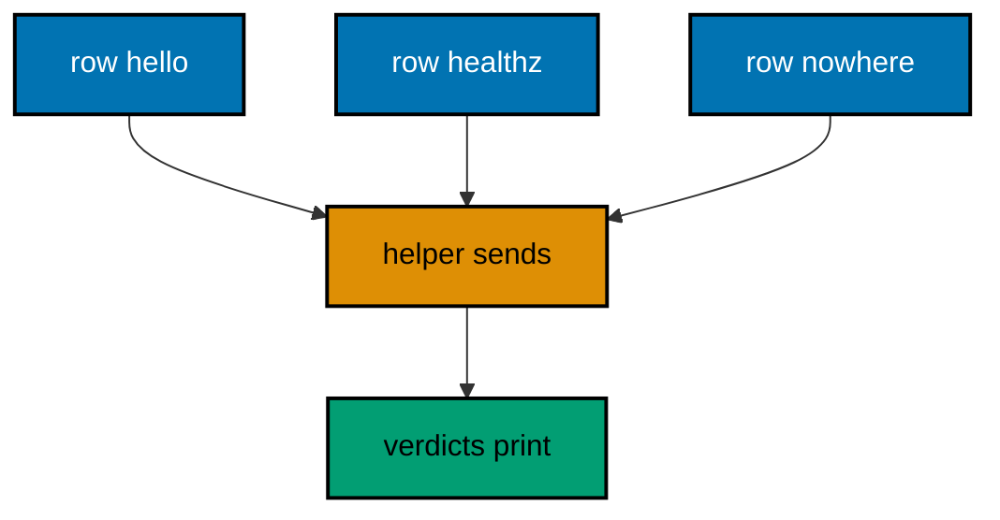

**`learning/code/ex-46-table-driven-paths-in-one-loop/Main.java`**:

```java
// Example 46: Table-Driven Paths in One Loop.
// Copy-pasted checks drift; a table keeps them honest. Each row names a
// method, a path, and the expected status, and one loop drives every row,
// printing the actual line beside the expectation. This example covers
// two routes plus the 404 fallback in three rows.
// (Concepts: co-01, co-09.)
import io.vertx.core.Vertx;
import io.vertx.core.http.HttpMethod;
import io.vertx.ext.web.Router;
import io.vertx.ext.web.client.WebClient;

public class Main {

  // Case names one row of the test table: request plus expectation.
  // Records carry cases: the loop below reads each field by name (co-15).
  record Case(String method, String path, int expected) { // => one row: what to send, what to expect
  }

  // buildRouter wires the service with every route this example serves.
  // Two routes plus the framework fallback: the table expects all three.
  static Router buildRouter(Vertx vertx) {
    // An empty table first: two routes follow, the fallback is automatic.
    Router router = Router.router(vertx); // => vertx creates routers bound to it
    // Both routes answer JSON: the table asserts status, the body rides along.
    router.get("/hello").handler(ctx -> ctx.response()
      .putHeader("content-type", "application/json") // => the body is JSON (co-04)
      .end("{\"message\":\"hello, vertx\"}")); // => 200 plus the greeting contract
    router.get("/healthz").handler(ctx -> ctx.response()
      .putHeader("content-type", "application/json") // => the body stays JSON
      .end("{\"ready\":true}")); // => 200 with the readiness flag
    // Hand the wired table back to the caller.
    return router;
  }

  // check drives one table row and prints actual beside expected.
  // Tables scale: new behavior adds a row, never a new helper (co-09).
  static void check(WebClient client, int port, Case kase) throws Exception {
    // A server-side request needs no socket: method, port, host, and path suffice.
    var request = client.request(HttpMethod.valueOf(kase.method()), port, "127.0.0.1", kase.path()); // => the row's request
    // The full pipeline runs, then answers: routing, handlers, and response.
    var response = request.send().toCompletionStage().toCompletableFuture().join();
    String text = response.bodyAsString(); // => the exact bytes the handler wrote
    // An empty body still needs a visible marker, or the line ends mid-air.
    String shown = (text == null || text.isEmpty()) ? "(empty body)" : text;
    // Actual beside expected: a drift reads as two numbers that differ.
    System.out.println(kase.method() + " " + kase.path() + " -> " + response.statusCode() + " " + shown + " (expected " + kase.expected() + ")"); // => Output: GET /hello -> 200 {...} (expected 200)
  }

  public static void main(String[] args) throws Exception {
    // One event loop carries both the server and the client below.
    Vertx vertx = Vertx.vertx(); // => vertx() boots the runtime this process shares
    Router router = buildRouter(vertx); // => the service under test, wired by its builder
    // Port zero asks the operating system for a free loopback port.
    // Reading it back keeps fixed ports out of every example (co-09).
    int port = vertx.createHttpServer().requestHandler(router).listen(0, "127.0.0.1")
      .toCompletionStage().toCompletableFuture().join().actualPort(); // => the assigned port the client will drive
    // The client talks through loopback, never leaving this process.
    WebClient client = WebClient.create(vertx); // => one client serves every row
    // The table: two known routes plus the fallback every API owns.
    Case[] cases = { // => rows, not code: behavior grows by appending
      new Case("GET", "/hello", 200), // => the greeting route
      new Case("GET", "/healthz", 200), // => the readiness route
      new Case("GET", "/nowhere", 404), // => the fallback every table should pin
    };
    // One loop drives every row: the helper stays untouched as rows grow.
    for (Case kase : cases) { // => hello, healthz, then the fallback
      check(client, port, kase); // => prints actual beside expected per row
    }
    // The pool shuts down: nothing in flight is cut.
    client.close();
    // The loop stops after every check printed, so no output is lost (co-08).
    vertx.close().toCompletionStage().toCompletableFuture().join();
  }
}
```

**Output** (`learning/code/ex-46-table-driven-paths-in-one-loop/expected/main.stdout.txt`):

```text
GET /hello -> 200 {"message":"hello, vertx"} (expected 200)
GET /healthz -> 200 {"ready":true} (expected 200)
GET /nowhere -> 404 <html><body><h1>Resource not found</h1></body></html> (expected 404)
```

**Key takeaway**: Rows name request plus expectation; one loop drives them all through one helper.

**Why it matters**: Tabular tests add coverage at the cost of one line per behavior. New routes enter the table in seconds, and reviewers read the matrix instead of tracing copies, which keeps growing suites honest.

---

### Example 47: Assert Status Then Body

Printing is observing; asserting is testing. A two-step helper checks the status first, then the body, printing PASS with the expectation when both hold. Layered assertions localize failures: status first narrows to the branch, body second pins the contract.

This example asserts the greeting in two verdicts, proving both steps hold for one request.

**`learning/code/ex-47-assert-status-then-body/Main.java`**:

```java
// Example 47: Assert Status Then Body.
// Printing is observing; asserting is testing. A two-step helper checks the
// status first, then the body, printing PASS with the expectation when both
// hold. Failures would print FAIL, but this example's expectations hold, so
// the golden output is three PASS lines.
// (Concepts: co-04, co-09.)
import io.vertx.core.Vertx;
import io.vertx.core.http.HttpMethod;
import io.vertx.ext.web.Router;
import io.vertx.ext.web.client.WebClient;

public class Main {

  // buildRouter wires the service with every route this example serves.
  // Small on purpose: the assertion helper below is the real subject (co-09).
  static Router buildRouter(Vertx vertx) {
    // An empty table first: one route is enough to demonstrate assertions.
    Router router = Router.router(vertx); // => vertx creates routers bound to it
    // The route answers JSON: the helper asserts status, then body.
    router.get("/hello").handler(ctx -> ctx.response()
      .putHeader("content-type", "application/json") // => the body is JSON (co-04)
      .end("{\"message\":\"hello, vertx\"}")); // => 200 plus the greeting contract
    // Hand the wired table back to the caller.
    return router;
  }

  // verdict prints PASS when actual holds, FAIL with both sides otherwise.
  // Failures show their work: expected beside actual, never a bare red line.
  static void verdict(String label, Object expected, Object actual) { // => label names the assertion
    // equals() decides: the golden line pins the outcome either way.
    if (expected.equals(actual)) { // => the passing branch this example prints
      System.out.println("PASS " + label + " == " + expected); // => Output: PASS status == 200
    } else {
      System.out.println("FAIL " + label + ": expected " + expected + " but got " + actual); // => unreachable here, by design
    }
  }

  // check asserts one request in two steps and prints both verdicts.
  // Status first, body second: layered assertions localize failures.
  static void check(WebClient client, int port) throws Exception {
    // A server-side request needs no socket: it never leaves this process.
    var response = client.request(HttpMethod.GET, port, "127.0.0.1", "/hello") // => GET names the verb under test
      .send().toCompletionStage().toCompletableFuture().join(); // => the pipeline runs, then answers
    // Status first: the coarsest assertion localizes the most breakage.
    verdict("status", 200, response.statusCode()); // => 200, as the route promises
    // Body second: the exact contract, asserted byte for byte.
    verdict("body", "{\"message\":\"hello, vertx\"}", response.bodyAsString()); // => the greeting contract, exactly
  }

  public static void main(String[] args) throws Exception {
    // One event loop carries both the server and the client below.
    Vertx vertx = Vertx.vertx(); // => vertx() boots the runtime this process shares
    Router router = buildRouter(vertx); // => the service under test, wired by its builder
    // Port zero asks the operating system for a free loopback port.
    // Reading it back keeps fixed ports out of every example (co-09).
    int port = vertx.createHttpServer().requestHandler(router).listen(0, "127.0.0.1")
      .toCompletionStage().toCompletableFuture().join().actualPort(); // => the assigned port the client will drive
    // The client talks through loopback, never leaving this process.
    WebClient client = WebClient.create(vertx); // => one client serves the assertions
    check(client, port); // => Output: two PASS lines, status then body
    // The pool shuts down: nothing in flight is cut.
    client.close();
    // The loop stops after every check printed, so no output is lost (co-08).
    vertx.close().toCompletionStage().toCompletableFuture().join();
  }
}
```

**Output** (`learning/code/ex-47-assert-status-then-body/expected/main.stdout.txt`):

```text
PASS status == 200
PASS body == {"message":"hello, vertx"}
```

**Key takeaway**: Assert status, then body; print PASS with the expectation or FAIL with both sides.

**Why it matters**: Two-step verdicts turn golden output into a test report instead of a transcript. A failing status points at routing while a failing body points at rendering, which halves the search before the editor even opens.

---

### Example 48: Test the 404 Too

Happy paths pass while the fallback rots: nobody asserts the absence until a client depends on it. A table with known and unknown paths pins the fallback beside the routes, so the 404 contract is tested, not hoped for. Absence is a feature with a test.

This example asserts one known route and one unknown path, proving the fallback holds beside the route.

**`learning/code/ex-48-test-the-404-too/Main.java`**:

```java
// Example 48: Test the 404 Too.
// Happy paths pass while the fallback rots: nobody asserts the absence
// until a client depends on it. A table with known and unknown paths pins
// the fallback beside the routes, so the 404 contract is tested, not
// hoped for. This example asserts one known route and one unknown path.
// (Concepts: co-04, co-09.)
import io.vertx.core.Vertx;
import io.vertx.core.http.HttpMethod;
import io.vertx.core.json.JsonObject;
import io.vertx.ext.web.Router;
import io.vertx.ext.web.client.WebClient;

public class Main {

  // buildRouter wires the service with one route plus a JSON fallback.
  // The fallback is a feature: unknown paths answer the error contract.
  static Router buildRouter(Vertx vertx) {
    // An empty table first: one route plus the fallback catcher follow.
    Router router = Router.router(vertx); // => vertx creates routers bound to it
    // The known route answers the greeting every test expects.
    router.get("/hello").handler(ctx -> ctx.response()
      .putHeader("content-type", "application/json") // => the body is JSON (co-04)
      .end("{\"message\":\"hello, vertx\"}")); // => 200 plus the greeting contract
    // The fallback answers JSON too: absences parse like successes (co-05).
    router.errorHandler(404, ctx -> ctx.response()
      .setStatusCode(404) // => 404 names the absence deliberately
      .putHeader("content-type", "application/json") // => failures parse like successes
      .end(new JsonObject().put("error", new JsonObject().put("code", 404).put("message", "not found")).encode())); // => the absence contract
    // Hand the wired table back to the caller.
    return router;
  }

  // verdict prints PASS when actual holds, FAIL with both sides otherwise.
  // Failures show their work: expected beside actual, never a bare red line.
  static void verdict(String label, Object expected, Object actual) { // => label names the assertion
    // equals() decides: the golden line pins the outcome either way.
    if (expected.equals(actual)) { // => the passing branch this example prints
      System.out.println("PASS " + label + " == " + expected); // => Output: PASS GET /hello status == 200
    } else {
      System.out.println("FAIL " + label + ": expected " + expected + " but got " + actual); // => unreachable here, by design
    }
  }

  // check asserts one path's status and prints the verdict.
  // Known and unknown share the helper: absence is tested, not hoped for.
  static void check(WebClient client, int port, String path, int expected) throws Exception {
    // A server-side request needs no socket: it never leaves this process.
    var response = client.request(HttpMethod.GET, port, "127.0.0.1", path) // => the path under test
      .send().toCompletionStage().toCompletableFuture().join(); // => the route or the fallback answers
    // The label carries the path: two verdicts stay distinguishable in gold.
    verdict("GET " + path + " status", expected, response.statusCode()); // => 200 for hello, 404 for nowhere
  }

  public static void main(String[] args) throws Exception {
    // One event loop carries both the server and the client below.
    Vertx vertx = Vertx.vertx(); // => vertx() boots the runtime this process shares
    Router router = buildRouter(vertx); // => the service under test, wired by its builder
    // Port zero asks the operating system for a free loopback port.
    // Reading it back keeps fixed ports out of every example (co-09).
    int port = vertx.createHttpServer().requestHandler(router).listen(0, "127.0.0.1")
      .toCompletionStage().toCompletableFuture().join().actualPort(); // => the assigned port the client will drive
    // The client talks through loopback, never leaving this process.
    WebClient client = WebClient.create(vertx); // => one client serves both verdicts
    check(client, port, "/hello", 200); // => Output: PASS GET /hello status == 200
    check(client, port, "/nowhere", 404); // => Output: PASS GET /nowhere status == 404
    // The pool shuts down: nothing in flight is cut.
    client.close();
    // The loop stops after every check printed, so no output is lost (co-08).
    vertx.close().toCompletionStage().toCompletableFuture().join();
  }
}
```

**Output** (`learning/code/ex-48-test-the-404-too/expected/main.stdout.txt`):

```text
PASS GET /hello status == 200
PASS GET /nowhere status == 404
```

**Key takeaway**: Pin the fallback in the same table as the routes; unknown paths are asserted behavior.

**Why it matters**: Tested fallbacks survive refactors that untested ones silently lose. A renamed route that breaks the 404 table fails loudly in the suite instead of leaking framework HTML to the first client that mistypes.

---

### Example 49: Post Then Get Proves State

A write test that never reads back proves the request was accepted, not that the state changed. Posting a gadget and then getting it back proves the round trip: the write landed where reads can find it. Acceptance plus proof is the complete write test.

This example creates gadget 1 and reads it back, asserting both halves with verdicts.

**`learning/code/ex-49-post-then-get-proves-state/Main.java`**:

```java
// Example 49: Post Then Get Proves State.
// A write test that never reads back proves the request was accepted, not
// that the state changed. Posting a gadget and then getting it back proves
// the round trip: the write landed where reads can find it. This example
// asserts both halves of one state change.
// (Concepts: co-03, co-09.)
import io.vertx.core.Vertx;
import io.vertx.core.http.HttpMethod;
import io.vertx.core.json.JsonObject;
import io.vertx.ext.web.Router;
import io.vertx.ext.web.client.WebClient;
import io.vertx.ext.web.handler.BodyHandler;
import java.util.LinkedHashMap;
import java.util.Map;

public class Main {

  // buildRouter wires creation plus lookup over one shared map.
  // The map is the state the round trip proves: POST writes, GET reads.
  // LinkedHashMap keeps creation order: listings read oldest first.
  // Handing the map in keeps storage visible in the composition root.
  static Router buildRouter(Vertx vertx, Map<Integer, String> store) { // => the state under test, handed in
    // An empty table first: middleware plus the two halves follow.
    Router router = Router.router(vertx); // => vertx creates routers bound to it
    // The same middleware decodes every body: creation reads the result.
    router.route().handler(BodyHandler.create()); // => bytes become a JsonObject
    // Creation writes the state the lookup below must find.
    router.post("/gadgets").handler(ctx -> {
      String name = ctx.body().asJsonObject().getString("name", "unnamed"); // => the gadget to remember (type: String)
      int id = store.size() + 1; // => 1 for the first gadget (type: int)
      store.put(id, name); // => the write the GET below proves
      ctx.response()
        .setStatusCode(201) // => 201 names the creation (co-04)
        .putHeader("content-type", "application/json") // => the body is JSON
        .end(new JsonObject().put("id", id).encode()); // => the new address
    });
    // Lookup reads the state creation wrote: the round trip completes here.
    router.get("/gadgets/:id").handler(ctx -> {
      int id = Integer.parseInt(ctx.pathParam("id")); // => "1" becomes 1 (type: int)
      ctx.response()
        .putHeader("content-type", "application/json") // => the body stays JSON
        .end(new JsonObject().put("id", id).put("name", store.get(id)).encode()); // => the remembered gadget
    });
    // Hand the wired table back to the caller.
    return router;
  }

  // verdict prints PASS when actual holds, FAIL with both sides otherwise.
  // State assertions read golden: the written value must come back whole.
  static void verdict(String label, Object expected, Object actual) { // => label names the assertion
    // equals() decides: the golden line pins the outcome either way.
    if (expected.equals(actual)) { // => the passing branch this example prints
      System.out.println("PASS " + label + " == " + expected); // => Output: PASS created id == 1
    } else {
      System.out.println("FAIL " + label + ": expected " + expected + " but got " + actual); // => unreachable here, by design
    }
  }

  // check writes one gadget, reads it back, and asserts both halves.
  // Acceptance then proof: the write is asserted, then the state is (co-09).
  static void check(WebClient client, int port) throws Exception {
    // The write half: creation must answer 201 with the new address.
    var created = client.post(port, "127.0.0.1", "/gadgets") // => POST names the verb under test
      .sendJsonObject(new JsonObject().put("name", "drill")) // => the gadget to remember
      .toCompletionStage().toCompletableFuture().join(); // => the store holds one gadget now
    verdict("created id", 1, created.bodyAsJsonObject().getInteger("id")); // => 1 for the first gadget
    // The proof half: the same gadget must read back through GET.
    var found = client.request(HttpMethod.GET, port, "127.0.0.1", "/gadgets/1") // => GET reads the remembered gadget
      .send().toCompletionStage().toCompletableFuture().join(); // => the round trip completes here
    verdict("round-trip name", "drill", found.bodyAsJsonObject().getString("name")); // => the written value, back whole
  }

  public static void main(String[] args) throws Exception {
    // One event loop carries both the server and the client below.
    Vertx vertx = Vertx.vertx(); // => vertx() boots the runtime this process shares
    // The composition root: one store shared by the write half and the proof half.
    Map<Integer, String> store = new LinkedHashMap<>(); // => empty until the POST lands
    Router router = buildRouter(vertx, store); // => wiring, with the state explicit
    // Port zero asks the operating system for a free loopback port.
    // Reading it back keeps fixed ports out of every example (co-09).
    int port = vertx.createHttpServer().requestHandler(router).listen(0, "127.0.0.1")
      .toCompletionStage().toCompletableFuture().join().actualPort(); // => the assigned port the client will drive
    // The client talks through loopback, never leaving this process.
    WebClient client = WebClient.create(vertx); // => one client serves both halves
    check(client, port); // => Output: two PASS lines, write then proof
    // The pool shuts down: nothing in flight is cut.
    client.close();
    // The loop stops after every check printed, so no output is lost (co-08).
    vertx.close().toCompletionStage().toCompletableFuture().join();
  }
}
```

**Output** (`learning/code/ex-49-post-then-get-proves-state/expected/main.stdout.txt`):

```text
PASS created id == 1
PASS round-trip name == drill
```

**Key takeaway**: Write, then read back; assert acceptance and proof as two verdicts.

**Why it matters**: Round-trip tests catch the storage bugs that acceptance tests miss: writes to the wrong key, serialization that loses fields, caches that never fill. Reading back what was written is the cheapest end-to-end proof a stateful route can carry.

---

### Example 50: Validation Cases Share One Table

Validation has many faces — missing fields, wrong types, out-of-bounds values — and each deserves a row, not a new test. A table of bodies with expected statuses drives one loop, so new rules add rows. The table is the validation specification, executable.

This example pins one valid body plus three rejections in four rows, proving each gate fires for its row.

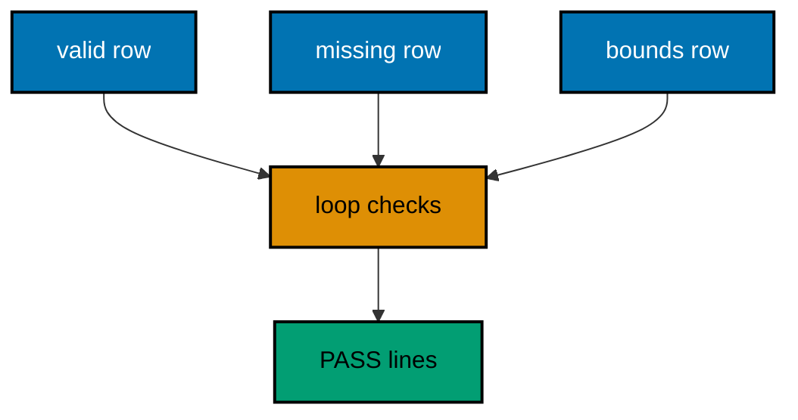

**`learning/code/ex-50-validation-cases-share-one-table/Main.java`**:

```java
// Example 50: Validation Cases Share One Table.
// Validation has many faces — missing fields, wrong types, out-of-bounds
// values — and each deserves a row, not a new test. A table of bodies with
// expected statuses drives one loop, so new rules add rows. This example
// pins one valid body plus three rejections in four rows.
// (Concepts: co-09, co-10.)
import io.vertx.core.Vertx;
import io.vertx.core.json.JsonObject;
import io.vertx.ext.web.Router;
import io.vertx.ext.web.client.WebClient;
import io.vertx.ext.web.handler.BodyHandler;

public class Main {

  // Case names one validation row: the body plus the expected status.
  // Records carry cases: the loop below reads each field by name (co-15).
  record Case(String label, String payload, int expected) { // => one row: what to send, what to expect
  }

  // buildRouter wires the service with one guarded creation.
  // The guard checks presence, type, and bounds before logic runs (co-10).
  // Gates run cheapest first: presence before parsing, parsing before range.
  // Each gate answers the same 422 shape: clients learn one error contract.
  static Router buildRouter(Vertx vertx) {
    // An empty table first: middleware plus the guarded route follow.
    Router router = Router.router(vertx); // => vertx creates routers bound to it
    // The same middleware decodes every body: the guard reads the result.
    router.route().handler(BodyHandler.create()); // => bytes become a JsonObject
    // Three gates in one handler: presence, then range, then logic.
    router.post("/gadgets").handler(ctx -> {
      JsonObject body = ctx.body().asJsonObject(); // => decoded, possibly invalid
      // Presence first: a missing name stops the handler with 422.
      if (!body.containsKey("name")) { // => the presence gate
        ctx.response()
          .setStatusCode(422) // => 422 names an unprocessable body (co-05)
          .putHeader("content-type", "application/json") // => failures parse like successes
          .end("{\"error\":{\"code\":422,\"message\":\"name is required\"}}"); // => what to fix, in the contract
        return; // => the handler is done: the gate held
      }
      int watts = body.getInteger("watts", 0); // => 0 when absent: absent is also out of bounds
      // Range second: watts outside 1..1000 stop here too.
      if (watts < 1 || watts > 1000) { // => the range gate
        ctx.response()
          .setStatusCode(422) // => 422 again: still the caller's fix
          .putHeader("content-type", "application/json") // => the body stays JSON
          .end("{\"error\":{\"code\":422,\"message\":\"watts must be 1..1000\"}}"); // => the bound, in the contract
        return; // => the handler is done: the gate held
      }
      ctx.response()
        .setStatusCode(201) // => 201 names the creation (co-04)
        .putHeader("content-type", "application/json") // => the body stays JSON
        .end(new JsonObject().put("name", body.getString("name")).put("watts", watts).encode()); // => the valid gadget
    });
    // Hand the wired table back to the caller.
    return router;
  }

  // verdict prints PASS when the status holds, FAIL with both sides otherwise.
  // Tables of expectations read golden: one verdict per row, in row order.
  static void check(WebClient client, int port, Case kase) throws Exception {
    // The payload travels as JSON: presence and range decide the status.
    var response = client.post(port, "127.0.0.1", "/gadgets") // => POST names the verb under test
      .sendJsonObject(new JsonObject(kase.payload())) // => the row's body
      .toCompletionStage().toCompletableFuture().join(); // => the guard answers, then logic
    int actual = response.statusCode(); // => the guard's verdict for this row
    // equals() decides: the golden line pins the outcome per row.
    if (actual == kase.expected()) { // => the passing branch this example prints
      System.out.println("PASS " + kase.label() + " -> " + actual); // => Output: PASS valid -> 201
    } else {
      System.out.println("FAIL " + kase.label() + ": expected " + kase.expected() + " but got " + actual); // => unreachable here, by design
    }
  }

  public static void main(String[] args) throws Exception {
    // One event loop carries both the server and the client below.
    Vertx vertx = Vertx.vertx(); // => vertx() boots the runtime this process shares
    Router router = buildRouter(vertx); // => the service under test, wired by its builder
    // Port zero asks the operating system for a free loopback port.
    // Reading it back keeps fixed ports out of every example (co-09).
    int port = vertx.createHttpServer().requestHandler(router).listen(0, "127.0.0.1")
      .toCompletionStage().toCompletableFuture().join().actualPort(); // => the assigned port the client will drive
    // The client talks through loopback, never leaving this process.
    WebClient client = WebClient.create(vertx); // => one client serves every row
    // The table: one valid body plus one rejection per gate.
    Case[] cases = { // => rows, not code: new rules append here
      new Case("valid", "{\"name\":\"drill\",\"watts\":40}", 201), // => passes every gate
      new Case("missing-name", "{\"watts\":40}", 422), // => fails the presence gate
      new Case("watts-low", "{\"name\":\"drill\",\"watts\":0}", 422), // => fails the lower bound
      new Case("watts-high", "{\"name\":\"drill\",\"watts\":1001}", 422), // => fails the upper bound
    };
    // One loop drives every row: the helper stays untouched as rows grow.
    for (Case kase : cases) { // => valid, then the three rejections
      check(client, port, kase); // => prints one verdict per row
    }
    // The pool shuts down: nothing in flight is cut.
    client.close();
    // The loop stops after every check printed, so no output is lost (co-08).
    vertx.close().toCompletionStage().toCompletableFuture().join();
  }
}
```

**Output** (`learning/code/ex-50-validation-cases-share-one-table/expected/main.stdout.txt`):

```text
PASS valid -> 201
PASS missing-name -> 422
PASS watts-low -> 422
PASS watts-high -> 422
```

**Key takeaway**: One table row per validation rule; the loop asserts each body against its expected status.

**Why it matters**: Tabular validation specs grow with the rules instead of the test files. A new constraint adds one row that a reviewer reads in seconds, while the loop guarantees every rule runs on every change.

---

### Example 51: Headers Asserted Like Bodies

Content types are contracts too: a client parsing JSON breaks when the server answers text. Asserting the content type beside the status pins the tongue, not just the words. Headers carry promises that bodies alone cannot keep.

This example asserts JSON for the API and HTML for the page, proving each route speaks its declared tongue.

**`learning/code/ex-51-headers-asserted-like-bodies/Main.java`**:

```java
// Example 51: Headers Asserted Like Bodies.
// Content types are contracts too: a client parsing JSON breaks when the
// server answers text. Asserting the content type beside the status pins
// the tongue, not just the words. This example asserts JSON for the API
// and HTML for the page in two verdicts.
// (Concepts: co-04, co-09.)
import io.vertx.core.Vertx;
import io.vertx.core.http.HttpMethod;
import io.vertx.ext.web.Router;
import io.vertx.ext.web.client.WebClient;

public class Main {

  // buildRouter wires one API route plus one page route.
  // Two tongues, one router: the assertions pin each route's tongue (co-04).
  static Router buildRouter(Vertx vertx) {
    // An empty table first: JSON plus HTML follow on separate paths.
    Router router = Router.router(vertx); // => vertx creates routers bound to it
    // The API answers JSON: parsers depend on this header.
    router.get("/gadgets").handler(ctx -> ctx.response()
      .putHeader("content-type", "application/json") // => the tongue JSON clients parse
      .end("{\"gadgets\":[]}")); // => 200 with the empty collection
    // The page answers HTML: browsers depend on this header.
    router.get("/dashboard").handler(ctx -> ctx.response()
      .putHeader("content-type", "text/html") // => the tongue browsers render
      .end("<html><body><h1>Gadget Dashboard</h1></body></html>")); // => 200 as a page
    // Hand the wired table back to the caller.
    return router;
  }

  // verdict prints PASS when the tongue holds, FAIL with both sides otherwise.
  // Tongue assertions read golden: the header is pinned per route.
  static void check(WebClient client, int port, String path, String expected) throws Exception {
    // A server-side request needs no socket: it never leaves this process.
    var response = client.request(HttpMethod.GET, port, "127.0.0.1", path) // => the route under test
      .send().toCompletionStage().toCompletableFuture().join(); // => the route answers in its tongue
    String actual = response.getHeader("content-type"); // => the tongue the handler served (type: String)
    // equals() decides: the golden line pins the tongue per route.
    if (expected.equals(actual)) { // => the passing branch this example prints
      System.out.println("PASS GET " + path + " content-type == " + expected); // => Output: PASS GET /gadgets content-type == application/json
    } else {
      System.out.println("FAIL GET " + path + " content-type: expected " + expected + " but got " + actual); // => unreachable here, by design
    }
  }

  public static void main(String[] args) throws Exception {
    // One event loop carries both the server and the client below.
    Vertx vertx = Vertx.vertx(); // => vertx() boots the runtime this process shares
    Router router = buildRouter(vertx); // => the service under test, wired by its builder
    // Port zero asks the operating system for a free loopback port.
    // Reading it back keeps fixed ports out of every example (co-09).
    int port = vertx.createHttpServer().requestHandler(router).listen(0, "127.0.0.1")
      .toCompletionStage().toCompletableFuture().join().actualPort(); // => the assigned port the client will drive
    // The client talks through loopback, never leaving this process.
    WebClient client = WebClient.create(vertx); // => one client serves both verdicts
    check(client, port, "/gadgets", "application/json"); // => Output: PASS GET /gadgets content-type == application/json
    check(client, port, "/dashboard", "text/html"); // => Output: PASS GET /dashboard content-type == text/html
    // The pool shuts down: nothing in flight is cut.
    client.close();
    // The loop stops after every check printed, so no output is lost (co-08).
    vertx.close().toCompletionStage().toCompletableFuture().join();
  }
}
```

**Output** (`learning/code/ex-51-headers-asserted-like-bodies/expected/main.stdout.txt`):

```text
PASS GET /gadgets content-type == application/json
PASS GET /dashboard content-type == text/html
```

**Key takeaway**: Assert content types per route; tongues are contracts, not accidents.

**Why it matters**: Pinned tongues catch the middleware misconfigurations that bodies hide. A JSON route answering text still prints the right words, but every parser breaks, so the header assertion guards the integration that body assertions cannot see.

---

### Example 52: One Router, Two Passes

Flaky tests pass once and fail on rerun because state leaks between runs. Serving the same router twice on two ports and asserting both passes proves the handlers hold no state: the second pass reads exactly like the first. Repeatability is a property tests must prove, not assume.

This example checks the greeting in pass 1 and pass 2, proving both verdicts read identical.

**`learning/code/ex-52-one-router-two-passes/Main.java`**:

```java
// Example 52: One Router, Two Passes.
// Flaky tests pass once and fail on rerun because state leaks between
// runs. Serving the same router twice on two ports and asserting both
// passes proves the handlers hold no state: the second pass reads exactly
// like the first. This example checks the greeting in pass 1 and pass 2.
// (Concepts: co-01, co-09.)
import io.vertx.core.Vertx;
import io.vertx.core.http.HttpMethod;
import io.vertx.ext.web.Router;
import io.vertx.ext.web.client.WebClient;

public class Main {

  // buildRouter wires the service with every route this example serves.
  // Stateless by construction: no field, no map, no counter anywhere.
  static Router buildRouter(Vertx vertx) {
    // An empty table first: one stateless route is the whole service.
    Router router = Router.router(vertx); // => vertx creates routers bound to it
    // The answer depends on nothing but the request: reruns are identical.
    router.get("/hello").handler(ctx -> ctx.response()
      .putHeader("content-type", "application/json") // => the body is JSON (co-04)
      .end("{\"message\":\"hello, vertx\"}")); // => 200 plus the greeting contract
    // Hand the wired table back to the caller.
    return router;
  }

  // verdict prints PASS when the body holds, FAIL with both sides otherwise.
  // Two passes print two verdicts: identical lines prove no leakage.
  static void check(WebClient client, int port, int pass) throws Exception {
    // A server-side request needs no socket: it never leaves this process.
    var response = client.request(HttpMethod.GET, port, "127.0.0.1", "/hello") // => the route under test
      .send().toCompletionStage().toCompletableFuture().join(); // => the router answers from scratch
    String actual = response.bodyAsString(); // => the exact bytes the handler wrote
    // equals() decides: the golden lines pin both passes identical.
    if ("{\"message\":\"hello, vertx\"}".equals(actual)) { // => the passing branch this example prints
      System.out.println("PASS pass " + pass + " body == " + actual); // => Output: PASS pass 1 body == {"message":"hello, vertx"}
    } else {
      System.out.println("FAIL pass " + pass + " body: got " + actual); // => unreachable here, by design
    }
  }

  public static void main(String[] args) throws Exception {
    // One event loop carries both servers and the client below.
    Vertx vertx = Vertx.vertx(); // => vertx() boots the runtime this process shares
    Router router = buildRouter(vertx); // => the service under test, wired by its builder
    // Two serves, two ports: the same router answers both passes.
    int first = vertx.createHttpServer().requestHandler(router).listen(0, "127.0.0.1")
      .toCompletionStage().toCompletableFuture().join().actualPort(); // => pass 1 rides this port
    int second = vertx.createHttpServer().requestHandler(router).listen(0, "127.0.0.1")
      .toCompletionStage().toCompletableFuture().join().actualPort(); // => pass 2 rides this port
    // The client talks through loopback, never leaving this process.
    WebClient client = WebClient.create(vertx); // => one client serves both passes
    check(client, first, 1); // => Output: PASS pass 1 body == {"message":"hello, vertx"}
    check(client, second, 2); // => Output: PASS pass 2 body == {"message":"hello, vertx"}
    // The pool shuts down: nothing in flight is cut.
    client.close();
    // The loop stops after every check printed, so no output is lost (co-08).
    vertx.close().toCompletionStage().toCompletableFuture().join();
  }
}
```

**Output** (`learning/code/ex-52-one-router-two-passes/expected/main.stdout.txt`):

```text
PASS pass 1 body == {"message":"hello, vertx"}
PASS pass 2 body == {"message":"hello, vertx"}
```

**Key takeaway**: Serve twice, assert twice; identical passes prove handlers hold no state.

**Why it matters**: Repeatable tests earn trust that one-shot tests borrow. A suite that passes twice in a row rules out ordering and leakage flakiness, which is the class of failure that wastes whole afternoons when it strikes CI.

---

### Example 53: Failing Check Prints the Diff

A bare FAIL wastes the next hour: the reader diffs by hand. A check that prints expected beside actual on mismatch points straight at the drift. Good failure output is a feature of the test, not an afterthought.

This example matches once and mismatches once on purpose, proving the diff format readers will meet on real drift.

**`learning/code/ex-53-failing-check-prints-the-diff/Main.java`**:

```java
// Example 53: Failing Check Prints the Diff.
// A bare FAIL wastes the next hour: the reader diffs by hand. A check that
// prints expected beside actual on mismatch points straight at the drift.
// This example matches once and mismatches once on purpose, and the program
// still exits 0: the diff is the lesson, not a failure.
// (Concepts: co-04, co-09.)
import io.vertx.core.Vertx;
import io.vertx.core.http.HttpMethod;
import io.vertx.ext.web.Router;
import io.vertx.ext.web.client.WebClient;

public class Main {

  // buildRouter wires the service with every route this example serves.
  // Small on purpose: the diff printer below is the real subject (co-09).
  static Router buildRouter(Vertx vertx) {
    // An empty table first: one route is enough to demonstrate the diff.
    Router router = Router.router(vertx); // => vertx creates routers bound to it
    // The route answers JSON: the printer compares against expectations.
    router.get("/hello").handler(ctx -> ctx.response()
      .putHeader("content-type", "application/json") // => the body is JSON (co-04)
      .end("{\"message\":\"hello, vertx\"}")); // => 200 plus the greeting contract
    // Hand the wired table back to the caller.
    return router;
  }

  // compare prints match, or the diff with expected beside actual.
  // Diffs point at drift: two values side by side beat one red line.
  static void compare(String label, String expected, String actual) { // => label names the comparison
    // equals() decides: the golden line pins the match or the whole diff.
    if (expected.equals(actual)) { // => the matching branch prints first
      System.out.println("match " + label + " == " + expected); // => Output: match body == {"message":"hello, vertx"}
    } else {
      System.out.println("DIFF " + label + ": expected [" + expected + "] actual [" + actual + "]"); // => the drift, in full
    }
  }

  // check fetches the greeting and compares it twice: once right, once off.
  // The mismatch is deliberate: the diff format is the lesson (co-09).
  static void check(WebClient client, int port) throws Exception {
    // A server-side request needs no socket: it never leaves this process.
    var response = client.request(HttpMethod.GET, port, "127.0.0.1", "/hello") // => GET names the verb under test
      .send().toCompletionStage().toCompletableFuture().join(); // => the pipeline runs, then answers
    String actual = response.bodyAsString(); // => the exact bytes the handler wrote
    // The right expectation matches: the baseline every diff needs.
    compare("body", "{\"message\":\"hello, vertx\"}", actual); // => Output: match body == {"message":"hello, vertx"}
    // The wrong expectation diffs: the format readers will meet on real drift.
    compare("body", "{\"message\":\"goodbye\"}", actual); // => Output: DIFF body: expected [{"message":"goodbye"}] actual [{"message":"hello, vertx"}]
  }

  public static void main(String[] args) throws Exception {
    // One event loop carries both the server and the client below.
    Vertx vertx = Vertx.vertx(); // => vertx() boots the runtime this process shares
    Router router = buildRouter(vertx); // => the service under test, wired by its builder
    // Port zero asks the operating system for a free loopback port.
    // Reading it back keeps fixed ports out of every example (co-09).
    int port = vertx.createHttpServer().requestHandler(router).listen(0, "127.0.0.1")
      .toCompletionStage().toCompletableFuture().join().actualPort(); // => the assigned port the client will drive
    // The client talks through loopback, never leaving this process.
    WebClient client = WebClient.create(vertx); // => one client serves the comparisons
    check(client, port); // => Output: one match line, then one DIFF line
    // The pool shuts down: nothing in flight is cut.
    client.close();
    // The loop stops after every check printed, so no output is lost (co-08).
    vertx.close().toCompletionStage().toCompletableFuture().join();
  }
}
```

**Output** (`learning/code/ex-53-failing-check-prints-the-diff/expected/main.stdout.txt`):

```text
match body == {"message":"hello, vertx"}
DIFF body: expected [{"message":"goodbye"}] actual [{"message":"hello, vertx"}]
```

**Key takeaway**: Print expected beside actual on mismatch; the program still exits 0 because the diff is the lesson.

**Why it matters**: Diff-printing failures compress debugging from an hour to a glance. Expected and actual side by side show the drift's shape immediately, which is the difference between fixing the code and fixing the wrong theory about the code.

---
