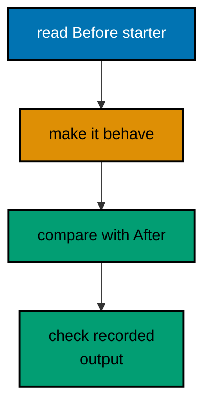

This page is the spaced-repetition companion to WebAssembly Essentials: recall first, then applied judgement, then hands-on repetition, then a checklist, then a why and why-not pass to confirm real automaticity rather than recognition. Every answer hides in a `<details>` block; try each item yourself before opening it.

## Recall Q&A

### Q1 (co-01): Why does the guard clause come before the happy path in Example 1?

<details><summary>Answer</summary>

A trap aborts the whole module, so refusing bad input before acting keeps the failure visible at the call site and the happy path flat at the margin. The nested version hides failures inside branches where the next reader stops looking.

</details>

### Q2 (co-01): When do you reach for match instead of an if-else ladder?

<details><summary>Answer</summary>

When the branches partition one value into named cases, like the five grading bands in Example 2. Match lists each case once with exhaustiveness checked; ladders repeat the variable and hide the order, so a new case lands in the wrong place.

</details>

### Q3 (co-01): What do if let and let-else divide between them?

<details><summary>Answer</summary>

if let opens the Some case for use in a block (Example 3 greets Sari inside the borrow); let-else inverts the same idea for guards, diverging early when the value is absent (Budi's lookup returns). One fuses test and unwrap, the other fails fast.

</details>

### Q4 (co-01): Which loop shape serves a search, a countdown, and a total?

<details><summary>Answer</summary>

loop with a break value for the search (the first square above 50 in Example 4), while for the countdown (fuel guarded by its own condition), for for the total (1..=5 with no index to forget). The exit condition stays visible in each header, so no flag variable travels between three places.

</details>

### Q5 (co-02): Why is Result preferable to exceptions for recoverable failure?

<details><summary>Answer</summary>

Recoverable failure is data the caller matches at the call site (Example 9 halves or refuses with a reason). Nothing unwinds across layers, so a Wasm trap always means a bug, never a mishandled input, and the signature documents every refusal.

</details>

### Q6 (co-02): How do map, and_then, and unwrap_or divide the Option pipeline?

<details><summary>Answer</summary>

Map transforms inside Some, and_then chains a fallible next step, and exactly one unwrap_or at the end names the default (Example 10). The chain short-circuits at the first miss, so no stage runs on absent input and no default scatters through branches.

</details>

### Q7 (co-02): What does ? desugar to, and what return type does it require?

<details><summary>Answer</summary>

On Err it returns the error to the caller immediately; on Ok it unwraps the value inline (Example 11 chains parse then range-check). It requires the function's own Result return, because ? can only exit through one error channel.

</details>

### Q8 (co-02): When do you reach for map_err, and what does each layer add?

<details><summary>Answer</summary>

At every boundary where a low-level error would otherwise escape unexplained: the parse in Example 12 adds the line number and the field, so the final message reads as the path the input traveled. Each layer adds what it knows; nobody logs what the error already carries.

</details>

### Q9 (co-02): Why does an enum beat a String for module errors?

<details><summary>Answer</summary>

An enum names every failure the module can produce, so callers match cases the compiler checks instead of parsing text it cannot (Example 13 grades Missing versus OutOfRange). Display renders each variant for humans; one Error impl plugs the enum into every ? chain.

</details>

### Q10 (co-08): What does the failing-first test prove, and where do tests live?

<details><summary>Answer</summary>

Tests live beside the code in #[cfg(test)] modules and run with the same toolchain (Example 35 pins doubling across three cases). The failing-first run proves the test can actually fail: Example 36 watches the leap-year test go red before the fix turns it green, so a passing suite means the code works, not that the test is vacuous.

</details>

### Q11 (co-16): How do you explain an unfamiliar idiomatic sample to someone else?

<details><summary>Answer</summary>

Name the shape first, then trace one path through it: Example 71 is an LRU cache (insert three, evict the stalest, read back), Example 73 grades three rows and refuses three with line numbers. State the transformation in one sentence, then walk the transcript line by line until every output maps to one input decision.

</details>

### Q12 (co-15): Which idioms exist for performance, and what does skipping them cost?

<details><summary>Answer</summary>

Reserve capacity up front and fuse passes into lazy adapters: Example 5 shows a thousand pushes reallocating only about ten times, with with_capacity skipping even those, while Example 47 proves fusion with a counter (two pulls, two mapper ticks, no intermediate Vec). Skipping either pays in reallocations or throwaway buffers the transcript never shows but production rosters feel.

</details>

### Q13 (co-03): What single rule keeps every HashMap transcript deterministic?

<details><summary>Answer</summary>

Sort before printing (Examples 6, 72, and the standing rule in `learning/code/README.md`). HashMap iterates in hash order, which varies run to run, so collecting keys and sorting them is the price of byte-identical goldens, paid in every example without exception.

</details>

### Q14 (co-03): Why do adapters compose while terminals execute?

<details><summary>Answer</summary>

Map, filter, and take build a pipeline without running it; only collect, sum, or count pulls values through (Example 7 honors three scores, Example 47 proves laziness with a counter: two pulls, two mapper ticks). No terminal means no work, which is also why take(2) skips the rest of the input entirely.

</details>

### Q15 (co-03): What does a slice borrow cost, and who must outlive it?

<details><summary>Answer</summary>

Nothing to form: a slice is a (pointer, length) pair, so windows, chunks, and split_at are all O(1) (Example 8). The owner must stay alive and unmutated while views are in use, which the borrow checker guarantees before the program ever runs.

</details>

### Q16 (co-04): Why do lines and split_whitespace beat hand-rolled splitting?

<details><summary>Answer</summary>

lines strips endings for free and split_whitespace collapses runs, skips leading space, and splits tabs (Example 19; kata 03 proves the hand loop drops the tail). The stdlib versions remove the three hand-rolled bug classes: trailing empties, double-space ghosts, and tab blindness.

</details>

### Q17 (co-04): How do you parse outside digits without trapping?

<details><summary>Answer</summary>

Match parse like any Result, name the target with turbofish, and strip 0x/0b prefixes before from_str_radix (Example 20 parses decimal, hex, and binary, refusing digit soup and u32 overflow). Never unwrap a parse of outside input: the refusal names the cause, and exit stays 0.

</details>

### Q18 (co-04, co-13): Where may a WASI module read, and where may it write?

<details><summary>Answer</summary>

It reads only mounted directories (this course mounts each unit folder read-only at /data, as in Examples 21, 32, and 33) and writes only to scratch (/tmp, as in Example 22). Absolute guest paths never depend on the working dir, and goldens record stdout, so programs print what they wrote as the proof the bytes landed.

</details>

### Q19 (co-05): Why must golden transcripts never contain "now"?

<details><summary>Answer</summary>

The second execution would differ from the first, and the harness runs every unit twice to prove determinism. Deterministic time code starts from fixed instants (UNIX_EPOCH plus known offsets) and computes with Duration (Example 23 schedules from a fixed midnight; Example 24 splits windows with checked math).

</details>

### Q20 (co-06): What does the mod line wire, and what changes across the split?

<details><summary>Answer</summary>

`mod stats;` loads the sibling file by name with the same fences as the inline module (Examples 26 and 27). Nothing changes semantically: visibility rules are identical, so the split reorganizes without relearning, one file per purpose.

</details>

### Q21 (co-06, co-07): What does the manifest promise, and what does the lockfile prove?

<details><summary>Answer</summary>

The manifest declares name, version, and edition as the crate's contract (Example 32 checks all three). The lockfile pins one x.y.z version per package so two machines compile the same graph (Example 33 checks both rules). The manifest wishes; the lockfile records. Zero dependencies is a choice: no network, no audit, no breakage.

</details>

### Q22 (co-10): What does a trait bound guarantee, and who pays for generics?

<details><summary>Answer</summary>

The bound guarantees the body only uses what it names (PartialOrd in Example 45's min_of, Display + PartialOrd + Copy in Example 46), so misuse fails at the call. Nobody pays at runtime: static dispatch stamps one copy per call site with no vtable and no indirection.

</details>

### Q23 (co-11): How do moves, borrows, and clones divide sharing?

<details><summary>Answer</summary>

Assignment moves and retires the source (Example 49); &T shares reads freely while &mut T lends writes exclusively (Example 50); Clone duplicates explicitly at a visible cost while Copy types duplicate implicitly (Example 51). Interior mutability (Example 52) moves the check to run time for the single-threaded shapes that need it.

</details>

### Q24 (co-09, co-12, co-14): What survives the survey, and what does the checklist enforce?

<details><summary>Answer</summary>

The protocol survives: claim-process-record queues, fair round-robin polling, earliest-deadline timers, single-poll executors, and share-and-guard state all run single-threaded here and transfer to threaded hosts unchanged (Examples 54–61). The checklist (Example 70) enforces the rest as code: no tabs, no bare unwraps, snake_case names, verb-led docs, and no traps in shipped paths.

</details>

## Applied problems

Eight applied problems. Each names a real situation and the course habit that solves it; work them with an editor open and check your answer against the named example before moving on.

### Problem 1: Flatten the translated validator

Port a three-level nested admission check (age, score, seat) into guard clauses per Example 9 and kata 04. List every input that changes verdict and prove the list is empty.

### Problem 2: Choose the error shape

Three failures: missing input file, unparseable digits, out-of-range score. Decide for each whether it is a plain Result message (Example 9), a context wrap (Example 12), or a custom enum variant (Example 13), and write the one-line justification the code reviewer will read.

### Problem 3: Replace the hand-rolled helper

Find a hand-rolled word splitter, a string-built report via += in a loop, and a hand-compared version triple in one program. Replace each with split_whitespace, format!/join, and parsed tuple comparison per Examples 19 and 69 and kata 03, then show the outputs are identical.

### Problem 4: Pin the band edges

Pick the least-tested grading function in your own code and write the table test from Example 37 for it: ten rows including both edges of every band. Run it red-first by asserting a wrong want once (see Example 36), then fix the want.

### Problem 5: Schedule without a clock

A program prints "started at <now>" and "finished at <now>" around its work. Convert it to the fixed-instant plan from Examples 23 and 24: compute the window from constants, print epoch seconds, and prove two runs are byte-identical.

### Problem 6: Audit the dropped errors

Grep your code for unwrap on Results and unexamined parse calls. For each, either match it or attach the rationale comment per Example 63 and 65. Count how many were accidents versus reviewed decisions.

### Problem 7: Merge three config layers

Take defaults, one machine file, and one run's flags for a small tool and merge them per Example 78: later layers win per key, untouched keys survive. Print every layer sorted plus the merged table, and point at which layer decided each key.

### Problem 8: Read a stranger's state machine

Open any order- or task-state code you did not write and answer without running it: what are the states, which transitions are legal, where do illegal ones refuse? Check your answers by tracing one legal and one illegal path like Examples 30 and 74.

## Code katas

Eight hands-on katas. Each starts from the `Before` starter, and the `After` reference shows one good solution with its recorded output. Make the starter match before peeking. Work them in order: the unwrap-to-Result and table-test katas first, because error shapes and test tables underlie everything; the split, flatten, error-enum, and counter katas next, because they train the four reflexes daily Wasm code demands; the generics and tiebreak katas after, because they isolate one design judgement each.



### Kata 01: Convert Unwrap to Result

Turn the exception-style parser (unwrap on split and parse) into matched Results where every failure prints with its row. The starter traps on the third row; the solution refuses it.

**Before** (`drilling/code/kata-01-convert-unwrap-to-result/before/starter.rs`):

```rust
// Kata 1 starter: exception-style parsing with unwrap.
//
// This is the before half: it works on clean input and traps on the first
// bad row. Your task: convert it to the after half, where every failure
// is a matched Result and the transcript ends with refusals, not a trap.
// => the unwrap on parse is the smell: row 3 ("many") traps the module
// => match the parse: Ok grades, Err names the row and moves on
fn grade(score: u32) -> char {
    match score {
        90..=100 => 'A',
        80..=89 => 'B',
        70..=79 => 'C',
        60..=69 => 'D',
        _ => 'F',
    }
}

fn main() {
    // => three rows: two grade, the third traps on unwrap, by design
    for row in ["sari=91", "budi=77", "citra=many"] {
        // => split_once divides the row: the shape is fine, the digits are not
        let (_, digits) = row.split_once('=').unwrap();
        // => the trap: "many" never parses, and unwrap aborts the module
        let score: u32 = digits.parse().unwrap();
        println!("{row} -> {}", grade(score));
    }
}
```

**After** (`drilling/code/kata-01-convert-unwrap-to-result/after/solution.rs`):

```rust
// Kata 1 solution: every failure is a matched Result.
//
// The unwrap calls are gone: split_once and parse each return their
// failure as data, and main prints refusals for the broken row while the
// clean rows grade exactly as before. Exit stays 0 on every input.
// => let-else opens the split: shapeless rows refuse with their text
// => map_err converts the parse failure: the row rides into the message

// grade renders the letter for a validated score, like Example 2.
// => the grader never sees a bad value: validation happens before it
fn grade(score: u32) -> char {
    // => u32 in, char out: the signature is the whole contract
    // => the band table reads top-down: the first matching arm wins
    match score {
        // => ranges partition the scale: every parsed score lands in one arm
        90..=100 => 'A',
        80..=89 => 'B',
        70..=79 => 'C',
        60..=69 => 'D',
        // => the catch-all closes the ladder: every score grades something
        _ => 'F',
    }
}

// grade_row grades one "name=digits" row or refuses it with its context.
// => Result carries both exits: the letter, or the row's own refusal
// => let-else and ? replace both unwraps: no trap survives in this file
fn grade_row(row: &str) -> Result<String, String> {
    // => &str in, owned out: letters and refusals both outlive the row
    // => the split refuses shapeless rows: the row quotes itself
    let Some((name, digits)) = row.split_once('=') else {
        // => let-else diverges: shapeless rows exit here with their text
        return Err(format!("{row:?} has no '='"));
    };
    // => the parse refuses digit soup: the digits quote themselves too
    let score = digits
        .parse::<u32>()
        .map_err(|_| format!("{digits:?} is not a score"))?;
    // => only validated scores reach the grader: the letter is always honest
    Ok(format!("{name} -> {}", grade(score)))
    // => name plus letter: the graded line reads as cause and effect
}

fn main() {
    // => the same three rows as the starter: two grade, one refuses now
    for row in ["sari=91", "budi=77", "citra=many"] {
        // => one match serves every row: letters print, refusals explain
        match grade_row(row) {
            Ok(line) => println!("{line}"),
            // => the refusal names the row: "many" is data, not a trap
            Err(reason) => println!("refused: {reason}"),
        }
    }
}
```

**Output** (`drilling/code/kata-01-convert-unwrap-to-result/expected/main.stdout.txt`):

```text
sari -> A
budi -> C
refused: "many" is not a score
```

### Kata 02: Write the Test for the Grade

The starter grades 89 as C (the arm stops at 88). Add the ten-row band table, watch the 89 row fail, widen the arm to 80..=89, and commit the green. The harness runs the test binary.

**Before** (`drilling/code/kata-02-write-test-for-grade/before/starter.rs`):

```rust
// Kata 2 starter: a grader with no tests.
//
// The rule below is correct on the rows its author tried and wrong on the
// one they did not: 89 grades B here, but the band table says C starts at
// 70 and B at 80, so 89 is... check the boundary yourself. Your task: add
// the #[cfg(test)] suite that pins every band edge, then fix the rule the
// failing test names.
// => the boundary bug hides in the second arm: 80..=88 excludes 89
// => the table test from Example 37 catches it: one row per band edge
fn letter(score: u8) -> char {
    match score {
        90..=100 => 'A',
        // => the upper edge stops at 88: 89 falls through to C below
        80..=88 => 'B',
        70..=79 => 'C',
        60..=69 => 'D',
        _ => 'F',
    }
}

fn main() {
    // => the binary samples the bands: 89 prints the wrong letter today
    for score in [95u8, 89, 75, 65, 55] {
        println!("{score} -> {}", letter(score));
    }
}
```

**After** (`drilling/code/kata-02-write-test-for-grade/after/solution.rs`):

```rust
// Kata 2 solution: the table test pins every edge, then the rule is fixed.
//
// The suite below failed on 89 before the fix (B expected, C produced)
// and passes after widening the arm to 80..=89. The red transcript is the
// proof the test works; the green transcript below is the committed state.
// => the table covers all five bands: each edge appears twice, like Ex.37
// => the fix widens one arm: 80..=89 restores 89 to B, matching the table

// letter grades scores with the corrected band: 80..=89 is B again.
// => the table below pins the edge: 89 must grade B, 90 must grade A
fn letter(score: u8) -> char {
    // => u8 in, char out: the signature is the whole contract
    // => the corrected arm: 80 through 89, both edges inclusive
    match score {
        // => ranges partition 0..=255: every input lands in exactly one arm
        90..=100 => 'A',
        // => inclusive top: 100 earns A, 89 starts B
        80..=89 => 'B',
        // => the fixed arm: 89 grades B again after the widening
        70..=79 => 'C',
        // => the C band: untouched by the fix, pinned anyway
        60..=69 => 'D',
        // => the D band: the table guards every edge, not just the bug
        // => the catch-all closes the ladder: 59 and below are F
        _ => 'F',
        // => the catch-all closes the ladder: 59 and below are F
    }
}

// => cfg(test) holds the table that caught the bug: ten rows, five bands
#[cfg(test)]
// => cfg(test) compiles the suite only under test: the binary stays lean
mod tests {
    // => the table lives here: rows beside the rule they pin
    // => super::* imports letter: the table tests one function, nothing else
    use super::*;

    // => every band edge appears twice: the top of one band, the next below
    #[test]
    fn grades_every_band_edge() {
        // => one test, ten rows: the loop multiplies coverage, not functions
        // => (input, expected) rows: the 89 row failed before the fix
        let cases = [
            // => u8 suffix once: the first row pins the type for the rest
            (100u8, 'A'),
            // => the ceiling: 100 is the highest gradable score
            (90, 'A'),
            // => the A floor: 90 passes, 89 does not
            (89, 'B'),
            // => the regression row: this one failed before the fix
            (80, 'B'),
            // => the B floor: the widened arm starts here
            (79, 'C'),
            // => the C ceiling: the pattern repeats per band, deliberately
            (70, 'C'),
            // => the C floor: symmetry the reader can verify at a glance
            (69, 'D'),
            // => the D ceiling: one wrong point costs a full band
            (60, 'D'),
            // => the D floor: the last passing score of all
            (59, 'F'),
            // => the F ceiling: just below the lowest pass
            (0, 'F'),
            // => the floor: zero is the lowest input the type allows
        ];
        // => one loop serves all ten rows: the logic never repeats per case
        for (score, expected) in cases {
            // => destructuring binds both: input and verdict per turn
            // => the assertion quotes the row: failures name their own input
            assert_eq!(
                letter(score),
                expected,
                "score {score} should grade {expected}"
            );
        }
    }
}

fn main() {
    // => the demo samples the fix: 89 prints B now
    // => the binary samples the bands: 89 prints B now, the bug is gone
    for score in [95u8, 89, 75, 65, 55] {
        // => 89 rides second: the fixed edge shows in the demo too
        println!("{score} -> {}", letter(score));
    }
}
```

**Output** (`drilling/code/kata-02-write-test-for-grade/expected/main.stdout.txt`):

```text

running 1 test
test tests::grades_every_band_edge ... ok

test result: ok. 1 passed; 0 failed; 0 ignored; 0 measured; 0 filtered out; finished in 0.00s

```

### Kata 03: Replace the Hand-Rolled Split

The starter walks characters by hand and drops the last word when the line does not end with a space. Replace the whole loop with split_whitespace, which also collapses runs and splits tabs the hand version never met.

**Before** (`drilling/code/kata-03-replace-hand-rolled-split/before/starter.rs`):

```rust
// Kata 3 starter: a hand-rolled word splitter.
//
// The loop below walks characters, builds words by hand, and almost works:
// it drops the last word when the line does not end with a space. Your
// task: replace the whole loop with split_whitespace, which never forgets
// the tail, collapses runs, and skips leading space without a single index.
// => the missing tail is the bug: "fast" never reaches the words below
// => stdlib split replaces 15 lines: the after half proves it in three
fn words(line: &str) -> Vec<String> {
    // => the hand-rolled buffer: characters accumulate until a space lands
    let mut found: Vec<String> = Vec::new();
    let mut current = String::new();
    for c in line.chars() {
        // => spaces flush the buffer: the word ends, a new one may begin
        if c == ' ' {
            // => non-empty buffers push: runs of spaces push nothing twice
            if !current.is_empty() {
                found.push(current.clone());
                current.clear();
            }
            continue;
        }
        // => tabs slip through unhandled: the splitter only knows spaces
        current.push(c);
    }
    // => the tail is never flushed: the last word dies in the buffer here
    found
}

fn main() {
    // => "fast" vanishes below: the missing flush eats the final word
    println!("{:?}", words("wasm  runs fast"));
}
```

**After** (`drilling/code/kata-03-replace-hand-rolled-split/after/solution.rs`):

```rust
// Kata 3 solution: the standard library splits, the hand loop retires.
//
// split_whitespace handles every case the hand loop fumbled: trailing
// words flush, runs of spaces collapse, tabs split, and leading space
// vanishes. Fifteen lines of index bookkeeping become one iterator chain.
// => split_whitespace is the whole splitter: no buffer, no flush, no bug
// => tabs split too: the stdlib knows whitespace the hand loop never met

// words splits a line with the standard library: the entire splitter.
// => split_whitespace yields &str borrows: map owns them into Strings
// => runs collapse, tails flush, tabs split: the stdlib handles all three
fn words(line: &str) -> Vec<String> {
    line.split_whitespace().map(String::from).collect()
}

fn main() {
    // => all three words print: the tail survives, the run collapses
    println!("{:?}", words("wasm  runs fast"));
    // => tabs split as well: the hand loop pushed them into words
    println!("{:?}", words("sandboxed\tfast"));
}
```

**Output** (`drilling/code/kata-03-replace-hand-rolled-split/expected/main.stdout.txt`):

```text
["wasm", "runs", "fast"]
["sandboxed", "fast"]
```

### Kata 04: Flatten the Nested Checks

The starter nests three validations three deep with the happy path at the bottom of the staircase. Invert every check into a guard clause that returns early, so the happy path climbs back to the margin and each refusal names its condition at its level.

**Before** (`drilling/code/kata-04-flatten-nested-checks/before/starter.rs`):

```rust
// Kata 4 starter: nested checks pyramid rightward.
//
// Three validations nest three deep, and the happy path hides at the
// bottom of the staircase. Your task: invert every check into a guard
// clause that returns early, so the happy path climbs back to the margin
// and each refusal names its own condition at its own level.
// => the happy path sits three levels deep: guards will lift it to zero
// => each nested else becomes a top-level return: failures exit in order
fn admit(age: u8, score: u8, seat: bool) -> &'static str {
    // => level one: age gates the whole admission, junior applicants wait
    if age >= 17 {
        // => level two: the score gates the qualified, low scores wait too
        if score >= 60 {
            // => level three: the seat gates the ready, full rooms wait
            if seat {
                "admitted"
            } else {
                "waitlisted: no seat"
            }
        } else {
            "waitlisted: score below 60"
        }
    } else {
        "waitlisted: age below 17"
    }
}

fn main() {
    // => four applicants: one admits, three wait for three different reasons
    println!("{}", admit(18, 91, true));
    println!("{}", admit(16, 91, true));
    println!("{}", admit(18, 55, true));
    println!("{}", admit(18, 91, false));
}
```

**After** (`drilling/code/kata-04-flatten-nested-checks/after/solution.rs`):

```rust
// Kata 4 solution: guard clauses flatten the pyramid to the margin.
//
// Each nested condition becomes a top-level refusal that returns early:
// age, then score, then seat, each named at its own level with no else.
// The happy path prints at the left margin, and the three refusals read
// as a checklist instead of a staircase.
// => invert each condition: the refusal returns, the pass falls through
// => the happy path is the last line: everything above it is a guard

// admit checks age, score, and seat as three guard clauses in order.
// => the first failing guard returns: later guards never run past a refusal
// => the happy path needs no branch: reaching it means all guards passed
fn admit(age: u8, score: u8, seat: bool) -> &'static str {
    // => three params, one verdict: age, score, and seat decide together
    // => guard one: juniors wait, everyone else falls through to scoring
    if age < 17 {
        return "waitlisted: age below 17";
    }
    // => guard two: low scores wait, qualifying scores fall through to seats
    if score < 60 {
        return "waitlisted: score below 60";
    }
    // => guard three: full rooms wait, seated applicants fall through to admit
    if !seat {
        return "waitlisted: no seat";
    }
    // => past all three guards: admitted, at the left margin, no nesting
    "admitted"
}

fn main() {
    // => four applicants: the admit plus one refusal per guard
    // => the same four applicants: one admits, three wait with reasons
    println!("{}", admit(18, 91, true));
    println!("{}", admit(16, 91, true));
    println!("{}", admit(18, 55, true));
    println!("{}", admit(18, 91, false));
}
```

**Output** (`drilling/code/kata-04-flatten-nested-checks/expected/main.stdout.txt`):

```text
admitted
waitlisted: age below 17
waitlisted: score below 60
waitlisted: no seat
```

### Kata 05: Grow the Error Enum

The starter fails every stage with a String, so callers match text and two stages share one message shape. Give each failure its own enum variant with Display: NoSeparator carries the row, BadDigits carries the digits, OutOfRange carries the value.

**Before** (`drilling/code/kata-05-error-enum-for-loader/before/starter.rs`):

```rust
// Kata 5 starter: string errors for a record loader.
//
// Every stage fails with a String, so callers match text instead of cases:
// adding a stage means editing every match, and two stages can produce the
// same message for different causes. Your task: give each failure its own
// enum variant with Display, and let the loader return the type, not text.
// => string errors merge causes: "bad data" could mean the name or digits
// => the enum names three cases: missing separator, bad digits, bad range
fn load(row: &str) -> Result<(String, u32), String> {
    // => the split fails with text: the separator case has no name of its own
    let (name, digits) = match row.split_once('=') {
        Some(pair) => pair,
        None => return Err(format!("bad row: {row:?}")),
    };
    // => the parse fails with text: digits and range share one message shape
    let score: u32 = match digits.parse() {
        Ok(score) => score,
        Err(_) => return Err(format!("bad score: {digits:?}")),
    };
    // => the range fails with text: three causes, one String, no cases
    if score > 100 {
        return Err(format!("bad score: {score}"));
    }
    Ok((name.to_string(), score))
}

fn main() {
    // => three rows: one loads, two fail with indistinguishable Strings
    for row in ["sari=91", "budi=many", "citra=104"] {
        println!("{row:?} -> {:?}", load(row));
    }
}
```

**After** (`drilling/code/kata-05-error-enum-for-loader/after/solution.rs`):

```rust
// Kata 5 solution: each failure gets its own enum variant.
//
// LoadError names the three cases the starter merged into one String:
// NoSeparator carries the row, BadDigits carries the digits, OutOfRange
// carries the value. Display renders each for humans, and callers match
// cases instead of substrings, so new stages add variants, not edits.
// => one variant per cause: the compiler lists what can go wrong, in full
// => Display is the human face: each variant renders its own sentence

use std::fmt;

// => fmt hosts Display: the human face of every refusal

// LoadError names the three ways loading one row can fail, separately.
// => NoSeparator carries the row: the message can quote the shapeless text
// => BadDigits carries the digits: the message can quote the bad number
// => OutOfRange carries the value: the message can quote the outlier
#[derive(Debug)]
enum LoadError {
    // => three variants, three causes: separator, digits, range
    NoSeparator(String),
    // => String carries the row: owned evidence for the message
    BadDigits(String),
    // => String carries the digits: owned evidence again
    OutOfRange(u32),
    // => u32 carries the value: Copy, no allocation needed
}

// Display turns each variant into the sentence its row deserves to show.
// => match every variant: a fourth cause would force a fourth message
impl fmt::Display for LoadError {
    // => Display serves humans: main prints {reason} through it
    fn fmt(&self, f: &mut fmt::Formatter<'_>) -> fmt::Result {
        // => &self borrows: rendering a refusal must not consume it
        match self {
            // => self is the case: each arm renders one failure story
            // => quotes the row: the author sees which line broke shape
            LoadError::NoSeparator(row) => write!(f, "{row:?} has no '='"),
            // => quotes the digits: the author sees which value misparsed
            LoadError::BadDigits(digits) => write!(f, "{digits:?} is not a score"),
            // => quotes the value: the author sees which score overflowed
            LoadError::OutOfRange(score) => write!(f, "{score} is outside 0..=100"),
        }
    }
}

// load returns the typed error: callers match variants, never substrings.
// => let-else opens the split: the row refuses with its own variant
// => map_err converts the parse: the digits refuse with theirs instead
fn load(row: &str) -> Result<(String, u32), LoadError> {
    // => owned pair leaves: the name copies out, the score parses out
    // => the split carries the row into NoSeparator: the case is named
    let Some((name, digits)) = row.split_once('=') else {
        return Err(LoadError::NoSeparator(row.to_string()));
    };
    // => the parse carries the digits into BadDigits: a different case
    let score = digits
        .parse::<u32>()
        .map_err(|_| LoadError::BadDigits(digits.to_string()))?;
    // => the range carries the value into OutOfRange: the third case
    if score > 100 {
        return Err(LoadError::OutOfRange(score));
    }
    Ok((name.to_string(), score))
    // => to_string owns the name: the pair outlives the borrowed row
}

fn main() {
    // => the same three rows: one loads, two refuse with named cases
    for row in ["sari=91", "budi=many", "citra=104"] {
        // => Debug on Ok shows the pair: Display on Err shows the sentence
        match load(row) {
            Ok(pair) => println!("{row:?} -> {pair:?}"),
            Err(reason) => println!("{row:?} -> error: {reason}"),
        }
    }
}
```

**Output** (`drilling/code/kata-05-error-enum-for-loader/expected/main.stdout.txt`):

```text
"sari=91" -> ("sari", 91)
"budi=many" -> error: "many" is not a score
"citra=104" -> error: 104 is outside 0..=100
```

### Kata 06: Share the Counter Safely

The starter threads a tally by value through every scorer, juggling ownership instead of grading. Wrap the count in a Cell inside a Meter, share the meter by reference, and read the total once at the end, per Example 52.

**Before** (`drilling/code/kata-06-share-counter-safely/before/starter.rs`):

```rust
// Kata 6 starter: a counter nobody can share.
//
// The tally below moves through each scorer by value, so every handoff
// needs a return trip and the call sites juggle ownership instead of
// grading. Your task: wrap the count in a Cell and share the meter by
// reference, so every scorer observes through & and the total reads once.
// => ownership juggling is the smell: the tally returns after every use
// => Cell shares the count: observe takes &, the total reads at the end
fn observe(tally: u32, score: u32) -> u32 {
    // => the tally moves in and out: callers thread it by hand, every time
    let _ = score;
    tally + 1
}

fn main() {
    // => the tally travels by value: each call hands it back explicitly
    let mut tally = 0u32;
    tally = observe(tally, 91);
    tally = observe(tally, 77);
    tally = observe(tally, 88);
    // => three observations counted: the threading below is the noise to cut
    println!("observations: {tally}");
}
```

**After** (`drilling/code/kata-06-share-counter-safely/after/solution.rs`):

```rust
// Kata 6 solution: the counter shares through a Cell, by reference.
//
// The meter owns a Cell<u32>; every scorer borrows the meter immutably
// and observes through &, so the call sites name only the score. The
// total reads once at the end, and no value ever travels by hand again.
// => Cell<u32> holds the count: Copy inside, set/get outside, no borrows
// => &self observes: shared handles mutate through the cell, legally

use std::cell::Cell;

// => Cell holds Copy counts: get/set need no borrows at all

// Meter counts observations through shared references only.
// => the count starts at zero: the first observation ticks it to one
struct Meter {
    // => one field: the count lives inside the cell
    count: Cell<u32>,
    // => Cell<u32> ticks legally: set replaces through shared borrows
}

impl Meter {
    // => new builds, observe ticks, total reads: one impl, three jobs
    // => new starts empty: zero observations, ready for every scorer
    fn new() -> Meter {
        // => Cell::new(0) starts the count: zero observations, ready
        Meter {
            count: Cell::new(0),
        }
        // => the cell owns zero: the first observe ticks it to one
    }

    // => &self observes: the shared borrow ticks the cell, no &mut needed
    fn observe(&self, score: u32) {
        // => the score grades elsewhere: the meter counts, nothing more
        let _ = score;
        self.count.set(self.count.get() + 1);
    }

    // => &self totals: the count reads out through the same shared path
    fn total(&self) -> u32 {
        // => get copies out: u32 leaves without disturbing the cell
        self.count.get()
        // => tail returns the count: reading never mutates, even here
    }
}

fn main() {
    // => one meter, three scorers by shared borrow: no threading by hand
    let meter = Meter::new();
    // => each scorer names only its score: the meter travels nowhere
    meter.observe(91);
    meter.observe(77);
    meter.observe(88);
    // => the total reads once: three observations, no value juggling
    println!("observations: {}", meter.total());
}
```

**Output** (`drilling/code/kata-06-share-counter-safely/expected/main.stdout.txt`):

```text
observations: 3
```

### Kata 07: Replace Two Mins with One Generic

The starter copies one comparison body into min_i32 and min_f64; adding strings means a third copy. Replace both with one min_of bounded by PartialOrd, like Example 45, and serve all three call sites from the single body.

**Before** (`drilling/code/kata-07-generic-min-replaces-two/before/starter.rs`):

```rust
// Kata 7 starter: two mins that differ only in type.
//
// min_i32 and min_f64 share every line but their signatures; adding a
// third type means copying the body again, and fixing a bug means fixing
// it everywhere. Your task: replace both with one generic min_of bounded
// by PartialOrd, like Example 45, and serve all three call sites from it.
// => duplicated bodies drift: the fix lands in one copy and misses the other
// => the generic serves every ordered type: integers, floats, and strings

// min_i32 returns the smaller of two integers, or the left on ties.
// => the body compares and picks: the same five lines min_f64 repeats
fn min_i32(left: i32, right: i32) -> i32 {
    if left <= right {
        left
    } else {
        right
    }
}

// min_f64 returns the smaller of two floats, or the left on ties.
// => the body compares and picks: the same five lines min_i32 repeats
fn min_f64(left: f64, right: f64) -> f64 {
    if left <= right {
        left
    } else {
        right
    }
}

fn main() {
    // => three call sites, two functions: strings have nowhere to go yet
    println!("min(91, 77) = {}", min_i32(91, 77));
    println!("min(9.1, 7.7) = {}", min_f64(9.1, 7.7));
}
```

**After** (`drilling/code/kata-07-generic-min-replaces-two/after/solution.rs`):

```rust
// Kata 7 solution: one generic min serves every ordered type.
//
// min_of carries the single comparison body with a PartialOrd bound, so
// integers, floats, and strings all resolve through it. Adding a type
// means a new call site, never a new copy, and the tie rule lives once.
// => T: PartialOrd bounds the generic: only comparable types are accepted
// => ties keep the left: the rule is stated once, in the single body

// min_of returns the smaller of two values of any ordered type.
// => the body uses only <=: the bound guarantees the operator exists
fn min_of<T: PartialOrd>(left: T, right: T) -> T {
    // => the comparison decides: smaller wins, ties keep the left value
    if left <= right {
        left
    } else {
        right
    }
}

fn main() {
    // => integers resolve through the generic: 77 is smaller, prints as min
    println!("min(91, 77) = {}", min_of(91, 77));
    // => floats resolve through the same body: 7.7 is smaller, same shape
    println!("min(9.1, 7.7) = {}", min_of(9.1, 7.7));
    // => strings resolve too: "budi" sorts before "sari", no new copy needed
    println!("min(sari, budi) = {}", min_of("sari", "budi"));
}
```

**Output** (`drilling/code/kata-07-generic-min-replaces-two/expected/main.stdout.txt`):

```text
min(91, 77) = 77
min(9.1, 7.7) = 7.7
min(sari, budi) = budi
```

### Kata 08: Break Ties by Name

The starter sorts by score only, so tied scores keep arrival order and the transcript depends on how the rows arrived. Add the name tiebreak (score descending, then name ascending, per Example 76's comparator shape) so rank is total no matter the input order.

**Before** (`drilling/code/kata-08-sort-tiebreak-stabilizes-ranks/before/starter.rs`):

```rust
// Kata 8 starter: sorting by score alone scrambles ties.
//
// sort_by score orders the grades but leaves tied scores in input order,
// so the transcript depends on how the rows arrived instead of what they
// mean. Your task: break ties by name ascending, so equal scores rank
// alphabetically and the table reads the same no matter the input order.
// => input order leaks through ties: budi and eka tie at 77, order accidental
// => the tiebreak sorts (score desc, name asc): rank is total, never partial

// rank sorts by score descending only; ties keep whatever order they arrived in.
// => sort_by with one key: the comparator never looks at the name
// => reverse() flips the whole order: descending scores, accidental ties
fn rank(names: &mut [(String, u32)]) {
    // => descending by score: the highest grade leads the table below
    names.sort_by(|left, right| right.1.cmp(&left.1));
}

fn main() {
    // => four rows: budi and eka tie at 77 in arrival order, eka first
    let mut rows = vec![
        ("eka".to_string(), 77u32),
        ("sari".to_string(), 91),
        ("budi".to_string(), 77),
        ("citra".to_string(), 88),
    ];
    // => the tie survives in arrival order: eka prints before budi today
    rank(&mut rows);
    for (name, score) in &rows {
        println!("{name}: {score}");
    }
}
```

**After** (`drilling/code/kata-08-sort-tiebreak-stabilizes-ranks/after/solution.rs`):

```rust
// Kata 8 solution: ties break by name, so rank is total.
//
// The comparator sorts score descending, then name ascending, so equal
// scores rank alphabetically no matter the input order. sort_by is stable,
// but the tiebreak means stability never decides: the order is explicit.
// => two-key comparator: score first (descending), name second (ascending)
// => then() chains the keys: the second runs only when the first ties

// rank sorts by score descending with ties broken by name ascending.
// => right.1.cmp orders scores high-first: the leaderboard reads top-down
// => then(name) orders ties A-first: budi precedes eka at 77, always
fn rank(names: &mut [(String, u32)]) {
    // => &mut borrows the rows: sorting reorders in place
    // => the chained comparator: score decides, name settles the ties
    names.sort_by(|left, right| right.1.cmp(&left.1).then(left.0.cmp(&right.0)));
    // => chained keys compare: score decides, name settles ties
}

fn main() {
    // => the same four rows: budi now precedes eka regardless of arrival
    let mut rows = vec![
        ("eka".to_string(), 77u32),
        ("sari".to_string(), 91),
        ("budi".to_string(), 77),
        ("citra".to_string(), 88),
    ];
    // => the tie breaks alphabetically: sari, citra, budi, eka, every run
    rank(&mut rows);
    for (name, score) in &rows {
        println!("{name}: {score}");
    }
}
```

**Output** (`drilling/code/kata-08-sort-tiebreak-stabilizes-ranks/expected/main.stdout.txt`):

```text
sari: 91
citra: 88
budi: 77
eka: 77
```

## Self-check checklist

Twenty-four self-check items, at least one per concept from co-01 to co-16. Read each aloud as a promise: if you hesitate on any item, return to its example before calling the course done.

- [ ] I can return early with guard clauses instead of nesting the happy path (co-01).
- [ ] I can replace ladders with matches and catch-all arms that close the scale (co-01).
- [ ] I can fuse tests and unwraps with if let and invert guards with let-else (co-01).
- [ ] I can return Result values and match both arms at the call site (co-02).
- [ ] I can chain Option with map, and_then, and one trailing unwrap_or (co-02).
- [ ] I can propagate with ? and require Result returns where it appears (co-02).
- [ ] I can add context with map_err naming the line and the field (co-02).
- [ ] I can name failures with error enums and render them with Display (co-02).
- [ ] I can probe a runtime capability boundary and fall back to the single-threaded shape (co-13).
- [ ] I can keep traps for bugs and validate input with checked arithmetic (co-02).
- [ ] I can sort HashMap keys before printing anything deterministic (co-03).
- [ ] I can compose lazy adapters and execute them with one terminal (co-03, co-15).
- [ ] I can borrow slices as O(1) views that never outlive their owner (co-03, co-11).
- [ ] I can format with inline captures, widths, precisions, and Debug shapes (co-04).
- [ ] I can split, trim, and join text without hand-rolled loops (co-04).
- [ ] I can parse numbers with turbofish and radix forms, matching refusals (co-04).
- [ ] I can read mounted inputs and write scratch outputs with round-trip proof (co-04).
- [ ] I can schedule from fixed instants and Durations, never wall clocks (co-05).
- [ ] I can split modules across files and draw visibility in three rings (co-06).
- [ ] I can declare manifests and verify pins in lockfiles (co-07).
- [ ] I can write table tests, mirror docs, and schedule slow tests with ignore (co-08).
- [ ] I can bound generics, pick closure modes, and stamp one body for many types (co-10).
- [ ] I can survey channels, queues, timers, executors, and guard shared state (co-09).
- [ ] I can run layout, lint, naming, trap, and doc checks as programs (co-12, co-14).

## Elaborative interrogation & self-explanation

Six why and why-not prompts. Each names a design decision and the rejected alternative; answer from your own experience first, then compare with the model answer. The goal is judgement transfer, not memorization.

### E1: Why does WebAssembly code return errors instead of trapping them, and what is lost in exchange?

<details><summary>Model answer</summary>

Trapping aborts the whole module, so recoverable failure must travel as data the caller matches where it happens. Model answer: the verbosity IS the feature — each match names the failure at its site — and ?, map_err, and enums keep it from becoming noise; what is lost is non-local recovery, which Wasm confines to bug boundaries where abort is the enforcement.

</details>

### E2: Why must mounts be explicit, and when would you skip the filesystem entirely?

<details><summary>Model answer</summary>

A WASI module sees only what the host mounts, so explicit mounts make the sandbox boundary visible in the run command. Model answer: default-deny keeps modules portable across hosts that grant different trees; skip the filesystem entirely when the program is a pure transform (Examples 1–20 never touch it), and mount only the folders the job needs.

</details>

### E3: Why does the standard library win over a dependency for text, time, and sorting?

<details><summary>Model answer</summary>

Stdlib code ships with the toolchain: no versions to pin, no audits, no yanked releases. Model answer: the cost of a dependency is permanent (supply chain, drift, review) while the cost of stdlib is one import; this course's empty [dependencies] is the extreme that proves the habit — reach outward only when the stdlib shape genuinely cannot express the need.

</details>

### E4: Why do small error enums compose better than wide ones, and what breaks when an error type grows?

<details><summary>Model answer</summary>

One-module enums let callers match cases the compiler checks without coupling stages to each other; the boundary converts once with From. Model answer: growing a shared enum forces every matcher to revisit every site, while Box<dyn Error> erases the seam entirely for helpers that serve many stages; keep enums small and convert at boundaries.

</details>

### E5: Why sort before printing instead of asserting on arrival order in shared programs?

<details><summary>Model answer</summary>

Hash order and concurrent completion order both vary run to run, so arrival order is not a property the program controls. Model answer: sorting makes the transcript a function of the data, not the scheduler; assert on the sorted output (or on membership), and the same binary passes under any interleaving, which Examples 6, 55, and 72 all demonstrate.

</details>

### E6: Why encode the review checklist as a program instead of a wiki page?

<details><summary>Model answer</summary>

A checklist that reads is a wish; one that runs is a gate (Example 70 scores before at five and after at zero). Model answer: programs do not get tired, skip steps, or disagree about what "done" means; the five rules here (layout, unwrap, names, docs, traps) are cheap exactly because a program checks them, and every unit in this course passes the same shape before it ships.

</details>
