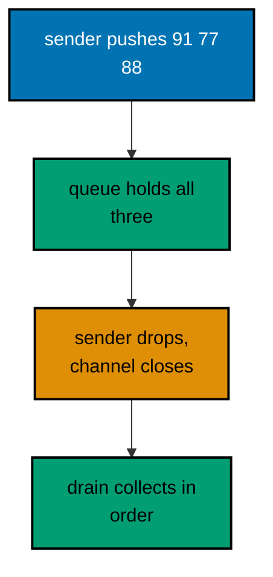
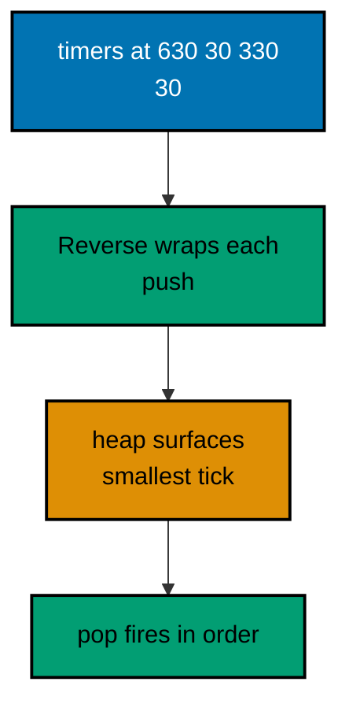
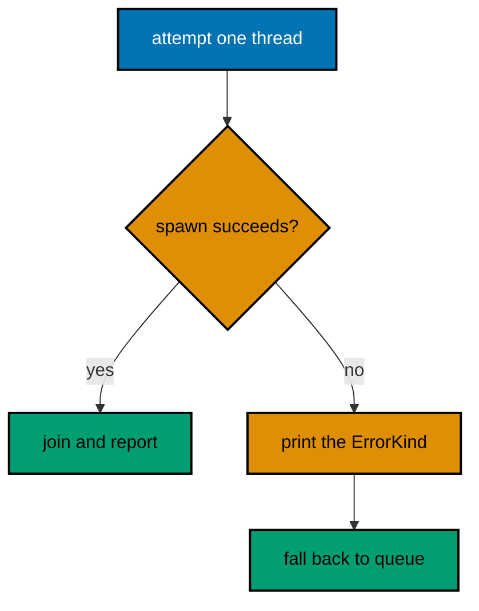
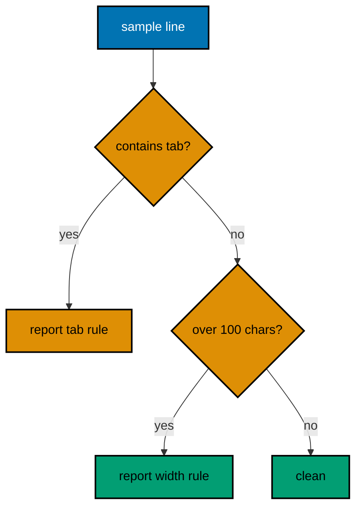
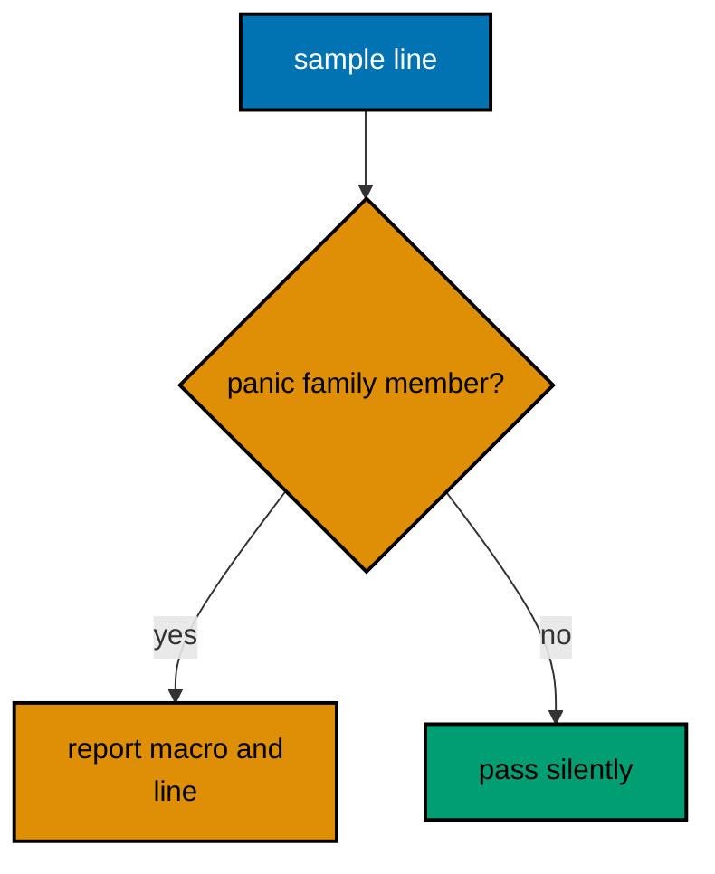
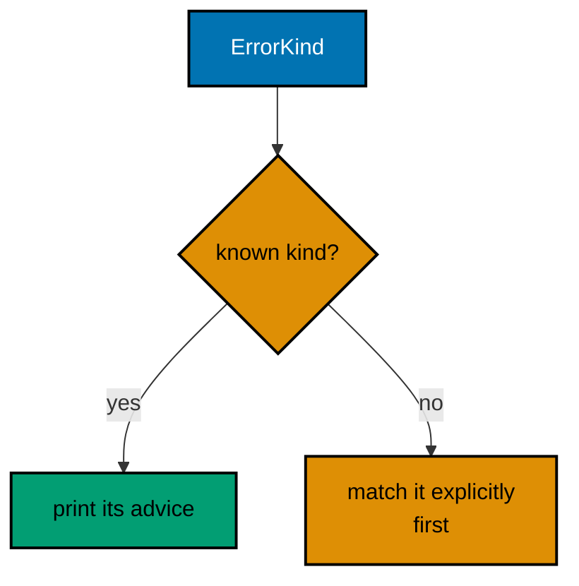
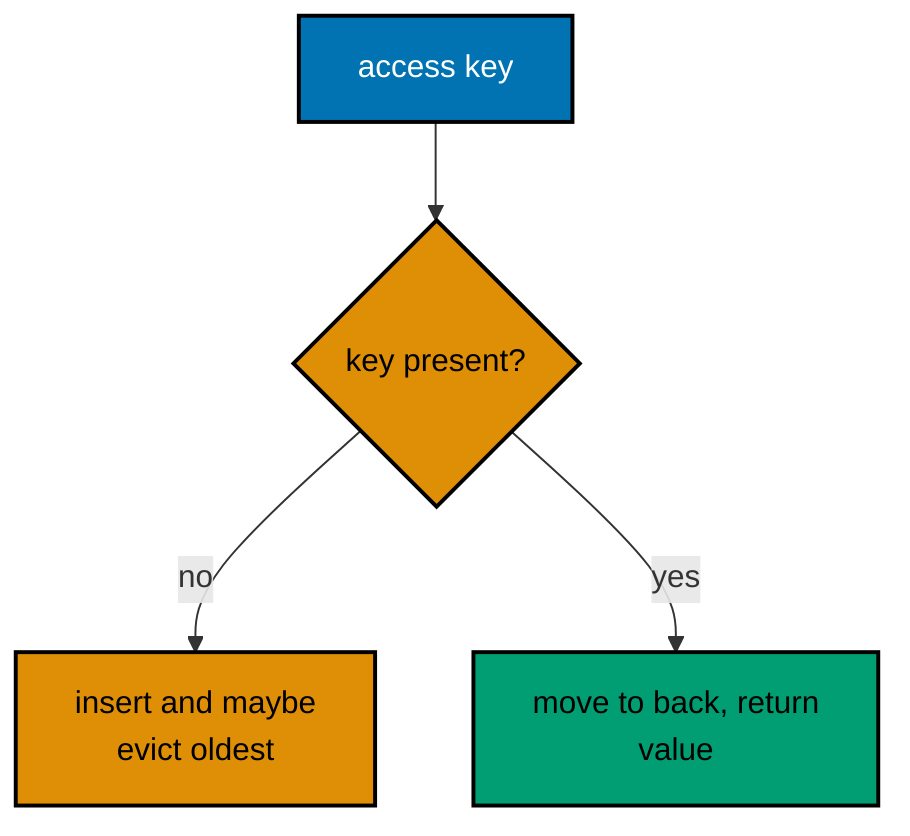
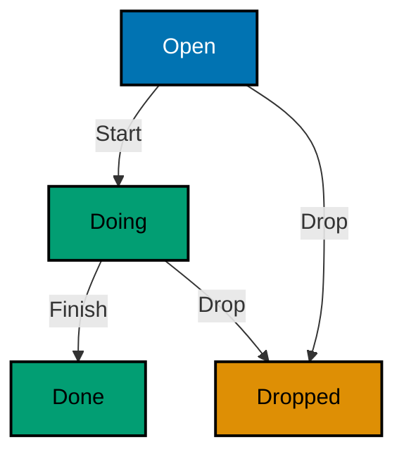
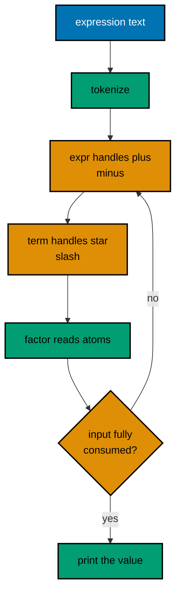

Examples 54–78 reach production fluency: concurrency primitives at survey level first (Examples 54–61), showing channels, worker queues, fair polling, timer wheels, single-poll executors, hand-written state machines, the threading boundary, and share-and-guard protocols; then tooling, linting, and style (Examples 62–70), checking layout, unwraps, names, traps, docs, allow-lists, error codes, version sorting, and the review checklist itself as a program; finally reading and explaining idiomatic code (Examples 71–78), walking an LRU cache, a word counter, a CSV transformer, a todo machine, an expression evaluator, a topological sort, a retry plan, and a config merger. Every example is a complete, runnable Rust module compiled to the WASI target under `learning/code/`; run each with the command in its own `run.yaml`.

---

### Example 54: Channels Pass Messages

A channel decouples the producer from the consumer: senders push values in, receivers pull them out, and the queue in between absorbs bursts. This survey runs both ends on one thread (the pinned runtime has no threads; Example 60 proves the boundary), which is exactly how you test channel logic before threading enters the picture. This example drains three grades in send order. (Concepts: co-09.)



**`learning/code/ex-54-channels-pass-messages/main.rs`**:

```rust
// Example 54: Channels Pass Messages.
//
// A channel decouples the producer from the consumer: senders push values
// in, receivers pull them out, and the queue in between absorbs bursts.
// This survey runs both ends on one thread (the pinned runtime has no
// threads; Example 60 proves the boundary), which is exactly how you test
// channel logic before threading enters the picture.
// => mpsc means many producers, one consumer: the common fan-in shape
// => try_recv never blocks: the survey polls, never parks, by design

use std::sync::mpsc;

// collect_grades drains every queued grade into a vector, in send order.
// => try_recv loops until Empty: no blocking call exists in this survey
// => Disconnected ends the drain: dropping the sender closes the channel
fn collect_grades(rx: mpsc::Receiver<u32>) -> Vec<u32> {
    // => the drain starts empty: each received grade appends in order
    let mut grades = Vec::new();
    // => loop until the channel reports Empty or Disconnected, then stop
    loop {
        match rx.try_recv() {
            // => a queued grade appends: order matches the sends below
            Ok(grade) => grades.push(grade),
            // => Empty means drained for now: the survey stops polling here
            Err(mpsc::TryRecvError::Empty) => break,
            // => Disconnected means senders are gone: the drain is final
            Err(mpsc::TryRecvError::Disconnected) => break,
        }
    }
    grades
}

fn main() {
    // => the channel pairs one sender with one receiver for this survey
    let (tx, rx) = mpsc::channel();
    // => three sends queue three grades: the buffer holds all of them
    for grade in [91u32, 77, 88] {
        // => the send cannot fail here: the receiver outlives the sends
        let _ = tx.send(grade);
    }
    // => dropping the sender closes the channel: the drain sees the end
    drop(tx);
    // => the drain prints in send order: channels preserve what they carry
    println!("grades: {:?}", collect_grades(rx));
}
```

**Output** (`learning/code/ex-54-channels-pass-messages/expected/main.stdout.txt`):

```text
grades: [91, 77, 88]
```

**Key takeaway**: mpsc is many producers, one consumer; try_recv polls, never parks.

**Why it matters**: The queue absorbs bursts between producer and consumer, and closing (dropping the sender) tells the drain the end is final. Channels preserve what they carry, in order, which the transcript proves. Size the queue for bursts and close it by dropping the sender: the drain knows finality without a sentinel value, order survives every handoff, and the transcript reads as the audit trail the threaded version would keep.

### Example 55: Workers Share a Queue

A worker pool is a queue plus a draining loop: tasks wait in order, each is claimed once, and results land in completion order. This survey models the pool on one thread with a VecDeque, so the transcript shows the claiming discipline (pop_front, process, record) that real threaded pools follow, minus the threads the runtime cannot host. (Concepts: co-09.)

**`learning/code/ex-55-workers-share-a-queue/main.rs`**:

```rust
// Example 55: Workers Share a Queue.
//
// A worker pool is a queue plus a draining loop: tasks wait in order,
// each is claimed once, and results land in completion order. This survey
// models the pool on one thread with a VecDeque, so the transcript shows
// the claiming discipline (pop_front, process, record) that real threaded
// pools follow, minus the threads the runtime cannot host.
// => VecDeque pops the front in O(1): the queue never reorders the work
// => results carry their task id: the audit trail survives any order

use std::collections::VecDeque;

// => VecDeque is the queue: O(1) pops from the front, forever

// Task pairs an id with the score it asks the pool to grade.
// => Copy keeps the queue mechanics free of borrow bookkeeping below
// => the id rides along: results name their task no matter the order
#[derive(Debug, Clone, Copy)]
struct Task {
    // => two plain numbers: the id audits, the score grades
    id: u32,
    // => ids arrive in order: 1 through 4, the audit trail's backbone
    score: u32,
    // => scores span the bands: A, F, C, B across the four tasks
}

// grade_task renders one graded line for a claimed task, like Example 31.
// => pure function of the task: workers share no state through this call
fn grade_task(task: Task) -> String {
    // => Task by value: Copy makes claiming cost nothing
    let letter = match task.score {
        // => the band table again: workers grade like every example before
        90..=100 => 'A',
        80..=89 => 'B',
        70..=79 => 'C',
        60..=69 => 'D',
        _ => 'F',
        // => the catch-all closes the scale: below 60 is F
    };
    format!("task {}: {} ({letter})", task.id, task.score)
    // => id plus score plus band: the record the audit trail keeps
}

fn main() {
    // => four tasks in, four lines out: the pool drains completely
    // => the queue holds four tasks in arrival order: ids 1 through 4
    let mut queue: VecDeque<Task> = [
        // => array literal first: into_iter().collect() builds the queue
        Task { id: 1, score: 91 },
        // => task 1 grades A: the head of the queue, claimed first
        Task { id: 2, score: 58 },
        // => task 2 grades F: the middle still keeps its order
        Task { id: 3, score: 77 },
        // => task 3 grades C: order, not grade, decides the claim sequence
        Task { id: 4, score: 88 },
        // => task 4 grades B: the tail waits its turn, like a real queue
    ]
    .into_iter()
    .collect();
    // => the results start empty: each claimed task appends its line here
    let mut done: Vec<String> = Vec::new();
    // => the worker loop claims from the front until nothing remains
    while let Some(task) = queue.pop_front() {
        // => pop_front claims: O(1), and the queue shrinks honestly
        // => claim, process, record: the three steps every pool repeats
        done.push(grade_task(task));
    }
    // => the queue drains fully: four claims, four records, nothing left
    println!("queue left: {}", queue.len());
    // => zero must print: anything left means a task was dropped
    // => results print in claim order: the transcript is the audit trail
    for line in done {
        println!("{line}");
    }
}
```

**Output** (`learning/code/ex-55-workers-share-a-queue/expected/main.stdout.txt`):

```text
queue left: 0
task 1: 91 (A)
task 2: 58 (F)
task 3: 77 (C)
task 4: 88 (B)
```

**Key takeaway**: VecDeque pops the front in O(1); results carry their task id.

**Why it matters**: The claim-process-record discipline is the whole pool: the queue never reorders the work, and each result names its task, so the transcript is the audit trail no matter what order a threaded pool would complete in. Practice the pool discipline single-threaded before adding threads: claim one task, process it, record the result, and repeat, so the transcript proves the protocol that real workers follow when parallelism finally enters.

### Example 56: Select Polls Two Sources

Select waits on several channels at once and serves whichever speaks first; without threads, the survey polls two iterators round-robin and serves each ready item in turn. The discipline is identical (fairness across sources, no starvation), only the waiting becomes explicit polling. This example interleaves two rosters fairly. (Concepts: co-09.)

**`learning/code/ex-56-select-polls-two-sources/main.rs`**:

```rust
// Example 56: Select Polls Two Sources.
//
// Select waits on several channels at once and serves whichever speaks
// first; without threads, the survey polls two iterators round-robin and
// serves each ready item in turn. The discipline is identical (fairness
// across sources, no starvation), only the waiting becomes explicit polling.
// => round-robin is fair: sources alternate, neither waits past its turn
// => iterators model channels here: next() is the non-blocking poll

fn main() {
    // => two fixed sources: odds from roster A, evens from roster B
    // => into_iter moves the arrays: no borrow outlives the poll loop
    let mut roster_a = [91u32, 77, 58].into_iter();
    let mut roster_b = [88u32, 95, 62].into_iter();
    // => served collects the interleaved transcript: A, B, A, B, A, B
    let mut served: Vec<u32> = Vec::new();
    // => the poll loop runs while either source still has items to serve
    loop {
        // => poll A first: its next item serves before B's on every round
        let next_a = roster_a.next();
        // => poll B second: fairness means B never waits more than one turn
        let next_b = roster_b.next();
        // => both exhausted ends the loop: the survey served everything
        if next_a.is_none() && next_b.is_none() {
            break;
        }
        // => serve A's item when present: the transcript keeps round order
        if let Some(score) = next_a {
            served.push(score);
        }
        // => serve B's item when present: no source starves the other
        // => order within rounds is fixed: A before B, every round the same
        if let Some(score) = next_b {
            served.push(score);
        }
    }
    // => interleaved in rounds: 91, 88, 77, 95, 58, 62, every round fair
    println!("served: {served:?}");
}
```

**Output** (`learning/code/ex-56-select-polls-two-sources/expected/main.stdout.txt`):

```text
served: [91, 88, 77, 95, 58, 62]
```

**Key takeaway**: Round-robin is fair; neither source waits past its turn.

**Why it matters**: Fairness is the property that survives the survey: real select wakes on readiness, this poll checks in turns, but both guarantee no source starves the other. The loop ends exactly when both sources exhaust. Poll in turns and stop when both sources exhaust: the round-robin stands in for readiness wakes, fairness holds by construction rather than by scheduler luck, and the merged transcript interleaves exactly as fairness demands.

### Example 57: Timers Fire in Order

A timer wheel holds (deadline, task) pairs and fires the earliest first; a BinaryHeap keeps the earliest deadline on top in O(log n) per insert. All deadlines here are fixed tick counts from a zero origin (never the wall clock), so the firing order is hand-checkable and byte-identical. This example fires four timers across a launch window. (Concepts: co-09.)



**`learning/code/ex-57-timers-fire-in-order/main.rs`**:

```rust
// Example 57: Timers Fire in Order.
//
// A timer wheel holds (deadline, task) pairs and fires the earliest
// first; a BinaryHeap keeps the earliest deadline on top in O(log n) per
// insert. All deadlines here are fixed tick counts from a zero origin
// (never the wall clock), so the firing order is hand-checkable and
// byte-identical on every run.
// => BinaryHeap is a max-heap: Reverse wrappers turn it into a min-heap
// => pop fires the earliest: the transcript is the schedule, executed

use std::cmp::Reverse;
// => Reverse flips Ord: the max-heap fires its minimum first
use std::collections::BinaryHeap;
// => BinaryHeap schedules: O(log n) inserts, earliest tick on top

// Timer pairs a tick deadline with the task name that fires at that tick.
// => Copy keeps the heap mechanics free of ownership ceremony below
// => Ord on (tick, name): earlier ticks fire first, names break ties
#[derive(Debug, Clone, Copy, PartialEq, Eq, PartialOrd, Ord)]
struct Timer {
    tick: u64,
    name: &'static str,
}

fn main() {
    // => the wheel starts empty: every timer below is scheduled by hand
    let mut wheel: BinaryHeap<Reverse<Timer>> = BinaryHeap::new();
    // => four timers at fixed ticks: warmup, two burns, and cooldown
    // => two share tick 30: the name tiebreak decides their order
    for timer in [
        Timer {
            tick: 630,
            name: "cooldown",
        },
        Timer {
            tick: 30,
            name: "warmup done",
        },
        Timer {
            tick: 330,
            name: "first burn done",
        },
        Timer {
            tick: 30,
            name: "sensors armed",
        },
    ] {
        // => Reverse wraps each push: the smallest tick surfaces to the top
        wheel.push(Reverse(timer));
    }
    // => the firing loop pops until empty: earliest deadline always wins
    // => pop removes the top: the heap reorders behind every firing
    while let Some(Reverse(timer)) = wheel.pop() {
        // => tick and name print per firing: the schedule reads top-down
        println!("tick {}: {}", timer.tick, timer.name);
    }
}
```

**Output** (`learning/code/ex-57-timers-fire-in-order/expected/main.stdout.txt`):

```text
tick 30: sensors armed
tick 30: warmup done
tick 330: first burn done
tick 630: cooldown
```

**Key takeaway**: BinaryHeap is a max-heap; Reverse wrappers turn it into a min-heap.

**Why it matters**: The derived Ord on (tick, name) settles ties alphabetically, so the schedule is total: equal ticks fire in name order, and the transcript is the schedule executed, not just planned. Order timers by tick and break ties by name: the derived ordering makes the schedule total, the heap keeps insertion logarithmic, and fixed origins keep every firing hand-checkable against the printed plan.

### Example 58: Executor Polls Ready Futures

An async executor polls futures until they resolve; a real one parks the thread on Pending and wakes on readiness. This survey polls exactly once per future with a no-op waker and keeps only the Ready answers, which is total (no loops, no hangs) and honest: anything Pending needs the real reactor the pinned runtime cannot host. This example resolves two ready futures. (Concepts: co-09.)

**`learning/code/ex-58-executor-polls-futures/main.rs`**:

```rust
// Example 58: Executor Polls Ready Futures.
//
// An async executor polls futures until they resolve; a real one parks the
// thread on Pending and wakes on readiness. This survey polls exactly once
// per future with a no-op waker and keeps only the Ready answers, which is
// total (no loops, no hangs) and honest: anything Pending needs the real
// reactor the pinned runtime cannot host, and the lesson says so outright.
// => one poll, no loop: immediately-ready futures resolve, rest report None
// => the waker does nothing: nothing can wake what never sleeps here

use std::future::Future;
use std::task::{Context, Poll, RawWaker, RawWakerVTable, Waker};

// noop_waker builds a waker whose every operation does nothing at all.
// => the vtable names four no-ops: clone, wake, wake_by_ref, and drop
// => null data pointer: there is no executor state to point at, by design
fn noop_waker() -> Waker {
    // => clone returns the same null waker: nothing to reference-count
    unsafe fn clone(_: *const ()) -> RawWaker {
        RawWaker::new(std::ptr::null(), &VTABLE)
    }
    // => wake does nothing: no thread waits, no queue needs a nudge
    unsafe fn wake(_: *const ()) {}
    // => the table bundles the four operations: clone, wake, wake_by_ref, drop
    static VTABLE: RawWakerVTable = RawWakerVTable::new(clone, wake, wake, wake);
    // => from_raw wraps the table: the caller owns the resulting Waker
    unsafe { Waker::from_raw(RawWaker::new(std::ptr::null(), &VTABLE)) }
}

// poll_once asks a future for its answer exactly once, without parking.
// => Pin holds the future still: polling requires a pinned future by rule
// => Ready yields Some: Pending yields None instead of spinning forever
fn poll_once<F: Future>(future: F) -> Option<F::Output> {
    // => the waker lives for the poll: nothing outlives this function
    let waker = noop_waker();
    // => the context carries the waker: the future may clone it freely
    let mut context = Context::from_waker(&waker);
    // => pin the owned future on the stack: Box pins without moving it
    let mut pinned = Box::pin(future);
    // => a single poll: ready answers return, pending answers report None
    match pinned.as_mut().poll(&mut context) {
        Poll::Ready(value) => Some(value),
        // => Pending means "needs a reactor": the survey reports, never waits
        Poll::Pending => None,
    }
}

fn main() {
    // => two immediately-ready futures: async blocks with no awaits inside
    let ready_sum = async { 20 + 22 };
    let ready_name = async { "wasi" };
    // => the single poll resolves both: ready futures never report Pending
    println!("sum: {:?}", poll_once(ready_sum));
    println!("name: {:?}", poll_once(ready_name));
}
```

**Output** (`learning/code/ex-58-executor-polls-futures/expected/main.stdout.txt`):

```text
sum: Some(42)
name: Some("wasi")
```

**Key takeaway**: One poll, no loop; Ready resolves, Pending reports None instead of spinning.

**Why it matters**: The no-op waker is honest about what is missing (nothing can wake what never sleeps), and the single poll is total where a loop-until-ready would hang. Real executors add parking and waking; the poll discipline here is the part that transfers. Poll once and keep only Ready: the single poll cannot hang, the no-op waker documents exactly what a real reactor would add, and the discipline of never blocking and never spinning transfers whole to the threaded executor.

### Example 59: Async State Machines Step

Every await desugars to a state machine: Start polls the first future, Waiting holds the partial progress, and Done carries the answer out. Writing the machine by hand shows what async hides: states for pauses, transitions for wakeups, and no hidden thread anywhere in the design. This example grades two scores through a two-pause machine. (Concepts: co-09.)

**`learning/code/ex-59-async-state-machines-step/main.rs`**:

```rust
// Example 59: Async State Machines Step.
//
// Every await desugars to a state machine: Start polls the first future,
// Waiting holds the partial progress, and Done carries the answer out.
// Writing the machine by hand shows what async hides: states for pauses,
// transitions for wakeups, and no hidden thread anywhere in the design.
// => states name the pauses: what the machine waits for, written down
// => step is total: each call advances or reports Done, never blocks

// Grader machines grade one score through named pauses, by hand.
// => Start holds the raw text: nothing has been checked yet
// => Waiting holds the parsed digits: validation passed, grading pending
// => Done holds the letter: the machine has no further work to do
#[derive(Debug)]
enum Grader {
    // => three variants, three pauses: Start, Waiting, Done in order
    Start(String),
    // => Start owns the text: the input lives inside the machine
    Waiting(u32),
    // => Waiting owns the digits: parsing succeeded, grading waits
    Done(char),
    // => Done owns the letter: the answer, carried out of the machine
}

// => the machine advances one pause per step: parse, then grade, then rest
impl Grader {
    // => step advances, letter reads: one writer, one reader
    // => &mut self lets the machine rewrite its own state in place
    // => bool answers done: true carries the letter out through the state
    fn step(&mut self) -> bool {
        // => &mut self rewrites in place: machines mutate their own state
        // => take the current state, leaving Done('?') to satisfy the borrow
        let current = std::mem::replace(self, Grader::Done('?'));
        // => replace takes the state: the placeholder keeps the borrow legal
        // => each arm advances one pause: parse, then grade, then rest
        let next = match current {
            // => Start parses the digits: failure parks the machine at F
            Grader::Start(text) => match text.parse::<u32>() {
                // => nested match: parsing decides the machine's next pause
                Ok(score) => Grader::Waiting(score),
                // => digits advance: Waiting holds the parsed score next
                // => unparseable input grades F immediately: the machine ends
                Err(_) => Grader::Done('F'),
            },
            // => Waiting grades the parsed score: Example 2's bands decide
            Grader::Waiting(score) => Grader::Done(match score {
                // => grading inline: the bands decide inside the Done wrap
                90..=100 => 'A',
                80..=89 => 'B',
                70..=79 => 'C',
                60..=69 => 'D',
                _ => 'F',
            }),
            // => Done stays done: stepping a finished machine is a no-op
            Grader::Done(letter) => Grader::Done(letter),
        };
        // => the bool reports completion: Done answers true, the rest false
        let done = matches!(next, Grader::Done(_));
        // => matches! reads the shape: Done means finished, nothing else
        *self = next;
        // => write-back installs the pause: the machine rests here until stepped
        done
        // => tail returns the verdict: true ends the stepping loop
    }

    // => letter reads the answer: callable only after step reports true
    fn letter(&self) -> char {
        // => &self reads: fetching the answer never disturbs the state
        match self {
            // => only Done carries a letter: other states answer '?'
            Grader::Done(letter) => *letter,
            // => Copy out: char leaves the borrow without moving anything
            // => stepping first is the caller's contract: '?' marks misuse
            _ => '?',
        }
    }
}

fn main() {
    // => two machines: one clean score, one unparseable input, both stepped
    for input in ["91", "9x"] {
        // => each machine starts ungraded: Start holds the raw text
        let mut grader = Grader::Start(input.to_string());
        // => step until done: at most two steps for this two-pause machine
        while !grader.step() {}
        // => the letter prints: grading finished without a single await
        println!("{input} -> {}", grader.letter());
    }
}
```

**Output** (`learning/code/ex-59-async-state-machines-step/expected/main.stdout.txt`):

```text
91 -> A
9x -> F
```

**Key takeaway**: States name the pauses; step is total, advancing or reporting Done.

**Why it matters**: Unparseable input parks the machine at F immediately (no third state needed for failure), and stepping a finished machine is a no-op, so drivers can poll without tracking completion separately. Model each pause as an explicit state: Start polls, Waiting holds partial progress, Done carries the answer, and failures park immediately, so drivers poll without tracking completion and the machine never hides a thread.

### Example 60: Threads Need a Feature

The pinned runtime is single-threaded: WASI threads need the threads proposal, which the runtime does not implement, so std::thread::spawn has no threads to make. Builder::spawn reports that honestly as an io error of kind Unsupported instead of trapping, and this survey prints the kind: portable code matches on it and falls back to the single-threaded queue. This example attempts one worker thread. (Concepts: co-09, co-13.)



**`learning/code/ex-60-threads-need-a-feature/main.rs`**:

```rust
// Example 60: Threads Need a Feature.
//
// The pinned runtime is single-threaded: WASI threads need the threads
// proposal, which the runtime does not implement, so std::thread::spawn
// has no threads to make. Builder::spawn reports that honestly as an io
// error of kind Unsupported instead of trapping, and this survey prints
// the kind: portable code matches on it and falls back to the queue from
// Example 55, while Wasm code never assumes threads exist.
// => spawn returns Result: the boundary is data, not a trap, by std design
// => match the kind, not the text: kinds are stable, messages are not

// try_spawn attempts one worker thread and reports the platform's answer.
// => Builder::spawn returns io::Result: Err names why no thread started
// => the Ok arm joins immediately: the survey wants the answer, not speed
fn try_spawn() -> Result<String, std::io::ErrorKind> {
    // => Builder names the attempt: the default stack, one named worker
    match std::thread::Builder::new()
        .name("grader".to_string())
        .spawn(|| 41 + 1)
    {
        // => the threaded path: join the handle and report the computed 42
        Ok(handle) => match handle.join() {
            Ok(value) => Ok(format!("thread computed {value}")),
            // => a panicking worker surfaces here: report, never propagate
            Err(_) => Err(std::io::ErrorKind::Other),
        },
        // => the single-threaded path: the kind is the whole lesson
        Err(error) => Err(error.kind()),
    }
}

fn main() {
    // => one match on the platform's answer: kind, never message text
    match try_spawn() {
        // => reachable where threads exist: native targets print this arm
        Ok(report) => println!("threaded: {report}"),
        // => reachable under the pinned runtime: Unsupported is the survey
        Err(kind) => println!("single-threaded runtime: spawn reports {kind:?}"),
    }
}
```

**Output** (`learning/code/ex-60-threads-need-a-feature/expected/main.stdout.txt`):

```text
single-threaded runtime: spawn reports Unsupported
```

**Key takeaway**: Spawn returns Result; match the kind, never the message text.

**Why it matters**: Kinds are stable across versions while messages are not, so matching Unsupported is portable and grepping text is not. Wasm code never assumes threads exist; native code takes the threaded arm through the same match. Match on the error kind and fall back in code: portable programs treat Unsupported as a branch, not a surprise, so the same logic runs single-threaded here and threaded where the proposal exists.

### Example 61: Shared State Needs a Protocol

Arc shares ownership across holders; Mutex guards the data with a lock each holder must take before touching it. The pair works on one thread exactly as on many (clone the Arc, lock the Mutex), which is why this survey runs green here: the protocol is identical, only the parallelism is hypothetical. This example posts three scores through three handles. (Concepts: co-09.)

**`learning/code/ex-61-shared-state-needs-sync/main.rs`**:

```rust
// Example 61: Shared State Needs a Protocol.
//
// Arc shares ownership across holders; Mutex guards the data with a lock
// each holder must take before touching it. The pair works on one thread
// exactly as on many (clone the Arc, lock the Mutex), which is why this
// survey runs green here: the protocol is identical, only the parallelism
// is hypothetical, and the lesson marks exactly that boundary outright.
// => Arc clones share: the last holder to drop frees the ledger
// => Mutex::lock guards: the guard derefs to the data, then releases

use std::sync::{Arc, Mutex};

// => Arc shares, Mutex guards: clone the handle, lock the data

// SharedLedger holds the course totals behind the share-and-guard pair.
// => Arc<Mutex<Vec<u32>>> reads inside-out: shared, guarded, a score list
// => new starts empty: every balance below is posted through the guard
#[derive(Debug, Clone)]
struct SharedLedger {
    // => one field wraps everything: sharing and guarding compose
    inner: Arc<Mutex<Vec<u32>>>,
    // => Vec<u32> inside: the course scores, guarded and shared
}

impl SharedLedger {
    // => post writes, total reads: both pass through the same guard
    // => the constructor wraps the empty Vec in a Mutex, then in an Arc
    fn new() -> SharedLedger {
        // => three wraps deep: Vec inside Mutex inside Arc, built at once
        SharedLedger {
            inner: Arc::new(Mutex::new(Vec::new())),
        }
    }

    // => &self posts through the guard: lock, push, release, all in one line
    fn post(&self, score: u32) {
        // => lock() returns the guard: a poisoned mutex would Err here
        if let Ok(mut guarded) = self.inner.lock() {
            // => the guard derefs to the Vec: the push lands inside the lock
            guarded.push(score);
        }
        // => the guard drops at the semicolon: the lock releases promptly
    }

    // => &self totals through the guard: sum the locked slice, then release
    fn total(&self) -> u32 {
        // => map the guard to its sum: lock failures total as zero, loudly
        self.inner
            .lock()
            .map(|guarded| guarded.iter().sum())
            .unwrap_or(0)
    }
}

fn main() {
    // => three handles, one Vec: clones share, the guard serializes
    // => one ledger, three handles: the clones below share a single Vec
    let ledger = SharedLedger::new();
    let scorer_a = ledger.clone();
    let scorer_b = ledger.clone();
    // => three posts through three handles: the guard serializes them all
    ledger.post(91);
    scorer_a.post(77);
    scorer_b.post(88);
    // => every post landed once: 91 + 77 + 88 totals 256 through the guard
    println!("total: {}", ledger.total());
}
```

**Output** (`learning/code/ex-61-shared-state-needs-sync/expected/main.stdout.txt`):

```text
total: 256
```

**Key takeaway**: Arc clones share; the guard derefs to the data, then releases.

**Why it matters**: The guard serializes every post even with three handles, and dropping it releases promptly, so the protocol (not the thread count) is what keeps the total exactly 256. The lesson marks the parallelism boundary outright instead of pretending. Share through Arc, guard through Mutex, and trust the protocol over the thread count: the guard serializes every post, the total lands exactly, and the survey marks where parallelism would begin instead of faking it.

### Example 62: rustfmt Keeps Layout

rustfmt owns the layout: four spaces, 100-column lines, trailing commas in multi-line calls. Code that looks formatted but is not fails the --check gate in CI; the checker below encodes the two cheapest layout rules over an embedded sample (tabs and overlong lines) and prints each violation with its line number, exactly the shape fmt --check reports. (Concepts: co-12.)



**`learning/code/ex-62-rustfmt-keeps-layout/main.rs`**:

```rust
// Example 62: rustfmt Keeps Layout.
//
// rustfmt owns the layout: four spaces, 100-column lines, trailing commas
// in multi-line calls. Code that looks formatted but is not fails the
// --check gate in CI; the checker below encodes the two cheapest layout
// rules over an embedded sample (tabs and overlong lines) and prints each
// violation with its line number, exactly the shape fmt --check reports.
// => the sample is data: the checker never reads its own source file
// => tabs and width are the rules: the rest of rustfmt needs the real tool

// SAMPLE holds two clean lines and two violations, fixed for the transcript.
// => line 3 uses a tab: rustfmt demands four spaces, never a tab stop
// => line 4 runs past 100 columns: rustfmt would wrap the call arguments
const SAMPLE: &str = "fn add(left: i32, right: i32) -> i32 {\n    left + right\n\t// tabbed comment: rustfmt replaces the tab with four spaces\n    call_with_many_arguments(first_argument, second_argument, third_argument, fourth_argument5, fifth_argument6)\n}";

// check_layout reports tab and width violations with 1-based line numbers.
// => lines() plus enumerate: each violation names its own line, precisely
// => chars().count() measures in characters: width is about reading, not bytes
fn check_layout(sample: &str) -> Vec<String> {
    // => findings start empty: clean samples report the all-clear below
    let mut findings: Vec<String> = Vec::new();
    for (index, line) in sample.lines().enumerate() {
        // => rule one: a tab anywhere is a layout violation, column noted
        if line.contains('\t') {
            findings.push(format!(
                "line {}: tab indentation, use four spaces",
                index + 1
            ));
        }
        // => rule two: over 100 characters is a wrap candidate, width noted
        if line.chars().count() > 100 {
            findings.push(format!(
                "line {}: {} chars, wrap past 100",
                index + 1,
                line.chars().count()
            ));
        }
    }
    findings
}

fn main() {
    // => the fixed sample carries exactly two violations: tab and width
    let findings = check_layout(SAMPLE);
    // => each finding prints on its own line: the fmt --check shape, in text
    for finding in &findings {
        println!("{finding}");
    }
    // => two findings is the pinned count: the sample never changes
    println!("{} layout findings", findings.len());
}
```

**Output** (`learning/code/ex-62-rustfmt-keeps-layout/expected/main.stdout.txt`):

```text
line 3: tab indentation, use four spaces
line 4: 112 chars, wrap past 100
2 layout findings
```

**Key takeaway**: Tabs and width are the rules; the sample never changes, the count stays two.

**Why it matters**: The real tool owns the rest of the rules, but these two catch the drift that reviews otherwise debate line by line. The checker's shape (rule plus line number) is what makes the violation actionable instead of aesthetic. Automate the two cheapest layout rules and let rustfmt own the rest: tabs and overlong lines become findings with line numbers, review stops debating whitespace, and the check gate keeps every future unit honest.

### Example 63: Clippy Flags Unwrap

Clippy reads intent, not just syntax: unwrap on a Result in library code means "I decided this cannot fail", which deserves a comment or a match. The checker scans an embedded sample for bare .unwrap() calls and prints each with its line number, the shape of the warning the real lint would raise. The sample hides three unwraps among two handled Results. (Concepts: co-12.)

**`learning/code/ex-63-clippy-flags-unwrap/main.rs`**:

```rust
// Example 63: Clippy Flags Unwrap.
//
// Clippy reads intent, not just syntax: unwrap on a Result in library code
// means "I decided this cannot fail", which deserves a comment or a match.
// The checker below scans an embedded sample for bare .unwrap() calls and
// prints each with its line number, the shape of the warning the real lint
// would raise over the same lines.
// => the sample is data: three unwraps hide among two handled Results
// => the scan is textual: ends_with on the trimmed line, lint-style

// SAMPLE mixes two handled Results with three bare unwraps, fixed in place.
// => line 1 unwraps a parse: the lint asks "what if the digits are bad?"
// => line 6 unwraps a file read: the lint asks "what if the mount moved?"
// => line 8 unwraps a config port: the lint asks "what if it is missing?"
const SAMPLE: &str = "let score = text.parse::<u32>().unwrap();\nmatch text.parse::<u32>() {\n    Ok(score) => score,\n    Err(_) => 0,\n}\nlet data = std::fs::read_to_string(path).unwrap();\nlet name = maybe_name.unwrap_or(\"anon\");\nlet port = config.port.unwrap();";

// check_unwraps reports every line whose call chain ends in .unwrap().
// => ends_with on the trimmed line: mid-chain unwraps are out of scope
// => unwrap_or and unwrap_or_else pass: defaults are handled, not trapped
fn check_unwraps(sample: &str) -> Vec<String> {
    // => findings start empty: only bare unwraps earn a report below
    let mut findings: Vec<String> = Vec::new();
    for (index, line) in sample.lines().enumerate() {
        // => trim first: indentation must not hide the call under review
        let code = line.trim();
        // => bare unwrap ends the chain: unwrap_or variants end differently
        if code.ends_with(".unwrap();") || code.ends_with(".unwrap()") {
            findings.push(format!(
                "line {}: bare unwrap, handle the Err arm",
                index + 1
            ));
        }
    }
    findings
}

fn main() {
    // => the fixed sample hides three bare unwraps among handled code
    let findings = check_unwraps(SAMPLE);
    // => each finding prints on its own line: the clippy shape, in text
    for finding in &findings {
        println!("{finding}");
    }
    // => three findings is the pinned count: the sample never changes
    println!("{} unwrap findings", findings.len());
}
```

**Output** (`learning/code/ex-63-clippy-flags-unwrap/expected/main.stdout.txt`):

```text
line 1: bare unwrap, handle the Err arm
line 6: bare unwrap, handle the Err arm
line 8: bare unwrap, handle the Err arm
3 unwrap findings
```

**Key takeaway**: Bare unwrap ends the chain; unwrap_or variants pass as handled.

**Why it matters**: The scan is textual like the lint's first pass, and each finding asks the question the lint asks ("what if the digits are bad?"). Handled Results pass silently, so the report lists only decisions that need revisiting. Ask what-if-the-digits-are-bad at every bare unwrap: the textual scan finds the three the sample hides, handled Results pass in silence, and each finding converts a hopeful call into a matched decision.

### Example 64: Names Follow Snake Case

The compiler warns on a CamelCase function and a shouting local, but the rule lives in the style guide, not the grammar: functions and locals are snake_case, types are UpperCamelCase, constants are SCREAMING_SNAKE_CASE. The checker classifies each name in a fixed table and prints the ones that break their kind's convention, like the non_snake_case lint. (Concepts: co-12, co-14.)

**`learning/code/ex-64-names-follow-snake-case/main.rs`**:

```rust
// Example 64: Names Follow Snake Case.
//
// The compiler warns on a CamelCase function and a shouting local, but
// the rule lives in the style guide, not the grammar: functions and
// locals are snake_case, types are UpperCamelCase, constants are
// SCREAMING_SNAKE_CASE. The checker below classifies each name in a fixed
// table and prints the ones that break their kind's convention, like the
// non_snake_case lint the compiler raises over the same names.
// => the table is data: (kind, name) rows, each checked by rule
// => classification is textual: case patterns, not compiler internals

// check_names classifies each (kind, name) row against its convention.
// => fn and let want snake_case: lowercase with underscores between words
// => type wants UpperCamelCase: capitalized words, no underscores at all
// => const wants SCREAMING_SNAKE_CASE: capitals with underscores between
fn check_names(rows: &[(&str, &str)]) -> Vec<String> {
    // => rows borrow: the table outlives the check, findings own
    // => findings start empty: conforming rows earn no report below
    let mut findings: Vec<String> = Vec::new();
    // => owned Strings leave: the transcript prints after the loop
    for (kind, name) in rows {
        // => iteration yields &(&str, &str): patterns destructure the pair
        // => each kind checks its own rule in turn: case first, shape second
        let ok = match *kind {
            // => *kind copies the &str: matching needs the value, not the borrow
            "fn" | "let" => {
                // => two kinds share the rule: functions and locals alike
                name.chars()
                    .all(|c| c.is_lowercase() || c == '_' || c.is_numeric())
                // => all() short-circuits: the first bad character fails the row
            }
            // => types capitalize every word and carry no underscores
            "type" => {
                !name.contains('_')
                    && name
                        .chars()
                        .next()
                        .map(|c| c.is_uppercase())
                        .unwrap_or(false)
            }
            // => starts uppercase, no underscores: the UpperCamelCase test
            // => constants shout: capitals, digits, and underscores only
            "const" => name
                .chars()
                .all(|c| c.is_uppercase() || c == '_' || c.is_numeric()),
            // => all caps or digits or _: the SCREAMING_SNAKE_CASE test
            // => unknown kinds pass silently: the table only teaches three
            _ => true,
        };
        // => violations print with kind and name: the lint's shape, in text
        if !ok {
            // => only violators append: conforming rows stay silent
            findings.push(format!("{kind} {name:?} breaks convention"));
            // => {name:?} quotes: the finding shows the exact spelling
        }
    }
    findings
}

fn main() {
    // => nine rows, four findings: the suite of names never changes
    // => the fixed table mixes five conforming names with four violations
    let rows = [
        // => the fixed table: five conforming names, four violations
        ("fn", "grade_score"),
        ("fn", "GradeScore"),
        ("let", "total_count"),
        ("let", "TotalCount"),
        ("type", "Roster"),
        ("type", "roster_entry"),
        ("const", "MAX_SCORE"),
        ("const", "maxScore"),
        ("fn", "parse_line"),
    ];
    // => each violation prints: GradeScore, TotalCount, roster_entry, maxScore
    let findings = check_names(&rows);
    // => &rows borrows: the table stays put while findings own
    for finding in &findings {
        // => borrow per finding: printing never consumes the list
        println!("{finding}");
    }
    // => four violations is the pinned count: the table never changes
    println!("{} naming findings", findings.len());
}
```

**Output** (`learning/code/ex-64-names-follow-snake-case/expected/main.stdout.txt`):

```text
fn "GradeScore" breaks convention
let "TotalCount" breaks convention
type "roster_entry" breaks convention
const "maxScore" breaks convention
4 naming findings
```

**Key takeaway**: Each kind checks its own rule: case first, shape second.

**Why it matters**: Naming is the cheapest readability rule a team can automate, and the table makes the convention checkable without reading the compiler's mind. Four violations is the pinned count because the table never changes. Enforce naming as data, not taste: the table pins every kind to its case, the checker quotes each violation with its row, and the fixed four-count transcript means the rule is checkable rather than debatable.

### Example 65: Errors Carry No Panics

Library code returns Result; panic! and unreachable! belong in tests and examples, never in shipped paths. The checker scans an embedded sample for the panic family and prints each with its line number, the shape of the audit this course runs on every unit before it ships. Asserts and Results pass the scan; traps do not. (Concepts: co-12, co-02.)



**`learning/code/ex-65-errors-carry-no-panics/main.rs`**:

```rust
// Example 65: Errors Carry No Panics.
//
// Library code returns Result; panic! and unreachable! belong in tests and
// examples, never in shipped paths. The checker below scans an embedded
// sample for the panic family (panic, unreachable, unimplemented, todo)
// and prints each with its line number, the shape of the audit this course
// runs on every unit before it ships (see learning/code/README.md).
// => the sample is data: two traps hide among one assert and one Result
// => assert! passes the scan: contracts are allowed, traps are not

// SAMPLE mixes one honest assert with two shipped traps, fixed in place.
// => line 2 asserts the contract: allowed, because tests check contracts
// => line 4 panics on bad input: the audit flags it, Result was available
// => line 8 is unreachable by wishful thinking: the audit flags it too
const SAMPLE: &str = "fn parse_score(text: &str) -> u32 {\n    assert!(!text.is_empty(), \"scores are never blank\");\n    let digits = text.strip_prefix(\"score:\");\n    panic!(\"bad score line\");\n}\nfn unreachable_arm() {\n    let _ = digits;\n    unreachable!(\"all scores grade A to F\");\n}";

// check_traps reports the panic family by macro name, line by line.
// => the family lists four macros: panic, unreachable, unimplemented, todo
// => contains() on the trimmed line: indentation never hides a trap
fn check_traps(sample: &str) -> Vec<String> {
    // => the family under review: each macro below earns its own report
    let family = ["panic!(", "unreachable!(", "unimplemented!(", "todo!("];
    // => findings start empty: asserts and Results earn no report at all
    let mut findings: Vec<String> = Vec::new();
    for (index, line) in sample.lines().enumerate() {
        // => trim first: the macro may hide behind any indentation depth
        let code = line.trim();
        // => any family member on the line earns a report with its name
        for macro_name in family {
            if code.contains(macro_name) {
                findings.push(format!("line {}: {macro_name} in shipped code", index + 1));
                // => one report per line: a line with two traps is still one
                break;
            }
        }
    }
    findings
}

fn main() {
    // => the fixed sample hides two traps: panic on line 4, unreachable on 8
    let findings = check_traps(SAMPLE);
    // => each finding prints: macro name and line, the audit shape in text
    for finding in &findings {
        println!("{finding}");
    }
    // => two findings is the pinned count: the sample never changes
    println!("{} trap findings", findings.len());
}
```

**Output** (`learning/code/ex-65-errors-carry-no-panics/expected/main.stdout.txt`):

```text
line 4: panic!( in shipped code
line 8: unreachable!( in shipped code
2 trap findings
```

**Key takeaway**: Asserts are contracts (allowed); traps in shipped code fail review.

**Why it matters**: The audit is a program, so the rule "no traps in library code" is enforceable instead of aspirational. Every unit in this course passes this scan, which is checkable rather than claimed. Scan every unit for traps before it ships: the audit program turns the no-panics rule into a gate finding, library code stays total by construction, and the passing scan is evidence, not aspiration.

### Example 66: Docs Start with Verbs

Doc comments are the API's user interface: the first line summarizes in one imperative sentence, and rustdoc lifts it into the index. The checker reads an embedded doc sample and enforces the two cheapest shape rules: every line starts with ///, and the summary starts with a verb. This example breaks both rules on purpose. (Concepts: co-12, co-14.)

**`learning/code/ex-66-docs-start-with-verbs/main.rs`**:

```rust
// Example 66: Docs Start with Verbs.
//
// Doc comments are the API's user interface: the first line summarizes in
// one imperative sentence ("Grades a score"), and rustdoc lifts it into
// the index. The checker below reads an embedded doc sample and enforces
// the two cheapest doc rules over it: every /// line starts with ///, and
// the summary line starts with a verb in its base form.
// => the sample is data: three verbs lead, two lines break the rules
// => starts_with checks the shape: content review stays a human job

// SAMPLE holds five doc lines: three summaries and two violations.
// => line 1 leads with a verb: "Grades" states the action in one word
// => line 4 is prose without markers: rustdoc would render it as code
const SAMPLE: &str = "/// Grades a score into its letter.\n/// Returns F for anything below 60.\n/// Refuses missing input with the Missing case.\nThis line documents without markers.\n/// 123 starts with a number, not a verb.";

// check_docs reports doc lines that break the two shape rules, by number.
// => rule one: every line starts with ///, the doc comment marker itself
// => rule two: the first word after /// starts with an uppercase letter
fn check_docs(sample: &str) -> Vec<String> {
    // => findings start empty: well-shaped lines earn no report below
    let mut findings: Vec<String> = Vec::new();
    for (index, line) in sample.lines().enumerate() {
        // => rule one fires on marker-less lines: prose among the docs
        if !line.starts_with("///") {
            findings.push(format!("line {}: doc line without /// marker", index + 1));
            continue;
        }
        // => strip the marker: the first word of the summary is the verb
        let summary = line.trim_start_matches('/').trim();
        // => rule two fires when the summary leads with a non-uppercase word
        if !summary
            .chars()
            .next()
            .map(|c| c.is_uppercase())
            .unwrap_or(false)
        {
            findings.push(format!(
                "line {}: summary does not start with a verb",
                index + 1
            ));
        }
    }
    findings
}

fn main() {
    // => the fixed sample breaks two rules: line 4 misses ///, line 5 the verb
    let findings = check_docs(SAMPLE);
    // => each finding prints: the line number and the broken shape rule
    for finding in &findings {
        println!("{finding}");
    }
    // => two findings is the pinned count: the sample never changes
    println!("{} doc findings", findings.len());
}
```

**Output** (`learning/code/ex-66-docs-start-with-verbs/expected/main.stdout.txt`):

```text
line 4: doc line without /// marker
line 5: summary does not start with a verb
2 doc findings
```

**Key takeaway**: Marker first, verb second; content review stays a human job.

**Why it matters**: Shape checks are automatable (markers, leading verbs) while content judgment is not, so the checker enforces exactly the cheap half and leaves the prose to reviewers. The marker-less line would render as code under rustdoc, which the rule prevents. Check shape mechanically and judge prose humanly: the checker verifies markers and leading verbs across the sample, reviewers own clarity and accuracy, and the split keeps automation fast and review meaningful.

### Example 67: Deny Unlisted Dependencies

An allow-list names the crates a project trusts; anything locked but unlisted fails the audit gate, the cargo-deny shape. The checker reads an embedded lock fragment and an embedded allow-list, then prints every locked crate the list never names, with the version that would need a review before it ships. (Concepts: co-12, co-07.)

**`learning/code/ex-67-deny-unlisted-dependencies/main.rs`**:

```rust
// Example 67: Deny Unlisted Dependencies.
//
// An allow-list names the crates a project trusts; anything locked but
// unlisted fails the audit gate, the cargo-deny shape. The checker below
// reads an embedded lock fragment and an embedded allow-list, then prints
// every locked crate the list does not name, with the version that would
// need a review before it ships.
// => the lists are data: two small tables the lesson fixes in place
// => unlisted means unreviewed: the finding names crate and version

// LOCK names three locked crates at their pinned versions, fixed in place.
// => itoa and ryu are the project's text workhorses: listed below
// => smallvec is transitive ballast here: nobody listed it, see the finding
const LOCK: &str = "itoa 1.0.15\nryu 1.0.20\nsmallvec 1.11.0\n";

// ALLOW names the two crates the project reviewed and trusts, fixed too.
// => allow-lists name crates, never versions: versions float, trust does not
// => the missing smallvec is the lesson: transitive is still shipped code
const ALLOW: &str = "itoa\nryu\n";

// check_allowlist reports locked crates the allow-list never names.
// => split_whitespace reads both tables: names first, versions ride along
// => the finding quotes name and version: review starts from the exact pin
fn check_allowlist(lock: &str, allow: &str) -> Vec<String> {
    // => the allowed set collects first: membership checks stay O(1)
    let allowed: Vec<&str> = allow.split_whitespace().collect();
    // => findings start empty: fully listed graphs report the all-clear
    let mut findings: Vec<String> = Vec::new();
    for line in lock.lines() {
        // => each lock line pairs a name with its version: two fields exactly
        let mut parts = line.split_whitespace();
        match (parts.next(), parts.next()) {
            // => listed crates pass silently: trust was recorded already
            (Some(name), Some(_)) if allowed.contains(&name) => {}
            // => unlisted crates report: name plus version, ready for review
            (Some(name), Some(version)) => {
                findings.push(format!("{name} {version} is locked but not allow-listed"));
            }
            // => shapeless lines report as data errors: the lock is corrupt
            _ => findings.push(format!("bad lock line: {line:?}")),
        }
    }
    findings
}

fn main() {
    // => the fixed tables hide exactly one unlisted crate: smallvec 1.11.0
    let findings = check_allowlist(LOCK, ALLOW);
    // => each finding prints: the crate and version awaiting review
    for finding in &findings {
        println!("{finding}");
    }
    // => one finding is the pinned count: the tables never change
    println!("{} audit findings", findings.len());
}
```

**Output** (`learning/code/ex-67-deny-unlisted-dependencies/expected/main.stdout.txt`):

```text
smallvec 1.11.0 is locked but not allow-listed
1 audit findings
```

**Key takeaway**: Allow-lists name crates, never versions; unlisted means unreviewed.

**Why it matters**: Transitive dependencies are still shipped code (smallvec arrives uninvited here), so the audit gates what the manifest never mentions. The finding quotes name plus version because review starts from the exact pin. Audit the lockfile, not just the manifest: transitive crates ship too, the allow-list names what review approved, and every unlisted pin arrives with its exact version so the next review starts from facts.

### Example 68: Explain the Error Code

rustc --explain turns a code into a page; the same habit works for io errors if the program maps each ErrorKind to its advice. The explainer matches every kind the course meets to one actionable line, the --explain shape: code in, understanding out. This example covers eight kinds from NotFound to WriteZero. (Concepts: co-12, co-02.)



**`learning/code/ex-68-explain-the-error-code/main.rs`**:

```rust
// Example 68: Explain the Error Code.
//
// rustc --explain turns a code like E0308 into a page; the same habit
// works for io errors if the program maps each ErrorKind to its advice.
// The explainer below matches every kind the course meets (NotFound,
// PermissionDenied, Unsupported, and the rest) to one actionable line,
// the --explain shape: code in, understanding out.
// => match every kind the program can meet: new kinds must earn advice too
// => advice is actionable: each line says what to change, not what broke

use std::io::ErrorKind;

// => ErrorKind is the matchable shape: kinds, not messages

// explain maps an error kind to the one line that unblocks the reader.
// => &'static str advice: the table lives as long as the program does
// => _ covers the long tail: rare kinds share the generic fallback line
fn explain(kind: ErrorKind) -> &'static str {
    // => Copy in: ErrorKind passes by value, cheaply
    match kind {
        // => arms name the course's reality: mounts, sandboxes, runtimes
        // => the mount moved or the name is wrong: check the path first
        ErrorKind::NotFound => "check the path: the file or mount is missing",
        // => the sandbox refused the write: scratch goes to /tmp, see Ex.22
        ErrorKind::PermissionDenied => "write to /tmp: the unit folder is read-only",
        // => the platform lacks the feature: fall back, like threads in Ex.60
        ErrorKind::Unsupported => "fall back: the runtime does not implement this",
        // => the name resolves to nothing: the input, not the code, is wrong
        ErrorKind::InvalidInput => "fix the input: the value itself is shapeless",
        // => the peer is gone: reconnect or degrade, never retry blindly
        ErrorKind::BrokenPipe | ErrorKind::ConnectionReset => {
            "the other end is gone: reconnect or degrade"
        }
        // => or-patterns share advice: two kinds, one unblocking line
        // => the wait ran out: lengthen the timeout or shrink the work
        ErrorKind::TimedOut => "lengthen the timeout or shrink the work",
        // => the write landed nowhere: clean /tmp and retry the write
        ErrorKind::WriteZero => "the write landed nowhere: clean /tmp and retry",
        // => the fallback for rare kinds: name the kind, state the rule
        _ => "unexpected kind: match on it explicitly before shipping",
        // => the wildcard closes the match: exhaustiveness demands it
    }
}

fn main() {
    // => eight kinds in, eight lines out: every arm above runs once
    // => the fixed table exercises every arm above, in match order
    for kind in [
        ErrorKind::NotFound,
        ErrorKind::PermissionDenied,
        ErrorKind::Unsupported,
        ErrorKind::InvalidInput,
        ErrorKind::BrokenPipe,
        ErrorKind::TimedOut,
        ErrorKind::WriteZero,
        ErrorKind::Other,
    ] {
        // => Debug shows the kind: the advice follows after the colon
        println!("{kind:?}: {}", explain(kind));
    }
}
```

**Output** (`learning/code/ex-68-explain-the-error-code/expected/main.stdout.txt`):

```text
NotFound: check the path: the file or mount is missing
PermissionDenied: write to /tmp: the unit folder is read-only
Unsupported: fall back: the runtime does not implement this
InvalidInput: fix the input: the value itself is shapeless
BrokenPipe: the other end is gone: reconnect or degrade
TimedOut: lengthen the timeout or shrink the work
WriteZero: the write landed nowhere: clean /tmp and retry
Other: unexpected kind: match on it explicitly before shipping
```

**Key takeaway**: Each line says what to change, not what broke.

**Why it matters**: Advice is actionable (check the path, write to /tmp, fall back) where the kind alone is merely taxonomic. The fallback arm names the rule for rare kinds: match on them explicitly before shipping, because the next reader meets the advice, not the code. Prefer advice over taxonomy in error surfacing: the checker prints what to do instead of merely naming the kind, and the explicit fallback arm keeps rare kinds reviewable before they ever ship.

### Example 69: Versions Sort Semantically

"1.10.0" sorts after "1.9.0" semantically but before it lexically, so version code parses into (major, minor, patch) numbers and compares numerically. The sorter parses a fixed registry list, drops the shapeless entries with their line, and prints the rest newest first. (Concepts: co-12, co-07.)

**`learning/code/ex-69-versions-sort-semantically/main.rs`**:

```rust
// Example 69: Versions Sort Semantically.
//
// "1.10.0" sorts after "1.9.0" semantically but before it lexically, so
// version code parses into (major, minor, patch) numbers and compares
// numerically. The sorter below parses a fixed registry list, drops the
// shapeless entries with their line numbers, and prints the rest newest
// first: the shape of every "which version is latest" answer in tooling.
// => parse-then-compare: strings never meet the ordering directly
// => shapeless entries report and drop: one bad row never poisons the list

// parse_version splits "1.2.3" into its three numeric parts or refuses.
// => exactly three dot-separated parts: anything else is shapeless here
// => each part parses as u32: letters and blanks fail before comparing
fn parse_version(text: &str) -> Option<(u32, u32, u32)> {
    // => tuple, not struct: Example 34's Version would work too
    // => split on dots: more or fewer than three parts means malformed
    let parts: Vec<&str> = text.split('.').collect();
    if parts.len() != 3 {
        return None;
    }
    // => parse each part in order: the first failure rejects the version
    let major = parts[0].parse::<u32>().ok()?;
    // => .ok()? converts: parse failure becomes suite-wide None
    let minor = parts[1].parse::<u32>().ok()?;
    let patch = parts[2].parse::<u32>().ok()?;
    Some((major, minor, patch))
    // => the triple is the sort key: text rides along for printing
}

fn main() {
    // => the fixed registry mixes clean versions with two shapeless rows
    let registry = [
        "1.9.0", "1.10.0", "2.0.0", "latest", "1.2.3", "1.2", "0.9.9",
    ];
    // => parsed pairs the version with its numbers: sort keys ride along
    let mut parsed: Vec<((u32, u32, u32), &str)> = Vec::new();
    // => numbers first: the sort below compares .0, never the text
    for text in registry {
        // => the array iterates by value: &str is Copy, nothing borrows
        // => shapeless rows report with their text: the list keeps going
        match parse_version(text) {
            Some(numbers) => parsed.push((numbers, text)),
            None => println!("skipped shapeless row: {text:?}"),
        }
    }
    // => sort by numbers, newest first: lexical order would wrongly rank 1.9
    parsed.sort_by(|left, right| right.0.cmp(&left.0));
    // => right-before-left compares: descending order, newest first
    // => the ranked list prints: 2.0.0 leads, 0.9.9 anchors, both numeric
    for (_, text) in parsed {
        println!("version: {text}");
    }
}
```

**Output** (`learning/code/ex-69-versions-sort-semantically/expected/main.stdout.txt`):

```text
skipped shapeless row: "latest"
skipped shapeless row: "1.2"
version: 2.0.0
version: 1.10.0
version: 1.9.0
version: 1.2.3
version: 0.9.9
```

**Key takeaway**: Parse-then-compare; strings never meet the ordering directly.

**Why it matters**: Lexical sorting would rank 1.9 above 1.10 and ship the wrong "latest", so every version comparison in tooling parses first. Shapeless rows report and drop instead of poisoning the list, so one bad row never blocks the ranking. Parse versions before comparing them anywhere in tooling: the numeric triple ranks 1.10 above 1.9 where strings would not, shapeless rows report and drop without blocking the ranking, and latest always means newest.

### Example 70: Review Checklist Runs as Code

The course's review rules (no tabs, unwrap, naming slips, missing docs, traps) compress into one checker: the before sample breaks four rules plus the doc rule, the after sample breaks none, and the transcript proves the delta. Run the checklist on every unit before it ships. (Concepts: co-12.)

**`learning/code/ex-70-review-checklist-runs-as-code/main.rs`**:

```rust
// Example 70: Review Checklist Runs as Code.
//
// The course's review rules (no tabs, no bare unwrap, snake_case names,
// docs with verbs, no traps) compress into one checker: the before sample
// below breaks four of the five, the after sample breaks none, and the
// transcript proves the delta. Run the checklist on every unit before it
// ships; the lesson for this cluster is that the list itself is a program.
// => five rules, two samples: before earns four findings, after earns none
// => one function per rule: each rule stays as small as its lesson example

// BEFORE breaks four rules on purpose: tab, unwrap, CamelCase, trap.
// => the tab opens line 2: rustfmt would demand four spaces (see Ex.62)
// => the unwrap ends line 3: clippy would ask for the Err arm (see Ex.63)
// => GradeScore breaks snake_case: the lint wants grade_score (see Ex.64)
// => panic! ends line 5: shipped traps fail the audit (see Ex.65)
const BEFORE: &str = "fn GradeScore(text: &str) -> u32 {\n\tlet score = text.parse::<u32>().unwrap();\n    score\n}\nfn unreachable_arm() {\n    panic!(\"all scores grade A to F\");\n}";

// AFTER keeps the behavior and breaks no rule: doc, spaces, match, snake, Result.
// => the /// line documents: the doc rule passes silently here
// => four spaces open line 3: the layout rule passes silently
// => match handles both arms: the clippy rule passes silently
// => grade_score is snake_case: the naming rule passes silently
// => Err replaces panic: the trap rule passes silently, exit stays 0
const AFTER: &str = "/// Grades a score or refuses it with a readable message.\nfn grade_score(text: &str) -> Result<u32, String> {\n    match text.parse::<u32>() {\n        Ok(score) => Ok(score),\n        Err(_) => Err(\"not a score\".to_string()),\n    }\n}";

// check_sample runs all five rules and counts the violations found.
// => each rule is one contains/pattern test: small, named, and honest
// => the count is the verdict: zero means the sample may ship
fn check_sample(sample: &str) -> Vec<String> {
    // => &str in, owned out: findings survive the sampled text
    // => findings start empty: clean samples report the all-clear below
    let mut findings: Vec<String> = Vec::new();
    for (index, line) in sample.lines().enumerate() {
        // => enumerate counts from zero: messages add one for humans
        // => rule one (layout): tabs never survive rustfmt, see Ex.62
        if line.contains('\t') {
            // => contains checks the raw line: trimming would hide the tab
            findings.push(format!("line {}: tab indentation", index + 1));
            // => index + 1 prints: humans count lines from one, not zero
        }
        // => rule two (clippy): bare unwrap deserves the Err arm, see Ex.63
        let code = line.trim();
        // => trim first: indented code matches the same rule shapes
        if code.ends_with(".unwrap();") || code.ends_with(".unwrap()") {
            // => two shapes: with and without the trailing semicolon
            findings.push(format!("line {}: bare unwrap", index + 1));
        }
        // => rule three (naming): CamelCase functions break snake_case, see Ex.64
        if code.starts_with("fn ") && code.contains("GradeScore") {
            // => fn plus CamelCase: the name test needs both halves
            findings.push(format!("line {}: CamelCase fn name", index + 1));
        }
        // => rule four (traps): panic in shipped code fails review, see Ex.65
        if code.contains("panic!(") {
            // => the macro name matches: panic with its bang, not panics
            findings.push(format!("line {}: panic in shipped code", index + 1));
        }
    }
    // => rule five (docs): a sample with no /// line earns one finding
    if !sample
        .lines()
        .any(|line| line.trim_start().starts_with("///"))
    {
        // => trim_start only: indented docs still count as documented
        findings.push("no doc comment".to_string());
    }
    findings
}

fn main() {
    // => two verdicts: the before count and the after count, five and zero
    // => before earns five: tab, unwrap, name, panic, plus the missing docs
    let before = check_sample(BEFORE);
    for finding in &before {
        println!("before: {finding}");
    }
    println!("before: {} findings", before.len());
    // => after earns zero: doc, layout, clippy, naming, and trap rules pass
    let after = check_sample(AFTER);
    for finding in &after {
        println!("after: {finding}");
    }
    println!("after: {} findings", after.len());
}
```

**Output** (`learning/code/ex-70-review-checklist-runs-as-code/expected/main.stdout.txt`):

```text
before: line 1: CamelCase fn name
before: line 2: tab indentation
before: line 2: bare unwrap
before: line 6: panic in shipped code
before: no doc comment
before: 5 findings
after: 0 findings
```

**Key takeaway**: Five rules, two samples: before earns five, after earns zero.

**Why it matters**: A checklist that runs is a gate; a checklist that reads is a wish. The before-to-after delta (5 to 0) is the review itself, executed, and the same shape audits every unit in this course before it ships. Run the checklist instead of reading it: the before sample breaks five rules, the after sample breaks none, and the delta is the review executed, so every unit ships through the same gate the course preaches.

### Example 71: LRU Cache, Explained

Read this like a maintainer: the struct lists the state (capacity, order, table), and each method preserves one invariant (insert evicts the least-recently-used, get refreshes recency). The order Vec holds keys oldest-first; the table maps keys to values; every access moves the key to the back, so index 0 is always the eviction candidate. This example inserts three entries through a capacity-2 cache and reads them back. (Concepts: co-16, co-03.)



**`learning/code/ex-71-lru-cache-explained/main.rs`**:

```rust
// Example 71: LRU Cache, Explained.
//
// Read this like a maintainer: the struct lists the state (capacity,
// order, table), and each method is one invariant (insert evicts the
// least-recently-used, get refreshes recency). The order Vec holds keys
// oldest-first; the table maps keys to values; every access moves the key
// to the back, so index 0 is always the eviction candidate.
// => state first: capacity, order, table tell the whole design in 3 lines
// => methods preserve one invariant each: evict-oldest, refresh-on-read

use std::collections::HashMap;

// => HashMap is the table: keys map to values, order lives separately

// LruCache holds at most capacity entries, evicting the stalest first.
// => order lists keys oldest-first: position 0 is the next eviction
// => table maps keys to values: the order Vec never stores values itself
struct LruCache {
    // => three fields, three jobs: limit, recency, storage
    capacity: usize,
    // => usize counts entries: capacity is a length, never negative
    order: Vec<String>,
    // => order holds keys oldest-first: index 0 evicts next
    table: HashMap<String, u32>,
    // => table holds values: keyed by owned Strings, graded u32
}

impl LruCache {
    // => new guards, touch refreshes, insert evicts, get reads
    // => new with capacity 0 would evict everything: the guard refuses it
    fn new(capacity: usize) -> Option<LruCache> {
        // => Option, not assert: zero capacity is misuse, not a trap
        if capacity == 0 {
            // => zero holds nothing: every insert would evict instantly
            return None;
            // => bare None: the shape already explains the refusal
        }
        Some(LruCache {
            capacity,
            order: Vec::new(),
            table: HashMap::new(),
        })
        // => both collections start empty: the first insert fills them
    }

    // => touch moves a key to the back: the most recent read lives longest
    fn touch(&mut self, key: &str) {
        // => &mut self reorders: refreshing recency mutates the order
        // => retain drops the old position: the push below re-adds it last
        self.order.retain(|existing| existing != key);
        // => &str compares by value: Strings match the borrowed key
        self.order.push(key.to_string());
        // => to_string copies: the order owns its keys, independent of callers
    }

    // => insert stores the value, evicting index 0 when over capacity
    fn insert(&mut self, key: &str, value: u32) {
        // => value is u32: Copy means no borrow survives the call
        self.table.insert(key.to_string(), value);
        self.touch(key);
        // => touch after store: the new key becomes most recent at once
        // => over capacity evicts the front: the stalest key leaves first
        while self.order.len() > self.capacity {
            // => while guards the invariant: length returns to capacity
            let stale = self.order.remove(0);
            // => remove(0) is O(n): honest about the Vec tradeoff, fine at this size
            self.table.remove(&stale);
            // => both structures forget: order and table stay in agreement
        }
    }

    // => get refreshes recency on hits and reports misses as None, honestly
    fn get(&mut self, key: &str) -> Option<u32> {
        // => &mut self refreshes: even reads reorder, so get borrows mutably
        if let Some(value) = self.table.get(key).copied() {
            // => copied() lifts u32 out: the borrow ends before touch reborrows
            self.touch(key);
            Some(value)
            // => the hit returns the digits: touch already refreshed the order
        } else {
            None
            // => misses answer None: the order stays untouched, honestly
        }
    }
}

fn main() {
    // => capacity 2, three inserts: the smallest survey that evicts
    // => capacity 2: the third insert must evict the stalest key below
    let mut cache = match LruCache::new(2) {
        // => match at construction: misuse exits early, use proceeds below
        // => valid capacity builds the cache: the survey proceeds below
        Some(cache) => cache,
        // => zero capacity refuses at construction: exit stays 0, lesson told
        None => {
            println!("refused: capacity must be positive");
            return;
        }
    };
    // => insert sari, then budi: order is [sari, budi], table holds both
    cache.insert("sari", 91);
    // => sari arrives first: order [sari], graded 91
    cache.insert("budi", 77);
    // => budi second: order [sari, budi], full but legal
    // => read sari: recency refreshes, so order becomes [budi, sari]
    println!("sari -> {:?}", cache.get("sari"));
    // => Some(91) prints: the read refreshed sari before citra arrived
    // => insert citra: over capacity evicts index 0, which is budi now
    cache.insert("citra", 88);
    // => citra third: over capacity, the front (budi) leaves
    // => budi is gone, sari and citra remain: the transcript proves the policy
    println!("budi -> {:?}", cache.get("budi"));
    // => None prints: eviction is silent, the transcript is not
    println!("citra -> {:?}", cache.get("citra"));
}
```

**Output** (`learning/code/ex-71-lru-cache-explained/expected/main.stdout.txt`):

```text
sari -> Some(91)
budi -> None
citra -> Some(88)
```

**Key takeaway**: State first (capacity, order, table); methods preserve one invariant each.

**Why it matters**: Reading the struct tells the whole design in three lines, so the reviewer verifies the policy (oldest-first eviction) before reading any method body. Construction refuses capacity 0 because a cache that evicts everything is a contradiction. Read the struct before the methods: three fields reveal the eviction policy, capacity 0 refuses as a contradiction, and the reviewer approves the design from the shape before spending time on any single method body.

### Example 72: Word Frequency Counter

Read this like a reviewer: the pipeline has three stages (split, count, rank), each a pure function of the last, and main wires them in order. The counter borrows the text, the ranker owns the sorted table, and the only HashMap in the file is sorted before anything prints. This example ranks a fixed paragraph's top three words. (Concepts: co-16, co-03.)

**`learning/code/ex-72-word-frequency-counter/main.rs`**:

```rust
// Example 72: Word Frequency Counter.
//
// Read this like a reviewer: the pipeline has three stages (split, count,
// rank), each a pure function of the last, and main wires them in order.
// The counter borrows the text, the ranker owns the sorted table, and the
// only HashMap in the file is sorted before anything prints (see Ex.6).
// => stages are pure: tokenize borrows, count consumes words, rank sorts
// => ties break alphabetically: the ranking is total, never arbitrary

use std::collections::HashMap;

// => HashMap tallies: each word maps to its sighting count

// tokenize splits text into lowercase words, dropping empty runs.
// => to_lowercase first: "Wasm" and "wasm" count as one word below
// => split on non-letters: punctuation never becomes a word of its own
fn tokenize(text: &str) -> Vec<String> {
    // => owned words leave: lowercase copies outlive the borrowed text
    text.to_lowercase()
        // => lowercase owns: the chain works on a fresh String from here
        .split(|c: char| !c.is_alphabetic())
        // => letters keep, rest splits: digits never form words here
        .filter(|word| !word.is_empty())
        // => empties drop: consecutive separators leave no ghost words
        .map(String::from)
        // => from borrows to owned: each surviving word becomes a String
        .collect()
}

// count tallies each word once per sighting through the entry API.
// => &str keys borrow the owned words: the table outlives the count call
// => entry().or_insert(0) plus one: the counting idiom, exactly as taught
fn count(words: &[String]) -> HashMap<&str, u32> {
    // => keys borrow the words: the table lives only as long as they do
    let mut tallies: HashMap<&str, u32> = HashMap::new();
    // => empty to start: the first sighting inserts, the rest increment
    for word in words {
        *tallies.entry(word.as_str()).or_insert(0) += 1;
    }
    // => the full table returns: main ranks a sorted copy below
    tallies
}

// rank sorts by count descending, breaking ties alphabetically ascending.
// => sort_by with a two-key comparison: count first, word second, total
// => take(limit) caps the table: the transcript shows the head, never all
fn rank<'a>(tallies: &'a HashMap<&'a str, u32>, limit: usize) -> Vec<(&'a str, u32)> {
    let mut table: Vec<(&'a str, u32)> = tallies
        .iter()
        .map(|(word, count)| (*word, *count))
        .collect();
    // => descending count, ascending word: every tie has a fixed winner
    table.sort_by(|left, right| right.1.cmp(&left.1).then(left.0.cmp(right.0)));
    table.into_iter().take(limit).collect()
}

fn main() {
    // => three lines print: wasm 3, fast and sandbox tie at 2, alphabetized
    // => the fixed paragraph: wasm leads with 3, fast and sandbox tie at 2
    let text = "wasm runs fast and wasm runs anywhere; fast, sandboxed wasm";
    // => the pipeline wires the three stages: tokenize, count, rank top 3
    let words = tokenize(text);
    let tallies = count(&words);
    // => the ranking prints count-first: ties break toward the alphabet
    for (word, tally) in rank(&tallies, 3) {
        println!("{word}: {tally}");
    }
}
```

**Output** (`learning/code/ex-72-word-frequency-counter/expected/main.stdout.txt`):

```text
wasm: 3
fast: 2
runs: 2
```

**Key takeaway**: Stages are pure; ties break alphabetically, so ranking is total.

**Why it matters**: Each stage is testable alone because each is a pure function of the last, and the two-key sort (count first, word second) means equal tallies still rank deterministically instead of depending on hash order. Keep each stage pure and sortable: pure functions test alone, the two-key order of count then word defeats hash randomness, and the transcript ranks the same paragraph identically on every machine and every run.

### Example 73: CSV Grade Transformer

Read this like an auditor: each input row becomes zero or one output rows, malformed rows become refusal lines, and the two streams never mix. The transformer parses "name,score" rows, grades the valid ones, and reports the broken ones with their line numbers, in a single pass. Three rows grade; three refuse in three different ways. (Concepts: co-16, co-04.)

**`learning/code/ex-73-csv-grade-transformer/main.rs`**:

```rust
// Example 73: CSV Grade Transformer.
//
// Read this like an auditor: each input row becomes zero or one output
// rows, malformed rows become refusal lines, and the two streams never
// mix. The transformer parses "name,score" rows, grades the valid ones,
// and reports the broken ones with their line numbers, in a single pass.
// => one pass, two streams: graded lines and refusal lines stay separate
// => the line number rides along: every refusal names its own row

// transform grades one row or refuses it with the row's own context.
// => split_once(',') divides the row: None means the comma is missing
// => the score parses after trimming: spaces never break a valid row
fn transform(line_number: usize, row: &str) -> Result<String, String> {
    // => line_number rides in: every refusal can name its own row
    // => the comma divides name from score: shapeless rows refuse here
    let (name, score_text) =
    // => the pair splits the row: name borrows, digits wait to parse
        row.split_once(',').ok_or_else(|| format!("line {line_number}: {row:?} has no comma"))?;
    // => ok_or_else quotes the row: {:?} shows the shapeless evidence
    // => digits parse after trimming: " 91 " grades exactly like "91"
    let score = score_text
        // => score_text becomes score: the name shortens once digits prove out
        .trim()
        // => trim before parse: spaces pad, digits decide
        .parse::<u32>()
        // => u32, not u8: scores parse wide, the guard narrows next
        .map_err(|_| format!("line {line_number}: score {score_text:?} is not a number"))?;
    // => the refusal quotes the digits: {:?} shows what would not parse
    // => the range guard caps the scale: scores above 100 refuse loudly
    if score > 100 {
        // => 100 is the ceiling: the bands stop where digits stop mattering
        return Err(format!(
            "line {line_number}: score {score} is outside 0..=100"
        ));
        // => {score} prints plainly: numbers need no quotes, strings get {:?}
    }
    // => the letter follows Example 2's bands: one rule, every transformer
    let letter = match score {
        // => the band table: the same five arms every grader uses
        90..=100 => 'A',
        // => 90 earns A: the top band starts here
        80..=89 => 'B',
        // => 80 earns B: ten points per band, uniformly
        70..=79 => 'C',
        // => 70 earns C: the middle holds, as always
        60..=69 => 'D',
        // => 60 earns D: the last passing band
        _ => 'F',
        // => below 60 fails: the catch-all closes the scale
    };
    Ok(format!("{},{},{letter}", name.trim(), score))
    // => name trims: the output never carries the input's padding
}

fn main() {
    // => two passes, six rows: graded first, refusals second
    // => six rows: three grade, three refuse in three different ways
    let rows = [
        // => the fixed sheet: three clean rows, three broken three ways
        "sari,91",
        // => clean: grades to sari,91,A
        "budi, 77 ",
        // => padded: spaces trim away, grades to budi,77,C
        "citra,88",
        // => clean: grades to citra,88,B
        "deka",
        // => no comma: the split refuses at line 4
        "eka,many",
        // => no digits: the parse refuses at line 5
        "gita,104",
        // => over range: the guard refuses at line 6
    ];
    // => graded lines print first: the clean stream leads the transcript
    for (index, row) in rows.iter().enumerate() {
        if let Ok(graded) = transform(index + 1, row) {
            // => graded prints: the clean stream leads the transcript
            println!("{graded}");
        }
    }
    // => refusal lines print second: every broken row names itself below
    for (index, row) in rows.iter().enumerate() {
        if let Err(reason) = transform(index + 1, row) {
            // => refusals print second: every broken row names itself
            println!("refused: {reason}");
        }
    }
}
```

**Output** (`learning/code/ex-73-csv-grade-transformer/expected/main.stdout.txt`):

```text
sari,91,A
budi,77,C
citra,88,B
refused: line 4: "deka" has no comma
refused: line 5: score "many" is not a number
refused: line 6: score 104 is outside 0..=100
```

**Key takeaway**: One pass, two streams; every refusal names its own row.

**Why it matters**: Graded lines print first and refusals second, so the clean stream reads uninterrupted and the broken rows are still all visible. Trimming before parsing means " 91 " grades exactly like "91", which real-world CSVs require. Separate the clean stream from the broken rows: graded lines print first for the uninterrupted reader, refusals follow with line numbers for the fixer, and trimming up front absorbs the spacing real CSVs always carry.

### Example 74: Todo State Machine

Read this like an operator: the task list is a small machine where each command (add, start, finish, drop) is legal in some states and refused in others. The transcript runs a fixed script of six commands and prints each outcome, so the legal path and the refusals are all visible in one reading. Four transitions succeed; two refuse with reasons. (Concepts: co-16, co-06.)

**`learning/code/ex-74-todo-list-state-machine/main.rs`**:

```rust
// Example 74: Todo State Machine.
//
// Read this like an operator: the task list is a small machine where each
// command (add, start, finish, drop) is legal in some states and refused
// in others, exactly like the order machine in Example 30. The transcript
// runs a fixed script of six commands and prints each outcome, so the
// legal path and the two refusals are all visible in one reading.
// => commands are an enum: the script below is data, not six loose calls
// => run matches command against state: illegal pairs refuse with reasons

// Task tracks one unit of work from creation to done or dropped.
// => Open waits: nothing has started, everything is still possible
// => Doing carries the starter: accountability rides with the state
// => Done and Dropped are terminal: no command leaves either one
// => Copy lets the script hand the task to run and keep the name below
#[derive(Debug, Clone, Copy)]
enum Task {
    // => four variants, two terminal: the machine's whole shape at a glance
    Open {
        title: &'static str,
    },
    // => Open waits: Done and Dropped below accept no commands
    Doing {
        title: &'static str,
        by: &'static str,
    },
    // => Doing names the actor: accountability rides with the state
    Done {
        title: &'static str,
    },
    // => Done is terminal: Finish already consumed the work
    Dropped {
        title: &'static str,
        reason: &'static str,
    },
    // => Dropped keeps why: the reason outlives the task
}

// Command names the six script steps main runs below, in order.
// => Add carries a title: creation needs nothing else to proceed
// => Start and Drop name their actor: the transcript shows who
#[derive(Debug, Clone, Copy)]
enum Command {
    // => four commands, one per legal move: add, start, finish, drop
    Add(&'static str),
    // => Add carries the title: creation needs a name, nothing else
    Start(&'static str),
    // => Start carries the actor: the transcript shows who began the work
    Finish,
    // => Finish carries nothing: Doing already holds everything needed
    Drop(&'static str),
    // => Drop carries the reason: cancellation records why, not just that
}

// describe renders the task for refusal lines: every field earns its reading.
// => each variant names its data: titles, actors, and reasons all print
// => the catch-all refusal below calls this: no field stays unread
impl Task {
    // => describe is the only method: rendering for refusal lines
    fn describe(&self) -> String {
        // => &self borrows: describing never consumes the task
        match self {
            // => one arm per variant: every state earns its reading
            Task::Open { title } => format!("open {title:?}"),
            // => open lowercases: the transcript reads like a status line
            Task::Doing { title, by } => format!("{title:?} doing by {by}"),
            // => doing names the actor: accountability prints inline
            Task::Done { title } => format!("{title:?} done"),
            // => done stamps the title: the work is complete, recorded
            Task::Dropped { title, reason } => format!("{title:?} dropped: {reason}"),
            // => dropped quotes why: the reason prints beside the title
        }
    }
}

// run applies one command to the current task, evolving or refusing it.
// => Option<Task> input: commands before any Add meet no task at all
// => Ok carries the next task: Err carries the refusal with its reason
fn run(current: Option<Task>, command: Command) -> Result<Option<Task>, String> {
    // => Option in, Result of Option out: absence and refusal stay distinct
    match (current, command) {
        // => the tuple matches state against command: every pair decides once
        // => Add on empty creates the task: the only birth in the machine
        (None, Command::Add(title)) => Ok(Some(Task::Open { title })),
        // => Add on an existing task refuses: one task at a time here
        (Some(_), Command::Add(title)) => {
            Err(format!("refused: {title:?} arrives while a task is open"))
        }
        // => Start moves Open to Doing: the actor's name rides along
        (Some(Task::Open { title }), Command::Start(by)) => Ok(Some(Task::Doing { title, by })),
        // => Finish moves Doing to Done: the work is complete, recorded
        (Some(Task::Doing { title, .. }), Command::Finish) => Ok(Some(Task::Done { title })),
        // => Drop from Open or Doing records why: the reason outlives the task
        (Some(Task::Open { title }), Command::Drop(reason)) => {
            Ok(Some(Task::Dropped { title, reason }))
        }
        (Some(Task::Doing { title, .. }), Command::Drop(reason)) => {
            Ok(Some(Task::Dropped { title, reason }))
        }
        // => every other pair refuses: Done and Dropped accept no commands
        (Some(task), command) => Err(format!("refused: {command:?} on {}", task.describe())),
        // => the catch-all names both: command plus the describing task
        (None, command) => Err(format!("refused: {command:?} with no task")),
        // => no task at all: commands before the first Add land here
    }
}

fn main() {
    // => six commands, six outcomes: the legal path plus three refusals
    // => the fixed script: add, start, finish, then two refusals and a drop
    let script = [
        // => the array is the script: six commands in run order
        Command::Add("grade roster"),
        // => birth: the machine starts empty, Add creates the task
        Command::Start("sari"),
        // => Open to Doing: sari takes accountability here
        Command::Finish,
        // => Doing to Done: the terminal state, recorded
        Command::Start("budi"),
        // => refused: Done accepts no Start, the transcript proves it
        Command::Drop("superseded"),
        // => refused: Done accepts no Drop either, reason unrecorded
        Command::Add("next roster"),
        // => refused: one task at a time, even after Done
    ];
    // => the machine starts empty: the first Add creates the task above
    let mut current: Option<Task> = None;
    // => None starts the machine: no task exists before the first Add
    for command in script {
        // => Command is Copy: run takes it, the name stays printable after
        // => each step prints: the next state, or the refusal with reasons
        match run(current, command) {
            Ok(next) => {
                // => the next state prints whole: Debug shows the machine's memory
                println!("{command:?} -> {next:?}");
                // => command then state: each line reads as cause and effect
                current = next;
                // => install the next state: the machine rests here until stepped
            }
            Err(reason) => println!("{reason}"),
        }
    }
}
```

**Output** (`learning/code/ex-74-todo-list-state-machine/expected/main.stdout.txt`):

```text
Add("grade roster") -> Some(Open { title: "grade roster" })
Start("sari") -> Some(Doing { title: "grade roster", by: "sari" })
Finish -> Some(Done { title: "grade roster" })
refused: Start("budi") on "grade roster" done
refused: Drop("superseded") on "grade roster" done
refused: "next roster" arrives while a task is open
```

**Key takeaway**: Commands are data; run matches command against state, refusing the rest.

**Why it matters**: The script is data (six commands as an array), so the operator reads the whole scenario before running it. Done and Dropped accept no commands, and the describe method gives every refusal a readable state to point at. Drive the machine with data and describe every refusal: the six-command script reads as the whole scenario, terminal states reject further commands by name, and describe gives each no a readable state to point at.



### Example 75: Expression Evaluator

Read this like a language implementer: tokenize turns characters into tokens, parse turns tokens into a tree, and eval walks the tree. Three passes, three functions, each testable alone. The transcript evaluates four expressions covering literals, precedence, parentheses, and the two refused shapes (trailing operator, divide by zero). (Concepts: co-16, co-01.)



**`learning/code/ex-75-expression-evaluator/main.rs`**:

```rust
// Example 75: Expression Evaluator.
//
// Read this like a language implementer: tokenize turns characters into
// tokens, parse turns tokens into a tree, and eval walks the tree. Three
// passes, three functions, each testable alone; the transcript evaluates
// four expressions covering literals, precedence, parentheses, and the two
// refused shapes (trailing operator, divide by zero).
// => tokens are an enum: Num carries value, Op carries which operation
// => parse is recursive descent: expr handles +, term handles *, factor atoms

// Token is the vocabulary of the four expressions main runs below.
// => Num holds u32 values: the evaluator never sees raw characters
// => Op holds + - * / and both parens: six symbols, each named once
#[derive(Debug, Clone, Copy, PartialEq, Eq)]
enum Token {
    // => seven variants: one number shape plus six symbols
    Num(u32),
    // => Num carries the value: lexing already did the arithmetic
    Plus,
    // => Plus adds: the loosest binding, parsed last in expr
    Minus,
    // => Minus subtracts: same level as Plus, left to right
    Star,
    // => Star multiplies: one level tighter than Plus
    Slash,
    // => Slash divides: same level as Star, zero refused later
    Open,
    // => Open nests: factor consumes it, then demands a Close
    Close,
    // => Close ends the nest: anything else after Open refuses
}

// tokenize scans digits and symbols, skipping spaces, refusing the rest.
// => digits accumulate by place value: 12 is one token, not two
// => unknown characters refuse with their position: lexing never guesses
fn tokenize(text: &str) -> Result<Vec<Token>, String> {
    // => owned Vec leaves: numbers copy out, symbols are unit variants
    // => tokens start empty: each scanned character appends or refuses
    let mut tokens: Vec<Token> = Vec::new();
    // => Vec grows per character: digits and symbols append in order
    // => bytes with positions: ASCII arithmetic is safe, digits are ASCII
    let bytes = text.as_bytes();
    // => bytes borrow the text: indexing never copies the input
    let mut index = 0;
    // => index is the cursor: every arm advances it, or refuses
    while index < bytes.len() {
        // => bounds first: the loop ends exactly at the last byte
        let byte = bytes[index];
        // => u8 copies out: matching owns the byte, not a borrow
        // => digits extend the current number: value = value * 10 + digit
        if byte.is_ascii_digit() {
            // => digits branch first: numbers consume greedily, symbols singly
            let mut value = 0u32;
            // => place value starts at zero: each digit shifts and adds
            while index < bytes.len() && bytes[index].is_ascii_digit() {
                // => the inner loop eats digits: multi-digit numbers stay whole
                value = value * 10 + (bytes[index] - b'0') as u32;
                // => ASCII math: subtracting b'0' yields the digit's value
                index += 1;
                // => advance per digit: the outer loop resumes after the number
            }
            tokens.push(Token::Num(value));
            // => one token per number: 12 pushes once, not twice
            continue;
            // => skip the symbol match: digits never fall through below
        }
        // => one symbol per known byte: spaces fall through to the skip arm
        match byte {
            // => one arm per symbol: unknown bytes refuse in the wildcard
            b'+' => tokens.push(Token::Plus),
            // => plus tokenizes: the character becomes a Plus variant
            b'-' => tokens.push(Token::Minus),
            // => minus tokenizes: same push shape, Minus variant
            b'*' => tokens.push(Token::Star),
            // => star tokenizes: multiplication waits for term
            b'/' => tokens.push(Token::Slash),
            // => slash tokenizes: division waits for term's zero check
            b'(' => tokens.push(Token::Open),
            // => open tokenizes: factor will nest an expr here
            b')' => tokens.push(Token::Close),
            // => close tokenizes: factor demands it after nested exprs
            b' ' => {}
            // => spaces vanish: the only byte the lexer silently drops
            // => anything else refuses with its byte offset: lexing is total
            _ => return Err(format!("bad character at byte {index}")),
        }
        index += 1;
        // => symbols advance once: digits already advanced in their loop
    }
    Ok(tokens)
    // => the full token stream returns: parsing starts below
}

// Parser holds the token slice and the cursor the descent shares.
// => position advances only on consume: peeking never moves the cursor
struct Parser<'a> {
    // => the lifetime ties tokens to input: the slice never outlives text
    tokens: &'a [Token],
    // => borrowed slice: the parser reads, tokenize owns
    position: usize,
    // => position is the cursor: peek reads it, consume bumps it
}

impl<'a> Parser<'a> {
    // => one impl, five methods: peek, consume, expr, term, factor
    // => peek reads without consuming: the descent decides before it eats
    fn peek(&self) -> Option<Token> {
        // => copied out: Token is Copy, so peek never borrows
        self.tokens.get(self.position).copied()
        // => get refuses past the end: exhaustion is None, not a trap
    }

    // => consume advances past the peeked token: the descent commits to it
    fn consume(&mut self) {
        // => &mut self advances: consuming mutates only the cursor
        self.position += 1;
        // => one step per call: the descent consumes exactly what it peeked
    }

    // => expr handles + and -: the loosest binding, parsed last, runs first
    fn expr(&mut self) -> Result<u32, String> {
        // => Result threads failures: overflow and underflow refuse upward
        // => the left side parses as a term: * and / bind tighter below
        let mut value = self.term()?;
        // => ? propagates: a term failure ends the whole parse here
        // => each + or - extends the sum: left associativity falls out
        while matches!(self.peek(), Some(Token::Plus) | Some(Token::Minus)) {
            // => the loop continues on + or -: anything else ends the sum
            let plus = self.peek() == Some(Token::Plus);
            // => remember the operator: consume erases which one followed
            self.consume();
            // => eat the operator: the right side parses as a fresh term
            let rhs = self.term()?;
            // => the right side binds tighter: term handles * and / first
            // => checked ops refuse overflow instead of wrapping the grade
            value = if plus {
                // => checked arithmetic: overflow refuses instead of wrapping
                value
                    .checked_add(rhs)
                    .ok_or_else(|| "overflow".to_string())?
                // => checked_add returns None on overflow: ok_or_else names it
            } else {
                value
                    .checked_sub(rhs)
                    .ok_or_else(|| "underflow".to_string())?
                // => checked_sub returns None below zero: u32 cannot go negative
            };
        }
        // => the accumulated sum returns: the loop ended on a non-operator
        Ok(value)
    }

    // => term handles * and /: tighter than expr, looser than atoms
    fn term(&mut self) -> Result<u32, String> {
        // => same loop shape as expr: tighter operators, identical discipline
        // => the left side parses as a factor: parens and numbers live there
        let mut value = self.factor()?;
        // => factors are the atoms: numbers and parenthesized exprs
        // => each * or / extends the product: same shape as expr above
        while matches!(self.peek(), Some(Token::Star) | Some(Token::Slash)) {
            // => the loop continues on * or /: + and - end the product
            let times = self.peek() == Some(Token::Star);
            // => remember the operator: consume erases which one followed
            self.consume();
            // => eat the operator: the right side parses as a fresh factor
            let rhs = self.factor()?;
            // => factor binds tightest: atoms and parens parse here
            value = if times {
                // => multiply checked, divide guarded: both refusals name themselves
                value
                    .checked_mul(rhs)
                    .ok_or_else(|| "overflow".to_string())?
                // => checked_mul refuses overflow: grades never wrap around
            } else if rhs == 0 {
                // => zero divisor branches: division refuses before dividing
                // => divide by zero refuses by name: the evaluator never traps
                return Err("divide by zero".to_string());
                // => return skips the loop: a zero divisor ends the whole term
            } else {
                value / rhs
                // => plain division: rhs is proven nonzero two lines above
            };
        }
        // => the accumulated product returns: the loop ended on + or -
        Ok(value)
    }

    // => factor handles atoms: numbers stand alone, parens nest an expr
    fn factor(&mut self) -> Result<u32, String> {
        // => atoms and parens: the tightest binding, parsed in one match
        match self.peek() {
            // => one peek decides: number, open paren, or refusal
            // => a number consumes itself: the leaf of the whole descent
            Some(Token::Num(value)) => {
                // => the leaf arm: numbers need no recursion at all
                self.consume();
                // => eat the number: the leaf consumes itself, done
                Ok(value)
                // => the digit value returns: lexing already computed it
            }
            // => an open paren consumes, nests an expr, and demands a close
            Some(Token::Open) => {
                // => the nesting arm: an expr lives inside these parens
                self.consume();
                // => eat the open paren: the nested expr parses next
                let value = self.expr()?;
                // => recurse into expr: nesting re-enters at the loosest level
                // => the close paren must follow: anything else refuses
                if self.peek() == Some(Token::Close) {
                    // => peek, not consume: the check reads before committing
                    self.consume();
                    // => eat the close: the nest resolves to its inner value
                    Ok(value)
                    // => the nested value returns: parens group, never compute
                } else {
                    Err("missing )".to_string())
                    // => unclosed nests refuse: the message shows the missing half
                }
            }
            // => anything else at atom position refuses: operators need operands
            _ => Err("expected a number or (".to_string()),
            // => operators and closes refuse here: atoms were promised
        }
    }
}

// evaluate wires the three passes: tokenize, parse the expr, demand the end.
// => trailing tokens refuse: "2 + 3 4" is shapeless, not 9
// => the parser must finish exactly at the end: partial parses never count
fn evaluate(text: &str) -> Result<u32, String> {
    // => text in, value out: the three passes run in fixed order
    let tokens = tokenize(text)?;
    // => lexing first: bad characters refuse before any parsing
    let mut parser = Parser {
        tokens: &tokens,
        position: 0,
    };
    // => position zero: the descent starts at the first token
    let value = parser.expr()?;
    // => expr parses the whole sum: precedence handled inside
    // => leftover tokens refuse: the whole input must parse, not a prefix
    if parser.position == tokens.len() {
        // => exact consumption: a prefix parse is not a full parse
        Ok(value)
    } else {
        // => nothing left over: the value earned its return
        Err("trailing input".to_string())
        // => trailing tokens refuse: extra input is shapeless, not ignored
    }
}

fn main() {
    // => four inputs, four lines: two values, two named refusals
    // => four expressions: precedence, parens, and the two refused shapes
    for text in ["2 + 3 * 4", "(2 + 3) * 4", "10 / 0", "2 +"] {
        // => the array is the suite: precedence, parens, zero, truncation
        // => each line shows input and answer: values print, refusals explain
        match evaluate(text) {
            Ok(value) => println!("{text} = {value}"),
            // => values print with their input: 14 and 20, computed
            Err(reason) => println!("{text}: refused: {reason}"),
            // => refusals print with their cause: naming beats trapping
        }
    }
}
```

**Output** (`learning/code/ex-75-expression-evaluator/expected/main.stdout.txt`):

```text
2 + 3 * 4 = 14
(2 + 3) * 4 = 20
10 / 0: refused: divide by zero
2 +: refused: expected a number or (
```

**Key takeaway**: Tokenize, parse, evaluate; each pass is testable alone.

**Why it matters**: Precedence falls out of the call structure (expr calls term calls factor), so no precedence table exists to drift. Checked ops refuse overflow and divide-by-zero refuses by name, which is why the evaluator traps nothing on hostile input. Let the call structure carry precedence: expr over term over factor needs no table to drift, checked arithmetic refuses overflow by value, and hostile input gets refusals instead of traps on every path.

### Example 76: Topological Build Order

Read this like a build engineer: crates list their dependencies, and the sorter emits an order where every dependency precedes its dependent. Depth-first search marks visiting nodes on the stack: revisiting one names the cycle instead of looping forever, and sorted iteration keeps the whole transcript byte-identical. This example sorts a clean graph and refuses a cyclic one. (Concepts: co-16, co-03.)

**`learning/code/ex-76-topological-build-order/main.rs`**:

```rust
// Example 76: Topological Build Order.
//
// Read this like a build engineer: crates list their dependencies, and
// the sorter emits an order where every dependency precedes its dependent.
// Depth-first search marks visiting nodes on the stack: revisiting one
// names the cycle instead of looping forever, and sorted iteration keeps
// the whole transcript byte-identical.
// => visiting marks the stack: a second visit to a marked node is the cycle
// => done marks the finished: each crate emits exactly once, dependencies first

use std::collections::HashMap;

// => HashMap is the graph: crates map to their dependency lists

// order sorts crates so dependencies build before their dependents.
// => graph maps each crate to the deps it names: the input contract
// => Ok carries the build order: Err names the cycle that blocks building
fn order<'a>(graph: &'a HashMap<&'a str, Vec<&'a str>>) -> Result<Vec<&'a str>, String> {
    // => lifetimes tie outputs to input: names borrow the graph, never copy
    // => done collects the finished: each crate appends once, in build order
    let mut done: Vec<&'a str> = Vec::new();
    // => done borrows names: the order references the graph's own strings
    // => visiting holds the stack: membership here means "cycle" on revisit
    let mut visiting: Vec<&'a str> = Vec::new();
    // => the stack borrows too: cycle paths quote the graph's names
    // => finished skips rework: shared dependencies visit once, not per parent
    let mut finished: Vec<&'a str> = Vec::new();
    // => finished borrows as well: all three lists share one lifetime

    // => visit walks one crate depth-first: deps first, then the crate itself
    fn visit<'a>(
        // => nested fn threads the stacks: &mut params carry the state along
        name: &'a str,
        // => the crate under visit: borrowed, never owned, throughout
        graph: &'a HashMap<&'a str, Vec<&'a str>>,
        // => the whole graph threads through: lookups borrow, always
        done: &mut Vec<&'a str>,
        // => done threads mutably: every finished crate appends here
        visiting: &mut Vec<&'a str>,
        // => the stack threads mutably: push on entry, remove on exit
        finished: &mut Vec<&'a str>,
        // => finished threads mutably: visited crates never revisit
    ) -> Result<(), String> {
        // => unit success: results accumulate in done, not the return
        // => finished crates return at once: the diamond stays linear
        if finished.contains(&name) {
            // => contains asks membership: linear scan, tiny graphs, honest
            return Ok(());
            // => nothing to redo: shared deps return without appending again
        }
        // => a stack revisit names the cycle: the path shows the loop
        if visiting.contains(&name) {
            // => the stack asks second: finished first, visiting next, in order
            // => the cycle prints from the stack: every member is implicated
            return Err(format!("cycle through {name}: {visiting:?}"));
            // => {visiting:?} quotes the path: the loop reads in stack order
        }
        // => push before descending: descendants see this crate as visiting
        visiting.push(name);
        // => push marks entry: descendants now see this crate as visiting
        // => unknown crates count as leaves: the graph may omit std crates
        if let Some(deps) = graph.get(name) {
            // => get borrows the deps: unknown crates skip to the leaves below
            // => sorted descent: siblings visit alphabetically, deterministically
            let mut ordered = deps.clone();
            // => clone to sort: the graph's own order stays untouched
            ordered.sort();
            // => byte order descent: siblings visit alphabetically, always
            for dep in ordered {
                // => recursion descends: each dep visits before its parent
                visit(dep, graph, done, visiting, finished)?;
                // => ? bubbles cycles: a deep loop aborts the whole order
            }
        }
        // => pop after descending: the crate leaves the stack finished
        visiting.retain(|stacked| *stacked != name);
        // => retain drops the name: the stack forgets on the way out
        finished.push(name);
        // => finished records: the next visit returns early above
        // => deps appended first: this crate lands after everything it needs
        done.push(name);
        Ok(())
    }

    // => sorted roots: entry order never depends on hash iteration
    let mut roots: Vec<&'a str> = graph.keys().copied().collect();
    // => keys copied out: &str is Copy, roots borrow nothing new
    roots.sort();
    // => roots sort too: diamond graphs start deterministically
    for root in roots {
        // => every root visits: disconnected crates still build
        visit(root, graph, &mut done, &mut visiting, &mut finished)?;
        // => ? ends on first cycle: one loop refuses the whole graph
    }
    Ok(done)
    // => done returns in build order: the transcript prints it whole
}

fn main() {
    // => two graphs: one builds, one refuses with its cycle named
    // => the clean graph: app needs ui and store; ui needs store; store stands alone
    let mut clean: HashMap<&str, Vec<&str>> = HashMap::new();
    clean.insert("app", vec!["ui", "store"]);
    clean.insert("ui", vec!["store"]);
    clean.insert("store", vec![]);
    // => store builds first, then ui, then app: dependencies precede dependents
    match order(&clean) {
        Ok(sequence) => println!("build: {sequence:?}"),
        Err(reason) => println!("refused: {reason}"),
    }
    // => the cyclic graph: a needs b, b needs a, and neither can go first
    let mut cyclic: HashMap<&str, Vec<&str>> = HashMap::new();
    cyclic.insert("a", vec!["b"]);
    cyclic.insert("b", vec!["a"]);
    // => the cycle refuses with its members named: a and b implicate each other
    match order(&cyclic) {
        Ok(sequence) => println!("build: {sequence:?}"),
        Err(reason) => println!("refused: {reason}"),
    }
}
```

**Output** (`learning/code/ex-76-topological-build-order/expected/main.stdout.txt`):

```text
build: ["store", "ui", "app"]
refused: cycle through a: ["a", "b"]
```

**Key takeaway**: Visiting marks the stack; a revisit names the cycle; done emits once.

**Why it matters**: Shared dependencies visit once (the diamond stays linear), sorted roots and deps keep hash order out of the transcript, and the cycle error implicates every member, so the fix starts with the loop, not a guess. Visit shared work once and sort everything else: the diamond stays linear through visited tracking, sorted roots keep hash order out, and the cycle error names every member so the fixer starts at the loop itself.

### Example 77: Retry with a Backoff Plan

Read this like an SRE: the plan lists each attempt with its delay, the delays grow exponentially with a cap, and the transcript shows which attempt finally succeeds against a fixed script of failures. No thread sleeps here: the plan computes delays as data (Duration values), and a real runner would sleep them. The survey executes the decision, not the waiting. (Concepts: co-16, co-05.)

**`learning/code/ex-77-retry-with-backoff-plan/main.rs`**:

```rust
// Example 77: Retry with a Backoff Plan.
//
// Read this like an SRE: the plan lists each attempt with its delay, the
// delays grow exponentially with a cap, and the transcript shows which
// attempt finally succeeds against a fixed script of failures. No thread
// sleeps here: the plan computes delays as data (Duration values), and a
// real runner would sleep them; the survey executes the decision, not the
// waiting, so every run prints the identical schedule.
// => delays are data: the plan prints seconds, nobody sleeps in the survey
// => the cap bounds the worst wait: growth stops at 30 seconds, by policy

use std::time::Duration;

// => Duration is data: the survey prints seconds, never sleeps

// Attempt pairs its 1-based number with the delay that precedes it.
// => delay zero on the first attempt: the first try never waits
// => Copy keeps the schedule mechanics free of borrow ceremony below
#[derive(Debug, Clone, Copy)]
struct Attempt {
    // => two fields: which try, and how long it waited
    number: u32,
    // => 1-based numbering: attempt 1 never waited, humans count from one
    delay: Duration,
    // => delay precedes the try: the wait before this attempt, as data
}

// plan builds the attempt schedule: exponential growth capped at 30s.
// => base 1s doubling: 0, 1, 2, 4, 8, 16, then the cap holds every step
// => max_attempts bounds the script: the survey never plans forever
fn plan(max_attempts: u32) -> Vec<Attempt> {
    // => owned schedule leaves: the caller owns every attempt below
    // => the schedule starts empty: attempt 1 appends with zero delay
    let mut attempts: Vec<Attempt> = Vec::new();
    // => delay doubles per attempt: 1s after the first, capped at 30s
    let mut delay = Duration::ZERO;
    // => zero starts the doubling: the first attempt waits nothing
    for number in 1..=max_attempts {
        // => 1..= includes the last: max_attempts tries, exactly
        attempts.push(Attempt { number, delay });
        // => push before growing: the stored delay is the wait just scheduled
        // => first wait is 1s, then doubling saturates at the policy cap
        delay = if delay.is_zero() {
            // => zero means first: the second attempt waits one second
            Duration::from_secs(1)
        } else {
            (delay + delay).min(Duration::from_secs(30))
            // => double then cap: growth stops at the 30s policy ceiling
        };
    }
    // => the full schedule returns: run plays the script against it below
    attempts
}

// run plays the fixed failure script against the plan and reports.
// => script lists per-attempt outcomes: false fails, true succeeds here
// => the first true ends the run: later attempts never execute at all
fn run(script: &[bool]) -> Vec<String> {
    // => the transcript starts empty: each attempt appends its own line
    let mut transcript: Vec<String> = Vec::new();
    // => the plan and the script align by index: attempt n reads script[n-1]
    for attempt in plan(script.len() as u32) {
        // => the delay prints in seconds: data, not sleeping, as promised
        let outcome = script[(attempt.number - 1) as usize];
        if outcome {
            // => success ends the run: the transcript shows the winning delay
            transcript.push(format!(
                "attempt {} after {}s: ok",
                attempt.number,
                attempt.delay.as_secs()
            ));
            break;
        }
        // => failure schedules the next attempt: the delay column grows
        transcript.push(format!(
            "attempt {} after {}s: failed",
            attempt.number,
            attempt.delay.as_secs()
        ));
    }
    transcript
}

fn main() {
    // => the fixed script: two failures, then success on the third attempt
    for line in run(&[false, false, true, true]) {
        println!("{line}");
    }
}
```

**Output** (`learning/code/ex-77-retry-with-backoff-plan/expected/main.stdout.txt`):

```text
attempt 1 after 0s: failed
attempt 2 after 1s: failed
attempt 3 after 2s: ok
```

**Key takeaway**: Delays are data; the cap bounds the worst wait; success ends the run.

**Why it matters**: The schedule (0, 1, 2, ...) is checkable without waiting, the policy cap (30s) bounds the worst case by construction, and the fixed failure script makes the third-attempt success reproducible instead of lucky. Bound the worst case in the policy and fix the script for the test: capped backoff turns retries from hope into arithmetic, the schedule reads without waiting, and the third-attempt success reproduces instead of arriving lucky.

### Example 78: Config Merges in Layers

Read this like a deployer: defaults ship the safe baseline, the file layer overrides for the machine, and arguments override for the run. Later layers win per key, earlier layers survive where later ones stay silent, and the transcript prints each layer plus the merged result, so precedence is visible instead of vibes. (Concepts: co-16, co-04.)

**`learning/code/ex-78-config-merge-layers/main.rs`**:

```rust
// Example 78: Config Merges in Layers.
//
// Read this like a deployer: defaults ship the safe baseline, the file
// layer overrides for the machine, and arguments override for the run.
// Later layers win per key, earlier layers survive where later ones stay
// silent, and the transcript prints each layer plus the merged result, so
// precedence is visible instead of vibes.
// => HashMap per layer: keys map to values, merges overwrite per key
// => file beats defaults, args beat file: the order is the precedence

use std::collections::HashMap;

// => one map per layer: three layers merge key by key below

// layer builds one named HashMap from fixed pairs, sorted for the transcript.
// => &str pairs keep the fixture readable: names and values in one glance
// => the map owns Strings: layers merge without borrowing each other
fn layer(pairs: &[(&str, &str)]) -> HashMap<String, String> {
    // => borrowed pairs in, owned map out: fixtures read plainly
    pairs
        .iter()
        .map(|(key, value)| (key.to_string(), value.to_string()))
        .collect()
    // => to_string twice: names and values both outlive the fixture
}

// merge folds later layers over earlier ones, key by key, later winning.
// => insert overwrites: the last writer of a key decides its value
// => untouched keys survive: silence in a later layer keeps the earlier value
fn merge(layers: &[HashMap<String, String>]) -> HashMap<String, String> {
    // => borrowed layers in, owned merge out: callers keep their maps
    // => the merged map starts empty: each layer overwrites into it in turn
    let mut merged: HashMap<String, String> = HashMap::new();
    for config in layers {
        // => outer loop in precedence order: defaults first, args last
        for (key, value) in config {
            // => iteration borrows: keys and values lend, never leave
            merged.insert(key.clone(), value.clone());
            // => clone both: the merge owns what the layers only lend
        }
    }
    // => the merged map returns: main prints it sorted below
    merged
}

// show prints one layer sorted by key: HashMap order never reaches output.
// => sorted keys print: every layer reads alphabetically in the transcript
// => the same printer serves all three layers and the merged result
fn show(title: &str, config: &HashMap<String, String>) -> Vec<String> {
    // => owned lines leave: the transcript prints after borrowing ends
    // => collect and sort: iteration order is never printed raw, see Ex.6
    let mut keys: Vec<&String> = config.keys().collect();
    // => keys borrow the map: sorting never clones the strings
    keys.sort();
    // => byte order, never hash order: the transcript stays identical
    // => one line per key: the layer reads as its own sorted table
    keys.iter()
        .map(|key| format!("{title}: {key} = {}", config[*key]))
        .collect()
}

fn main() {
    // => three layers plus the merge: four sorted tables print
    // => defaults ship safe values: quiet port, local host, info level
    let defaults = layer(&[("host", "localhost"), ("port", "3101"), ("level", "info")]);
    // => the file layer overrides for the machine: host and level change
    let file = layer(&[("host", "wasm-worker-3"), ("level", "warn")]);
    // => the args layer overrides for the run: only the port changes here
    let args = layer(&[("port", "8080")]);
    // => each layer prints sorted: defaults, file, args, then the merge
    for line in show("defaults", &defaults) {
        println!("{line}");
    }
    for line in show("file", &file) {
        println!("{line}");
    }
    for line in show("args", &args) {
        println!("{line}");
    }
    // => merged: wasm-worker-3, 8080, warn -- later layers won per key
    for line in show("merged", &merge(&[defaults, file, args])) {
        println!("{line}");
    }
}
```

**Output** (`learning/code/ex-78-config-merge-layers/expected/main.stdout.txt`):

```text
defaults: host = localhost
defaults: level = info
defaults: port = 3101
file: host = wasm-worker-3
file: level = warn
args: port = 8080
merged: host = wasm-worker-3
merged: level = warn
merged: port = 8080
```

**Key takeaway**: Later layers win per key; silence preserves the earlier value.

**Why it matters**: Merging is the whole deployment story in one fold (insert overwrites), and printing every layer sorted makes the precedence auditable: the merged table shows exactly which layer decided each key.
Print every layer and the merge so precedence is auditable: sorted keys show the decision source of each key, the fold overwrite rule is the whole policy in one line, and the merged table is the deployment story told once.
