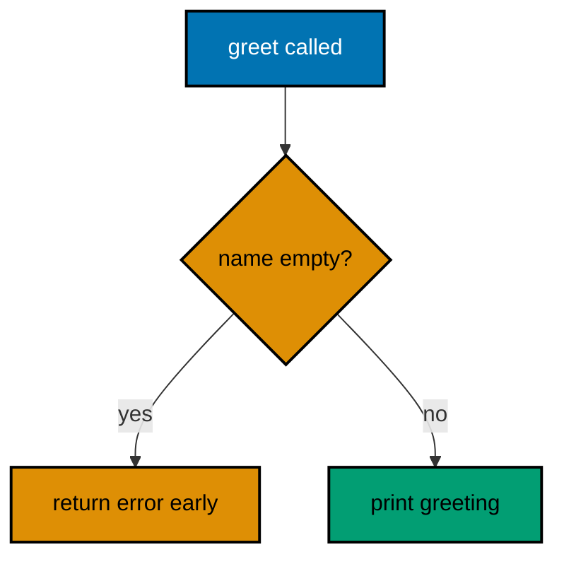
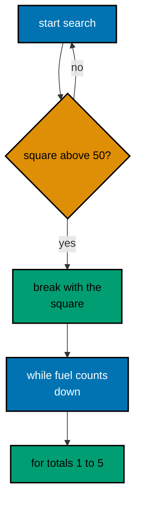
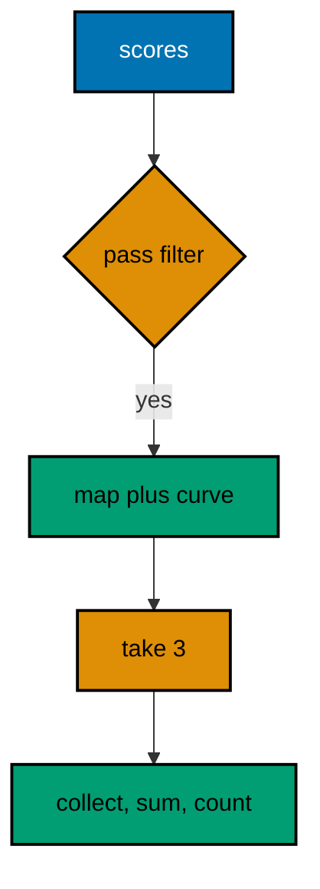
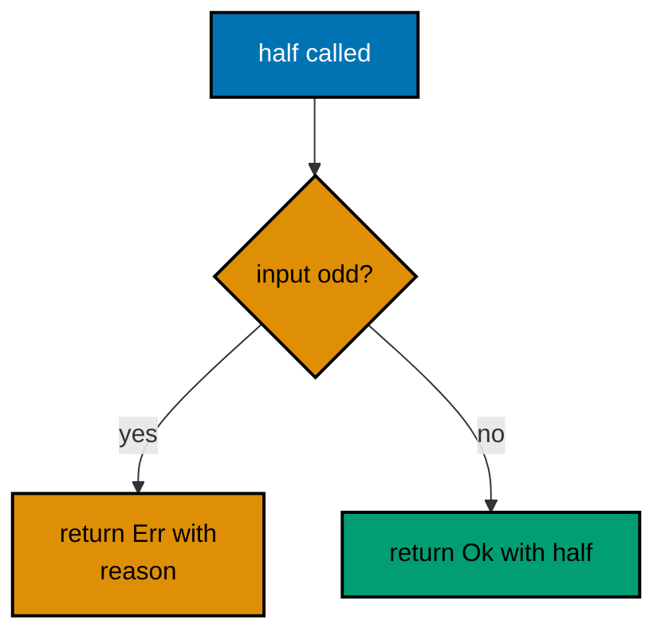
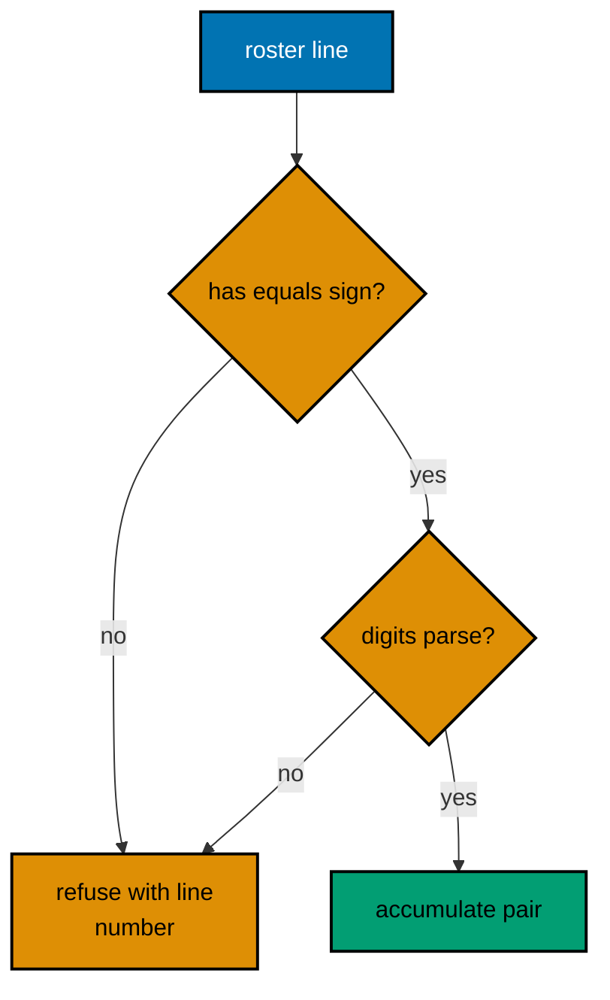
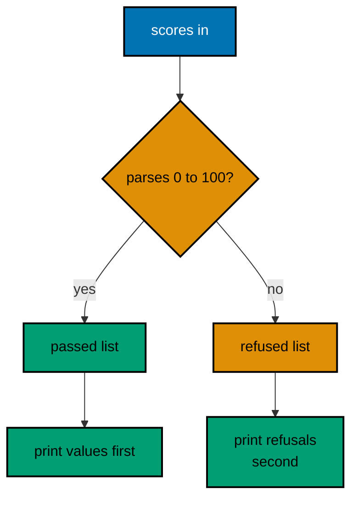
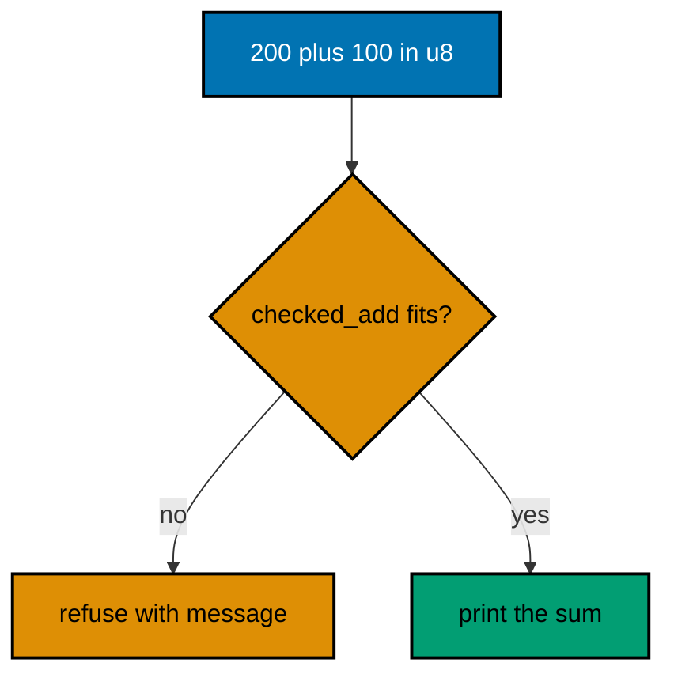
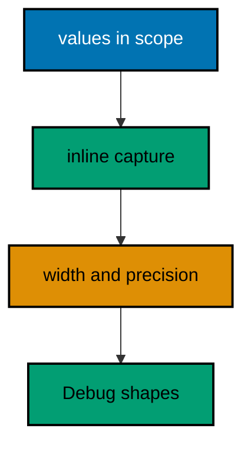
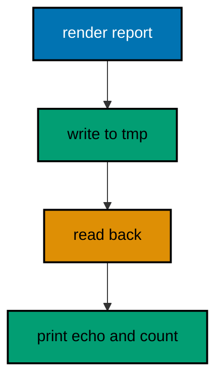

Examples 1–25 build WebAssembly fluency from the ground up: idiomatic control flow and collections first (Examples 1–8), showing early returns, match, if-let, loop values, vectors, maps, iterators, and slices; then the error-handling idiom in full (Examples 9–17), from Result returns through Option combinators, the ? operator, context, custom enums, module boundaries, collected failures, panic boundaries, and error trait objects; finally the standard library for daily text, file, and time work (Examples 18–25), covering formatting, splitting, parsing, bundled input, scratch output, fixed instants, durations, and paths. Every example is a complete, runnable Rust module compiled to the WASI target under `learning/code/`; run each with the command in its own `run.yaml`.

---

### Example 1: Early Return Hello

The first WebAssembly habit to build is checking the failure first and returning it, so the happy path stays at the left margin instead of nesting inside an if block. A trap aborts the whole module, so refusing bad input before acting is not style here but survival. This example greets a name but refuses an empty one before it ever prints. (Concepts: co-01, co-02.)



**`learning/code/ex-01-early-return-hello/main.rs`**:

```rust
// Example 1: Hello with an Early Return.
//
// A WebAssembly trap aborts the whole module, so idiomatic Wasm code
// refuses bad input before it ever acts: the guard clause fails fast
// and the happy path stays flat at the left margin, never nested.
// => the guard-first shape keeps every failure visible at the call site
// => no nesting means no hidden path for a bug to hide inside

// greet prints a greeting, refusing an empty name up front.
// => the return type is data (Result), never a thrown exception
// => callers handle the failure exactly where the call happens
fn greet(name: &str) -> Result<(), String> {
    // => guard clause first: the failure case is decided up front
    if name.is_empty() {
        // => build the failure value and leave immediately
        return Err(String::from("name is empty"));
    }
    // => past the guard, the name is safe to use without further checks
    println!("hello, {name}");
    // => Ok(()) means success: there is nothing else to report
    Ok(())
}

fn main() {
    // => match the first call: the empty name trips the guard clause
    match greet("") {
        // => Err arm prints the failure value the guard returned
        Err(message) => println!("error: {message}"),
        // => Ok arm is unreachable here: the guard always refuses ""
        Ok(()) => println!("unexpected success"),
    }
    // => same call shape, valid input: success prints inside greet
    match greet("Sari") {
        // => Err arm is unreachable: a real name passes the guard
        Err(message) => println!("error: {message}"),
        // => Ok arm stays quiet: the greeting already printed above
        Ok(()) => {}
    }
}
```

**Output** (`learning/code/ex-01-early-return-hello/expected/main.stdout.txt`):

```text
error: name is empty
hello, Sari
```

**Key takeaway**: Check the failure first and return it; the happy path stays flat.

**Why it matters**: Early returns keep nesting shallow, which is why idiomatic code reads as a sequence of guards followed by one straight happy path. The match at the call site makes every failure visible exactly where it can happen. Reach for the guard first whenever invalid input is cheap to detect: the earlier the refusal, the less state the reader must hold while checking the rest.

### Example 2: Match Replaces If Ladders

A tagless if-else ladder repeats the variable and hides the order of its bands; match lists each range once, top-down, and the compiler proves every case is covered. Adding a band later means adding one arm, not re-reading a ladder for the right insertion point. This example grades scores through five bands, hitting both edges of each. (Concepts: co-01.)

**`learning/code/ex-02-match-replaces-if-ladders/main.rs`**:

```rust
// Example 2: Match Replaces If Ladders.
//
// A tagless if-else ladder repeats the variable and hides the order;
// match lists each range once, top-down, and the compiler proves every
// case is covered, so a new variant breaks the build instead of the run.
// => exhaustiveness is checked at compile time, not discovered in tests
// => each arm reads as one rule: pattern on the left, outcome on the right

// grade turns a score into its letter, narrowest band first.
// => u8 pins the input to 0..=255: out-of-range scores cannot exist
// => match on ranges keeps the boundary order visible in one place
fn grade(score: u8) -> char {
    // => arms are tried top-down; the first matching range wins
    match score {
        // => 90 and above is the narrowest, most selective band
        90..=100 => 'A',
        // => each band below widens toward the failing tail
        80..=89 => 'B',
        70..=79 => 'C',
        60..=69 => 'D',
        // => the catch-all arm closes the ladder: no score is ungraded
        _ => 'F',
    }
}

fn main() {
    // => a fixed table drives every band, including both edges of each
    let scores = [95u8, 90, 89, 80, 79, 70, 69, 60, 59, 0];
    // => iterate by value: u8 is Copy, so no borrow bookkeeping intrudes
    for score in scores {
        // => one line per score keeps the band table readable as output
        println!("{score} -> {}", grade(score));
    }
}
```

**Output** (`learning/code/ex-02-match-replaces-if-ladders/expected/main.stdout.txt`):

```text
95 -> A
90 -> A
89 -> B
80 -> B
79 -> C
70 -> C
69 -> D
60 -> D
59 -> F
0 -> F
```

**Key takeaway**: List each range once in a match; exhaustiveness is checked, not hoped for.

**Why it matters**: Range arms make boundary order visible in one place, so the next reader sees the grading policy without simulating a ladder. The catch-all arm closes the scale: no input falls through silently. When a new band arrives, the diff touches one arm instead of re-indenting a ladder, so reviews stay small and boundary mistakes surface as a wrong arm rather than a wrong nesting level.

### Example 3: If Let Unwraps Option

Option marks a value that may be absent; if let opens only the Some case without nesting, so lookup code reads as "use it when it is there". The let-else form inverts the same idea for guards, diverging early when the value is missing. This example looks up nicknames in a tiny directory, hitting, guarding, and missing on purpose. (Concepts: co-01, co-02.)

**`learning/code/ex-03-if-let-unwraps-option/main.rs`**:

```rust
// Example 3: If Let Unwraps Option.
//
// Option marks a value that may be absent; if let opens only the Some
// case and skips the None case without nesting, so lookup code reads as
// "use it when it is there" instead of "prove it is there, then use it".
// => if let fuses the test and the unwrap into one readable step
// => the else branch stays optional: absence needs no ceremony

// nickname looks a name up in a tiny directory of preferred names.
// => Option<&str> says absence is ordinary data, not a failure to report
// => 'a links the answer to the directory: the borrower's contract, in full
// => lifetimes arrive properly in Example 53: read 'a as "borrows from" here
fn nickname<'a>(directory: &[(&'a str, &'a str)], name: &str) -> Option<&'a str> {
    // => find returns the first pair whose key matches, or None
    directory
        .iter()
        .find(|(key, _)| *key == name)
        // => map keeps only the nickname half of the found pair
        .map(|(_, nick)| *nick)
}

fn main() {
    // => a fixed directory: lookups below hit and miss on purpose
    // => pairs are (&str, &str): the borrow lives as long as this array
    let directory = [("Sari", "S"), ("Budi", "B")];
    // => if let opens the Some case directly into a usable binding
    if let Some(nick) = nickname(&directory, "Sari") {
        // => inside this block, nick is a plain &str: no unwrap in sight
        println!("Sari goes by {nick}");
    }
    // => the modern let-else form inverts the same idea for guards
    let Some(nick) = nickname(&directory, "Budi") else {
        // => divergence arm: return, break, or continue belong here
        println!("no nickname on file");
        return;
    };
    // => past the let-else, nick is usable with no further checks
    println!("Budi goes by {nick}");
    // => a miss takes the quiet path: absence prints as absence
    if let Some(nick) = nickname(&directory, "Citra") {
        println!("Citra goes by {nick}");
    } else {
        // => else runs only for None: the miss is handled, not trapped
        println!("Citra has no nickname");
    }
}
```

**Output** (`learning/code/ex-03-if-let-unwraps-option/expected/main.stdout.txt`):

```text
Sari goes by S
Budi goes by B
Citra has no nickname
```

**Key takeaway**: if let fuses the test and the unwrap; let-else inverts it for guards.

**Why it matters**: Absence stays ordinary data instead of becoming ceremony. The borrow in the signature (with its lifetime, fully explained in Example 53) keeps the answer tied to the directory it came from. Prefer if let at a single use site and let-else at a function boundary: the first keeps the happy path flat for one value, the second refuses early so the remaining lines assume success.

### Example 4: Loops Return Values

Rust loops are expressions: loop can break with a value, while guards each step, and for walks any iterator. Picking the loop whose exit condition is visible in its own header removes flag variables and the off-by-one errors that travel with them. This example searches with a value-carrying break, counts down with while, and totals with for. (Concepts: co-01.)



**`learning/code/ex-04-loop-breaks-with-values/main.rs`**:

```rust
// Example 4: Loops Return Values.
//
// Rust loops are expressions: loop can break with a value, while guards
// each step, and for walks any iterator, so counting, searching, and
// repeating each pick the loop shape that shows its own exit condition.
// => prefer the loop whose exit condition is visible in its own header
// => break with a value turns a search into an expression, not a flag

fn main() {
    // => block plus loop: the search reads as one value-producing unit
    // => the block scopes the counter: n never leaks into the code below
    let first_big = {
        // => a mutable counter drives the search upward from 1
        let mut n = 1u32;
        loop {
            // => square before comparing: the check reads the real value
            let square = n * n;
            // => break carries the answer out: no flag variable needed
            if square > 50 {
                break square;
            }
            // => only reached while the answer is still too small
            n += 1;
        }
    };
    // => 8 is the first n with n*n above 50, so 64 always prints
    // => the block evaluates to the break value: first_big needs no mut
    println!("first square above 50: {first_big}");
    // => while guards a countdown: the condition is the whole story
    // => no initializer beyond fuel: the condition carries the whole loop
    let mut fuel = 3u32;
    while fuel > 0 {
        // => print-then-decrement keeps the trace in countdown order
        println!("fuel: {fuel}");
        fuel -= 1;
        // => decrement, not reset: the loop counts down to zero exactly
    }
    // => for walks a range: no index variable to initialize or forget
    // => 1..=5 is inclusive on both ends: five iterations, never six
    let mut total = 0u32;
    for n in 1..=5 {
        // => accumulation is the only statement: the loop adds, nothing else
        total += n;
    }
    // => 1+2+3+4+5 is fixed arithmetic: the total never varies by run
    println!("total 1..=5: {total}");
}
```

**Output** (`learning/code/ex-04-loop-breaks-with-values/expected/main.stdout.txt`):

```text
first square above 50: 64
fuel: 3
fuel: 2
fuel: 1
total 1..=5: 15
```

**Key takeaway**: Prefer the loop whose exit condition is visible in its own header.

**Why it matters**: A break with a value turns a search into an expression instead of a flag variable that must be initialized, set, and checked in three different places. Prefer the loop whose exit condition reads in its own header: for owns counting, while owns conditions, and loop with a value-carrying break owns search, so each shape advertises its own termination.

### Example 5: Vec Grows on Push

Vec owns a growable buffer: push appends, length counts the live elements, and capacity counts the reserved slots. Watching both numbers teaches the doubling rule without reading allocator source: a thousand pushes reallocate only about ten times. This example pushes four readings through a capacity-2 buffer so the first growth is visible. (Concepts: co-01, co-03, co-15.)

**`learning/code/ex-05-vec-grows-on-push/main.rs`**:

```rust
// Example 5: Vec Grows on Push.
//
// Vec owns a growable buffer: push appends at the end, length counts the
// live elements, and capacity counts the reserved slots, so watching both
// numbers teaches the doubling rule without reading allocator source.
// => length is what you filled; capacity is what you reserved ahead
// => growth doubles, so a thousand pushes reallocate only ~ten times

fn main() {
    // => with_capacity reserves 2 slots: the first growth is then visible
    let mut readings: Vec<u32> = Vec::with_capacity(2);
    // => fixed input: the same four pushes run on every execution
    for reading in [21u32, 22, 23, 24] {
        // => push may reallocate: the Vec hides that move from callers
        readings.push(reading);
        // => length and capacity after each push show the doubling rule
        println!(
            "pushed {reading}: len={} cap={}",
            readings.len(),
            readings.capacity()
        );
    }
    // => pop removes from the end: the Vec shrinks logically, not physically
    if let Some(last) = readings.pop() {
        // => pop returns Option: an empty Vec yields None instead of trapping
        println!("popped {last}: len={}", readings.len());
    }
    // => indexing a live position is safe: the length check already passed
    println!("first reading: {}", readings[0]);
}
```

**Output** (`learning/code/ex-05-vec-grows-on-push/expected/main.stdout.txt`):

```text
pushed 21: len=1 cap=2
pushed 22: len=2 cap=2
pushed 23: len=3 cap=4
pushed 24: len=4 cap=4
popped 24: len=3
first reading: 21
```

**Key takeaway**: Length is what you filled; capacity is what you reserved ahead.

**Why it matters**: Growth doubling is the reason push stays cheap on average, and with_capacity is how you skip the early reallocations when you know the size up front. Pop returns Option because an empty Vec yields None instead of trapping. Measure before reserving: with_capacity pays only when the size is known, and the doubling rule means even a cold Vec amortizes push to constant time, which is why push stays the default and reserve stays the optimization.

### Example 6: HashMap Counts with Entry

Counting with a map has one hazard: the first sighting has no entry yet. The entry API turns "insert or update" into one lookup, so the miss path and the hit path share a single line. This example counts words through entry, then sorts before printing, because HashMap iteration order varies run to run and goldens must not. (Concepts: co-01, co-03.)

**`learning/code/ex-06-hashmap-returns-two-values/main.rs`**:

```rust
// Example 6: HashMap Counts with Entry.
//
// Counting with a map has one hazard: the first sighting has no entry
// yet. The entry API turns "insert or update" into one lookup, so the
// miss path and the hit path share a single line instead of two.
// => entry() finds the slot once: no double lookup, no clone of the key
// => or_insert hands back a mutable count the caller bumps in place

// A HashMap iterates in hash order, which varies run to run, so this
// example always sorts its keys before printing: sorted output is the
// price of deterministic transcripts. See learning/code/README.md.
// => sorting before printing keeps every golden file byte-identical
// => the rule applies to every map in this course, without exception
use std::collections::HashMap;

fn main() {
    // => fixed words: the counts below are hand-checkable constants
    let words = ["wasm", "fast", "wasm", "sandboxed", "fast", "wasm"];
    // => the counter starts empty: every word is first seen as a miss
    let mut counts: HashMap<&str, u32> = HashMap::new();
    for word in words {
        // => entry finds-or-creates the slot, then bumps it in place
        *counts.entry(word).or_insert(0) += 1;
    }
    // => collect and sort: iteration order is never printed raw
    let mut ranked: Vec<(&str, u32)> = counts.into_iter().collect();
    ranked.sort();
    // => one line per word: the counts are fixed by the input above
    for (word, count) in ranked {
        println!("{word}: {count}");
    }
}
```

**Output** (`learning/code/ex-06-hashmap-returns-two-values/expected/main.stdout.txt`):

```text
fast: 2
sandboxed: 1
wasm: 3
```

**Key takeaway**: entry finds the slot once; sorting before printing keeps output deterministic.

**Why it matters**: One lookup instead of two removes the double-lookup bug class, and the sort-before-print rule in `learning/code/README.md` applies to every map in this course without exception. Reach for entry whenever the miss path and the hit path share one line: the single lookup keeps counts correct under rehash, and the sorted print keeps the transcript byte-identical across runs and platforms.

### Example 7: Iterators Replace Loops

An iterator chain names the transformation while a hand loop names the machinery; the chain cannot miscount because there is no counter to get wrong. Lazy adapters fuse the passes with no intermediate vector, and terminals (collect, sum, count) choose the result shape. This example builds an honors list, a total, and a count from one fixed table. (Concepts: co-01, co-03, co-15.)



**`learning/code/ex-07-iterators-replace-loops/main.rs`**:

```rust
// Example 7: Iterators Replace Loops.
//
// A filter-map-take chain names the transformation while a hand loop names
// the machinery; the chain version cannot miscount because there is no
// counter to get wrong, and lazy adapters fuse the passes with no vector.
// => adapters compose; terminals execute: no terminal, no work happens
// => take caps the pull: the pipeline stops after enough answers arrive

fn main() {
    // => fixed scores: every number below is checkable by hand
    let scores = [55u32, 91, 48, 77, 88, 62, 95, 30];
    // => filter keeps passes, map lifts each by a 5-point curve, take(3)
    // => caps the honors list: the chain reads like its own specification
    let honors: Vec<u32> = scores
        .iter()
        .filter(|score| **score >= 60)
        .map(|score| *score + 5)
        .take(3)
        .collect();
    // => Debug prints the whole Vec: the three honored scores in order
    println!("honored: {honors:?}");
    // => sum is the terminal reduction: no accumulator variable exists
    let pass_total: u32 = scores.iter().filter(|score| **score >= 60).sum();
    // => five scores pass (91+77+88+62+95); the sum is fixed arithmetic
    println!("pass total: {pass_total}");
    // => count is another terminal: it consumes the pipeline in one word
    let distinction = scores.iter().filter(|score| **score >= 85).count();
    // => 91, 88, and 95 clear 85, so the count is always 3
    println!("distinctions: {distinction}");
}
```

**Output** (`learning/code/ex-07-iterators-replace-loops/expected/main.stdout.txt`):

```text
honored: [96, 82, 93]
pass total: 413
distinctions: 3
```

**Key takeaway**: Adapters compose the pipeline; exactly one terminal executes it.

**Why it matters**: The chain reads like its own specification, and each terminal (Vec, sum, count) is one word instead of a loop with its own accumulator to initialize and forget. Read the chain left to right as the specification: each adapter names one decision, the terminal names the result shape, and the absence of indices means off-by-one errors have nowhere to hide.

### Example 8: Slices Borrow Views

A slice is a borrowed window into an array or Vec: no copy happens, so windows, chunks, and split_at all cost O(1) to form. The borrow checker guarantees the owner outlives every window it lends. This example slides windows, cuts chunks, and splits one borrow into two disjoint views. (Concepts: co-01, co-03.)

**`learning/code/ex-08-slices-borrow-views/main.rs`**:

```rust
// Example 8: Slices Borrow Views.
//
// A slice is a borrowed window into a Vec, an array, or a string: no
// copy happens, so windows, chunks, and split_at all cost O(1) to form.
// The borrow checker guarantees the owner outlives every window it lends.
// => slicing never allocates: each view is a (pointer, length) pair
// => the owner must stay alive and unmutated while views are in use

fn main() {
    // => a fixed frame of samples: every window below is hand-checkable
    let samples = [2u32, 4, 4, 4, 5, 5, 7, 9];
    // => windows(3) slides a 3-wide view: six windows over eight samples
    for (index, window) in samples.windows(3).enumerate() {
        // => Debug prints each borrowed triple: no allocation per window
        println!("window {index}: {window:?}");
    }
    // => chunks(3) cuts non-overlapping views: 3 + 3 + 2 for eight items
    for (index, chunk) in samples.chunks(3).enumerate() {
        // => the last chunk is short: chunks never pad, they end early
        println!("chunk {index}: {chunk:?}");
    }
    // => split_at divides one borrow into two disjoint views at index 4
    let (head, tail) = samples.split_at(4);
    // => both halves print: the split point is visible in the output
    println!("head: {head:?}");
    println!("tail: {tail:?}");
}
```

**Output** (`learning/code/ex-08-slices-borrow-views/expected/main.stdout.txt`):

```text
window 0: [2, 4, 4]
window 1: [4, 4, 4]
window 2: [4, 4, 5]
window 3: [4, 5, 5]
window 4: [5, 5, 7]
window 5: [5, 7, 9]
chunk 0: [2, 4, 4]
chunk 1: [4, 5, 5]
chunk 2: [7, 9]
head: [2, 4, 4, 4]
tail: [5, 5, 7, 9]
```

**Key takeaway**: Slicing never allocates; each view is a (pointer, length) pair.

**Why it matters**: Windows and chunks turn "look at neighbors" from index arithmetic into one method call, and split_at divides one borrow into two disjoint views the checker proves cannot overlap. Prefer views over copies whenever the data already lives somewhere: a slice costs two words to form, never allocates, and the checker guarantees the owner outlives every window it lends.

### Example 9: Result Instead of Exceptions

Recoverable failure is a value: Result carries either the answer or the reason, and the caller matches both arms at the call site. Nothing unwinds across layers, so a Wasm trap always means a bug, never a mishandled input. This example halves even numbers and refuses odd ones with a readable reason. (Concepts: co-02.)



**`learning/code/ex-09-result-instead-of-exceptions/main.rs`**:

```rust
// Example 9: Result Instead of Exceptions.
//
// Recoverable failure is a value: Result carries either the answer or
// the reason, and the caller matches both arms at the call site.
// Nothing unwinds across layers, so a Wasm trap always means a bug,
// never a mishandled input.
// => Ok holds the answer; Err holds a reason the caller can read
// => matching at the call site keeps the failure next to its cause

// half refuses odd inputs: halving an odd number loses information.
// => Result<i32, String> makes the refusal part of the signature
// => the signature is the documentation: no hidden failure modes
fn half(even: i32) -> Result<i32, String> {
    // => the guard names the exact input this function cannot serve
    if even % 2 != 0 {
        // => Err carries a readable reason, not a code to look up
        return Err(format!("{even} is odd, cannot halve exactly"));
    }
    // => the happy path divides: even inputs always divide cleanly
    Ok(even / 2)
}

fn main() {
    // => match the refusal first: odd input prints its reason, exit stays 0
    match half(7) {
        // => Ok arm is unreachable: 7 trips the oddness guard above
        Ok(value) => println!("half of 7: {value}"),
        // => Err arm prints the reason: the failure is handled, not thrown
        Err(reason) => println!("refused: {reason}"),
    }
    // => match the success: even input divides and prints its half
    match half(8) {
        // => Ok arm prints 4: the only reachable arm for even input
        Ok(value) => println!("half of 8: {value}"),
        // => Err arm is unreachable: even inputs never hit the guard
        Err(reason) => println!("refused: {reason}"),
    }
}
```

**Output** (`learning/code/ex-09-result-instead-of-exceptions/expected/main.stdout.txt`):

```text
refused: 7 is odd, cannot halve exactly
half of 8: 4
```

**Key takeaway**: Ok holds the answer; Err holds a reason the caller can read.

**Why it matters**: Matching at the call site keeps the failure next to its cause, and the signature documents the refusal so no hidden failure mode survives into production. Reserve exceptions for bugs and Results for refusals: the caller matches every documented failure at the site that caused it, so production logs show decisions instead of stack traces from mishandled input.

### Example 10: Option Combinators Chain

Nested if-lets pyramid quickly; combinators (map, and_then, unwrap_or) keep an optional pipeline flat by threading the Some value through and short-circuiting the first None to one default at the very end. This example chains two lookups (name to nickname, nickname to badge) and defaults only once. (Concepts: co-02.)

**`learning/code/ex-10-option-for-absent-values/main.rs`**:

```rust
// Example 10: Option Combinators Chain.
//
// Nested if-lets pyramid quickly; combinators (map, and_then, unwrap_or)
// keep an optional pipeline flat by threading the Some value through and
// short-circuiting the first None to the default at the very end.
// => map transforms inside Some; and_then chains fallible steps
// => exactly one default appears, at the end, as unwrap_or's argument

// nickname_of looks a name up in a tiny directory of preferred names.
// => Option<&str> keeps absence ordinary: misses are data, not errors
// => callers below compose the steps without a single nested branch
fn nickname_of(name: &str) -> Option<&str> {
    // => match on a fixed table: two names hit, everything else misses
    match name {
        "Sari" => Some("S"),
        "Budi" => Some("B"),
        // => the wildcard arm is the honest miss: no nickname exists
        _ => None,
    }
}

// badge_of maps a nickname to its badge letter, again possibly absent.
// => a second lookup stage: absence stays ordinary data here as well
fn badge_of(nick: &str) -> Option<char> {
    // => only "S" holds a badge in this fixed table
    match nick {
        "S" => Some('*'),
        // => every other nickname simply has no badge to show
        _ => None,
    }
}

fn main() {
    // => map+and_then chain: two lookups collapse into one expression
    let sari_badge = nickname_of("Sari").and_then(badge_of).unwrap_or('-');
    // => S -> *: both lookups hit, so the badge prints
    println!("Sari: {sari_badge}");
    // => the chain short-circuits at the missing badge, not at the lookup
    let budi_badge = nickname_of("Budi").and_then(badge_of).unwrap_or('-');
    // => Budi has a nickname but no badge: the default '-' prints
    println!("Budi: {budi_badge}");
    // => the chain short-circuits at the first miss for an unknown name
    let citra_badge = nickname_of("Citra").and_then(badge_of).unwrap_or('-');
    // => no nickname means no badge lookup runs at all: '-' prints
    println!("Citra: {citra_badge}");
}
```

**Output** (`learning/code/ex-10-option-for-absent-values/expected/main.stdout.txt`):

```text
Sari: *
Budi: -
Citra: -
```

**Key takeaway**: Map transforms inside Some; and_then chains fallible steps; one default ends it.

**Why it matters**: The chain short-circuits at the first miss, so no stage runs on absent input, and exactly one unwrap_or names the default instead of scattering fallbacks through branches. Keep the pipeline to one default at the end: intermediate fallbacks multiply the states the reader must simulate, while a single trailing unwrap_or says exactly what absence is worth downstream.

### Example 11: Question Mark Propagates

The ? operator is early-return shorthand: on Err it returns the error to the caller, on Ok it unwraps the value inline. A three-step pipeline becomes three lines with no match arms, yet every failure still exits through the function's own Result. This example chains port parsing and range checking into one serving decision. (Concepts: co-02.)

**`learning/code/ex-11-question-mark-propagates/main.rs`**:

```rust
// Example 11: Question Mark Propagates.
//
// The ? operator is early-return shorthand: on Err it returns the error
// to the caller, on Ok it unwraps the value inline. A three-step pipeline
// becomes three lines with no match arms, yet every failure still exits
// through the function's own Result.
// => ? after a call means "succeed here or leave with the error"
// => the function needs a Result return: ? can only exit through one

// parse_port and check_range model a setup chain, each fallible in turn.
// => parse_port refuses non-numbers with a readable message, never a trap
// => check_range refuses privileged ports WASI could never bind anyway
fn parse_port(text: &str) -> Result<u16, String> {
    // => parse failure becomes a readable refusal via map_err, not a panic
    text.parse::<u16>()
        .map_err(|_| format!("{text:?} is not a number"))
}

// check_range refuses privileged ports, which need rights WASI never has.
// => the guard names the policy: ports below 1024 stay out of reach
// => returning the port on success lets ? thread the value onward
fn check_range(port: u16) -> Result<u16, String> {
    // => 1024 is the first unprivileged port: the boundary is inclusive
    if port < 1024 {
        return Err(format!("port {port} is privileged, pick 1024 or above"));
    }
    Ok(port)
}

// describe runs the whole chain: parse, then check, then report.
// => two ? in a row: the first Err exits before the second stage runs
// => the single Ok line at the end serves only fully validated input
fn describe(text: &str) -> Result<String, String> {
    // => ? unwraps the port or returns the parse refusal immediately
    let port = parse_port(text)?;
    // => ? unwraps the checked port or returns the policy refusal instead
    let open = check_range(port)?;
    // => both stages passed: the description carries the validated port
    Ok(format!("serving on port {open}"))
}

fn main() {
    // => each input below exercises a different exit of the same chain
    for text in ["abc", "80", "3101"] {
        // => one match serves the whole pipeline: Ok prints, Err explains
        match describe(text) {
            // => reachable only when parse and check both succeed
            Ok(line) => println!("{text}: {line}"),
            // => reachable with the exact refusal of the failing stage
            Err(reason) => println!("{text}: refused: {reason}"),
        }
    }
}
```

**Output** (`learning/code/ex-11-question-mark-propagates/expected/main.stdout.txt`):

```text
abc: refused: "abc" is not a number
80: refused: port 80 is privileged, pick 1024 or above
3101: serving on port 3101
```

**Key takeaway**: ? after a call means "succeed here or leave with the error".

**Why it matters**: Each input exits at a different stage with that stage's refusal, so the transcript reads as the path the input traveled. The function needs a Result return because ? can only exit through one. Use ? at every stage that cannot proceed on failure and reserve match for the one place that decides: propagation keeps each function short, and the single exit channel keeps the error type honest.

### Example 12: Map Err Adds Context

A bare parse error says "invalid digit" but never says which field or which line; map_err wraps each fallible step with the context its caller needs. Each layer adds what it knows (field name here, line number there), so the final message reads as the input's travel path. This example loads score rosters and names the exact failing line. (Concepts: co-02.)



**`learning/code/ex-12-map-err-adds-context/main.rs`**:

```rust
// Example 12: Map Err Adds Context.
//
// A bare parse error says "invalid digit" but never says which field or
// which line; map_err wraps each fallible step with the context its caller
// needs, so the final message reads as the path the input traveled.
// => convert at the boundary: low-level errors become domain messages
// => each layer adds what it knows: field name here, line number there

// load_scores parses "name=score" lines, naming the line that breaks.
// => enumerate pairs each line with its human (1-based) line number
// => map_err on parse carries the line number into the final message
fn load_scores(text: &str) -> Result<Vec<(&str, u32)>, String> {
    // => the roster starts empty: parsed pairs accumulate in order
    let mut roster = Vec::new();
    // => Vec preserves file order: the transcript reads top-down
    for (index, line) in text.lines().enumerate() {
        // => split_once divides "name=score": None means the '=' is missing
        let Some((name, score_text)) = line.split_once('=') else {
            // => let-else diverges: shapeless rows exit here with their number
            // => the message names the line number and shows the bad line
            return Err(format!("line {}: {line:?} has no '='", index + 1));
        };
        // => parse with context: the message names the line and the field
        // => Turbofish pins u32: inference cannot guess the target type
        let score = score_text
            .parse::<u32>()
            .map_err(|_| format!("line {}: score {score_text:?} is not a number", index + 1))?;
        // => only fully validated pairs reach the roster, in file order
        // => push happens after both checks: no partial row ever lands
        roster.push((name, score));
    }
    // => the full roster returns: main prints it per fixture below
    Ok(roster)
}

fn main() {
    // => three rosters: one clean, two broken at different stages
    // => the fixed array covers the seam, the digits, and the digits shape
    let rosters = [
        "sari=91\nbudi=77",
        "sari=91\nbudi:many",
        "sari=91\nbudi=many",
    ];
    // => one match per roster: Ok prints pairs, Err prints the context
    // => the loop reuses one match: all three rosters share the verdict
    for roster in rosters {
        // => the array iterates by value: &str rosters copy, nothing borrows
        // => Debug shows the parsed pairs: names with their scores
        match load_scores(roster) {
            Ok(pairs) => println!("parsed: {pairs:?}"),
            // => the message always names the failing line and the cause
            Err(reason) => println!("refused: {reason}"),
        }
    }
}
```

**Output** (`learning/code/ex-12-map-err-adds-context/expected/main.stdout.txt`):

```text
parsed: [("sari", 91), ("budi", 77)]
refused: line 2: "budi:many" has no '='
refused: line 2: score "many" is not a number
```

**Key takeaway**: Convert at the boundary: low-level errors become domain messages.

**Why it matters**: Context travels with the error instead of living in whoever happened to log it, so the on-call reader finds the failing line and field in the message itself. Add context at the layer that knows it: the parser knows the line, the loader knows the field, and the final message reads as the path the input traveled, so nobody greps logs to reconstruct the failure.

### Example 13: Custom Error Enums Carry Cases

String errors describe one failure; an enum names every failure the module can produce, so callers match cases instead of parsing text. Display renders each variant for humans, and one Error impl plugs the enum into every ? chain and boxed-error boundary. This example grades with Missing and OutOfRange as separate, matchable cases. (Concepts: co-02.)

**`learning/code/ex-13-custom-error-enum/main.rs`**:

```rust
// Example 13: Custom Error Enums Carry Cases.
//
// String errors describe one failure; an enum names every failure the
// module can produce, so callers match cases instead of parsing text.
// Display renders each variant for humans; the Error trait plugs the enum
// into every ? chain and Box<dyn Error> boundary in the ecosystem.
// => one variant per failure cause: the compiler lists what can go wrong
// => Display is the human face; the enum itself is the machine contract

use std::fmt;

// => fmt is the Display home: the trait and the formatter live here

// GradeError names the two ways grading one score can fail.
// => two variants, two causes: missing input versus a bad value
// => Debug derives for free: Display below is written by hand, on purpose
#[derive(Debug)]
enum GradeError {
    // => the enum never leaves this file: grade returns it, main matches it
    // => no score was supplied at all: the input row was empty
    Missing,
    // => a score arrived but lies outside 0..=100: out of grading range
    OutOfRange(u8),
}

// Display turns each variant into the sentence a user should read.
// => match every variant: adding a case forces a message for it too
// => write! to the formatter: no allocation beyond the final String
impl fmt::Display for GradeError {
    // => Display serves one audience: the human reading the transcript
    fn fmt(&self, f: &mut fmt::Formatter<'_>) -> fmt::Result {
        // => &self borrows: rendering a refusal must not consume it
        match self {
            // => self is the case: each arm renders one failure story
            // => Missing explains itself: nothing to grade was given
            GradeError::Missing => write!(f, "no score supplied"),
            // => OutOfRange echoes the bad value so the caller can find it
            GradeError::OutOfRange(score) => write!(f, "score {score} is outside 0..=100"),
        }
    }
}

// Error has no required methods here: the impl is the plug itself.
// => this one line admits GradeError into ? chains and boxed errors
// => Debug + Display above already satisfy the trait's only bounds
impl std::error::Error for GradeError {}

// grade refuses missing and out-of-range scores with a typed refusal.
// => Option input models rows where the score column may be absent
// => the error type is GradeError: callers match cases, never substrings
fn grade(score: Option<u8>) -> Result<char, GradeError> {
    // => None maps to the Missing case: absence is a named failure
    let score = score.ok_or(GradeError::Missing)?;
    // => the range guard maps outliers to their carrying variant
    if score > 100 {
        return Err(GradeError::OutOfRange(score));
    }
    // => validated input grades exactly like Example 2's table
    Ok(match score {
        90..=100 => 'A',
        80..=89 => 'B',
        70..=79 => 'C',
        60..=69 => 'D',
        _ => 'F',
    })
}

fn main() {
    // => main exercises every case: one input per variant plus the pass
    // => three inputs: missing, out of range, and a clean pass
    for score in [None, Some(104), Some(85)] {
        // => Debug on the input shows which case each line exercises
        match grade(score) {
            // => the letter prints: grading succeeded for this input
            Ok(letter) => println!("{score:?} -> {letter}"),
            // => Display renders the case: the human message, not the variant
            Err(reason) => println!("{score:?} -> error: {reason}"),
        }
    }
}
```

**Output** (`learning/code/ex-13-custom-error-enum/expected/main.stdout.txt`):

```text
None -> error: no score supplied
Some(104) -> error: score 104 is outside 0..=100
Some(85) -> B
```

**Key takeaway**: One variant per failure cause; Display is the human face of each.

**Why it matters**: Adding a failure means adding a variant, which forces a message for it too. Callers match cases that the compiler checks instead of substrings that only tests might catch. Name one variant per failure the module can produce and render each for humans: the compiler then checks every caller exhaustively, and new failures arrive with their messages instead of their mysteries.

### Example 14: Errors Cross Module Boundaries

A module owns its errors: parse failures stay a ParseError inside the parsing module, and the crate root converts once at the boundary with From. Callers meet one error type while each module keeps the cases only it can produce. This example parses a roster through a module seam with a single conversion. (Concepts: co-02, co-06.)

**`learning/code/ex-14-errors-cross-module-boundaries/main.rs`**:

```rust
// Example 14: Errors Cross Module Boundaries.
//
// A module owns its errors: parse failures stay a ParseError inside the
// parsing module, and the crate root converts once at the boundary.
// Callers of the crate meet one error type, while each module keeps the
// cases only it can produce.
// => small modules, small errors: each failure lives where it is caused
// => From conversions at the boundary keep ? working across the seam

// catalog is the parsing module: names, scores, and their failures.
// => one module, one error enum: ParseError names only parsing failures
// => the enum stays private: outsiders meet the crate error instead
mod catalog {
    // => pub items are the module's whole API: parse_line and ParseError only
    // => two cases: a line without '=', or a score that is not a number
    #[derive(Debug)]
    pub enum ParseError {
        // => pub enum in a private module: reachable paths stay inside this file
        // => carries the offending line so the message can show it
        NoSeparator(String),
        // => carries the offending digits for the same reason
        BadScore(String),
    }

    // => parse_line serves one "name=score" line or names its failure
    pub fn parse_line(line: &str) -> Result<(&str, u32), ParseError> {
        // => the name borrows the input line: clean rows cost no allocation
        // => split_once divides at '=': None means the line is shapeless
        let (name, score_text) = line
            // => the binding splits the row: name borrows, digits wait to parse
            .split_once('=')
            // => the whole line rides along: the message can quote it
            .ok_or_else(|| ParseError::NoSeparator(line.to_string()))?;
        // => the digits parse or the BadScore case carries them upward
        let score = score_text
            // => score_text becomes score: the name shortens once digits are proven
            .parse::<u32>()
            .map_err(|_| ParseError::BadScore(score_text.to_string()))?;
        Ok((name, score))
        // => the pair borrows the line: the caller owns the text, not the row
    }
}

// A crate-level error with one variant per module stage, starting here
// with only the catalog stage: later stages would add their own arms.
// => the boundary converts once, so main matches one type, not many
// => From<ParseError> lets ? cross the module seam without map_err
#[derive(Debug)]
enum RosterError {
    // => Catalog is the only stage today: new modules add new arms here
    // => wraps the module error: no information is lost in conversion
    Catalog(catalog::ParseError),
}

// => From is the ? bridge: catalog failures become roster failures
impl From<catalog::ParseError> for RosterError {
    // => one-line wrap: the boundary conversion stays boring on purpose
    fn from(error: catalog::ParseError) -> Self {
        RosterError::Catalog(error)
    }
}

// load_all parses every line, letting ? cross the module boundary.
// => map_err(RosterError::from) converts each ParseError at the seam below
// => main sees one error type no matter how many modules grow behind it
fn load_all(text: &str) -> Result<Vec<(&str, u32)>, RosterError> {
    // => convert then collect: the first Err aborts with its case intact
    text.lines()
        .map(catalog::parse_line)
        .map(|row| row.map_err(RosterError::from))
        .collect()
    // => lines() drops a trailing newline: a final newline adds no empty row
}

// Display renders the boundary error by reading the module case inside.
// => match through both layers: the boundary names the module and cause
// => main prints {reason}: the typed rendering, never a Debug dump
impl std::fmt::Display for RosterError {
    fn fmt(&self, f: &mut std::fmt::Formatter<'_>) -> std::fmt::Result {
        match self {
            RosterError::Catalog(inner) => match inner {
                // => the separator case quotes the shapeless row for the author
                catalog::ParseError::NoSeparator(row) => write!(f, "catalog: {row:?} has no '='"),
                // => the digits case quotes the bad number for the author
                catalog::ParseError::BadScore(digits) => {
                    write!(f, "catalog: score {digits:?} is not a number")
                }
            },
        }
    }
}

fn main() {
    // => two rosters: one clean, one broken at the second line
    for roster in ["sari=91\nbudi=77", "sari=91\nbudi--77"] {
        // => Display on the boundary error names the module case inside
        match load_all(roster) {
            // => clean rosters print their parsed pairs in file order
            Ok(pairs) => println!("parsed: {pairs:?}"),
            // => broken input prints the converted case: module, row, cause
            Err(reason) => println!("refused: {reason}"),
        }
    }
}
```

**Output** (`learning/code/ex-14-errors-cross-module-boundaries/expected/main.stdout.txt`):

```text
parsed: [("sari", 91), ("budi", 77)]
refused: catalog: "budi--77" has no '='
```

**Key takeaway**: Small modules, small errors; From conversions keep ? working across the seam.

**Why it matters**: The boundary converts once, so main matches one type no matter how many modules grow behind it, and no failure information is lost in conversion because the wrapper carries the module case inside. Convert at the boundary and nowhere else: modules keep their small precise errors for their own matches, main sees one type for its report, and the wrapper preserves the original case for debugging.

### Example 15: Collect Failures into a Report

Stopping at the first error hides the other four; validating forms need every problem at once. Splitting one mixed list of Results into clean values and refusal reasons prints the full report in one pass: values first, then every failure. This example validates seven candidates and refuses three in different ways. (Concepts: co-02.)

**`learning/code/ex-15-collect-failures-into-report/main.rs`**:

```rust
// Example 15: Collect Failures into a Report.
//
// Stopping at the first error hides the other four; validating forms
// need every problem at once. Splitting one mixed list of Results into
// clean values and refusal reasons prints the full report in one pass.
// => partition_map would need a third-party crate: partition stays in std
// => values print first, then every failure: the report reads top-down

// check_score validates one score, refusing negatives and outliers.
// => i32 input admits below-zero values so the guard has work to do
// => the happy range 0..=100 returns the score unchanged for collection
fn check_score(score: i32) -> Result<i32, String> {
    // => the range guard names both edges: below 0 or above 100 refuses
    if !(0..=100).contains(&score) {
        return Err(format!("score {score} is outside 0..=100"));
    }
    Ok(score)
}

fn main() {
    // => seven candidates: four clean, three broken in different ways
    let candidates = [91, -4, 77, 104, 62, -1, 88];
    // => map every candidate to its Result, then split oks from errs
    let (passed, failed): (Vec<Result<i32, String>>, Vec<Result<i32, String>>) =
        // => into_iter moves the array: no borrow outlives this statement
        candidates.into_iter().map(check_score).partition(Result::is_ok);
    // NOTE: partition keeps Results whole on both sides; the maps below
    // open each side. Two passes read clearer than one clever fold here.
    // => filter_map with .ok() keeps only the passing scores, in order
    let passed: Vec<i32> = passed.into_iter().filter_map(Result::ok).collect();
    // => filter_map with .err() keeps only the refusal reasons, in order
    let failed: Vec<String> = failed.into_iter().filter_map(Result::err).collect();
    // => the clean scores print first: the report leads with good news
    println!("passed: {passed:?}");
    // => each refusal prints on its own line: every problem is visible
    for reason in failed {
        println!("refused: {reason}");
    }
}
```

**Output** (`learning/code/ex-15-collect-failures-into-report/expected/main.stdout.txt`):

```text
passed: [91, 77, 62, 88]
refused: score -4 is outside 0..=100
refused: score 104 is outside 0..=100
refused: score -1 is outside 0..=100
```

**Key takeaway**: Partition Results, then open each side; values print first, failures after.

**Why it matters**: Form validation reports every problem in one pass instead of making the user fix-and-resubmit five times. Two passes read clearer than one clever fold, so the code stays reviewable. Partition is the shape to reach for in validation, review, and import: keep every success usable, report every refusal with its reason, and never make the user fix blind one error at a time.



### Example 16: Panic Stays at the Boundary

Panic means a bug, never a validation: in a Wasm module it traps the whole instance, so library code returns Result and reserves assert for contracts the caller cannot break without misusing the API. Checked arithmetic turns overflow from a trap into a matchable None. This example refuses overflowing and underflowing arithmetic with messages, never traps. (Concepts: co-02.)



**`learning/code/ex-16-panic-stays-at-the-boundary/main.rs`**:

```rust
// Example 16: Panic Stays at the Boundary.
//
// Panic means a bug, never a validation: in a Wasm module it traps the
// whole instance, so library code returns Result and reserves assert for
// contracts the caller cannot break without misusing the API. Checked
// arithmetic turns overflow from a trap into a matchable None.
// => debug_assert documents intent for test builds, free in release
// => the rule: fallible input gets Result, impossible states get assert

fn main() {
    // => checked_add returns None on overflow instead of trapping release
    match 200u8.checked_add(100) {
        // => reachable only when the sum fits: 200 + 100 never does
        Some(sum) => println!("200 + 100 = {sum}"),
        // => the honest overflow path: a message, not a trap, exit stays 0
        None => println!("200u8 + 100 overflows: refused, not trapped"),
    }
    // => saturating_add clamps at the edge: 200 + 100 pins to 255
    let clamped = 200u8.saturating_add(100);
    // => clamping is the documented choice for meters and progress bars
    println!("saturating 200 + 100 = {clamped}");
    // => debug_assert states the contract for test builds, free in release
    let sides = 4u32;
    // => a square always has four sides: asserting it says "trust, verify"
    debug_assert!(sides == 4, "a square needs four sides");
    // => reaching this line proves the contract holds in this build too
    println!("square has {sides} sides: contract holds");
    // => checked subtraction on a countdown refuses to wrap below zero
    match 3u32.checked_sub(5) {
        // => reachable only when the difference stays unsigned-safe
        Some(left) => println!("3 - 5 = {left}"),
        // => underflow prints as a refusal: no wrap, no trap, exit 0
        None => println!("3 - 5 underflows u32: refused, not trapped"),
    }
}
```

**Output** (`learning/code/ex-16-panic-stays-at-the-boundary/expected/main.stdout.txt`):

```text
200u8 + 100 overflows: refused, not trapped
saturating 200 + 100 = 255
square has 4 sides: contract holds
3 - 5 underflows u32: refused, not trapped
```

**Key takeaway**: Fallible input gets Result; impossible states get assert; traps get nothing.

**Why it matters**: The rule is enforceable in review (Example 65 checks it as code): any trap in library code is a bug by definition, because the caller's only mistake that deserves a trap is violating a documented contract. State the contract the caller must uphold and check the rest with checked math: debug_assert documents the promise in debug builds without costing release, while checked_add turns overflow into a matchable refusal.

### Example 17: Error Trait Objects Erase Types

One helper serving three fallible stages meets three error types; an enum would couple every stage to one definition. Box<dyn Error> erases the concrete type at the seam, so each stage keeps its own error while the helper returns a single shape with ? doing the conversion. This example parses years and scores behind one boxed error. (Concepts: co-02.)

**`learning/code/ex-17-error-trait-objects/main.rs`**:

```rust
// Example 17: Error Trait Objects Erase Types.
//
// One helper serving three fallible stages meets three error types; an
// enum would couple every stage to one definition. Box<dyn Error> erases
// the concrete type at the seam, so each stage keeps its own error while
// the helper returns a single shape with ? doing the conversion.
// => dyn Error is one pointer to any error: heterogeneity without enums
// => the 'static bound says the error owns its data: no borrowed causes

use std::error::Error;

// => Error is the trait: boxes of dyn Error erase any failure type

// parse_year and parse_score fail differently on purpose: one misses its
// digits, the other misses its range, and neither knows about the other.
// => parse_year leans on the std ParseIntError through the trait object
// => parse_score refuses outliers with a domain message of its own
fn parse_year(text: &str) -> Result<u32, Box<dyn Error>> {
    // => boxed errors leave: each stage's failure fits the same shape
    // => ? converts ParseIntError into the box automatically via From
    let year = text.parse::<u32>()?;
    // => the range guard is domain policy: years start at 2000 here
    if year < 2000 {
        // => a string converts into Box<dyn Error> just as well
        return Err(format!("year {year} predates the records").into());
    }
    Ok(year)
}

// parse_score refuses out-of-range scores with a plain domain message.
// => a second, unrelated error source behind the same boxed shape
// => callers below cannot tell the two failures apart by type: by text
fn parse_score(text: &str) -> Result<u32, Box<dyn Error>> {
    // => digits first: a non-number exits through the parse error inside
    let score = text.parse::<u32>()?;
    // => range second: an outlier exits through the domain message
    if score > 100 {
        return Err(format!("score {score} is outside 0..=100").into());
    }
    Ok(score)
}

fn main() {
    // => three records: the years fail two ways, the score fails once
    // => tuple iteration keeps both halves together: no index tracks pairs
    for (year_text, score_text) in [("19xx", "91"), ("1999", "91"), ("2024", "104")] {
        // => the year parses first: its refusal reports and skips the score
        let year = match parse_year(year_text) {
            Ok(year) => year,
            // => Display on the box prints the concrete reason it hides
            Err(reason) => {
                println!("{year_text}/{score_text}: refused: {reason}");
                continue;
            }
        };
        // => the score parses second: only years that passed reach this match
        // => staging keeps the transcript ordered: year refusals precede score ones
        match parse_score(score_text) {
            // => reachable only when both stages of the record succeed
            Ok(score) => println!("{year}: score {score}"),
            // => Display on the box prints the concrete reason it hides
            Err(reason) => println!("{year_text}/{score_text}: refused: {reason}"),
        }
    }
}
```

**Output** (`learning/code/ex-17-error-trait-objects/expected/main.stdout.txt`):

```text
19xx/91: refused: invalid digit found in string
1999/91: refused: year 1999 predates the records
2024/104: refused: score 104 is outside 0..=100
```

**Key takeaway**: dyn Error is one pointer to any error; heterogeneity without a shared enum.

**Why it matters**: Stages stay decoupled (neither knows the other's failure type), and the 'static bound guarantees the boxed error owns its data, so no borrowed cause can outlive its stage. Box errors at stage boundaries where the next stage cannot name the previous type: the pipeline stays generic over failure, each stage keeps its precise error, and the static bound keeps every cause owned.

### Example 18: Format Strings Carry Placeholders

The format mini-language keeps values next to their labels: {name} inlines a variable, {value:?} shows its Debug shape, and width and precision flags align columns without a single manual pad call. This example formats one record five ways, from plain capture to pretty Debug. (Concepts: co-04.)



**`learning/code/ex-18-format-strings-with-placeholders/main.rs`**:

```rust
// Example 18: Format Strings Carry Placeholders.
//
// The format mini-language keeps values next to their labels: {name}
// inlines a variable, {value:?} shows its Debug shape, and width and
// precision flags align columns without a single manual pad call.
// => inline captures (Rust 2021) skip the old positional argument list
// => :? is for developers, Display is for users: never mix the two

fn main() {
    // => fixed record: every formatted line below is hand-checkable
    let name = "sari";
    let score = 91u32;
    let ratio = 91.0 / 100.0;
    // => inline capture: the variable name inside braces is the argument
    println!("{name} scored {score}");
    // => width 6 right-aligns the score: columns line up down the page
    println!("{name:>6} | {score:>6}");
    // => .2 precision pins the ratio to two decimals: 0.91 exactly
    println!("{name} ratio: {ratio:.2}");
    // => :? shows the Debug shape of a tuple: developers read structure
    println!("record: {:?}", (name, score));
    // => {:#?} pretty-prints Debug across lines: nested data stays legible
    println!("pretty: {:#?}", [name, "budi"]);
}
```

**Output** (`learning/code/ex-18-format-strings-with-placeholders/expected/main.stdout.txt`):

```text
sari scored 91
  sari |     91
sari ratio: 0.91
record: ("sari", 91)
pretty: [
    "sari",
    "budi",
]
```

**Key takeaway**: Inline captures skip the argument list; :? is for developers, Display for users.

**Why it matters**: Values stay next to their labels in the source, so the transcript never drifts from the code that produced it. Width and precision flags align columns without a single manual pad call. Keep values beside their labels and let flags do the alignment: inline captures remove the argument list that drifts from its placeholders, and width plus precision turn columns into one format string.

### Example 19: Split and Join Text

Lines, words, and comma fields are all "split on a boundary, handle each piece, join with a glue": lines strips endings for free, split_whitespace collapses runs of space, and join rebuilds one string. This example cleans a ragged roster and rebuilds a sentence from its words. (Concepts: co-04.)

**`learning/code/ex-19-split-and-join-text/main.rs`**:

```rust
// Example 19: Split and Join Text.
//
// Lines, words, and comma fields are all "split on a boundary, handle
// each piece, join with a glue": lines() strips endings for free,
// split_whitespace collapses runs of space, and join rebuilds one string.
// => lines() never keeps the '\n': no trim step follows a line split
// => split_whitespace ignores leading space: hand loops over-split

fn main() {
    // => fixed roster text: two lines, comma fields, ragged spacing
    let roster = "sari, 91, pass\nbudi, 77, pass";
    // => lines() yields each row without its newline: no trim needed
    for line in roster.lines() {
        // => split(',') cuts fields; trim clears the space after each comma
        let fields: Vec<&str> = line.split(',').map(str::trim).collect();
        // => Debug shows the cleaned fields: three per line, no stray space
        println!("fields: {fields:?}");
    }
    // => a ragged sentence: double spaces and tabs hide between words
    let sentence = "wasm  runs\tanywhere fast";
    // => split_whitespace collapses every run: four words, no empties
    let words: Vec<&str> = sentence.split_whitespace().collect();
    println!("words: {words:?}");
    // => join rebuilds one string with a single-space glue between words
    println!("joined: {}", words.join(" "));
    // => replace swaps a token everywhere: one call, no loop, no regex
    println!("renamed: {}", sentence.replace("wasm", "Wasm"));
}
```

<!-- markdownlint-disable MD010 -->
<!-- Tab in the fence below is byte-for-byte program output, mirrored by the harness sync check; do not detab. -->

**Output** (`learning/code/ex-19-split-and-join-text/expected/main.stdout.txt`):

```text
fields: ["sari", "91", "pass"]
fields: ["budi", "77", "pass"]
words: ["wasm", "runs", "anywhere", "fast"]
joined: wasm runs anywhere fast
renamed: Wasm  runs	anywhere fast
```

<!-- markdownlint-enable MD010 -->

**Key takeaway**: Split on the boundary, handle the pieces, join with a glue.

**Why it matters**: lines never keeps the newline and split_whitespace ignores leading runs, so the two most common hand-rolled bugs (trailing empty strings, empty words from double spaces) cannot be written. Reach for lines, split_whitespace, and join before writing a loop: the standard pieces compose into clean-parse-rebuild pipelines, and the hand-rolled version survives only where the delimiter is genuinely irregular.

### Example 20: Parse Numbers Without Panicking

User digits are untrusted: parse returns Result so "12x" becomes a matchable Err instead of a trap. Turbofish names the target type at the call, and from_str_radix handles base 16 and 2 where parse stops at 10. This example parses five literals through three shapes, refusing two. (Concepts: co-04.)

**`learning/code/ex-20-parse-numbers-with-from-str/main.rs`**:

```rust
// Example 20: Parse Numbers Without Panicking.
//
// User digits are untrusted: parse() returns Result so "12x" becomes a
// matchable Err instead of a trap. Turbofish names the target type at
// the call, and radix forms (hex, binary) parse with from_str_radix.
// => never unwrap a parse of outside input: match it like any Result
// => u32::from_str_radix handles base 16 and 2 where parse() stops at 10

fn main() {
    // => each literal below exercises a different parse exit on purpose
    for text in ["3101", "31x01", "0xC1D", "0b101", "4294967296"] {
        // => strip the 0x/0b prefix first: from_str_radix wants bare digits
        let parsed = if let Some(hex) = text.strip_prefix("0x") {
            // => base 16: C1D in hex is a three-digit module version
            u32::from_str_radix(hex, 16).map_err(|_| "bad hex digits".to_string())
        } else if let Some(bin) = text.strip_prefix("0b") {
            // => base 2: 101 in binary is the five flags below
            u32::from_str_radix(bin, 2).map_err(|_| "bad binary digits".to_string())
        } else {
            // => plain decimal through parse with a readable refusal
            text.parse::<u32>().map_err(|_| "not a u32".to_string())
        };
        // => one match serves all three shapes: Ok prints, Err explains
        match parsed {
            Ok(value) => println!("{text} -> {value}"),
            // => the refusal names the cause: bad digits, never a trap
            // => exit stays 0 throughout: refusals print, the loop continues
            Err(reason) => println!("{text} -> refused: {reason}"),
        }
    }
}
```

**Output** (`learning/code/ex-20-parse-numbers-with-from-str/expected/main.stdout.txt`):

```text
3101 -> 3101
31x01 -> refused: not a u32
0xC1D -> 3101
0b101 -> 5
4294967296 -> refused: not a u32
```

**Key takeaway**: Never unwrap a parse of outside input; strip radix prefixes first.

**Why it matters**: The refusal names the cause (bad digits, not a u32) instead of trapping the module, and radix parsing keeps version strings and flags in the same numeric pipeline as decimals. Treat every outside string as hostile until matched: turbofish pins the target, radix forms extend the pipeline past decimal, and the refusal carries the reason so exit stays 0 and the transcript stays exact.

### Example 21: Read the Bundled Input File

A WASI module sees only mounted directories: this unit's run mounts its own folder read-only at /data, so the program reads /data/input.txt and nothing else. The lesson anchors the exact bytes it will find, so the transcript is checkable line by line. This example numbers the roster it reads. (Concepts: co-04, co-13.)

**`learning/code/ex-21-read-bundled-input-file/input.txt`**:

```text
sari=91
budi=77
citra=88
```

**`learning/code/ex-21-read-bundled-input-file/main.rs`**:

```rust
// Example 21: Read the Bundled Input File.
//
// A WASI module sees only mounted directories: this unit's run mounts
// its own folder read-only at /data, so the program reads
// /data/input.txt and nothing else. The lesson anchors the exact bytes
// the program will find, line by line.
// => absolute guest paths (/data/...) never depend on the working dir
// => read_to_string is the whole file at once: lines() then splits it

fn main() {
    // => the mount makes the unit folder visible at /data, read-only
    let text = std::fs::read_to_string("/data/input.txt")
        // => map_err keeps exit 0 on a missing mount: harness, not content
        .map_err(|error| format!("cannot read bundled input: {error}"));
    // => one match: the roster prints, or the mount problem explains itself
    match text {
        Ok(text) => {
            // => lines plus numbers: the roster prints as its own index
            for (index, line) in text.lines().enumerate() {
                println!("{}: {line}", index + 1);
            }
        }
        // => reachable only when the harness mount is missing or moved
        Err(reason) => println!("{reason}"),
    }
}
```

**Output** (`learning/code/ex-21-read-bundled-input-file/expected/main.stdout.txt`):

```text
1: sari=91
2: budi=77
3: citra=88
```

**Key takeaway**: Absolute guest paths never depend on the working dir; read_to_string is the whole file at once.

**Why it matters**: Mounts are the module's only window to the filesystem, so naming /data paths makes the sandbox boundary visible in the code itself. A missing mount explains itself with exit still 0. Design the module around its mounts: read-only inputs arrive as anchored bytes the lesson can quote, so the program logic never depends on the working directory and the transcript never depends on the machine.

### Example 22: Write the Report to Tmp

The unit folder mounts read-only, so outputs go to /tmp, the one writable scratch dir the harness provides. Write, read back, and print a checksum line: the read-back proves the bytes landed, and stdout stays the only channel the golden records. This example renders a ranked report and verifies the round trip. (Concepts: co-04.)



**`learning/code/ex-22-write-report-to-tmp/main.rs`**:

```rust
// Example 22: Write the Report to Tmp.
//
// The unit folder mounts read-only, so outputs go to /tmp, the one
// writable scratch dir the harness provides. Write, read back, and print
// a checksum line: the read-back proves the bytes landed, and stdout stays
// the only channel the golden file records.
// => /tmp is per-run scratch: overwrite, never append, across executions
// => print what you wrote: goldens record stdout, not side files

// report renders one "name: score (letter)" line per roster entry.
// The whole report builds in memory: no IO runs until the text is done.
// => format! builds the whole report before any IO: IO never half-runs
// => sorting by name keeps the report byte-identical on every run
fn report(entries: &[(&str, u32)]) -> String {
    // => clone into owned pairs so the sort cannot disturb the caller
    // => to_vec copies the slice: the caller's array never moves
    let mut ordered: Vec<(&str, u32)> = entries.to_vec();
    ordered.sort();
    // => tuples sort by name first: the report reads alphabetically
    // => one line per entry: the letter follows Example 2's bands
    // => push_str appends without reallocating per line: one buffer grows
    let mut out = String::new();
    for (name, score) in ordered {
        let letter = match score {
            90..=100 => 'A',
            80..=89 => 'B',
            70..=79 => 'C',
            60..=69 => 'D',
            _ => 'F',
        };
        out.push_str(&format!("{name}: {score} ({letter})\n"));
        // => newline per entry: the report is line-oriented, like the roster
    }
    // => the owned report returns: main writes it, reads it, prints it
    out
}

fn main() {
    // => fixed roster: the same three entries render on every run
    // => the array literal is the fixture: three names, three scores
    let text = report(&[("sari", 91), ("budi", 77), ("citra", 88)]);
    // => write to scratch: the unit folder itself is read-only by design
    if let Err(error) = std::fs::write("/tmp/report.txt", &text) {
        // => a failed write explains itself: exit stays 0, output stays full
        println!("write failed: {error}");
        return;
    }
    // => read back the same path: the round trip proves the bytes landed
    // => same path, second syscall: the bytes must survive the round trip
    match std::fs::read_to_string("/tmp/report.txt") {
        // => print the round-tripped bytes: the golden records this echo
        Ok(back) => print!("{back}"),
        // => reachable only when scratch vanishes between the two calls
        Err(error) => println!("read back failed: {error}"),
    }
    // => the byte count is fixed by the roster above: 43 on every run
    println!("wrote {} bytes to /tmp/report.txt", text.len());
}
```

**Output** (`learning/code/ex-22-write-report-to-tmp/expected/main.stdout.txt`):

```text
budi: 77 (C)
citra: 88 (B)
sari: 91 (A)
wrote 40 bytes to /tmp/report.txt
```

**Key takeaway**: /tmp is per-run scratch: overwrite, never append; print what you wrote.

**Why it matters**: Goldens record stdout, not side files, so the echo plus the byte count is the proof the bytes landed. Sorting before rendering keeps the report byte-identical on every run. Print what you wrote and count what you printed: stdout becomes the checkable witness for side files the harness cannot see, and the sorted render keeps that witness identical on every run.

### Example 23: Fixed Instants Beat Wall Clocks

A golden transcript cannot contain "now": the second execution would differ from the first. Deterministic time code starts from fixed instants (UNIX_EPOCH plus known offsets) and computes with Duration, so scheduling examples print plans, never the clock that ran them. This example schedules a launch window from a fixed midnight. (Concepts: co-05.)

**`learning/code/ex-23-fixed-instants-beat-wall-clocks/main.rs`**:

```rust
// Example 23: Fixed Instants Beat Wall Clocks.
//
// A golden transcript cannot contain "now": the second execution would
// differ from the first. Deterministic time code starts from fixed
// instants (UNIX_EPOCH plus known offsets) and computes with Duration,
// so scheduling examples print plans, never the clock that ran them.
// => never print SystemTime::now: goldens must repeat byte-for-byte
// => Duration arithmetic (checked_add, as_secs) is total and pure

use std::time::{Duration, UNIX_EPOCH};

fn main() {
    // => a fixed launch instant: 2026-10-21 00:00:00 UTC as epoch seconds
    // => 1792540800 is that midnight: the number below never changes
    let launch = UNIX_EPOCH + Duration::from_secs(1792540800);
    // => three fixed offsets: warmup, main burn, and cooldown windows
    // => from_secs names the unit: seconds, never bare numbers
    let warmup = Duration::from_secs(30);
    let burn = Duration::from_secs(10 * 60);
    // => 10 * 60 reads as minutes: the arithmetic documents the unit
    let cooldown = Duration::from_secs(5 * 60);
    // => 5 * 60 ditto: cooldown is half the burn, visibly
    // => checked_add keeps time math total: overflow becomes a refusal
    // => unwrap_or falls back to epoch: a plan degrades, never traps
    let ignition = launch.checked_add(warmup).unwrap_or(UNIX_EPOCH);
    let cutoff = ignition.checked_add(burn).unwrap_or(UNIX_EPOCH);
    let done = cutoff.checked_add(cooldown).unwrap_or(UNIX_EPOCH);
    // => duration_since on ordered instants cannot fail: later minus earlier
    let elapsed = |later: std::time::SystemTime, earlier: std::time::SystemTime| {
        // => the closure returns 0 on reversal: plans never print negatives
        later.duration_since(earlier).unwrap_or(Duration::ZERO)
    };
    // => epoch seconds print as plain numbers: stable across time zones
    // => as_secs reads the count: formatting never touches the clock
    println!(
        "launch={} ignition={} cutoff={} done={}",
        launch
            .duration_since(UNIX_EPOCH)
            .unwrap_or(Duration::ZERO)
            .as_secs(),
        ignition
            .duration_since(UNIX_EPOCH)
            .unwrap_or(Duration::ZERO)
            .as_secs(),
        cutoff
            .duration_since(UNIX_EPOCH)
            .unwrap_or(Duration::ZERO)
            .as_secs(),
        done.duration_since(UNIX_EPOCH)
            .unwrap_or(Duration::ZERO)
            .as_secs(),
    );
    // => fixed arithmetic reads back: 30s warmup, 600s burn, 300s cool
    println!(
        "warmup={}s burn={}s cooldown={}s",
        warmup.as_secs(),
        burn.as_secs(),
        cooldown.as_secs()
    );
    // => the whole window sums to 930 seconds: 30 + 600 + 300, printed
    println!("window={}s", elapsed(done, launch).as_secs());
}
```

**Output** (`learning/code/ex-23-fixed-instants-beat-wall-clocks/expected/main.stdout.txt`):

```text
launch=1792540800 ignition=1792540830 cutoff=1792541430 done=1792541730
warmup=30s burn=600s cooldown=300s
window=930s
```

**Key takeaway**: Never print SystemTime::now; Duration arithmetic is total and pure.

**Why it matters**: Epoch seconds print as plain numbers that are stable across time zones, and checked_add keeps time math total, so plans compute instead of observing. The whole window sums to a checkable 930 seconds. Compute time from fixed origins and Durations instead of reading the clock: plans become pure functions of their inputs, tests pin exact seconds, and the suite runs twice with byte-identical goldens every time.

### Example 24: Durations Schedule Tasks

Duration is the whole scheduling vocabulary: from_secs builds spans, as_secs reads them back, and checked arithmetic keeps sums total, so task plans compute start times from one fixed origin with no clock. This example splits a 15-minute window four ways and refuses the zero split honestly. (Concepts: co-05.)

**`learning/code/ex-24-durations-schedule-tasks/main.rs`**:

```rust
// Example 24: Durations Schedule Tasks.
//
// Duration is the whole scheduling vocabulary: from_secs builds spans,
// as_secs reads them back, and checked arithmetic keeps sums total, so
// task plans compute start times from one fixed origin with no clock.
// => saturating/checked ops turn overflow from a trap into a decision
// => divide durations by u32 to split a window into even slots

use std::time::Duration;

// => Duration is data, not a clock: spans travel without a time source

// slot divides a window into count even slots, refusing a zero split.
// => Option return: a zero count is a usage error, not a panic site
// => the division is exact for the fixed windows this course schedules
fn slot(window: Duration, count: u32) -> Option<Duration> {
    // => Duration is Copy: the caller keeps its window after the call
    // => count 0 would divide by zero: None names the misuse up front
    if count == 0 {
        return None;
    }
    // => Duration / u32 is std's own split: even slots, remainder dropped
    Some(window / count)
}

fn main() {
    // => two demos plus a sum: split four ways, refuse zero, total the legs
    // => a fixed 15-minute window split four ways: 225 seconds each
    let window = Duration::from_secs(15 * 60);
    match slot(window, 4) {
        // => reachable: 900 / 4 is exactly 225 seconds per slot
        Some(each) => println!(
            "4 slots of {}s in a {}s window",
            each.as_secs(),
            window.as_secs()
        ),
        // => unreachable for count 4: the guard only fires on zero
        None => println!("refused: cannot split into 0 slots"),
    }
    // => the zero split demonstrates the refusal path with exit still 0
    match slot(window, 0) {
        // => unreachable: dividing by zero never produces a slot
        Some(each) => println!("0 slots of {}s?", each.as_secs()),
        // => the honest refusal: misuse prints, it never traps
        None => println!("refused: cannot split into 0 slots"),
    }
    // => checked sums keep multi-leg plans total: 225 + 225 + 450 fits
    let legs = [
        Duration::from_secs(225),
        Duration::from_secs(225),
        Duration::from_secs(450),
    ];
    let mut total = Duration::ZERO;
    for leg in legs {
        // => checked_add per leg: any overflow would stop the sum loudly
        total = total.checked_add(leg).unwrap_or(Duration::ZERO);
    }
    // => 225 + 225 + 450 is 900: the plan fills its window exactly
    println!("three legs total {}s", total.as_secs());
}
```

**Output** (`learning/code/ex-24-durations-schedule-tasks/expected/main.stdout.txt`):

```text
4 slots of 225s in a 900s window
refused: cannot split into 0 slots
three legs total 900s
```

**Key takeaway**: Divide durations by u32 to split a window; saturating and checked ops decide the edges.

**Why it matters**: The zero split refuses instead of dividing by zero, and checked sums keep multi-leg plans total, so the schedule is data the runner can trust without re-validating. Model schedules as data with checked arithmetic: refusals name the bad leg, totals stay exact across multi-leg plans, and the runner executes a trusted table instead of re-validating half-built state.

### Example 25: Paths Join Without Strings

Joining paths with format invites separator bugs; PathBuf::push and Path::join own the separators, and components, extension, and file_stem read paths back apart without a single manual split. This example assembles a unit path and takes it apart again. (Concepts: co-04.)

**`learning/code/ex-25-paths-join-safely/main.rs`**:

```rust
// Example 25: Paths Join Without Strings.
//
// Joining paths with format! invites separator bugs; PathBuf::push and
// Path::join own the separators, and components(), extension(), and
// file_stem() read paths back apart without a single manual split.
// => push/join own the separators: no hand-written '/' ever appears
// => extension and file_stem parse names: split('.') misreads dotfiles

use std::path::{Path, PathBuf};

fn main() {
    // => start from the unit folder: every path below stays relative
    let mut report: PathBuf = Path::new("learning").join("code");
    // => push appends one segment: the separator is the platform's own
    report.push("ex-25-paths-join-safely");
    report.push("main.rs");
    // => Debug shows the assembled guest path with its real separators
    println!("joined: {report:?}");
    // => extension reads the type: "rs" without the dot, Some-wrapped
    println!("extension: {:?}", report.extension());
    // => file_stem reads the name: "main" without the extension
    println!("stem: {:?}", report.file_stem());
    // => components walk the segments: each prints quoted, in order
    for part in report.components() {
        println!("part: {part:?}");
    }
    // => with_extension swaps the type: the sibling golden-layout path
    let golden = report.with_extension("wasm");
    // => the stem survives the swap: only the extension changed hands
    println!("sibling: {golden:?}");
}
```

**Output** (`learning/code/ex-25-paths-join-safely/expected/main.stdout.txt`):

```text
joined: "learning/code/ex-25-paths-join-safely/main.rs"
extension: Some("rs")
stem: Some("main")
part: Normal("learning")
part: Normal("code")
part: Normal("ex-25-paths-join-safely")
part: Normal("main.rs")
sibling: "learning/code/ex-25-paths-join-safely/main.wasm"
```

**Key takeaway**: Push and join own the separators; no hand-written '/' ever appears.

**Why it matters**: Extension and file_stem parse names without split('.'), which misreads dotfiles, and components walk segments in order, so path logic never depends on string surgery that breaks on the next platform.
Let the path type own separators, extensions, and stems: push and join stay correct across platforms, components walk in order, and dotfiles plus unusual names stop being special cases in string surgery.
