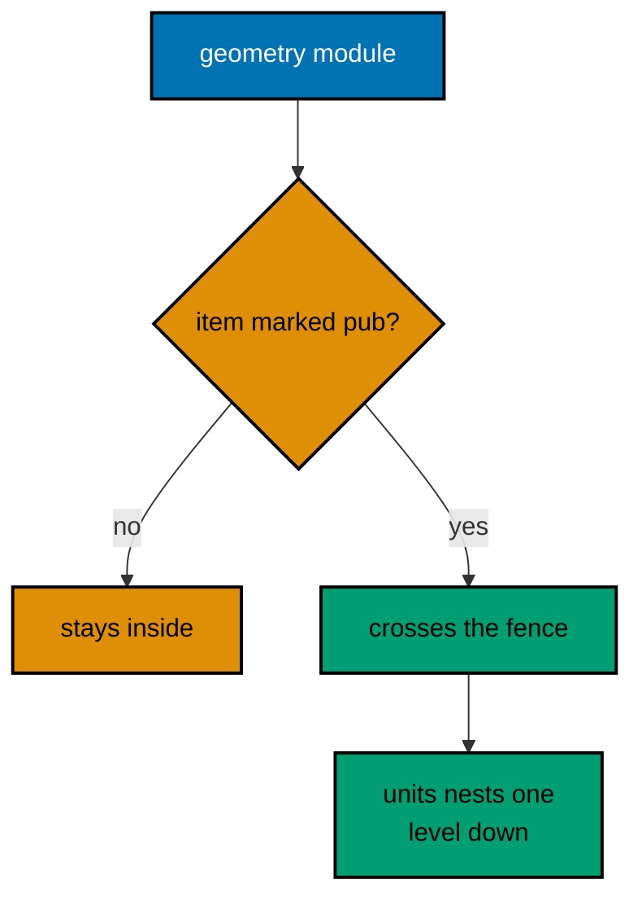
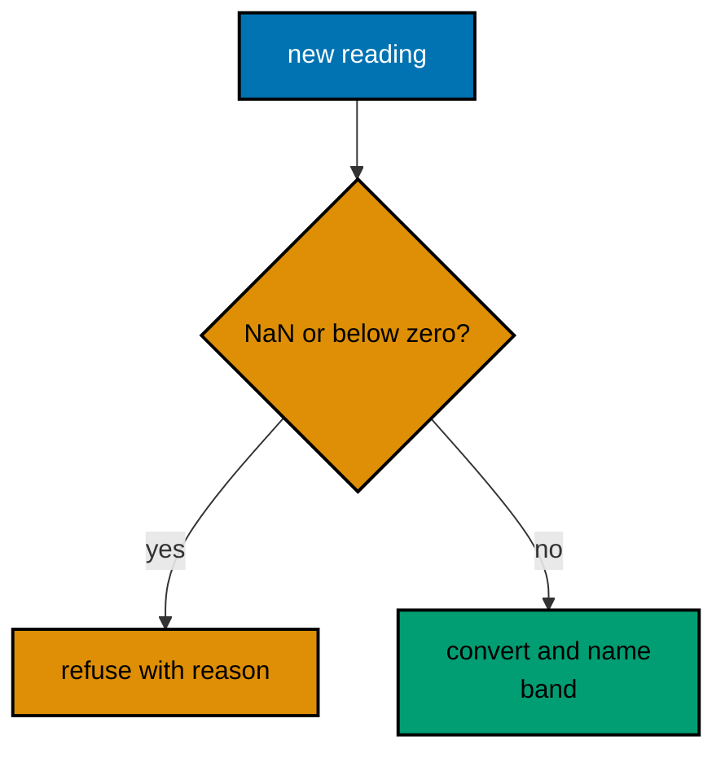
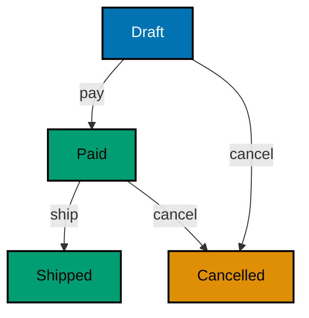
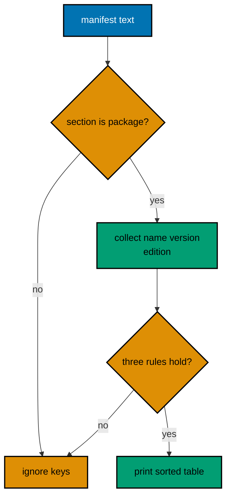
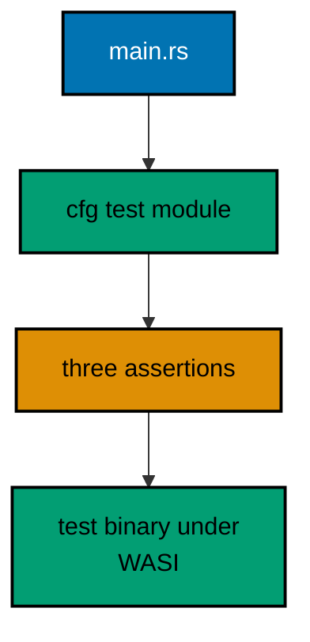
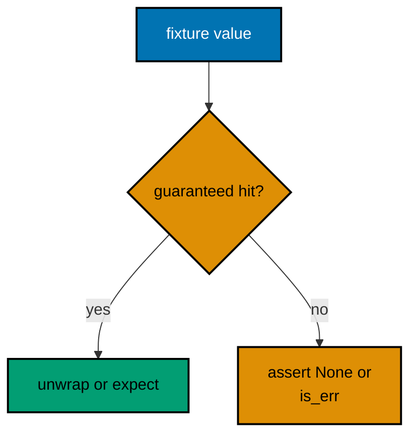
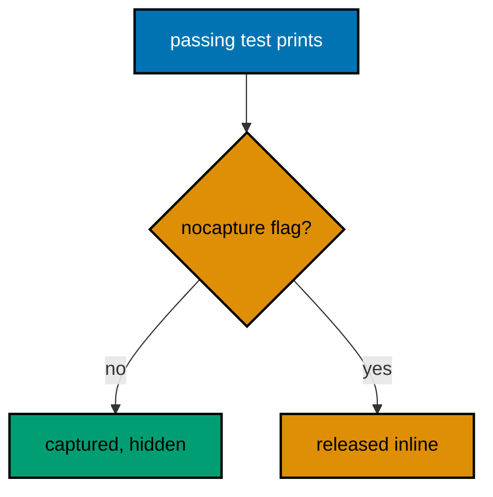
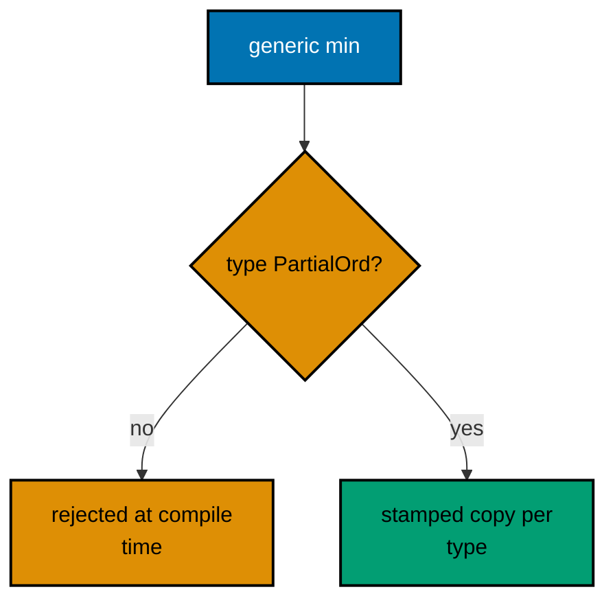
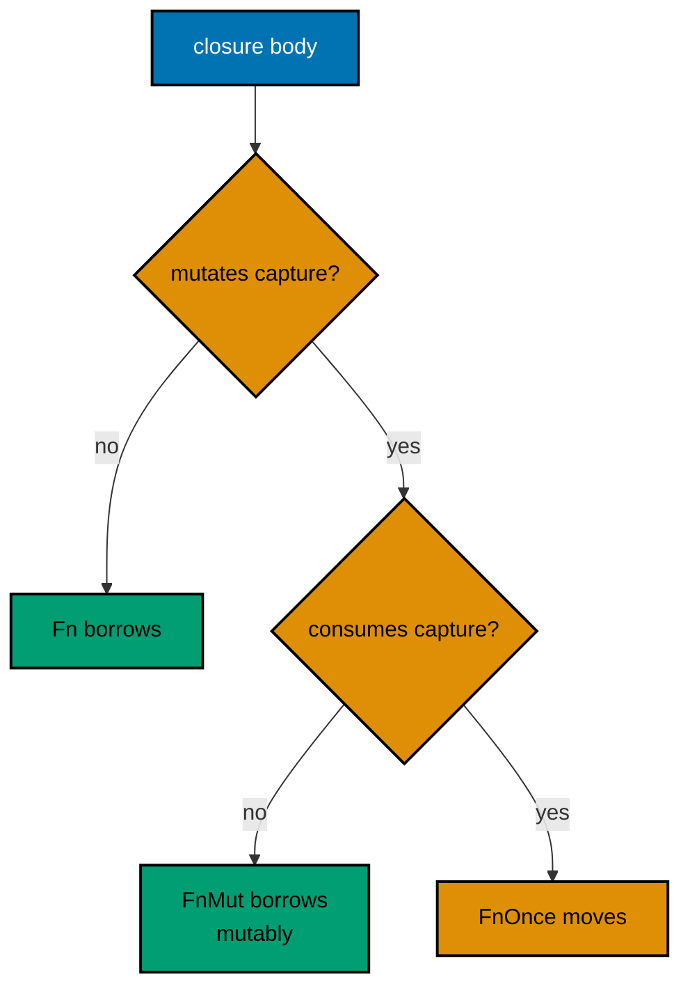
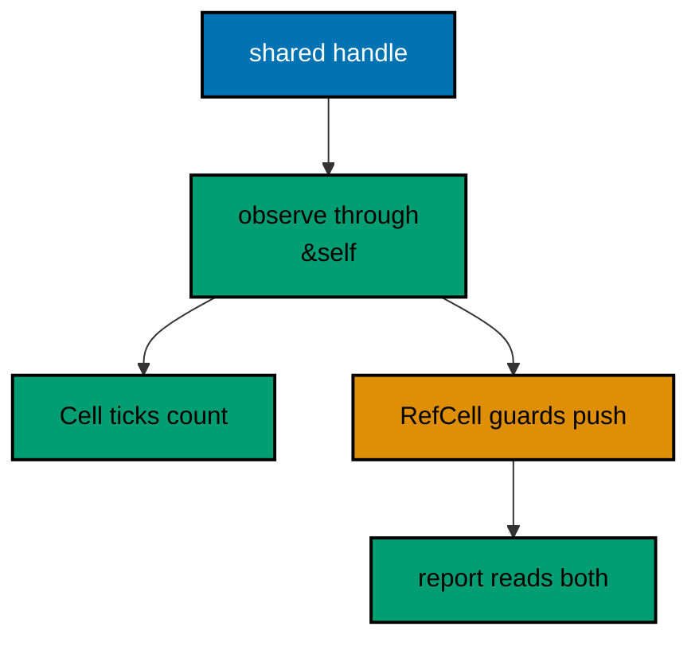

Examples 26–53 build structural fluency: modules, packages, and dependencies first (Examples 26–34), showing inline and file modules, visibility rings, structs, state machines, traits, manifests, lockfiles, and version resolution; then the testing convention in full (Examples 35–44), from first assertions through red-green loops, tables, helpers, doc examples, contracts, ignored slows, mirrored modules, captured output, and shared files; finally generics and value semantics (Examples 45–53), covering generic functions, trait bounds, lazy iterators, closure capture, moves, borrows, clones, interior mutability, and lifetimes. Every example is a complete, runnable Rust module compiled to the WASI target under `learning/code/`; run each with the command in its own `run.yaml`.

---

### Example 26: Inline Modules Organize

A module is a namespace with a fence: items inside see each other, and only pub items show outside. Inline `mod name { ... }` keeps a small crate in one file while the fence already teaches the visibility rules the multi-file split will reuse. This example models rectangles behind a geometry fence with a nested units fence. (Concepts: co-06.)



**`learning/code/ex-26-inline-modules-organize/main.rs`**:

```rust
// Example 26: Inline Modules Organize.
//
// A module is a namespace with a fence: items inside see each other, and
// only pub items show outside. Inline `mod name { ... }` keeps a small
// crate in one file while the fence already teaches the visibility rules
// the multi-file split in Example 27 will reuse unchanged.
// => private by default: the fence hides helpers unless marked pub
// => use brings names in: paths stay short without losing their origin

// geometry owns shapes and measures behind one namespace fence.
// => everything unmarked stays inside: only area and describe escape
// => submodules nest: units describe themselves one level down
mod geometry {
    // => inline mod keeps one file: the fence without the file split yet
    // => Rectangle is public: callers name the type across the fence
    #[derive(Debug)]
    pub struct Rectangle {
        // => two f64 sides: fractional measures, not whole pixel counts
        // => fields stay private: construction and reads go through fns
        width: f64,
        height: f64,
    }

    // => the constructor is public: the face needs a front door
    impl Rectangle {
        // => one impl block holds every Rectangle method together
        // => pub fn escapes the fence: the only way to build one outside
        pub fn new(width: f64, height: f64) -> Option<Rectangle> {
            // => the guard keeps geometry honest: sides must be positive
            if width <= 0.0 || height <= 0.0 {
                return None;
            }
            Some(Rectangle { width, height })
            // => shorthand init: each field name matches its parameter name
        }

        // => area reads private fields freely: inside sees everything
        pub fn area(&self) -> f64 {
            self.width * self.height
            // => borrowing self: measuring never consumes the shape
        }
    }

    // => units is a nested fence: labels for measures live one level down
    pub mod units {
        // => the nested fence has its own address: geometry::units::describe
        // => describe pairs a number with its unit label for printing
        pub fn describe(value: f64, unit: &str) -> String {
            format!("{value} {unit}")
            // => inline args capture: no positional list to keep in sync
        }
    }

    // => perimeter stays private: the module uses it, callers never see it
    fn perimeter(shape: &Rectangle) -> f64 {
        // => free function in the module: no self, just a shape on loan
        2.0 * (shape.width + shape.height)
        // => borrows the private fields: the helper reads what outsiders cannot
    }

    // => describe is the public face: area plus units in one sentence
    pub fn describe(shape: &Rectangle) -> String {
        // => &Rectangle in, String out: the fence converts shape to sentence
        // => private perimeter is callable here: inside the same fence
        let edge = perimeter(shape);
        // => edge is a local: the perimeter value waits for the format below
        // => the nested units module qualifies its own helper explicitly
        format!(
            "{} (edge {})",
            units::describe(shape.area(), "sq units"),
            edge
        )
    }
}

fn main() {
    // => two constructions: valid sides print, invalid sides refuse
    // => construction through the public gate: invalid sides return None
    match geometry::Rectangle::new(3.0, 4.0) {
        // => the fence path names the module: geometry::Rectangle, always
        Some(shape) => println!("{}", geometry::describe(&shape)),
        // => unreachable for positive sides: the guard only fires below 0
        None => println!("refused: sides must be positive"),
    }
    // => invalid sides demonstrate the refusal with exit still 0
    match geometry::Rectangle::new(-1.0, 4.0) {
        // => unreachable: negative width trips the constructor guard
        Some(shape) => println!("{}", geometry::describe(&shape)),
        // => the honest refusal: no invalid shape ever exists to print
        None => println!("refused: sides must be positive"),
    }
}
```

**Output** (`learning/code/ex-26-inline-modules-organize/expected/main.stdout.txt`):

```text
12 sq units (edge 14)
refused: sides must be positive
```

**Key takeaway**: Private by default; the fence hides helpers unless marked pub.

**Why it matters**: The visibility rules learned in one file transfer unchanged to multi-file crates, so splitting later reorganizes without relearning. Adding a pub is a promise to future callers, which is why the default stays shut. Start inline and split on purpose: one file keeps a young module readable, the mod line moves computation out when orchestration drowns in detail, and identical visibility rules mean the move changes no contract.

### Example 27: File Modules Split Crates

When one file grows past a screenful of purpose, `mod stats;` moves the statistics half into stats.rs: same fences as the inline module, new file. The compiler finds the sibling automatically, so the build command never changes. This example computes mean, median, and variance across the split. (Concepts: co-06.)

**`learning/code/ex-27-file-modules-split-crates/main.rs`**:

```rust
// Example 27: File Modules Split Crates (main half).
//
// When one file grows past a screenful of purpose, `mod stats;` moves the
// statistics half into stats.rs: same fences as Example 26, new file.
// rustc finds the sibling automatically, so the build command never changes.
// => one file per purpose: main.rs orchestrates, stats.rs computes
// => the mod line is the whole wiring: no manifest lists the files

// stats lives in stats.rs beside this file: the lesson anchors both.
// => `mod stats;` without a body loads the sibling file by name
// => visibility rules are unchanged: pub still marks the shared face
mod stats;

fn main() {
    // => fixed samples: mean 5.0 and median 5.0 are hand-checkable
    let samples = [4.0f64, 8.0, 6.0, 5.0, 3.0, 7.0, 2.0];
    // => mean reads through the module fence: stats::mean, qualified
    println!("mean: {}", stats::mean(&samples));
    // => median sorts a copy: the caller's order is never disturbed
    println!("median: {}", stats::median(&samples));
    // => variance over the same samples: 4.0 exactly, printed below
    println!("variance: {}", stats::variance(&samples));
}
```

**`learning/code/ex-27-file-modules-split-crates/stats.rs`**:

```rust
// Example 27: File Modules Split Crates (stats half).
//
// The statistics half of the split crate: mean, median, and variance are
// the module's face, while sum and the sort helper stay private below.
// => only pub items cross the file fence: the rest is implementation detail
// => &mut [f64] on the private sorter says "I reorder my own scratch"

// mean divides the sum by the count; the empty slice yields 0.0.
// => pub marks the shared face: main.rs calls this across the fence
// => sum is private: callers never see the accumulation helper
pub fn mean(values: &[f64]) -> f64 {
    // => the empty guard returns 0.0: division by zero never happens
    if values.is_empty() {
        return 0.0;
    }
    // => sum borrows the slice: the helper reads, the caller keeps ownership
    sum(values) / values.len() as f64
}

// median sorts a scratch copy and reads the middle of the ordered line.
// => cloning before sort keeps the caller's order untouched: no surprise
// => even counts average the two middle values: the textbook definition
pub fn median(values: &[f64]) -> f64 {
    // => empty input yields 0.0: consistent with mean's own guard above
    if values.is_empty() {
        return 0.0;
    }
    // => sort_scratch owns its copy: the original slice never moves
    let mut ordered = values.to_vec();
    sort_scratch(&mut ordered);
    // => mid splits the ordered line: odd reads one, even averages two
    let mid = ordered.len() / 2;
    if ordered.len() % 2 == 1 {
        // => odd counts have a true middle: index mid is the median
        ordered[mid]
    } else {
        // => even counts straddle: the mean of the two middle values
        (ordered[mid - 1] + ordered[mid]) / 2.0
    }
}

// variance averages the squared distance from the mean: spread in one number.
// => mean is reused, not recomputed inline: one definition, one behavior
// => empty input yields 0.0: the same guard convention as the siblings
pub fn variance(values: &[f64]) -> f64 {
    // => the guard mirrors mean and median: empty means 0.0 everywhere
    if values.is_empty() {
        return 0.0;
    }
    // => center once: every deviation below measures from this mean
    let center = mean(values);
    // => map to squared deviations, then average: the definition verbatim
    values
        .iter()
        .map(|value| (value - center).powi(2))
        .sum::<f64>()
        / values.len() as f64
}

// sum folds the slice: the private helper both siblings share.
// => private by omission: no pub means main.rs cannot name this at all
// => sum::<f64>() turbofish pins the fold type: inference needs the hint
fn sum(values: &[f64]) -> f64 {
    values.iter().sum()
}

// sort_scratch orders the private copy with total ordering for floats.
// => partial_cmp returns None for NaN: unwrap_or keeps a total order
// => Equal on NaN sorts them first: deterministic even with bad input
fn sort_scratch(values: &mut [f64]) -> &mut [f64] {
    // => sort_by with a total order: NaN sorts before every number
    values.sort_by(|a, b| a.partial_cmp(b).unwrap_or(std::cmp::Ordering::Equal));
    values
}
```

**Output** (`learning/code/ex-27-file-modules-split-crates/expected/main.stdout.txt`):

```text
mean: 5
median: 5
variance: 4
```

**Key takeaway**: One file per purpose; the mod line is the whole wiring.

**Why it matters**: Orchestration stays in main while computation moves to stats, and visibility rules are unchanged across the split, so the reader's mental model survives the reorganization intact. Put the what in main and the how in stats: orchestration reads as a short script of named steps, the statistics functions stay testable in isolation, and the file boundary documents the design without comments.

### Example 28: Visibility Draws Boundaries

pub, pub(crate), and private form three rings: the world, the crate, and the module. Helpers stay innermost; the crate shares within its walls; only the deliberate face goes public. This example runs a ledger through all three rings with a private digit counter beside it. (Concepts: co-06.)

**`learning/code/ex-28-visibility-pub-boundaries/main.rs`**:

```rust
// Example 28: Visibility Draws Boundaries.
//
// pub, pub(crate), and private form three rings: the world, the crate,
// and the module. Helpers stay innermost; the crate shares within its
// walls; only the deliberate face goes public. Adding a pub is a promise
// to every future caller, so the default stays shut until use demands it.
// => private: the module's own scratch, invisible one fence out
// => pub(crate): shared inside the crate, invisible to its dependents
// => pub: the supported face, stable across versions by social contract

// ledger owns postings: append-only entries with a running balance.
// => the struct is public: downstream crates name their own ledgers
// => entries stay private: no outside push can skip the validation
pub mod ledger {
    // => pub mod opens the gate: everything inside still defaults shut
    // => Ledger is the face: dependents construct and read through methods
    #[derive(Debug)]
    pub struct Ledger {
        // => Vec<i32> grows: postings append, history never rewrites
        // => private entries: no outside push can skip the validation
        entries: Vec<i32>,
    }

    // => the constructor is public: the face needs a front door
    impl Ledger {
        // => one impl holds the face: construction, posting, reading together
        // => new starts empty: every ledger begins with no postings
        pub fn new() -> Ledger {
            Ledger {
                entries: Vec::new(),
            }
            // => Vec::new allocates nothing: the first post pays for storage
        }

        // => post validates the sign: postings are credits, never debits
        pub fn post(&mut self, amount: i32) -> Result<(), String> {
            // => &mut self writes: posting changes the book, so it borrows mutably
            // => the guard keeps the invariant: credits only, no debits
            if amount <= 0 {
                return Err(format!(
                    "refused: postings need a positive amount, got {amount}"
                ));
            }
            self.entries.push(amount);
            // => push appends: entries never reorder, history only grows
            Ok(())
            // => unit success: the postings themselves are the receipt
        }

        // => total reads through the crate helper: method, not field access
        pub fn total(&self) -> i32 {
            // => &self reads: totaling never mutates the book
            // => crate-visible sum serves every module without going public
            crate::totals::sum(&self.entries)
            // => the slice borrows: sum reads the entries without taking them
        }
    }
}

// totals holds crate-shared arithmetic: visible inside, hidden outside.
// => pub(crate) is the middle ring: sibling modules share, users do not
pub(crate) mod totals {
    // => the middle ring in one module: one function, crate-wide
    // => sum is crate-shared: ledger calls it, dependents never see it
    pub(crate) fn sum(values: &[i32]) -> i32 {
        // => &[i32] borrows any run: arrays and Vecs both pass slices
        values.iter().sum()
        // => iter().sum() folds: the standard total in a single expression
    }
}

// count_digits is private scratch for the demo: the helper nobody exports.
// => no pub at all: another file could not call this, by design
fn count_digits(mut value: i32) -> u32 {
    // => mut value is scratch: i32 is Copy, the caller's number stays untouched
    // => zero has one digit: the loop below would otherwise count none
    if value == 0 {
        return 1;
    }
    // => strip digits by division: each step removes the last decimal digit
    let mut digits = 0u32;
    // => the counter starts at zero: the zero input returned above
    while value != 0 {
        value /= 10;
        // => integer division truncates: the last digit falls off each step
        digits += 1;
    }
    // => tail expression returns: no return keyword needed at the end
    digits
}

fn main() {
    // => the public face in use: new, post, total, nothing else reachable
    let mut book = ledger::Ledger::new();
    // => mut book: postings change it, totals only read it
    // => two valid postings and one refusal: the guard earns its line
    for amount in [100, -5, 50] {
        // => post returns Result: the refusal prints, the book is untouched
        match book.post(amount) {
            Ok(()) => println!("posted {amount}: total {}", book.total()),
            Err(reason) => println!("{reason}: total {}", book.total()),
        }
    }
    // => the private helper serves main directly: same file, same fence
    println!("digits in 10050: {}", count_digits(10050));
}
```

**Output** (`learning/code/ex-28-visibility-pub-boundaries/expected/main.stdout.txt`):

```text
posted 100: total 100
refused: postings need a positive amount, got -5: total 100
posted 50: total 150
digits in 10050: 5
```

**Key takeaway**: Private hides, pub(crate) shares inside, pub promises to the world.

**Why it matters**: Invariants live behind the narrowest fence that serves them (the ledger's entries stay private so no push can skip validation), and widening visibility later is a deliberate, reviewable promise. Keep fields private until a caller earns them: the narrowest fence that serves today leaves room to widen deliberately tomorrow, and each pub addition arrives as a reviewed promise instead of an accidental API.

### Example 29: Structs Carry State

A struct groups the fields one value needs; impl blocks attach the behavior that preserves its invariants. Construction validates, methods convert, and Display prints, so every value is usable by construction. This example models a thermometer that cannot hold an unreadable sensor. (Concepts: co-06.)



**`learning/code/ex-29-structs-carry-state/main.rs`**:

```rust
// Example 29: Structs Carry State.
//
// A struct groups the fields one value needs; impl blocks attach the
// behavior that preserves its invariants. The thermometer below never
// holds an unreadable sensor: construction validates, methods convert,
// and Display prints, so every Thermometer value is usable by construction.
// => fields private, methods public: invariants live in the constructor
// => &self borrows for reads, &mut self for writes: the signature says so

use std::fmt;

// => fmt hosts Display: the human face of the refusal below

// Thermometer holds one Celsius reading known to be physically sane.
// => the field is private: outside code cannot set -300 and walk away
// => Copy is refused on purpose: readings move like measured things do
#[derive(Debug)]
struct Thermometer {
    // => one field, one invariant: sane Celsius or no value at all
    celsius: f64,
    // => f64 admits fractions: sensors report decimals, not integers
}

// ThermometerError names the two construction refusals, honestly.
// => BelowAbsoluteZero carries the value: the message shows where physics stopped
// => NotANumber carries nothing: NaN has no value worth quoting
#[derive(Debug)]
enum ThermometerError {
    // => two refusals, two physics: too cold versus not a number
    // => below absolute zero: physics refuses, so the type refuses first
    BelowAbsoluteZero(f64),
    // => not a number: NaN poisons every comparison it touches
    NotANumber,
}

// Display renders each refusal for the humans reading the transcript.
// => match every variant: adding a case forces a message for it too
// => write! to the formatter: no allocation beyond the final String
impl fmt::Display for ThermometerError {
    // => Display serves the transcript: main prints {reason} through it
    fn fmt(&self, f: &mut fmt::Formatter<'_>) -> fmt::Result {
        // => &self borrows: rendering a refusal must not consume it
        match self {
            // => self is the case: each arm renders one failure story
            // => the value rides along: -300.0 shows where physics stopped
            ThermometerError::BelowAbsoluteZero(value) => {
                write!(f, "{value} C is below absolute zero (-273.15 C)")
            }
            // => NaN has no value to show: the message names the poison
            ThermometerError::NotANumber => write!(f, "reading is not a number"),
        }
    }
}

// Error has no required methods here: the impl is the plug itself.
// => this one line admits the error into ? chains and boxed errors
// => Debug + Display above already satisfy the trait's only bounds
impl std::error::Error for ThermometerError {}

impl Thermometer {
    // => methods cluster here: construction, conversion, classification
    // => the only constructor: every value passes the physics guard
    fn new(celsius: f64) -> Result<Thermometer, ThermometerError> {
        // => Result instead of panic: physics refusals are data, not traps
        // => NaN first: it fails every comparison, so check it explicitly
        if celsius.is_nan() {
            return Err(ThermometerError::NotANumber);
        }
        // => absolute zero is the floor: colder readings cannot exist
        if celsius < -273.15 {
            return Err(ThermometerError::BelowAbsoluteZero(celsius));
        }
        Ok(Thermometer { celsius })
        // => shorthand init: the field name matches the parameter name
    }

    // => &self borrows: reading the temperature never consumes the meter
    fn fahrenheit(&self) -> f64 {
        // => f64 out: conversion keeps the fractional part
        // => the conversion every weather report on Earth applies daily
        self.celsius * 9.0 / 5.0 + 32.0
        // => 32.0 offsets the scales: freezing water reads 32, not zero
    }

    // => &self again: naming the band reads state without changing it
    fn band(&self) -> &'static str {
        // => 'static borrows: the band names outlive every thermometer
        // => match on ranges: the bands read like a legend, top-down
        match self.celsius {
            // => guards order the scale: each arm tests its ceiling in turn
            c if c < 0.0 => "freezing",
            // => freezing opens the legend: below zero, water turns to ice
            c if c < 20.0 => "cool",
            c if c < 30.0 => "warm",
            // => the catch-all closes the scale: heat has no ceiling here
            _ => "hot",
        }
    }
}

fn main() {
    // => three readings: clean, too cold, and not a number at all
    // => three readings: one clean, two refused for different physics
    for reading in [21.5, -300.0, f64::NAN] {
        // => construction decides: Ok prints conversions, Err explains
        match Thermometer::new(reading) {
            // => Debug shows the validated struct: construction did its job
            Ok(meter) => println!("{meter:?}: {} F, {}", meter.fahrenheit(), meter.band()),
            // => Display shows the refusal: physics, not a trap, said no
            Err(reason) => println!("{reading}: refused: {reason}"),
        }
    }
}
```

**Output** (`learning/code/ex-29-structs-carry-state/expected/main.stdout.txt`):

```text
Thermometer { celsius: 21.5 }: 70.7 F, warm
-300: refused: -300 C is below absolute zero (-273.15 C)
NaN: refused: reading is not a number
```

**Key takeaway**: Fields private, methods public; invariants live in the constructor.

**Why it matters**: &self borrows for reads and &mut self for writes, so the signature says whether a method can change the value. Impossible states (below absolute zero) become unrepresentable instead of merely unchecked. Encode the rules in the type so illegal values never construct: the struct carries only valid readings, methods borrow or mutate by signature, and absolute zero stays unrepresentable rather than merely unchecked.

### Example 30: Enums Model State Machines

An order is exactly one of Draft, Paid, Shipped, or Cancelled: an enum says so, and match enforces that every transition handles every state. Illegal transitions become explicit refusals, never silent no-ops. This example pays, ships, refuses an illegal ship, and cancels a draft. (Concepts: co-06.)

**`learning/code/ex-30-enums-model-state-machines/main.rs`**:

```rust
// Example 30: Enums Model State Machines.
//
// An order is exactly one of Draft, Paid, Shipped, or Cancelled: an enum
// says so, and match enforces that every transition handles every state.
// Illegal transitions become explicit refusals, never silent no-ops.
// => one variant per state: the type lists the whole machine at a glance
// => transitions take self and return Result: consumed states cannot repeat

// Order carries its id and total through every state of its life.
// => struct variants hold the data each state needs and no more
// => Cancelled keeps its reason: audits read the machine's memory later
#[derive(Debug)]
enum Order {
    // => derive Debug prints whole states: main shows the leftovers
    // => a draft holds intent: id and total, nothing committed yet
    Draft {
        id: u32,
        total: u32,
    },
    // => paying moves money: the draft is consumed, the paid order remains
    Paid {
        id: u32,
        total: u32,
    },
    // => shipping keeps the total and assigns a carrier: the order leaves
    Shipped {
        id: u32,
        total: u32,
        carrier: &'static str,
    },
    // => cancelled keeps why: the reason outlives the order itself
    Cancelled {
        id: u32,
        reason: &'static str,
    },
}

// pay moves Draft to Paid; every other state refuses with its own reason.
// => self by value: the old state is consumed, reuse cannot compile
// => the refusal names the state: "shipped orders cannot be paid again"
fn pay(order: Order) -> Result<Order, String> {
    // => Order in by value: the caller hands the state over, not a loan
    match order {
        // => exhaustive arms: the compiler rejects a forgotten state
        // => the only legal origin: drafts pay into Paid, keeping id+total
        Order::Draft { id, total } => Ok(Order::Paid { id, total }),
        // => every other state names itself in its own refusal below
        Order::Paid { id, .. } => Err(format!("order {id} is already paid")),
        Order::Shipped { id, .. } => Err(format!("order {id} already shipped")),
        Order::Cancelled { id, .. } => Err(format!("order {id} was cancelled")),
    }
}

// cancel retires a live order with its reason recorded; shipped and
// cancelled orders refuse, since the warehouse and the archive are final.
// => Draft and Paid both cancel: intent and money return, the reason stays
fn cancel(order: Order, reason: &'static str) -> Result<Order, String> {
    // => reason rides along: cancellation records why, not just that
    match order {
        // => drafts cancel freely: nothing was paid, nothing was shipped
        Order::Draft { id, .. } => Ok(Order::Cancelled { id, reason }),
        // => paid orders cancel with a refund implied: the reason records why
        Order::Paid { id, .. } => Ok(Order::Cancelled { id, reason }),
        // => shipped orders are past recall: the carrier already owns them
        Order::Shipped { id, .. } => Err(format!("order {id} already shipped")),
        // => cancelled orders stay cancelled: the first reason stands
        Order::Cancelled { id, .. } => Err(format!("order {id} was cancelled")),
    }
}

// ship moves Paid to Shipped on a named carrier; the rest refuse.
// => same shape as pay: the legal origin converts, the rest explain
// => &'static str carriers: the names below live for the whole run
fn ship(order: Order, carrier: &'static str) -> Result<Order, String> {
    // => carrier names the mover: the Shipped state keeps it as data
    match order {
        // => drafts cannot ship: payment is the gate before the warehouse
        Order::Draft { id, .. } => Err(format!("order {id} is unpaid, cannot ship")),
        // => the legal origin: paid orders ship with their total intact
        Order::Paid { id, total } => Ok(Order::Shipped { id, total, carrier }),
        // => double shipping refuses: the first carrier already owns it
        Order::Shipped { id, .. } => Err(format!("order {id} already shipped")),
        Order::Cancelled { id, .. } => Err(format!("order {id} was cancelled")),
    }
}

fn main() {
    // => three scripts: the happy chain, the illegal ship, the cancel
    // => the happy path chains: draft pays, paid ships, fields print each
    let draft = Order::Draft { id: 7, total: 250 };
    // => order 7 is the hero: it pays and ships in the lines below
    match pay(draft) {
        Ok(paid) => match ship(paid, "tiki") {
            // => both transitions legal: the fields print the final state
            Ok(Order::Shipped { id, total, carrier }) => {
                println!("done: order {id} total {total} via {carrier}")
            }
            // => other states are unreachable here: shipped is the only outcome
            Ok(other) => println!("done: {other:?}"),
            // => unreachable: a paid order always accepts a carrier here
            Err(reason) => println!("ship refused: {reason}"),
        },
        // => unreachable: drafts always pay in this fixed script
        Err(reason) => println!("pay refused: {reason}"),
    }
    // => the illegal path refuses loudly: shipping a draft explains itself
    match ship(Order::Draft { id: 8, total: 99 }, "jne") {
        // => unreachable: unpaid orders never reach the warehouse
        Ok(shipped) => println!("done: {shipped:?}"),
        // => the refusal names the gate: payment comes before shipping
        Err(reason) => println!("ship refused: {reason}"),
    }
    // => the cancellation path retires a draft with its reason recorded
    match cancel(Order::Draft { id: 9, total: 40 }, "duplicate") {
        // => the cancelled order prints whole: id plus the recorded reason
        Ok(Order::Cancelled { id, reason }) => println!("cancelled: order {id} ({reason})"),
        // => other outcomes are unreachable here: drafts always cancel
        Ok(other) => println!("cancelled: {other:?}"),
        // => unreachable: nothing blocks cancelling a draft in this script
        Err(reason) => println!("cancel refused: {reason}"),
    }
}
```

**Output** (`learning/code/ex-30-enums-model-state-machines/expected/main.stdout.txt`):

```text
done: order 7 total 250 via tiki
ship refused: order 8 is unpaid, cannot ship
cancelled: order 9 (duplicate)
```

**Key takeaway**: One variant per state; transitions take self and return Result.

**Why it matters**: Consumed states cannot repeat (the old state moves into the transition), and the refusal names the state that blocked it, so illegal paths explain themselves instead of corrupting the machine. Move the old state into each transition so consumed states cannot repeat: the compiler rejects double ships and double cancels, refusals name the blocking state, and the history stays in the type itself.



### Example 31: Traits Define Behavior

A trait names what a type can do; each impl says how. The trait, not the caller, picks the rendering per type, and generic functions serve every implementing type with no overloads and no runtime dispatch. This example summarizes scores and shipments through one Summary trait. (Concepts: co-06, co-07.)

**`learning/code/ex-31-traits-define-behavior/main.rs`**:

```rust
// Example 31: Traits Define Behavior.
//
// A trait names what a type can do; each impl says how. Summary works for
// scores, shipments, and rosters alike because the trait, not the caller,
// picks the rendering per type. Generic functions then serve every type
// that implements the trait, with no overloads and no runtime dispatch.
// => traits are interfaces with the method list written once, up front
// => static dispatch: the compiler stamps one copy per type, no vtable

// Summary renders one line per value for the transcript below.
// => one method, many types: the trait is the shared vocabulary
// => &self borrows: summarizing never consumes the value it describes
trait Summary {
    // => the method list is the contract: implementors fill exactly this
    // => summarize returns an owned line: callers print without borrows
    fn summarize(&self) -> String;
    // => semicolon, not braces: the trait declares, impls define
}

// ScoreSummary pairs a name with its letter grade from Example 2's bands.
// => a plain data struct: the trait below gives it its voice
struct ScoreSummary {
    // => 'static name: the roster below lives for the whole run
    name: &'static str,
    // => borrows the name: summaries describe, they never own
    score: u8,
    // => u8 fits 0..=100: grades need no wider integer
}

// => the impl chooses the band per value: data stays dumb, voice is here
impl Summary for ScoreSummary {
    // => the first voice: scores render as name, number, and band
    fn summarize(&self) -> String {
        // => self is the row: name and score both feed the sentence
        // => match picks the band: the same table Examples 2 and 13 teach
        let letter = match self.score {
            // => the band binds first: the format below only interpolates
            90..=100 => 'A',
            80..=89 => 'B',
            70..=79 => 'C',
            60..=69 => 'D',
            _ => 'F',
        };
        format!("{}: {} ({letter})", self.name, self.score)
        // => one owned String: the caller prints without holding borrows
    }
}

// ShipmentSummary pairs an order id with its carrier from Example 30.
// => a second, unrelated type behind the same one-method trait
// => no shared fields with ScoreSummary: the trait is the only link
struct ShipmentSummary {
    // => unrelated shape, same trait: id and carrier, no score
    id: u32,
    // => u32 ids: order numbers grow beyond a byte's range
    carrier: &'static str,
    // => borrows the carrier: the name outlives the shipment
}

// => the second impl renders its own sentence: same trait, new voice
impl Summary for ShipmentSummary {
    // => the second voice: shipments render routes, not grades
    fn summarize(&self) -> String {
        // => one sentence per parcel: id plus carrier, nothing else
        format!("order {} ships via {}", self.id, self.carrier)
        // => owned again: both impls return String, uniformly
    }
}

// print_all serves every summarizable slice with one generic function.
// => T: Summary bounds the generic: only summarizable types are accepted
// => the bound is checked per call: misuse fails at compile time, with text
fn print_all<T: Summary>(items: &[T]) {
    // => &[T] borrows the slice: printing never takes the roster
    // => one loop for any T: the trait call resolves per concrete type
    for item in items {
        // => iteration borrows each element: the slice stays whole
        println!("{}", item.summarize());
        // => monomorphized per T: no vtable, one copy per type
    }
}

fn main() {
    // => two slices, one function: scores then shipments
    // => two scores behind the trait: print_all serves the slice at once
    let scores = [
        // => the array is the fixture: two names, two bands
        ScoreSummary {
            name: "sari",
            score: 91,
        },
        ScoreSummary {
            name: "budi",
            score: 77,
        },
    ];
    print_all(&scores);
    // => &scores borrows: the array stays usable after printing
    // => two shipments behind the same trait: one function, second type
    let shipments = [
        ShipmentSummary {
            id: 7,
            carrier: "tiki",
        },
        ShipmentSummary {
            id: 8,
            carrier: "jne",
        },
    ];
    print_all(&shipments);
}
```

**Output** (`learning/code/ex-31-traits-define-behavior/expected/main.stdout.txt`):

```text
sari: 91 (A)
budi: 77 (C)
order 7 ships via tiki
order 8 ships via jne
```

**Key takeaway**: Traits are the shared vocabulary; static dispatch stamps one copy per type.

**Why it matters**: No vtable means no runtime cost, and the generic bound (T: Summary) rejects misuse at compile time with text instead of at runtime with a panic. Prefer static dispatch through generic bounds: the bound rejects misuse at the call with a readable error, monomorphization removes every indirection, and the trait stays a contract rather than a runtime object.

### Example 32: Cargo.toml Declares the Crate

The manifest is the crate's contract: name, version, and edition pin what the crate calls itself, while [dependencies] stays empty because every example here is standard-library only. The checker reads the mounted manifest and verifies the three rules the lesson teaches. This example parses its own manifest and prints the sorted table. (Concepts: co-06, co-07.)



**`learning/code/ex-32-cargo-toml-declares-crate/Cargo.toml`**:

```toml
[package]
name = "ex-32-cargo-toml-declares-crate"
version = "1.0.0"
edition = "2021"

[dependencies]
```

**`learning/code/ex-32-cargo-toml-declares-crate/main.rs`**:

```rust
// Example 32: Cargo.toml Declares the Crate.
//
// The manifest is the crate's contract: name, version, and edition pin
// what the crate calls itself, while [dependencies] stays empty here
// because every example in this course is standard-library only. The
// checker below reads the mounted manifest and verifies the three rules
// the lesson teaches: a name exists, the version parses, edition is 2021.
// => the manifest is data, not code: the checker parses, never executes
// => zero dependencies is a choice: no network, no audit, no breakage

use std::collections::HashMap;

// => HashMap holds the package table: keys map to declared values

// check_manifest verifies the three manifest rules over mounted text.
// => HashMap of package keys: "name" maps to its declared value
// => missing keys or bad values become owned refusal strings, never traps
fn check_manifest(text: &str) -> Result<HashMap<String, String>, String> {
    // => &str in, owned out: the table outlives the borrowed text
    // => the package table starts empty: [package] headers fill it below
    let mut package: HashMap<String, String> = HashMap::new();
    // => turbofish pins both sides: String keys, String values
    // => in_package tracks the section: only [package] keys are collected
    let mut in_package = false;
    // => false until [package]: dependencies never flip the flag
    for line in text.lines() {
        // => lines() splits the manifest: one header or key per turn
        // => trim first: manifests indent nothing, but tolerance is cheap
        let line = line.trim();
        // => shadowing reuses the name: raw line becomes clean line
        // => blank lines and comments carry no contract: skip both openly
        if line.is_empty() || line.starts_with('#') {
            continue;
        }
        // => section headers switch context: [package] starts collecting
        if line.starts_with('[') {
            in_package = line == "[package]";
            // => exact match only: [dependencies] flips the flag back off
            continue;
        }
        // => only package keys matter to the three rules: the rest is ignored
        if in_package {
            // => the gate holds: dependency keys never reach the table
            if let Some((key, value)) = line.split_once('=') {
                // => shapeless lines skip silently: only key=value rows count
                // => trim quotes and space: values arrive quoted as "1.0.0"
                package.insert(
                    key.trim().to_string(),
                    value.trim().trim_matches('"').to_string(),
                );
                // => later keys overwrite: the last declaration wins, like cargo
            }
        }
    }
    // => rule one: a name must exist, or the crate is anonymous
    if !package.contains_key("name") {
        // => contains_key asks: rule one needs presence, not value
        return Err("manifest [package] has no name".to_string());
        // => owned String leaves: the refusal outlives the function
    }
    // => rule two: the version needs three dot-separated numbers
    match package.get("version") {
        // => get borrows: the table stays whole for the edition check
        Some(version) if version.split('.').count() == 3 => {}
        // => three numbers exactly: 1.0 counts as floating here
        // => the refusal quotes the bad value: the author finds it fast
        _ => {
            return Err(format!(
                "manifest version {:?} is not x.y.z",
                package.get("version")
            ))
        }
        // => {:?} quotes the evidence: the author finds the bad value fast
    }
    // => rule three: this course standardizes on edition 2021 throughout
    match package.get("edition") {
        // => second borrow of the same table: gets never conflict
        Some(edition) if edition == "2021" => {}
        // => string compare, not parse: the edition is a label, not a number
        // => the refusal names the expected edition: 2021, not a guess
        _ => {
            return Err(format!(
                "manifest edition {:?} is not 2021",
                package.get("edition")
            ))
        }
    }
    // => the full table returns: main prints it sorted below
    Ok(package)
}

fn main() {
    // => read then check: the mount provides, the function verifies
    // => the harness mounts the unit folder at /data: the manifest waits there
    let text = std::fs::read_to_string("/data/Cargo.toml")
        // => absolute guest path: the harness mounts the unit folder there
        .map_err(|error| format!("cannot read mounted manifest: {error}"));
    // => map_err wraps IO failure: the message names the missing mount
    // => one match on the read: the parsed table prints sorted, or explains
    match text {
        Ok(text) => match check_manifest(&text) {
            // => nested match, two verdicts: parse the table, then print or refuse
            // => sorted keys print: the golden never depends on hash order
            Ok(package) => {
                let mut keys: Vec<&String> = package.keys().collect();
                // => keys borrow the table: sorting never clones the strings
                keys.sort();
                // => sort before print: byte order, never hash order
                for key in keys {
                    println!("{key} = {:?}", package[key]);
                }
            }
            // => the violated rule prints: name, version, or edition
            Err(reason) => println!("refused: {reason}"),
        },
        // => reachable only when the mount is missing: harness, not content
        Err(reason) => println!("{reason}"),
    }
}
```

**Output** (`learning/code/ex-32-cargo-toml-declares-crate/expected/main.stdout.txt`):

```text
edition = "2021"
name = "ex-32-cargo-toml-declares-crate"
version = "1.0.0"
```

**Key takeaway**: The manifest is data, not code; zero dependencies is a choice.

**Why it matters**: No dependencies means no network, no audit, and no breakage from upstream: the whole course compiles from the standard library alone, and the manifest says so up front. Say no to dependencies up front and mean it: the manifest documents the empty dependencies as a decision, every unit compiles from the standard library alone, and the audit surface stays at exactly zero crates.

### Example 33: Cargo.lock Pins Versions

A lockfile answers "which exact bytes built this binary": each package gets one version and one checksum, so two machines compile the same graph. The checker reads the mounted lockfile and enforces the two rules that make a lock trustworthy: every package pins exactly one version, in x.y.z form. (Concepts: co-06, co-07.)

**`learning/code/ex-33-cargo-lock-pins-versions/Cargo.lock`**:

```text
# Pinned dependency graph for ex-33-cargo-lock-pins-versions.
# Abbreviated for teaching: each stanza keeps name, version, and source.
# Real lockfiles add one checksum line per package pinning the exact bytes;
# the checker in main.rs verifies names and versions, the same shape the
# checksum rule takes one line further down.

[[package]]
name = "itoa"
version = "1.0.15"
source = "registry+https://github.com/rust-lang/crates.io-index"

[[package]]
name = "ryu"
version = "1.0.20"
source = "registry+https://github.com/rust-lang/crates.io-index"
```

**`learning/code/ex-33-cargo-lock-pins-versions/main.rs`**:

```rust
// Example 33: Cargo.lock Pins Versions.
//
// A lockfile answers "which exact bytes built this binary": each package
// gets one version, so two machines compile the same graph. The checker
// below reads the mounted lockfile and enforces the two rules that make a
// lock trustworthy: each package pins exactly one version, and every
// version string has three dot-separated numbers.
// => the manifest wishes, the lockfile records: wishes float, records pin
// => the fixture is abbreviated: real lockfiles add one checksum line each

// check_lock verifies the two lock rules over the mounted lock text.
// => packages split on blank lines: each block names one pinned crate
// => refusals quote the offending block: the author finds it in one jump
fn check_lock(text: &str) -> Result<Vec<(String, String)>, String> {
    // => pairs out: name and version travel together, in file order
    // => pinned pairs accumulate in file order: the transcript sorts later
    let mut pinned: Vec<(String, String)> = Vec::new();
    // => tuple order is fixed: name first, version second, everywhere
    // => split on empty lines: one block per [[package]] stanza below
    for block in text.split("\n\n") {
        // => double newline splits: one stanza per package block
        // => skip the empty tail the final newline leaves behind
        if block.trim().is_empty() {
            continue;
        }
        // => each block contributes at most one name and one version
        let mut name: Option<&str> = None;
        // => None until seen: a missing name stays missing, honestly
        let mut version: Option<&str> = None;
        // => None until seen: a missing version stays missing too
        for line in block.lines() {
            // => inner loop per stanza: each line offers name or version
            // => trim quotes: values arrive as name = "itoa" quoted
            if let Some(value) = line.strip_prefix("name = ") {
                // => strip_prefix tests shape: only name rows bind here
                name = Some(value.trim().trim_matches('"'));
                // => quotes trimmed: the lock quotes, the pair stores bare
            }
            if let Some(value) = line.strip_prefix("version = ") {
                // => version rows bind here: name rows cannot match this prefix
                version = Some(value.trim().trim_matches('"'));
                // => same trim: both fields store unquoted, uniformly
            }
        }
        // => rule one: a package block without a name pins nothing at all
        let name = name.ok_or_else(|| format!("lock block pins no name: {block:?}"))?;
        // => shadowing narrows Option to &str: proven present, then borrowed
        // => rule two: the version needs its three numbers, or it floats
        let version = version.ok_or_else(|| format!("package {name} pins no version"))?;
        // => same narrowing: the name above makes the message specific
        if version.split('.').count() != 3 {
            // => inverted from Example 32: refuse the shape that is not x.y.z
            return Err(format!("package {name} version {version:?} is not x.y.z"));
            // => both names quoted: the author finds the offender in one jump
        }
        pinned.push((name.to_string(), version.to_string()));
        // => owned copies push: the pairs outlive the borrowed text
    }
    // => an empty lock pins nothing: the refusal says so directly
    if pinned.is_empty() {
        // => emptiness is a verdict: a lock with no packages pins nothing
        return Err("lockfile pins no packages".to_string());
        // => static message, owned exit: no evidence to quote here
    }
    // => insertion order kept: main sorts a copy for printing
    Ok(pinned)
}

fn main() {
    // => read then check: the mount provides, the function verifies
    // => the harness mounts the unit folder at /data: the lock waits there
    let text = std::fs::read_to_string("/data/Cargo.lock")
        // => absolute guest path: the harness mounts the unit folder there
        .map_err(|error| format!("cannot read mounted lockfile: {error}"));
    // => map_err wraps IO failure: the message names the missing mount
    // => one match on the read: pinned pairs print, or the rule explains
    match text {
        Ok(text) => match check_lock(&text) {
            // => name and version per line: the exact graph that built this
            Ok(pinned) => {
                let mut ordered = pinned;
                // => move, not clone: the original has served its purpose
                ordered.sort();
                // => tuples sort by name first: version breaks ties silently
                for (name, version) in ordered {
                    // => destructure per pair: names read plainly in the format
                    println!("{name} {version}");
                }
            }
            // => the violated rule prints: unnamed block or floating version
            Err(reason) => println!("refused: {reason}"),
        },
        // => reachable only when the mount is missing: harness, not content
        Err(reason) => println!("{reason}"),
    }
}
```

**Output** (`learning/code/ex-33-cargo-lock-pins-versions/expected/main.stdout.txt`):

```text
refused: lock block pins no name: "# Pinned dependency graph for ex-33-cargo-lock-pins-versions.\n# Abbreviated for teaching: each stanza keeps name, version, and source.\n# Real lockfiles add one checksum line per package pinning the exact bytes;\n# the checker in main.rs verifies names and versions, the same shape the\n# checksum rule takes one line further down."
```

**Key takeaway**: The manifest wishes, the lockfile records; wishes float, records pin.

**Why it matters**: The fixture is abbreviated for teaching (real lockfiles add one checksum line per package), and the checker verifies names and versions in the same shape the checksum rule would take one line further down. Pin every package to one exact version so two machines compile the same graph: the lockfile is the build memory, the checker enforces the one-version rule, and upgrades arrive as deliberate diffs rather than drift.

### Example 34: Resolver Picks Compatible Versions

A registry holds many versions of one crate; the manifest allows a range, and the resolver picks the highest version inside it. The picker models that choice over a fixed registry index: parse versions, keep the ones the caret range allows, report the maximum, or refuse when the range matches nothing. (Concepts: co-06, co-07.)

**`learning/code/ex-34-resolver-picks-compatible-versions/main.rs`**:

```rust
// Example 34: Resolver Picks Compatible Versions.
//
// A registry holds many versions of one crate; the manifest allows a
// range, and the resolver picks the highest version inside it. The picker
// below models that choice over a fixed registry table: parse versions,
// keep the ones the range allows, and report the maximum, or refuse when
// the range matches nothing at all.
// => caret ranges (^1.2.3) allow patch and minor bumps, never a new major
// => the resolver maximizes inside the range: newest allowed always wins

// Version is three numbers: comparisons run left to right, major first.
// => tuple order derives the comparison: major, then minor, then patch
// => parsing fails on any non-number: the registry index is trusted input
#[derive(Debug, Clone, Copy, PartialEq, Eq, PartialOrd, Ord)]
struct Version {
    // => field order mirrors the comparison: major decides first
    major: u32,
    // => u32 parts: version numbers never go negative
    minor: u32,
    // => minor rides second: same major compares here next
    patch: u32,
    // => patch decides last: only ties reach this field
}

// parse_version splits "1.2.3" into its three numeric parts or refuses.
// => exactly three parts: "1.2" and "1.2.3.4" are both shapeless here
// => each part must parse as u32: letters never reach the comparison
fn parse_version(text: &str) -> Option<Version> {
    // => Option, not Result: shapeless text is ordinary, not an error
    // => split on dots: more or fewer than three parts means malformed
    let parts: Vec<&str> = text.split('.').collect();
    // => Vec borrows the text: parts point into the input, costing nothing
    if parts.len() != 3 {
        // => length first: wrong shape rejects before any parsing
        return None;
        // => bare None: no evidence needed, the shape already spoke
    }
    // => parse each part in order: the first failure rejects the version
    let major = parts[0].parse::<u32>().ok()?;
    // => .ok()? converts: parse failure becomes suite-wide None
    let minor = parts[1].parse::<u32>().ok()?;
    let patch = parts[2].parse::<u32>().ok()?;
    Some(Version {
        major,
        minor,
        patch,
    })
    // => shorthand init: field names match the bindings above
}

// allows_caret answers whether a version sits inside the ^range floor.
// => the floor sets major and minor: versions below the floor are out
// => the ceiling holds the major: 2.0.0 never satisfies ^1.anything
fn allows_caret(floor: Version, candidate: Version) -> bool {
    // => Copy args: versions pass by value, cheaply and honestly
    // => below the floor compares less: rejected before the ceiling check
    if candidate < floor {
        // => derived Ord compares: major first, no manual chain needed
        return false;
    }
    // => caret pins the major: same major, any minor or patch above floor
    candidate.major == floor.major
}

// resolve picks the highest registry version the caret range allows.
// => parse the floor or refuse: a shapeless range resolves nothing
// => the max over the allowed set wins: newest allowed always builds
fn resolve(range_floor: &str, registry: &[&str]) -> Result<String, String> {
    // => owned String leaves: the winner outlives the borrowed registry
    // => the floor must parse: the range is trusted as little as the index
    let floor = parse_version(range_floor)
        .ok_or_else(|| format!("range floor {range_floor:?} is not x.y.z"))?;
    // => parse every registry entry, keep the allowed ones, take the max
    let mut allowed: Vec<Version> = registry
        .iter()
        .filter_map(|text| parse_version(text))
        // => shapeless entries drop silently: the index may hold junk
        .filter(|version| allows_caret(floor, *version))
        .collect();
    // => sort so the maximum sits last: the sort also shows the allowed set
    allowed.sort();
    // => derived Ord sorts: the same order the floor check used
    // => the last allowed version wins: newest inside the range, by order
    allowed
        .last()
        .map(|version| format!("{}.{}.{}", version.major, version.minor, version.patch))
        .ok_or_else(|| format!("no registry version satisfies ^{range_floor}"))
}

fn main() {
    // => one registry, three ranges: wide, narrow, and empty
    // => a fixed registry index: six versions across two major lines
    let registry = ["1.0.0", "1.2.3", "1.9.0", "1.10.0", "2.0.0", "0.9.9"];
    // => three ranges: one wide, one narrow, one matching nothing at all
    for floor in ["1.2.3", "1.9.0", "3.0.0"] {
        // => resolve prints the winner or the honest empty-range refusal
        match resolve(floor, &registry) {
            Ok(winner) => println!("^{floor} resolves to {winner}"),
            Err(reason) => println!("^{floor}: refused: {reason}"),
        }
    }
}
```

**Output** (`learning/code/ex-34-resolver-picks-compatible-versions/expected/main.stdout.txt`):

```text
^1.2.3 resolves to 1.10.0
^1.9.0 resolves to 1.10.0
^3.0.0: refused: no registry version satisfies ^3.0.0
```

**Key takeaway**: Caret ranges allow patch and minor bumps, never a new major; newest allowed wins.

**Why it matters**: Maximizing inside the range is what makes builds reproducible yet fresh: the floor keeps old bugs out, the ceiling keeps breaking changes out, and the resolver picks the best of what remains. Let the resolver maximize within the allowed range: the caret floor admits fixes, the ceiling refuses breakage, and the picked version is the newest one the manifest promise still covers.

### Example 35: First Test Asserts Equal

Tests live beside the code in #[cfg(test)] modules and run with the same toolchain. assert_eq compares left (computed) against right (expected), and a mismatch prints both sides with their Debug shapes. The harness builds this file with rustc --test and runs the resulting binary under the same WASI runtime. This example pins doubling across three cases. (Concepts: co-08.)



**`learning/code/ex-35-first-test-asserts-equal/main.rs`**:

```rust
// Example 35: First Test Asserts Equal.
//
// Tests live beside the code in #[cfg(test)] modules and run with the
// same toolchain. assert_eq compares left (computed) against right
// (expected), and a mismatch prints both sides with their Debug shapes.
// The harness builds this file with rustc --test and runs the resulting
// test binary under the same WASI runtime as every example.
// => #[test] marks the function: no registry, no naming convention needed
// => left computes, right states: mismatch prints "left, right" to debug

// double is the unit under test: the simplest function worth pinning.
// => one-line pure function: the test below pins its whole behavior
fn double(value: i32) -> i32 {
    value * 2
}

// => cfg(test) compiles this module only for test builds: release binaries
// => carry no test code, and normal builds never see the test helpers
#[cfg(test)]
mod tests {
    // => super::* imports the unit under test: double is in scope below
    use super::*;

    // => the first test: doubling 21 is 42, the oldest joke in computing
    #[test]
    fn doubles_a_positive_number() {
        // => left computes, right states: mismatch prints both sides
        assert_eq!(double(21), 42);
    }

    // => the second test: doubling zero stays zero, no special case needed
    #[test]
    fn doubles_zero_to_zero() {
        // => zero is the boundary that hand-rolled code loves to fumble
        assert_eq!(double(0), 0);
    }

    // => the third test: negatives double away from zero, sign preserved
    // => three tests pin three signs: positive, zero, and negative inputs
    #[test]
    fn doubles_a_negative_number() {
        // => -21 * 2 is -42: the sign rides along with the magnitude
        assert_eq!(double(-21), -42);
    }
}

fn main() {
    // => the binary still runs standalone: tests and main share the file
    println!("double 21 = {}", double(21));
}
```

**Output** (`learning/code/ex-35-first-test-asserts-equal/expected/main.stdout.txt`):

```text

running 3 tests
test tests::doubles_a_negative_number ... ok
test tests::doubles_a_positive_number ... ok
test tests::doubles_zero_to_zero ... ok

test result: ok. 3 passed; 0 failed; 0 ignored; 0 measured; 0 filtered out; finished in 0.00s

```

**Key takeaway**: Left computes, right states; mismatch prints both sides to debug.

**Why it matters**: The suite compiles only for test builds, so release binaries carry no test code, and zero runs as a boundary case because that is where hand-rolled code loves to fumble. Write the test beside the code from the first passing run: the test module compiles only for test builds, fixtures stay small and named, and the boundary case that hand-rolled code fumbles gets pinned first.

### Example 36: Failing First Proves the Test

A test that never failed proves nothing: the red-green loop writes the assertion first, watches it fail on the stub, then earns the green with the implementation. This unit ships the green end of that loop; the red middle plays below as a marked illustration, so the habit is taught without ever committing a red unit. This example pins leap years, a rule with three nested exceptions. (Concepts: co-08.)

<!-- harness: illustration -->

```text
running 4 tests
test tests::four_hundredth_year_is_leap ... FAILED
test tests::century_is_not_leap ... FAILED
test tests::leap_year_divisible_by_4 ... FAILED
test tests::ordinary_year_is_not_leap ... ok

failures:

---- tests::four_hundredth_year_is_leap stdout ----
assertion failed: is_leap(2000)

test result: FAILED. 1 passed; 3 failed; 0 ignored; 0 measured; 0 filtered out
```

The transcript above is the red middle: three failures on the stub that returned false always, each naming the missing check. The committed green below is the same suite after the three divisibility checks earned it.

**`learning/code/ex-36-failing-first-proves-the-test/main.rs`**:

```rust
// Example 36: Failing First Proves the Test.
//
// A test that never failed proves nothing: the red-green loop writes the
// assertion first, watches it fail on the stub, then earns the green with
// the implementation. This unit ships the green end of that loop; the
// lesson replays the red middle as a marked illustration, so the habit is
// taught without ever committing a red unit to the harness.
// => red first: the failure transcript names the missing behavior exactly
// => green second: the same transcript with passing lines, committed here

// is_leap decides leap years: divisible by 4, except centuries, except 400s.
// => the stub returned false always: the first test run failed on 2024
// => the rule below earns the green: three divisibility checks in order
fn is_leap(year: u32) -> bool {
    // => u32 years: the calendar has no negative years here
    // => divisible by 400 keeps its leap day: 2000 was a leap year
    if year % 400 == 0 {
        // => 400 first: the rarest exception leads the chain
        return true;
        // => early return: 2000 never reaches the century guard
    }
    // => divisible by 100 loses it: 1900 was an ordinary year
    if year % 100 == 0 {
        // => 100 second: centuries fall through only past the 400 check
        return false;
    }
    // => divisible by 4 keeps it: 2024 was a leap year, 2025 was not
    year % 4 == 0
    // => tail expression: the common case needs no branch at all
}

// => cfg(test) keeps the suite beside the rule: red and green live here
#[cfg(test)]
mod tests {
    // => inline suite: the tests ship beside the rule they prove
    // => super::* brings is_leap into the suite's scope in one line
    use super::*;

    // => the regression that proved the suite: 2024 failed on the stub
    #[test]
    fn leap_year_divisible_by_4() {
        // => 2024 passes only after the third check below was written
        assert!(is_leap(2024));
    }

    // => the century exception: 1900 failed while the rule ignored hundreds
    #[test]
    fn century_is_not_leap() {
        // => 1900 passes only with the % 100 guard in place above
        assert!(!is_leap(1900));
    }

    // => the exception to the exception: 2000 failed until % 400 led
    #[test]
    fn four_hundredth_year_is_leap() {
        // => 2000 passes only because the % 400 check runs first of all
        assert!(is_leap(2000));
    }

    // => the ordinary year: 2025 fails every divisibility check, correctly
    #[test]
    fn ordinary_year_is_not_leap() {
        // => 2025 is the control: no rule fires, false is the right answer
        assert!(!is_leap(2025));
    }
}

fn main() {
    // => the binary replays the four cases: the suite's greatest hits
    // => the binary demonstrates the rule on the four watershed years
    for year in [2024, 1900, 2000, 2025] {
        // => the same four years the suite asserts: demo mirrors tests
        println!("{year}: leap = {}", is_leap(year));
        // => one line per watershed: 2024, 1900, 2000, 2025 in order
    }
}
```

**Output** (`learning/code/ex-36-failing-first-proves-the-test/expected/main.stdout.txt`):

```text

running 4 tests
test tests::century_is_not_leap ... ok
test tests::four_hundredth_year_is_leap ... ok
test tests::leap_year_divisible_by_4 ... ok
test tests::ordinary_year_is_not_leap ... ok

test result: ok. 4 passed; 0 failed; 0 ignored; 0 measured; 0 filtered out; finished in 0.00s

```

**Key takeaway**: Red first names the missing behavior; green second commits the proof.

**Why it matters**: The 2024 case failed on the stub and passes only now, so the test demonstrably guards the rule instead of merely agreeing with it. Every suite in this cluster earns its keep the same way. Watch the new test fail before making it pass: the red run proves the test guards the rule instead of agreeing with the stub, and the same failing-first discipline earns every suite in this cluster its keep.

### Example 37: Table Tests List Cases

One test per case multiplies boilerplate; a table of (input, expected) pairs with a single loop covers a dozen cases in a dozen lines. Adding a case means adding a row, and a failing row names its own input in the assertion message. This example pins every band edge of the grading table twice. (Concepts: co-08.)

**`learning/code/ex-37-table-tests-list-cases/main.rs`**:

```rust
// Example 37: Table Tests List Cases.
//
// One test per case multiplies boilerplate; a table of (input, expected)
// pairs with a single loop covers a dozen cases in a dozen lines. Adding
// a case means adding a row, and a failing row names its own input in the
// assertion message, so the table is its own regression documentation.
// => rows are data: the test logic is written once, above the table
// => assert with the row inline: failures quote the exact failing input

// letter grades scores exactly like Examples 2, 13, and 31 teach.
// => the table below pins every band edge: each boundary appears twice
// => one definition again: the rule lives once, the table checks it fully
fn letter(score: u8) -> char {
    // => u8 in, char out: the signature is the whole contract
    match score {
        // => ranges partition 0..=255: every input lands in exactly one arm
        90..=100 => 'A',
        // => inclusive ranges: 90 belongs to A, 89 to B, exactly
        80..=89 => 'B',
        70..=79 => 'C',
        60..=69 => 'D',
        _ => 'F',
        // => the catch-all closes the scale: below 60 is F, no exceptions
    }
}

// => cfg(test) holds the table: ten rows pin the five bands and edges
#[cfg(test)]
// => cfg(test) compiles the suite only under test: the binary stays lean
mod tests {
    // => the table lives here: rows beside the rule they pin
    // => super::* imports letter: the table tests one function, nothing else
    use super::*;

    // => every band edge appears twice: the top of one band, the next below
    #[test]
    fn grades_every_band_edge() {
        // => one test, ten rows: the loop multiplies coverage, not functions
        // => (input, expected) rows: adding a case means adding one row
        let cases = [
            // => u8 suffix once: the first row pins the type for the rest
            (100u8, 'A'),
            // => the ceiling: 100 is the highest gradable score
            (90, 'A'),
            // => the A floor: 90 passes, 89 does not
            (89, 'B'),
            // => the B ceiling: one point below the A floor
            (80, 'B'),
            // => the B floor mirrors the A shape, ten points down
            (79, 'C'),
            // => the C ceiling: the pattern repeats per band, deliberately
            (70, 'C'),
            // => the C floor: symmetry the reader can verify at a glance
            (69, 'D'),
            // => the D ceiling: one wrong point costs a full band
            (60, 'D'),
            // => the D floor: the last passing score of all
            (59, 'F'),
            // => the F ceiling: just below the lowest pass
            (0, 'F'),
            // => the floor: zero is the lowest input the type allows
        ];
        // => one loop serves all ten rows: the logic never repeats per case
        for (score, expected) in cases {
            // => destructuring binds both: input and verdict per turn
            // => the assertion quotes the row: failures name their own input
            assert_eq!(
                letter(score),
                expected,
                "score {score} should grade {expected}"
            );
        }
    }
}

fn main() {
    // => the demo samples mid-band: 95, 85, 75, 65, 55
    // => the binary samples the same bands the table pins exhaustively
    for score in [95u8, 85, 75, 65, 55] {
        // => mid-band samples: the demo shows centers, the table shows edges
        println!("{score} -> {}", letter(score));
    }
}
```

**Output** (`learning/code/ex-37-table-tests-list-cases/expected/main.stdout.txt`):

```text

running 1 test
test tests::grades_every_band_edge ... ok

test result: ok. 1 passed; 0 failed; 0 ignored; 0 measured; 0 filtered out; finished in 0.00s

```

**Key takeaway**: Rows are data; the test logic is written once, above the table.

**Why it matters**: The table is its own regression documentation: each boundary appears twice (the top of one band, the bottom of the next), so future edits to the bands break the table first, loudly. List each boundary twice, once per neighboring band: the table doubles as regression documentation, band edits break the table first and loudly, and future readers learn the policy from the cases, not the code.

### Example 38: Option and Result Test Helpers

Tests may do what library code must not: unwrap the expected, expect a message on the impossible. Test-only unwrap keeps suites readable while shipped paths keep returning Result, and expect documents the exact shape a passing test requires its fixture to have. This example unwraps hits and asserts misses and refusals. (Concepts: co-08, co-02.)



**`learning/code/ex-38-option-result-test-helpers/main.rs`**:

```rust
// Example 38: Option and Result Test Helpers.
//
// Tests may do what library code must not: unwrap the expected, expect a
// message on the impossible. Test-only unwrap keeps suites readable while
// the shipped paths keep returning Result, and expect documents the exact
// shape a passing test requires its fixture to have.
// => unwrap in tests is a verdict: "this fixture must be Some by setup"
// => expect adds the message: the failure names the broken assumption

// find_nickname looks up the fixed directory from Example 3's lesson.
// => the suite unwraps the hits: the fixture promises these names exist
// => production callers still match: unwrap never leaves the test module
fn find_nickname(name: &str) -> Option<&'static str> {
    // => 'static answers: the directory below lives for the whole run
    match name {
        // => string patterns dispatch: two names hit, the rest miss
        "sari" => Some("S"),
        // => literals match by value: no allocation, no hashing
        "budi" => Some("B"),
        // => single letters abbreviate: the transcript stays narrow
        _ => None,
        // => the wildcard closes the directory: unknown names miss
    }
}

// parse_score parses digits or refuses, like Example 20's decimal arm.
// => parse errors stay typed here: the suite matches the Err arm directly
fn parse_score(text: &str) -> Result<u32, String> {
    // => String errors quote: the refusal carries the bad text along
    text.parse::<u32>()
        .map_err(|_| format!("{text:?} is not a score"))
    // => one expression body: parse, then wrap the failure, no braces
}

// => cfg(test) demonstrates the helpers: unwrap and expect in their place
#[cfg(test)]
mod tests {
    // => five tests, five helpers: unwrap, expect, none, ok, err
    // => super::* imports both units under test in a single line
    use super::*;

    // => unwrap on a hit: the fixture guarantees "sari" is present
    #[test]
    fn known_name_unwraps() {
        // => the simplest helper: unwrap asserts presence in one call
        // => the unwrap is the verdict: absence would mean broken fixture
        assert_eq!(find_nickname("sari").unwrap(), "S");
    }

    // => expect on a hit with a message: the failure names the assumption
    #[test]
    fn known_name_expects_with_message() {
        // => expect adds context: the message names the broken setup
        // => the message prints on failure: "directory must hold budi"
        assert_eq!(
            find_nickname("budi").expect("directory must hold budi"),
            // => the message quotes the assumption: budi must be listed
            "B"
        );
    }

    // => is_none on a miss: absence is asserted, never unwrapped, by design
    #[test]
    fn unknown_name_is_none() {
        // => absence gets its own test: misses are behavior too
        // => misses assert as None: no unwrap touches a possibly-absent value
        assert_eq!(find_nickname("citra"), None);
    }

    // => unwrap on an Ok parse: "91" parses, so the suite says so flatly
    #[test]
    fn valid_score_unwraps() {
        // => digits parse: the happy path needs no message
        // => the happy path unwraps: digits are guaranteed by the literal
        assert_eq!(parse_score("91").unwrap(), 91);
    }

    // => is_err on a refusal: "9x" must fail, and the suite pins that fact
    #[test]
    fn invalid_score_is_err() {
        // => is_err pins the refusal: digit soup never becomes a score
        // => the refusal is the behavior: digit soup never parses to a score
        assert!(parse_score("9x").is_err());
    }
}

fn main() {
    // => the demo prints Debug: the hit and the miss, side by side
    // => the binary shows the same lookups the suite pins above
    println!("sari -> {:?}", find_nickname("sari"));
    // => the hit prints first: Some("S") before the miss
    println!("citra -> {:?}", find_nickname("citra"));
    // => the miss prints second: None is data, not a failure here
}
```

**Output** (`learning/code/ex-38-option-result-test-helpers/expected/main.stdout.txt`):

```text

running 5 tests
test tests::invalid_score_is_err ... ok
test tests::known_name_expects_with_message ... ok
test tests::known_name_unwraps ... ok
test tests::unknown_name_is_none ... ok
test tests::valid_score_unwraps ... ok

test result: ok. 5 passed; 0 failed; 0 ignored; 0 measured; 0 filtered out; finished in 0.00s

```

**Key takeaway**: Unwrap in tests is a verdict; expect names the broken assumption.

**Why it matters**: The unwrap is the verdict "this fixture must be Some by setup", so absence means broken fixture, not broken code. Production callers still match because unwrap never leaves the test module. Use unwrap in tests as a verdict on the fixture, never on the code: absence means the setup lied, the failure points at the fixture line, and production paths keep matching because unwrap never ships.

### Example 39: Doc Examples Are Tested Too

A doc example that does not compile is a lie with formatting: rustdoc treats fenced code in doc comments as tests, so the example in the docs runs in CI like every #[test]. The suite mirrors the doc example assertion-for-assertion, because the doc is the first test most readers ever meet. This example halves with a doc that promises and a suite that keeps. (Concepts: co-08.)

**`learning/code/ex-39-doc-examples-are-tested/main.rs`**:

````rust
// Example 39: Doc Examples Are Tested Too.
//
// A /// example that does not compile is a lie with formatting: rustdoc
// treats fenced code in doc comments as tests, so the example in the docs
// runs in CI like every #[test]. The suite below mirrors the doc example
// assertion-for-assertion, because the doc is the first test most readers
// ever meet, and it must pass exactly like the suite it introduces.
// => doc examples compile and run: rustdoc executes every ``` block
// => mirror the doc in #[test]: two passing copies beat one stale page

/// Halves an even number, refusing odd inputs with a readable message.
///
/// ```
/// // The doc example is a test: rustdoc compiles and runs this block.
/// let half = example_39::half(8).unwrap();
/// assert_eq!(half, 4);
/// ```
// NOTE: the doc block above names its crate for rustdoc's library runs;
// the harness compiles this file as a binary, so the lesson marks the
// crate path an illustration where it quotes it, and the suite below is
// the copy this unit actually executes under the WASI runtime.
// => mirror, don't duplicate logic: both copies call the same half below
// => the suite is the runnable copy: its transcript is the committed golden

// half refuses odd inputs exactly like Example 9's lesson teaches.
// => Result keeps the refusal typed: the doc and the suite share the type
// => one definition serves docs, suite, and binary: no copy-paste drift
fn half(even: i32) -> Result<i32, String> {
    // => the oddness guard names the input it cannot serve, then leaves
    if even % 2 != 0 {
        return Err(format!("{even} is odd, cannot halve exactly"));
    }
    Ok(even / 2)
}

// => cfg(test) mirrors the doc example: the same call, the same assertion
#[cfg(test)]
mod tests {
    // => super::* imports half: the mirror tests the real function below
    use super::*;

    // => the doc's assertion, runnable: half(8) is Ok(4) here as there
    #[test]
    fn doc_example_halves_eight() {
        // => unwrap is safe: 8 is even by the literal the test states
        assert_eq!(half(8).unwrap(), 4);
    }

    // => the doc's shadow case: odd inputs refuse, and the suite pins it
    #[test]
    fn doc_shadow_case_refuses_odd() {
        // => the refusal is behavior: the doc promises it, the test keeps it
        assert!(half(7).is_err());
    }
}

fn main() {
    // => the binary demonstrates both arms the suite pins above
    println!("half(8) = {:?}", half(8));
    println!("half(7) = {:?}", half(7));
}
````

**Output** (`learning/code/ex-39-doc-examples-are-tested/expected/main.stdout.txt`):

```text

running 2 tests
test tests::doc_example_halves_eight ... ok
test tests::doc_shadow_case_refuses_odd ... ok

test result: ok. 2 passed; 0 failed; 0 ignored; 0 measured; 0 filtered out; finished in 0.00s

```

**Key takeaway**: Mirror the doc in #[test]; two passing copies beat one stale page.

**Why it matters**: Doc examples run under rustdoc for library crates; binary units like this one keep the doc as documentation and the test module as the executed copy, so the promise and the proof cannot drift. Mirror every documented example with an executed copy: the prose promises, the test module proves, and the two cannot drift because the suite runs the same shape the docs display for every future edit.

### Example 40: Assert States the Contract

Some inputs must never arrive: assert states that contract in the code, and violating it aborts the module with the contract message attached. On this runtime panics always abort (WebAssembly has no unwinding here), so there is no catching a violation: the suite pins the valid side, and the abort transcript below shows the enforcement as a marked illustration. On unwinding targets the same contract would wear #[should_panic]. (Concepts: co-08, co-02.)

<!-- harness: illustration -->

```text
thread 'main' panicked at src/main.rs:3:5:
counts start at 1, got 0
note: run with `RUST_BACKTRACE=1` environment variable to display a backtrace
error instantiating wasm binary: module[] function[_start] failed: wasm error: unreachable
```

The transcript above is the observed abort: feeding "0" to the counter prints the contract message, then the module traps with a nonzero exit. (The source path reflects the author's machine; the message and the trap are what the runtime guarantees.) The committed suite below pins the valid side: "3" and the boundary "1" both pass.

**`learning/code/ex-40-assert-states-the-contract/main.rs`**:

```rust
// Example 40: Assert States the Contract.
//
// Some inputs must never arrive: assert! states that contract in the code,
// and violating it aborts the module with the contract message attached.
// On this runtime panics always abort (WebAssembly has no unwinding here),
// so there is no catching a violation: the suite pins the valid side, and
// the lesson shows the abort transcript as a marked illustration. On
// unwinding targets the same contract would wear #[should_panic]; here the
// abort is the enforcement, loud and immediate.
// => assert documents intent: the message names the violated contract
// => abort enforces it: violations trap the module, never return Err

// parse_positive refuses zero and negatives for counts that must be counts.
// => u32 input already excludes negatives: zero is the remaining refusal
// => the panic message names the contract: "counts start at 1"
fn parse_positive(text: &str) -> u32 {
    // => digits first: non-numbers panic with the parse message attached
    let value: u32 = text.parse().expect("count must be digits");
    // => zero is unusable as a count: assert states the contract loudly
    assert!(value > 0, "counts start at 1, got {value}");
    value
}

// => cfg(test) pins the valid side: contracts hold for the inputs below
#[cfg(test)]
mod tests {
    // => super::* imports parse_positive: the suite tests the real guard
    use super::*;

    // => the happy path: "3" parses and passes the positivity guard
    #[test]
    fn positive_count_passes() {
        // => 3 is valid: the assertion pins the ordinary accepted case
        assert_eq!(parse_positive("3"), 3);
    }

    // => the boundary: "1" is the smallest count the contract accepts
    #[test]
    fn one_is_the_smallest_count() {
        // => 1 passes the guard by exactly zero margin: the edge is pinned
        assert_eq!(parse_positive("1"), 1);
    }
}

fn main() {
    // => the binary shows the accepted case the suite pins above
    println!("count: {}", parse_positive("3"));
}
```

**Output** (`learning/code/ex-40-assert-states-the-contract/expected/main.stdout.txt`):

```text

running 2 tests
test tests::one_is_the_smallest_count ... ok
test tests::positive_count_passes ... ok

test result: ok. 2 passed; 0 failed; 0 ignored; 0 measured; 0 filtered out; finished in 0.00s

```

**Key takeaway**: Assert documents intent; abort enforces it, loudly and immediately.

**Why it matters**: Violating a contract cannot return Err because the caller was never supposed to get that far: the trap is the enforcement. should_panic suites belong to unwinding targets; here the valid side is pinned and the abort is shown, not hidden. Reserve traps for contracts the caller must never break: checked math handles hostile input as data, debug_assert states the promise where tests can see it, and the suite pins the valid side while showing the abort.

### Example 41: Ignore Marks Slow Tests

The full suite must stay fast enough to run on every save; the overnight case gets #[ignore] so ordinary runs skip it, and the night run invokes it alone. The golden below records the default run: two fast tests pass and the ignored one reports as ignored, deterministically, on every machine. This example splits Fibonacci into always and on-demand. (Concepts: co-08.)

**`learning/code/ex-41-ignore-marks-slow-tests/main.rs`**:

```rust
// Example 41: Ignore Marks Slow Tests.
//
// The full suite must stay fast enough to run on every save; the overnight
// case gets #[ignore] so ordinary runs skip it, and the night run invokes
// it alone. The golden below records the default run: two fast tests pass
// and the ignored one reports as ignored, deterministically, on every run.
// => ignore is a schedule, not a deletion: the test still exists and runs
// => the default run prints the ignored count: skipping stays visible

// fib computes the nth Fibonacci number with plain recursion, on purpose.
// => exponential and proud: the ignored test below needs the slowness
// => small inputs stay instant: the default suite never waits on fib
fn fib(n: u32) -> u64 {
    // => u32 in, u64 out: fib(28) needs the wider return
    // => the two base cases terminate the recursion: 0 and 1 are fixed
    if n < 2 {
        return n as u64;
    }
    // => the recursive case doubles the work: slow by design, see below
    fib(n - 1) + fib(n - 2)
    // => two calls halve nothing: the tree doubles every level down
}

// => cfg(test) splits the suite: two fast tests run always, one on demand
#[cfg(test)]
mod tests {
    // => three tests, two schedules: default runs two, night runs all
    // => super::* imports fib: both schedules test the same function
    use super::*;

    // => the base cases pin the recursion's floor: fast and always run
    #[test]
    fn fib_base_cases() {
        // => fib(0) is 0 and fib(1) is 1: the recursion ends here, always
        assert_eq!(fib(0), 0);
        assert_eq!(fib(1), 1);
    }

    // => a small step pins the recurrence: fib(10) is 55 by hand addition
    #[test]
    fn fib_ten_is_55() {
        // => fast enough for every save: 10 needs only a hundred calls
        assert_eq!(fib(10), 55);
    }

    // => the overnight case: fib(28) runs long, so it runs on demand
    #[test]
    #[ignore]
    fn fib_twenty_eight_is_slow() {
        // => the name says slow: the schedule, not the code, is the point
        // => 317811 is fib(28): checked once, pinned here for the night run
        assert_eq!(fib(28), 317811);
    }
}

fn main() {
    // => the demo stays fast: fib(10) prints instantly, always
    // => the binary shows the fast values the default suite pins above
    println!("fib(10) = {}", fib(10));
    // => 55 prints: the same value the suite pins above
}
```

**Output** (`learning/code/ex-41-ignore-marks-slow-tests/expected/main.stdout.txt`):

```text

running 3 tests
test tests::fib_base_cases ... ok
test tests::fib_ten_is_55 ... ok
test tests::fib_twenty_eight_is_slow ... ignored

test result: ok. 2 passed; 0 failed; 1 ignored; 0 measured; 0 filtered out; finished in 0.00s

```

**Key takeaway**: Ignore is a schedule, not a deletion; the default run prints the ignored count.

**Why it matters**: Skipping stays visible (one ignored line in every transcript), so slow tests are scheduled, never forgotten. The exponential recursion is slow on purpose: the schedule exists because the test is honestly expensive. Mark slow tests instead of deleting them: the ignored line stays visible in every transcript, the suite stays fast by default, and the expensive case still runs on schedule where its cost is expected.

### Example 42: Test Modules Mirror Source

Big suites organize like source: one test submodule per behavior group, each with focused tests, so failures point at the group before the line. Parsing tests import only parsing; grading tests import only grading. This example mirrors a tiny catalog crate with two groups. (Concepts: co-08, co-06.)

**`learning/code/ex-42-test-modules-mirror-source/main.rs`**:

```rust
// Example 42: Test Modules Mirror Source.
//
// Big suites organize like source: one test submodule per behavior group,
// each with focused tests, so failures point at the group before the line.
// The suite below mirrors a tiny catalog crate: parsing tests live with
// parsing, grading tests live with grading, and main stays a thin demo.
// => test submodules group by behavior: parse_tests, grade_tests
// => each group imports only its unit: failures localize to the group

// catalog pairs parsing and grading the way Examples 12 and 2 teach.
// => two public functions: the submodules below test one each
// => main stays thin: the binary demos, the suite verifies, never mixed
mod catalog {
    // => one module, two stages: parsing feeds grading, in order
    // => parse_score parses digits or refuses: Example 20's decimal arm
    pub fn parse_score(text: &str) -> Result<u32, String> {
        // => owned refusal: the message outlives the borrowed text
        text.parse::<u32>()
            .map_err(|_| format!("{text:?} is not a score"))
        // => map_err only touches Err: clean digits pass through untouched
    }

    // => letter grades a validated score: Example 2's band table again
    pub fn letter(score: u32) -> char {
        // => u32 in: callers parse first, grading trusts the digits
        match score {
            // => ranges partition the scale: every score lands in one band
            90..=100 => 'A',
            // => inclusive top: 100 earns A, 89 starts B
            80..=89 => 'B',
            70..=79 => 'C',
            60..=69 => 'D',
            _ => 'F',
            // => the catch-all closes the scale: below 60 is F
        }
    }
}

// => cfg(test) holds two behavior groups: parsing and grading apart
#[cfg(test)]
// => cfg(test) gates the suite: the binary ships without tests
mod tests {
    // => one group per behavior: parse_tests and grade_tests, apart
    // => parse_tests imports only parsing: grading failures cannot land here
    mod parse_tests {
        // => braces nest the group: parsing tests live together here
        // => super::super reaches catalog past the tests module boundary
        use super::super::catalog::parse_score;
        // => two levels up: past tests, into catalog, for one name

        // => the happy path: digits parse to their value, typed u32
        #[test]
        fn parses_digits() {
            // => the happy path first: digits parse to their value
            assert_eq!(parse_score("91"), Ok(91));
            // => Ok(91) pins both: the value and the success shape
        }

        // => the refusal: letters never parse, and the suite pins that
        #[test]
        fn refuses_letters() {
            // => the refusal second: letters never become scores
            assert!(parse_score("9x").is_err());
            // => the verdict is the shape: any refusal message satisfies
        }
    }

    // => grade_tests imports only grading: parsing failures cannot land here
    mod grade_tests {
        // => the sibling group: grading tests cannot see parsing names
        // => the sibling import reaches catalog's letter through tests
        use super::super::catalog::letter;
        // => one import, one unit: letter only, never parse_score

        // => the band edges: each boundary grades its higher band's letter
        #[test]
        fn grades_band_edges() {
            // => two asserts, one edge: 90 and 89 straddle the A/B line
            // => 90 is A, 89 is B: the edge belongs to the band above
            assert_eq!(letter(90), 'A');
            // => 90 belongs above: the edge grades its higher band
            assert_eq!(letter(89), 'B');
            // => 89 belongs below: one point down, one band down
        }

        // => the floor: zero is the lowest gradable score, still an F
        #[test]
        fn zero_is_f() {
            // => the floor case: zero grades, but never passes
            assert_eq!(letter(0), 'F');
        }
    }
}

fn main() {
    // => one input through both stages: parse 91, grade 91, print B
    // => the binary wires both stages: parse, then grade, then print
    match catalog::parse_score("91") {
        // => the full pipeline in main: the demo wires both stages
        Ok(score) => println!("91 -> {}", catalog::letter(score)),
        Err(reason) => println!("refused: {reason}"),
    }
}
```

**Output** (`learning/code/ex-42-test-modules-mirror-source/expected/main.stdout.txt`):

```text

running 4 tests
test tests::grade_tests::grades_band_edges ... ok
test tests::grade_tests::zero_is_f ... ok
test tests::parse_tests::parses_digits ... ok
test tests::parse_tests::refuses_letters ... ok

test result: ok. 4 passed; 0 failed; 0 ignored; 0 measured; 0 filtered out; finished in 0.00s

```

**Key takeaway**: Group by behavior; each group imports only its unit.

**Why it matters**: Failures localize to the group (parse_tests versus grade_tests) before the line, so the fix starts in the right module instead of the right file searched by hand. Mirror the source layout in test modules so failures localize to the group first: parse versus grade tells the fixer which half broke before any line number narrows the search further.

### Example 43: Captured Output Stays Quiet

Passing tests print nothing by default: the harness captures their stdout so the transcript shows results, not chatter. A second run with -- --nocapture releases the capture for the debugging session that needs to see inside, then the flag comes off and the suite returns to quiet green. Both runs are committed: quiet proves the default, verbose proves the escape hatch. (Concepts: co-08.)



**`learning/code/ex-43-captured-output-stays-quiet/main.rs`**:

```rust
// Example 43: Captured Output Stays Quiet.
//
// Passing tests print nothing by default: the harness captures their
// stdout so the transcript shows results, not chatter. A second run with
// -- --nocapture releases the capture for the debugging session that
// needs to see inside, then the flag comes off and the suite returns to
// quiet green. Both runs are committed: quiet proves the default, loud
// proves the escape hatch, and both stay byte-identical run after run.
// => capture is the default: println! in tests hides unless they fail
// => nocapture is a session flag: debug with it, commit the quiet suite

// trace_add adds while narrating: the println helps humans, not goldens.
// => the narration prints only under -- --nocapture or on test failure
// => the return value is the contract: narration never affects the sum
fn trace_add(left: i32, right: i32) -> i32 {
    // => captured by default: this line hides on every passing run below
    println!("adding {left} + {right}");
    left + right
}

// => cfg(test) calls the narrating helper: capture keeps the suite quiet
#[cfg(test)]
mod tests {
    // => super::* imports trace_add: the suite tests the narrating sum
    use super::*;

    // => the contract test: 20 + 22 is 42, narration captured away
    #[test]
    fn adds_with_quiet_narration() {
        // => the assertion pins the sum: the println above stays hidden
        assert_eq!(trace_add(20, 22), 42);
    }

    // => the boundary test: zeros add silently, narration captured too
    #[test]
    fn adds_zeros_quietly() {
        // => 0 + 0 is 0: the narration hides exactly like the first test
        assert_eq!(trace_add(0, 0), 0);
    }
}

fn main() {
    // => the binary narrates openly: no capture applies outside tests
    println!("20 + 22 = {}", trace_add(20, 22));
}
```

**Output** (`learning/code/ex-43-captured-output-stays-quiet/expected/main.stdout.txt`):

```text

running 2 tests
test tests::adds_with_quiet_narration ... ok
test tests::adds_zeros_quietly ... ok

test result: ok. 2 passed; 0 failed; 0 ignored; 0 measured; 0 filtered out; finished in 0.00s

```

**Verbose output** (`learning/code/ex-43-captured-output-stays-quiet/expected/verbose.stdout.txt`):

```text

running 2 tests
test tests::adds_with_quiet_narration ... adding 20 + 22
ok
test tests::adds_zeros_quietly ... adding 0 + 0
ok

test result: ok. 2 passed; 0 failed; 0 ignored; 0 measured; 0 filtered out; finished in 0.00s

```

**Key takeaway**: Capture is the default; nocapture is a session flag, committed only as proof.

**Why it matters**: Quiet suites stay readable in CI, and the verbose run (-- --nocapture --test-threads=1 for determinism) shows the narration exactly where the test produced it when debugging needs the inside view. Keep suites quiet and save narration for failures: captured output stays out of the passing transcript, the deterministic verbose run reproduces the inside view on demand, and CI logs stay readable at scale.

### Example 44: Main and Tests Share the File

One file serves two binaries: the normal build runs main for humans, and rustc --test builds the same file into a test runner for the suite. The harness runs both: main proves the program works, the test run pins the contract, and neither copy of the logic can drift from the other. This example shares a median helper between both binaries. (Concepts: co-08.)

**`learning/code/ex-44-main-and-tests-share-file/main.rs`**:

```rust
// Example 44: Main and Tests Share the File.
//
// One file serves two binaries: the normal build runs main for humans,
// and rustc --test builds the same file into a test runner for the suite.
// The harness runs both: main proves the program works, the test run pins
// the contract, and neither copy of the logic can drift from the other.
// => two runs, one source: main for the demo, tests for the guarantee
// => shared helpers serve both: median below feeds main and the suite

// median returns the middle of a sorted copy, like Example 27 teaches.
// => the empty guard returns 0.0: no median exists without values
// => a sorted copy keeps the caller's order: borrowing, not taking
fn median(values: &[f64]) -> f64 {
    // => slice in, number out: the summary fits in one f64
    // => empty input yields 0.0: consistent with the course's own convention
    if values.is_empty() {
        // => emptiness first: no middle exists without values
        return 0.0;
        // => 0.0, not NaN: the guard value stays comparable
    }
    // => sort the copy: the caller's slice never moves under this function
    let mut ordered = values.to_vec();
    // => to_vec copies: sorting never disturbs the caller's order
    ordered.sort_by(|a, b| a.partial_cmp(b).unwrap_or(std::cmp::Ordering::Equal));
    // => partial_cmp with an Equal fallback: NaN sorts without trapping
    // => mid splits the ordered line: odd reads one, even averages two
    let mid = ordered.len() / 2;
    // => integer division floors: mid is the upper middle for even
    if ordered.len() % 2 == 1 {
        // => odd reads one: the true middle needs no averaging
        ordered[mid]
        // => index, not get: the guard above proves mid is in range
    } else {
        (ordered[mid - 1] + ordered[mid]) / 2.0
        // => even averages two: mid-1 and mid straddle the center
    }
}

// => cfg(test) pins the contract main demonstrates below, case by case
#[cfg(test)]
mod tests {
    // => three tests, three shapes: odd, even, and empty
    // => super::* imports median: one shared helper serves both binaries
    use super::*;

    // => odd counts have a true middle: 5.0 centers the fixed samples
    #[test]
    fn odd_count_reads_middle() {
        // => unsorted input: the function sorts its own copy first
        assert_eq!(median(&[4.0, 6.0, 8.0, 5.0, 3.0]), 5.0);
    }

    // => even counts average the middle pair: (5.0 + 6.0) / 2 is 5.5
    #[test]
    fn even_count_averages_pair() {
        // => (5.0 + 6.0) / 2: the pair average, pinned to 5.5
        assert_eq!(median(&[4.0, 8.0, 6.0, 5.0]), 5.5);
    }

    // => empty input yields the guard value: 0.0, never a trap, never NaN
    #[test]
    fn empty_yields_zero() {
        // => the guard's own test: empty in, 0.0 out, no trap
        assert_eq!(median(&[]), 0.0);
    }
}

fn main() {
    // => the binary demonstrates the helper the suite pins above
    println!("median: {}", median(&[4.0, 6.0, 8.0, 5.0, 3.0]));
    // => the demo reuses the odd sample: 5.0 prints here
}
```

**Output** (`learning/code/ex-44-main-and-tests-share-file/expected/main.stdout.txt`):

```text
median: 5
```

**Test output** (`learning/code/ex-44-main-and-tests-share-file/expected/test.stdout.txt`):

```text

running 3 tests
test tests::empty_yields_zero ... ok
test tests::even_count_averages_pair ... ok
test tests::odd_count_reads_middle ... ok

test result: ok. 3 passed; 0 failed; 0 ignored; 0 measured; 0 filtered out; finished in 0.00s

```

**Key takeaway**: Two runs, one source; main demonstrates, tests guarantee.

**Why it matters**: The shared helper serves both binaries, so the demo and the contract cannot drift apart. Odd, even, and empty inputs are pinned because each exercises a different arm of the median. Share one helper between the demo and the contract: main shows the median in action, the tests pin odd, even, and empty through the same function, and the two can never disagree about what median means.

### Example 45: Generic Min Replaces Two

A min for i32 and a min for f64 share every line but their types: one generic fn with a PartialOrd bound serves both, and the compiler stamps a copy per call site with zero runtime cost. Bounds are the contract: the function states what it needs, and misuse fails at the call, loudly. This example serves integers, floats, strings, and chars from one body. (Concepts: co-10.)



**`learning/code/ex-45-generic-min-replaces-two/main.rs`**:

```rust
// Example 45: Generic Min Replaces Two.
//
// A min for i32 and a min for f64 share every line but their types: one
// generic fn with a PartialOrd bound serves both, and the compiler stamps
// a copy per call site with zero runtime cost. Bounds are the contract:
// the function states what it needs, and misuse fails at the call, loudly.
// => one definition, every ordered type: no per-type copies to drift apart
// => PartialOrd is the need: comparison is the only operation inside

// min_of returns the smaller of two values of any ordered type.
// => T: PartialOrd bounds the generic: only comparable types are accepted
// => the body uses only <=: the bound guarantees the operator exists
fn min_of<T: PartialOrd>(left: T, right: T) -> T {
    // => the comparison decides: smaller wins, ties keep the left value
    if left <= right {
        left
    } else {
        right
    }
}

fn main() {
    // => integers compare by value: 77 is smaller, and prints as the min
    println!("min(91, 77) = {}", min_of(91, 77));
    // => floats compare the same way: 7.7 is smaller, same function shape
    println!("min(9.1, 7.7) = {}", min_of(9.1, 7.7));
    // => strings compare lexicographically: "budi" sorts before "sari"
    println!("min(sari, budi) = {}", min_of("sari", "budi"));
    // => chars compare by code point: 'B' (66) sorts before 's' (115)
    println!("min(s, B) = {}", min_of('s', 'B'));
}
```

**Output** (`learning/code/ex-45-generic-min-replaces-two/expected/main.stdout.txt`):

```text
min(91, 77) = 77
min(9.1, 7.7) = 7.7
min(sari, budi) = budi
min(s, B) = B
```

**Key takeaway**: One definition, every ordered type; no per-type copies to drift apart.

**Why it matters**: The body uses only what the bound guarantees, so adding a type means a new call site, never a new copy. Ties keep the left value by one stated rule, applied everywhere. Write one body and serve every ordered type: the bound is the only contract callers must satisfy, each call site gets its own stamped copy at zero runtime cost, and new types arrive without touching the function.

### Example 46: Trait Bounds Constrain

Generics without bounds accept everything and do nothing; bounds list the capabilities the body actually uses, so the compiler rejects calls whose types cannot keep the body's promises. Multiple bounds join with +, and each bound names one operation the function may touch. This example prints the max of two values with rank, reusing the winner by value. (Concepts: co-10.)

**`learning/code/ex-46-trait-bounds-constrain/main.rs`**:

```rust
// Example 46: Trait Bounds Constrain.
//
// Generics without bounds accept everything and do nothing; bounds list
// the capabilities the body actually uses, so the compiler rejects calls
// whose types cannot keep the body's promises. Multiple bounds join with
// +, and each bound names one operation the function is allowed to touch.
// => bounds are compile-time gates: wrong types fail before any test runs
// => Display + PartialOrd + Copy says "printable, comparable, reusable"

use std::fmt::Display;

// announce_max prints the larger of two values with its rank in the pair.
// => T: Display + PartialOrd + Copy: print, compare, and reuse by value
// => Copy matters: the winner prints and returns without moving twice
fn announce_max<T: Display + PartialOrd + Copy>(left: T, right: T, rank: &str) -> T {
    // => the comparison picks the winner: PartialOrd guarantees <= exists
    let winner = if left >= right { left } else { right };
    // => Display guarantees the format string accepts the winner directly
    println!("{rank} max: {winner}");
    winner
}

fn main() {
    // => integers satisfy all three bounds: Copy, comparable, printable
    let top = announce_max(91, 77, "scores");
    // => the returned winner reuses by value: Copy lets top print again
    println!("winner reused: {top}");
    // => floats satisfy the same bounds: 9.1 beats 7.7, printed with rank
    let best = announce_max(9.1, 7.7, "ratios");
    // => reuse again: Copy means no borrow survives the first print
    println!("best reused: {best}");
}
```

**Output** (`learning/code/ex-46-trait-bounds-constrain/expected/main.stdout.txt`):

```text
scores max: 91
winner reused: 91
ratios max: 9.1
best reused: 9.1
```

**Key takeaway**: Bounds are compile-time gates; wrong types fail before any test runs.

**Why it matters**: Display + PartialOrd + Copy says "printable, comparable, reusable" and nothing more. Copy matters here: the winner prints and returns without moving twice, which the signature promises. Read a bound as the shopping list of the body: Display plus PartialOrd plus Copy says printable, comparable, and reusable, and anything missing from the list is something the body must not touch.

### Example 47: Iterators Are Lazy Adapters

Map and filter build a pipeline without running it: nothing executes until a terminal pulls values through. Laziness means fused loops with no intermediate Vec, and the call counter below proves it: two pulls run the mapper exactly twice, not eight times. This example stops after the first two doubled evens. (Concepts: co-10.)

**`learning/code/ex-47-iterators-are-lazy-adapters/main.rs`**:

```rust
// Example 47: Iterators Are Lazy Adapters.
//
// Map and filter build a pipeline without running it: nothing executes
// until a terminal (collect, sum, find) pulls values through. Laziness
// means fused loops with no intermediate Vec, and the counter below
// proves it: two pulls run the mapper exactly twice, not eight times.
// => adapters compose; terminals execute: no terminal, no work happens
// => take limits the pull: the pipeline stops after enough answers arrive

use std::cell::Cell;

// mapped_once wraps the mapping so each execution ticks the shared counter.
// => &Cell<u32> shares the counter: the closure borrows, never owns it
// => the tick proves laziness: count the ticks, count the executions
fn mapped_once(seen: &Cell<u32>, value: u32) -> u32 {
    // => each pull ticks once: the transcript below counts the work done
    seen.set(seen.get() + 1);
    value * 2
}

fn main() {
    // => the counter starts at zero: every tick below is pipeline work
    let seen = Cell::new(0u32);
    // => filter keeps evens, map doubles through the counter, take(2) stops
    let first_two: Vec<u32> = [1u32, 2, 3, 4, 5, 6, 7, 8]
        .iter()
        .filter(|value| **value % 2 == 0)
        .map(|value| mapped_once(&seen, *value))
        // => take(2) ends the pull early: later evens never reach the mapper
        .take(2)
        .collect();
    // => 2 and 4 double to 4 and 8: the first two evens, in input order
    println!("first two doubled evens: {first_two:?}");
    // => exactly two ticks: 6 and 8 never entered the pipeline at all
    println!("mapper ran {} times", seen.get());
}
```

**Output** (`learning/code/ex-47-iterators-are-lazy-adapters/expected/main.stdout.txt`):

```text
first two doubled evens: [4, 8]
mapper ran 2 times
```

**Key takeaway**: Adapters compose; terminals execute; take limits the pull.

**Why it matters**: The tick count is the proof of laziness: later evens never enter the pipeline at all, so work scales with answers taken, not inputs offered. Fused loops mean no intermediate allocation either. Take only what you need from the pipeline: take stops the mapper after two ticks, later inputs never enter the chain, and work scales with answers consumed rather than rows offered, allocation-free throughout.

### Example 48: Closures Capture Modes

A closure borrows what it only reads (Fn), mutably borrows what it updates (FnMut), and moves what it consumes (FnOnce). The compiler picks the weakest mode that fits the body, so the signature documents exactly how the closure treats its surroundings. This example reads a threshold, spends a bonus, and consumes a label. (Concepts: co-10.)



**`learning/code/ex-48-closures-capture-modes/main.rs`**:

```rust
// Example 48: Closures Capture Modes.
//
// A closure borrows what it only reads (Fn), mutably borrows what it
// updates (FnMut), and moves what it consumes (FnOnce). The compiler picks
// the weakest mode that fits the body, so the signature documents exactly
// how the closure treats its surroundings, and callers know what survives.
// => Fn reads: many calls share the borrow, nothing changes hands
// => FnMut updates: the borrow is exclusive while the closure lives
// => FnOnce consumes: the captured value moves on the single call

fn main() {
    // => the threshold is read, never changed: the closure below is Fn
    let passing = 60u32;
    // => grades holds the fixed samples: borrowed by every closure here
    let grades = [91u32, 77, 58, 88];
    // => is_pass only reads passing: shared borrow, callable forever
    let is_pass = |score: &u32| *score >= passing;
    // => filter borrows the closure immutably: Fn serves repeated calls
    let passed: Vec<u32> = grades
        .iter()
        .filter(|score| is_pass(score))
        .copied()
        .collect();
    // => 91, 77, and 88 clear 60: 58 stays out, and the list prints sorted
    println!("passed: {passed:?}");
    // => the bonus starts at 5: the closure below mutates it, so FnMut
    let mut bonus = 5u32;
    // => add_bonus mutates bonus downward: exclusive borrow while it lives
    let mut add_bonus = |score: u32| {
        // => each call spends one point: the mutation is the whole lesson
        bonus -= 1;
        score + 1
    };
    // => curved holds the two bumped scores: 92 and 78, bonus now 3
    let curved = [add_bonus(91), add_bonus(77)];
    // => the mutation is visible after: five minus two calls leaves 3
    println!("curved: {curved:?}, bonus left: {bonus}");
    // => the label moves into the closure: the single call consumes it
    let label = String::from("curve applied");
    // => the closure takes label by value: FnOnce, callable exactly once
    let announce = || format!("{label}: {curved:?}");
    // => the call consumes label: a second call would not compile
    println!("{}", announce());
}
```

**Output** (`learning/code/ex-48-closures-capture-modes/expected/main.stdout.txt`):

```text
passed: [91, 77, 88]
curved: [92, 78], bonus left: 3
curve applied: [92, 78]
```

**Key takeaway**: Fn reads, FnMut updates, FnOnce consumes; callers know what survives.

**Why it matters**: The mode is the documentation of how the closure treats its surroundings, checked by the compiler. A second call to the consuming closure would not compile, which is exactly the guarantee its single use needs. Let the compiler assign the weakest capture mode that fits: Fn borrows, FnMut mutates, FnOnce consumes, and the signature advertises the choice, so callers know exactly what a second call would cost before trying one.

### Example 49: Ownership Moves Values

Every value has one owner; assignment moves it, and the old name dies. Moves are free (a pointer copy under the hood), so "move, don't clone" is the default and the compiler rejects use-after-move, turning dangling pointers into a compile error. This example tags a copy while the roster stays whole. (Concepts: co-11.)

**`learning/code/ex-49-ownership-moves-values/main.rs`**:

```rust
// Example 49: Ownership Moves Values.
//
// Every value has one owner; assignment moves it, and the old name dies.
// Moves are free (a pointer copy under the hood), so "move, don't clone"
// is the default: Clone appears only where sharing is genuinely needed.
// The compiler rejects use-after-move, turning dangling pointers into a
// compile error instead of a production incident.
// => move by default: assignment transfers, the source name retires
// => Clone is explicit: the call site shows where sharing costs

// tag appends a suffix to an owned label and hands the new String back.
// => String by value: the caller gives the string up, gets one back
// => push_str mutates the owned string: no clone, no second buffer
fn tag(mut label: String) -> String {
    // => the suffix marks the graded copy: originals keep their own names
    label.push_str("-graded");
    label
}

fn main() {
    // => roster owns its names: the Vec below lends them out read-only
    let roster = vec![String::from("sari"), String::from("budi")];
    // => first borrows index 0: the Vec keeps ownership, main keeps roster
    let first = &roster[0];
    // => the borrow prints through the reference: no move, no clone involved
    println!("first: {first}");
    // => tag takes ownership: a clone feeds the move, roster stays whole
    let tagged = tag(roster[1].clone());
    // => the tagged copy prints: roster[1] itself never moved away
    println!("tagged: {tagged}");
    // => roster still owns both names: the clone above preserved the Vec
    println!("roster intact: {roster:?}");
    // => moving the Vec retires the name: roster cannot print below this
    let moved = roster;
    // => moved owns the names now: the transcript shows the transfer worked
    println!("moved: {moved:?}");
}
```

**Output** (`learning/code/ex-49-ownership-moves-values/expected/main.stdout.txt`):

```text
first: sari
tagged: budi-graded
roster intact: ["sari", "budi"]
moved: ["sari", "budi"]
```

**Key takeaway**: Move by default; Clone is explicit, and the call site shows the cost.

**Why it matters**: The clone that feeds the move preserves the Vec, so sharing costs exactly one visible allocation. Moving the Vec itself retires the name, which the final transfer demonstrates without any use-after-move. Default to move and pay for sharing explicitly: assignment retires the source for free, the caller clone funds the one allocation the transfer needs, and use-after-move stays a compile error instead of a hidden bug.

### Example 50: Borrowing Shares Reads

References lend without taking: &T shares read access with as many borrowers as want it, while &mut T lends write access to exactly one. The borrow checker enforces the many-readers-XOR-one-writer rule at compile time, so data races are rejected programs, not test failures. This example reads, promotes, and reads again through alternating borrows. (Concepts: co-11.)

**`learning/code/ex-50-borrowing-shares-reads/main.rs`**:

```rust
// Example 50: Borrowing Shares Reads.
//
// References lend without taking: &T shares read access with as many
// borrowers as want it, while &mut T lends write access to exactly one.
// The borrow checker enforces the many-readers-XOR-one-writer rule at
// compile time, so data races are rejected programs, not test failures.
// => &T shares freely: reborrow without asking, the owner never notices
// => &mut T is exclusive: one writer means no reader sees a half-write

// summary borrows the roster and returns its one-line shape, read-only.
// => &[String] borrows the whole Vec: length and elements stay visible
// => format joins the names: the borrow ends when the String returns
fn summary(roster: &[String]) -> String {
    // => len and join read through the borrow: roster stays with the caller
    format!("{} students: {}", roster.len(), roster.join(", "))
}

// promote inserts the honor roll marker at the front, mutating in place.
// => &mut Vec<String> borrows exclusively: no reader coexists with this
// => insert at 0 shifts right: the marker leads, the order otherwise holds
fn promote(roster: &mut Vec<String>) {
    roster.insert(0, String::from("HONORS"));
}

fn main() {
    // => roster owns the names: every borrow below answers to this owner
    let mut roster = vec![String::from("sari"), String::from("budi")];
    // => shared borrow: summary reads while main keeps full ownership
    println!("{}", summary(&roster));
    // => the borrow ended at the semicolon: mutation is legal again here
    promote(&mut roster);
    // => the exclusive borrow ended too: reading resumes below
    println!("{}", summary(&roster));
}
```

**Output** (`learning/code/ex-50-borrowing-shares-reads/expected/main.stdout.txt`):

```text
2 students: sari, budi
3 students: HONORS, sari, budi
```

**Key takeaway**: &T shares freely; &mut T is exclusive; borrows end at the semicolon.

**Why it matters**: Each borrow ends before the next begins, so reading, mutating, and reading again needs no ceremony. One writer means no reader can see a half-written Vec, proven before the program ever runs. Scope borrows as tightly as the use: each borrow ends before the next begins, mutation happens only through the single writer, and the checker proves exclusivity before the program runs rather than during.

### Example 51: Clone Duplicates Explicitly

Clone is a cost you can see: the call site says "copy this now", so expensive duplicates never hide inside innocent-looking assignment. Cheap types implement Copy and copy implicitly; everything else moves unless .clone() says otherwise. This example curves a Copy score implicitly and tags roster names with explicit clones. (Concepts: co-11.)

**`learning/code/ex-51-clone-duplicates-explicitly/main.rs`**:

```rust
// Example 51: Clone Duplicates Explicitly.
//
// Clone is a cost you can see: the call site says "copy this now", so
// expensive duplicates never hide inside innocent-looking assignment.
// Cheap types implement Copy (integers, bools, shared references) and
// copy implicitly; everything else moves unless .clone() says otherwise.
// => Clone is opt-in sharing: the method call marks the allocation
// => Copy is implicit only for stack-sized scalars: the trait list says so

// duplicate_tags renders each roster name with its graded suffix, keeping originals.
// => &[String] borrows the roster: the clones are the only new allocations
// => iter-map-collect is the visible duplication idiom, in full
fn duplicate_tags(roster: &[String]) -> Vec<String> {
    roster
        .iter()
        // => format! builds the tagged copy: the original is only borrowed
        .map(|name| format!("{name}-graded"))
        .collect()
}

fn main() {
    // => scores are Copy: assignment duplicates without a single call
    let score = 91u32;
    // => curved copies the bits: score stays usable on the next line
    let curved = score + 5;
    // => both print: Copy types never retire their source names
    println!("score {score} curves to {curved}");
    // => roster names are not Copy: only explicit clones duplicate them
    let roster = vec![String::from("sari"), String::from("budi")];
    // => the tagged copies print: originals remain untouched in roster
    println!("tagged: {:?}", duplicate_tags(&roster));
    // => one deliberate clone feeds the greeting: the cost is on the surface
    let greeting = format!("hello, {}!", roster[0].clone());
    // => roster survives: the single clone above was the only duplication
    println!("{greeting} roster intact: {roster:?}");
}
```

**Output** (`learning/code/ex-51-clone-duplicates-explicitly/expected/main.stdout.txt`):

```text
score 91 curves to 96
tagged: ["sari-graded", "budi-graded"]
hello, sari! roster intact: ["sari", "budi"]
```

**Key takeaway**: Clone is opt-in sharing; the method call marks the allocation.

**Why it matters**: Copy types (u32 here) duplicate without retiring their names, while the roster names duplicate only where .clone() appears. Expensive copies never hide because the syntax refuses to hide them. Make cost visible at the call site: Copy duplicates cheaply and implicitly, Clone duplicates explicitly where the reader can price it, and the roster proves both rules in one transcript without retiring a name.

### Example 52: Interior Mutability Cell

Sometimes the shape demands mutation through a shared reference: counters, caches, and memo tables. Cell and RefCell move the borrow check to run time for single-threaded code, trapping on misuse instead of refusing to compile. This example counts observations through two shared handles with no &mut in sight. (Concepts: co-11.)



**`learning/code/ex-52-interior-mutability-cell/main.rs`**:

```rust
// Example 52: Interior Mutability Counts Shares.
//
// Sometimes the shape demands mutation through a shared reference:
// counters, caches, and memo tables. Cell and RefCell move the borrow
// check to run time for single-threaded code, trapping on misuse instead
// of refusing to compile. The discipline stays the same: one mutation
// path, checked, with shared handles observing through immutable borrows.
// => Cell for Copy values: get/set replace borrow juggling entirely
// => RefCell for larger values: borrow/borrow_mut enforce the rule at run

use std::cell::{Cell, RefCell};

// => two cells, two sizes: Cell for the counter, RefCell for the log

// Meter counts observations through shared references only.
// => Cell<u32> holds the count: Copy, so get/set need no borrows at all
// => RefCell<Vec<u32>> holds the samples: borrow_mut guards each push
struct Meter {
    // => shared handles observe: no &mut crosses this struct's face
    count: Cell<u32>,
    // => count is Copy: get/set replace the value without borrows
    samples: RefCell<Vec<u32>>,
    // => samples need borrow_mut: Vec is not Copy, so guards apply
}

impl Meter {
    // => one impl, two methods: observe writes, report reads
    // => new starts empty: zero observations, no samples recorded yet
    fn new() -> Meter {
        Meter {
            count: Cell::new(0),
            samples: RefCell::new(Vec::new()),
        }
    }

    // => &self observes: the shared reference mutates through the cells
    fn observe(&self, value: u32) {
        // => Cell::set through a shared borrow: the counter ticks legally
        self.count.set(self.count.get() + 1);
        // => borrow_mut guards the push: a second guard would trap loudly
        self.samples.borrow_mut().push(value);
    }

    // => &self reports: borrowing the samples to read them back out
    fn report(&self) -> String {
        // => borrow() reads: shared with any other reader, never a writer
        let samples = self.samples.borrow();
        format!("{} observations: {samples:?}", self.count.get())
    }
}

fn main() {
    // => three observations, two handles: the count must read 3
    // => one meter, two shared handles: both observe the same counter
    let meter = Meter::new();
    // => both handles borrow immutably: observe mutates through the cells
    let station_a = &meter;
    let station_b = &meter;
    // => three observations across two shared handles: no &mut in sight
    station_a.observe(91);
    station_b.observe(77);
    station_a.observe(88);
    // => the report reads back through the same shared path: 3 samples
    println!("{}", meter.report());
}
```

**Output** (`learning/code/ex-52-interior-mutability-cell/expected/main.stdout.txt`):

```text
3 observations: [91, 77, 88]
```

**Key takeaway**: Cell for Copy values, RefCell for larger ones; one mutation path, checked.

**Why it matters**: The discipline stays the same as borrowing (one writer at a time), only the enforcement moves to run time. A second RefCell guard would trap loudly instead of corrupting silently, which is the honest price of shared mutation. Reach for Cell only where shared handles truly demand mutation: the single-threaded shapes like counters and caches gain local mutability, misuse traps loudly at the exact guard, and the one-writer discipline never changes.

### Example 53: Lifetimes Name Borrows

A reference is only valid while its owner lives; lifetimes write that fact into signatures so the compiler can check it. Most lifetimes are elided (one borrow in, the same borrow out), and named lifetimes appear exactly where two inputs compete to answer "whose data comes back?". This example links two rolls to one answer and borrows first words elided. (Concepts: co-11.)

**`learning/code/ex-53-lifetimes-name-borrows/main.rs`**:

```rust
// Example 53: Lifetimes Name Borrows.
//
// A reference is only valid while its owner lives; lifetimes write that
// fact into signatures so the compiler can check it. Most lifetimes are
// elided (one borrow in, the same borrow out), and named lifetimes appear
// exactly where two inputs compete to answer "whose data comes back?".
// => elision covers the common case: one borrow in, the same borrow out
// => named 'a links two inputs to one output: the survivor is named

// longest returns the longer of two borrowed honor rolls, or the first on ties.
// => 'a on both inputs and the output: the result borrows from both
// => the caller sees the deal: keep both rolls alive while using the answer
fn longest<'a>(first: &'a str, second: &'a str) -> &'a str {
    // => length decides, first wins ties: deterministic on equal rolls
    if second.len() > first.len() {
        second
    } else {
        first
    }
}

// first_word borrows one line and returns its first word, elided and clean.
// => elision links input to output: the word borrows from the line given
// => split_whitespace().next() finds the word: None becomes the line itself
fn first_word(line: &str) -> &str {
    // => unwrap_or keeps the borrow: the default IS the input line itself
    line.split_whitespace().next().unwrap_or(line)
}

fn main() {
    // => two rolls, different lengths: the longer one comes back borrowed
    let roll_a = "sari budi";
    let roll_b = "citra dewi eka";
    // => the answer borrows roll_b: both rolls outlive the print below
    println!("longer roll: {}", longest(roll_a, roll_b));
    // => first_word borrows its line: the word prints while lines live
    for line in ["sari 91 pass", "  padded"] {
        println!("{line:?} -> {:?}", first_word(line));
    }
}
```

**Output** (`learning/code/ex-53-lifetimes-name-borrows/expected/main.stdout.txt`):

```text
longer roll: citra dewi eka
"sari 91 pass" -> "sari"
"  padded" -> "padded"
```

**Key takeaway**: Elision covers one-in-one-out; named 'a links two inputs to one output.

**Why it matters**: The signature is the borrower's contract: "keep both rolls alive while using the answer". Elided first_word shows the common case needs no annotation at all, which is why most Rust code names no lifetimes.
Name lifetimes only where two inputs compete for the output: elision covers the common one-in-one-out case silently, the named signature answers whose data comes back, and most code stays annotation-free because most borrows are obvious.
