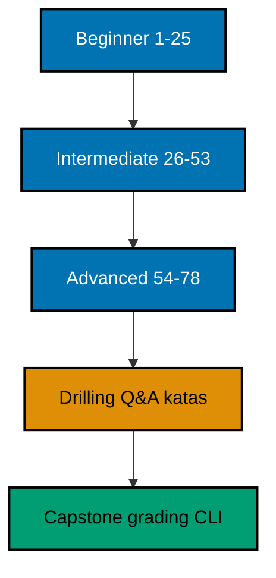

## Why this exists -- the big idea

Most WebAssembly material teaches the container: the text format, the JavaScript API, the browser embedder. This course teaches the program: how to write idiomatic WebAssembly software the way its own community writes it, compiled from Rust to the WASI target and executed under the pinned deterministic runtime. The habit transfers to any Wasm host, because the idioms live in the code, not the embedder.

## Tensions and trade-offs -- when NOT to reach for this

This course is not a Rust course (just-enough-rust covers the language), not a browser course (no DOM, no JavaScript glue, no bundler appears anywhere), and not a concurrency course (threads do not exist under the pinned runtime; the concurrency cluster is an honest survey). Reach for it when you want the Wasm-side idioms: errors as values, tests beside code, manifests that pin, and tools that check.

## Lineage -- where this sits

This course revamps the legacy WebAssembly track, reframing its browser-and-text-format material into the in-depth shape: the same worked-example spine the language in-depth courses use, pointed at WebAssembly itself. Learners arrive from just-enough-rust and leave able to read, write, test, and ship idiomatic Wasm modules.

## How this course is organized

Beginner (Examples 1–25) builds control flow, error handling, and standard-library fluency. Intermediate (Examples 26–53) adds modules, the testing convention, and generics with value semantics. Advanced (Examples 54–78) surveys concurrency, encodes tooling as runnable checkers, and practices reading idiomatic code. Each cluster opens with an anchor example that names the cluster's core habit. Drilling then turns the same habits into questions, katas, and checklists, and the capstone ships a small grading CLI.

## About the runtime

Every example compiles from a single Rust file (standard library only, edition 2021) to the WASI target with `rustc --edition 2021 --target wasm32-wasi -O -C strip=symbols -C debuginfo=0`, and runs under the `webassembly` toolchain (wazero 1.12.0, the pinned entry in `apps/ayokoding-cli`). Units that read files mount their own folder read-only at `/data`; units that write use `/tmp`. Test units build with `rustc --test` and run the same way, with the timing tail normalized. Fixtures were built with rustc 1.80.0 (`wasm32-wasi`, the pre-rename name of the `wasm32-wasip1` target); the runtime that executes them is the pinned one. Outputs are byte-identical across runs: no clocks, no network, no randomness, no threads. Sorting before printing is the standing rule wherever a map is involved; see `learning/code/README.md`.

## Examples by Level

### Beginner (Examples 1–25)

- [Example 1: Early Return Hello](/en/learn/courses/webassembly-essentials/learning/beginner#example-1-early-return-hello)
- [Example 2: Match Replaces If Ladders](/en/learn/courses/webassembly-essentials/learning/beginner#example-2-match-replaces-if-ladders)
- [Example 3: If Let Unwraps Option](/en/learn/courses/webassembly-essentials/learning/beginner#example-3-if-let-unwraps-option)
- [Example 4: Loops Return Values](/en/learn/courses/webassembly-essentials/learning/beginner#example-4-loops-return-values)
- [Example 5: Vec Grows on Push](/en/learn/courses/webassembly-essentials/learning/beginner#example-5-vec-grows-on-push)
- [Example 6: HashMap Counts with Entry](/en/learn/courses/webassembly-essentials/learning/beginner#example-6-hashmap-counts-with-entry)
- [Example 7: Iterators Replace Loops](/en/learn/courses/webassembly-essentials/learning/beginner#example-7-iterators-replace-loops)
- [Example 8: Slices Borrow Views](/en/learn/courses/webassembly-essentials/learning/beginner#example-8-slices-borrow-views)
- [Example 9: Result Instead of Exceptions](/en/learn/courses/webassembly-essentials/learning/beginner#example-9-result-instead-of-exceptions)
- [Example 10: Option Combinators Chain](/en/learn/courses/webassembly-essentials/learning/beginner#example-10-option-combinators-chain)
- [Example 11: Question Mark Propagates](/en/learn/courses/webassembly-essentials/learning/beginner#example-11-question-mark-propagates)
- [Example 12: Map Err Adds Context](/en/learn/courses/webassembly-essentials/learning/beginner#example-12-map-err-adds-context)
- [Example 13: Custom Error Enums Carry Cases](/en/learn/courses/webassembly-essentials/learning/beginner#example-13-custom-error-enums-carry-cases)
- [Example 14: Errors Cross Module Boundaries](/en/learn/courses/webassembly-essentials/learning/beginner#example-14-errors-cross-module-boundaries)
- [Example 15: Collect Failures into a Report](/en/learn/courses/webassembly-essentials/learning/beginner#example-15-collect-failures-into-a-report)
- [Example 16: Panic Stays at the Boundary](/en/learn/courses/webassembly-essentials/learning/beginner#example-16-panic-stays-at-the-boundary)
- [Example 17: Error Trait Objects Erase Types](/en/learn/courses/webassembly-essentials/learning/beginner#example-17-error-trait-objects-erase-types)
- [Example 18: Format Strings Carry Placeholders](/en/learn/courses/webassembly-essentials/learning/beginner#example-18-format-strings-carry-placeholders)
- [Example 19: Split and Join Text](/en/learn/courses/webassembly-essentials/learning/beginner#example-19-split-and-join-text)
- [Example 20: Parse Numbers Without Panicking](/en/learn/courses/webassembly-essentials/learning/beginner#example-20-parse-numbers-without-panicking)
- [Example 21: Read the Bundled Input File](/en/learn/courses/webassembly-essentials/learning/beginner#example-21-read-the-bundled-input-file)
- [Example 22: Write the Report to Tmp](/en/learn/courses/webassembly-essentials/learning/beginner#example-22-write-the-report-to-tmp)
- [Example 23: Fixed Instants Beat Wall Clocks](/en/learn/courses/webassembly-essentials/learning/beginner#example-23-fixed-instants-beat-wall-clocks)
- [Example 24: Durations Schedule Tasks](/en/learn/courses/webassembly-essentials/learning/beginner#example-24-durations-schedule-tasks)
- [Example 25: Paths Join Without Strings](/en/learn/courses/webassembly-essentials/learning/beginner#example-25-paths-join-without-strings)

### Intermediate (Examples 26–53)

- [Example 26: Inline Modules Organize](/en/learn/courses/webassembly-essentials/learning/intermediate#example-26-inline-modules-organize)
- [Example 27: File Modules Split Crates](/en/learn/courses/webassembly-essentials/learning/intermediate#example-27-file-modules-split-crates)
- [Example 28: Visibility Draws Boundaries](/en/learn/courses/webassembly-essentials/learning/intermediate#example-28-visibility-draws-boundaries)
- [Example 29: Structs Carry State](/en/learn/courses/webassembly-essentials/learning/intermediate#example-29-structs-carry-state)
- [Example 30: Enums Model State Machines](/en/learn/courses/webassembly-essentials/learning/intermediate#example-30-enums-model-state-machines)
- [Example 31: Traits Define Behavior](/en/learn/courses/webassembly-essentials/learning/intermediate#example-31-traits-define-behavior)
- [Example 32: Cargo.toml Declares the Crate](/en/learn/courses/webassembly-essentials/learning/intermediate#example-32-cargotoml-declares-the-crate)
- [Example 33: Cargo.lock Pins Versions](/en/learn/courses/webassembly-essentials/learning/intermediate#example-33-cargolock-pins-versions)
- [Example 34: Resolver Picks Compatible Versions](/en/learn/courses/webassembly-essentials/learning/intermediate#example-34-resolver-picks-compatible-versions)
- [Example 35: First Test Asserts Equal](/en/learn/courses/webassembly-essentials/learning/intermediate#example-35-first-test-asserts-equal)
- [Example 36: Failing First Proves the Test](/en/learn/courses/webassembly-essentials/learning/intermediate#example-36-failing-first-proves-the-test)
- [Example 37: Table Tests List Cases](/en/learn/courses/webassembly-essentials/learning/intermediate#example-37-table-tests-list-cases)
- [Example 38: Option and Result Test Helpers](/en/learn/courses/webassembly-essentials/learning/intermediate#example-38-option-and-result-test-helpers)
- [Example 39: Doc Examples Are Tested Too](/en/learn/courses/webassembly-essentials/learning/intermediate#example-39-doc-examples-are-tested-too)
- [Example 40: Assert States the Contract](/en/learn/courses/webassembly-essentials/learning/intermediate#example-40-assert-states-the-contract)
- [Example 41: Ignore Marks Slow Tests](/en/learn/courses/webassembly-essentials/learning/intermediate#example-41-ignore-marks-slow-tests)
- [Example 42: Test Modules Mirror Source](/en/learn/courses/webassembly-essentials/learning/intermediate#example-42-test-modules-mirror-source)
- [Example 43: Captured Output Stays Quiet](/en/learn/courses/webassembly-essentials/learning/intermediate#example-43-captured-output-stays-quiet)
- [Example 44: Main and Tests Share the File](/en/learn/courses/webassembly-essentials/learning/intermediate#example-44-main-and-tests-share-the-file)
- [Example 45: Generic Min Replaces Two](/en/learn/courses/webassembly-essentials/learning/intermediate#example-45-generic-min-replaces-two)
- [Example 46: Trait Bounds Constrain](/en/learn/courses/webassembly-essentials/learning/intermediate#example-46-trait-bounds-constrain)
- [Example 47: Iterators Are Lazy Adapters](/en/learn/courses/webassembly-essentials/learning/intermediate#example-47-iterators-are-lazy-adapters)
- [Example 48: Closures Capture Modes](/en/learn/courses/webassembly-essentials/learning/intermediate#example-48-closures-capture-modes)
- [Example 49: Ownership Moves Values](/en/learn/courses/webassembly-essentials/learning/intermediate#example-49-ownership-moves-values)
- [Example 50: Borrowing Shares Reads](/en/learn/courses/webassembly-essentials/learning/intermediate#example-50-borrowing-shares-reads)
- [Example 51: Clone Duplicates Explicitly](/en/learn/courses/webassembly-essentials/learning/intermediate#example-51-clone-duplicates-explicitly)
- [Example 52: Interior Mutability Cell](/en/learn/courses/webassembly-essentials/learning/intermediate#example-52-interior-mutability-cell)
- [Example 53: Lifetimes Name Borrows](/en/learn/courses/webassembly-essentials/learning/intermediate#example-53-lifetimes-name-borrows)

### Advanced (Examples 54–78)

- [Example 54: Channels Pass Messages](/en/learn/courses/webassembly-essentials/learning/advanced#example-54-channels-pass-messages)
- [Example 55: Workers Share a Queue](/en/learn/courses/webassembly-essentials/learning/advanced#example-55-workers-share-a-queue)
- [Example 56: Select Polls Two Sources](/en/learn/courses/webassembly-essentials/learning/advanced#example-56-select-polls-two-sources)
- [Example 57: Timers Fire in Order](/en/learn/courses/webassembly-essentials/learning/advanced#example-57-timers-fire-in-order)
- [Example 58: Executor Polls Ready Futures](/en/learn/courses/webassembly-essentials/learning/advanced#example-58-executor-polls-ready-futures)
- [Example 59: Async State Machines Step](/en/learn/courses/webassembly-essentials/learning/advanced#example-59-async-state-machines-step)
- [Example 60: Threads Need a Feature](/en/learn/courses/webassembly-essentials/learning/advanced#example-60-threads-need-a-feature)
- [Example 61: Shared State Needs a Protocol](/en/learn/courses/webassembly-essentials/learning/advanced#example-61-shared-state-needs-a-protocol)
- [Example 62: rustfmt Keeps Layout](/en/learn/courses/webassembly-essentials/learning/advanced#example-62-rustfmt-keeps-layout)
- [Example 63: Clippy Flags Unwrap](/en/learn/courses/webassembly-essentials/learning/advanced#example-63-clippy-flags-unwrap)
- [Example 64: Names Follow Snake Case](/en/learn/courses/webassembly-essentials/learning/advanced#example-64-names-follow-snake-case)
- [Example 65: Errors Carry No Panics](/en/learn/courses/webassembly-essentials/learning/advanced#example-65-errors-carry-no-panics)
- [Example 66: Docs Start with Verbs](/en/learn/courses/webassembly-essentials/learning/advanced#example-66-docs-start-with-verbs)
- [Example 67: Deny Unlisted Dependencies](/en/learn/courses/webassembly-essentials/learning/advanced#example-67-deny-unlisted-dependencies)
- [Example 68: Explain the Error Code](/en/learn/courses/webassembly-essentials/learning/advanced#example-68-explain-the-error-code)
- [Example 69: Versions Sort Semantically](/en/learn/courses/webassembly-essentials/learning/advanced#example-69-versions-sort-semantically)
- [Example 70: Review Checklist Runs as Code](/en/learn/courses/webassembly-essentials/learning/advanced#example-70-review-checklist-runs-as-code)
- [Example 71: LRU Cache, Explained](/en/learn/courses/webassembly-essentials/learning/advanced#example-71-lru-cache-explained)
- [Example 72: Word Frequency Counter](/en/learn/courses/webassembly-essentials/learning/advanced#example-72-word-frequency-counter)
- [Example 73: CSV Grade Transformer](/en/learn/courses/webassembly-essentials/learning/advanced#example-73-csv-grade-transformer)
- [Example 74: Todo State Machine](/en/learn/courses/webassembly-essentials/learning/advanced#example-74-todo-state-machine)
- [Example 75: Expression Evaluator](/en/learn/courses/webassembly-essentials/learning/advanced#example-75-expression-evaluator)
- [Example 76: Topological Build Order](/en/learn/courses/webassembly-essentials/learning/advanced#example-76-topological-build-order)
- [Example 77: Retry with a Backoff Plan](/en/learn/courses/webassembly-essentials/learning/advanced#example-77-retry-with-a-backoff-plan)
- [Example 78: Config Merges in Layers](/en/learn/courses/webassembly-essentials/learning/advanced#example-78-config-merges-in-layers)

## Worked examples index

One row per example: title, level, runtime, task, check, and concept references.

| ex                                                                                                                    | Title                              | Level        | Runtime                                | Task                                                  | Check                                                          | Concepts            |
| --------------------------------------------------------------------------------------------------------------------- | ---------------------------------- | ------------ | -------------------------------------- | ----------------------------------------------------- | -------------------------------------------------------------- | ------------------- |
| [ex-01](/en/learn/courses/webassembly-essentials/learning/beginner#example-1-early-return-hello)                      | Early Return Hello                 | Beginner     | webassembly (wazero run)               | greet a name, refusing empty input                    | exit 0; expected/main.stdout.txt                               | co-01, co-02        |
| [ex-02](/en/learn/courses/webassembly-essentials/learning/beginner#example-2-match-replaces-if-ladders)               | Match Replaces If Ladders          | Beginner     | webassembly (wazero run)               | grade ten scores through five bands                   | exit 0; expected/main.stdout.txt                               | co-01               |
| [ex-03](/en/learn/courses/webassembly-essentials/learning/beginner#example-3-if-let-unwraps-option)                   | If Let Unwraps Option              | Beginner     | webassembly (wazero run)               | look up nicknames, hitting and missing                | exit 0; expected/main.stdout.txt                               | co-01, co-02        |
| [ex-04](/en/learn/courses/webassembly-essentials/learning/beginner#example-4-loops-return-values)                     | Loops Return Values                | Beginner     | webassembly (wazero run)               | search with break value, count down, total a range    | exit 0; expected/main.stdout.txt                               | co-01               |
| [ex-05](/en/learn/courses/webassembly-essentials/learning/beginner#example-5-vec-grows-on-push)                       | Vec Grows on Push                  | Beginner     | webassembly (wazero run)               | push four readings through a capacity-2 Vec           | exit 0; expected/main.stdout.txt                               | co-01, co-03, co-15 |
| [ex-06](/en/learn/courses/webassembly-essentials/learning/beginner#example-6-hashmap-counts-with-entry)               | HashMap Counts with Entry          | Beginner     | webassembly (wazero run)               | count six words through the entry API                 | exit 0; expected/main.stdout.txt                               | co-01, co-03        |
| [ex-07](/en/learn/courses/webassembly-essentials/learning/beginner#example-7-iterators-replace-loops)                 | Iterators Replace Loops            | Beginner     | webassembly (wazero run)               | build an honors list, a total, and a count            | exit 0; expected/main.stdout.txt                               | co-01, co-03, co-15 |
| [ex-08](/en/learn/courses/webassembly-essentials/learning/beginner#example-8-slices-borrow-views)                     | Slices Borrow Views                | Beginner     | webassembly (wazero run)               | slide windows, cut chunks, split one borrow           | exit 0; expected/main.stdout.txt                               | co-01, co-03        |
| [ex-09](/en/learn/courses/webassembly-essentials/learning/beginner#example-9-result-instead-of-exceptions)            | Result Instead of Exceptions       | Beginner     | webassembly (wazero run)               | halve 7 (refuse) and 8 (divide)                       | exit 0; expected/main.stdout.txt                               | co-02               |
| [ex-10](/en/learn/courses/webassembly-essentials/learning/beginner#example-10-option-combinators-chain)               | Option Combinators Chain           | Beginner     | webassembly (wazero run)               | chain nickname and badge lookups with one default     | exit 0; expected/main.stdout.txt                               | co-02               |
| [ex-11](/en/learn/courses/webassembly-essentials/learning/beginner#example-11-question-mark-propagates)               | Question Mark Propagates           | Beginner     | webassembly (wazero run)               | parse and range-check three port inputs               | exit 0; expected/main.stdout.txt                               | co-02               |
| [ex-12](/en/learn/courses/webassembly-essentials/learning/beginner#example-12-map-err-adds-context)                   | Map Err Adds Context               | Beginner     | webassembly (wazero run)               | load three rosters, two broken at named lines         | exit 0; expected/main.stdout.txt                               | co-02               |
| [ex-13](/en/learn/courses/webassembly-essentials/learning/beginner#example-13-custom-error-enums-carry-cases)         | Custom Error Enums Carry Cases     | Beginner     | webassembly (wazero run)               | grade missing, out-of-range, and clean inputs         | exit 0; expected/main.stdout.txt                               | co-02               |
| [ex-14](/en/learn/courses/webassembly-essentials/learning/beginner#example-14-errors-cross-module-boundaries)         | Errors Cross Module Boundaries     | Beginner     | webassembly (wazero run)               | parse two rosters across a module boundary            | exit 0; expected/main.stdout.txt                               | co-02, co-06        |
| [ex-15](/en/learn/courses/webassembly-essentials/learning/beginner#example-15-collect-failures-into-a-report)         | Collect Failures into a Report     | Beginner     | webassembly (wazero run)               | validate seven candidates, refuse three               | exit 0; expected/main.stdout.txt                               | co-02               |
| [ex-16](/en/learn/courses/webassembly-essentials/learning/beginner#example-16-panic-stays-at-the-boundary)            | Panic Stays at the Boundary        | Beginner     | webassembly (wazero run)               | refuse overflow and underflow with messages           | exit 0; expected/main.stdout.txt                               | co-02               |
| [ex-17](/en/learn/courses/webassembly-essentials/learning/beginner#example-17-error-trait-objects-erase-types)        | Error Trait Objects Erase Types    | Beginner     | webassembly (wazero run)               | parse years and scores behind one boxed error         | exit 0; expected/main.stdout.txt                               | co-02               |
| [ex-18](/en/learn/courses/webassembly-essentials/learning/beginner#example-18-format-strings-carry-placeholders)      | Format Strings Carry Placeholders  | Beginner     | webassembly (wazero run)               | format one record five ways                           | exit 0; expected/main.stdout.txt                               | co-04               |
| [ex-19](/en/learn/courses/webassembly-essentials/learning/beginner#example-19-split-and-join-text)                    | Split and Join Text                | Beginner     | webassembly (wazero run)               | clean a ragged roster and rejoin a sentence           | exit 0; expected/main.stdout.txt                               | co-04               |
| [ex-20](/en/learn/courses/webassembly-essentials/learning/beginner#example-20-parse-numbers-without-panicking)        | Parse Numbers Without Panicking    | Beginner     | webassembly (wazero run)               | parse five literals through three shapes              | exit 0; expected/main.stdout.txt                               | co-04               |
| [ex-21](/en/learn/courses/webassembly-essentials/learning/beginner#example-21-read-the-bundled-input-file)            | Read the Bundled Input File        | Beginner     | webassembly (wazero run) + /data mount | number the bundled roster                             | exit 0; expected/main.stdout.txt                               | co-04, co-13        |
| [ex-22](/en/learn/courses/webassembly-essentials/learning/beginner#example-22-write-the-report-to-tmp)                | Write the Report to Tmp            | Beginner     | webassembly (wazero run) + /data mount | render, write, read back, and count a report          | exit 0; expected/main.stdout.txt                               | co-04               |
| [ex-23](/en/learn/courses/webassembly-essentials/learning/beginner#example-23-fixed-instants-beat-wall-clocks)        | Fixed Instants Beat Wall Clocks    | Beginner     | webassembly (wazero run)               | schedule a launch window from a fixed midnight        | exit 0; expected/main.stdout.txt                               | co-05               |
| [ex-24](/en/learn/courses/webassembly-essentials/learning/beginner#example-24-durations-schedule-tasks)               | Durations Schedule Tasks           | Beginner     | webassembly (wazero run)               | split a window four ways; refuse the zero split       | exit 0; expected/main.stdout.txt                               | co-05               |
| [ex-25](/en/learn/courses/webassembly-essentials/learning/beginner#example-25-paths-join-without-strings)             | Paths Join Without Strings         | Beginner     | webassembly (wazero run)               | assemble a unit path and take it apart                | exit 0; expected/main.stdout.txt                               | co-04               |
| [ex-26](/en/learn/courses/webassembly-essentials/learning/intermediate#example-26-inline-modules-organize)            | Inline Modules Organize            | Intermediate | webassembly (wazero run)               | build valid and invalid rectangles; describe one      | exit 0; expected/main.stdout.txt                               | co-06               |
| [ex-27](/en/learn/courses/webassembly-essentials/learning/intermediate#example-27-file-modules-split-crates)          | File Modules Split Crates          | Intermediate | webassembly (wazero run)               | mean, median, and variance across a file split        | exit 0; expected/main.stdout.txt                               | co-06               |
| [ex-28](/en/learn/courses/webassembly-essentials/learning/intermediate#example-28-visibility-draws-boundaries)        | Visibility Draws Boundaries        | Intermediate | webassembly (wazero run)               | post two credits, refuse one debit; count digits      | exit 0; expected/main.stdout.txt                               | co-06               |
| [ex-29](/en/learn/courses/webassembly-essentials/learning/intermediate#example-29-structs-carry-state)                | Structs Carry State                | Intermediate | webassembly (wazero run)               | validate three readings; convert and name bands       | exit 0; expected/main.stdout.txt                               | co-06               |
| [ex-30](/en/learn/courses/webassembly-essentials/learning/intermediate#example-30-enums-model-state-machines)         | Enums Model State Machines         | Intermediate | webassembly (wazero run)               | pay, ship, refuse a ship, cancel a draft              | exit 0; expected/main.stdout.txt                               | co-06               |
| [ex-31](/en/learn/courses/webassembly-essentials/learning/intermediate#example-31-traits-define-behavior)             | Traits Define Behavior             | Intermediate | webassembly (wazero run)               | summarize scores and shipments through one trait      | exit 0; expected/main.stdout.txt                               | co-06, co-07        |
| [ex-32](/en/learn/courses/webassembly-essentials/learning/intermediate#example-32-cargotoml-declares-the-crate)       | Cargo.toml Declares the Crate      | Intermediate | webassembly (wazero run) + /data mount | verify the manifest's name, version, and edition      | exit 0; expected/main.stdout.txt                               | co-06, co-07        |
| [ex-33](/en/learn/courses/webassembly-essentials/learning/intermediate#example-33-cargolock-pins-versions)            | Cargo.lock Pins Versions           | Intermediate | webassembly (wazero run) + /data mount | verify each locked package pins one x.y.z version     | exit 0; expected/main.stdout.txt                               | co-06, co-07        |
| [ex-34](/en/learn/courses/webassembly-essentials/learning/intermediate#example-34-resolver-picks-compatible-versions) | Resolver Picks Compatible Versions | Intermediate | webassembly (wazero run)               | resolve three caret ranges over six registry versions | exit 0; expected/main.stdout.txt                               | co-06, co-07        |
| [ex-35](/en/learn/courses/webassembly-essentials/learning/intermediate#example-35-first-test-asserts-equal)           | First Test Asserts Equal           | Intermediate | webassembly (wazero run)               | pin doubling across three cases                       | exit 0; expected/main.stdout.txt                               | co-08               |
| [ex-36](/en/learn/courses/webassembly-essentials/learning/intermediate#example-36-failing-first-proves-the-test)      | Failing First Proves the Test      | Intermediate | webassembly (wazero run)               | pin leap years across four watershed years            | exit 0; expected/main.stdout.txt                               | co-08               |
| [ex-37](/en/learn/courses/webassembly-essentials/learning/intermediate#example-37-table-tests-list-cases)             | Table Tests List Cases             | Intermediate | webassembly (wazero run)               | pin every grading band edge twice                     | exit 0; expected/main.stdout.txt                               | co-08               |
| [ex-38](/en/learn/courses/webassembly-essentials/learning/intermediate#example-38-option-and-result-test-helpers)     | Option and Result Test Helpers     | Intermediate | webassembly (wazero run)               | unwrap hits, assert misses and refusals               | exit 0; expected/main.stdout.txt                               | co-08, co-02        |
| [ex-39](/en/learn/courses/webassembly-essentials/learning/intermediate#example-39-doc-examples-are-tested-too)        | Doc Examples Are Tested Too        | Intermediate | webassembly (wazero run)               | mirror the doc example; demonstrate both arms         | exit 0; expected/main.stdout.txt                               | co-08               |
| [ex-40](/en/learn/courses/webassembly-essentials/learning/intermediate#example-40-assert-states-the-contract)         | Assert States the Contract         | Intermediate | webassembly (wazero run)               | accept 3 and 1 through the positivity contract        | exit 0; expected/main.stdout.txt                               | co-08, co-02        |
| [ex-41](/en/learn/courses/webassembly-essentials/learning/intermediate#example-41-ignore-marks-slow-tests)            | Ignore Marks Slow Tests            | Intermediate | webassembly (wazero run)               | pass two fast tests; report one ignored               | exit 0; expected/main.stdout.txt                               | co-08               |
| [ex-42](/en/learn/courses/webassembly-essentials/learning/intermediate#example-42-test-modules-mirror-source)         | Test Modules Mirror Source         | Intermediate | webassembly (wazero run)               | parse then grade; mirror modules in tests             | exit 0; expected/main.stdout.txt                               | co-08, co-06        |
| [ex-43](/en/learn/courses/webassembly-essentials/learning/intermediate#example-43-captured-output-stays-quiet)        | Captured Output Stays Quiet        | Intermediate | webassembly (wazero run)               | demonstrate capture; prove the nocapture hatch        | exit 0; expected/main.stdout.txt + expected/verbose.stdout.txt | co-08               |
| [ex-44](/en/learn/courses/webassembly-essentials/learning/intermediate#example-44-main-and-tests-share-the-file)      | Main and Tests Share the File      | Intermediate | webassembly (wazero run)               | demonstrate the median; pin odd, even, empty          | exit 0; expected/main.stdout.txt + expected/test.stdout.txt    | co-08               |
| [ex-45](/en/learn/courses/webassembly-essentials/learning/intermediate#example-45-generic-min-replaces-two)           | Generic Min Replaces Two           | Intermediate | webassembly (wazero run)               | min across integers, floats, strings, and chars       | exit 0; expected/main.stdout.txt                               | co-10               |
| [ex-46](/en/learn/courses/webassembly-essentials/learning/intermediate#example-46-trait-bounds-constrain)             | Trait Bounds Constrain             | Intermediate | webassembly (wazero run)               | max with rank across integers and floats              | exit 0; expected/main.stdout.txt                               | co-10               |
| [ex-47](/en/learn/courses/webassembly-essentials/learning/intermediate#example-47-iterators-are-lazy-adapters)        | Iterators Are Lazy Adapters        | Intermediate | webassembly (wazero run)               | stop after two doubled evens; count mapper ticks      | exit 0; expected/main.stdout.txt                               | co-10               |
| [ex-48](/en/learn/courses/webassembly-essentials/learning/intermediate#example-48-closures-capture-modes)             | Closures Capture Modes             | Intermediate | webassembly (wazero run)               | read a threshold, spend a bonus, consume a label      | exit 0; expected/main.stdout.txt                               | co-10               |
| [ex-49](/en/learn/courses/webassembly-essentials/learning/intermediate#example-49-ownership-moves-values)             | Ownership Moves Values             | Intermediate | webassembly (wazero run)               | tag a copy; retire the moved Vec                      | exit 0; expected/main.stdout.txt                               | co-11               |
| [ex-50](/en/learn/courses/webassembly-essentials/learning/intermediate#example-50-borrowing-shares-reads)             | Borrowing Shares Reads             | Intermediate | webassembly (wazero run)               | read, promote, and re-read the roster                 | exit 0; expected/main.stdout.txt                               | co-11               |
| [ex-51](/en/learn/courses/webassembly-essentials/learning/intermediate#example-51-clone-duplicates-explicitly)        | Clone Duplicates Explicitly        | Intermediate | webassembly (wazero run)               | curve a Copy score; clone roster names explicitly     | exit 0; expected/main.stdout.txt                               | co-11               |
| [ex-52](/en/learn/courses/webassembly-essentials/learning/intermediate#example-52-interior-mutability-cell)           | Interior Mutability Cell           | Intermediate | webassembly (wazero run)               | observe three times through two shared handles        | exit 0; expected/main.stdout.txt                               | co-11               |
| [ex-53](/en/learn/courses/webassembly-essentials/learning/intermediate#example-53-lifetimes-name-borrows)             | Lifetimes Name Borrows             | Intermediate | webassembly (wazero run)               | pick the longer roll; take first words                | exit 0; expected/main.stdout.txt                               | co-11               |
| [ex-54](/en/learn/courses/webassembly-essentials/learning/advanced#example-54-channels-pass-messages)                 | Channels Pass Messages             | Advanced     | webassembly (wazero run)               | send three grades; drain in order                     | exit 0; expected/main.stdout.txt                               | co-09               |
| [ex-55](/en/learn/courses/webassembly-essentials/learning/advanced#example-55-workers-share-a-queue)                  | Workers Share a Queue              | Advanced     | webassembly (wazero run)               | claim four tasks; record four graded lines            | exit 0; expected/main.stdout.txt                               | co-09               |
| [ex-56](/en/learn/courses/webassembly-essentials/learning/advanced#example-56-select-polls-two-sources)               | Select Polls Two Sources           | Advanced     | webassembly (wazero run)               | interleave two rosters round-robin                    | exit 0; expected/main.stdout.txt                               | co-09               |
| [ex-57](/en/learn/courses/webassembly-essentials/learning/advanced#example-57-timers-fire-in-order)                   | Timers Fire in Order               | Advanced     | webassembly (wazero run)               | fire four timers in tick order                        | exit 0; expected/main.stdout.txt                               | co-09               |
| [ex-58](/en/learn/courses/webassembly-essentials/learning/advanced#example-58-executor-polls-ready-futures)           | Executor Polls Ready Futures       | Advanced     | webassembly (wazero run)               | resolve two ready futures with one poll each          | exit 0; expected/main.stdout.txt                               | co-09               |
| [ex-59](/en/learn/courses/webassembly-essentials/learning/advanced#example-59-async-state-machines-step)              | Async State Machines Step          | Advanced     | webassembly (wazero run)               | grade two scores through a two-pause machine          | exit 0; expected/main.stdout.txt                               | co-09               |
| [ex-60](/en/learn/courses/webassembly-essentials/learning/advanced#example-60-threads-need-a-feature)                 | Threads Need a Feature             | Advanced     | webassembly (wazero run)               | attempt one thread; report Unsupported                | exit 0; expected/main.stdout.txt                               | co-09, co-13        |
| [ex-61](/en/learn/courses/webassembly-essentials/learning/advanced#example-61-shared-state-needs-a-protocol)          | Shared State Needs a Protocol      | Advanced     | webassembly (wazero run)               | post three scores through three handles               | exit 0; expected/main.stdout.txt                               | co-09               |
| [ex-62](/en/learn/courses/webassembly-essentials/learning/advanced#example-62-rustfmt-keeps-layout)                   | rustfmt Keeps Layout               | Advanced     | webassembly (wazero run)               | flag the tab and the overlong line                    | exit 0; expected/main.stdout.txt                               | co-12               |
| [ex-63](/en/learn/courses/webassembly-essentials/learning/advanced#example-63-clippy-flags-unwrap)                    | Clippy Flags Unwrap                | Advanced     | webassembly (wazero run)               | flag three bare unwraps among handled code            | exit 0; expected/main.stdout.txt                               | co-12               |
| [ex-64](/en/learn/courses/webassembly-essentials/learning/advanced#example-64-names-follow-snake-case)                | Names Follow Snake Case            | Advanced     | webassembly (wazero run)               | flag four misnamed rows in a nine-row table           | exit 0; expected/main.stdout.txt                               | co-12, co-14        |
| [ex-65](/en/learn/courses/webassembly-essentials/learning/advanced#example-65-errors-carry-no-panics)                 | Errors Carry No Panics             | Advanced     | webassembly (wazero run)               | flag the panic and the unreachable                    | exit 0; expected/main.stdout.txt                               | co-12, co-02        |
| [ex-66](/en/learn/courses/webassembly-essentials/learning/advanced#example-66-docs-start-with-verbs)                  | Docs Start with Verbs              | Advanced     | webassembly (wazero run)               | flag the marker-less line and the number-led verb     | exit 0; expected/main.stdout.txt                               | co-12, co-14        |
| [ex-67](/en/learn/courses/webassembly-essentials/learning/advanced#example-67-deny-unlisted-dependencies)             | Deny Unlisted Dependencies         | Advanced     | webassembly (wazero run)               | flag the unlisted locked crate                        | exit 0; expected/main.stdout.txt                               | co-12, co-07        |
| [ex-68](/en/learn/courses/webassembly-essentials/learning/advanced#example-68-explain-the-error-code)                 | Explain the Error Code             | Advanced     | webassembly (wazero run)               | explain eight error kinds in one line each            | exit 0; expected/main.stdout.txt                               | co-12, co-02        |
| [ex-69](/en/learn/courses/webassembly-essentials/learning/advanced#example-69-versions-sort-semantically)             | Versions Sort Semantically         | Advanced     | webassembly (wazero run)               | rank five versions; skip two shapeless rows           | exit 0; expected/main.stdout.txt                               | co-12, co-07        |
| [ex-70](/en/learn/courses/webassembly-essentials/learning/advanced#example-70-review-checklist-runs-as-code)          | Review Checklist Runs as Code      | Advanced     | webassembly (wazero run)               | score before at five, after at zero                   | exit 0; expected/main.stdout.txt                               | co-12               |
| [ex-71](/en/learn/courses/webassembly-essentials/learning/advanced#example-71-lru-cache-explained)                    | LRU Cache, Explained               | Advanced     | webassembly (wazero run)               | insert three, evict the stalest, read back            | exit 0; expected/main.stdout.txt                               | co-16, co-03        |
| [ex-72](/en/learn/courses/webassembly-essentials/learning/advanced#example-72-word-frequency-counter)                 | Word Frequency Counter             | Advanced     | webassembly (wazero run)               | rank the top three words of a paragraph               | exit 0; expected/main.stdout.txt                               | co-16, co-03        |
| [ex-73](/en/learn/courses/webassembly-essentials/learning/advanced#example-73-csv-grade-transformer)                  | CSV Grade Transformer              | Advanced     | webassembly (wazero run)               | grade three rows; refuse three with line numbers      | exit 0; expected/main.stdout.txt                               | co-16, co-04        |
| [ex-74](/en/learn/courses/webassembly-essentials/learning/advanced#example-74-todo-state-machine)                     | Todo State Machine                 | Advanced     | webassembly (wazero run)               | run a six-command script; refuse two                  | exit 0; expected/main.stdout.txt                               | co-16, co-06        |
| [ex-75](/en/learn/courses/webassembly-essentials/learning/advanced#example-75-expression-evaluator)                   | Expression Evaluator               | Advanced     | webassembly (wazero run)               | evaluate four expressions; refuse two shapes          | exit 0; expected/main.stdout.txt                               | co-16, co-01        |
| [ex-76](/en/learn/courses/webassembly-essentials/learning/advanced#example-76-topological-build-order)                | Topological Build Order            | Advanced     | webassembly (wazero run)               | sort a clean graph; refuse a cycle by name            | exit 0; expected/main.stdout.txt                               | co-16, co-03        |
| [ex-77](/en/learn/courses/webassembly-essentials/learning/advanced#example-77-retry-with-a-backoff-plan)              | Retry with a Backoff Plan          | Advanced     | webassembly (wazero run)               | fail twice, succeed on the third attempt              | exit 0; expected/main.stdout.txt                               | co-16, co-05        |
| [ex-78](/en/learn/courses/webassembly-essentials/learning/advanced#example-78-config-merges-in-layers)                | Config Merges in Layers            | Advanced     | webassembly (wazero run)               | print three layers and the merged table               | exit 0; expected/main.stdout.txt                               | co-16, co-04        |
