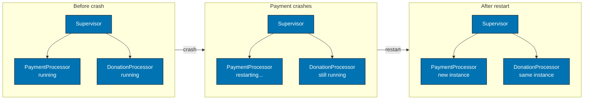
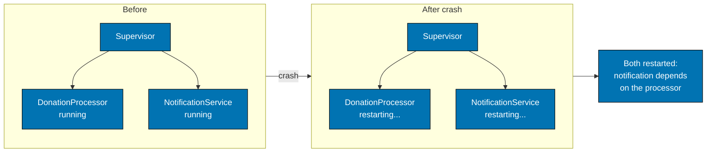
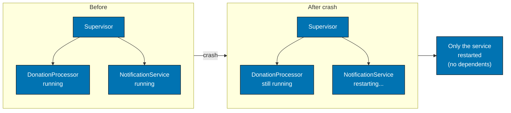
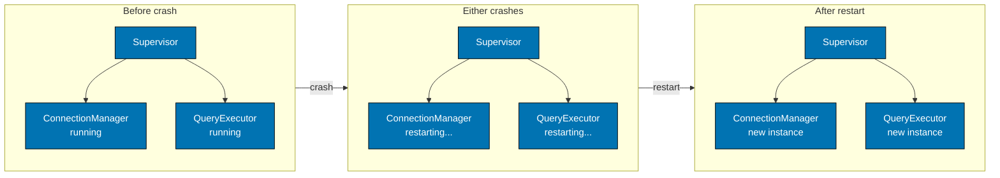
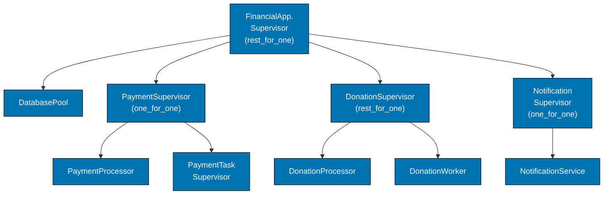

**How do you build fault-tolerant systems in Elixir?** This guide teaches the progression from manual process monitoring through OTP Supervisor patterns, showing how supervision trees provide automatic recovery and production resilience.

## Why It Matters

Process crashes are inevitable in distributed systems. The question isn't IF processes will crash, but HOW your system recovers when they do.

**Manual monitoring challenges**:

- Process crash detection requires explicit monitoring
- No automatic restart policies
- Manual cleanup of crashed process resources
- Cascading failures without isolation

**Real-world scenarios requiring supervision**:

- **Financial systems** - Payment processor crashes shouldn't kill invoice system
- **Background jobs** - Failed email sends should retry without manual intervention
- **API services** - Database connection crashes should auto-reconnect
- **Real-time features** - WebSocket crashes should restart without dropping other connections
- **Data pipelines** - ETL stage failures should restart without manual ops intervention

Production question: How do you ensure processes restart automatically with the right strategy for your failure domain?

## Manual Process Monitoring

Before understanding Supervisor, see what manual monitoring requires.

### Process.monitor/1 - Detect Crashes

```elixir
# Manual crash detection with Process.monitor
defmodule ManualMonitor do
  def start_worker(task) do
    parent = self()                          # => Current process PID
                                             # => Type: pid()

    pid = spawn_link(fn ->
      result = perform_task(task)            # => Execute task
      send(parent, {:result, result})        # => Send result to parent
    end)                                     # => pid: Worker PID
                                             # => Linked to parent

    ref = Process.monitor(pid)               # => Monitor worker process
                                             # => Returns: reference
                                             # => Type: reference()

    receive do
      {:result, value} ->
        Process.demonitor(ref)               # => Remove monitor
        {:ok, value}                         # => Return successful result

      {:DOWN, ^ref, :process, ^pid, reason} ->
        {:error, {:crashed, reason}}         # => Process crashed
                                             # => reason: Exit reason
                                             # => Type: {:error, term()}
    after
      5000 ->
        Process.exit(pid, :kill)             # => Timeout: kill worker
        {:error, :timeout}                   # => Return timeout error
    end
  end

  defp perform_task(:ok_task), do: :ok
  defp perform_task(:crash_task), do: raise "Task failed"
end

# Usage - successful task
result = ManualMonitor.start_worker(:ok_task)
# => result: {:ok, :ok}
# => Worker executed, returned result

# Usage - crashing task
result = ManualMonitor.start_worker(:crash_task)
# => result: {:error, {:crashed, {%RuntimeError{message: "Task failed"}, [...]}}}
# => Process crashed, detected by monitor
```

Monitor detects crashes but doesn't restart processes automatically.

## Limitations of Manual Monitoring

Manual monitoring solves crash detection but creates new production problems.

### Problem 1: No Automatic Restart

```elixir
# Manual restart requires explicit implementation
defmodule ManualRestarter do
  def start_worker_with_retry(task, max_retries \\ 3) do
    start_worker_loop(task, 0, max_retries)
                                             # => Retry loop
  end

  defp start_worker_loop(task, attempt, max_retries) when attempt < max_retries do
    case ManualMonitor.start_worker(task) do
      {:ok, result} ->
        {:ok, result}                        # => Success, return

      {:error, reason} ->
        IO.puts("Worker failed (attempt #{attempt + 1}): #{inspect(reason)}")
        Process.sleep(1000)                  # => Backoff delay
        start_worker_loop(task, attempt + 1, max_retries)
                                             # => Retry recursively
    end
  end

  defp start_worker_loop(_task, attempt, max_retries) do
    {:error, {:max_retries_reached, attempt}}
                                             # => Exhausted retries
  end
end

# Usage - requires manual retry management
result = ManualRestarter.start_worker_with_retry(:sometimes_crash_task)
# => Manual retry logic
# => No supervision tree
# => No restart strategy configuration
```

Every retry scenario needs custom implementation. No standardized restart policies.

### Problem 2: No Restart Strategies

```elixir
# Different failure domains need different restart strategies
defmodule PaymentSystem do
  def start do
    # Start payment processor
    {:ok, payment_pid} = PaymentProcessor.start_link()

    # Start notification service
    {:ok, notif_pid} = NotificationService.start_link()

    # Start invoice tracker
    {:ok, invoice_pid} = InvoiceTracker.start_link()

    # Manual monitoring of all processes
    Process.monitor(payment_pid)
    Process.monitor(notif_pid)
    Process.monitor(invoice_pid)

    # Question: If payment_pid crashes, should we restart:
    # - Only payment processor? (one_for_one)
    # - Payment processor + everything started after it? (rest_for_one)
    # - All processes? (one_for_all)
    # => Manual monitoring doesn't provide restart strategies
    # => Must implement custom logic for each scenario
  end
end
```

No built-in restart strategy patterns. Each failure domain needs custom handling.

### Problem 3: No Supervision Tree Structure

```elixir
# Complex system with manual monitoring
defmodule FinancialApp do
  def start do
    # Database pool
    {:ok, db_pid} = DatabasePool.start_link()

    # Payment subsystem
    {:ok, payment_super} = start_payment_subsystem()

    # Donation subsystem
    {:ok, donation_super} = start_donation_subsystem()

    # Notification subsystem
    {:ok, notif_super} = start_notification_subsystem()

    # Manual monitoring - flat structure
    Process.monitor(db_pid)
    Process.monitor(payment_super)
    Process.monitor(donation_super)
    Process.monitor(notif_super)

    # Problems:
    # - No hierarchy (all processes at same level)
    # - No isolation between subsystems
    # - Database failure should stop everything
    # - Payment failure shouldn't affect donations
    # => Manual monitoring provides no tree structure
    # => No hierarchical restart policies
  end

  defp start_payment_subsystem do
    # Payment processor + workers
    # How to supervise internal structure?
    # => Must implement custom supervision
  end
end
```

Flat monitoring structure. No hierarchical supervision with isolated failure domains.

### Problem 4: Resource Cleanup Complexity

```elixir
# Resource cleanup with manual monitoring
defmodule DatabaseWorker do
  def start_link(config) do
    parent = self()

    pid = spawn_link(fn ->
      # Open connection
      {:ok, conn} = :db.connect(config.url)
                                             # => Connection established
                                             # => Resource acquired

      send(parent, {:started, conn})

      # Worker loop
      loop(conn)                             # => Process work
    end)

    receive do
      {:started, conn} ->
        ref = Process.monitor(pid)
        {:ok, pid, conn, ref}
    end
  end

  def stop(pid, conn, ref) do
    Process.demonitor(ref)
    Process.exit(pid, :normal)
    :db.close(conn)                          # => Manual cleanup
                                             # => Must track connection handle
                                             # => Caller responsible for cleanup
  end

  # Question: What if caller crashes before calling stop?
  # => Connection leaked
  # => No automatic cleanup mechanism
end
```

Resource cleanup requires manual tracking. Caller crash leaks resources.

## Supervisor Module - Fault Tolerance

Elixir's `Supervisor` module provides production-ready process supervision.

### Basic Supervisor

```elixir
# Supervisor managing single worker
defmodule InvoiceProcessor do
  use GenServer

  def start_link(_opts) do
    GenServer.start_link(__MODULE__, %{}, name: __MODULE__)
                                             # => Start GenServer
                                             # => Initial state: empty map
  end

  def process(invoice) do
    GenServer.call(__MODULE__, {:process, invoice})
                                             # => Synchronous call
  end

  @impl true
  def init(_opts) do
    {:ok, %{}}                               # => Initial state
  end

  @impl true
  def handle_call({:process, invoice}, _from, state) do
    # Simulate processing (might crash)
    if :rand.uniform() > 0.7 do
      raise "Processing failed"              # => 30% crash rate
    end

    result = %{invoice_id: invoice.id, status: :completed}
    {:reply, result, state}                  # => Success
  end
end

defmodule InvoiceSupervisor do
  use Supervisor                             # => Supervisor behavior

  def start_link(_opts) do
    Supervisor.start_link(__MODULE__, :ok, name: __MODULE__)
                                             # => Start supervisor
                                             # => Returns: {:ok, pid}
  end

  @impl true
  def init(:ok) do
    children = [
      InvoiceProcessor                       # => Child spec
                                             # => Shorthand for {InvoiceProcessor, []}
    ]                                        # => children: List of child specs

    Supervisor.init(children, strategy: :one_for_one)
                                             # => strategy: Restart crashed child only
                                             # => Returns: {:ok, spec}
  end
end
```

**Usage**:

```elixir
# Start supervisor (which starts worker)
{:ok, sup_pid} = InvoiceSupervisor.start_link([])
# => Supervisor started
# => InvoiceProcessor started automatically
# => Type: {:ok, pid()}

# Process invoices (worker might crash)
result1 = InvoiceProcessor.process(%{id: 1, amount: 100})
# => Might return: {:ok, %{invoice_id: 1, status: :completed}}
# => Or might crash (30% chance)

# If crash occurs:
# => Supervisor detects crash
# => Automatically restarts InvoiceProcessor
# => Next call succeeds (new worker)

result2 = InvoiceProcessor.process(%{id: 2, amount: 200})
# => Works even if previous call crashed
# => Automatic recovery
```

Supervisor automatically restarts crashed workers. No manual retry logic needed.

### Supervisor.init/2 Return Value

```elixir
@impl true
def init(:ok) do
  children = [Worker1, Worker2]

  Supervisor.init(children, strategy: :one_for_one)
                                             # => Returns: {:ok, {supervisor_flags, child_specs}}
                                             # => supervisor_flags: Supervision strategy
                                             # => child_specs: List of child specifications
                                             # => Type: {:ok, tuple()}
end
```

## Supervision Strategies

Supervisor provides three core restart strategies for different failure domains.

### Strategy 1: one_for_one - Independent Workers

Restart only the crashed process. Other processes unaffected.

**Use case**: Independent workers where failure doesn't affect siblings.

```elixir
# Financial system: Payment + Donation processors
defmodule FinancialSupervisor do
  use Supervisor

  def start_link(_opts) do
    Supervisor.start_link(__MODULE__, :ok, name: __MODULE__)
  end

  @impl true
  def init(:ok) do
    children = [
      PaymentProcessor,                      # => Independent payment worker
      DonationProcessor                      # => Independent donation worker
    ]

    Supervisor.init(children, strategy: :one_for_one)
                                             # => one_for_one strategy
                                             # => Payment crash → restart Payment only
                                             # => Donation crash → restart Donation only
  end
end
```

**Behavior**:



Payment crash doesn't affect donations. Perfect for independent workers.

### Strategy 2: rest_for_one - Sequential Dependencies

Restart crashed process and all processes started after it (in child list order).

**Use case**: Sequential dependencies where later workers depend on earlier ones.

```elixir
# Donation system: Processor → Notification
defmodule DonationSupervisor do
  use Supervisor

  def start_link(_opts) do
    Supervisor.start_link(__MODULE__, :ok, name: __MODULE__)
  end

  @impl true
  def init(:ok) do
    children = [
      DonationProcessor,                     # => Started first
      NotificationService                    # => Started second (depends on processor)
    ]

    Supervisor.init(children, strategy: :rest_for_one)
                                             # => rest_for_one strategy
                                             # => Processor crash → restart both
                                             # => Notification crash → restart notification only
  end
end
```

**Behavior**:

**Scenario 1: DonationProcessor crashes**



**Scenario 2: NotificationService crashes**



Order matters! Processor crash affects notification (dependency). Notification crash doesn't affect processor.

### Strategy 3: one_for_all - Shared State

Restart all children when any child crashes.

**Use case**: Tightly coupled workers sharing state or resources.

```elixir
# Database pool: Connection manager + Query executor
defmodule DatabasePoolSupervisor do
  use Supervisor

  def start_link(_opts) do
    Supervisor.start_link(__MODULE__, :ok, name: __MODULE__)
  end

  @impl true
  def init(:ok) do
    children = [
      ConnectionManager,                     # => Manages DB connections
      QueryExecutor                          # => Executes queries via connections
    ]

    Supervisor.init(children, strategy: :one_for_all)
                                             # => one_for_all strategy
                                             # => Any crash → restart all
                                             # => Shared connection pool state
  end
end
```

**Behavior**:



Any crash restarts everything. Ensures consistent shared state.

## Production Pattern: Hierarchical Trees

Real systems use multiple supervisors in tree structure for isolated failure domains.

### Financial Application Tree

```elixir
# Top-level application supervisor
defmodule FinancialApp.Supervisor do
  use Supervisor

  def start_link(_opts) do
    Supervisor.start_link(__MODULE__, :ok, name: __MODULE__)
  end

  @impl true
  def init(:ok) do
    children = [
      # Infrastructure
      DatabasePool,                          # => Level 1: Database

      # Subsystem supervisors
      PaymentSupervisor,                     # => Level 2: Payment subsystem
      DonationSupervisor,                    # => Level 2: Donation subsystem
      NotificationSupervisor                 # => Level 2: Notification subsystem
    ]

    Supervisor.init(children, strategy: :rest_for_one)
                                             # => rest_for_one strategy
                                             # => DB crash → restart everything
                                             # => Payment crash → restart payment/donation/notif
                                             # => Donation crash → restart donation/notif
                                             # => Notif crash → restart notif only
  end
end

# Payment subsystem (isolated failure domain)
defmodule PaymentSupervisor do
  use Supervisor

  def start_link(_opts) do
    Supervisor.start_link(__MODULE__, :ok, name: __MODULE__)
  end

  @impl true
  def init(:ok) do
    children = [
      PaymentProcessor,                      # => Core processor
      {Task.Supervisor, name: PaymentTaskSupervisor}
                                             # => Dynamic payment tasks
    ]

    Supervisor.init(children, strategy: :one_for_one)
                                             # => one_for_one strategy
                                             # => Isolated from other subsystems
  end
end

# Donation subsystem (isolated failure domain)
defmodule DonationSupervisor do
  use Supervisor

  def start_link(_opts) do
    Supervisor.start_link(__MODULE__, :ok, name: __MODULE__)
  end

  @impl true
  def init(:ok) do
    children = [
      DonationProcessor,                     # => Core processor
      DonationWorker                         # => Background worker
    ]

    Supervisor.init(children, strategy: :rest_for_one)
                                             # => rest_for_one strategy
                                             # => Processor crash restarts worker
  end
end
```

**Supervision tree**:



**Failure scenarios**:

```
Scenario 1: PaymentProcessor crashes
- PaymentProcessor restarts (one_for_one in PaymentSupervisor)
- PaymentTaskSupervisor keeps running
- DonationSupervisor unaffected
- NotificationSupervisor unaffected
=> Isolated payment failure

Scenario 2: DonationProcessor crashes
- DonationProcessor restarts
- DonationWorker restarts (rest_for_one in DonationSupervisor)
- NotificationSupervisor restarts (rest_for_one in top supervisor)
=> Cascading restart for dependent services only

Scenario 3: DatabasePool crashes
- Everything restarts (rest_for_one in top supervisor)
=> Infrastructure failure affects all subsystems
```

Hierarchical structure provides failure isolation with controlled cascading.

## Restart Policies

Configure restart behavior with `max_restarts` and `max_seconds`.

### Default Restart Policy

```elixir
# Default: 3 restarts per 5 seconds
Supervisor.init(children, strategy: :one_for_one)
# => max_restarts: 3
# => max_seconds: 5
# => If more than 3 restarts in 5 seconds → supervisor terminates
```

**Behavior**:

```
Time    Event
0s      Worker starts
1s      Crash 1 → Restart 1
2s      Crash 2 → Restart 2
3s      Crash 3 → Restart 3
4s      Crash 4 → Supervisor terminates (exceeded 3 restarts in 5s)
```

Prevents infinite restart loops. Supervisor gives up if worker repeatedly crashes.

### Custom Restart Policy

```elixir
# Aggressive restart for transient failures
Supervisor.init(
  children,
  strategy: :one_for_one,
  max_restarts: 10,                          # => Allow 10 restarts
  max_seconds: 60                            # => Within 60 seconds
)
# => Tolerates temporary issues (network blips, external API timeouts)

# Conservative restart for critical services
Supervisor.init(
  children,
  strategy: :one_for_one,
  max_restarts: 1,                           # => Allow only 1 restart
  max_seconds: 10                            # => Within 10 seconds
)
# => Fails fast for persistent problems
```

Tune based on failure characteristics and recovery expectations.

## Dynamic Children

Start children dynamically with `DynamicSupervisor`.

### DynamicSupervisor Pattern

```elixir
# Dynamic donation processing workers
defmodule DonationWorkerSupervisor do
  use DynamicSupervisor

  def start_link(_opts) do
    DynamicSupervisor.start_link(__MODULE__, :ok, name: __MODULE__)
  end

  @impl true
  def init(:ok) do
    DynamicSupervisor.init(strategy: :one_for_one)
                                             # => Dynamic supervisor
                                             # => Children added at runtime
  end

  def start_worker(donation_id) do
    spec = {DonationWorker, donation_id}
    DynamicSupervisor.start_child(__MODULE__, spec)
                                             # => Start child dynamically
                                             # => Returns: {:ok, pid}
  end

  def stop_worker(pid) do
    DynamicSupervisor.terminate_child(__MODULE__, pid)
                                             # => Stop specific child
                                             # => Returns: :ok
  end
end

defmodule DonationWorker do
  use GenServer

  def start_link(donation_id) do
    GenServer.start_link(__MODULE__, donation_id)
  end

  @impl true
  def init(donation_id) do
    IO.puts("Processing donation #{donation_id}")
    {:ok, %{donation_id: donation_id}}
  end
end
```

**Usage**:

```elixir
# Start dynamic supervisor
{:ok, _sup} = DonationWorkerSupervisor.start_link([])

# Start workers dynamically
{:ok, worker1} = DonationWorkerSupervisor.start_worker("donation-123")
# => Worker started and supervised
{:ok, worker2} = DonationWorkerSupervisor.start_worker("donation-456")
# => Second worker started

# Workers crash → automatically restarted by supervisor

# Stop specific worker
DonationWorkerSupervisor.stop_worker(worker1)
# => Worker stopped, removed from supervision
```

Dynamic supervision for variable workload. Workers start/stop based on demand.

## Best Practices

### 1. Design Failure Domains

```elixir
# Good: Isolated subsystems with appropriate strategies
defmodule App.Supervisor do
  use Supervisor

  def init(:ok) do
    children = [
      # Critical infrastructure (failure affects all)
      DatabasePool,

      # Independent subsystems (one_for_one per subsystem)
      PaymentSupervisor,
      DonationSupervisor
    ]

    Supervisor.init(children, strategy: :rest_for_one)
  end
end

# Bad: Flat structure with all workers in one supervisor
defmodule BadSupervisor do
  use Supervisor

  def init(:ok) do
    children = [
      DatabasePool,
      PaymentWorker,
      DonationWorker,
      NotificationWorker
    ]

    Supervisor.init(children, strategy: :one_for_all)
                                             # => Any crash restarts everything
                                             # => No isolation
  end
end
```

### 2. Use Appropriate Restart Strategies

```elixir
# one_for_one: Independent workers
children = [PaymentAPI, DonationAPI]
Supervisor.init(children, strategy: :one_for_one)

# rest_for_one: Sequential dependencies
children = [Database, QueryCache]
Supervisor.init(children, strategy: :rest_for_one)

# one_for_all: Shared state
children = [ConnectionPool, ConnectionMonitor]
Supervisor.init(children, strategy: :one_for_all)
```

### 3. Tune Restart Policies

```elixir
# Transient failures (network, external APIs)
Supervisor.init(children,
  strategy: :one_for_one,
  max_restarts: 10,
  max_seconds: 60
)

# Persistent failures (critical services)
Supervisor.init(children,
  strategy: :one_for_one,
  max_restarts: 3,
  max_seconds: 5
)
```

### 4. Let It Crash - Don't Catch Errors

```elixir
# Good: Let supervisor handle crashes
defmodule PaymentWorker do
  def process_payment(payment) do
    validate_payment!(payment)               # => Raises on invalid
    charge_customer!(payment)                # => Raises on failure
    # => Supervisor restarts on crash
  end
end

# Bad: Catching errors prevents supervisor restart
defmodule BadWorker do
  def process_payment(payment) do
    try do
      validate_payment!(payment)
      charge_customer!(payment)
    rescue
      e -> {:error, e}                       # => Hides crash from supervisor
                                             # => Worker stays in bad state
    end
  end
end
```

### 5. Use DynamicSupervisor for Variable Load

```elixir
# Good: Dynamic workers for varying workload
defmodule TaskSupervisor do
  use DynamicSupervisor

  def process_batch(items) do
    Enum.each(items, fn item ->
      DynamicSupervisor.start_child(__MODULE__, {Worker, item})
                                             # => Start worker per item
                                             # => Supervised execution
    end)
  end
end

# Bad: Fixed pool for unknown workload
defmodule FixedPool do
  def init(:ok) do
    children = Enum.map(1..10, fn i -> {Worker, i} end)
                                             # => Fixed 10 workers
                                             # => Can't handle 100 concurrent tasks
    Supervisor.init(children, strategy: :one_for_one)
  end
end
```

## Common Pitfalls

### Pitfall 1: Wrong Restart Strategy

```elixir
# Wrong: one_for_all for independent workers
Supervisor.init([PaymentAPI, DonationAPI], strategy: :one_for_all)
# => Payment crash restarts donations unnecessarily

# Right: one_for_one for independent workers
Supervisor.init([PaymentAPI, DonationAPI], strategy: :one_for_one)
```

### Pitfall 2: Flat Supervision Structure

```elixir
# Wrong: All workers in single supervisor
Supervisor.init([
  DatabasePool,
  PaymentWorker1, PaymentWorker2,
  DonationWorker1, DonationWorker2
], strategy: :one_for_one)
# => No subsystem isolation

# Right: Hierarchical structure
Supervisor.init([
  DatabasePool,
  PaymentSupervisor,
  DonationSupervisor
], strategy: :rest_for_one)
```

### Pitfall 3: Catching All Errors

```elixir
# Wrong: Prevents supervisor from restarting
def handle_call(:risky_operation, _from, state) do
  try do
    result = risky_operation()
    {:reply, result, state}
  rescue
    _ -> {:reply, {:error, :failed}, state}
  end
end

# Right: Let it crash
def handle_call(:risky_operation, _from, state) do
  result = risky_operation()               # => Crash propagates to supervisor
  {:reply, result, state}
end
```

## Further Reading

**Next guides in OTP and Concurrency category**:

- [Application Structure](/en/learn/software-engineering/programming-languages/elixir/in-the-field/application-structure) - Application behavior and lifecycle management

**Foundation guides**:

- [Processes and Message Passing](/en/learn/software-engineering/programming-languages/elixir/in-the-field/processes-and-message-passing) - Process primitives and Task module
- [GenServer Patterns](/en/learn/software-engineering/programming-languages/elixir/in-the-field/genserver-patterns) - State management with GenServer

**Related production topics**:

- [Best Practices](/en/learn/software-engineering/programming-languages/elixir/in-the-field/best-practices) - Production patterns and conventions
- [Anti Patterns](/en/learn/software-engineering/programming-languages/elixir/in-the-field/anti-patterns) - Common mistakes and solutions

## Summary

Supervisor trees provide fault tolerance through automatic restart:

1. **Manual Monitoring** - `Process.monitor/1` detects crashes but no auto-restart
2. **Limitations** - No restart strategies, no tree structure, manual cleanup
3. **Supervisor Module** - OTP-compliant supervision with restart strategies
4. **Strategies** - `one_for_one`, `rest_for_one`, `one_for_all` for different failure domains
5. **Hierarchical Trees** - Multiple supervisors create isolated failure domains
6. **Restart Policies** - Configure `max_restarts`/`max_seconds` for crash tolerance
7. **Dynamic Children** - `DynamicSupervisor` for variable workload

**Use one_for_one** for independent workers.
**Use rest_for_one** for sequential dependencies.
**Use one_for_all** for shared state.

Build hierarchical trees for isolated, fault-tolerant subsystems.
