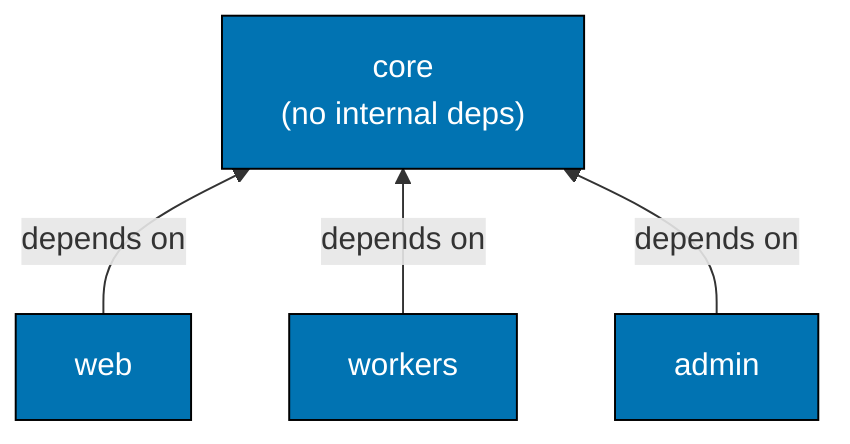

**Managing multiple interconnected applications?** This guide teaches the progression from single Mix applications through their organizational limitations to umbrella projects, showing when multi-app monorepos provide production value.

## Why It Matters

Most Elixir projects start as single Mix applications. As systems grow, you encounter architectural challenges:

- **Donation platform** - Core domain, web interface, background workers, admin panel
- **E-commerce** - Catalog service, payment processing, inventory management, analytics
- **Financial system** - Contract management, payment gateway, reporting, compliance
- **Content platform** - API server, content delivery, search indexing, user management

Production question: Should you split into multiple applications, and if so, should they be separate repositories or umbrella apps? The answer depends on your coupling and deployment requirements.

## Standard Mix Application

Every Elixir project starts with `mix new`.

### Single Application Structure

```bash
mix new donation_platform
# => Creates standard Mix project
# => Structure: Single application
# => Compilation: One compile step
# => Deployment: Single release
```

Project structure:

```
donation_platform/
├── mix.exs                        # => Project configuration
├── lib/
│   ├── donation_platform.ex       # => Main module
│   └── donation_platform/
│       ├── donor.ex               # => Domain logic
│       ├── donation.ex            # => Domain logic
│       └── campaign.ex            # => Domain logic
└── test/
    └── donation_platform_test.exs
```

### Basic Organization - Folders Only

```elixir
# Standard single-app organization
donation_platform/
├── lib/
│   └── donation_platform/
│       ├── core/                  # => Domain logic folder
│       │   ├── donor.ex
│       │   ├── donation.ex
│       │   └── campaign.ex
│       ├── web/                   # => Web interface folder
│       │   ├── router.ex
│       │   └── controllers/
│       └── workers/               # => Background jobs folder
│           ├── email_worker.ex
│           └── report_worker.ex
└── mix.exs
# => All code in single application
# => Compilation: Everything together
# => Testing: All tests run together
```

This works initially but has production limitations.

## Limitations of Single Application

As projects grow, single applications create organizational problems.

### Problem 1: No Architectural Boundaries

```elixir
# Web controller directly accessing worker internals
defmodule DonationPlatform.Web.DonorController do
  alias DonationPlatform.Workers.EmailWorker

  def create(conn, params) do
    donor = create_donor(params)

    # => Direct dependency on worker implementation
    EmailWorker.send_welcome(donor.email, donor.name)
    # => Tight coupling between layers
    # => No boundary enforcement
    # => Type: :ok | {:error, reason}

    json(conn, donor)
  end
end
# => Web depends on workers
# => Workers depend on core
# => All boundaries voluntary
# => Easy to violate architecture
```

No compiler enforcement of architectural layers.

### Problem 2: Tight Coupling

```elixir
# Core domain mixed with infrastructure
defmodule DonationPlatform.Core.Donation do
  # => Domain logic
  def process_donation(donor_id, amount) do
    # ... business logic ...

    # => Infrastructure concern in domain
    send_receipt_email(donor_id, amount)     # => Email logic
    store_in_cache(donor_id, amount)         # => Cache logic
    log_to_analytics(donor_id, amount)       # => Analytics logic
    # => Domain polluted with infrastructure
    # => Hard to test domain in isolation
    # => Type: {:ok, donation} | {:error, reason}
  end
end
# => Everything depends on everything
# => Circular dependencies possible
# => Hard to extract or test
```

All code shares single namespace and dependency graph.

### Problem 3: All-or-Nothing Deployment

```elixir
# mix.exs - Single application
defp deps do
  [
    {:phoenix, "~> 1.7"},              # => Web framework
    {:ecto_sql, "~> 3.10"},            # => Database
    {:oban, "~> 2.15"},                # => Job queue
    {:ex_aws, "~> 2.4"},               # => Cloud services
    {:broadway, "~> 1.0"}              # => Data pipeline
    # => All dependencies loaded always
    # => Web server loads job queue
    # => Workers load Phoenix
    # => Type: list(dependency)
  ]
end
# => Single release includes everything
# => Cannot deploy web separately from workers
# => Scaling requires entire application
```

No way to deploy or scale components independently.

### Problem 4: Namespace Collisions

```elixir
# Everything under one namespace
defmodule DonationPlatform.User do       # => User for web auth?
  # ...
end

defmodule DonationPlatform.User do       # => User for donations?
  # => Compilation error: Already defined
  # => Type: Compilation error
end

# Must use verbose names
defmodule DonationPlatform.Web.User do   # => Web auth user
  # ...
end

defmodule DonationPlatform.Core.Donor do # => Donation user (renamed)
  # ...
end
# => Naming confusion
# => Verbose module names
# => Context conflicts
```

Single namespace forces naming conventions to avoid conflicts.

### Problem 5: Long Compilation Times

```bash
# Any change recompiles entire application
mix compile
# => Compiles: Core, Web, Workers, Admin
# => Time: 30-60 seconds for large projects
# => Type: Compilation result

# Changed one file in workers
touch lib/donation_platform/workers/email_worker.ex
mix compile
# => Recompiles: All dependencies of workers
# => Potentially: Web, Core if dependencies exist
# => No isolation benefit
```

No way to compile subsystems independently.

### Problem 6: Testing Complexity

```elixir
# All tests run together
mix test
# => Runs: Core tests (unit)
# => Runs: Web tests (integration)
# => Runs: Worker tests (async jobs)
# => Time: 5-10 minutes
# => Type: Test results

# Want to test only core domain?
mix test test/donation_platform/core
# => Still loads: All dependencies
# => Still starts: Database, cache, etc.
# => No isolation
```

Cannot test subsystems in isolation without loading entire application.

## Umbrella Projects - Multi-App Monorepo

Umbrella projects provide architectural boundaries within single repository.

### Creating Umbrella Project

```bash
mix new donation_platform --umbrella
# => Creates umbrella project structure
# => Type: Umbrella project
# => Structure: apps/ directory for applications
```

Generated structure:

```
donation_platform/
├── mix.exs                        # => Root configuration
├── apps/                          # => Applications directory
│   └── .gitkeep
└── config/
    └── config.exs
```

### Adding Applications

```bash
cd donation_platform/apps

mix new core
# => Creates: apps/core/
# => Type: Standard Mix application
# => Purpose: Domain logic

mix new web --sup
# => Creates: apps/web/
# => Type: Supervised application
# => Purpose: Phoenix web interface

mix new workers --sup
# => Creates: apps/workers/
# => Type: Supervised application
# => Purpose: Oban job processing

mix new admin --sup
# => Creates: apps/admin/
# => Type: Supervised application
# => Purpose: Admin interface
```

Final structure:

```
donation_platform/
├── mix.exs                        # => Root umbrella config
├── apps/
│   ├── core/                      # => Domain logic app
│   │   ├── mix.exs
│   │   └── lib/
│   │       └── core/
│   │           ├── donor.ex
│   │           ├── donation.ex
│   │           └── campaign.ex
│   ├── web/                       # => Web interface app
│   │   ├── mix.exs
│   │   └── lib/
│   │       └── web/
│   │           ├── router.ex
│   │           └── controllers/
│   ├── workers/                   # => Background jobs app
│   │   ├── mix.exs
│   │   └── lib/
│   │       └── workers/
│   │           ├── email_worker.ex
│   │           └── report_worker.ex
│   └── admin/                     # => Admin panel app
│       ├── mix.exs
│       └── lib/
│           └── admin/
│               └── dashboard.ex
└── config/
    └── config.exs
```

Each application is independent Mix project within umbrella.

## Application Dependencies

Umbrella apps declare dependencies on sibling apps.

### Defining Dependencies in mix.exs

```elixir
# apps/web/mix.exs
defmodule Web.MixProject do
  use Mix.Project

  def project do
    [
      app: :web,
      version: "0.1.0",
      build_path: "../../_build",          # => Shared build directory
      config_path: "../../config/config.exs",
      deps_path: "../../deps",             # => Shared dependencies
      deps: deps()                         # => Application dependencies
    ]
  end

  defp deps do
    [
      {:core, in_umbrella: true},          # => Depends on core app
                                           # => Type: Internal dependency
                                           # => Compilation: core before web
      {:phoenix, "~> 1.7"},                # => External dependencies
      {:plug_cowboy, "~> 2.6"}
    ]
  end
end
```

```elixir
# apps/workers/mix.exs
defmodule Workers.MixProject do
  use Mix.Project

  def project do
    [
      app: :workers,
      version: "0.1.0",
      build_path: "../../_build",
      config_path: "../../config/config.exs",
      deps_path: "../../deps",
      deps: deps()
    ]
  end

  defp deps do
    [
      {:core, in_umbrella: true},          # => Depends on core app
      {:oban, "~> 2.15"},                  # => Job queue
      {:swoosh, "~> 1.11"}                 # => Email library
      # => Does NOT depend on :web
      # => Isolated from web concerns
    ]
  end
end
```

```elixir
# apps/core/mix.exs - No internal dependencies
defmodule Core.MixProject do
  use Mix.Project

  def project do
    [
      app: :core,
      version: "0.1.0",
      build_path: "../../_build",
      config_path: "../../config/config.exs",
      deps_path: "../../deps",
      deps: deps()
    ]
  end

  defp deps do
    [
      {:ecto_sql, "~> 3.10"},              # => External only
      {:decimal, "~> 2.0"}
      # => No umbrella dependencies
      # => Pure domain logic
      # => Type: list(dependency)
    ]
  end
end
```

Dependency graph enforces architectural layers:



### Compilation Order

```bash
mix compile
# => Compiles: core first (no deps)
# => Compiles: web, workers, admin in parallel (depend on core)
# => Type: Compilation result
# => Order: Automatic based on dependencies
```

Mix automatically orders compilation based on dependency graph.

## Application Communication

Apps communicate through clean boundaries.

### Example - Web Calling Core

```elixir
# apps/web/lib/web/controllers/donation_controller.ex
defmodule Web.DonationController do
  use Web, :controller

  # => Import from core app
  alias Core.Donations                   # => Domain service
  alias Core.Donor                       # => Domain struct
  # => Type: Module aliases

  def create(conn, params) do
    # => Call core domain logic
    case Donations.process_donation(params) do
      {:ok, donation} ->                 # => Success case
        # => Type: {:ok, %Donation{}}
        json(conn, donation)

      {:error, changeset} ->             # => Validation error
        # => Type: {:error, Ecto.Changeset.t()}
        json(conn, %{errors: format_errors(changeset)})
    end
    # => Web layer never accesses database directly
    # => Core layer handles all business logic
    # => Clean separation of concerns
  end
end
```

Web depends on core, but core knows nothing about web.

### Example - Workers Calling Core

```elixir
# apps/workers/lib/workers/receipt_worker.ex
defmodule Workers.ReceiptWorker do
  use Oban.Worker

  # => Import from core app
  alias Core.Donations                   # => Domain service
  alias Core.Donors                      # => Domain service

  @impl Oban.Worker
  def perform(%Oban.Job{args: %{"donation_id" => id}}) do
    # => Load donation from core
    donation = Donations.get_donation!(id)
    # => Type: %Core.Donation{}

    # => Load donor from core
    donor = Donors.get_donor!(donation.donor_id)
    # => Type: %Core.Donor{}

    # => Send receipt email
    send_receipt_email(donor.email, donation)
    # => Type: :ok | {:error, reason}

    :ok
  end
end
```

Workers depend on core for domain operations.

### Shared Dependencies

```elixir
# Root mix.exs - Shared across all apps
defmodule DonationPlatform.MixProject do
  use Mix.Project

  def project do
    [
      apps_path: "apps",                 # => Applications directory
      version: "0.1.0",                  # => Umbrella version
      start_permanent: Mix.env() == :prod,
      deps: deps()                       # => Shared dependencies
    ]
  end

  defp deps do
    [
      # => Shared test/dev dependencies
      {:credo, "~> 1.7", only: [:dev, :test], runtime: false},
      {:dialyxir, "~> 1.3", only: [:dev], runtime: false}
      # => Available to all apps
      # => Type: list(dependency)
    ]
  end
end
```

Root `mix.exs` defines shared dependencies available to all apps.

## Production Patterns

### Pattern 1 - Shared Configuration

```elixir
# config/config.exs - Shared configuration
import Config

# => Configure all apps
config :core, Core.Repo,
  database: "donation_platform_#{config_env()}",
  pool_size: 10
  # => Type: Repo configuration

config :web, Web.Endpoint,
  url: [host: "localhost"],
  secret_key_base: System.get_env("SECRET_KEY_BASE")
  # => Type: Endpoint configuration

config :workers, Oban,
  repo: Core.Repo,                       # => Shared repo
  queues: [default: 10, mailers: 20]
  # => Type: Oban configuration

# => Environment-specific config
import_config "#{config_env()}.exs"
```

Configuration shared across all umbrella apps.

### Pattern 2 - Independent Testing

```bash
# Test only core domain
cd apps/core
mix test
# => Runs: Core tests only
# => Loads: Core dependencies only
# => Time: 30 seconds (not 5 minutes)
# => Type: Test results

# Test only web interface
cd apps/web
mix test
# => Runs: Web tests only
# => Loads: Core + Web dependencies
# => Isolated from workers/admin
```

Each app tests independently with only required dependencies.

### Pattern 3 - Selective Releases

```elixir
# rel/web_release.exs - Web-only release
import Config

# => Include only web and core apps
config :web_release,
  applications: [:core, :web]            # => Exclude: workers, admin
  # => Type: Release configuration

# Deployment:
# - Web servers: Release with :core + :web
# - Worker servers: Release with :core + :workers
# - Admin servers: Release with :core + :admin
```

Different releases for different deployment targets.

### Pattern 4 - Clean Architectural Layers

```
Core (Domain)
  - No external app dependencies
  - Pure business logic
  - Ecto schemas and changesets
  - Domain services

Web (Interface)
  - Depends on: Core
  - Phoenix controllers/views
  - GraphQL/REST APIs
  - WebSocket channels

Workers (Background)
  - Depends on: Core
  - Oban jobs
  - Scheduled tasks
  - Email delivery

Admin (Management)
  - Depends on: Core
  - Admin dashboard
  - Management tools
  - Reporting
```

Clear separation prevents architectural violations.

## When to Use Umbrella Projects

### Use Umbrella When

**1. Multiple Deployment Targets**

```elixir
# Different services need different apps
# - Web servers: core + web
# - API servers: core + api
# - Workers: core + workers
# - Admin: core + admin
```

**2. Architectural Boundaries**

```elixir
# Want to enforce clean architecture
# - Core: Domain logic (no external knowledge)
# - Interface: Web/API (depends on core)
# - Infrastructure: Workers/Services (depends on core)
```

**3. Team Organization**

```elixir
# Different teams own different apps
# - Core team: Domain logic
# - Web team: User interfaces
# - Platform team: Background services
```

**4. Compilation Performance**

```elixir
# Large codebase benefits from isolation
# - Change in workers: No need to recompile web
# - Change in web: No need to recompile workers
# - Core changes: Recompile dependents only
```

### Keep Single App When

**1. Simple Projects**

```elixir
# Small projects (< 10,000 LOC)
# Single deployment target
# No architectural complexity
```

**2. Tight Integration**

```elixir
# All components tightly coupled
# Share most dependencies
# Deploy together always
```

**3. Early Stage**

```elixir
# Product direction unclear
# Requirements changing rapidly
# Premature optimization risk
```

## Migration Path

### From Single App to Umbrella

**Step 1: Create Umbrella Structure**

```bash
# Outside existing project
mix new donation_platform_umbrella --umbrella
cd donation_platform_umbrella/apps

# Move existing app
mv ../../donation_platform ./legacy
```

**Step 2: Extract Core Domain**

```bash
cd apps
mix new core

# Move domain logic
mv legacy/lib/donation_platform/donor.ex core/lib/core/
mv legacy/lib/donation_platform/donation.ex core/lib/core/
mv legacy/lib/donation_platform/campaign.ex core/lib/core/
```

**Step 3: Create Specialized Apps**

```bash
mix new web --sup
mix new workers --sup

# Configure dependencies
# apps/web/mix.exs: {:core, in_umbrella: true}
# apps/workers/mix.exs: {:core, in_umbrella: true}
```

**Step 4: Migrate Code**

```bash
# Move web code to web app
mv legacy/lib/donation_platform/web/* apps/web/lib/web/

# Move worker code to workers app
mv legacy/lib/donation_platform/workers/* apps/workers/lib/workers/
```

**Step 5: Update Imports**

```elixir
# Before (single app)
alias DonationPlatform.Core.Donor

# After (umbrella)
alias Core.Donor                         # => From core app
```

**Step 6: Test and Deploy**

```bash
cd donation_platform_umbrella
mix test                                 # => All apps
mix release                              # => Umbrella release
```

## Best Practices

### 1. Core App Has No Internal Dependencies

```elixir
# Good: Core isolated
defp deps do
  [
    {:ecto_sql, "~> 3.10"}               # => External only
  ]
end

# Bad: Core depends on other apps
defp deps do
  [
    {:web, in_umbrella: true}            # => Circular dependency risk
  ]
end
```

### 2. Apps Depend on Core, Not Each Other

```elixir
# Good: Star topology
# core ← web
# core ← workers
# core ← admin

# Bad: Circular dependencies
# web ← workers ← admin ← web
```

### 3. Shared Code Goes in Core

```elixir
# Good: Shared in core
defmodule Core.Donations do
  # => Used by: web, workers, admin
end

# Bad: Duplicated across apps
defmodule Web.Donations do ... end
defmodule Workers.Donations do ... end
```

### 4. Use Path Dependencies for Development

```elixir
# apps/web/mix.exs
defp deps do
  [
    {:core, in_umbrella: true},          # => Development: Path dependency
                                         # => Production: Git tag or Hex
  ]
end
```

### 5. Test Apps Independently

```bash
# Test each app in isolation
cd apps/core && mix test
cd apps/web && mix test
cd apps/workers && mix test
```

## Common Pitfalls

### Pitfall 1: Over-Splitting Too Early

```elixir
# Wrong: Too many apps for small project
apps/
├── core/
├── web/
├── api/
├── workers/
├── admin/
├── reporting/
└── analytics/
# => 7 apps for 5,000 LOC project
# => Premature complexity
```

### Pitfall 2: Circular Dependencies

```elixir
# Wrong: Circular deps
# apps/web/mix.exs
{:workers, in_umbrella: true}

# apps/workers/mix.exs
{:web, in_umbrella: true}                # => Compilation error
```

### Pitfall 3: Duplicating Code Instead of Sharing

```elixir
# Wrong: Duplicate validation logic
# apps/web/lib/web/donation_validator.ex
def validate(donation), do: ...

# apps/workers/lib/workers/donation_validator.ex
def validate(donation), do: ...          # => Duplicate

# Right: Share in core
# apps/core/lib/core/donations.ex
def validate(donation), do: ...          # => Single source
```

### Pitfall 4: Not Using Umbrella for Multiple Services

```elixir
# Wrong: Single app for web + workers + admin
# Even with folders, no compilation isolation

# Right: Umbrella with separate deployments
# - Web servers: core + web
# - Worker servers: core + workers
```

## Further Reading

**Architecture patterns**:

- [Application Structure](/en/learn/software-engineering/programming-languages/elixir/in-the-field/application-structure) - Application behavior and supervision
- [Supervisor Trees](/en/learn/software-engineering/programming-languages/elixir/in-the-field/supervisor-trees) - Multi-app supervision strategies

**Configuration**:

- [Configuration Management](/en/learn/software-engineering/programming-languages/elixir/in-the-field/configuration-management) - Environment-specific config for umbrellas

**Deployment**:

- [Deployment Strategies](/en/learn/software-engineering/programming-languages/elixir/in-the-field/deployment-strategies) - Releasing umbrella applications

## Summary

Umbrella projects provide multi-app organization within single repository:

1. **Standard Mix Application** - Single app, folders for organization
2. **Limitations** - No boundaries, tight coupling, all-or-nothing deployment
3. **Umbrella Structure** - Multi-app with explicit dependencies
4. **Production Benefits** - Clean architecture, selective releases, compilation isolation

**Use single app** for simple projects, tight integration, early stage development.

**Use umbrella** for architectural boundaries, multiple deployment targets, large codebases.

Both approaches serve different needs - choose based on project scale and deployment requirements.
