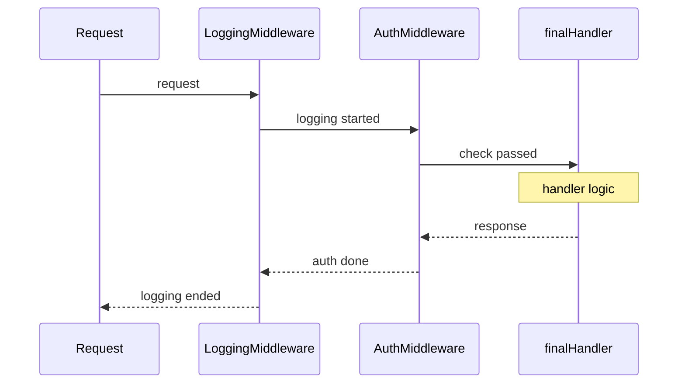

## Why Composition Matters

Go favors composition over inheritance, enabling flexible code reuse without complex type hierarchies. Understanding struct embedding, interface composition, and middleware patterns prevents brittle inheritance-like structures and enables powerful abstractions used throughout the standard library and production systems.

**Core benefits**:

- **Flexibility**: Change behavior without modifying types
- **Testability**: Easy to mock embedded interfaces
- **Decoupling**: Components interact through interfaces, not concrete types
- **Reusability**: Compose small interfaces into larger behaviors

**Problem**: Developers from OOP backgrounds create deep type hierarchies, missing Go's composition model. This leads to tight coupling and difficult refactoring.

**Solution**: Learn struct embedding from standard library, then apply interface composition and middleware patterns for production systems.

## Standard Library: Struct Embedding

Go's struct embedding allows one struct to include another, promoting fields and methods to the outer type.

**Pattern from standard library**:

```go
package main

import (
    "fmt"
    // => Standard library for output
    "time"
    // => Standard library for time operations
)

// Base type with common fields
type Entity struct {
    ID        string
    // => ID is unique identifier
    CreatedAt time.Time
    // => CreatedAt is creation timestamp
    UpdatedAt time.Time
    // => UpdatedAt is last modification timestamp
}

// User embeds Entity (composition)
type User struct {
    Entity
    // => Entity embedded (not inherited)
    // => Entity fields promoted to User
    // => User "has-a" Entity (not "is-a")

    Email string
    // => Email field specific to User
    Name  string
    // => Name field specific to User
}

func main() {
    user := User{
        Entity: Entity{
            // => Initialize embedded Entity
            ID:        "user-123",
            CreatedAt: time.Now(),
            UpdatedAt: time.Now(),
        },
        Email: "alice@example.com",
        Name:  "Alice",
    }

    // PROMOTED FIELDS: access Entity fields directly
    fmt.Println(user.ID)
    // => Output: user-123
    // => user.ID is shorthand for user.Entity.ID
    // => Field promoted from embedded Entity

    fmt.Println(user.CreatedAt)
    // => Output: 2026-02-04 20:00:00 +0700 WIB
    // => Promoted field accessed directly

    // EXPLICIT ACCESS: also valid
    fmt.Println(user.Entity.ID)
    // => Output: user-123
    // => Explicit access to embedded field
    // => Same result as user.ID
}
```

**Method promotion**:

```go
package main

import (
    "fmt"
    // => Standard library for output
    "time"
    // => Standard library for time operations
)

type Entity struct {
    ID        string
    UpdatedAt time.Time
}

// Method on Entity
func (e *Entity) Touch() {
    // => Touch updates UpdatedAt timestamp
    // => Pointer receiver modifies Entity

    e.UpdatedAt = time.Now()
    // => Sets UpdatedAt to current time
}

type User struct {
    Entity
    // => Embeds Entity (gains Touch method)

    Email string
}

func main() {
    user := User{
        Entity: Entity{ID: "user-123"},
        Email:  "alice@example.com",
    }

    // PROMOTED METHOD: call Entity method on User
    user.Touch()
    // => Calls user.Entity.Touch()
    // => Method promoted from embedded Entity
    // => user.UpdatedAt modified

    fmt.Println(user.UpdatedAt)
    // => Output: 2026-02-04 20:00:00 +0700 WIB
    // => UpdatedAt set by Touch method
}
```

**Limitations**:

- No polymorphism (embedding is not inheritance)
- Name collisions resolved by explicit access
- Cannot override methods (no dynamic dispatch)
- Embedding multiple types with same field causes ambiguity

## Standard Library: Interface Composition

Go interfaces compose from smaller interfaces, following the "accept interfaces, return structs" principle.

**Pattern from standard library** (io package):

```go
package main

import (
    "io"
    // => Standard library I/O interfaces
    "os"
    // => Standard library file operations
    "strings"
    // => Standard library string utilities
)

// SMALL INTERFACES (from io package):
// type Reader interface {
//     Read(p []byte) (n int, err error)
// }
// => Reader represents anything that can be read
// => Single method interface (common pattern)

// type Writer interface {
//     Write(p []byte) (n int, err error)
// }
// => Writer represents anything that can be written to
// => Single method interface

// COMPOSED INTERFACE:
// type ReadWriter interface {
//     Reader
//     Writer
// }
// => ReadWriter embeds Reader and Writer
// => Types must implement both Read and Write
// => Composition creates larger interface from smaller ones

func copy(dst io.Writer, src io.Reader) (int64, error) {
    // => dst is anything implementing Write
    // => src is anything implementing Read
    // => Interfaces enable flexibility (files, buffers, networks)

    buffer := make([]byte, 32*1024)
    // => 32KB buffer for copying
    // => []byte allocated on heap

    var written int64
    // => Total bytes written (accumulator)

    for {
        // => Infinite loop (exits on EOF or error)

        nr, err := src.Read(buffer)
        // => Read up to 32KB from source
        // => nr is number of bytes read
        // => err is io.EOF when done

        if nr > 0 {
            // => Data available in buffer

            nw, errW := dst.Write(buffer[:nr])
            // => Write nr bytes to destination
            // => buffer[:nr] slices to actual data read
            // => nw is bytes written

            written += int64(nw)
            // => Accumulate total bytes written

            if errW != nil {
                // => Write error occurred
                return written, errW
            }
        }

        if err == io.EOF {
            // => End of file reached (normal termination)
            break
        }
        if err != nil {
            // => Read error occurred
            return written, err
        }
    }

    return written, nil
    // => Success: return total bytes copied
}

func main() {
    // src is *strings.Reader (implements io.Reader)
    src := strings.NewReader("hello world")
    // => strings.Reader wraps string as io.Reader
    // => Read method reads from string

    // dst is *os.File (implements io.Writer)
    dst := os.Stdout
    // => os.Stdout is standard output file
    // => Write method writes to terminal

    copy(dst, src)
    // => Output: hello world
    // => copy works with any Reader/Writer
    // => No concrete type dependencies
}
```

**Composition enables flexibility**:

```go
package main

import "io"

// Small focused interfaces
type Flusher interface {
    Flush() error
    // => Flush writes buffered data
}

type Closer interface {
    Close() error
    // => Close releases resources
}

// Composed interfaces
type WriteCloser interface {
    io.Writer
    // => Embeds Writer interface
    Closer
    // => Adds Close method
}
// => WriteCloser represents writable closeable resource
// => Files, network connections implement this

type ReadWriteCloser interface {
    io.Reader
    io.Writer
    Closer
}
// => ReadWriteCloser combines three interfaces
// => Full duplex communication with cleanup
// => TCP connections implement this

func process(rwc io.ReadWriteCloser) error {
    // => rwc must implement Read, Write, Close
    // => Accepts files, network connections, pipes
    // => Interface composition enables polymorphism

    defer rwc.Close()
    // => Ensure resources released
    // => Close called on function exit

    // Read/write operations...
    return nil
}
```

**Why interface composition matters**:

- Small interfaces easy to implement and test
- Compose interfaces to express requirements precisely
- Functions accept minimal interface needed (not concrete types)
- Standard library uses this pattern extensively

## Production Pattern: HTTP Middleware

Middleware wraps http.Handler to add cross-cutting concerns (logging, auth, metrics) without modifying handler code.

**Pattern: Middleware Chain**:

```go
package main

import (
    "fmt"
    // => Standard library for output
    "log"
    // => Standard library for logging
    "net/http"
    // => Standard library HTTP server
    "time"
    // => Standard library for timing
)

// Middleware is function that wraps http.Handler
type Middleware func(http.Handler) http.Handler
// => Takes handler, returns wrapped handler
// => Allows chaining multiple middlewares
// => Composition pattern for HTTP handling

// Logging middleware
func LoggingMiddleware(next http.Handler) http.Handler {
    // => next is the wrapped handler
    // => Returns new handler with logging behavior

    return http.HandlerFunc(func(w http.ResponseWriter, r *http.Request) {
        // => http.HandlerFunc adapts function to http.Handler
        // => w is response writer
        // => r is incoming request

        start := time.Now()
        // => Record start time

        log.Printf("Started %s %s", r.Method, r.URL.Path)
        // => Log request method and path
        // => Output: Started GET /api/users

        next.ServeHTTP(w, r)
        // => CRITICAL: call wrapped handler
        // => Without this, request chain breaks
        // => Delegates to next middleware or final handler

        duration := time.Since(start)
        // => Calculate request duration

        log.Printf("Completed %s %s in %v", r.Method, r.URL.Path, duration)
        // => Log completion with timing
        // => Output: Completed GET /api/users in 15ms
    })
}

// Authentication middleware
func AuthMiddleware(next http.Handler) http.Handler {
    // => Wraps handler with auth check

    return http.HandlerFunc(func(w http.ResponseWriter, r *http.Request) {
        // => Handler function for auth checking

        token := r.Header.Get("Authorization")
        // => Extract auth token from header
        // => token is "Bearer xyz123" or empty

        if token == "" {
            // => No token provided

            http.Error(w, "Unauthorized", http.StatusUnauthorized)
            // => Return 401 Unauthorized
            // => Sets response status and body
            // => Request chain stops here

            return
            // => CRITICAL: return without calling next
            // => Prevents unauthorized access to handler
        }

        // Token validation would happen here
        // In production: verify JWT, check DB, etc.

        next.ServeHTTP(w, r)
        // => Auth passed: continue to next handler
        // => Only reached if token present
    })
}

// Business logic handler
func helloHandler(w http.ResponseWriter, r *http.Request) {
    // => Final handler (business logic)
    // => Called after all middleware

    fmt.Fprintf(w, "Hello, authenticated user!")
    // => Write response body
    // => Output: Hello, authenticated user!
}

func main() {
    // Final handler (business logic)
    finalHandler := http.HandlerFunc(helloHandler)
    // => Wrap function as http.Handler

    // Compose middleware chain
    handler := LoggingMiddleware(AuthMiddleware(finalHandler))
    // => Execution order: Logging → Auth → finalHandler
    // => Request flows: Logging (before) → Auth (before) → finalHandler → Auth (after) → Logging (after)
    // => Composition wraps handlers like onion layers

    http.Handle("/api/hello", handler)
    // => Register wrapped handler at /api/hello
    // => All requests pass through middleware chain

    log.Println("Server starting on :8080")
    http.ListenAndServe(":8080", nil)
    // => Start HTTP server on port 8080
    // => Blocks until server stops
}
```

**Middleware chain visualization**:



**Reusable middleware library pattern**:

```go
package main

import "net/http"

// Chain wraps multiple middlewares
type Chain struct {
    middlewares []Middleware
    // => middlewares is ordered list of wrappers
}

func NewChain(middlewares ...Middleware) Chain {
    // => Variadic function accepts any number of middlewares
    // => Returns Chain for fluent API

    return Chain{middlewares: middlewares}
    // => Store middlewares in order
}

func (c Chain) Then(h http.Handler) http.Handler {
    // => Then applies all middlewares to handler
    // => Returns fully wrapped handler

    // Apply middlewares in reverse order
    for i := len(c.middlewares) - 1; i >= 0; i-- {
        // => Loop backwards through middlewares
        // => Ensures correct execution order

        h = c.middlewares[i](h)
        // => Wrap h with middleware[i]
        // => Each iteration adds outer layer
    }

    return h
    // => Return fully composed handler
}

func main() {
    // Create reusable middleware chain
    chain := NewChain(
        LoggingMiddleware,
        AuthMiddleware,
    )
    // => chain wraps any handler with logging + auth

    // Apply to handler
    handler := chain.Then(http.HandlerFunc(helloHandler))
    // => Composes: LoggingMiddleware(AuthMiddleware(helloHandler))
    // => Reusable pattern for multiple endpoints

    http.Handle("/api/hello", handler)
    // => /api/hello has logging + auth

    http.Handle("/api/users", chain.Then(http.HandlerFunc(usersHandler)))
    // => /api/users has same middleware chain
    // => DRY: Define middleware once, apply everywhere
}

func usersHandler(w http.ResponseWriter, r *http.Request) {
    // => Another handler using same middleware
    // ...
}
```

## Trade-offs: When to Use Each

**Comparison table**:

| Pattern                 | Type Safety  | Flexibility | Use Case                                    |
| ----------------------- | ------------ | ----------- | ------------------------------------------- |
| **Struct embedding**    | Compile-time | Low         | Reuse fields/methods (Entity base)          |
| **Interface embedding** | Compile-time | Medium      | Compose behaviors (ReadWriteCloser)         |
| **Middleware**          | Compile-time | High        | HTTP cross-cutting concerns (logging, auth) |

**When to use struct embedding**:

- Common fields across types (ID, timestamps)
- Reuse methods without duplication
- "Has-a" relationships (User has Entity)
- Promote methods/fields to outer type

**When to use interface composition**:

- Define minimal interfaces (Reader, Writer)
- Compose interfaces for requirements (ReadWriter)
- Accept interfaces, return structs (standard pattern)
- Enable polymorphism without inheritance

**When to use middleware**:

- HTTP cross-cutting concerns (logging, auth, metrics)
- Wrap handlers without modifying code
- Compose behavior chains (pipeline pattern)
- Reusable request/response processing

## Production Best Practices

**Prefer small interfaces**:

```go
// GOOD: small focused interface
type Notifier interface {
    Notify(message string) error
}

// BAD: large interface (hard to implement)
type Service interface {
    Notify(message string) error
    Log(level string, msg string)
    Metrics() map[string]int
    // ... many methods
}
```

**Compose interfaces from smaller ones**:

```go
// Small interfaces
type Notifier interface {
    Notify(message string) error
}

type Logger interface {
    Log(level string, msg string)
}

// Composed interface
type NotifyingLogger interface {
    Notifier
    Logger
}
// => Only require this when both needed
```

**Use middleware for HTTP concerns**:

```go
// Separate concerns into middleware
chain := NewChain(
    RecoveryMiddleware,   // Panic recovery
    LoggingMiddleware,    // Request logging
    MetricsMiddleware,    // Prometheus metrics
    AuthMiddleware,       // Authentication
    RateLimitMiddleware,  // Rate limiting
)

// Apply to handlers
http.Handle("/api/users", chain.Then(usersHandler))
```

**Embed interfaces for testing**:

```go
type UserService struct {
    db     Database
    notify Notifier
}
// => db and notify are interfaces
// => Easy to mock in tests
// => No concrete type dependencies
```

## Summary

Go's composition model enables flexible code reuse without inheritance. Struct embedding shares fields and methods, interface composition builds complex behaviors from small interfaces, and middleware chains wrap handlers for cross-cutting concerns. Prefer composition over concrete types for testable, decoupled production code.

**Key takeaways**:

- Struct embedding promotes fields/methods (has-a, not is-a)
- Interface composition creates larger interfaces from smaller ones
- Middleware chains wrap http.Handler for reusable behavior
- Small interfaces easier to implement, test, and compose
- Composition provides flexibility without inheritance complexity
