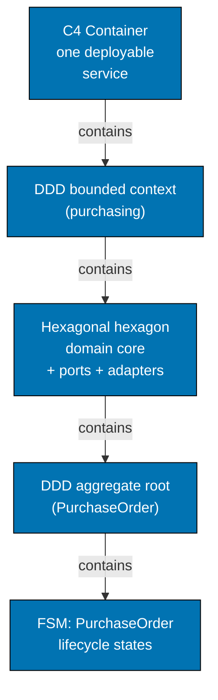

**You have finished the by-example tracks for C4, DDD, Hexagonal Architecture, and Finite State Machines. You know what an aggregate is. You know what a port is. You know how to draw a Container diagram. You know how to model a state machine. Now the question is: how do they all wire together in a real production codebase that ships?** This section answers that question through three parallel cases against the same shared Procure-to-Pay domain — so the only thing that changes between cases is the language and framework.

## What "Case" Means Here

A **case** is a comprehensive worked treatment of the four architecture pattern families on a single coherent domain. Each case integrates:

- **C4** — how the service and its bounded contexts are drawn (Context, Container, Component)
- **DDD** — how the business problem is carved into bounded contexts, aggregates, value objects, and domain events
- **Hexagonal Architecture** — how source code is structured so the domain core never depends on infrastructure (ports, adapters, composition root)
- **FSM** — how aggregate lifecycles move through their states (state types, transition functions, guards)

The cases here teach the **wiring decisions** — how these four families meet in code — not the families themselves. The four `by-example` tracks earlier in this section teach the families in isolation; the cases here show them composed.

## What's in this section

Three production cases, all running against the hypothetical `procurement-platform-be` service (Purchase Requisitions → POs → Goods Receipt → Three-Way Matching → Payment):

- [In FP — F# / Giraffe / Npgsql, Clojure / Ring / next.jdbc, TypeScript / Hono / node-postgres, Haskell / Servant / postgresql-simple](/en/learn/software-engineering/software-architecture/by-example/cases/in-fp) — Functional-programming flavor; 27 guides (F# is the canonical annotated reference; Clojure, TypeScript, and Haskell show the same wiring in their respective idioms)
- [In OOP — Java / Spring Boot 4, Kotlin / Spring Boot 4, C# / ASP.NET Core, TypeScript / NestJS](/en/learn/software-engineering/software-architecture/by-example/cases/in-oop) — Object-oriented flavor; 27 guides (Java is the canonical annotated reference; Kotlin, C#, and TypeScript show the same wiring in their respective idioms)
- [In Procedural — Go / chi / database/sql, Rust / axum / sqlx / tokio](/en/learn/software-engineering/software-architecture/by-example/cases/in-procedural) — Procedural flavor with composition + structural typing, no framework-managed DI containers; Go is canonical (Three Dots Labs reference, Boyle 2022); Rust shows ownership-driven wiring. Tier content rollout in progress.

All three cases share the same 27-guide numbering (beginner 1–6/7, intermediate 8–14/15, advanced 15/16–22, production 23–27) so cross-paradigm comparison is trivial: Guide 5's F# port definition versus Guide 5's Java interface definition versus Guide 5's Go interface definition is a single side-by-side read. Cross-language comparison within a paradigm is equally direct — Guide 5's F# type alias versus Guide 5's Clojure protocol or TypeScript function type surfaces how idiom shapes the same concept.

## Prerequisites

Complete the four by-example tracks before starting either case:

- **C4 by-example**: [overview](/en/learn/software-engineering/software-architecture/c4-model/by-example/overview)
- **DDD by-example**: [FP track](/en/learn/software-engineering/software-architecture/domain-driven-design-ddd/in-fp-by-example) or [OOP track](/en/learn/software-engineering/software-architecture/domain-driven-design-ddd/in-oop-by-example)
- **Hexagonal by-example**: [FP track](/en/learn/software-engineering/software-architecture/hexagonal-architecture/in-fp-by-example) or [OOP track](/en/learn/software-engineering/software-architecture/hexagonal-architecture/in-oop-by-example)
- **FSM by-example**: [FP track](/en/learn/software-engineering/software-architecture/finite-state-machine-fsm/in-fp-by-example) or [OOP track](/en/learn/software-engineering/software-architecture/finite-state-machine-fsm/in-oop-by-example)

The cases use terms like _container_, _component_, _aggregate_, _port_, _adapter_, _bounded context_, _repository pattern_, and _state machine_ without redefinition. If any feel unfamiliar, finish the relevant prerequisite track first.

## How the Four Families Compose

The four families operate at different levels and slot together as follows:

| Family  | Level     | Question Answered                          |
| ------- | --------- | ------------------------------------------ |
| **C4**  | Views     | _How do we draw the system?_               |
| **DDD** | Domain    | _How do we carve the business problem?_    |
| **Hex** | Structure | _Where does each piece of code live?_      |
| **FSM** | Behavior  | _How does an aggregate move through life?_ |

The stack reads top-down. **C4** describes any system independent of paradigm. **DDD** defines the units inside one C4 container. **Hexagonal Architecture** organizes the source tree implementing one DDD bounded context. **FSM** lives at the deepest layer, encoded inside an aggregate root, governing transitions that the application layer triggers through input ports.

Every guide in each case touches one or more of these layers explicitly.

## Running Domain — Procure-to-Pay Procurement Platform

All three cases reason against the same hypothetical service: `procurement-platform-be`, the backend of a Procure-to-Pay (P2P) procurement platform.

| Bounded context    | Aggregate root                              | Responsibility                                                |
| ------------------ | ------------------------------------------- | ------------------------------------------------------------- |
| `purchasing`       | `PurchaseRequisition`, `PurchaseOrder`      | Requisition lifecycle, approval routing, PO issuance          |
| `supplier`         | `Supplier`                                  | Vendor master, approval state, risk score                     |
| `receiving`        | `GoodsReceiptNote`                          | Goods receipt against PO, quantity verification               |
| `invoicing`        | `Invoice`                                   | Invoice registration, three-way matching (PO ↔ GRN ↔ Invoice) |
| `payments`         | `Payment`                                   | Payment run scheduling, bank disbursement                     |
| `murabaha-finance` | `MurabahaContract` _(optional Sharia tier)_ | Bank-purchased asset, markup contract, repayment schedule     |

Same contexts, same aggregates, same domain events, same ports, same state machines across all three cases — only the language and framework idioms differ.

## Why Three Parallel Cases

Comparing the F# wiring of Guide 5 (a port as a function type alias) against the Java wiring of Guide 5 (a port as a nominal interface) against the Go wiring of Guide 5 (a port as a small structural interface satisfied implicitly) against the same business problem is the fastest way to internalise the structural decisions that hexagonal architecture, DDD, and the C4/FSM frames demand — regardless of which paradigm you ultimately ship with. Within each paradigm, additional language implementations (Clojure, TypeScript, and Haskell on the FP side; Kotlin, C#, and TypeScript on the OOP side; Rust on the Procedural side) show how the same structural decisions translate into different language idioms without changing the underlying wiring logic.
