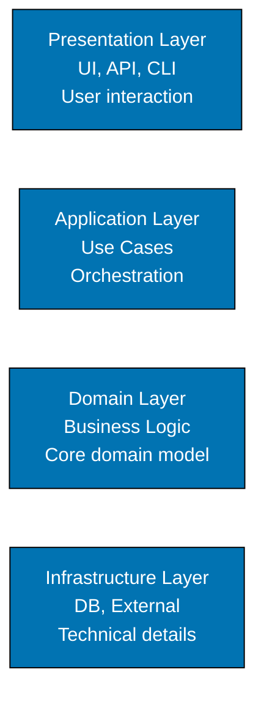

Domain-Driven Design (DDD) is a software development philosophy and set of patterns for modeling complex business domains. Introduced by Eric Evans in 2003, DDD emphasizes collaboration between domain experts and developers to create software that accurately reflects business reality.

## 🎯 What is Domain-Driven Design?

DDD is an approach to software development that:

- **Focuses on the core domain** and domain logic
- **Creates a shared language** between technical and business teams (Ubiquitous Language)
- **Models complex business domains** through well-defined patterns
- **Organizes code** around business concepts, not technical concerns

**Core Philosophy**: The most important part of software is understanding and modeling the business domain correctly. Technology is secondary.

## 📐 Why Use Domain-Driven Design?

**Business Alignment:**

- **Shared vocabulary**: Developers and domain experts speak the same language
- **Business-centric code**: Code structure mirrors business concepts
- **Reduced translation errors**: Less "lost in translation" between requirements and implementation
- **Adaptable to change**: Business rule changes map directly to code changes

**Technical Benefits:**

- **Modular architecture**: Clear boundaries prevent tangled dependencies
- **Testable code**: Business logic isolated from infrastructure
- **Scalable complexity**: Patterns that handle growing domain complexity
- **Maintainable systems**: Intent-revealing code that's easier to understand and modify

**When DDD Shines:**

- Complex business logic with many rules and edge cases
- Multiple teams working on different parts of the same domain
- Long-lived systems that will evolve over years
- Domains with rich, nuanced behavior (not just CRUD operations)

## 🏗️ Strategic Design: The Big Picture

Strategic design helps organize large, complex domains into manageable pieces.

### Ubiquitous Language

**Definition**: A common vocabulary shared by developers and domain experts, used everywhere (code, conversations, documentation).

**Why It Matters:**

- **Eliminates translation**: No gap between "business speak" and "code speak"
- **Reveals insights**: Collaboratively defining terms uncovers hidden complexity
- **Guides naming**: Class names, method names, variables all use domain language
- **Evolves with understanding**: Language refines as team learns more about the domain

**Example:**

```
❌ Bad (Technical Language):
class DataProcessor {
  void processData(DataRecord record) { ... }
}

✅ Good (Ubiquitous Language):
class OrderFulfillment {
  void fulfillOrder(Order order) { ... }
}
```

### Bounded Context

**Definition**: An explicit boundary within which a particular domain model is defined and applicable.

**Why Boundaries Matter:**

- **Different meanings in different contexts**: "Customer" means different things in Sales vs. Support
- **Reduces complexity**: Each context has its own simplified model
- **Team autonomy**: Teams own their bounded context
- **Clear integration points**: Explicit contracts between contexts

**Example Contexts in E-Commerce:**

- **Sales Context**: Customer = person who buys products (focus: purchase history, preferences)
- **Shipping Context**: Customer = delivery recipient (focus: address, delivery preferences)
- **Support Context**: Customer = person needing help (focus: support tickets, satisfaction)

Each context has its own `Customer` entity with different attributes and behavior.

### Context Mapping

**Definition**: Documenting relationships between bounded contexts and how they integrate.

**Common Patterns:**

- **Shared Kernel**: Two contexts share a subset of the domain model
- **Customer-Supplier**: Upstream team provides API that downstream team consumes
- **Conformist**: Downstream context conforms to upstream model (no influence)
- **Anti-Corruption Layer (ACL)**: Translation layer preventing external models from polluting your domain
- **Published Language**: Formal shared language for integration (e.g., JSON schema, Protocol Buffers)

**When to Use Context Mapping:**

- Multiple teams working on different parts of the system
- Integrating with third-party systems or legacy code
- Planning microservices boundaries

## 🧩 Tactical Design: Building Blocks

Tactical patterns are code-level building blocks for implementing domain models.

### Entities

**Definition**: Objects with a unique identity that persists over time, even as attributes change.

**Characteristics:**

- **Identity**: Distinguished by ID, not attributes
- **Mutable**: Attributes can change
- **Continuity**: Same entity across different states

**Example:**

```go
// Order is an Entity - identity matters
type Order struct {
    ID          OrderID    // Identity
    CustomerID  CustomerID
    Items       []OrderItem
    Status      OrderStatus
    CreatedAt   time.Time
}

// Same order, different states
order1 := Order{ID: "ORD-123", Status: Pending}
order2 := Order{ID: "ORD-123", Status: Shipped}
// Still the same order (ID matches)
```

### Value Objects

**Definition**: Immutable objects defined by their attributes, with no identity.

**Characteristics:**

- **Immutable**: Cannot change after creation
- **Interchangeable**: Two value objects with same attributes are equal
- **No identity**: Only attributes matter

**Example:**

```go
// Money is a Value Object - attributes define equality
type Money struct {
    Amount   decimal.Decimal
    Currency string
}

// Two Money instances with same values are equal
money1 := Money{Amount: 100.00, Currency: "USD"}
money2 := Money{Amount: 100.00, Currency: "USD"}
// money1 == money2 (same attributes = equal)
```

### Aggregates

**Definition**: A cluster of entities and value objects treated as a single unit, with a root entity enforcing consistency.

**Characteristics:**

- **Root entity**: Single entry point (Aggregate Root)
- **Consistency boundary**: All rules enforced through root
- **Transactional boundary**: Changes happen atomically
- **Identity**: Aggregate identified by root's identity

**Example:**

```go
// Order is the Aggregate Root
type Order struct {
    ID       OrderID          // Root identity
    Items    []OrderItem      // Child entities
    Total    Money           // Value object
    Status   OrderStatus
}

// ✅ Add item through aggregate root
func (o *Order) AddItem(product Product, quantity int) error {
    // Business rule: Can't add items to shipped orders
    if o.Status == Shipped {
        return errors.New("cannot modify shipped order")
    }

    item := OrderItem{Product: product, Quantity: quantity}
    o.Items = append(o.Items, item)
    o.recalculateTotal() // Maintain consistency
    return nil
}

// ❌ Don't modify child entities directly
// orderItem.Quantity = 10  // Bypasses business rules!
```

### Domain Services

**Definition**: Operations that don't naturally belong to any entity or value object.

**When to Use:**

- **Multi-entity operations**: Logic spanning multiple aggregates
- **Stateless operations**: No identity, no state
- **Domain logic**: Still part of business rules, not infrastructure

**Example:**

```go
// PricingService - operation doesn't belong to Order or Product
type PricingService struct {
    taxCalculator TaxCalculator
    discountRules []DiscountRule
}

func (s *PricingService) CalculateOrderTotal(order Order, customer Customer) Money {
    subtotal := order.Subtotal()
    discount := s.applyDiscounts(order, customer)
    tax := s.taxCalculator.Calculate(subtotal - discount, customer.TaxRegion)
    return subtotal - discount + tax
}
```

### Repositories

**Definition**: Abstractions for accessing and persisting aggregates, providing collection-like interface.

**Characteristics:**

- **Aggregate-focused**: One repository per aggregate root
- **Collection illusion**: Feels like an in-memory collection
- **Persistence abstraction**: Hides database details from domain

**Example:**

```go
// Repository interface in domain layer
type OrderRepository interface {
    Save(order Order) error
    FindByID(id OrderID) (Order, error)
    FindByCustomer(customerID CustomerID) ([]Order, error)
    Delete(id OrderID) error
}

// Infrastructure layer implements concrete repository
type PostgresOrderRepository struct {
    db *sql.DB
}

func (r *PostgresOrderRepository) Save(order Order) error {
    // Database-specific implementation
}
```

### Domain Events

**Definition**: Something significant that happened in the domain, communicated to other parts of the system.

**Characteristics:**

- **Immutable**: Events are facts, they can't change
- **Named in past tense**: "OrderPlaced", "PaymentReceived"
- **Rich with context**: Contains relevant data about what happened
- **Asynchronous communication**: Decouples parts of the system

**Example:**

```go
// Domain Event
type OrderPlacedEvent struct {
    OrderID    OrderID
    CustomerID CustomerID
    Total      Money
    PlacedAt   time.Time
}

// Publishing event
func (o *Order) Place() error {
    // Business logic
    o.Status = Placed

    // Publish event
    event := OrderPlacedEvent{
        OrderID:    o.ID,
        CustomerID: o.CustomerID,
        Total:      o.Total,
        PlacedAt:   time.Now(),
    }

    eventBus.Publish(event)
    return nil
}

// Other contexts listen for events
func (inventory *InventoryService) HandleOrderPlaced(event OrderPlacedEvent) {
    // Reserve inventory for order
}
```

## 🌐 Technology-Agnostic Approach

DDD is **not tied to any technology**:

- **Language-agnostic**: Patterns work in Java, Go, Python, Elixir, C#, TypeScript
- **Framework-independent**: Apply with Spring, Django, Phoenix, Express, .NET
- **Database-neutral**: Works with SQL, NoSQL, event stores, file systems
- **Architecture-flexible**: Compatible with monoliths, microservices, serverless

**Focus**: Domain modeling and business logic organization, not technical implementation.

## 📏 Layered Architecture in DDD

DDD typically uses layered architecture to separate concerns:



**Dependency Rule**: Inner layers don't depend on outer layers (Domain doesn't know about Infrastructure).

## 💡 When to Use DDD

**DDD is Worth It When:**

- ✅ Complex business domain with many rules and edge cases
- ✅ Domain experts available for collaboration
- ✅ Long-lived system (5+ years expected lifespan)
- ✅ Business logic is the primary complexity (not technical)
- ✅ Frequent domain changes expected
- ✅ Multiple teams working on related domains

**DDD is Overkill When:**

- ❌ Simple CRUD applications (just data entry and retrieval)
- ❌ Technical complexity dominates (e.g., real-time video processing)
- ❌ Short-lived systems or prototypes
- ❌ No access to domain experts
- ❌ Small team with simple, well-understood domain

## 🚀 Getting Started with DDD

**Step-by-Step Approach:**

1. **Understand the Domain**: Talk to domain experts, observe current processes
2. **Develop Ubiquitous Language**: Collaboratively define key terms
3. **Identify Bounded Contexts**: Find natural boundaries in the domain
4. **Model Core Domain**: Focus on the most valuable, complex parts first
5. **Apply Tactical Patterns**: Use entities, value objects, aggregates appropriately
6. **Iterate**: Refine model as understanding deepens

**First Project Checklist:**

- [ ] Identified domain experts and scheduled regular sessions
- [ ] Created glossary of ubiquitous language terms
- [ ] Drawn context map showing bounded contexts
- [ ] Defined at least one aggregate with clear boundaries
- [ ] Separated domain logic from infrastructure
- [ ] Validated model with domain experts

## 🔗 Related Content

- [**C4 Model**](/en/learn/software-engineering/software-architecture/c4-model) - Use for visualizing DDD bounded contexts and architecture
- [**System Design Cases**](/en/learn/software-engineering/system-design/by-example/cases) - See DDD principles in real-world system designs
- [**Finite State Machine**](/en/learn/software-engineering/software-architecture/finite-state-machine-fsm) - Useful for modeling entity state transitions

## By Example Tracks

Learn the DDD building blocks through heavily annotated code in three paradigms:

- [**In FP**](/en/learn/software-engineering/software-architecture/domain-driven-design-ddd/in-fp-by-example) — DDD with functional programming (immutability, pure functions, composition).
- [**In OOP**](/en/learn/software-engineering/software-architecture/domain-driven-design-ddd/in-oop-by-example) — DDD with object-oriented programming (entities, value objects, aggregates as classes).
- [**In Procedural**](/en/learn/software-engineering/software-architecture/domain-driven-design-ddd/in-procedural-by-example) — DDD with procedural code (explicit data and functions, no class machinery).

## Production Wiring

Once the by-example tracks above are clear, the cases tutorials show DDD aggregates flowing through real production code with hexagonal isolation:

- Next step (production wiring): [In FP — F# / Giraffe / Npgsql, Clojure / Ring / next.jdbc, TypeScript / Hono / node-postgres](/en/learn/software-engineering/software-architecture/by-example/cases/in-fp) — pairs with the FP by-example track.
- Next step (production wiring): [In OOP — Java / Spring Boot 4, Kotlin / Spring Boot 4, C# / ASP.NET Core, TypeScript / NestJS](/en/learn/software-engineering/software-architecture/by-example/cases/in-oop) — pairs with the OOP by-example track.

## 📚 Further Reading

**Essential Books:**

- _Domain-Driven Design_ by Eric Evans (2003) - The original "Blue Book"
- _Implementing Domain-Driven Design_ by Vaughn Vernon (2013) - Practical guide "Red Book"
- _Domain-Driven Design Distilled_ by Vaughn Vernon (2016) - Concise introduction

**Online Resources:**

- [Domain-Driven Design Community](https://dddcommunity.org/) - Official DDD community
- [DDD Crew GitHub](https://github.com/ddd-crew) - Practical DDD resources and tools
- [EventStorming](https://www.eventstorming.com/) - Collaborative domain modeling technique

**Patterns Reference:**

- [DDD Reference](https://domainlanguage.com/ddd/reference/) - Quick reference by Eric Evans
- [Awesome DDD](https://github.com/heynickc/awesome-ddd) - Curated DDD resources

---

**Key Takeaway**: DDD is about understanding the business domain deeply and modeling it accurately in code. Use strategic design (bounded contexts, ubiquitous language) to organize complexity, and tactical patterns (entities, aggregates, repositories) to implement domain models that evolve with business needs.
