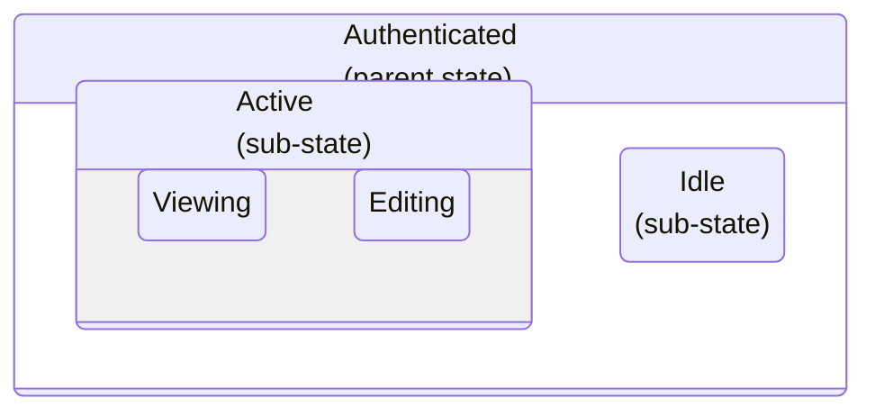

A Finite State Machine (FSM) is a mathematical model of computation that represents a system with a finite number of states, transitions between those states, and actions. FSMs provide a rigorous, visual way to design systems with well-defined behavior based on their current state and incoming events.

## 🎯 What is a Finite State Machine?

An FSM consists of:

1. **States**: Finite set of conditions the system can be in (e.g., "Pending", "Processing", "Completed")
2. **Transitions**: Rules for moving from one state to another based on events/inputs
3. **Events/Inputs**: Triggers that cause state changes (e.g., "Submit", "Cancel", "Approve")
4. **Actions**: Operations performed during transitions or while in a state (optional)
5. **Initial State**: The starting point when the system begins
6. **Final States**: Terminal states where the system ends (optional)

**Key Principle**: At any moment, the system is in exactly one state. State changes are explicit and predictable.

## 📐 Why Use Finite State Machines?

**Clarity and Predictability:**

- **Explicit behavior**: All possible states and transitions are documented
- **No ambiguity**: System behavior is deterministic for any input
- **Visual representation**: State diagrams are easy to understand and communicate
- **Reduced bugs**: Impossible states and transitions are prevented by design

**Design Benefits:**

- **Easier testing**: Test each state and transition independently
- **Maintainability**: Adding new states/transitions is straightforward
- **Validation**: Enforce business rules through state constraints
- **Debugging**: Current state makes troubleshooting easier

## 🏗️ Types of Finite State Machines

### 1. Deterministic Finite Automaton (DFA)

**Characteristics:**

- **One transition per state-event pair**: Given current state and event, next state is always the same
- **Predictable**: No randomness or ambiguity
- **Most common**: Used in most practical applications

**Example (Order Processing):**

```
States: Pending → Confirmed → Shipped → Delivered
Events: confirm, ship, deliver

Pending + confirm → Confirmed
Confirmed + ship → Shipped
Shipped + deliver → Delivered
```

### 2. Non-Deterministic Finite Automaton (NFA)

**Characteristics:**

- **Multiple possible transitions**: Same state and event can lead to different states
- **Ambiguous**: Next state not always deterministic
- **Less common**: Theoretical importance, but converted to DFA for implementation

**Example:**

```
State A + event X → State B OR State C (non-deterministic)
```

### 3. Hierarchical State Machine (HSM)

**Characteristics:**

- **Nested states**: States can contain sub-states
- **Reduces complexity**: Group related states together
- **Inheritance**: Sub-states inherit parent state transitions

**Example (Authentication):**



## 🧩 FSM Components in Detail

### States

**Definition**: Distinct modes of operation with specific behavior.

**Good State Characteristics:**

- **Mutually exclusive**: System can't be in two states at once
- **Exhaustive**: System is always in exactly one state
- **Meaningful**: State names reflect business concepts
- **Stable**: State represents a stable condition, not a transition

**Example (Payment):**

```
✅ Good States:
- Pending: Waiting for payment authorization
- Authorized: Payment approved but not captured
- Captured: Money received
- Refunded: Money returned to customer
- Failed: Payment processing failed

❌ Bad States:
- "ProcessingPayment" - This is a transition, not a stable state
- "Data" - Too generic, not meaningful
```

### Transitions

**Definition**: Rules defining how the system moves from one state to another.

**Transition Anatomy:**

```
Current State + Event → Next State [Guard Condition] / Action
```

**Example:**

```
Pending + PaymentReceived → Confirmed [amount >= total] / SendConfirmationEmail
```

**Guard Conditions** (optional): Boolean conditions that must be true for transition to occur.

### Events/Inputs

**Definition**: External triggers causing state transitions.

**Event Types:**

- **User actions**: Button clicks, form submissions
- **System events**: Timeouts, scheduled tasks, API callbacks
- **External events**: Webhooks, message queue messages
- **Internal events**: State entry/exit, timers

**Example:**

```
User Events: Submit, Cancel, Approve, Reject
System Events: Timeout, Retry, AutoExpire
External Events: PaymentReceived, InventoryRestocked
```

### Actions

**Definition**: Operations executed during transitions or while in a state.

**Action Types:**

- **Entry actions**: Execute when entering a state
- **Exit actions**: Execute when leaving a state
- **Transition actions**: Execute during state change
- **Internal actions**: Execute within state without transition

**Example:**

```
State: Processing
  Entry Action: StartProcessingTimer, LogStateEntry
  Exit Action: StopProcessingTimer
  Internal Action (on RetryEvent): IncrementRetryCount
```

## 🌐 Real-World Applications

### 1. Order Processing

```
States: Created → Pending → Confirmed → Shipped → Delivered → Closed

Transitions:
Created + Submit → Pending
Pending + Approve → Confirmed
Confirmed + Ship → Shipped
Shipped + Deliver → Delivered
Delivered + Archive → Closed
Any State + Cancel → Cancelled (if allowed)
```

### 2. User Authentication

```
States: Unauthenticated → Authenticating → Authenticated → LoggedOut

Transitions:
Unauthenticated + Login → Authenticating
Authenticating + Success → Authenticated
Authenticating + Failure → Unauthenticated
Authenticated + Logout → LoggedOut
Authenticated + SessionExpired → Unauthenticated
```

### 3. Document Workflow

```
States: Draft → Review → Approved → Published → Archived

Transitions:
Draft + Submit → Review
Review + Approve → Approved
Review + Reject → Draft [with comments]
Approved + Publish → Published
Published + Archive → Archived
Any State + Delete → Deleted (if allowed)
```

### 4. Traffic Light

```
States: Red → Green → Yellow → Red (cycle)

Transitions:
Red + Timer(30s) → Green
Green + Timer(45s) → Yellow
Yellow + Timer(5s) → Red

Actions:
Red Entry: StopTraffic, AllowPedestrians
Green Entry: AllowTraffic, StopPedestrians
Yellow Entry: WarnTraffic
```

## 📏 FSM Design Best Practices

**Do:**

- ✅ **Name states meaningfully**: Use business domain language (not "State1", "State2")
- ✅ **Keep states minimal**: Only create states that represent distinct system behavior
- ✅ **Make transitions explicit**: Document all valid state changes
- ✅ **Use guard conditions**: Prevent invalid transitions based on data
- ✅ **Define initial state**: System must have a clear starting point
- ✅ **Handle all events**: Every state should handle all possible events (even if just ignoring them)
- ✅ **Document state meaning**: What does being in this state mean for the system?

**Don't:**

- ❌ **Mix concerns**: Don't embed complex business logic directly in FSM - use actions
- ❌ **Create too many states**: Complexity grows quadratically with states
- ❌ **Forget error handling**: Always have error states and recovery transitions
- ❌ **Ignore impossible transitions**: Explicitly prevent or handle invalid state changes
- ❌ **Use FSM for everything**: Simple sequential workflows don't need FSMs

## 🔧 Implementation Patterns

### 1. State Pattern (OOP)

```go
// State interface
type OrderState interface {
    Confirm(order *Order) error
    Ship(order *Order) error
    Deliver(order *Order) error
}

// Concrete state
type PendingState struct{}

func (s *PendingState) Confirm(order *Order) error {
    order.State = &ConfirmedState{}
    return nil
}

func (s *PendingState) Ship(order *Order) error {
    return errors.New("cannot ship pending order")
}

// Order with state
type Order struct {
    ID    string
    State OrderState
}
```

### 2. Enum/Switch Pattern

```go
type OrderStatus int

const (
    Pending OrderStatus = iota
    Confirmed
    Shipped
    Delivered
)

func (o *Order) Confirm() error {
    switch o.Status {
    case Pending:
        o.Status = Confirmed
        return nil
    default:
        return errors.New("cannot confirm from current state")
    }
}
```

### 3. State Machine Library

```go
// Using a library (example: github.com/looplab/fsm)
fsm := fsm.NewFSM(
    "pending",
    fsm.Events{
        {Name: "confirm", Src: []string{"pending"}, Dst: "confirmed"},
        {Name: "ship", Src: []string{"confirmed"}, Dst: "shipped"},
        {Name: "deliver", Src: []string{"shipped"}, Dst: "delivered"},
    },
    fsm.Callbacks{
        "enter_confirmed": func(e *fsm.Event) { sendConfirmationEmail() },
    },
)

fsm.Event("confirm") // Transition to confirmed
```

## 💡 When to Use FSM

**FSM is Ideal When:**

- ✅ System has **clearly defined states** (order status, user authentication, game state)
- ✅ **State-dependent behavior**: Actions vary based on current state
- ✅ **Explicit transitions**: Business rules dictate specific state changes
- ✅ **Finite number of states**: Doesn't grow unbounded
- ✅ **Complex validation**: Enforcing what can happen when
- ✅ **Workflow management**: Document approval, order processing

**FSM is Overkill When:**

- ❌ Simple boolean flags suffice (`isActive`, `isComplete`)
- ❌ States are infinite or data-driven
- ❌ No state-dependent behavior
- ❌ Linear, sequential flow with no branching
- ❌ Stateless operations

## 🚀 Getting Started with FSM

**Step-by-Step Approach:**

1. **Identify states**: List all distinct modes your system can be in
2. **Define events**: What triggers state changes?
3. **Map transitions**: For each state-event pair, what happens?
4. **Add guard conditions**: When should transitions be prevented?
5. **Define actions**: What happens during transitions?
6. **Draw state diagram**: Visualize the FSM
7. **Implement**: Choose implementation pattern (State Pattern, Enum/Switch, Library)
8. **Test**: Verify all transitions and guard conditions

**First FSM Checklist:**

- [ ] Listed all possible states
- [ ] Defined initial state
- [ ] Identified all events/triggers
- [ ] Mapped all valid transitions
- [ ] Added guard conditions for conditional transitions
- [ ] Defined entry/exit actions for key states
- [ ] Created state diagram
- [ ] Handled invalid transitions (error cases)

## 🔗 Related Content

- [**C4 Model**](/en/learn/software-engineering/software-architecture/c4-model) - Use Component diagrams to show FSM within system architecture
- [**Domain-Driven Design**](/en/learn/software-engineering/software-architecture/domain-driven-design-ddd) - FSMs often model entity lifecycles in DDD
- [**System Design Cases**](/en/learn/software-engineering/system-design/by-example/cases) - See FSMs in real-world system workflows

## By Example Tracks

Learn finite state machines through heavily annotated code in three paradigms:

- [**In FP**](/en/learn/software-engineering/software-architecture/finite-state-machine-fsm/in-fp-by-example) — FSMs with functional programming (transition functions, immutable state, pattern matching).
- [**In OOP**](/en/learn/software-engineering/software-architecture/finite-state-machine-fsm/in-oop-by-example) — FSMs with object-oriented programming (state classes, the State pattern).
- [**In Procedural**](/en/learn/software-engineering/software-architecture/finite-state-machine-fsm/in-procedural-by-example) — FSMs with procedural code (transition tables and explicit dispatch).

## Production Wiring

Once the by-example tracks are clear, the cases tutorials show FSM aggregate lifecycles wired into real production code across both paradigm families:

- Next step (production wiring): [In FP — F# / Giraffe / Npgsql, Clojure / Ring / next.jdbc, TypeScript / Hono / node-postgres](/en/learn/software-engineering/software-architecture/by-example/cases/in-fp) — pairs with the FP by-example track.
- Next step (production wiring): [In OOP — Java / Spring Boot 4, Kotlin / Spring Boot 4, C# / ASP.NET Core, TypeScript / NestJS](/en/learn/software-engineering/software-architecture/by-example/cases/in-oop) — pairs with the OOP by-example track.

## 📚 Further Reading

**Books:**

- _Introduction to Automata Theory, Languages, and Computation_ by Hopcroft & Ullman - Theoretical foundation
- _Design Patterns_ by Gang of Four - State Pattern chapter
- _UML Distilled_ by Martin Fowler - State diagrams in UML

**Online Resources:**

- [State Machine Cat](https://state-machine-cat.js.org/) - Draw state machines online
- [XState](https://xstate.js.org/) - JavaScript state machine library with visual tooling
- [PlantUML State Diagrams](https://plantuml.com/state-diagram) - Text-based state diagram tool

**Tools:**

- **PlantUML**: Text-based state diagram generation
- **Mermaid**: Markdown-embeddable state diagrams
- **Draw.io**: Visual state diagram editor
- **Statecharts**: Hierarchical state machine notation (David Harel)

---

**Key Takeaway**: Finite State Machines bring clarity and rigor to systems with well-defined states and transitions. Use FSMs when state-dependent behavior is critical to business logic, and transitions must be explicit and controlled. They transform complex conditional logic into visual, testable, maintainable state management.
