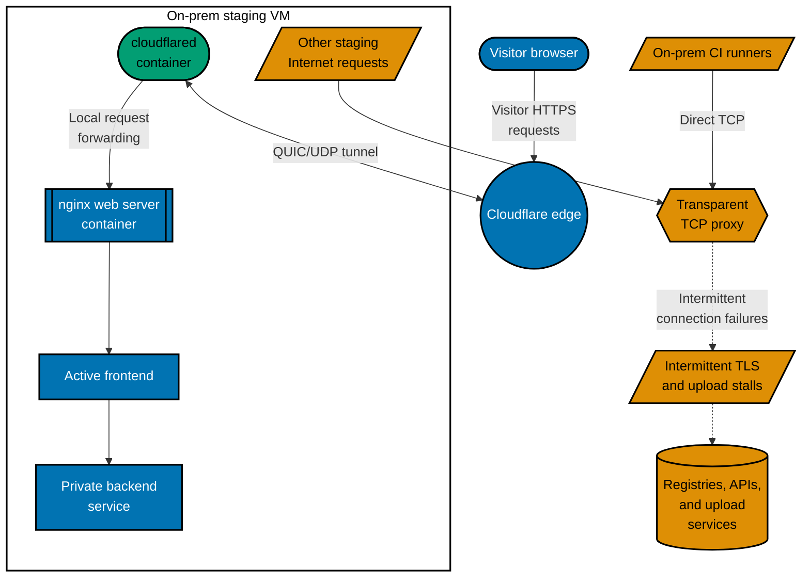
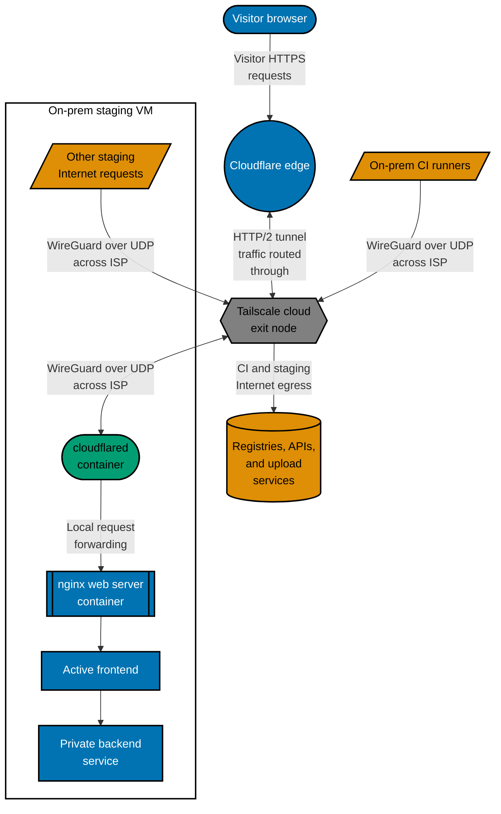
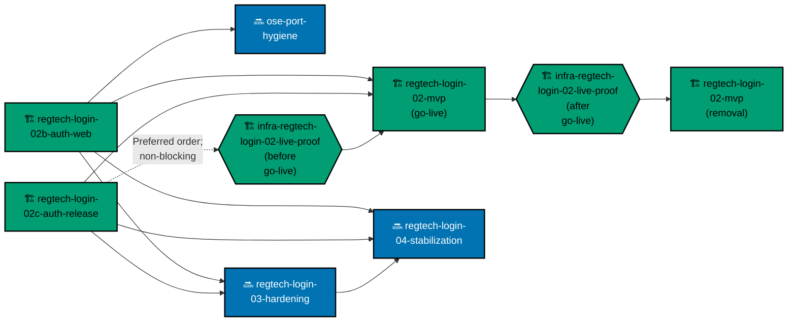

This update picks up from the previous [Open Sharia Enterprise (OSE) website update](/updates/2026-09-09-week-42-five-repositories-two-tools-two-backends/),
published September 9, 2026 at 19:17 Western Indonesian Time (WIB), and covers through October 17
at 21:30 WIB. Since that
website baseline, the repository set grew from five to seven, several early product foundations were
retired, and learning content and reusable tools advanced. The product scope also narrowed to fit
the resources available to us.

## A clearer route into learning

[AyoKoding](https://ayokoding.com) now gives learners more structure for deciding where to begin
and what to study next. Five just-enough primers provide a shorter on-ramp. Learning paths now
separate core and extension phases, while a course catalog, category navigation, and clearer course
pages make the collection easier to explore.

The catalog also gained a Go backend essentials course. We corrected gaps in existing data
structures and Structured Query Language (SQL) material, and repaired deployment build inputs and
the production end-to-end workflow for the learning site. These merged changes improve the path through the material; they do
not mean every planned course is finished. AyoKoding remains a growing learning platform, and its
content will keep changing as we learn which explanations and sequences serve readers well.

The artificial intelligence (AI) tool benchmark now compares models across four tiers, requires at least two
independent benchmarks for each rated model, and puts pricing beside performance. Its refresh added Composer
and Muse Code to the comparison. Readers can weigh the evidence and pricing for their own needs.

## Seven repositories with clearer responsibilities

The September website update described five OSE Code Repositories. The set has since grown to seven
with the addition of
[OSE Rules](https://github.com/wahidyankf/ose-rules) and
[py-typekit](https://github.com/wahidyankf/py-typekit). The public and private OSE repositories
also retired their shared in-tree F-sharp (F#) application for the
[Repository Hygiene & INtegration Orchestrator (RHINO)](https://github.com/wahidyankf/rhino). The byte-identical source boundary
described in the September update no longer applies; the repositories now maintain their own code
and releases.

OSE Rules offers reusable governance and engineering artifacts for repositories to assess and
adopt. Choosing an artifact does not subscribe a repository to automatic updates. BeaverNest
remains an independent family product. [RHINO](https://github.com/wahidyankf/rhino) checks
repository-declared quality rules, and [Host Infrastructure Pressure & Process Orchestrator (HIPPO)](https://github.com/wahidyankf/hippo) coordinates
resource-sensitive work across local checkouts. OSE consumers pin RHINO and HIPPO releases instead
of carrying those implementations. Python projects can pin py-typekit by Git tag. OSE Rules remains
a catalog of optional artifacts, with no automatic propagation into adopting repositories.

The September website update described RHINO v0.1.3 as a read-only checker. Since then, RHINO has
grown into a configurable set of declared checks, with optional metadata, plan checks, lifecycle
definitions, and generated harness profiles. Its v0.13.0 release also added safer selection of
regular files for formatting. That gives each repository a clearer way to state which checks it
wants while leaving compatibility links and unstaged changes intact.

The September update also described HIPPO v0.5.2's fixed reservations and shared resource ledger.
Those remain the foundation. Later releases added adaptive allocation, resource tiers, bounded
launch-time allocation, and, in v0.9.0, a terminal dashboard for viewing running and queued work
alongside shared capacity. The dashboard helps developers see when other tasks are using the same
machine; HIPPO does not manage every process on that host.

Python projects can now use py-typekit v0.1.0, its first release, to represent expected success,
failure, and absence as typed values. FERRET also arrived during this website window as a local,
privacy-first telemetry tool for evaluating coding-agent runs. It records agent, skill, tool, and
outcome metadata while leaving prompts, responses, tool arguments, transcripts, and environment
values out of its records. The v0.3.3 release adopted py-typekit's typed result values without
changing FERRET's command-line interface; later work added Command Code metadata support.

OSE Public and its private sibling keep one canonical definition for each local agent and generate
their own harness-specific bindings. Reviews separate implementation from judgment and tie
findings to evidence. Day-to-day test runs focus on changed behaviour, while scheduled continuous integration (CI) covers the
broader end-to-end flow. These practices give maintainers a clearer way to check changes across the
repository set.

### BeaverNest remained a family product

The September website update described BeaverNest's page-scoped Codex conversations and verified
backups. Since then, the independent [BeaverNest](https://github.com/wahidyankf/beaver-nest)
application completed the core of Family Chat, including real-time conversations, offline recovery,
return-to-last-read, notifications, and backup recovery. Quoted replies added a way to answer a
specific message while preserving a jump back to its source. Later work strengthened the backend's
domain boundaries and made recovery easier to rehearse: retained backup files are checked for
changes, and restore drills use isolated copies rather than live data.

Those capabilities serve BeaverNest's family-only product.

## Some early foundations were retired

The September update described health-only backend foundations for OSE's learning management
system (LMS) and Roots and named their first real capabilities as the next product work. In the
following weeks, OSE's identity component (ID) also reached a local-only foundation. On October 14,
we removed OSE ID, OSE LMS, and Roots application
scaffolds along with first-party tooling devoted to them. That reverses the earlier next-step
expectation: the repository record now shows those experiments as completed history rather than
current product capability.

Those foundations had not become public identity, learning-management, or Sharia-compliance
services. Our development machine has limited capacity, and our token budget is limited too. Keeping
those apps moving alongside OSE's main products would spread those resources too thin. We retired
them to focus the resources available to us on the main products.

We've also been exploring more affordable alternatives, including the [General Language Model (GLM)](https://arxiv.org/abs/2103.10360) Flash family, DeepSeek, and Muse, to
stretch that budget. Finding an approach we can sustain is part of the development work too.

The primary OSE product direction is regulatory technology (RegTech) together with core banking,
accounting, and enterprise resource planning (ERP). The earlier updates remain snapshots of what
was built at the time; the active product
scope has since narrowed to make room for this work.

## Private staging work moved forward

In the private sibling, a RegTech service progressed from a verified end-to-end foundation to a
staging release workflow. The work added database operations and backup and restore drills, then
introduced gated web sign-in and profile flows. The latest merged work adds another readiness check
to the staging release process.

This remains private development and staging work. The sign-in, profile, and readiness changes
mark progress toward controlled use within that setting.

## Making continuous integration (CI) connections more reliable

In October, intermittent Internet service provider (ISP) path failures disrupted Transport Layer Security (TLS) connections to registries and artifact
uploads across different CI machines. The same errors appearing on multiple machines suggested a
shared network path, rather than one broken runner. Basic connection checks were misleading: even
Transmission Control Protocol (TCP) probes with a hop limit too low to reach the test destination received a quick handshake.
Packet captures then showed the later TLS handshake retransmitting while the connection's onward
leg stalled. The evidence pointed to a transparent TCP proxy completing the local handshake without
reliably completing the remote connection.

Our CI runners and staging machine are on-prem. The staging virtual machine (VM) holds the same
application containers in both diagrams. Visitors reach Cloudflare edge over Hypertext Transfer
Protocol Secure (HTTPS). Before the route change, the `cloudflared` connector selected its transport
automatically; [QUIC](https://www.rfc-editor.org/rfc/rfc9000.html#section-1.1), a secure transport
protocol over the User Datagram Protocol (UDP), was observed on the original ISP path, and public
probes passed.

Separate registry, application programming interface (API), and upload requests from CI and other
staging Internet traffic used direct Transmission Control Protocol (TCP) across the provider path.
The TCP proxy disrupted this branch; the Cloudflare Tunnel connection did not pass through it.

### Before: direct TCP egress and the original tunnel route

We first tried adjusting the runners' maximum transmission unit (MTU) because the network path reported a smaller packet size.
That change did not resolve the CI failures, so we reverted it. A separate virtual-machine network
adjustment had its own evidence, but it was not the fix for this runner incident. Keeping these
incidents distinct helped avoid treating a plausible network setting as a solution without testing
the failing flow.

The completed workaround routes CI and staging Internet traffic through a Tailscale cloud exit node,
using WireGuard over UDP. On that new route, QUIC did not complete for the staging connector, so the
connector was switched to Hypertext Transfer Protocol version 2 (HTTP/2). HTTP/2 is the
cloudflared-to-Cloudflare Tunnel transport; its Transmission Control Protocol (TCP) connection travels
inside WireGuard over UDP across the Internet service provider (ISP) segment. The exit node routes
traffic but does not terminate the Cloudflare Tunnel or run cloudflared. This route-specific connector
change does not establish that UDP is generally blocked elsewhere.

### After: CI, staging egress, and Cloudflare Tunnel through the exit node

The on-prem staging virtual machine keeps the same application layout. Both CI and staging Internet
egress now use the encrypted UDP route, while the cloudflared connector uses HTTP/2 inside that route.

`cloudflared` initiates the tunnel outbound from the staging VM. Visitor requests return through
that established connection. See [Cloudflare Tunnel documentation](https://developers.cloudflare.com/tunnel/)
for how the tunnel uses outbound connections.

After routing, the diagnostic proxy signature disappeared and a soak check passed. A real staging
qualify-and-deploy flow then passed on its first attempt. The bounded observation window recorded
no network-class failures, which is evidence about that period rather than a promise that future
connections cannot fail. The broader heavy quality workflow remains unproven because unrelated
backend scenarios still fail.

The lesson for intermittent infrastructure failures is to compare destinations and machines, keep
the actual error and retransmission evidence, and test the complete service flow after changing a
route. A quick successful connection by itself may only show that the first leg answered.

## A possible direction for developer tooling

Alongside the product work, we may explore ways to monitor development work across multiple machines
and coding harnesses. Today we connect through Secure Shell (SSH) and Mosh (mobile shell), and track
sessions manually with the terminal multiplexer (tmux). One
possible future step is extending HIPPO to observe resource pressure across machines. This is exploratory;
multi-machine monitoring is not a current HIPPO capability.

Our adopted directed acyclic graph (DAG)-aware planning rules describe task dependencies. Pieces
whose prerequisites are complete can be worked on independently across machines, while dependent steps
wait for theirs. This is a planning foundation for parallel work, not an automated scheduler that
monitors machines or dispatches work between them.

The RegTech plan below is a concrete snapshot of that ordering. It shows how work can be independent
until a named dependency requires it to wait. The plan's minimum viable product (MVP) work is split
into go-live and removal stages; `auth` identifies authentication work, and `infra` identifies
infrastructure work. The live-proof plan likewise appears in before- and after-go-live stages.

Legend: 🔜 blue means planned, and 🏗️ teal means in progress. The hexagons mark infrastructure
steps. Solid arrows show blocking dependencies; the dotted arrow shows that release work should
land before the first live-proof stage without blocking it. Plans without arrows between them can
proceed independently. The two live-proof nodes are stages of one plan; the go-live and removal
nodes likewise show the MVP work before and after the temporary switches are removed. This is a
planning snapshot, not a claim that every item is complete or that an automated scheduler assigns
work across machines.

We'd also like to explore an evaluation platform. We do not yet know how to approach it, but we hope
to find a way, Insha Allah.

## Still early, with clearer ownership

OSE remains pre-alpha. The work described here ranges from learning-site content and published
tools to private staging foundations, each at a different level of maturity. We will keep naming
those boundaries as the platform evolves.
