This update follows our [October 17 website update](/updates/2026-10-17-week-47-learning-paths-and-product-readiness/)
and covers our work through November 15, 2026 at 20:55 Western Indonesian Time. During that
period, we experimented with distributing work across machines and found it practical to run
multiple coding agents that way. AyoKoding, BeaverNest, FinRegTech, and our developer tools also
made progress. Open Sharia Enterprise (OSE) remains pre-alpha.

## Working across machines

Over the past month, we experimented with remote dispatch and with tools including
[Herdr](https://github.com/herdrdev/herdr) to work across multiple machines. It is now practical
for us to run multiple agents across those machines. Independent work can be distributed across
the machines available to us, reducing our dependence on the capacity of any single host.

We also documented capacity checks, dispatch records, and cleanup expectations during the month
to make that workflow easier to repeat.

## FinRegTech and SuperAgent

FinRegTech completed its staging transition according to the repository record. Development of its
next version continues, and its cutover remains unfinished.

[SuperAgent](https://github.com/wahidyankf/super-agent) aims to help us juggle work across multiple
projects, data sources, and machines. Its current implementation connects people and coding tools
to data sources through a command-line tool and a Model Context Protocol (MCP) server. Version v0.2.0 is an alpha pre-release;
breaking changes are expected and the project advises against production use.

Since that release, merged source work added a generic connector engine, moved Outline operations
onto its bundled specification, and added a converter for Jira's document format. Further Kiwi and
Jira connector changes have design decisions recorded; those migrations remain planned.

## Learning progress on AyoKoding

[AyoKoding](https://www.ayokoding.com/) now has a Learn home, course and path progress, lesson
navigation, and a way to continue learning. Learners can mark lessons complete and see their place
in a path. Progress lives in the browser; the site does not create a server-side learning record
for it.

Changes merged into the AyoKoding source refresh the artificial intelligence (AI) benchmark data
and model roster, add FrontierCode-AA to the methodology, and offer a choice between the composite
average and individual benchmark scores. Models without a score for a selected benchmark remain
unranked in that view. These changes have not yet been verified in the production deployment.

We are also building a separate Go and htmx implementation of AyoKoding. Merged work includes
content and tool-data handling, with improvements to progress, search, navigation, and rendering.
The rewrite is still in progress; the existing site remains in place, and the rewrite has not been
presented as a production cutover.

## BeaverNest chat and recovery

[BeaverNest](https://github.com/wahidyankf/beaver-nest) remains an independent family product.
Its Family Chat and Codex chat now share rendering for Markdown, images, and Mermaid diagrams.
The chat header and composer stay in place while messages scroll, making long conversations easier
to navigate. Family Chat and its reply feature remain controlled by separate flags that default to
off; merged functionality should not be mistaken for availability to everyone.

Other merged changes refuse a restore when the copied backup fails its integrity check, and close
gaps around revoked chat sessions and malformed or oversized requests. These changes strengthen
recovery and access handling without changing BeaverNest's family-only scope.

Accounts with both administrator and child roles now use the child model tier in Codex chat;
they cannot select or switch to a different model or effort level.

## Reusable tools with independent releases

[RHINO](https://github.com/wahidyankf/rhino), the repository hygiene tool, replaced its Rust
implementation with Go during this period. Follow-up releases fixed issues in the port and made
README index validation faster. Later releases added optional vault checks and commands. OSE Public
currently pins RHINO v0.16.7; consumers should check the
[release notes](https://github.com/wahidyankf/rhino/releases) before upgrading, including for
changed exit statuses.

[HIPPO](https://github.com/wahidyankf/hippo) refined memory thresholds and release checks to better
suit small machines, while preserving request and health checks. The previous website update
highlighted HIPPO's interactive terminal dashboard; v0.12.0 removed it. Status and watch commands
remain, with a documented shell recipe for a live terminal view.

## The month ahead

For future general-purpose web servers, we plan to use an Elixir-based stack. Our aim is to keep
infrastructure requirements minimal and reduce operational work, giving us more time to focus on
developing product features.

We will mainly use Go for tooling and straightforward applications such as AyoKoding, aiming to
keep the machine resources needed for development low.

We have five priorities for the coming month:

1. **Infrastructure:** Begin adopting a full infrastructure as code (IaC) approach. Once that work
   is complete, we aim to move hosting from Vercel to Cloudflare within the same month.
2. **AI chat quality:** Improve system prompts, inject relevant context into prompts, and strengthen
   checks on model outputs across OSE projects.
3. **Reusable Elixir libraries:** Extract reusable components into shared libraries for our Elixir
   projects.
4. **Software factory:** Explore how agents could coordinate development work across projects. The
   capabilities and costs of models available to us make this experimentation practical.
   SuperAgent starts with connectors; we may explore how
   it could work with HIPPO for host resource coordination and RHINO for repository checks. Those
   integrations and agent orchestration remain exploratory.
5. **Software verification:** We expect AI agents and AI-assisted development to remain part of
   our workflow, so we aim to improve and standardize our software verification processes across
   projects. This work will cover both functional behavior and non-functional requirements.

## The nine repositories

The previous update described seven OSE Code Repositories. We now group nine independent repositories
under ose-projects, with [ExBdd](https://github.com/wahidyankf/ex-bdd) and
[SuperAgent](https://github.com/wahidyankf/super-agent) joining the set. ExBdd is an Elixir framework
for executable Gherkin specifications. BeaverNest replaced its vendored copy with a dependency
pinned to ExBdd v0.1.0. This grouping helps people find the repositories and does not imply a shared
release schedule.

The map below groups the nine repositories by their roles. The groups are a navigation aid: each
repository owns its work and releases independently. The private repository is for authorized
product operations and infrastructure work.

```mermaid
%% Color palette: Blue #0173B2, Teal #029E73, Orange #DE8F05, Gray #808080, White #FFFFFF, Black #000000
%% Node labels and shapes identify roles; the groups do not imply a parent repository or dependency.
%% Invisible links arrange the groups and nodes vertically; they do not represent relationships.
graph TD
    accTitle: The nine independent OSE Code Repositories
    accDescr: The OSE product group contains ose-public for the public platform and research, and ose-private for authorized product operations and infrastructure. BeaverNest is an independent family product and learning lab. RHINO, HIPPO, and py-typekit are upstream tools for repository hygiene, resource coordination, and typed results. OSE Rules is a shared rules catalog. ExBdd is an Elixir behavior-driven testing framework. SuperAgent connects people and coding tools to data sources. All nine repositories release independently; no arrows or parent repository are implied.
    subgraph PRODUCT["OSE product"]
        direction TB
        PUBLIC["ose-public<br/>Platform and<br/>public research"]:::blue
        PRIVATE["ose-private<br/>Authorized product<br/>operations and<br/>infrastructure"]:::blue
        PUBLIC ~~~ PRIVATE
    end
    subgraph FAMILY["Family product"]
        direction TB
        BEAVER["BeaverNest<br/>Family product<br/>and learning lab"]:::blue
    end
    subgraph TOOLS["Upstream tools"]
        direction TB
        RHINO(["RHINO<br/>Repository hygiene"]):::teal
        HIPPO(["HIPPO<br/>Resource<br/>coordination"]):::teal
        TYPEKIT(["py-typekit<br/>Typed results"]):::teal
        RHINO ~~~ HIPPO
        HIPPO ~~~ TYPEKIT
    end
    subgraph CATALOG["Shared catalog"]
        direction TB
        RULES{{"ose-rules<br/>Reusable rules"}}:::orange
    end
    subgraph TESTING["Testing"]
        direction TB
        EXBDD[/"ex-bdd<br/>Elixir behavior<br/>testing"/]:::gray
    end
    subgraph CONNECTORS["Connectors"]
        direction TB
        SUPER(["SuperAgent<br/>Data-source<br/>connectors"]):::teal
    end
    PRODUCT ~~~ FAMILY
    FAMILY ~~~ TOOLS
    TOOLS ~~~ CATALOG
    CATALOG ~~~ TESTING
    TESTING ~~~ CONNECTORS
    classDef blue fill:#0173B2,stroke:#000000,color:#FFFFFF,stroke-width:2px
    classDef teal fill:#029E73,stroke:#000000,color:#000000,stroke-width:2px
    classDef orange fill:#DE8F05,stroke:#000000,color:#000000,stroke-width:2px
    classDef gray fill:#808080,stroke:#000000,color:#000000,stroke-width:2px
    classDef default fill:#FFFFFF,stroke:#000000,color:#000000,stroke-width:2px
    classDef group fill:#FFFFFF,stroke:#000000,color:#000000,stroke-width:2px
    class PRODUCT,FAMILY,TOOLS,CATALOG,TESTING,CONNECTORS group
```

