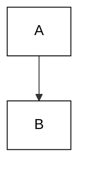

# About OSE

Synthetic enterprise and Sharia compliance content used only by E2E tests.

## Fixture scope

This page is isolated from production content and identity.

## Code sample

```ts
const greeting = "hello";
```

## Mermaid diagram


