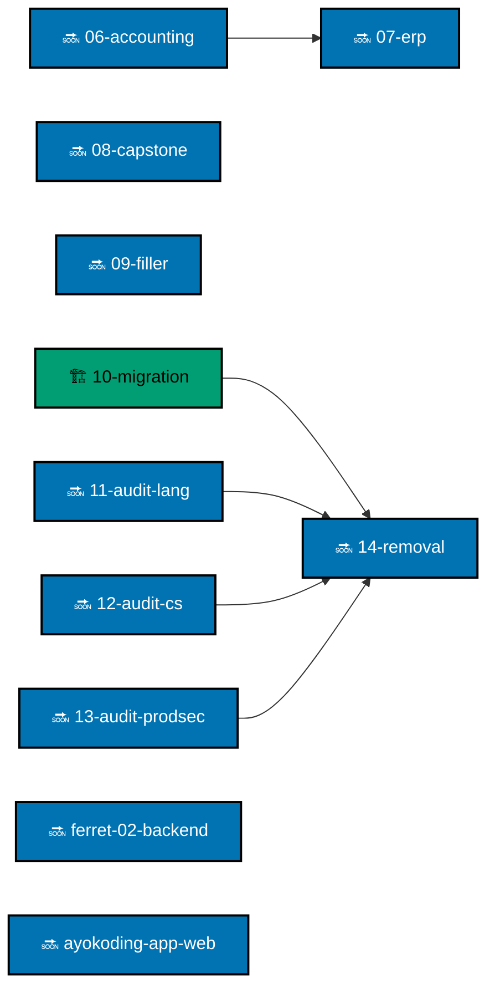

# Plans

Plans are the repository's working record of change. They help an AI delivery session or an
authorized maintainer understand why work exists, what it depends on, and what evidence will show
it is complete. They are not product documentation.

## Find the right plan stage

- [`ideas/`](./ideas/README.md) — short, promotable problem briefs.
- [`backlog/`](./backlog/README.md) — prepared work that has not started.
- [`in-progress/`](./in-progress/README.md) — active delivery records, including their task lists.
- [`done/`](./done/README.md) — completed historical plans; do not casually rewrite them.

## How delivery works

The default delivery mode is `worktree-to-pr`: a focused worktree and branch produce one pull
request, which is reviewed, gated, and merged by the authorized AI delivery flow. The exact plan
states its delivery mode and any exceptions. External contribution intake is closed.

For plan structure, naming, lifecycle, and evidence requirements, read the
[Plans Organization Convention](../repo-governance/conventions/structure/plans.md). For help
choosing between permanent documentation and a temporary plan, see
[How to Organize Your Work](../docs/how-to/organize-work.md).

## Plan Order

Every plan in `backlog/` and `in-progress/` appears here. Plans with no arrow between them run in parallel. An arrow
means the head starts only after the tail; a dotted arrow means the tail should land first without blocking. The graph
is updated in the same change that moves, adds, or removes a plan, per
[Plan-Order Graph and Legend](../repo-governance/conventions/structure/plans/plan-order-graph-and-legend.md).

Legend: 🔜 blue = backlog; 🏗️ teal = in progress. Hexagon credentialed-machine steps do not apply here.
`ferret-02` has no live dependencies and runs in parallel with everything.

The [AyoKoding Phoenix LiveView rewrite](./backlog/ayokoding-app-web/README.md) also has no live
dependencies (`Depends-on: []`). It can start and finish alongside the existing AyoKoding plans;
its executor reconciles shared content changes already merged into `main` without waiting for
the content series. Awareness links between plans do not add dependency edges.
