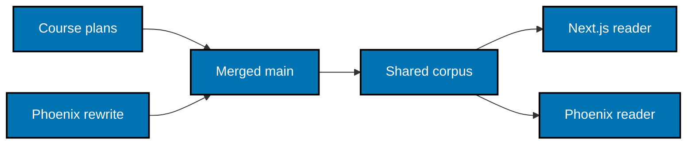

# Baseline, Parity, and Concurrent Content Work

## Inspected state

The authoring baseline is commit `88d4f0b36156b6efb10c03e532a646cea65f81b1`. At that revision
`apps/ayokoding-www` is a Next.js application; the Phoenix app and its test projects do not exist.
The source of truth is the current files, not an old plan's assumed route or course count.

| Existing source                                               | Contract to preserve                                                                                                                          |
| ------------------------------------------------------------- | --------------------------------------------------------------------------------------------------------------------------------------------- |
| `src/app/[locale]/` and `(content)/[...slug]/page.tsx`        | Landing, special tools routes, browse, content dispatch, metadata, 404, and English/Indonesian routing.                                       |
| `src/features/content/core/` and `shell/`                     | Frontmatter, relative Markdown links, heading normalization, shortcodes, tree order, previous/next, Markdown rendering and content filtering. |
| `src/features/course-paths/core/`, `shell/`, and `manifests/` | Variable-depth path IDs, phase manifests, prerequisites, framing, catalog metadata, and canonical fallback.                                   |
| `src/features/search/` and `content/shell/service.ts`         | Locale-scoped title/body search with forward token matching, excerpts, static tool pages, and result de-duplication.                          |
| `src/features/learning-progress/`                             | Browser-only v1 progress, lesson sequencing, resume/start cards, reset, and cross-tab state.                                                  |
| Both tools' `core/` and `shell/` directories                  | Calculations, scoring, ranking/substitutes, filters, URL codecs, labels, rounding, source notes, and data dates.                              |
| `src/redirects/` and `next.config.ts`                         | Ordered redirects, including case-sensitive locale entry rules and historical content routes.                                                 |
| `src/app/sitemap.ts`, `robots.ts`, and `feed.xml/route.ts`    | Discovery documents; RSS includes published English non-section pages.                                                                        |

Paths in this table are relative to `apps/ayokoding-www/`. Before execution, inspect its
`project.json`, both existing E2E projects, and `behaviour-coverage.json` again. Existing app targets
include `test:unit`, `test:integration`, `test:quick`, `test:coverage`, and `examples:check`;
frontend/backend runtime acceptance belongs to the separate E2E projects.

## Complete scenario disposition

The canonical source is recursive `specs/apps/ayokoding/www/behaviours/**/*.feature`. An initial
new feature list is not a complete inventory of the old product. At Phase 0, enumerate every
Scenario and every expanded Scenario Outline example using the already installed Cucumber parser
used by `scripts/behaviour-coverage.mjs`. Record one row per identity in the ignored execution
ledger, then preserve the final accepted migration table in this plan's evidence.

Each row contains source feature path, scenario title, example identity, source revision,
disposition (`retain`, `adapt`, `implementation-only`), destination feature/title, Unit owner,
Integration/E2E owners or individually justified exemptions, evidence, and reconciliation status.
No empty destination is permitted for a user-facing outcome. `implementation-only` requires a
specific reason and its replacement proof or an explicit explanation that no product outcome is
being removed. Never count an unexpanded outline as one passing proof for all its rows.

| Source family                                                                         | Destination / disposition                                                                                                                                                                                                                                              |
| ------------------------------------------------------------------------------------- | ---------------------------------------------------------------------------------------------------------------------------------------------------------------------------------------------------------------------------------------------------------------------- |
| `frontend/app-shell/{accessibility,responsive}.feature`; `frontend/i18n/*.feature`    | Shell, locale/navigation, and accessibility scenarios; retain user behavior.                                                                                                                                                                                           |
| `frontend/content/{content-rendering,code-block-copy,course-content-hygiene}.feature` | Content, browser helpers, and current shared-corpus integrity; retain or adapt framework coupling.                                                                                                                                                                     |
| `frontend/content/static-delivery.feature`                                            | Adapt readable initial HTML, correct assets, cache safety, and draft exclusion. Next prerender manifests, standalone tracing, and Next cache internals are implementation-only; never require Phoenix to fabricate those artifacts or a fixed prerendered route count. |
| `frontend/navigation/*.feature`                                                       | Routes and navigation; preserve redirect precedence and source revision. Reconcile Learn-bucket changes already merged from plan 14.                                                                                                                                   |
| `frontend/search/search.feature`                                                      | Search dialog, keyboard, result navigation, and static tools discovery.                                                                                                                                                                                                |
| `frontend/course-paths/*.feature`                                                     | Course catalog and paths; every current path-order, phase, prerequisite, fallback, framing, omitted-course, and accessibility outcome must appear in the disposition ledger.                                                                                           |
| `frontend/learning-progress/*.feature`                                                | Browser progress and learning journeys; preserve exact storage schema and privacy.                                                                                                                                                                                     |
| `frontend/tools/*.feature`                                                            | Tools index and both tools; port all controls and modes, not just the abbreviated control count in an old comment.                                                                                                                                                     |
| `backend/{content,navigation,search,i18n}/*.feature`                                  | Adapt data and validation semantics into context/LiveView scenarios. Do not reproduce tRPC's JSON envelope.                                                                                                                                                            |
| `backend/health/health-check.feature`                                                 | Retain old-app tRPC checks there; prove the new server's readiness through its real `/en` HTML route. No new health API is needed.                                                                                                                                     |
| `build-tools/index-generation/*.feature`                                              | Remain owned by the existing generator. The new app proves read-only consumption and generated-index rendering instead of duplicating the generator.                                                                                                                   |
| `build-tools/benchmark-reference-generation/*.feature`                                | Preserve the generator and its old TS imports; shared-data extraction must leave generated reference blocks unchanged.                                                                                                                                                 |
| `build-tools/env-loader/*.feature`                                                    | Adapt environment isolation and startup validation to Phoenix local/test configuration.                                                                                                                                                                                |
| `build-tools/build-workers/*.feature`                                                 | Next worker budgeting remains with Next; Phoenix compile/test work goes through HIPPO with fixed admission.                                                                                                                                                            |

## Stable fixtures and current-corpus proof

Use synthetic lessons and manifests under the new app's `test/fixtures/` for repeatable domain and
rendering tests. Each fixture owns its inputs; do not depend on a course retaining a particular
word count, title, outline status, or legacy path forever. Test unknown/invalid frontmatter,
missing roots, malformed manifests, and duplicate/unsafe path IDs as well as valid documents.

Separately run current-corpus Integration and E2E smoke coverage against the recorded merged
revision, including both locales and actual course/path links. Do not replace that real-corpus
pass with fixtures, and do not make every local test rescan the entire lesson library.

## Parallel execution contract

`Depends-on: []` is intentional. Existing plans 06 through 14 continue changing the current
`ayokoding-www` source. The rewrite owns its new app, E2E project, new specs, and imported library;
the only planned old-app code edits are bounded tool data adapters. It never changes course
bodies, phase manifests, content-example tooling, or source indexes to simplify its implementation.

At every delivery boundary, record the latest merged `origin/main` revision, diff the shared source
families and old specs against the prior recorded revision, and rebase/reconcile the rewrite's
affected contracts and tests. The source revision is a moving integration input, not a lock that
requires course authors to preserve old content. Do not inspect or consume their uncommitted
worktrees, wait for a plan to archive, or add a coordinated-merge prerequisite.

When plan 07 has already removed transitional manifest fields, remove the corresponding Phoenix
acceptance branches and fixtures. When plan 14 has already removed legacy content, use its surviving
renderer fixture, current Learn buckets, current redirects, and updated search/sitemap expectations.
If those changes have not merged, implement the current source faithfully without predicting them.

Final acceptance compares the new app against the latest recorded merged corpus and corresponding
old-app behavior, even if every other live plan is still unfinished. Newly merged differences
reopen only the affected parity packet. They never convert awareness links into hard dependencies.
