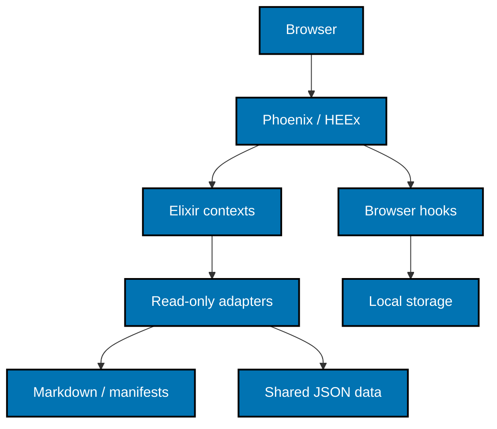
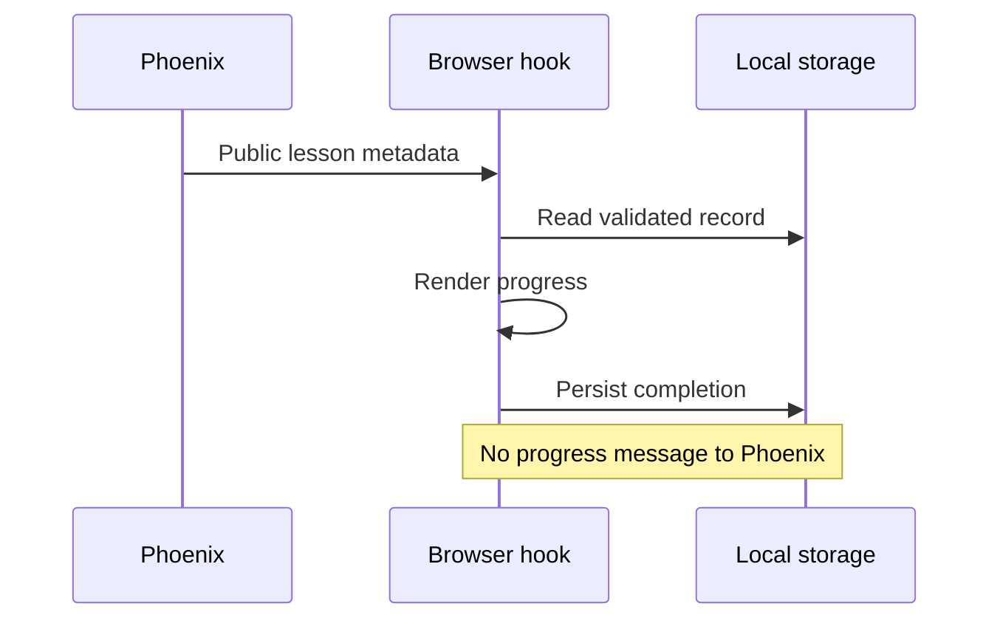

# Architecture and Content

## Runtime shape

Build a single non-umbrella Phoenix application with OTP application `:ayokoding`, domain namespace
`AyoKoding`, and web namespace `AyoKodingWeb`. Use Phoenix 1.8 and LiveView 1.2 with a compatible
Elixir/OTP pair; the copied library's `~> 1.18` requirement sets the stronger Elixir floor. Resolve
and record exact compatible patches and lockfiles during setup rather than claiming an installed
version from a plan. Generate without Ecto, mailer, or dashboard; keep HTML, LiveView, esbuild,
Tailwind, and Bandit. No database, Docker stack, account, or external runtime service is required.

Phoenix explicitly supports the `--no-ecto`, `--no-mailer`, and `--no-dashboard` generator options.
See [installation](https://phoenix.hexdocs.pm/installation.html) and
[generator options](https://phoenix.hexdocs.pm/Mix.Tasks.Phx.New.html), accessed 2026-10-25.

## Module and data boundaries

| Boundary                                   | Responsibility                                                                                                                                                                               |
| ------------------------------------------ | -------------------------------------------------------------------------------------------------------------------------------------------------------------------------------------------- |
| `AyoKoding.Content`                        | Validated metadata, slug/link resolution, source-independent catalog/tree/sequence decisions, and HTML rendering coordination.                                                               |
| `AyoKoding.CoursePaths`                    | Manifest parsing/validation, phase order, course membership, prerequisites, framing, and path-context fallback.                                                                              |
| `AyoKoding.Search`                         | Locale-scoped forward token matching over titles/body and static tools, title-before-body result merging, de-duplication, excerpts, and limits.                                              |
| `AyoKoding.Tools.Benchmark` / `Calculator` | Pure calculations and URL codecs using validated shared datasets.                                                                                                                            |
| `AyoKodingWeb`                             | Router, redirect plug, HTML/metadata/discovery responses, LiveViews, and accessible function components. Translate inputs and outputs here; keep calculations and content rules in contexts. |
| `assets/` browser helpers                  | Theme, keyboard focus, localStorage progress/resizing, code copy, and rendering hooks for math/diagrams. No browser record is sent to a context.                                             |

File-backed content, manifests, and data adapters implement narrow behaviors with in-memory Unit
doubles. They return explicit success/error values rather than leaking full filesystem paths to a
browser. Validate locale, slug/path segments, query fields, and decoded datasets at their boundary.
Never read a path obtained by joining an unvalidated URL onto the source root. Reject traversal,
encoded separators, NUL, and escaping symlinks with the same missing-page result.

Use one supervised immutable catalog snapshot per source generation. Serialize its rebuild so
simultaneous initial readers share the same scan. A development `FileSystem` watcher invalidates
the affected source generation and triggers Phoenix LiveReload; tests inject deterministic change
notifications. Publish a new complete snapshot atomically, and never mutate a snapshot a request
is reading. Cache parsed HTML by source-generation and canonical content identity; a source edit
must be visible on the next successful reload. Do not introduce persistent storage or a search
service to solve local caching.

## Local configuration

Default the app listener to `127.0.0.1:3102`. The Nx dev wrapper resolves explicit `--port`, then
`AYOKODING_WEB_PORT`, then 3102, validating integer range 1–65535 and failing on malformed input.
Ignore bare `PORT`, matching the repository's app-prefixed configuration convention. Tests start
their own server on 3191 using `AYOKODING_WEB_PORT=3191` and do not reuse an arbitrary process.

Defaults resolved relative to the new app root are:

| Setting                       | Source                                                                                      |
| ----------------------------- | ------------------------------------------------------------------------------------------- |
| `AYOKODING_WEB_CONTENT_DIR`   | `../ayokoding-www/content`                                                                  |
| `AYOKODING_WEB_MANIFESTS_DIR` | `../ayokoding-www/src/features/course-paths/manifests`                                      |
| `AYOKODING_WEB_SHOW_DRAFTS`   | false; explicit true only for owned test/authoring fixtures                                 |
| Public asset source           | `../ayokoding-www/public`, exposed by a read-only static adapter with safe path containment |
| Tool data source              | `../../libs/ayokoding-data/data`, JSON decoded directly in Elixir                           |

Reuse the existing environment variable meanings without loading another environment tier's files.
Supply a documented uncommitted `.env.local` only if needed; the committed `.env.example` contains
placeholders, not real secret values. Never read or modify `.env.prod` or `.env.stag`. Test bootstrap
uses isolated fixture roots and test secrets before the Phoenix application starts; no developer
corpus is mutated by a test. Application configuration derives paths independently of shell cwd.

## Elixir rendering pipeline

Read UTF-8 Markdown, split frontmatter, parse it with `YamlElixir.read_from_string/2`, and normalize
using the existing reader's metadata semantics. Invalid required frontmatter is skipped with a
sanitized warning; optional catalog metadata remains tolerant as in the existing schema. Drafts
are hidden unless the explicit draft setting is enabled. Preserve `_index.md` section behavior,
weight ordering, prerequisites, outline status, dates, tags, and course metadata.

Use MDEx's HTML/AST pipeline with GFM support. Preprocess existing callout, tabs/tab, YouTube, and
steps shortcodes into allowed render nodes; do not interpret source as executable HEEx. Normalize
the first body heading to h2 with the existing relative shift/clamp rule before assigning stable
heading IDs and extracting h2–h4 TOC entries. Resolve `.md` relative links differently for section
indexes and leaf pages, preserving anchors and the current locale URL mapping.

Retain authored safe raw HTML, mathematical notation, fenced-language labels, line structure, and
copy payloads through fixture comparisons. Sanitize executable HTML, unsafe URL schemes, and
event-handler attributes before insertion; never turn Markdown text or event inputs into HEEx
expressions. KaTeX and Mermaid use browser hooks over known code/math nodes; syntax highlighting
uses the MDEx-supported renderer with an explicit bundled language set and the current accessible
light/dark palette. Unknown languages still render escaped readable code with working copy.

MDEx provides distinct HTML and executable HEEx modes; this plan chooses HTML/AST only. Rendering,
GFM, sanitization, and syntax options are documented in [MDEx](https://mdex.hexdocs.pm/MDEx.html);
YAML string parsing is documented in [YamlElixir](https://yaml-elixir.hexdocs.pm/YamlElixir.html),
accessed 2026-10-25. Setup must validate the resolved MDEx NIF/native dependency requirements on the
actual host; do not assume a Rust compiler or precompiled binary is available.

## Courses and search

Port the current manifest schemas and rules from `course-paths/core/schemas.ts` and its helpers;
accept variable-depth `careers/...` and `skills/...` IDs and derive ordering from phases. Current
transitional manifest allowances remain only while present in the merged source. Malformed files
are skipped with warnings, and a missing manifest root yields the current empty-state behavior.
No content migration or authoring tool is added.

Build a native in-memory search index from published non-section content plus static tool entries.
Keep the current forward-prefix token behavior, locale isolation, title-before-body results,
de-duplication, excerpt rules, and 1–50 result limit (default 20). Derive representative matching and
ordering vectors from `ContentService` against synthetic fixtures before porting; browser-visible
semantics and those vectors are the contract, not FlexSearch's implementation or numeric scores.
An empty dialog input clears results; a malformed direct event returns a stable inline validation
state. No Node process or prebuilt Next search-data file is required at runtime.

## Shared tools data

Create a language-neutral data library with `data/ai-benchmark.json`, `data/cost-of-living.json`,
and `data/fx.json`, plus `provenance.md` and shared `test-vectors/*.json`. Export the evaluated old
TypeScript objects once, preserving list order, numbers, absent optional properties, configuration,
operator priorities, tier anchors, harness catalogs/defaults, methodology examples, and price-blend
constants. Preserve calculator country/city data, salary ladders, policy constants, and independent
FX snapshot date. Copy provenance held only in source comments into structured metadata or notes.

The old data module paths and named exports remain as typed JSON adapters. Benchmark documentation
generation continues using its existing imports and must produce unchanged generated blocks. Elixir
reads the same JSON directly; each runtime validates its adapter and runs shared expected-result
vectors for scoring, cost, savings, minimum role, numeric formatting, and query encoding. Do not
refresh data values or source dates during this format migration.

## Browser-only progress and state

Keep key `ayokoding-learn-progress-v1` and the strict v1 record fields: `version`, `completed`,
`lastPath`, and `lastCourse`. Mirror current segment validation, limits, deterministic serialization,
idempotent completion, invalid-record recovery, blocked-storage in-memory fallback, cross-tab
storage events, and reset of this key alone. Theme and resize keys remain `theme`,
`ayokoding-sidebar-width`, and `ayokoding-mobilenav-width`.

The server emits public course/lesson metadata. A hook computes completion, resume cards, and
progress-dependent links entirely in the browser and owns a stable DOM island across patches.
Neither `pushEvent`, connect parameters, cookies, URLs, logs, telemetry, nor server assigns contain
the progress record or its completion/history fields. Hook `mounted`, `updated`, `disconnected`,
`reconnected`, and `destroyed` behavior must preserve state without duplicate listeners.

The progress hook is Unit-tested in TypeScript and exercised in real browsers. ExUnit integration
tests prove server HTML and event boundaries; they do not pretend to execute localStorage. Different
ports have different origins; compatible schemas do not imply cross-port data transfer.
