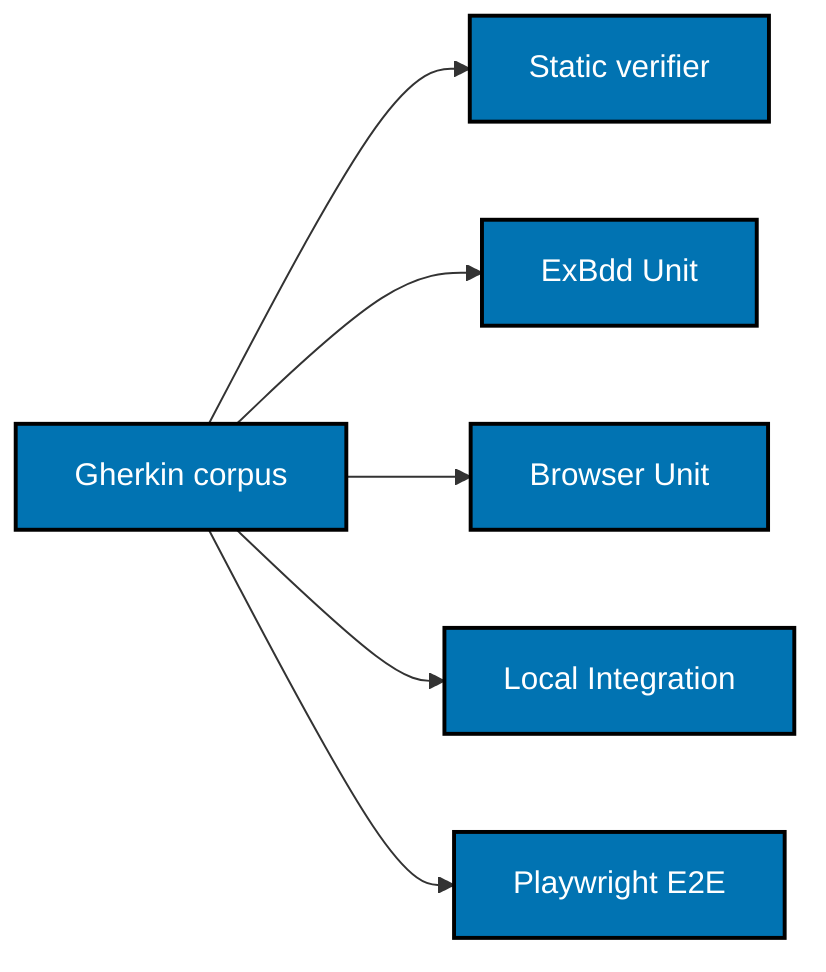

# BDD, Test Layers, and Verification

## Import contract and attribution

Copy only the tracked `libs/ex-bdd/` subtree from BeaverNest commit
`8ec64d79958f5c260101283ec16443f95376174d`. The immediate source is repository owner
`wahidyankf`, not a new OSE-authored engine. Preserve hidden formatter/configuration files, source,
tests, fixtures, `mix.exs`, `mix.lock`, `LICENSE`, and `UPSTREAM.md`; exclude dependencies, caches,
coverage, and generated output. The source is available in the related repository locally; resolve
its location at runtime rather than committing a home-specific path.

Retain these notices without replacing them with OSE copyright:

- BeaverNest's ownership/maintenance information and exact source repository, path, and commit.
- Original `huddlz-hq/cucumber` version 1.0.0, commit
  `114aceb7ed6a3e95eb496971e8a331a8a4b81a64`, copyright 2024 Micah Woods, MIT license.
- Cucumber Compatibility Kit fixture attribution, copyright 2020 Cucumber Ltd and contributors.

Append an OSE import section to `UPSTREAM.md` with the actual execution-time import date, source
snapshot, retained provenance, local modifications, and manual refresh procedure. Future refreshes
compare tracked subtrees at explicit commits, replay local changes, and rerun library and consumer
gates. Do not add automated upstream synchronization. Update `LICENSING-NOTICE.md`, which currently
claims there is no vendored third-party/forked code, and the library/monorepo indexes.

The [source library](https://github.com/wahidyankf/beaver-nest/tree/8ec64d79958f5c260101283ec16443f95376174d/libs/ex-bdd)
is `:ex_bdd` / `ExBdd`, version 1.0.0. Its inspected `mix.exs` requires Elixir `~> 1.18` and its
README documents `compile_features!/1`, `verify_features!/1`, configurable ExUnit case templates,
and strict completeness checking. Reference inspected 2026-10-25.

## One corpus, explicit layer ownership

Application dependency:

```elixir
{:ex_bdd, path: "../../libs/ex-bdd", only: :test}
```

The canonical app corpus is `specs/apps/ayokoding/web/behaviours/**/*.feature`; the library owns
`specs/libs/ex-bdd/behaviours/**/*.feature`. Each owner has its own coverage configuration and tests.
ExBdd imports are test-only; the Phoenix runtime does not depend on a BDD engine.

| Layer               | Owner and boundary                                                                                                                                                                                         |
| ------------------- | ---------------------------------------------------------------------------------------------------------------------------------------------------------------------------------------------------------- |
| Elixir Unit         | Shared step definitions call an in-memory behavior driver under `ExUnit.Case`; no application startup, real filesystem, network, native process, or browser. Use `mix test --no-start` with the Unit tree. |
| Browser-helper Unit | Vitest executes the same assigned Gherkin scenarios for browser-state/focus helpers using in-memory storage/DOM doubles. This is the Unit owner for those scenarios, not a Unit exemption.                 |
| Integration         | ExBdd uses a project `ConnCase` and real local fixture roots with `Phoenix.ConnTest` / `Phoenix.LiveViewTest`; mounts, event handling, source reload, parsing, and adapter behavior use owned resources.   |
| E2E                 | `apps/ayokoding-web-e2e` uses TypeScript `playwright-bdd` over the owner's canonical corpus and the real local Phoenix server. Browser and request-fixture tests cover public behavior.                    |

Use a single consumer discovery-scope function before both native static verification and runtime
compilation. ExBdd does not implement native exemption filtering. The function selects the exact
Elixir-owned Unit scenarios, applicable Integration scenarios, and the matching bindings/support;
Vitest owns the complementary Unit identities. Their union must equal all expanded scenarios, with
no unowned identity or duplicate ownership. Integration exemptions require the repository's exact
boundary explanation and alternative-proof comment; never exempt Unit or tag unfinished behavior.

Share app step definitions between Unit and Integration through a driver interface; their drivers
implement distinct boundaries. The library retains its existing unit/integration self-tests and
CCK fixtures and adds adapters for its new canonical corpus. Do not transplant BeaverNest's domain,
storage, account, Caddy, deployment, or authenticated chat scaffolding.



## Repository tooling adaptation

`scripts/behaviour-coverage.mjs` currently accepts TS/TSX, F#, Java, Go, C#, and Python bindings;
it does not extract `.ex` or `.exs` and does not recognize Mix's unit coverage floor. Extend this
existing mechanism rather than creating another Elixir-expression parser in JavaScript.

Add an optional native-verifier argument vector to an adapter's coverage configuration. For an
Elixir adapter, the existing Node entry point validates Gherkin policy, owner/target declarations,
scope identities, and then invokes the declared native verification command with `spawn` and
`shell: false`. The command runs from the declared project root with `MIX_ENV=test`, never starts
the app or executes scenarios, and fails closed on nonzero exit or invalid/missing summary.

Add a small `mix ex_bdd.verify --layer unit|integration` task to the copied library as a recorded
local adaptation. It loads the consumer's test discovery configuration, applies its shared scope,
and calls `ExBdd.Verifier.verify!` over the resulting discovery. For a fully unfiltered corpus it
may use `ExBdd.verify_features!/1`. It reports the verified expanded identities and declared Unit
coverage floor. The Node gate still verifies that `test:unit` actually runs the coverage collector;
an integer in metadata alone is insufficient. No runtime test command is permitted in a static
`test:coverage:*` target.

Regression cases cover successful dispatch, absent/failed verifier, missing/ambiguous/unused step
bindings, empty corpus, outlines and inherited tags, consistent exemption scope, missing Unit
identity, a fabricated floor, and a genuine Mix coverage floor below 99%. Existing language behavior
must remain unchanged. New consumer CLI/task paths are planned artifacts and get their own tests.

## Coverage and target contracts

New app targets: `dev`, `build`, `typecheck`, `lint`, `test:unit`, `test:integration`,
`test:coverage:unit`, `test:coverage:integration`, `test:coverage:e2e`, `test:coverage:behaviour`,
`test:coverage`, and `test:quick`. `test:unit` runs Elixir and browser-helper Unit coverage; each
production-code denominator enforces 99% line coverage with documented legitimate exclusions.
Tests/support/generated framework code do not enlarge or hide production denominators. Integration
owns real adapters; do not manufacture an exclusion merely to lift a failing score.

`test:quick` runs typecheck, lint, Unit execution, and aggregate static BDD completeness. It never
runs Integration or E2E. App runtime E2E belongs to `ayokoding-web-e2e:test:e2e`; the app README
explains that dedicated owner instead of adding a hollow duplicate target. The E2E project's quick
target typechecks/lints TypeScript and validates static bindings without starting a browser.

Preserve the imported library's separate Unit and full-engine numeric coverage contracts. Its
full-engine check runs both layers and remains outside quick; name it `test:coverage:engine` so the
repository's `test:coverage` stays the static BDD aggregate. `test:unit` retains 99% Unit coverage.
No library E2E runtime is required because the engine has no public user journey; document that
boundary and its Integration alternative proof.

Retries are zero in all new product tests. Reject `@retry-n`, focused, skipped, TODO, or quarantine
behavior through the existing policies. The copied engine may retain upstream retry capability
and tests as licensed library behavior; the app must not enable it. Capture traces on failure,
not only on a retry. Use framework lifecycle and observable completion signals, never sleep or
broaden timeouts to disguise contention or a defect.

## Planned verification commands

These Nx targets become valid only in the delivery unit that creates them. Every command runs from
the worktree root. Unit/static work uses `ephemeral/standard`; real corpus/build/browser suites use
`ephemeral/heavy`; dependency installation is `transactional/standard`; servers are `service/standard`.

```bash
rtk ./hippo run --class ephemeral --resource-tier standard --disk-path . -- npm exec nx -- run ex-bdd:test:quick
rtk ./hippo run --class ephemeral --resource-tier standard --disk-path . -- npm exec nx -- run ayokoding-data:test:quick
rtk ./hippo run --class ephemeral --resource-tier standard --disk-path . -- npm exec nx -- run ayokoding-web:test:quick
rtk ./hippo run --class ephemeral --resource-tier heavy --disk-path . -- npm exec nx -- run ayokoding-web:test:integration
rtk ./hippo run --class ephemeral --resource-tier heavy --disk-path . -- npm exec nx -- run ayokoding-web-e2e:test:e2e
```

Playwright owns a fresh server on 3191, isolated source fixtures, and browser contexts. Keep
`reuseExistingServer: false`, retries zero, and local Chromium/Firefox/WebKit projects. It exercises
the same Phoenix assets and native LiveSocket that development uses. See
[Playwright server lifecycle](https://playwright.dev/docs/test-webserver) and
[LiveView testing](https://phoenix-live-view.hexdocs.pm/Phoenix.LiveViewTest.html), accessed 2026-10-25.

## Manual and terminal proof

Manual browser evidence covers both locales at 375, 768, and 1280 px; capture sanitized screenshots
under the executing plan's `evidence/` with feature, locale, and breakpoint in the filename. Prove
keyboard focus, storage recovery and network privacy, deep links, reconnect, tool query state,
code copying, diagrams/math, and no browser console errors. Compare to the existing app's reference
captures. Wire recipes live in the API companion and delivery checklist.

At the terminal current-main gate, run the live exploratory, usability, and design tester triad,
triage spec-gap/suggestion rows separately, and fix actual defect findings before acceptance.
There is no new REST/GraphQL API: Rule 16's REST/GraphQL API-tester gate is inapplicable, with
the evidence in the API companion; HTTP and LiveView behavior still receive request/browser proof.
