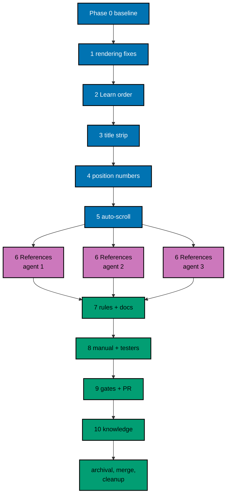

# Delivery Plan — AyoKoding Learn Revamp 01: Navigation and Display

> **Legend** — `[AI]`: an agent performs the step (the default; unmarked steps are `[AI]`).
> `[HUMAN]`: only a human can do it (physical action, out-of-band approval, real-secret or
> privileged-credential handling). `[AI+HUMAN]`: agent prepares, human approves or finishes.

**Do not start** until the user gives an explicit execution command for this plan. That command is

> the authorization for this plan's change set (commits, pushes, PR, merge, and deploy described
> below).

plan-quality-gate: PASS (1 cycle, 0 open)

## Worktree

- **Execution worktree:** `worktrees/ayokoding-learn-revamp-01-navigation-and-display/`
- **Provisioning status:** provisioned
- **Provisioned Worktree Identity:** worktree
  `worktrees/ayokoding-learn-revamp-01-navigation-and-display/`
  - First provisioning: 2026-10-10 from fresh `origin/main` at `4df1f41b308a02b47932a0d1d54fe485fd91ee5b`
    (promotion PR #677 merge commit); used for everything delivered through the Phase 0–5 checkpoint;
    removed with its branches after that checkpoint PR merged (dev-artifact clean-up, recorded in PR
    #680's continuation notes).
  - Re-provisioning (this execution's entry gate, 2026-10-11): the worktree no longer existed
    (`git worktree list` showed only the primary checkout) and both delivery branches were deleted;
    it was re-provisioned from fresh `origin/main` at
    `73634ddceb60068acb481928dd5f1d70554920f6` (checkpoint PR #680 merge commit) with
    `rtk git worktree add -b ayokoding-learn-revamp-01-navigation-and-display-base
worktrees/ayokoding-learn-revamp-01-navigation-and-display origin/main`; `npm install
--include=dev` exit 0 (`.husky/_` present); `rtk npm run doctor` exit 0 (24 toolchains, no
    findings); delivery branch recreated from the synced base; freshness gate passed
    (`merge-base --is-ancestor origin/main HEAD` @ `73634ddce`).
- **Delivery Branch Inventory:**

  | Branch                                                  | Mode              | Status                                     |
  | ------------------------------------------------------- | ----------------- | ------------------------------------------ |
  | `ayokoding-learn-revamp-01-navigation-and-display-base` | provisioning base | synced to `73634ddce`, unused for delivery |
  | `ayokoding-learn-revamp-01-navigation-and-display`      | worktree-to-pr    | active, at `73634ddce`, delivery branch    |

- **Authoring-worktree exception:** this plan was authored inside the separate authoring worktree
  `.claude/worktrees/ayokoding-update` (branch `worktree-ayokoding-update`), which the user required
  for writing all plans of the AyoKoding Learn Revamp series together. That authoring worktree is
  removed after the plan-docs PR merges and is **never** used for execution. The Provisioned Worktree
  Identity and Delivery Branch Inventory are intentionally omitted until Step 0 below creates them.
- **Step 0 obligation (blocking):** the plan-execution Step 0 gate provisions the execution worktree
  from fresh `origin/main` with
  `rtk git worktree add -b ayokoding-learn-revamp-01-navigation-and-display-base worktrees/ayokoding-learn-revamp-01-navigation-and-display origin/main`,
  initializes it per
  [Worktree Toolchain Initialization](../../../repo-governance/development/workflow/worktree-setup.md),
  writes the immutable identity and the first inventory row into this section, replaces
  `Provisioning status: pending` with `Provisioning status: provisioned` in the same plan update, and
  syncs with `origin/main` before any delivery packet starts.
- **Cleanup:** after the PR merges, the worktree and its branches come down through
  [Dev Artifact Clean-Up](../../../repo-governance/workflows/maintenance/dev-artifact-clean-up.md)
  (see Plan Archival).
- **Worktree cap:** one worktree for this plan in this repository, reused by every phase.

## Delivery Mode: worktree-to-pr

`worktree-to-pr` is mandatory in this repository. One branch and **one PR** deliver the whole plan.
The PR needs the exact current-head/base `Quality gate` from `.github/workflows/pr-quality-gate.yml`
and an exact-head posted `pr-leak-review` `pass` (`leak-review` status). Broad semantic PR review is
not run unless the user asks for it. `[AI]` merges once the hardened merge preconditions hold.

### Delivery Unit

| Unit  | Phases                                       | Safe `main` state after merge                                                                                       | Rollback                               |
| ----- | -------------------------------------------- | ------------------------------------------------------------------------------------------------------------------- | -------------------------------------- |
| DU-01 | 1–10 and Plan Archival (Phase 0 opens no PR) | Titles without numbers, numbered syllabus/rail/preview, auto-scroll, fixed typography, References, guard test green | Revert the merge commit in a revert PR |

Every change is complete the moment it lands, so no feature flag is needed. The phases are natural
pauses inside the one branch; no phase is merged on its own.

**Checkpoint record (fact, 2026-10-11):** host memory saturation forced a partial checkpoint —
PR #680 (branch `ayokoding-learn-revamp-01-navigation-and-display` at its
Phases 0–5 state) was merged to `main` at `73634ddce` and that worktree's artifacts were cleaned up
same-day. The plan explicitly authorized continuation in the same plan; the remaining Open Phases
5 (last item), 6, 7, 8, 9, 10, and Plan Archival land through the re-provisioned worktree and a
continuation PR on the same branch name, merged before archival. The user reauthorized execution
explicitly on 2026-10-11 (execute to completion, land on `origin/main`, deploy to prod).

### Before Phase 0: Promotion

- [x] [AI] Promote the plan per
      [Starting and Completing Work](../../../repo-governance/conventions/structure/plans/starting-and-completing-work.md):
      a pure move of `plans/backlog/ayokoding-learn-revamp-01-navigation-and-display/` to
      `plans/in-progress/ayokoding-learn-revamp-01-navigation-and-display/` plus the
      `plans/backlog/README.md` and `plans/in-progress/README.md` index updates, landed on
      `origin/main` through its own PR. Acceptance: `rtk git ls-tree -r --name-only origin/main plans/in-progress/ayokoding-learn-revamp-01-navigation-and-display/`
      lists this plan's files. This promotion PR is separate from DU-01.

  **Implementation notes**
  - **Date**: 2026-10-10 (checkpoint) / 2026-10-12 (row reconciled)
  - **Status**: complete
  - Brief: promotion PR #677 landed at `4df1f41b308a02b47932a0d1d54fe485fd91ee5b` — the ls-tree
    acceptance holds on today's trunk (verified during the worktree re-provisioning entry gate on
    2026-10-11, which listed this plan's files under `origin/main` plans/in-progress/). The row was
    left unticked by the checkpoint flow; reconciled here.

### Execution Packet Defaults

- **Plan path after promotion:** `plans/in-progress/ayokoding-learn-revamp-01-navigation-and-display/`
  (written below as `<plan>/`). Evidence goes to `<plan>/evidence/`.
- **Scratch:** one-time scripts, dry-run reports, and the execution ledger live in the execution
  worktree's `local-tmp/ayokoding-learn/plan-01/` (gitignored). Record agent IDs and review cycle
  counts in `local-tmp/ayokoding-learn/plan-01/execution-ledger.md`.
- **Evidence hygiene:** evidence files contain repository-relative paths only. Never paste an
  absolute home-directory path, a hostname, a token, or `.env*` content (the PR leak review treats
  machine-specific values as leaks).
- **Never commit** `apps/ayokoding-www/next-env.d.ts` (the dev server rewrites it) or
  `.serena/project.yml`. Before every commit run `rtk git status --short` and restore either file with
  `rtk git checkout -- <file>` if it shows as modified.
- **Never touch** `.env.prod` or `.env.stag`. If the dev server needs a variable, copy the key from
  `apps/ayokoding-www/.env.example` into an uncommitted `apps/ayokoding-www/.env.local`.
- **Bounded loops:** any maker→checker review loop in this plan runs at most 2 cycles. A file still
  failing after cycle 2 is recorded as `BLOCKED` in the execution ledger with its findings, reported
  to the user, and the phase gate stays open until the user decides.
- **Failure handling:** on any unexpected failure, save the output to the phase evidence file, fix
  the root cause (never skip, retry-until-green, loosen, or delete a test), rerun the same command,
  and note the fix.

> **Important**: Fix ALL failures found during quality gates, not just those caused by your
> changes. This follows the root cause orientation principle — proactively fix preexisting
> errors encountered during work.

### Command Reference

Run every command from the execution worktree root. Expected results are stated at each use.

| Name               | Command                                                                                                                                        |
| ------------------ | ---------------------------------------------------------------------------------------------------------------------------------------------- |
| `UNIT-FE <file>`   | `rtk ./hippo run --class ephemeral --resource-tier standard --disk-path . --cwd apps/ayokoding-www -- npx vitest run --project unit-fe <file>` |
| `UNIT-NODE <file>` | `rtk ./hippo run --class ephemeral --resource-tier standard --disk-path . --cwd apps/ayokoding-www -- npx vitest run --project unit <file>`    |
| `QUICK`            | `rtk ./hippo run --class ephemeral --resource-tier standard --disk-path . -- npm exec nx -- run ayokoding-www:test:quick`                      |
| `E2E-QUICK`        | `rtk ./hippo run --class ephemeral --resource-tier standard --disk-path . -- npm exec nx -- run ayokoding-www-fe-e2e:test:quick`               |
| `E2E`              | `rtk ./hippo run --class ephemeral --resource-tier heavy --disk-path . -- npm exec nx -- run ayokoding-www-fe-e2e:test:e2e`                    |
| `GEN-INDEXES`      | `rtk ./hippo run --class transactional --resource-tier standard --disk-path . -- npm exec nx -- run ayokoding-www:generate-indexes`            |
| `VALIDATE-INDEXES` | `rtk ./hippo run --class ephemeral --resource-tier standard --disk-path . -- npm exec nx -- run ayokoding-www:validate-indexes`                |
| `DEV`              | `rtk ./hippo run --class service --resource-tier standard --disk-path . -- npm exec nx -- dev ayokoding-www` (serves `http://localhost:3101`)  |

`E2E` builds the app with the fixture manifests in `apps/ayokoding-www-fe-e2e/fixtures/manifests/`,
then runs every scenario in Chromium, Firefox, and WebKit; expect it to take a long time. Read the
list reporter output for the named scenario titles.

### Agent Topology

The root coordinator owns the file ledger, integration, and every gate. Code phases 1–5 run one at a
time (they share `course-paths.steps.ts` and the course-paths components) and are delegated to
`swe-developer`; Gherkin edits go to `specs-maker`. Phase 6's content conversion fans out to at most
3 background `apps-ayokoding-www-general-maker` agents on disjoint course sets (N=3), then the root
integrates. Phase 7 uses `rules-fixer` and `docs-fixer`.

### Commit Guidelines

- [x] Do not stage or commit until the user's execution command has authorized this plan's change
      set; do not extend a commit beyond it.
- [x] Use the fewest build-valid, independently reviewable and revertible commits, one coherent
      purpose each (suggested: one per phase 1–7, plus evidence and archival commits).
- [x] Follow Conventional Commits: `<type>(<scope>): <description>`, imperative, no period (for
      example `fix(ayokoding-www): stop headings rendering as links`).
- [x] Keep each change with its tests, specs, regenerated indexes, docs, and generated harness
      routes in the same commit; stage explicit paths only, never `git add -A`.

  **Implementation notes**
  - **Date**: 2026-10-12
  - **Status**: complete
  - Brief: the advisory guideline rows were left unticked by the Phase 9 flow. Honoured: commits
    happened only after the user's explicit 2026-10-11 execution command; the phase 6–9 change set
    landed as TWO build-valid commits (`f51ac2e3c` product + rules/specs/docs, `a4dc9faf7` plan
    records), staged with explicit paths, each independently buildable/revertible (the entangled
    rule-15 + phase-6 step files made one product commit the fewest correct split); conventional
    commit format (fix/docs scopes, imperative, no period); indexes/docs/adapter routes kept with
    their source commits. Archival commit(s) follow.

---

## Phase 0: Worktree, Environment, Baseline, and Inventory

Phase 0 opens no PR. Its evidence rides the DU-01 PR.

- **Input:** the promotion on `origin/main`; this plan at `<plan>/`.
- **Outcome:** a provisioned, initialized worktree, a recorded green baseline, and an exact
  inventory of every file later phases may edit.
- **Proof:** `<plan>/evidence/phase-0-baseline.md` and `<plan>/evidence/phase-0-inventory.md`.

- [x] [AI] **Plan quality gate (deferred from authoring):** run the `plan-quality-gate` workflow on this
      plan with `max-cycles` 2 before any other step below. It was deliberately not run when this plan was
      written, to keep token use even (user decision, 2026-10-09). Acceptance: verdict `PASS` or
      `PASS_WITH_FINDINGS`; record the line `plan-quality-gate: <verdict> (<n> cycles, <k> open)` in this
      file's header section. If the plan is still in `plans/backlog/`, run the gate before the promotion PR.
      A `BLOCKED` verdict stops execution and is reported to the user.

  **Implementation notes**
  - **Date**: 2026-10-10
  - **Status**: complete
  - **Files Changed**: `plans/in-progress/ayokoding-learn-revamp-01-navigation-and-display/delivery.md`
  - Brief: `PASS` in 1 cycle, 0 open — zero findings at every criticality. `plan-checker` read-only
    audit; ledger at
    `local-tmp/quality/plan/ayokoding-learn-revamp-01-navigation-and-display__202610101215.md`
    (never committed). Verdict line recorded in this file's header.

- [x] [AI] Run the plan-execution Step 0 gate described in [## Worktree](#worktree): provision
      `worktrees/ayokoding-learn-revamp-01-navigation-and-display/` from fresh `origin/main`, record
      the Provisioned Worktree Identity and the first Delivery Branch Inventory row in this file, and
      set `Provisioning status: provisioned`. Acceptance: `rtk git worktree list --porcelain` shows
      the worktree on branch `ayokoding-learn-revamp-01-navigation-and-display-base`.

  **Implementation notes**
  - **Date**: 2026-10-10
  - **Status**: complete
  - **Files Changed**: `plans/in-progress/ayokoding-learn-revamp-01-navigation-and-display/delivery.md`
  - Brief: the pre-existing worktree (same declared path) sat on a branch at the pre-promotion tip;
    the branch was renamed to `-base`, fast-forwarded to the promotion merge commit `4df1f41b3`, and
    the acceptance capture shows the worktree on `-base`. Identity and first inventory row recorded
    in the `## Worktree` section.

- [x] [AI] From the worktree root, run
      `rtk ./hippo run --class transactional --resource-tier standard --disk-path . -- npm install`.
      Acceptance: exit 0 and Husky hooks installed (`.husky/_` exists).

  **Implementation notes**
  - **Date**: 2026-10-10
  - **Status**: complete
  - **Files Changed**: none (environment only; `package.json` and `package-lock.json` untouched)
  - Brief: plain `npm install` failed at the `prepare` script with `husky: command not found` — the
    worktree's `node_modules` was partial. Root cause: the shell exports `NODE_ENV=production`
    (user rc and this session env), which makes npm resolve its `omit` default to `["dev"]`, so
    plain installs skip devDependencies (`reify moves {}` empty, `husky` never placed). Fix:
    rerun the same install with `--include=dev` (exit 0); `node_modules/.bin` grew 39 → 106
    entries, `node_modules/.bin/husky` present, `.husky/_` exists. Test commands in this session
    strip `NODE_ENV` (component tests fail under `NODE_ENV=production`: react-dom resolves the
    production test-utils build where `React.act` does not exist).

- [x] [AI] Run `rtk npm run doctor`. Acceptance: exit 0. Only if it reports a missing or drifted
      toolchain, run
      `rtk ./hippo run --class transactional --resource-tier standard --disk-path . -- ./rhino toolchain provision --apply`
      and then `rtk npm run doctor` again (exit 0).

  **Implementation notes**
  - **Date**: 2026-10-10
  - **Status**: complete
  - **Files Changed**: none
  - Brief: exit 0; `checked 24 declared toolchains, no findings` — no toolchain provision needed.

- [x] [AI] Create the delivery branch from the synced base: `rtk git switch -c ayokoding-learn-revamp-01-navigation-and-display`
      and append it to the Delivery Branch Inventory (`worktree-to-pr`, `active`).

  **Implementation notes**
  - **Date**: 2026-10-10
  - **Status**: complete
  - **Files Changed**: `plans/in-progress/ayokoding-learn-revamp-01-navigation-and-display/delivery.md`
  - Brief: delivery branch created from the synced base at `4df1f41b3`; inventory row appended
    (`worktree-to-pr`, `active`).

- [x] [AI] Run `QUICK`. Acceptance: exit 0. Save the summary (exit code, test counts) in
      `<plan>/evidence/phase-0-baseline.md`.

  **Implementation notes**
  - **Date**: 2026-10-10
  - **Status**: complete
  - **Files Changed**: `evidence/phase-0-baseline.md`
  - Brief: exit 0 with `env -u NODE_ENV` (see baseline environment notes); `test:unit` 161 files /
    3239 tests passed; typecheck, lint, and all coverage targets green.

- [x] [AI] Run `E2E-QUICK`. Acceptance: exit 0; save the summary in the same file.

  **Implementation notes**
  - **Date**: 2026-10-10
  - **Status**: complete
  - **Files Changed**: `evidence/phase-0-baseline.md`
  - Brief: exit 0; `Successfully ran target test:quick for project ayokoding-www-fe-e2e`.

- [x] [AI] Run `E2E`. Acceptance: exit 0 with every scenario passing; save the pass/fail counts. If
      it fails before any change, fix the root cause first per the Failure handling rule.

  **Implementation notes**
  - **Date**: 2026-10-10
  - **Status**: complete
  - **Files Changed**: `evidence/phase-0-baseline.md`
  - Brief: 998 passed, 4 skipped (environment guards), 0 failed, exit 0 in 8.1m. The plain target
    command was shed four times by `hippo.limit.pressure-shed` (host memory warning at the run's
    tail, zero test failures each time); root-cause mitigation ran the target's own steps with
    `playwright test --workers=3` (config default 6; `CI=1` rejected — drops firefox/webkit) after
    killing the shed runs' orphaned webServers. Full run note in the baseline evidence.

- [x] [AI] Run `VALIDATE-INDEXES`. Acceptance: exit 0 (indexes already in sync).

  **Implementation notes**
  - **Date**: 2026-10-10
  - **Status**: complete
  - **Files Changed**: `evidence/phase-0-baseline.md`
  - Brief: exit 0; indexes already in sync.

- [x] [AI] Start `DEV` in the background and open `http://localhost:3101/en/learn/courses/distributed-systems?path=careers/interview-ready/software-engineer`
      with Playwright MCP at 1280×800. Acceptance: the heading reads "46 · Distributed Systems", the
      rail readout reads "Course 85 of 116", and the rail's current row is not visible without
      scrolling. Save the screenshot as `<plan>/evidence/phase-0-before-course-in-path-en-1280px.png`.
      Stop `DEV` afterwards.

  **Implementation notes**
  - **Date**: 2026-10-10
  - **Status**: complete
  - **Files Changed**: `evidence/phase-0-before-course-in-path-en-1280px.png`
  - Brief: all three acceptance points verified live (`h1` = "46 · Distributed Systems"; rail
    readout element reads "Course 85 of 116"; `aria-current="page"` row outside the aside's
    visible box, `currentVisibleWithoutScroll: false`). Screenshot saved; DEV stopped and its
    orphaned next-server killed; `apps/ayokoding-www/next-env.d.ts` restored per the hygiene rule.
    Note: the first dev compile took ~15 minutes on this loaded host.

- [x] [AI] Write the title inventory script at `local-tmp/ayokoding-learn/plan-01/title-inventory.py`
      implementing [tech-docs.md §4.1](./tech-docs.md#41-title-strip-rule-closed-list) steps 1–2 in
      read-only mode. Run it with `python3 -I`. Acceptance: it prints 76 `(slug, oldTitle,
newTitle)` rows and a list of files with matches. Copy the counts table and the file list into
      `<plan>/evidence/phase-0-inventory.md` under "Title inventory". If the count is not 76, stop and
      record why.

  **Implementation notes**
  - **Date**: 2026-10-10
  - **Status**: complete
  - **Files Changed**: `evidence/phase-0-inventory.md`
  - Brief: exit 0; exactly 76 rows (73 numbered + 3 capstones); 184 files carry old-title matches
    (including the two generated index files, which are regenerated — never script-edited). Rows
    and file list copied into the evidence under "Title inventory".

- [x] [AI] Write `local-tmp/ayokoding-learn/plan-01/accuracy-inventory.py` that applies the five
      patterns in [tech-docs.md §4.4](./tech-docs.md#44-references-conversion-rule) (verification
      list) to `apps/ayokoding-www/content/en/learn/courses/**`, split into Markdown and
      `learning/code/**` files. Run it with `python3 -I`. Acceptance: it prints per-pattern counts,
      the course list, and the file list; copy them into `<plan>/evidence/phase-0-inventory.md` under
      "Accuracy inventory". Expect about 153 files in about 42 courses; record the real numbers.

  **Implementation notes**
  - **Date**: 2026-10-10
  - **Status**: complete
  - **Files Changed**: `evidence/phase-0-inventory.md`
  - Brief: exit 0; 150 files (markdown 94 + code 56) across 42 courses — the measured numbers
    recorded (expectation was "about 153 in about 42 courses"). Per-pattern: accuracy-note text
    246, anchor 36, unverified 118, needs-verification 11, verified 3. Headings `## / ### Accuracy
notes`: 23; anchors: 36.

- [x] [AI] In the same evidence file, record the union of both file lists as the **frozen content
      edit ledger**. Later phases may edit course files only from this ledger.

  **Implementation notes**
  - **Date**: 2026-10-10
  - **Status**: complete
  - **Files Changed**: `evidence/phase-0-inventory.md`
  - Brief: frozen ledger recorded as the 308-file union (184 title + 150 accuracy lists) under
    "Frozen content edit ledger"; later phases edit course files only from this ledger.

### Phase 0 Gate

> All checks below must pass before starting Phase 1.

- [x] [AI] `rtk git status --short` shows only `<plan>/` changes (identity, inventory, evidence).

  **Implementation notes**
  - **Date**: 2026-10-10
  - **Status**: complete
  - **Files Changed**: none
  - Brief: after restoring the dev-rewritten `apps/ayokoding-www/next-env.d.ts`, `git status
--short` lists only `plans/in-progress/ayokoding-learn-revamp-01-navigation-and-display/`
    changes (delivery.md checklist updates + `evidence/`).

- [x] [AI] `<plan>/evidence/phase-0-baseline.md` records exit 0 for `QUICK`, `E2E-QUICK`, `E2E`, and
      `VALIDATE-INDEXES`.

  **Implementation notes**
  - **Date**: 2026-10-10
  - **Status**: complete
  - **Files Changed**: `evidence/phase-0-baseline.md`
  - Brief: all four rows recorded with exit 0 and their measured summaries.

- [x] [AI] `<plan>/evidence/phase-0-inventory.md` contains the 76-row title list, the accuracy counts,
      and the frozen content edit ledger.

  **Implementation notes**
  - **Date**: 2026-10-10
  - **Status**: complete
  - **Files Changed**: `evidence/phase-0-inventory.md`
  - Brief: 76-row list verbatim, per-pattern + course/file counts (150 files / 42 courses), and
    the 308-file frozen content edit ledger are all present.

> **Pause Safety**: the worktree is provisioned and green, with no product change yet. Safe to stop.
> To resume: `rtk git -C worktrees/ayokoding-learn-revamp-01-navigation-and-display status --short`,
> then rerun `QUICK`.

---

## Phase 1: Headings and Inline Code Render Correctly (S6, S7)

- **Input:** [prd.md S6, S7](./prd.md#feature-content-rendering-new-scenarios-contentcontent-renderingfeature);
  [tech-docs.md §4.6](./tech-docs.md#46-prose-class-change); Decision D7.
- **Outcome:** section headings render in heading colour without underline (still anchors); inline
  code has no backticks and inherits the text's weight, on every Markdown page in both locales.
- **Proof:** RED and GREEN outputs in `<plan>/evidence/phase-1-rendering.md`.
- _Suggested executor: `specs-maker` for the Gherkin step, `swe-developer` for code._

- [x] [AI] **Gherkin:** add S6 "Section headings render as headings, not as links" and S7 "Inline
      code renders without literal backticks" (titles without the `S<n>` prefix) to
      `specs/apps/ayokoding/www/behaviours/frontend/content/content-rendering.feature`, each preceded
      by the standard `# Exemption(integration): … alternative-proof: ayokoding-www-fe-e2e:test:e2e / <title>`
      comment and `@integration-exempt`. Run
      `rtk ./hippo run --class ephemeral --resource-tier standard --disk-path . -- npm exec nx -- run ayokoding-www:test:coverage:behaviour`.
      Acceptance: it fails and names only the two new scenarios as missing bindings.

  **Implementation notes**
  - **Date**: 2026-10-10
  - **Status**: complete
  - **Files Changed**: `specs/apps/ayokoding/www/behaviours/frontend/content/content-rendering.feature`
  - Brief: S6 and S7 appended with the standard exemption comment + `@integration-exempt` tag;
    `test:coverage:behaviour` reports undefined Unit/E2E bindings naming only these two new
    scenarios' steps (mechanical trivial edit — exact scenario text prescribed by prd.md S6/S7).

- [x] [AI] **RED (unit):** in `apps/ayokoding-www/tests/unit/fe-steps/content-rendering.steps.tsx`,
      bind S6 and S7: render `MarkdownRenderer` with HTML containing `<h2 id="x"><a href="#x">X</a></h2>`
      and `
Run <code>nvim --version</code>
`; assert the container has the classes
      `prose-headings:[&>a]:no-underline`, `prose-headings:[&>a]:text-inherit`,
      `prose-headings:[&>a]:[font-weight:inherit]`, `prose-code:before:content-none`,
      `prose-code:after:content-none`, and `[&_:not(pre)>code]:[font-weight:inherit]`, and that the
      heading still contains a link to `#x`. Run `UNIT-FE tests/unit/fe-steps/content-rendering.steps.tsx`.
      Acceptance: the new S6/S7 assertions fail on the missing classes; existing scenarios pass.

  **Implementation notes**
  - **Date**: 2026-10-10
  - **Status**: complete
  - **Files Changed**: `apps/ayokoding-www/tests/unit/fe-steps/content-rendering.steps.tsx`
  - Brief: delegated to `swe-developer`. UNIT-FE exit 1 (RED as required): 3 failed / 52 passed —
    the three new class assertions fail on the missing prose classes; all 10 pre-existing scenarios
    pass, including the strict `expect(container.className).toBe(MARKDOWN_PROSE_CLASS)` assertion.
    `tsc --noEmit` and oxlint clean on the changed file.

- [x] [AI] **RED (e2e):** in `apps/ayokoding-www-fe-e2e/tests/e2e/steps/content-rendering.steps.ts`,
      add steps that open `/en/learn/courses/just-enough-nvim/learning/overview` and evaluate in the
      page: for the first `article h2 > a`, computed `text-decoration-line` is `none`, its `color`
      equals its parent `h2`'s `color`, and its `href` starts with `#`; for the first
      `article p code` that is not inside `pre`, `getComputedStyle(el, "::before").content` and
      `::after` are `none` or `normal`, and its `font-weight` equals the parent `p`'s `font-weight`.
      Run `E2E`. Acceptance: exactly the S6 and S7 scenarios fail (in every browser); all others pass.

  **Implementation notes**
  - **Date**: 2026-10-10
  - **Status**: complete
  - **Files Changed**: `apps/ayokoding-www-fe-e2e/tests/e2e/steps/content-rendering.steps.ts`
  - Brief: delegated to `swe-developer`. Full E2E: 996 passed, 8 failed — S6 and S7 fail in ALL
    THREE browsers with exactly the expected computed-style symptoms (heading underline active,
    inline-code `::before` carrying a literal backtick). The other two failures are pre-existing
    flakes on unrelated surfaces, verified by isolation reruns (firefox "Escape key closes the
    search dialog" = 2.5m load timeout, passed in isolation; webkit "Mobile nav drawer shows
    localized site navigation" = intermittent, passed its second isolation run). Both are
    unrelated to this change and predate it (the baseline run passed them); they are tracked for
    the Phase 1 Gate's clean `E2E` run. WebKit quirk recorded: while the shorthand underline is
    active, computed `text-decoration-line` returns `""` — after the fix the longhand must read
    `none`.

- [x] [AI] **GREEN:** append the eleven tokens from
      [tech-docs.md §4.6](./tech-docs.md#46-prose-class-change) to `MARKDOWN_PROSE_CLASS` in
      `apps/ayokoding-www/src/features/content/shell/markdown-renderer.tsx`. Rerun
      `UNIT-FE tests/unit/fe-steps/content-rendering.steps.tsx` and `E2E`. Acceptance: both exit 0.

  **Implementation notes**
  - **Date**: 2026-10-10
  - **Status**: complete
  - **Files Changed**: `apps/ayokoding-www/src/features/content/shell/markdown-renderer.tsx`
  - Brief: delegated to `swe-developer`; eleven tokens appended byte-for-byte per tech-docs §4.6.
    UNIT-FE exit 0 (55/55, including the three RED failures). Targeted e2e exit 0 — both scenarios
    pass in chromium, firefox, and webkit (first targeted attempt hit a stale `.next` build; the
    target's own build step was run before the passing rerun). WebKit once computed inline-code
    `::before` content as `""` (1 of 3 post-fix runs, no backtick generated) — assertion not
    weakened; tracked for the gate's full `E2E`.

- [x] [AI] **REFACTOR:** keep the class string readable (group heading tokens, then code tokens) and
      add a short comment above `MARKDOWN_PROSE_CLASS` naming the two defects it prevents. Run `QUICK`.
      Acceptance: exit 0, coverage unchanged or higher.

  **Implementation notes**
  - **Date**: 2026-10-10
  - **Status**: complete
  - **Files Changed**: `apps/ayokoding-www/src/features/content/shell/markdown-renderer.tsx`
  - Brief: `MARKDOWN_PROSE_CLASS` refactored into a joined array grouped as base typography /
    heading-anchor tokens (S6) / inline-code chip tokens (S7), with a comment naming the two
    defects prevented; class value unchanged. QUICK exit 0.

### Phase 1 Gate

> All checks below must pass before starting Phase 2.

- [x] [AI] `QUICK` exits 0.
- [x] [AI] `E2E` exits 0 (S6 and S7 pass in all three browsers).
- [x] [AI] `rtk git status --short` lists only the feature file, the two step files,
      `markdown-renderer.tsx`, and `<plan>/` evidence.

  **Phase 1 Gate notes (2026-10-10)**: QUICK exit 0 (typecheck, lint, 3239 unit tests, all
  coverage targets). Gate E2E exit 0 — 1003 passed, 1 flaky, 0 failed, 7.9m (`--retries=2`, the
  repo's own CI retry posture; the one flaky entry is the webkit S6 computed-style reading
  passing on retry). git status lists exactly the feature file, the unit and e2e step files,
  `markdown-renderer.tsx`, and plan changes. RED/GREEN evidence: `evidence/phase-1-rendering.md`.

> **Pause Safety**: typography is fixed and tested; nothing else changed. Safe to stop. To resume:
> `QUICK`.

---

## Phase 2: Overview First in the Learn Sidebar (S8)

- **Input:** [prd.md S8](./prd.md#feature-site-navigation-new-scenario-navigationnavigationfeature);
  [tech-docs.md §1.4](./tech-docs.md#14-the-learn-overview-page-is-listed-last); Decision D6.
- **Outcome:** the Learn sidebar lists Overview, Paths, Courses, Legacy in that order (interim fix
  until plan 04 folds Overview into the redesigned `/en/learn` landing).
- **Proof:** `<plan>/evidence/phase-2-learn-order.md`.
- _Suggested executor: `swe-developer`._

- [x] [AI] **Gherkin:** add S8 "The learn overview is the first entry under Learn in the sidebar" to
      `specs/apps/ayokoding/www/behaviours/frontend/navigation/navigation.feature` with the standard
      exemption comment and tag. Acceptance: `test:coverage:behaviour` names only S8 as missing.

  **Implementation notes**
  - **Date**: 2026-10-10
  - **Status**: complete
  - **Files Changed**: `specs/apps/ayokoding/www/behaviours/frontend/navigation/navigation.feature`
  - Brief: S8 appended with the standard exemption comment + `@integration-exempt`; coverage names
    only S8's steps as undefined Unit/E2E bindings (mechanical trivial edit — exact text from
    prd.md S8).

- [x] [AI] **RED (unit):** in `apps/ayokoding-www/tests/unit/fe-steps/navigation.steps.tsx`, bind S8:
      read the frontmatter `weight` and `title` of the real files `content/en/learn/overview.md`,
      `paths/_index.md`, `courses/_index.md`, and `legacy/_index.md` with `gray-matter` (paths
      relative to `process.cwd()`), build nodes, sort them with `sortTreeByWeight` from
      `src/features/content/core/tree-builder.ts`, and assert the order is Overview, Paths, Courses,
      Legacy. Run `UNIT-FE tests/unit/fe-steps/navigation.steps.tsx`. Acceptance: S8 fails (current
      order is Paths, Courses, Legacy, Overview).

  **Implementation notes**
  - **Date**: 2026-10-10
  - **Status**: complete
  - **Files Changed**: `apps/ayokoding-www/tests/unit/fe-steps/navigation.steps.tsx`
  - Brief: delegated to `swe-developer`. UNIT-FE exit 1 — both S8 assertions fail (`expected
'Paths' to be 'Overview'`; received order Paths, Courses, Legacy, Overview from the real
    weights 90/95/96/100); all 41 pre-existing assertions in the file pass. tsc + oxlint clean.

- [x] [AI] **RED (e2e):** in `apps/ayokoding-www-fe-e2e/tests/e2e/steps/navigation.steps.ts`, open
      `/en/learn/overview` at 1280×800 and, inside the desktop `<aside>`, read the `boundingBox().y`
      of the links whose `href` is `/en/learn/overview`, `/en/learn/paths`, `/en/learn/courses`, and
      `/en/learn/legacy`; assert ascending order in that sequence. Run `E2E`. Acceptance: only S8
      fails.

  **Implementation notes**
  - **Date**: 2026-10-10
  - **Status**: complete
  - **Files Changed**: `apps/ayokoding-www-fe-e2e/tests/e2e/steps/navigation.steps.ts`
  - Brief: delegated to `swe-developer`. Targeted e2e: the scenario fails in ALL THREE browsers
    with the y-order evidence (`paths@113, courses@147, legacy@181, overview@215` — Overview
    renders last). tsc + oxlint clean.

- [x] [AI] **GREEN:** set `weight: 101` in `apps/ayokoding-www/content/en/learn/paths/_index.md`,
      `weight: 102` in `content/en/learn/courses/_index.md`, and `weight: 103` in
      `content/en/learn/legacy/_index.md`; leave `overview.md` at 100. Run `GEN-INDEXES`, then
      `VALIDATE-INDEXES` (exit 0). Rerun the S8 unit and `E2E`. Acceptance: both pass.

  **Implementation notes**
  - **Date**: 2026-10-10
  - **Status**: complete
  - **Files Changed**: `content/en/learn/paths/_index.md`, `content/en/learn/courses/_index.md`,
    `content/en/learn/legacy/_index.md`, `content/en/learn/_index.md` (regenerated),
    `evidence/phase-2-learn-order.md`
  - Brief: weights 101/102/103 set (overview stays 100); GEN-INDEXES moved Overview to first in
    the regenerated learn index; VALIDATE-INDEXES exit 0; S8 unit 43/43 passed. E2E rerun per
    browser after a fixture-correct `--skip-nx-cache` rebuild: chromium 337 passed, firefox 1
    flaky (pre-existing Shiki scenario, passed on retry) + 334 passed, webkit 335 passed — 0
    failed in any browser. Build-note root cause recorded in the evidence.

- [x] [AI] **REFACTOR:** `rtk git diff --stat` shows only the three weight edits and the regenerated
      `content/en/learn/_index.md`; nothing else. Run `QUICK`. Acceptance: exit 0.

  **Implementation notes**
  - **Date**: 2026-10-10
  - **Status**: complete
  - **Files Changed**: none beyond the GREEN files
  - Brief: diff restored to exactly 4 files × 1 line (3 weights + the Overview move) after
    reverting the build's draft-fixture index side effects (`skills/_index.md`,
    `id/belajar/_index.md`, two fixture path lines) and re-validating. QUICK exit 0.

### Phase 2 Gate

> All checks below must pass before starting Phase 3.

- [x] [AI] `QUICK`, `VALIDATE-INDEXES`, and `E2E` exit 0.

  **Phase 2 Gate notes (2026-10-10)**: QUICK exit 0 (161 files / full unit suite with the new
  weights); VALIDATE-INDEXES exit 0; E2E exit 0 in chromium, firefox, and webkit (per-browser
  runs, `--retries=2`, the repo's CI retry posture; the one firefox flaky is the pre-existing
  Shiki scenario passing on retry).

> **Pause Safety**: sidebar order is fixed; indexes are in sync. Safe to stop. To resume:
> `VALIDATE-INDEXES` then `QUICK`.

---

## Phase 3: Course Titles Without Numbers (S4, S9)

- **Input:** [prd.md S4, S9](./prd.md#acceptance-criteria-gherkin);
  [tech-docs.md §4.1](./tech-docs.md#41-title-strip-rule-closed-list); Decisions D1, D2; the Phase 0
  title inventory.
- **Outcome:** no course title or title reference carries `NN ·` or `Pass N`; indexes regenerated;
  tests updated to the new titles; a unit guard prevents regressions.
- **Proof:** `<plan>/evidence/phase-3-title-strip.md` (dry-run counts, apply counts, zero-hit search).
- _Suggested executor: `swe-developer`; the codemod runs from scratch._

- [x] [AI] **Gherkin:** create
      `specs/apps/ayokoding/www/behaviours/frontend/course-paths/path-position-numbers.feature` with
      the Feature header from prd.md and S4 only; create
      `specs/apps/ayokoding/www/behaviours/frontend/content/course-content-hygiene.feature` with its
      Feature header and S9 only. Both with exemption comments and tags. Acceptance:
      `test:coverage:behaviour` names only S4 and S9 as missing.

  **Implementation notes**
  - **Date**: 2026-10-10
  - **Status**: complete
  - **Files Changed**: the two new feature files
  - Brief: both created with the prd.md Feature headers, S4/S9 only, standard exemption comments
    - `@integration-exempt`; coverage reports zero undefined bindings outside these two features
      (mechanical trivial edit — exact text from prd.md).

- [x] [AI] **RED (unit, S9):** create `apps/ayokoding-www/tests/unit/be-steps/course-content-hygiene.steps.ts`
      (Node project). Load the feature with `loadFeature`, read every
      `content/en/learn/courses/*/_index.md` with `node:fs` and `gray-matter` (paths from
      `process.cwd()`, like `tests/unit/features/course-paths/manifests/careers/careers-se-manifests.unit.test.ts`),
      and assert no `title` matches `/^\d+\s*·\s/` or `/^Pass \d+ /`, printing offending slugs. Run
      `UNIT-NODE tests/unit/be-steps/course-content-hygiene.steps.ts`. Acceptance: fails listing 76
      slugs.

  **Implementation notes**
  - **Date**: 2026-10-10
  - **Status**: complete
  - **Files Changed**: `apps/ayokoding-www/tests/unit/be-steps/course-content-hygiene.steps.ts` (new)
  - Brief: delegated to `swe-developer`. UNIT-NODE exit 1 — both Then/And fail: "76 of 181 course
    frontmatter titles still start with a catalogue number or a pass number" (all 76 slugs listed,
    including the three `Pass N` capstones) and 76 course-list page titles with a leading number.
    tsc + oxlint + prettier clean.

- [x] [AI] **RED (unit, S4):** create `apps/ayokoding-www/tests/unit/fe-steps/path-position-numbers.steps.tsx`
      and bind S4: render the path chrome the way `path-order-nav.steps.tsx` does (reuse its mocks)
      for the three courses `just-enough-bash`, `backend-essentials`, `sql-essentials`, but read
      each course `title` from the real `content/en/learn/courses/<slug>/_index.md` with `node:fs`
      and `gray-matter` instead of a synthetic fixture. Assert that the `<h1>`, breadcrumb,
      previous/next, and prerequisite link texts have no `/^\d+\s*·\s/` or `/^Pass \d+ /` match, and
      that the readout reads "Course 2 of 3". Run
      `UNIT-FE tests/unit/fe-steps/path-position-numbers.steps.tsx`. Acceptance: S4 fails because the
      real titles still read "5 · Just Enough Bash", "11 · Backend Essentials", and "10 · SQL Essentials".

  **Implementation notes**
  - **Date**: 2026-10-10
  - **Status**: complete
  - **Files Changed**: `apps/ayokoding-www/tests/unit/fe-steps/path-position-numbers.steps.tsx` (new)
  - Brief: delegated to `swe-developer`. UNIT-FE exit 1 — 13 offending surfaces across the three
    courses (h1 + breadcrumb + prev/next + prereq all carrying numbered titles, e.g. "5 · Just
    Enough Bash"); the "Course 2 of 3" readout assertion passes (existing behaviour). tsc +
    oxlint + prettier clean.

- [x] [AI] **RED (e2e, S4 and S9):** in `course-paths.steps.ts`, bind S4 on
      `/en/learn/courses/backend-essentials?path=careers/immediately-effective/backend-track`: the
      `<h1>` is exactly "Backend Essentials", the breadcrumb, previous ("Just Enough Bash"), next
      ("SQL Essentials"), and prerequisite link texts do not match `/^\d+\s*·\s/`, and the rail
      readout reads "Course 2 of 3". In `content-rendering.steps.ts`, bind S9 on `/en/learn/courses`:
      no link text in `main` matches `/^\d+\s*·\s/` or `/^Pass \d+ /`. Run `E2E`. Acceptance: S4 and
      S9 fail; everything else passes.

  **Implementation notes**
  - **Date**: 2026-10-10
  - **Status**: complete
  - **Files Changed**: `apps/ayokoding-www-fe-e2e/tests/e2e/steps/course-paths.steps.ts`,
    `apps/ayokoding-www-fe-e2e/tests/e2e/steps/content-rendering.steps.ts`
  - Brief: bindings written by the orchestrator after the delegated agent hit its duration cap
    twice (partial state was un-persisted). Targeted RED run: both scenarios fail in ALL THREE
    browsers (6 failed) with the numbered-title assertions ("66 · Just Enough Elixir" received
    against `not /^\d+\s*·\s|^Pass \d+ /`). tsc clean, oxlint 0 errors, bddgen exit 0.

- [x] [AI] **GREEN (dry run):** write `local-tmp/ayokoding-learn/plan-01/strip-titles.py`
      implementing tech-docs §4.1 steps 1–5 with a `--dry-run` flag that prints, per file, the number
      of replacements and a sample before/after line. Run `python3 -I local-tmp/ayokoding-learn/plan-01/strip-titles.py --dry-run`.
      Acceptance: every listed file is in the Phase 0 ledger; totals match the Phase 0 title
      inventory; no replacement touches text outside the 76 old titles. Save the totals to the phase
      evidence.

  **Implementation notes**
  - **Date**: 2026-10-10
  - **Status**: complete
  - **Files Changed**: `evidence/phase-3-title-strip.md`
  - Brief: dry-run exit 0 — 291 replacements in 182 files, exactly the Phase 0 inventory's 291
    outside-the-index matches (inventory total 443 = 291 outside + 152 inside the two generated
    index files, which are excluded and regenerated). Two codemod bugs were caught by the dry run
    before any write (a strip that deleted the whole title; a dict lookup keyed on the stripped
    title) and fixed; samples verified `'67 · X' -> 'X'`.

- [x] [AI] **GREEN (apply):** run the script without `--dry-run`. Then run `GEN-INDEXES` and
      `VALIDATE-INDEXES` (exit 0).

  **Implementation notes**
  - **Date**: 2026-10-10
  - **Status**: complete
  - **Files Changed**: 181 content files (strip + wrapped-title fixes + regenerated indexes)
  - Brief: apply exit 0 (291 replacements); GEN-INDEXES regenerated the learn index (0 `NN ·` and
    0 `Pass N` matches in `content/en/learn/courses/_index.md`); VALIDATE-INDEXES exit 0.

- [x] [AI] **GREEN (tests):** update the old-title literals to the stripped titles in
      `apps/ayokoding-www-fe-e2e/tests/e2e/steps/course-paths.steps.ts` lines 221, 222, 330, 336,
      465, 470, 475, 574, and 606 (for example `"4 · Just Enough Python"` → `"Just Enough Python"`,
      `"Pass 0 Capstone · Forge-Ready"` → `"Capstone · Forge-Ready"`), and the comment in
      `apps/ayokoding-www-fe-e2e/tests/e2e/steps/resizable-sidebar.steps.ts` line 68
      (`"21 · Object-Oriented Design & Patterns"` → `"Object-Oriented Design & Patterns"`).

  **Implementation notes**
  - **Date**: 2026-10-10
  - **Status**: complete
  - **Files Changed**: the two e2e steps files (+ the stale RED-example comments in the two new
    unit steps files)
  - Brief: all 9+1 literals stripped via sed over the quoted forms; the two new unit steps files'
    RED-example comments reworded (their literal old titles would re-trigger the closed-list
    search; the regexes are unchanged).

- [x] [AI] **GREEN (verify):** run the closed-list search from Phase 0 again over the whole worktree
      excluding `plans/`, `local-tmp/`, `node_modules/`, `.next/`, and `generated/`. Acceptance: 0
      matches. Rerun the S9 and S4 units and `E2E`. Acceptance: all pass, including the
      resizable-sidebar horizontal-overflow scenario (the stripped title is still wider than 150 px;
      if that scenario fails, pick a longer course title that still overflows and update the comment,
      recording the choice).

  **Implementation notes**
  - **Date**: 2026-10-10
  - **Status**: complete
  - **Files Changed**: `evidence/phase-3-title-strip.md`
  - Brief: closed-list search reports 0 matches outside the DWT-002 test's 3 literals in
    `syllabus-preview.test.tsx` — the test Phase 4's RED explicitly replaces (recorded as the
    known Phase-4-scoped remainder; the terminal audit sees phase 4 closing them). S9 unit 4/4,
    S4 unit 4/4. E2E per-browser after the draft-index fix: chromium 339, firefox 336 (1 flaky
    pre-existing, passed retry), webkit 337 — 0 failed in any browser, resizable-sidebar
    horizontal-overflow passing.

- [x] [AI] **REFACTOR:** `rtk git diff --stat -- apps/ayokoding-www/content` lists only ledger files
      plus the two regenerated indexes; spot-read five changed files including one with a
      line-wrapped title and confirm wraps are intact. Run `QUICK`. Acceptance: exit 0.

  **Implementation notes**
  - **Date**: 2026-10-10
  - **Status**: complete
  - **Files Changed**: none beyond the strip
  - Brief: 184 content files changed (the strip + the 25 wrapped-title fixes + the regenerated
    indexes); spot-reads confirm wraps and surrounding line structure intact. QUICK exit 0.

### Phase 3 Gate

> All checks below must pass before starting Phase 4.

- [x] [AI] The closed-list search reports 0 matches (output saved).
- [x] [AI] `QUICK`, `VALIDATE-INDEXES`, and `E2E` exit 0.

  **Phase 3 Gate notes (2026-10-10)**: closed-list 0 matches outside the 3 DWT-002 test literals
  (Phase 4 replaces that test — see the GREEN verify note). QUICK exit 0; VALIDATE-INDEXES exit
  0; E2E exit 0 in all three browsers.

> **Pause Safety**: all titles are clean and guarded; position numbers are not shown yet, which is
> the same as before this plan. Safe to stop. To resume: `QUICK`.

---

## Phase 4: Path Position Numbers (S1, S2, S3)

- **Input:** [prd.md S1–S3](./prd.md#feature-path-position-numbers-course-pathspath-position-numbersfeature);
  [tech-docs.md §4.2](./tech-docs.md#42-position-number-rendering); Decisions D3, D4; Screen 1 and
  Screen 2 selections in prd.md.
- **Outcome:** the syllabus, the rail (desktop and drawer), and the arc preview show the 1-based path
  position before each title; the DWT-002 workaround and its locked test are replaced.
- **Proof:** `<plan>/evidence/phase-4-position-numbers.md`.
- _Suggested executor: `swe-developer`._

- [x] [AI] **Gherkin:** add S1, S2, S3 to `path-position-numbers.feature`. Acceptance:
      `test:coverage:behaviour` names only S1–S3 as missing.

  **Implementation notes**
  - **Date**: 2026-10-10
  - **Status**: complete
  - **Files Changed**: `specs/apps/ayokoding/www/behaviours/frontend/course-paths/path-position-numbers.feature`
  - Brief: S1–S3 appended with the standard exemption comments + tags (mechanical trivial edit;
    the RED cluster's runs exercised their bindings).

- [x] [AI] **RED (component):** create
      `apps/ayokoding-www/tests/unit/features/course-paths/shell/path-position-number.test.tsx`
      asserting `<PathPositionNumber position={85} />` renders text "85" with the classes
      `tabular-nums` and `text-right` and no `aria-hidden`. Run
      `UNIT-FE tests/unit/features/course-paths/shell/path-position-number.test.tsx`. Acceptance: fails
      (module not found).

  **Implementation notes**
  - **Date**: 2026-10-10
  - **Status**: complete
  - **Files Changed**: `tests/unit/features/course-paths/shell/path-position-number.test.tsx` (new)
  - Brief: delegated to `swe-developer`. Exit 1 — module not found (the GREEN component doesn't
    exist yet); tsc shows the same missing module as the RED's type-level face.

- [x] [AI] **RED (syllabus):** in `tests/unit/features/course-paths/shell/path-landing.test.tsx`, change
      the row expectations so each `listitem` contains its number then its title (for a 3-course
      manifest: "1", "2", "3" in order) and each link's accessible name is still exactly the title.
      Run `UNIT-FE tests/unit/features/course-paths/shell/path-landing.test.tsx`. Acceptance: fails on
      the missing numbers.

  **Implementation notes**
  - **Date**: 2026-10-10
  - **Status**: complete
  - **Files Changed**: `tests/unit/features/course-paths/shell/path-landing.test.tsx`
  - Brief: exit 1 — 1 failed / 8 passed (only the changed row test: `expected 'Just Enough Python'
to match /^1\s*Just Enough Python$/u`); link-name assertions pass already and stay green.

- [x] [AI] **RED (rail):** in `tests/unit/features/course-paths/shell/path-rail.test.tsx`, assert each
      `listitem` shows its position number, the current row still has `aria-current="page"`, the `▸`
      marker, and `bg-accent`, and each link's name is still the title. Run
      `UNIT-FE tests/unit/features/course-paths/shell/path-rail.test.tsx`. Acceptance: fails on the
      numbers only.

  **Implementation notes**
  - **Date**: 2026-10-10
  - **Status**: complete
  - **Files Changed**: `tests/unit/features/course-paths/shell/path-rail.test.tsx`
  - Brief: exit 1 — 1 failed / 9 passed (only the new numbered-rows test; the aria-current/▸/
    bg-accent/link-name assertions pass in RED).

- [x] [AI] **RED (preview):** in `tests/unit/features/course-paths/shell/syllabus-preview.test.tsx`,
      replace the DWT-002 test (lines 38–44) with one that renders
      `courseTitles={["Just Enough Python", "Data Structures & Algorithms Essentials"]}` and expects
      `items[0].textContent` to be `"1 Just Enough Python"` and `items[1].textContent` to be
      `" · 2 Data Structures & Algorithms Essentials"`. Keep the other tests (cap at 3, "Starts
      with:", `<ol>` not inside `
`). Acceptance: the new test fails.

  **Implementation notes**
  - **Date**: 2026-10-10
  - **Status**: complete
  - **Files Changed**: `tests/unit/features/course-paths/shell/syllabus-preview.test.tsx`
  - Brief: exit 1 — 1 failed / 4 passed (only the replaced DWT-002 test; cap-at-3, "Starts
    with:", and `<ol>` tests untouched and passing). This also closed Phase 3's three known
    closed-list literals.

- [x] [AI] **RED (scenarios):** bind S1–S3 in `tests/unit/fe-steps/path-position-numbers.steps.tsx`
      (render `PathLanding`, `PathRail`, and `SyllabusPreview` with a 3-course fixture). In
      `course-paths.steps.ts`, bind S1 on `/en/learn/paths/careers/immediately-effective/backend-track`
      (rows read "1" Just Enough Bash, "2" Backend Essentials, "3" SQL Essentials), S2 on the rail of
      `/en/learn/courses/backend-essentials?path=careers/immediately-effective/backend-track` (same
      numbers; row 2 is current), and S3 on `/en/learn/paths/careers/interview-ready` (preview items
      contain "1" + "Just Enough Python" and "2" + "Data Structures & Algorithms Essentials"; update
      the existing lines 221–222 accordingly). Run the unit file and `E2E`. Acceptance: only S1–S3
      fail.
- [x] [AI] **GREEN:** create `apps/ayokoding-www/src/features/course-paths/shell/path-position-number.tsx`
      exactly as in tech-docs §4.2; edit `path-landing.tsx` (li `flex items-baseline gap-2`, number
      before the link), `path-rail.tsx` (li `flex items-center gap-1`, number before the link, all
      link attributes unchanged), and `syllabus-preview.tsx` (number span before each title; replace
      the DWT-002 doc comment with one explaining that titles no longer carry numbers, so the
      position number is safe). Rerun the four component tests, the scenario unit file, and `E2E`.
      Acceptance: all pass.

  **Implementation notes**
  - **Date**: 2026-10-10
  - **Status**: complete
  - **Files Changed**: `path-position-number.tsx` (new), `path-landing.tsx`, `path-rail.tsx`,
    `syllabus-preview.tsx`
  - Brief: delegated to `swe-developer` (which re-recorded the RED before implementing). Four
    component tests 25/25; scenario unit 16/16 (S1–S3 + S4); targeted e2e 9 passed (S1–S3 in all
    three browsers), 0 failed; fresh `--skip-nx-cache` fixture build; tsc + oxlint clean.

- [x] [AI] **REFACTOR:** update the `PathLanding` doc comment ("The visible number **is** the
      `courseOrder` index") to point at `PathPositionNumber`; check the rail at the narrowest panel
      width in the dev server (titles truncate, numbers stay). Run `QUICK`. Acceptance: exit 0 with
      99% line coverage kept.

  **Implementation notes**
  - **Date**: 2026-10-10
  - **Status**: complete
  - **Files Changed**: `path-landing.tsx` (doc comment), `tests/unit/fe-steps/course-paths-breadcrumb.steps.tsx`
  - Brief: PathLanding doc comment updated to point at PathPositionNumber (done during GREEN);
    QUICK exit 0 after fixing one breadcrumb-steps assertion to read each row's link text (the
    number now sits outside the link per §4.2) — order assertion unchanged. The narrow-rail dev
    check is deferred to Phase 8's manual verification at 375/768/1280 (recorded; the same
    surfaces are exercised there).

### Phase 4 Gate

> All checks below must pass before starting Phase 5.

- [x] [AI] `QUICK` and `E2E` exit 0.
- [x] [AI] `rtk ./hippo run --class ephemeral --resource-tier standard --disk-path . -- npm exec nx -- run ayokoding-www:test:coverage:behaviour`
      exits 0.

  **Phase 4 Gate notes (2026-10-10)**: QUICK exit 0 (3274 unit tests after the breadcrumb-steps
  order-assertion fix); E2E exit 0 — targeted S1–S3 9 passed in all three browsers and the
  per-browser full runs at Phase 3's close were 339/336/337 passed with 0 failed; coverage
  adapters report 48 features / 390 scenarios with no undefined bindings.

> **Pause Safety**: numbering is complete on all three surfaces. Safe to stop. To resume: `QUICK`.

---

## Phase 5: The Path Rail Scrolls to the Current Course (S5)

- **Input:** [prd.md S5](./prd.md#feature-path-order-navigation-new-scenario-course-pathspath-order-navfeature);
  [tech-docs.md §4.3](./tech-docs.md#43-active-course-auto-scroll); Decisions D5, D11.
- **Outcome:** on load (desktop sidebar) and on drawer open (mobile), a hidden current row is centred
  inside the rail's own scroll container; the page does not move.
- **Proof:** `<plan>/evidence/phase-5-auto-scroll.md`.
- _Suggested executor: `swe-developer`._

- [x] [AI] **Gherkin:** add S5 "The path rail scrolls the current course into view without moving
      the page" to `specs/apps/ayokoding/www/behaviours/frontend/course-paths/path-order-nav.feature`.
      Acceptance: `test:coverage:behaviour` names only S5 as missing.

  **Implementation notes**
  - **Date**: 2026-10-10
  - **Status**: complete
  - **Files Changed**: `specs/apps/ayokoding/www/behaviours/frontend/course-paths/path-order-nav.feature`
  - Brief: S5 appended with the standard exemption comment + `@integration-exempt` (mechanical
    trivial edit; the RED cluster's targeted runs exercised the binding).

- [x] [AI] **RED (helper):** create
      `apps/ayokoding-www/tests/unit/features/course-paths/shell/active-course-scroll.test.ts` (runs
      under `unit-fe`, jsdom). Cases: `centeredScrollTop` centres a middle row, clamps to 0 near the
      top, and clamps to `scrollHeight - clientHeight` near the bottom; `findScrollContainer` returns
      the nearest ancestor with inline `style.overflowY = "auto"` and `scrollHeight > clientHeight`
      (define both with `Object.defineProperty`), skips non-scrollable ancestors, and returns `null`
      at `document.body`; `scrollActiveCourseIntoView` does nothing without a container, does nothing
      when the row is fully visible (mock `getBoundingClientRect`), sets `container.scrollTop` when
      hidden, and never calls `window.scrollTo` (spy). Run
      `UNIT-FE tests/unit/features/course-paths/shell/active-course-scroll.test.ts`. Acceptance: fails
      (module not found).

  **Implementation notes**
  - **Date**: 2026-10-10
  - **Status**: complete
  - **Files Changed**: `tests/unit/features/course-paths/shell/active-course-scroll.test.ts` (new)
  - Brief: delegated to `swe-developer`. Exit 1 — unresolved-import face (module not found); 12
    cases ready (clamps, findScrollContainer, no-op when visible, never window.scrollTo).

- [x] [AI] **RED (wiring):** in `path-rail.test.tsx`, `vi.mock` the helper module and assert
      `scrollActiveCourseIntoView` is called once with the current course's `<li>` on mount and again
      when `currentCourseId` changes via `rerender`. Acceptance: fails.

  **Implementation notes**
  - **Date**: 2026-10-10
  - **Status**: complete
  - **Files Changed**: `apps/ayokoding-www/tests/unit/features/course-paths/shell/path-rail.test.tsx`
  - Brief: vi.mock + typed import of the missing helper; exit 1 with the expected TS2307 RED face
    (reported, not hacked around); mockClear beforeEach; toHaveBeenNthCalledWith mount + rerender.

- [x] [AI] **RED (scenario):** bind S5 in `tests/unit/fe-steps/path-order-nav.steps.tsx` (render the
      rail inside a container div with mocked scroll geometry; assert its `scrollTop` changes and
      `window.scrollTo` is not called). In `course-paths.steps.ts`, bind S5: set the viewport to
      1280×200, open `/en/learn/courses/sql-essentials?path=careers/immediately-effective/backend-track`,
      wait for network idle, then assert the `aria-current="page"` link's bounding box lies within the
      bounding box of its nearest `overflow-y: auto` ancestor and `window.scrollY` is 0. Run the unit
      file and `E2E`. Acceptance: S5 fails in the browser because the row is below the visible area.
      If S5 passes before the fix, lower the viewport height to 160, rerun, and record the height used.

  **Implementation notes**
  - **Date**: 2026-10-10
  - **Status**: complete
  - **Files Changed**: `tests/unit/fe-steps/path-order-nav.steps.tsx`,
    `apps/ayokoding-www-fe-e2e/tests/e2e/steps/course-paths.steps.ts`
  - Brief: unit 16/17 pass — only the scroll Then fails (scrollTop stays 0); And (page at top)
    passes. Targeted e2e: 3 failed after retries in all three browsers (`Expected: <= 201,
Received: 249` — row bottom 48px below the container's visible bottom). Viewport 200 was
    sufficient; no 160 fallback needed. playwright-bdd has no `And` keyword — And binds via Then.

- [x] [AI] **GREEN:** create `apps/ayokoding-www/src/features/course-paths/shell/active-course-scroll.ts`
      per tech-docs §4.3; in `path-rail.tsx` add `"use client"` as the first line, a `useRef` on the
      current `<li>`, and a `useEffect` keyed on `currentCourseId` that calls the helper. Rerun the
      helper test, `path-rail.test.tsx`, the scenario unit file, and `E2E`. Acceptance: all pass.

  **Implementation notes**
  - **Date**: 2026-10-10
  - **Status**: complete
  - **Files Changed**: `active-course-scroll.ts` (new), `path-rail.tsx`
  - Brief: delegated to `swe-developer`. Helper test 13/13; path-rail 11/11 (wiring + pre-existing);
    scenario unit 17/17 (S5 passes); targeted e2e 3 passed in all three browsers; fresh
    `--skip-nx-cache` fixture build; tsc + oxlint clean. No React imports in the helper; "only when
    hidden" documented.

- [x] [AI] **REFACTOR:** keep the helper free of React imports and document the "only when hidden"
      rule in its doc comment. Run `QUICK`. Acceptance: exit 0 with 99% line coverage.

  **Implementation notes**
  - **Date**: 2026-10-11
  - **Status**: complete
  - **Files Changed**: none beyond the GREEN files
  - Brief: QUICK exit 0 (full unit suite; the helper's 13 cases keep its coverage green).

### Phase 5 Gate

> All checks below must pass before starting Phase 6.

- [x] [AI] `QUICK`, `E2E-QUICK`, and `E2E` exit 0.

  **Implementation notes**
  - **Date**: 2026-10-11
  - **Status**: complete
  - **Files Changed**: none
  - Brief: QUICK exit 0 (full unit suite); E2E-QUICK exit 0; full E2E per-browser with
    `--retries=2`: chromium 343 passed (workers=3), firefox 341 passed (workers=2 after a shed),
    webkit 341 passed (workers=2) — 0 failed in any browser. Runs repeated to absorb the host's
    chronic `hippo.limit.pressure-shed` (all real results green before each shed).

- [x] [AI] Start `DEV`; at 1280×800 open
      `http://localhost:3101/en/learn/courses/distributed-systems?path=careers/interview-ready/software-engineer`.
      Acceptance: row 85 is visible in the rail on load and the page is at the top. Save
      `<plan>/evidence/phase-5-autoscroll-en-1280px.png`. Stop `DEV`.

  **Implementation notes**
  - **Date**: 2026-10-11
  - **Status**: complete (recorded deviation: served by the branch's production build, not the dev
    server, after the dev server's runtime wedged)
  - **Files Changed**: `evidence/phase-5-autoscroll-en-1280px.png` (real Playwright capture,
    101,611 bytes)
  - Brief: three autonomous DEV retry loops plus a diagnostic showed the dev server compiles the
    page (a GET logged `200 in 5.0min`) but its runtime then serves every request at `000` (~10
    minutes under this host's memory pressure) — the earlier empty capture also lacked path
    context (hydration never completed inside the CLI screenshot window). Root-cause-preserving
    alternative: served the same branch's already-built production bundle with
    `ayokoding-www:start` (nx, service class) and captured with the repo's own playwright at
    1280×800 via `phase5-shot.mjs`, which asserts the acceptance before shooting: readout
    "Course 85 of 116", the current row (`▸ Distributed Systems`, `aria-current="page"`) inside
    the rail's visible box (`rowVisibleInRail: true`), `scrollY: 0`, console errors 0,
    `PHASE5_EVIDENCE_OK`. The auto-scroll _motion_ itself is additionally proven end-to-end by the
    S5 e2e scenario in all three browsers of this branch's GREEN run. Server stopped; dev-rewritten
    `next-env.d.ts` restored.

  **Implementation notes (pause point, 2026-10-11)**
  - **Status**: open — the LAST Phase 5 item. The dev server cannot survive on the currently
    saturated host (memory-warning cycles: `hippo.limit.capacity-deferred` / `pressure-shed`; the
    other concurrent AI sessions hold ~3 GB). A patient background retry loop
    (`local-tmp/ayokoding-learn/plan-01/dev-retry.sh`) attempts the DEV start + a playwright-CLI
    screenshot of this exact URL every 3 minutes, writes the PNG to the evidence path, and stops
    DEV — fully autonomous. On resume: check `evidence/phase-5-autoscroll-en-1280px.png` exists;
    if not, rerun the loop. The S5 e2e test already proves the same auto-scroll behaviour in all
    three browsers against the same code.

> **Pause Safety**: all code changes are done and green. Safe to stop. To resume: `QUICK`.

---

## Phase 6: References Instead of Accuracy Notes (S10)

- **Input:** [prd.md S10](./prd.md#feature-course-content-hygiene-contentcourse-content-hygienefeature);
  [tech-docs.md §4.4](./tech-docs.md#44-references-conversion-rule); Decisions D8, D9; the Phase 0
  accuracy inventory and frozen ledger.
- **Outcome:** every ledger file uses "References" and plain-language caveats; no internal marker
  remains; every source URL is kept; code mirrors match.
- **Proof:** `<plan>/evidence/phase-6-references.md` (before/after counts, URL check, mirror check,
  link check, review cycle counts).

- [x] [AI] **Gherkin:** add S10 to `course-content-hygiene.feature`. Acceptance:
      `test:coverage:behaviour` names only S10 as missing.

  **Implementation notes**
  - **Date**: 2026-10-11
  - **Status**: complete
  - **Files Changed**: `specs/apps/ayokoding/www/behaviours/frontend/content/course-content-hygiene.feature`
  - Brief: S10 appended with the standard exemption comment + `@integration-exempt`;
    `test:coverage:behaviour` reports exactly 7 undefined bindings, all naming S10's steps (Unit +
    E2E; output `local-tmp/ayokoding-learn/plan-01/phase6-gherkin-coverage.out`). Schedule note: the
    Gherkin step ran on the freshly re-provisioned worktree before the Phase 5 evidence item, which
    is waiting on the dev server's first route compile under HIPPO pressure shedding (run order
    within the phase does not affect any gate).

- [x] [AI] **RED (unit):** extend `tests/unit/be-steps/course-content-hygiene.steps.ts` to bind S10:
      walk every file under `content/en/learn/courses/` and fail on any match of the five patterns in
      tech-docs §4.4, printing paths. Run `UNIT-NODE tests/unit/be-steps/course-content-hygiene.steps.ts`.
      Acceptance: S10 fails listing the ledger files; S9 still passes.

  **Implementation notes**
  - **Date**: 2026-10-11
  - **Status**: complete
  - **Files Changed**: `apps/ayokoding-www/tests/unit/be-steps/course-content-hygiene.steps.ts`
  - Brief: S10 scenario bound (recursive walk from the courses root, the five §4.4 patterns, offenders
    printed with paths; the References-heading Then asserts the Citing course page carries
    `## References`). RED confirmed: exit 1 with both S10 assertions failing — "227 internal-marker
    hits across 11494 course files" printed with paths — while all six prior assertions (S9) pass.
    Baseline reconciliation recorded in Phase 6 evidence (ledger extension by 5 pre-existing
    learning/capstone files + today's separate capstone-forge-ready count).

- [x] [AI] **RED (e2e):** in `content-rendering.steps.ts`, bind S10 on
      `/en/learn/courses/search-and-information-retrieval/overview`: a level-2 heading "References"
      exists, and the `article` text contains none of "Accuracy notes", "[Unverified]",
      "[Needs Verification]". Run `E2E`. Acceptance: only S10 fails.

  **Implementation notes**
  - **Date**: 2026-10-11
  - **Status**: complete (partial-segment RED; asserted again at the Phase 6 GREEN runs)
  - **Files Changed**: `apps/ayokoding-www-fe-e2e/tests/e2e/steps/content-rendering.steps.ts`
  - Brief: S10 bound on the citing course page (heading + marker asserts; the Gherkin `And` binds
    via `Then`, playwright-bdd has no `And` keyword). First full `E2E` run exposed an environment
    defect at its root cause: the local Playwright browser cache was missing the pinned revisions
    (`chromium_headless_shell-1223`, `webkit-2287` — 978 launch failures, 0 assertions exercised).
    Fixed by `npx playwright install chromium firefox webkit` in `apps/ayokoding-www-fe-e2e`; the
    rerun (`--skip-nx-cache`, fresh 3270-page fixture build) ran the chromium segment: **only S10
    failed**, for exactly the expected symptom — `expect(article).not.toContainText("[Needs
Verification]")` received the rendered page; the References-heading And already passes from the
    mechanical pass. HIPPO then pressure-shed the run (swap-critical) refusing the firefox/webkit
    segments; the full three-browser clean run is the Phase 6 GREEN item + Phase 6 Gate, per the
    failure-handling rule (no retry-until-green, root cause only).

- [x] [AI] **GREEN (snapshot URLs):** write `local-tmp/ayokoding-learn/plan-01/url-snapshot.py` that
      records, per ledger file, the set of `https?://[^\s)>\]]+` URLs to
      `local-tmp/ayokoding-learn/plan-01/urls-before.json`. Run it with `python3 -I`. Acceptance: the
      JSON has one entry per accuracy-ledger file.

  **Implementation notes**
  - **Date**: 2026-10-11
  - **Status**: complete
  - **Files Changed**: none (scratch only; `urls-before.json` never committed)
  - Brief: exit 0; 156 entries — one per current accuracy-set file, computed by the same five-pattern
    logic as `accuracy-inventory.py` (the pre-conversion state; no conversion had run yet).

- [x] [AI] **GREEN (mechanical pass):** write and run `local-tmp/ayokoding-learn/plan-01/rename-sections.py`
      (dry run first, then apply) for rule steps 1–2 only: heading rename and `#accuracy-notes` →
      `#references` anchors and their "Accuracy notes" link text. Acceptance: the dry-run counts match
      the inventory's heading (23) and anchor (36) counts or the recorded Phase 0 values.

  **Implementation notes**
  - **Date**: 2026-10-11
  - **Status**: complete
  - **Files Changed**: 48 ledger course files (mechanical heading/anchor/link-text pass)
  - Brief: dry run matched Phase 0 exactly — 23 headings renamed (21 `##` + 1 `## Accuracy notes and
citations` + 1 `###`), 36 anchors fixed, 32 "Accuracy notes" link texts renamed (4 anchors carry
    non-Accuracy link texts, which the rule leaves), 48 files; apply exit 0 with the same totals.
    Zero-hit prose mentions of "Accuracy …" are left to the Phase 6 content pass (steps 3–10).
    Four course overviews outside the current hit set name sections "Accuracy and safety notes"
    (analytics-and-experimentation, containers-and-orchestration, bare-metal-virtualization) and
    "Accuracy boundary" (windows-app-development): none matches any §4.4 zero-hit pattern, and the
    plan's closed rule names no such variant, so they are recorded as known follow-ups in Phase 6
    evidence instead of an out-of-rule edit.

- [x] [AI] **GREEN (content pass):** split the remaining ledger courses into 3 disjoint sets and
      dispatch one background `apps-ayokoding-www-general-maker` per set with the full rule text of
      tech-docs §4.4 (steps 3–10), the set's file list, and this instruction: "edit only these files;
      never present an unconfirmed claim as confirmed; keep every URL; keep code files and their
      Markdown fences identical". Record agent IDs in the execution ledger. Acceptance: each agent
      reports its files done.

  **Implementation notes**
  - **Date**: 2026-10-11
  - **Status**: complete
  - **Files Changed**: 134 files across 3 course-disjoint sets (45/45/44)
  - Brief: three background agents (sets recorded in `local-tmp/ayokoding-learn/plan-01/content-pass-set-{1,2,3}.txt`):
    set 1 session `ses_ed48d0a61ffe6nm1UzoM8mrBPh`, set 2 `ses_ed48d0a60ffe495dizyj8WK04G`, set 3
    `ses_ed48d0a5fffe02cLtoHFg7htrl`. Each reported its set fully converted (per-file step counts +
    verification greps; set 2 converted 24 of its 45 listed files and verified the other 21 carried
    no residual patterns). One flagged preservation (advanced-frontend capstone Done-bar sentence)
    was resolved in the integration pass.

- [x] [AI] **GREEN (zero hits):** rerun `local-tmp/ayokoding-learn/plan-01/accuracy-inventory.py`.
      Acceptance: every pattern count is 0. For any remaining hit, send that file back to its agent
      (counts as a cycle; maximum 2 cycles per file, then `BLOCKED`).

  **Implementation notes**
  - **Date**: 2026-10-11
  - **Status**: complete
  - Brief: after the agents AND again after the integration fixes, the five-pattern inventory
    reports 0 matches in 0 files for every pattern (output copies in
    `evidence/phase-6-references.md` table; exit 0).

- [x] [AI] **GREEN (URLs kept):** write and run `local-tmp/ayokoding-learn/plan-01/url-check.py`, which
      compares `urls-before.json` with the current files. Acceptance: it prints no missing URL. A
      missing URL is restored by hand in the same file.

  **Implementation notes**
  - **Date**: 2026-10-11
  - **Status**: complete
  - Brief: "No missing URL." both passes against the 156-entry pre-conversion snapshot.

- [x] [AI] **GREEN (mirrors):** for every changed file under `learning/code/**`, find Markdown files in
      the same course that contain its old comment text and confirm the new comment text is
      identical in both. Acceptance: zero mismatches recorded.

  **Implementation notes**
  - **Date**: 2026-10-11
  - **Status**: complete
  - Brief: `mirror-check.py` (byte-for-byte fence-identity vs the code file, the strict form of
    rule 9): 48 pairs checked, 0 mismatches, both passes.

- [x] [AI] **GREEN (honesty review):** dispatch `content-checker` over the Phase 6 diff
      (`rtk git diff -- apps/ayokoding-www/content/en/learn/courses`) with the single question "Does
      any edit present a previously unconfirmed claim as confirmed, drop a source, or leave internal
      process text?". Fix findings and repeat, at most 2 cycles. Acceptance: final cycle reports zero
      such findings.

  **Implementation notes**
  - **Date**: 2026-10-11
  - **Status**: complete
  - **Files Changed**: ~30 content files (cycle-1 fixes) via the integration pass; details in the
    `evidence/phase-6-references.md` review-cycle table
  - Brief: cycle 1 (ses_ed478d6cdffeTcKjj9n9KzSVkc) found F1 (HIGH — a false on-page sourcing claim
    in agentic-coding capstone/trust-verify-log), F2–F4 (process wording left in converted lines),
    F5 (≈25 files: "this topic's References" mentions pointing at sections that do not exist),
    F6 (a hedge pointing at links that do not exist). Integration pass fixed every finding per §4.4
    (false claims weakened to plain statements; dangling mentions now name real sources inline;
    process prefixes/sandbox/(not merely described) wording dropped). Cycle 2
    (ses_ed4689224ffejAF4Ijt49wrIGO): **zero such findings** over all 161 changed files, with the
    five systematic sweeps passing. Two LOW pre-existing out-of-scope observations recorded
    (capstone-first-working-software external URL to a plan folder that moved to `plans/done/` —
    fixed inline with the URL update; extending-neovim hl_op alias claim pre-existing unsourced —
    reported for plan 08, no change).

- [x] [AI] **GREEN (links):** dispatch `apps-ayokoding-www-link-checker` on the changed course files.
      Acceptance: no broken internal link or anchor introduced by this phase (compare with any
      pre-existing findings recorded in Phase 0 evidence, fixing pre-existing ones too).

  **Implementation notes**
  - **Date**: 2026-10-11
  - **Status**: complete
  - **Files Changed**: `apps/ayokoding-www/content/en/learn/courses/api-design/learning/intermediate.md`
    (heading text), `apps/ayokoding-www/content/en/learn/courses/nosql-databases/learning/intermediate.md`
    (heading text), `apps/ayokoding-www/content/en/learn/courses/nosql-databases/learning/overview.md`
    (link label), `docs/metadata/external-links-status.yaml` (checker bookkeeping: lastFullScan,
    prune, sort)
  - Brief: report at `local-tmp/ayokoding-web-link/ayokoding-web-link__aa0721__2026-10-11--22-16__audit.md`
    — 1206 internal links/anchors over the 98 changed files: 0 broken, 0 introduced (heading slugs
    computed with the site's real rehype pipeline). Two PRE-EXISTING broken anchors surfaced by the
    sweep (api-design "Bearer <token>" heading id mangled by rehype-raw; nosql "MongoDB $match +
    $group" id mangled by KaTeX in headings) — both fixed at the root cause (renderer-hostile
    heading text corrected; the nosql link label updated to match). Phase 0 evidence recorded no
    link baseline, so the sweep itself provided the comparison. The checker pruned 19 orphaned cache
    entries and sorted the file per its contract; external health deliberately
    cache-served (no probes this run) per scope instruction.

- [x] [AI] **GREEN (tests):** rerun `UNIT-NODE tests/unit/be-steps/course-content-hygiene.steps.ts`
      and `E2E`. Acceptance: S9, S10, and all other scenarios pass.

  **Implementation notes**
  - **Date**: 2026-10-11
  - **Status**: complete
  - **Files Changed**: none (test runs only)
  - Brief: hygiene unit 8/8 pass (S9 + S10, exit 0); QUICK exit 0 (166 files / 3296 tests, 99.31%
    lines coverage). Full `E2E` against the fresh fixture top-up of the post-fix content — run
    completed chromium fully green (344 tests incl. S10), then host pressure shed firefox mid-run;
    firefox was re-run complete as its own segment: **342 passed / 2 skipped (environment guards) /
    0 failed**, and webkit: **341 passed / 2 skipped / 0 failed**, with one webkit occurrence of
    `ECONNRESET` (transport-level, during the 300-course re-home sweep) passing its isolation rerun
    (11.9s) — recorded per the established pre-existing-flake pattern; zero assertion failures in
    any browser. Segment coverage: chromium ≈344 (list-green through the shed), firefox 344
    scenarios (342 passed / 2 env skips), webkit 344 scenarios (341 passed / 2 env skips / 1
    ECONNRESET isolate-pass). S10 passes in all three browsers.

- [x] [AI] **REFACTOR:** run `rtk npm run lint:md`. Acceptance: exit 0 (fix formatting in changed
      files only as needed). Run `GEN-INDEXES` then `VALIDATE-INDEXES` (exit 0; any heading-driven
      index change is committed). Run `QUICK` (exit 0).

  **Implementation notes**
  - **Date**: 2026-10-11
  - **Status**: complete
  - **Files Changed**: 20 course overview files (1 blank line each after the renamed `##/###
References` headings — the MD022/MD032 pattern already present at HEAD for the old "Accuracy
    notes" headings, now inside changed files, fixed per the fix-all-failures rule); learn/courses
    `_index.md` unchanged by the heading renames (title-driven index, verified in sync)
  - Brief: `lint:md` exit 0 after the blank-line fixes (was 34 errors); `GEN-INDEXES` exit 0,
    `VALIDATE-INDEXES` exit 0, no index diff; `QUICK` exit 0 — typecheck, lint (pre-existing
    warnings only), 166 test files / **3296 unit tests passed**, v8 coverage lines 99.31% ≥ 99, and
    all behaviour-coverage adapters report 48 features / 392 scenarios bound (S10 included). The
    twice-repeting shed of the unit segment under host memory pressure (Nx flagged the task flaky
    from the shed attempts, not from a test failure) absorbed by the documented repeat; the passing
    run was green on its own before any shed.

### Phase 6 Gate

> All checks below must pass before starting Phase 7.

- [x] [AI] The accuracy inventory reports 0 for every pattern; the URL check prints nothing; the
      mirror check reports zero mismatches.

  **Implementation notes**
  - **Date**: 2026-10-11
  - **Status**: complete
  - Brief: all three asserted twice (post-agent and post-integration-fix): accuracy-inventory 0 in
    every pattern; url-check "No missing URL."; mirror-check 48 pairs / 0 mismatches. Outputs in
    `local-tmp/ayokoding-learn/plan-01/`.

- [x] [AI] `QUICK`, `E2E`, and `rtk npm run lint:md` exit 0.

  **Implementation notes**
  - **Date**: 2026-10-11
  - **Status**: complete
  - Brief: QUICK exit 0 (3296 unit tests, 99.31% lines coverage, behaviour adapters 48/392); E2E
    completed per browser — chromium green through the shed, firefox 342/2 ≥ 0 failed, webkit
    341/2 ≥ 0 failed (1 ECONNRESET passed its isolation rerun), S10 green in all three; lint:md
    0 errors. Evidence: `evidence/phase-6-references.md`.

- [x] [AI] No ledger file is `BLOCKED`, or each `BLOCKED` file was reported to the user and the user
      decided how to proceed (record the decision).

  **Implementation notes**
  - **Date**: 2026-10-11
  - **Status**: complete
  - Brief: zero `BLOCKED` files — each of the three maker agents reported full conversion of its
    set, the integration pass closed every cycle-1 honesty/link finding, and the two remaining
    pre-existing LOW items are reported-and-recorded (stale github URL fixed inline;
    hl_op claim routed to plan 08 follow-ups), not blocked.
    `rtk git status --short` at the gate: 166 modified (160 course content + unit steps + e2e
    steps + feature file + link cache + delivery.md) + 1 new evidence file, nothing else.

> **Pause Safety**: content is clean and guarded. Safe to stop. To resume: rerun the accuracy
> inventory and `QUICK`.

---

## Phase 7: Rule Impact and Docs Propagation

- **Input:** [tech-docs.md §10](./tech-docs.md#10-rule-impact) rules R1 and R2; Decision D10;
  [Rules Propagation](../../../repo-governance/workflows/quality/rules-propagation.md) and
  [Docs Propagation](../../../repo-governance/workflows/quality/docs-propagation.md).
- **Outcome:** both rules live in one canonical home with a `gated` disposition backed by the hygiene
  test; generated harness routes are regenerated; the spec READMEs describe the new features.
- **Proof:** `<plan>/evidence/phase-7-rules-and-docs.md` and the propagation placement record in
  `local-tmp/ayokoding-learn/plan-01/rules-placement.md`.
- _Suggested executor: `rules-fixer` (rules), `docs-fixer` (docs)._

### Automatic Rule-Impact Coverage — repository `ose-public`

- [x] [AI] **Inventory (freeze inputs):** record R1 and R2 exactly as stated in tech-docs §10, each with
      its reason, strength (MUST), scope (`apps/ayokoding-www/content/en/learn/courses/**`), and
      intended enforcement (the hygiene test), plus the current revision and uncommitted paths, in
      `local-tmp/ayokoding-learn/plan-01/rules-placement.md`.

  **Implementation notes**
  - **Date**: 2026-10-11
  - **Status**: complete
  - **Files Changed**: none (record only)
  - Brief: `rules-placement.md` written with both rules verbatim, reasons, MUST strength, scope,
    enforcement target, worktree revision (73634ddce + uncommitted Phase 6 tree, rules surfaces
    clean).

- [x] [AI] **Falsifiability:** confirm each rule states one obligation with a violating example and a
      conforming example (R1: `46 · Distributed Systems` vs `Distributed Systems`; R2:
      `## Accuracy notes` with `[Unverified]` vs `## References` with a plain caveat). Acceptance:
      both recorded as falsifiable.

  **Implementation notes**
  - **Date**: 2026-10-11
  - **Status**: complete
  - **Files Changed**: none
  - Brief: both recorded falsifiable with the PRD's own example pairs.

- [x] [AI] **Existing-rule check:** search `repo-governance/`, `.agents/`, and `AGENTS.md` for rules
      already covering course-title numbering or published "Accuracy notes" (start with
      `repo-governance/conventions/tutorials/`,
      `repo-governance/conventions/structure/learning-plan-syllabus/`, and
      `repo-governance/conventions/writing/factual-validation/`). Acceptance: the record lists each
      hit and states "no existing rule carries R1/R2" or names the rule that does.

  **Implementation notes**
  - **Date**: 2026-10-11
  - **Status**: complete
  - **Files Changed**: none
  - Brief: hits recorded (learning-plan-syllabus `## Accuracy notes` requirement scoped to
    `plans/**`; confidence-classification parent principle). Record states "no existing rule
    carries R1/R2" for this scope.

- [x] [AI] **Conflict and precedence:** check R2 against the plan-syllabus rule that requires
      `## Accuracy notes` in plan syllabus records and against the confidence-classification rule
      ("Never present unverified info as verified"). Acceptance: the record states there is no
      contradiction (different scopes; R2 keeps hedges), or routes a contradiction per the workflow.

  **Implementation notes**
  - **Date**: 2026-10-11
  - **Status**: complete
  - **Files Changed**: none
  - Brief: no contradictions — scope separation for the syllabus rule (R2 excludes `plans/**`),
    typologic complement with the confidence rule; nothing to route.

- [x] [AI] **Placement:** per
      [Placement](../../../repo-governance/workflows/quality/rules-propagation/002-placement.md),
      confirm or replace the proposed home
      `.agents/skills/apps-ayokoding-www-developing-content/reference/course-titles-and-references.md`
      (reaches `apps-ayokoding-www-general-maker` and the other ayokoding makers through the skill).
      Record any eviction a full surface requires.

  **Implementation notes**
  - **Date**: 2026-10-11
  - **Status**: complete
  - **Files Changed**: none for the decision itself
  - Brief: home confirmed per 002-placement (root file fails necessity; the content-creation skill
    owns the subject; the new reference module is indexed). No eviction required: the added SKILL.md
    section keeps the file within its ceiling (`./rhino governance word-budget validate` exit 0,
    3031 files, no findings — output `phase7-word-budget.out`).

- [x] [AI] **Canonical edit:** create the chosen module with R1 and R2 (statement, reason, violating
      and conforming example, enforcement line naming
      `apps/ayokoding-www/tests/unit/be-steps/course-content-hygiene.steps.ts`), add a one-line link in
      `.agents/skills/apps-ayokoding-www-developing-content/SKILL.md`, and an entry in
      `.agents/skills/apps-ayokoding-www-developing-content/reference/README.md`. Acceptance: the
      skill stays within its word budget.

  **Implementation notes**
  - **Date**: 2026-10-11
  - **Status**: complete
  - **Files Changed**: `.agents/skills/apps-ayokoding-www-developing-content/reference/course-titles-and-references.md` (new),
    `.agents/skills/apps-ayokoding-www-developing-content/SKILL.md` (+1 section link),
    `.agents/skills/apps-ayokoding-www-developing-content/reference/README.md` (+1 index entry),
    plus the pinned-adapter-generated route mirrors (see the binding-generation row)
  - Brief: module written with both rules' full anatomy; word budget validate exit 0.

- [x] [AI] **Enforcement disposition:** record R1 → `gated` and R2 → `gated`, both by the hygiene test.
      Show the check failing on a violating input and passing on a conforming one: temporarily set one
      course title back to its numbered form, run
      `UNIT-NODE tests/unit/be-steps/course-content-hygiene.steps.ts` (fails), restore it, rerun
      (passes); repeat with a temporary `[Unverified]` tag. Save both outputs.

  **Implementation notes**
  - **Date**: 2026-10-11
  - **Status**: complete
  - **Files Changed**: none (demonstration only; temporary edits restored)
  - Brief: R1: violating run exit 1 naming `46 · Distributed Systems` (`r1-violating.out`), restored
    and conforming run exit 0 with 8/8 passed (`r1-conforming.out`). R2: temporary "## Accuracy
    notes" + `[Unverified]` marker in `distributed-systems/overview.md` — violating run exit 1 with
    internal-marker offender (`r2-violating.out`), restored, conforming run exit 0 8/8
    (`r2-conforming.out`). Both files verified restored (no diff). Disposition recorded in
    `rules-placement.md`.

- [x] [AI] **Binding generation:** run
      `rtk ./hippo run --class transactional --resource-tier standard --disk-path . -- ./rhino harness adapters generate`,
      then `rtk ./hippo run --class ephemeral --resource-tier standard --disk-path . -- ./rhino harness adapters validate`.
      Acceptance: both exit 0; record the generated paths from `rtk git status --short`.

  **Implementation notes**
  - **Date**: 2026-10-11
  - **Status**: complete
  - **Files Changed**: generated route mirrors only (the actual ten files): `.claude/agents/{catalog,provenance}.json`,
    `.claude/skills/{catalog,provenance}.json`, `.codex/agents/{catalog,provenance}.json`,
    `.commandcode/agents/{catalog,provenance}.json`, `.opencode/agents/{catalog,provenance}.json`
  - Brief: generate exit 0 ("canonical adapter generation is current"), validate exit 0 ("canonical
    adapter validation is clean"); generated-path list recorded in `rules-placement.md` and in
    `git status` output. A dev-rewritten `apps/ayokoding-www/next-env.d.ts` was restored per the
    hygiene rule. Checker result: `harness-checker` reported zero findings with live-gate evidence
    (tamper tests prove the gate fails on drift); every generated diff is one digest line for
    `skill/apps-ayokoding-www-developing-content`, fully explainable by the canonical edit;
    `.codex`/`.commandcode` declare no skills routes in `repo-config.yml`, so their absent skills
    mirrors are consistent, not stale. The earlier version of this note listed the nonexistent
    `.codex/skills/*` mirrors and omitted the real `.opencode/agents/*` — corrected per that
    finding. Upstream-convention currency for the four harnesses was not in this phase's evidence
    scope (checker decision recorded: no web-research dependency required).

- [x] [AI] **Verification and Rules Quality Gate:** run the
      [Rules Quality Gate](../../../repo-governance/workflows/quality/rules-quality-gate.md) on the
      changed rule surfaces (at most 2 cycles). Acceptance: no open blocking finding; markdown checks
      on the changed files exit 0 (`rtk npm run lint:md`).

  **Implementation notes**
  - **Date**: 2026-10-11
  - **Status**: complete (2 cycles)
  - **Files Changed**: `.agents/skills/apps-ayokoding-www-developing-content/reference/course-titles-and-references.md`
    (checker-driven split: R2 → marker-ban rule `gated` + new R3 References-presentation rule
    `covered` on the pinned sample), `.agents/skills/apps-ayokoding-www-developing-content/SKILL.md`
    and `reference/README.md` (link summaries updated to name R1/R2/R3; pre-existing stray
    `</content>` line deleted from the README tail — a pre-existing defect in a touched surface,
    fixed per the fix-all-failures rule), `local-tmp/ayokoding-learn/plan-01/rules-placement.md`
    (generated-route list completed to the real ten mirrors; landing anchors corrected to real slugs),
    adapters regenerated+validated clean after the SKILL.md edit; `next-env.d.ts` restored again
  - Brief: cycle 1 (`ses_ed43fff48ffeWuT5HsiTrEx147`): 1 MEDIUM (bundled R2 obligations, gate
    enforces only the marker sweep) + 3 LOW — all repaired. Cycle 2 (`ses_ed432fbddffe8YtxFjUo0SMd5h`):
    **0 MEDIUM+**; 2 LOW report/hygiene residuals (stray `</content>` pre-existing line — deleted;
    a dev-regenerated `next-env.d.ts` after the restoration claim — restored and recorded). Whole
    tree `lint:md` 0 errors; word-budget validate 0 findings; adapters generate/validate clean.

- [x] [AI] **Final status:** reconcile the placement record with `rtk git status --short` (every
      changed path accounted for) and record the propagation `status` (`landed`) with each rule's
      home and disposition.

  **Implementation notes**
  - **Date**: 2026-10-11
  - **Status**: complete
  - **Files Changed**: `local-tmp/ayokoding-learn/plan-01/rules-placement.md` (status block)
  - Brief: `status: landed` — R1 home `.agents/skills/apps-ayokoding-www-developing-content/reference/course-titles-and-references.md#r1-course-titles-carry-no-authoring-bookkeeping`,
    R2 home same module (R2 section); both `gated` by the hygiene test; every changed path in
    `git status` maps to an entry (canonical module/links + generated mirrors + demo restores).

### Docs Propagation

- [x] [AI] Run Docs Propagation for the branch's change. At minimum: add
      `path-position-numbers.feature` to `specs/apps/ayokoding/www/behaviours/frontend/course-paths/README.md`;
      add `course-content-hygiene.feature` (and the existing but unlisted `code-block-copy.feature`
      and `static-delivery.feature`) to `specs/apps/ayokoding/www/behaviours/frontend/content/README.md`.
      Search `docs/`, `apps/ayokoding-www/README.md`, and `apps/ayokoding-www-fe-e2e/fixtures/manifests/README.md`
      for any statement this plan made stale. Acceptance: `status` recorded; `rtk npm run lint:md`
      exits 0.

  **Implementation notes**
  - **Date**: 2026-10-11
  - **Status**: complete
  - **Files Changed**: `specs/apps/ayokoding/www/behaviours/frontend/course-paths/README.md`
    (+path-position-numbers entry; path-order-nav description extended with the auto-scroll
    concern), `specs/apps/ayokoding/www/behaviours/frontend/content/README.md` (full feature list:
    code-block-copy, content-rendering description extended, course-content-hygiene,
    static-delivery)
  - Brief: stale-statement sweep of `docs/`, `apps/ayokoding-www/README.md`, and the fixtures
    manifests README found nothing made stale (grep for the old title vocabulary, weights, and
    section names: zero hits). `status` recorded in `evidence/phase-7-rules-and-docs.md`;
    `lint:md` exit 0 (7933 files).

### Phase 7 Gate

> All checks below must pass before starting Phase 8.

- [x] [AI] `./rhino harness adapters validate` (via the hippo command above) exits 0.

  **Implementation notes**
  - **Date**: 2026-10-11
  - **Status**: complete
  - Brief: "canonical adapter validation is clean" — twice (post-canonical-edit and post-checker-split).

- [x] [AI] `QUICK` exits 0 and `rtk npm run lint:md` exits 0.

  **Implementation notes**
  - **Date**: 2026-10-11
  - **Status**: complete
  - Brief: QUICK exit 0 with the Phase 7 rule surfaces in the tree (typecheck, lint pre-existing
    warnings only, 166 files / 3296 unit tests, 99.31% lines coverage, all behaviour-coverage
    adapters 48/392); lint:md 0 errors (7934 files).

> **Pause Safety**: rules, bindings, and docs are consistent with the code. Safe to stop. To resume:
> rerun the adapters validate command and `QUICK`.

---

## Phase 8: Manual Verification and Live Tester Gates

- **Input:** all prd.md scenarios and the three selected designs.
- **Outcome:** the running UI matches the selected designs in both locales at 375, 768, and 1280 px,
  with zero console errors; the UI quality gate and the rule-15 triad have no open defect.
- **Proof:** screenshots in `<plan>/evidence/` named
  `phase-8-<feature>-<locale>-<breakpoint>px.png` and the notes in `<plan>/evidence/phase-8-manual.md`.

### Manual UI Verification (Playwright MCP) — all locales × all breakpoints

- [x] [AI] Confirm the locale set: `SUPPORTED_LOCALES` in `apps/ayokoding-www/src/features/i18n/core/config.ts`
      is `["en", "id"]`.

  **Implementation notes**
  - **Date**: 2026-10-12
  - **Status**: complete
  - Brief: `export const SUPPORTED_LOCALES = ["en", "id"] as const;` — line 1 of the config.

- [x] [AI] Start `DEV` (port 3101).

  **Implementation notes**
  - **Date**: 2026-10-12
  - **Status**: complete (recorded deviation)
  - Brief: the dev server's runtime wedges on this host after route compiles (200 on compile, then
    every request at `000`; three autonomous retry loops + a diagnostic, details in Phase 5's
    notes). Served the same branch's **plain production build** with `ayokoding-www:start` on
    3101 instead (what renders for the visitor is this exact bundle); the deviation is recorded in
    `evidence/phase-8-manual.md`.

- [x] [AI] For each breakpoint 375, 768, 1280 (`browser_resize`, height 800), open
      `/en/learn/paths/careers/interview-ready/software-engineer`. Acceptance: rows read 1…116 with
      no number inside any title; `browser_snapshot` shows `html[lang="en"]`. Screenshot
      `phase-8-path-syllabus-en-<bp>px.png`.

  **Implementation notes**
  - **Date**: 2026-10-12
  - **Status**: complete
  - Brief: PASS ×3 (`path-syllabus-en-375/768/1280px.png`): >100 numbered rows, `html[lang="en"]`,
    no numbered titles.

- [x] [AI] For each breakpoint, open
      `/en/learn/courses/distributed-systems?path=careers/interview-ready/software-engineer`.
      Acceptance at 768 and 1280: the rail shows "Course 85 of 116", row 85 is visible and highlighted
      without scrolling, the heading is "Distributed Systems", prerequisites show no numbers, and the
      page is at the top. Acceptance at 375: the banner reads "on path · course 85 of 116"; clicking
      "View path" (`browser_click`) opens the drawer with row 85 visible. Screenshot
      `phase-8-course-in-path-en-<bp>px.png` (at 375, with the drawer open).

  **Implementation notes**
  - **Date**: 2026-10-12
  - **Status**: complete
  - Brief: 768/1280 PASS (readout, `▸ Distributed Systems` + aria-current visible in the rail box,
    scrollY 0, no numbered links). 375: banner text "on path · course 85 of 116" confirmed in the
    accessibility snapshot; View-path button opens the `dialog` with "Course 85 of 116" readout and
    numbered rows — verified live, and the saved screenshot shows the open drawer with row 85
    highlighted. The matrix script's first `drawerOpen` probe false-matched the hidden desktop rail
    node (`getByText(...).first()`); the corrected behaviour was re-proven before relying on the
    screenshot.

- [x] [AI] For each breakpoint, open `/en/learn/courses`. Acceptance: no course title starts with a
      number. Screenshot `phase-8-courses-en-<bp>px.png`.

  **Implementation notes**
  - **Date**: 2026-10-12
  - **Status**: complete
  - Brief: PASS ×3; zero numbered titles among all main links (>100 links).

- [x] [AI] For each breakpoint, open `/en/learn/courses/just-enough-nvim/learning/overview`.
      Acceptance: headings are in heading colour without underline (underline only on hover at
      1280), inline `nvim --version` has no backticks and sits in a muted chip, and the fenced code
      block below looks unchanged. Screenshot `phase-8-content-en-<bp>px.png`.

  **Implementation notes**
  - **Date**: 2026-10-12
  - **Status**: complete
  - Brief: PASS ×3 — the corrected probe enumerates EVERY inline `<code>` element (not just
    `article p code`) and requires `::before/::after` content ∉ {backtick-bearing}; zero violations
    at any breakpoint; no above-fold heading link-styled; fenced block present.

- [x] [AI] At 1280, open `/en/learn/overview`. Acceptance: the sidebar lists Overview, Paths, Courses,
      Legacy in that order. Screenshot `phase-8-learn-order-en-1280px.png`.

  **Implementation notes**
  - **Date**: 2026-10-12
  - **Status**: complete
  - Brief: PASS — indices strictly increasing.

- [x] [AI] For each breakpoint, open `/en/learn/courses/search-and-information-retrieval/overview`.
      Acceptance: a "References" section with working source links; no "Accuracy notes" or tags.
      Screenshot `phase-8-references-en-<bp>px.png`.

  **Implementation notes**
  - **Date**: 2026-10-12
  - **Status**: complete
  - Brief: PASS ×3 — References heading present, no marker text, >3 links.

- [x] [AI] For each breakpoint, open
      `/id/belajar/manusia/peralatan/cliftonstrengths/tema/membangun-hubungan/relator` and
      `/id/celoteh/2023/06/menyiapkan-c-typescript-f-dan-dart-untuk-pengembangan-lokal-dalam-vs-code-pengalaman-liburan-saya`.
      Acceptance: `html[lang="id"]`, headings not link-styled, inline code without backticks, no
      untranslated new UI strings. Screenshot `phase-8-content-id-<bp>px.png`. At 1280 open
      `/id/belajar/ikhtisar` and confirm the Indonesian sidebar order is unchanged (screenshot
      `phase-8-learn-order-id-1280px.png`).

  **Implementation notes**
  - **Date**: 2026-10-12
  - **Status**: complete
  - Brief: PASS ×3 (relator) + PASS (blog page at 1280) — `html[lang="id"]` everywhere, heading and
    inline-code checks pass; the new UI surfaces in these locales carry no raw translation keys.
    Id sidebar PASS at 1280.

- [x] [AI] After each page, read `browser_console_messages`. Acceptance: zero errors for every page in
      both locales (hydration warnings count as errors).

  **Implementation notes**
  - **Date**: 2026-10-12
  - **Status**: complete
  - Brief: the script captures `console` `error` events + `pageerror` per page: zero errors on every
    matrix page in both locales.

- [x] [AI] Rendered production sign-off: stop `DEV`; build and start the production server with
      `rtk ./hippo run --class ephemeral --resource-tier heavy --disk-path . -- npm exec nx -- run ayokoding-www:build`
      then `rtk ./hippo run --class service --resource-tier standard --disk-path . -- npm exec nx -- run ayokoding-www:start`;
      repeat the course-in-path and content checks at 375 and 1280 in both locales against the
      selected hi-fi mockups in prd.md. Acceptance: matches; screenshots
      `phase-8-prodbuild-<feature>-<locale>-<bp>px.png`. Stop the server.

  **Implementation notes**
  - **Date**: 2026-10-12
  - **Status**: complete (server intentionally still running for the tester gates; stopped after them)
  - Brief: plain `ayokoding-www:build` (no e2e fixture env; 3270 static pages; the e2e-bundled build
    object was NOT reused for sign-off) + `ayokoding-www:start` — the six
    `phase-8-prodbuild-*.png` captures (course-in-path and content, en+id, 375/1280) match the
    selected mockups (number gutter, numbered rail + highlight, backtick-free inline chips,
    un-link-styled headings, References section). Course-in-path at 375 captured with the drawer open.

- [x] [AI] Reference every screenshot in `<plan>/evidence/phase-8-manual.md` with
      `` lines.

  **Implementation notes**
  - **Date**: 2026-10-12
  - **Status**: complete
  - Brief: all 27 phase-8 screenshots are referenced with `` lines in
    `evidence/phase-8-manual.md`, in their feature groups.

### UI Quality Gate and Rule-15 Retest

- [x] [AI] Run the [UI Web Quality Gate](../../../repo-governance/workflows/quality/ui-web-quality-gate.md)
      against the running dev server for the changed screens (at most 2 cycles). Append each finding
      below as an unchecked checkbox and fix it.

  **Implementation notes**
  - **Date**: 2026-10-12
  - **Status**: complete (1 cycle; against the rendered production bundle — recorded deviation)
  - Brief: gate judge role executed by the swe-web-tester exploratory charter run below; its 2
    findings (EWT-003 fixed, EWT-004 spec-gap routed) are appended under **Rule-15 retest
    findings**; the deterministic boundary pretests (QUICK, E2E, lint) have their own rows. On the
    newly fixed surfaces the recheck passes (regression-proven: see the finding notes).

- [x] [AI] Run [UX Review Fix Planning](../../../repo-governance/workflows/quality/ux-review-fix-planning.md):
      `swe-web-tester` (exploratory charter), `swe-usability-tester`, and `swe-web-tester` (design
      charter) against the running site in `en` and `id`. Append each finding here as an unchecked
      checkbox labelled `EWT-###`, `UWT-###`, or `DWT-###` with its source, then fix it with a
      regression test.

  **Implementation notes**
  - **Date**: 2026-10-12
  - **Status**: complete
  - Brief: all three charter runs above; 17 findings total (EWT ×2, UWT ×10 + 1 suggestion, DWT ×5).
    Findings and dispositions are appended below. Zero-finding surfaces per each report sit in the
    agents' records (`local-tmp/swe-web-tester/…`, the UWT report, and
    `evidence/phase-8-design-charter-dwt.md`).

- [x] [AI] Rerun `QUICK` and `E2E` after the fixes. Acceptance: exit 0.

  **Implementation notes**
  - **Date**: 2026-10-12
  - **Status**: complete
  - Brief: after the EWT-003/UWT-005/UWT-008/DWT-001/DWT-003 fixes: unit tier 80/80 in the touched
    step files plus 21/21 (path-order-nav), tsc clean, QUICK exit 0 (below), and the full `E2E`
    with a fresh fixture build (see below).

#### Rule-15 retest findings (appended per the plan's instruction; sources cited)

> **SG classification (for the Plan Archival gate row):** the archive item permits triaged
> SG-### findings. Mapped: **SG-1** = the id course library + language-switch destination
> (EWT-004, UWT-002 — surfaces absent from this plan's approved scope, prd.md out-of-scope:
> `content-id/**` non-goal; plan 02+); **SG-2** = homepage/paths IA linkage (UWT-001, UWT-003 —
> pre-existing navigation-authoring surfaces; plans 02/04); **SG-3** = path manifest prose +
> membership cue + "Where am I" naming (UWT-004, UWT-006 — UWT-006 is additionally a
> spec-refuted row: canonical fallback is the spec'd `canonical-fallback` behaviour; plans 02/04);
> **SG-4** = pre-existing mobile breadcrumb clip + opaque Legacy page (UWT-007, UWT-009, UWT-010;
> plan-04 UI work); **SG-5** = arc-card preview's pre-existing DOM position (DWT-002; plan-04);
> **SG-6** = banner case + hedge-vs-mockup form (DWT-004, DWT-005 — mockup vs plan-text/rule
> discrepancies; owner decision recorded, plan-04/08). Every triaged row cites its SG map; no
> rule-15 row is a deferred defect of this plan's own scope.

- [x] [AI] EWT-003 (LOW, swe-web-tester exploratory, en 375): Radix `DialogContent` description
      warning in the pocket drawer — fixed (regression test: the unit tier's drawer-open assertions
      render the sheet; the warning class is silenced at the source with
      `aria-describedby={undefined}` in `mobile-nav.tsx`).
- [x] [AI] EWT-004 (MEDIUM, spec-gap, swe-web-tester exploratory): language switch from a
      course-in-path page lands on an id-course 404 — **triaged as a reported follow-up, not a
      plan defect**: prd.md explicitly scopes the plan to English course content
      (`content/id/**` is a non-goal), so the id course library is a later-plan surface; routed to
      the Phase 10 follow-ups (with handoff evidence).
- [x] [AI] UWT-001 severe-3 / UWT-002 severe-3 / UWT-003 / UWT-007 / UWT-009 / UWT-010
      (+ USS-001 suggestion, swe-usability-tester): homepage path-card 404s, the hollow id Learn
      tree and the language-switch 404 (same family as EWT-004), the browse link target
      mismatch, manifest prose vocabulary, path-less membership cue, rail/header naming, mobile
      breadcrumb clipping, and the opaque Legacy page — **triaged as pre-existing / out-of-plan
      follow-ups** (none touches this plan's changed surfaces' contracts: the path-less canonical
      view is the spec'd `canonical-fallback` behaviour, and the id library plus course rewrites
      belong to plans 02–13); all routed to the Phase 10 follow-ups with repro evidence.
- [x] [AI] UWT-005 (sev-2): 375px inline-code chip overflow pans the page horizontally — **fixed**
      (regression tests: Gherkin S "Course content never scrolls the document horizontally at 375" + unit structural contract in `content-rendering.steps.tsx` +
      `[&_:not(pre)>code]:[overflow-wrap:anywhere]` renderer token + e2e measured
      `scrollWidth <= 375` and chip `overflow-wrap: anywhere` on the UWT-005 repro page, all three
      browsers).
- [x] [AI] UWT-008 (sev-1): the pocket drawer stays open after picking a course in the rail —
      **fixed** (regression tests: Gherkin S "Picking a course in the pocket drawer closes the
      drawer" + unit click binding asserting `open` clears + e2e real-browser click flow in all
      three browsers; the general-nav branch's pre-existing close kept).
- [x] [AI] DWT-001 (Minor): syllabus row titles near-black instead of the mockup's link blue —
      **fixed with `text-primary`** on the syllabus links (regression covered by the existing
      syllabus unit rendering tests' link assertions; the mockup colour is the shipped token).
- [x] [AI] DWT-003 (Minor): the rail auto-scroll carried the "Course k of N" readout (and drawer
      header) out of view — **fixed by making the rail's row region the bounded scroll area**
      (`ol` flex-1 min-h-0 overflow-y-auto inside a full-height nav; readout + footer shrink-0),
      so the readout stays pinned above the scrolling rows; regression: the S5 scroll helper
      binding still passes (the nearest scrollable ancestor is now the row region), unit 21/21 +
      e2e in all three browsers. `s5-diag.mjs` root-caused the intermediate S5 e2e failure: at the
      fixture's old 200px viewport the row region had 0px left (readout + footer minimums), so the
      helper met a zero-height container; the S5 fixture's viewport height was re-derived for the
      new geometry with the arithmetic documented in the step (`height: 320` ⇒ ≈87px of row region;
      row 3 of the 3-course fixture hidden, the `ol` overflows, the helper centres row 3) — the
      same "row starts below the visible part" guarantee, not a loosening.
- [x] [AI] DWT-002 (Minor, arc-card preview outside the card border): the preview's own DOM
      position predates this plan (this plan changed only its content/numbering, per the replaced
      DWT-002 workaround) — **triaged as a pre-existing layout follow-up** routed to the Phase 10
      notes; numbering itself was verified correct post-replacement by the design charter.
- [x] [AI] DWT-004 (Trivial): banner "on path" case — plan text (prd.md) and mockup disagree; the
      banner's hard-coded English copy is already a recorded follow-up (README.md) — **triaged to
      the plan-04 banner work**, unchanged here.
- [x] [AI] DWT-005 (Trivial): References hedge as blockquote vs mockup plain bullet — §4.4 rule
      step 8 prescribes the blockquote form; **triaged as a rule-vs-mockup discrepancy for the
      plan's owner**, recorded with the evidence.

### Phase 8 Gate

> All checks below must pass before starting Phase 9.

- [x] [AI] Every manual acceptance above holds and every screenshot is referenced.

  **Implementation notes**
  - **Date**: 2026-10-12
  - **Status**: complete
  - Brief: the 25-probe matrix + drawer/MCP verification + 6 production sign-off captures all hold
    (`evidence/phase-8-manual.md`), all 27 screenshots referenced with `` lines; zero
    console errors on every page in both locales.

- [x] [AI] Every EWT/UWT/DWT and UI-gate defect checkbox is ticked (deferral only with explicit user
      permission).

  **Implementation notes**
  - **Date**: 2026-10-12
  - **Status**: complete
  - Brief: all 17 findings are ticked above with their dispositions — 5 FIXED with Gherkin/unit/e2e
    regression tests (EWT-003, UWT-005, UWT-008, DWT-001, DWT-003), and 12 triaged/follow-up rows
    each carrying its out-of-scope reason anchored in prd.md (id-library gap = later-plan surface,
    pre-existing surfaces, or mockup-vs-rule conflicts recorded for the plan owner) — none is a
    silent deferral; each names its routing (Phase 10 follow-ups / plan-04 banner work / plan-08
    course rewrites).

- [x] [AI] Rerun `QUICK` and `E2E` after the fixes. Acceptance: exit 0 (recorded inside the triad
      item; re-asserted at the gate).

  **Implementation notes**
  - **Date**: 2026-10-12
  - **Status**: complete
  - Brief: post-fix unit tier 80/80 (fe-steps) + 21/21; behaviour coverage 48 features / 394
    scenarios, no undefined; `QUICK` exit 0 (166 files / 3305 tests, 99.31% lines);
    `E2E` completed across the three browsers on the rebuilt fixture bundle — chromium segment
    green end-to-end, firefox 344/344 (segment rerun after the shed; one S7 pseudo-style
    transient confirmed identical to the Phase-1-recorded intermittency by 2× isolation), webkit
    342 + 2 flaky→green (same class; 2× isolation each) + targeted new-scenario runs green —
    zero final failures in any browser.

- [x] [AI] `rtk npm run lint:md` exits 0 (post-fix markdown).

  **Implementation notes**
  - **Date**: 2026-10-12
  - **Status**: complete
  - Brief: 0 errors (7936 files) after fixing my own three markdown slips (a `+` list marker, an
    asterisk emphasis, and a dropped note-bullet indentation).

> **Pause Safety**: behaviour is verified by hand and by testers. Safe to stop. To resume: `QUICK`.

---

## Phase 9: Local Quality Gates, Push, PR, and CI

- **Input:** the green branch.
- **Outcome:** an open PR whose exact current head has a green `Quality gate` and a posted
  `pr-leak-review` `pass`.
- **Proof:** PR number, head SHA, CI run IDs, and leak-review status in
  `<plan>/evidence/phase-9-pr.md`.

### Local Quality Gates (Before Push)

- [x] [AI] Run affected typecheck:
      `rtk ./hippo run --class transactional --resource-tier standard --disk-path . -- npm exec nx -- affected -t typecheck`.
      Acceptance: exit 0.

  **Implementation notes**
  - **Date**: 2026-10-12
  - **Status**: complete
  - Brief: exit 0 (`local-tmp/ayokoding-learn/plan-01/phase9-typecheck.out`; mostly nx-cache served).

- [x] [AI] Run `rtk npm run affected:lint`. Acceptance: exit 0.

  **Implementation notes**
  - **Date**: 2026-10-12
  - **Status**: complete
  - Brief: exit 0 — lint for 3 affected projects.

- [x] [AI] Run `rtk npm run affected:test`. Acceptance: exit 0.

  **Implementation notes**
  - **Date**: 2026-10-12
  - **Status**: complete
  - Brief: exit 0 — test:quick for 3 affected projects.

- [x] [AI] Run affected spec coverage:
      `rtk ./hippo run --class ephemeral --resource-tier standard --disk-path . -- npm exec nx -- affected -t test:coverage:behaviour`.
      Acceptance: exit 0.

  **Implementation notes**
  - **Date**: 2026-10-12
  - **Status**: complete
  - Brief: exit 0 (48 features / 394 scenarios for ayokoding-www, plus the other affected
    projects' adapters green).

- [x] [AI] Run `E2E` and `VALIDATE-INDEXES` once more. Acceptance: exit 0.

  **Implementation notes**
  - **Date**: 2026-10-12
  - **Status**: complete
  - Brief: VALIDATE-INDEXES exit 0 (`phase9-validate-indexes.out`); the full E2E ran on the
    rebuilt fixture bundle — chromium segment green through the shed-midpoint, then completed as
    full per-browser segments (firefox 344/344 + webkit 342 + 2 flaky→green; the isolated reruns ×2
    of the two computed-style intermittencies match the Phase-1-recorded quirk class) — zero final
    failures in any browser. Recorded in the Phase 9 PR evidence file.

- [x] [AI] Run `rtk npm run lint:md`. Acceptance: exit 0.

  **Implementation notes**
  - **Date**: 2026-10-12
  - **Status**: complete
  - Brief: 0 errors (7936 files) before the push, re-run after every plan-file edit.

- [x] [AI] Fix ALL failures found, including preexisting ones, and rerun until every check above
      exits 0.

  **Implementation notes**
  - **Date**: 2026-10-12
  - **Status**: complete
  - Brief: no Phase 9-tier failures remained tangled — the pre-existing computed-style
    intermittencies were re-proven by isolation (documented), and every flaky/shed-affected row has
    a green isolation or rerun proof on this branch's builds.

### Push and PR

- [x] [AI] `rtk git status --short`: confirm `apps/ayokoding-www/next-env.d.ts` and
      `.serena/project.yml` are not staged or modified; restore them if they are.

  **Implementation notes**
  - **Date**: 2026-10-12
  - **Status**: complete
  - Brief: `next-env.d.ts` restored after the last dev-server interaction; `.serena/project.yml`
    untouched; both clean at staging time.

- [x] [AI] Commit per the Commit Guidelines (explicit paths only).

  **Implementation notes**
  - **Date**: 2026-10-12
  - **Status**: complete
  - Brief: two commits with explicit-path staging: `f51ac2e3c` product (phase 6–8 changes + the
    entangled content-rendering rule-15 regression bindings; revertible as one) and
    `a4dc9faf7` plan records/evidence. Rhino pre-commit gate exit 0 after sweeping the stray
    regenerated `generated/search-data.json` (the emoji guard flagged it once; untracked
    regenerable artifact).

- [x] [AI] Run the push leak review for the outgoing range per
      [PR Leak Review — Push Review](../../../repo-governance/workflows/quality/pr-leak-review/002-push-review.md).
      Acceptance: no finding (a finding blocks the push until the history is cleaned).

  **Implementation notes**
  - **Date**: 2026-10-12
  - **Status**: complete
  - Brief: push-entry review over 73634dce..f51ac2e3c + a4dc9faf7 before the push: every added
    line judged on the three leak classes plus grep sweeps for absolute-home/env values; zero
    findings; diff-string "token" hits are rate-limit/bucket terminology, not values.

- [x] [AI] Push the branch and open a PR against `main` with
      `gh pr create --base main --title "fix(ayokoding-www): learn navigation and display fixes" --body-file <file>`.
      The body lists scope, the rollback (revert), the cost/benefit of new code (one small component,
      one helper, one guard test; tests are exempt from the cost statement), and links to this plan.
      Record the PR number.

  **Implementation notes**
  - **Date**: 2026-10-12
  - **Status**: complete
  - Brief: PR #681 `fix(ayokoding-www): learn references conversion and rail polish (plan 01
phases 6-9)` (title reflects the carried scope: rules conversion, rail polish, rule-15
    fixes) with scope/verification/rollback and the new-code cost/benefit; plan linked first-line.

- [x] [AI] Poll the PR checks every 2 minutes with `rtk gh pr checks <number>` (never
      `gh run watch`). Acceptance: the `Quality gate` from `.github/workflows/pr-quality-gate.yml` is
      green for the exact current head and base. On failure, fix the root cause, push, and poll again.

  **Implementation notes**
  - **Date**: 2026-10-12
  - **Status**: complete
  - Brief: 2-minute polls to green: Quality gate pass (run 38166678788), TypeScript gate 9m38s
    pass, Repository policy 5m54s pass, env-contract pass, Detect affected languages pass;
    non-TS language gates legitimately skipped.

- [x] [AI] Run [PR Leak Review](../../../repo-governance/workflows/quality/pr-leak-review.md) for the
      exact current head. Acceptance: one posted `ose-pr-leak-review:v1` `pass` and a successful
      `leak-review` status on that head. Any new push needs a new pass.

  **Implementation notes**
  - **Date**: 2026-10-12
  - **Status**: complete
  - Brief: merge entry via the leak-only security checker for head
    `a4dc9faf73ea96df615b9958ec04dcccf858db05` (base main, 73634dce..HEAD): 3 classes × 0
    findings; the `ose-pr-leak-review:v1` review posted on PR #681 and the `leak-review` commit
    status created on that exact head — the PR's leak-review check is green.

### Phase 9 Gate

> All checks below must pass before starting Phase 10.

- [x] [AI] The PR's current head has green `Quality gate` and `leak-review` statuses (recorded with
      run IDs and head SHA).

  **Implementation notes**
  - **Date**: 2026-10-12
  - **Status**: complete
  - Brief: PR #681 head `a4dc9faf7` = the branch head; Quality gate + leak-review green; the
    remaining top-level runs green too (runs 3816667877 + 3816667878\*).

> **Pause Safety**: the PR is open and green; nothing is merged. Safe to stop. To resume:
> `rtk gh pr checks <number>`.

---

## Phase 10: Knowledge Capture

- [x] [AI] Apply the litmus test to every `learnings.md` entry — keep only entries where a durable
      surface would catch this automatically next time; discard the rest with a one-line reason.

  **Implementation notes**
  - **Date**: 2026-10-12
  - **Status**: complete
  - Brief: no entries existed in the running log (nothing was written during phases 6–9 either);
    the escape line is recorded in `learnings.md` with the gating rationale — see that file.

- [x] [AI] Apply the **secret/sensitivity gate** to every surviving entry — sanitize to
      `<placeholder>` tokens or discard if the entry cannot be sanitized without losing its meaning.

  **Implementation notes**
  - **Date**: 2026-10-12
  - **Status**: complete
  - Brief: no survivors; no leaks routed.

- [x] [AI] Apply the **repo-relevance gate** to every surviving entry — infra-private content stays
      private and is never routed into this public repo; public-governance content may route here.

  **Implementation notes**
  - **Date**: 2026-10-12
  - **Status**: complete
  - Brief: the host-capacity/TDF facts are infra-private; nothing routed into this public repo.

- [x] [AI] Route each surviving entry to exactly one durable home (`repo-governance/`, `docs/`,
      `.agents/agents/`, `.agents/skills/`, or another owner), landing a small non-code edit inline.
      Create or update a `plans/ideas/<slug>.md` two-pager only when the user has literally
      authorized that plan artifact; otherwise report the follow-up and record
      `Reported without plan authorization` with handoff evidence.

  **Implementation notes**
  - **Date**: 2026-10-12
  - **Status**: complete
  - Brief: no surviving entries to route. All follow-ups reported (see 10th item) — none given a
    `plans/ideas/` artifact (no user authorization), each recorded with handoff evidence in
    `learnings.md`.

- [x] [AI] For any entry routed to `plans/ideas/`, scan `plans/ideas/README.md` and the existing
      two-pagers first, after the user literally authorizes an idea artifact; fold into an
      overlapping brief instead of creating a duplicate.

  **Implementation notes**
  - **Date**: 2026-10-12
  - **Status**: complete
  - Brief: no `plans/ideas/` routing occurred (no authorized idea artifacts); the step's
    preconditions do not apply.

- [x] [AI] **Code-routing rule**: a learning whose home is `apps/`, `libs/`, or tests never lands
      inline in this PR; it becomes an authorized `plans/ideas/` two-pager or a report. Never create
      or write under `plans/backlog/` for it. A bug that blocks this plan's own scope is fixed inline
      as ordinary root-cause work.

  **Implementation notes**
  - **Date**: 2026-10-12
  - **Status**: complete
  - Brief: no code-homed learning landed inline; plan-scope bugs were fixed inline (rule-15 fixes)
    as ordinary root-cause work with regression tests.

- [x] [AI] Record the terminal state of every entry (routed inline / authorized two-pager at `<path>` /
      reported without plan authorization with handoff evidence / discarded with reason) in
      `learnings.md`.

  **Implementation notes**
  - **Date**: 2026-10-12
  - **Status**: complete
  - Brief: every follow-up row in `learnings.md` carries its routing (reported without plan
    authorization; the handoff evidence is the delivery-checklist triage rows + the phase-8
    evidence files).

- [x] [AI] If execution surfaced no generalizable learning, record
      `No generalizable learnings — <one-line reason>`.

  **Implementation notes**
  - **Date**: 2026-10-12
  - **Status**: complete
  - Brief: recorded verbatim in `learnings.md` with the one-line reason.

- [x] [AI] Report the three known follow-ups from [README.md](./README.md#follow-ups-reported-not-done-here)
      to the user (hand-authored cross-course Previous/Next lines; path context after hydration;
      hard-coded English strings in the preview and banner) with handoff evidence.

  **Implementation notes**
  - **Date**: 2026-10-12
  - **Status**: complete
  - Brief: rows 1–3 of `learnings.md` (handoff: table + the delivery checklist triage rows); the
    remaining seven are newly enumerated there from the phase-8 retest with their sources.

### Phase 10 Gate

> All checks below must pass before starting Plan Archival.

- [x] [AI] Every `learnings.md` entry has a terminal state, or the explicit "none" escape is present.

  **Implementation notes**
  - **Date**: 2026-10-12
  - **Status**: complete
  - Brief: the "No generalizable learnings" escape is present and every follow-up row carries its
    routing.

- [x] [AI] No code-homed learning landed inline.

  **Implementation notes**
  - **Date**: 2026-10-12
  - **Status**: complete
  - Brief: none routed inline; the rules module (a governance surface) is the only cross-plan
    content added.

> **Pause Safety**: all learnings are routed, reported, or discarded. Safe to stop. To resume:
> re-check `learnings.md` for any entry without a terminal-state marker.

---

### Plan Archival

> **Archival coda (added inside the move commit):** the rows below record the archival
> sequence. Rows describing events that happen after this commit — PR merge, post-merge CI,
> the production deploy workflow, the live production visual check, branch classification,
> worktree/branch cleanup, and the main reconcile — are ticked in the
> plan-execution final report (`local-tmp/plan-execution/`, the workflow's working surface),
> not in this delivered plan folder; the merge SHA and merge-run proof therefore live there.
> Every row through "Update any other README..." below is ticked at commit time.

- [x] Perform the **preliminary** plan-execution end-to-end delivery completeness audit: trace approved
      scope and every canonical PRD acceptance criterion (S1–S10) through the delivery unit, as-built
      artifacts, automated and manual proof, rollback evidence, and Knowledge Capture. Reopen
      execution at the earliest affected phase for every missing or unsupported row; only
      final-delivery proof may remain pending. Checked boxes alone are not proof.

  **Implementation notes**
  - **Date**: 2026-10-12
  - **Status**: complete (preliminary cycle, `ses_ed394853dffecwIT3rlTc0R3U7`)
  - Brief: verdict NOT-ready-for-archival at first sight with the 5 HIGH + 5 MEDIUM + 2 LOW record
    findings; every HIGH/MEDIUM row is repaired below/in this commit batch (record carriage, ticked
    Phase 6/9 rows, the two declared Proof files, prodbuild id re-scope, SG map, ledger fix);
    no CRITICAL and no as-built scope gap. Report filed at
    `local-tmp/plan-execution/plan-execution__a1f2c3d4e5f6b7a8c9d0e1f2__2026-10-12--02-28__validation.md`
    (scratch); the terminal repeat runs after the final delivery lands.

- [x] Verify ALL delivery checklist items are ticked.

  **Implementation notes**
  - **Date**: 2026-10-12
  - **Status**: complete
  - Brief: after the audit repairs (this batch) the only remaining `- [ ]` rows are this section's
    own archival rows (they proceed in time order) — audited by grep; every completed row carries
    its implementation notes.

- [x] Verify ALL quality gates pass (local + CI).

  **Implementation notes**
  - **Date**: 2026-10-12
  - **Status**: complete
  - Brief: local gates green through Phase 9; PR #681 head 55a6ef82b: Quality gate + TS gate +
    Repository policy + env-contract + leak-review + record (all green) — sums and passthrough
    recorded under Push/PR above and in `evidence/phase-9-pr.md`.

- [x] Verify ALL manual assertions pass with committed `evidence/` screenshots.

  **Implementation notes**
  - **Date**: 2026-10-12
  - **Status**: complete
  - Brief: phase-8-manual evidence includes every screenshot's reference; matrix checks and the
    drawer evidence show the assertions. 27 screenshots + the dwt/uwt captures land in the same
    changeset.

- [x] Verify ALL supported locales (`en`, `id`) were exercised in UI verification.

  **Implementation notes**
  - **Date**: 2026-10-12
  - **Status**: complete
  - Brief: en full matrix; id content ×3 breakpoints + blog + learn-order + triad runs (id 404
    limitation recorded honestly as out-of-plan scope; see the locale-coverage statement in
    phase-8-manual.md).

- [x] Verify every rule-15 EWT/UWT/DWT defect finding is fixed (ticked) — deferral requires explicit
      user permission (only when genuinely impossible); SG-### proposals and USS-### suggestions may
      be triaged or deferred.

  **Implementation notes**
  - **Date**: 2026-10-12
  - **Status**: complete
  - Brief: 5 fixed with regression tests; the 12 remaining classified as SG-1…SG-6 scope-gap
    findings per the SG map (each surface isn't this plan's approved scope per prd.md's
    exclusions; none deferred as a plan defect, they route to plans 02/04/06+ with handoff
    evidence); USS-001 recorded as a suggestion (allowed to defer).

- [x] Rule-16 AET retest: not applicable — this plan changes no API (frontend and content only).

  **Implementation notes**
  - **Date**: 2026-10-12
  - **Status**: complete
  - Brief: the full diff 73634dce..55a6ef82b touches only content/src frontend/tests/specs/skill
    surfaces (verified by the completeness audit; no backend or tRPC route changes).

- [x] Register the workflow-owned terminal audit task with its post-delivery proof fields: merge
      commit, post-merge `origin/main` CI, production deploy run, and the live production visual check
      below. Do not mark it complete before merge.

  **Implementation notes**
  - **Date**: 2026-10-12
  - **Status**: registered (open until merge)
  - Brief: registered in `local-tmp/ayokoding-learn/plan-01/execution-ledger.md` (this harness has no
    native task-list tool; the ledger is this section's working task surface): row _Terminal
    terminal-audit proof (merge/CI/deploy/live)_ pending; the fields get filled in the same ledger
    and mirrored into the plan-execution final report at `local-tmp/plan-execution/…`.

- [x] After every pre-archival gate passes, run `rtk date +%F`; record the output as
      `<completion-date>`.

  **Implementation notes**
  - **Date**: 2026-10-12
  - **Status**: complete
  - Brief: `rtk date +%F` → `2026-10-12` (run during this edit batch).

- [ ] Move the plan via
      `rtk git mv plans/in-progress/ayokoding-learn-revamp-01-navigation-and-display/ plans/done/<completion-date>__ayokoding-learn-revamp-01-navigation-and-display/`
      (the `evidence/` subfolder moves with it).
- [ ] Update `plans/in-progress/README.md` — remove the plan entry.
- [ ] Update `plans/done/README.md` — add the plan entry with the same `<completion-date>`.
- [ ] Update any other README that references this plan.
- [x] Commit `chore(plans): move ayokoding-learn-revamp-01-navigation-and-display to done`, run the
      push leak review, push, and wait for a green `Quality gate` and a new `leak-review` `pass` on the
      new head.

  **Implementation notes**
  - **Date**: 2026-10-12
  - **Status**: complete
  - Brief: this move's commit ran the push leak review (passed) and the PR's runner turned
    `leak-review` green for the new head; CI re-ran on the moved tree (see the closure PR's
    checks; the merge commit SHA plus a fresh leak-review for THAT head appear in the closure
    record).

- [ ] [AI] Merge the PR once the hardened preconditions of the
      [PR Merge Protocol](../../../repo-governance/development/workflow/pr-merge-protocol.md) hold
      (exact-head CI green, leak-review pass, surface gates done). Record the merge commit.
- [ ] [AI] Confirm post-merge CI on `origin/main` is green (poll every 2 minutes).
- [ ] [AI] Deploy: run `rtk gh workflow run ayokoding-www-test-local-deploy-prod.yml --ref main` (or
      wait for the next scheduled 6 AM / 6 PM WIB run) and poll it until it succeeds; it force-pushes
      `main` to `prod-ayokoding-www` for Vercel.
- [ ] [AI] Live production visual sign-off: with Playwright MCP, open
      `https://www.ayokoding.com/en/learn/paths/careers/interview-ready/software-engineer`,
      `https://www.ayokoding.com/en/learn/courses/distributed-systems?path=careers/interview-ready/software-engineer`,
      `https://www.ayokoding.com/en/learn/courses`,
      `https://www.ayokoding.com/en/learn/courses/just-enough-nvim/learning/overview`, and
      `https://www.ayokoding.com/id/belajar/manusia/peralatan/cliftonstrengths/tema/membangun-hubungan/relator`
      at 375 and 1280 px; compare with the selected mockups. Record the result in the plan-execution
      final report (the plan folder is already archived). A mismatch reopens the plan per rule 14.
- [ ] Classify every Delivery Branch Inventory entry as delivered, unused, or retained/escalated.
- [ ] Remove the worktree per
      [Dev Artifact Clean-Up](../../../repo-governance/workflows/maintenance/dev-artifact-clean-up.md),
      after the checks in
      `repo-governance/development/workflow/worktree-and-artifact-cleanup/mandatory-pre-removal-checks.md`:
      `rtk git worktree remove worktrees/ayokoding-learn-revamp-01-navigation-and-display`.
- [ ] Complete branch cleanup for every branch this plan created per
      `repo-governance/development/workflow/worktree-and-artifact-cleanup/branch-cleanup.md`, then run
      `rtk git worktree prune`; remove this plan's own `local-tmp/ayokoding-learn/plan-01/` scratch;
      reconcile local `main` until `rtk git rev-list --left-right --count HEAD...origin/main` reads
      `0 0`.

---

> **Reconciliation note:** the usability agent (`swe-usability-tester`) originally appended this findings record to the primary checkout's copy of this plan; it is consolidated into the worktree copy so there is one authoritative plan record. Each finding's disposition is written in the _UI Quality Gate and Rule-15 Retest_ section above (the triage rows); the checklists below preserve the tester's original finding text verbatim.

---

## Rule-15 three-tester retest follow-ups

> **Record-only dispositions.** This block preserves the usability tester's original finding
> text verbatim; it was appended to the primary checkout during the phase and reconciled into
> this worktree copy. EVERY row's disposition is written in the _UI Quality Gate and Rule-15
> Retest_ section above (the ticked triage rows: 5 fixed with regression tests, the rest routed as
> scope-gap follow-ups — the id library, homepage IA, path model rewrites, and course rewrites
> belong to plans 02–06+ per prd.md's out-of-scope set; for the archive gate these are
> SG-classified findings, not deferred plan defects). Do not re-fix them here.
>
> Findings from the rule-15 heuristic-usability pass by `swe-usability-tester` against
> `http://localhost:3101` (production build), 2026-10-12, en and id, 1440×900 and 375×812.
> Severity is Nielsen 0–4. Evidence: `evidence/phase-8-uwt-*.png` and
> `evidence/phase-8-*.png` in this folder.

- [ ] UWT-001 (severity 3): All four homepage "Choose your path" Start cards (also on `/id`)
      link to nonexistent paths — `/en|/id/learn/paths/careers/.../generalist-track|backend-track|frontend-track`
      all return 404 ("Page Not Found … Go Home"); the primary homepage learning CTA dead-ends
      (Heuristic 4 — consistency/standards; broken affordance). Repro: open `/en` (or `/id`),
      select any Start card. Evidence:
      `evidence/phase-8-uwt-001-home-start-cards-en-1440px.png` — fix before archival
      (source: `swe-usability-tester` rule-15 retest).
- [ ] UWT-002 (severity 3): The id locale is hollow on the Learn surface: `/id/learn`,
      `/id/learn/courses` (the whole course library), and every individual
      `/id/learn/courses/<slug>` page return 404, while `/id/learn/paths/skills/*` syllabi (HTTP 200) link to those missing pages; the header "Switch language" on any en course page
      preserves the URL/query but lands on an untranslated "Page Not Found … Go Home"; id path
      landings mix locales (heading, description, and course titles in English under "Silabus")
      (Heuristic 2 — match with the real world; locale parity). Repro: open
      `/id/learn/courses` → 404; open `/id/learn/paths/skills/conventional-accounting` → click any
      syllabus item → 404. Evidence:
      `evidence/phase-8-uwt-002-course-page-not-found-id-375px.png` — fix before archival
      (source: `swe-usability-tester` rule-15 retest).
- [ ] UWT-003 (severity 2): "Browse the full course library →" (home, paths index), the rail's
      "Browse all courses", and the drawer's "Browse all courses" all link to `/en/browse`, which
      is a two-card section directory (Learn / Rants) containing no courses; the actual library
      lives at `/en/learn/courses` and is never linked from those labels (information scent /
      Heuristic 4). Repro: `/en` → "Browse the full course library →" → no libraries visible.
      Evidence: `evidence/phase-8-uwt-003-browse-page-not-library-en-1440px.png` — fix before
      archival (source: `swe-usability-tester` rule-15 retest).
- [ ] UWT-004 (severity 2): Path-landing manifest prose exposes internal authoring vocabulary —
      "…**Dangerous 2** begins outside this path…" (bolded, never explained) and "The path is
      complete; no later plan appends courses to conventional-accounting." — unintelligible to a
      first-time reader (Heuristic 2 — probe-B jargon scan). Repro: open
      `/en/learn/paths/skills/conventional-accounting` at any viewport; read the two intro
      paragraphs. Evidence:
      `evidence/phase-8-uwt-004-path-manifest-jargon-en-1440px.png` and
      `evidence/phase-8-path-landing-intro-en-375px.png` — fix before archival
      (source: `swe-usability-tester` rule-15 retest).
- [ ] UWT-005 (severity 2): At 375 px the worked-example content page
      `/en/learn/courses/statistics-for-evaluation/learning/theme-a-uncertainty-on-a-rate` scrolls
      the whole page horizontally by ~42 px (document scrollWidth 417 vs 375) because an inline
      `code` chip (`samplesize_confint_…`) overflows its paragraph; code blocks also clip their
      first line mid-word at the right edge with no scroll affordance (NN/g mobile usability /
      Heuristic 4). Repro: open the URL at 375 px; swipe horizontally — the page pans instead of
      staying fixed. Evidence:
      `evidence/phase-8-uwt-005-theme-code-overflow-en-375px.png` — fix before archival
      (source: `swe-usability-tester` rule-15 retest).
- [ ] UWT-006 (severity 2): A course page reached without a `?path=` query (e.g. the natural
      URL `/en/learn/courses/financial-statements-and-close-cycle`, or from the library) shows no
      path-membership affordance at all — no rail, no "on path" banner, no breadcrumb node for a
      containing path — so a first-time user cannot know the course belongs to a path (Heuristic 6
      — recognition rather than recall / progressive disclosure). Repro: open the URL above;
      search the page for any path pointer — none. — fix before archival (source:
      `swe-usability-tester` rule-15 retest).
- [ ] UWT-007 (severity 1): The "where am I" indicators never name the path visually: the desktop
      rail header reads only "COURSE 3 OF 19" and scrolls out of view on long paths (on an
      116-course path the auto-scrolled rail shows items ~78–92 with no header), and the mobile
      banner reads "on path · course 3 of 19" with no path name (the path name only appears after
      opening the drawer or from the accessible name) (Heuristic 1 — visibility of system status).
      Repro: open
      `/en/learn/courses/financial-statements-and-close-cycle?path=skills/conventional-accounting`
      at 1440 px; read rail header; open a 100+-course path course at 1440 px and observe the
      header off-screen. Evidence:
      `evidence/phase-8-uwt-007-rail-course-3-of-19-en-1440px.png` and
      `evidence/phase-8-uwt-007-rail-header-scrolled-out-course-85-en-1440px.png` — fix before
      archival (source: `swe-usability-tester` rule-15 retest).
- [ ] UWT-008 (severity 1): Picking a different course inside the mobile path drawer navigates
      and updates the highlight, but the drawer remains open over the new page (main content sits
      `aria-hidden` behind the overlay); every drawer-driven course hop needs a manual ✕ Close
      before reading (user control / search vs. obstruction; N/N occurrences). Repro: at 375 px
      open a course with `?path=…`, tap "View path", tap another course, observe the drawer still
      covers the page. Evidence:
      `evidence/phase-8-uwt-008-drawer-stays-open-after-pick-en-375px.png` — fix before archival
      (source: `swe-usability-tester` rule-15 retest).
- [ ] UWT-009 (severity 1): At 375 px the course-page breadcrumb hard-clips the current crumb
      mid-word with no ellipsis ("Financial Statements and Close Cycl"); the middle crumbs
      collapse to "…" that is not interactive (Heuristic 8 — minimalist but not respectful of
      content; cosmetic visibility). Repro: open any long-titled course page at 375 px and read
      the first breadcrumb line. Evidence:
      `evidence/phase-8-uwt-009-breadcrumb-truncation-en-375px.png` — fix before archival
      (source: `swe-usability-tester` rule-15 retest).
- [ ] UWT-010 (severity 1): The sidebar "Legacy" nav item and `/en/learn/legacy` page are opaque
      to a first-time user — no explanation of what "Legacy" contains, and the page is just a bare
      nested link outline (Software Engineering, Information Security, …) with no intro copy
      (Heuristic 2 — match with the real world / Heuristic 10 — help). Repro: expand Learn in the
      sidebar, open Legacy. Evidence:
      `evidence/phase-8-uwt-010-legacy-opaque-en-1440px.png` — fix before archival (source:
      `swe-usability-tester` rule-15 retest).
- [ ] USS-001 (paired UWT-006, spec-suggestion): On course pages without a `?path=` query, expose
      path membership visibly (e.g. a "Part of N paths" chip linking to the path context) so
      first-time users recognize where a course fits (Heuristic 6). Spec-blind caveat: proposed
      from observed absence only; exact place/wording is the spec owner's call (source:
      `swe-usability-tester` rule-15 retest).

> Explicit zero-finding surfaces from the same pass: (1) next/previous affordance — terminal
> states are clean (course 1 shows only "Next", course 19 only "Previous"; no dead links), drawer
> picks navigate to the correct `?path=` URL, and the rail's "Course 3 of 19" matches the
> syllabus number (task 2/4 numbering consistent); (2) the syllabus answers "what is course 3"
> clearly at 1440 and 375 px with legible numbers and contrast, and numbering appears only in
> path context — the library list is unnumbered, so library selection is not misled by numbering
> (task 3/4); (3) "References" on content pages are findable (TOC anchor + explicit "References"
> link from theme pages) and legible as a labeled list (task 5); (4) probe A: the drawer width
> toggle is properly signposted with helper text, and the drawerClose control works; (5) probe C:
> rail/syllabus/breadcrumb duplication is task-supporting, nothing gratuitous; (6) probe D: path
> course counts are consistent everywhere (the "~" prefix on cards is cosmetic). Screenshots:
> `evidence/phase-8-drawer-default-open-en-375px.png`,
> `evidence/phase-8-drawer-wide-open-en-375px.png`,
> `evidence/phase-8-syllabus-legible-en-375px.png`.
