# Phase 10 — Manual UI Verification

Plan: `ayokoding-learn-revamp-04` (learning-experience). Executed 2026-10-15 by the SWE Web Tester
agent against the **production standalone build** served from
`apps/ayokoding-www/.next/standalone/apps/ayokoding-www/server.js` on `http://localhost:3101`
(fixture manifests, drafts shown). Chromium 1223 via the repo's Playwright 1.60.0; fresh browser
context (cleared site data) per flow; viewports 375×800, 768×1280×800. Driver scripts (gitignored):
`local-tmp/ayokoding-learn/plan-04/p10/verify.mjs`, `verify2.mjs`.

**Verdict: all acceptance criteria hold. Zero browser console errors across every page and flow.
Four curl results exactly as expected. No defect requires a fix.**

## 1 · Fresh data before each flow

**PASS.** Every flow ran in a newly created Playwright context (no storage, no cache inherited), so
progress state was empty (`Not started` everywhere, "Start learning" card) unless a flow had
explicitly advanced it.

## 2 · Learn home — `/en/learn` (375, 768, 1280) — **PASS**


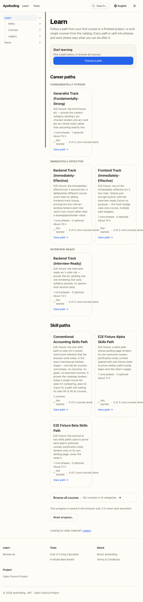
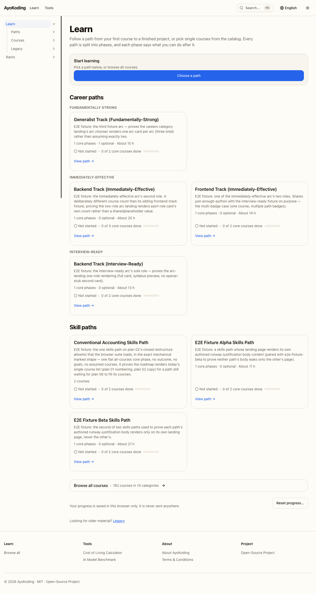

- `html[lang="en"]` at all three widths.
- Two-sentence intro: _"Follow a path from your first course to a finished project, or pick single
  courses from the catalog. Every path is split into phases, and each phase says what you can do
  after it."_
- "Start learning" card with "Choose a path" button (fresh reader); "Career paths" grouped by arc —
  FUNDAMENTALLY STRONG / IMMEDIATELY-EFFECTIVE / INTERVIEW-READY (3 card groups, 4 tracks);
  "Skill paths" (3 cards); "Browse all courses · 182 courses in 14 categories"; "Your progress is
  saved in this browser only…" + "Reset progress…" + Legacy line.
- No horizontal scroll at 375 (scrollBody−clientWidth = 0, measured on `html` and `body`).

## 3 · Roadmap — `/en/learn/paths/careers/fundamentally-strong/generalist-track` (375, 768, 1280) — **PASS**

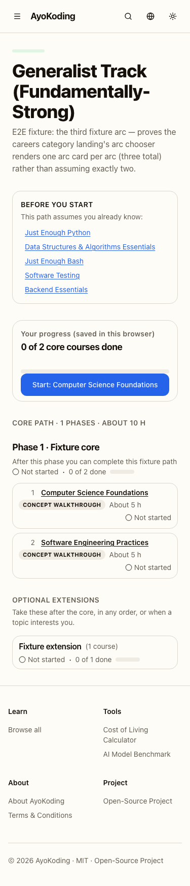
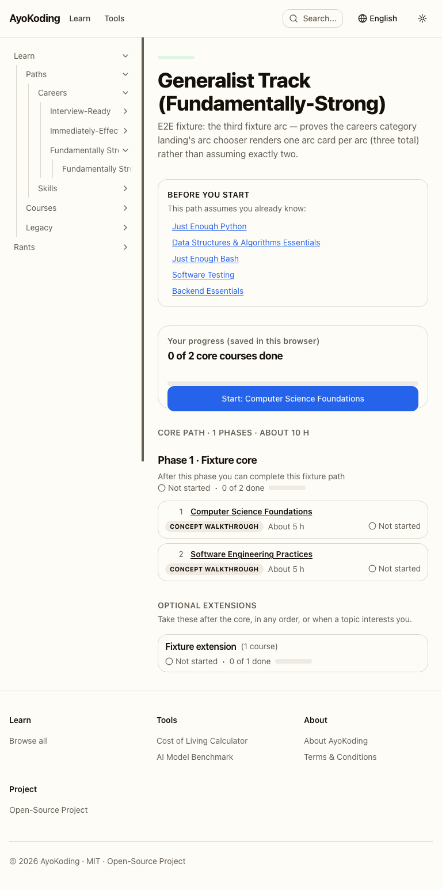
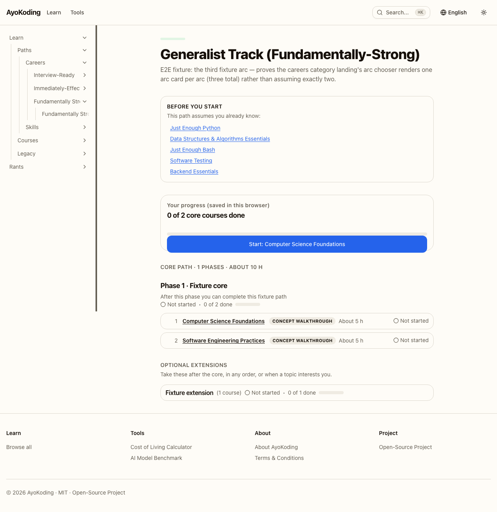

- Progress card: _"Your progress (saved in this browser) — 0 of 2 core courses done"_ with the blue
  **"Start: Computer Science Foundations"** button.
- Core phases as a timeline: `section#phase-fixture-core` with **"Phase 1 · Fixture core"**, outcome
  sentence _"After this phase you can complete this fixture path"_, phase progress
  ("Not started · 0 of 2 done"), and numbered course cards (1, 2) with title, format badge
  (CONCEPT WALKTHROUGH), "About 5 h", and status in words ("Not started").
- "OPTIONAL EXTENSIONS" heading + note with the extension phase rendered as a **closed
  `<details>`** ("Fixture extension (1 course) · Not started · 0 of 1 done") at all widths; open
  state verified absent (no `open` attribute).
- No horizontal scroll at 375.

## 4 · Lesson page (375, 768, 1280) — **PASS**


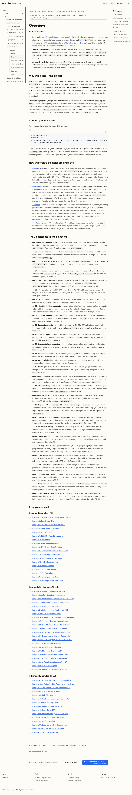
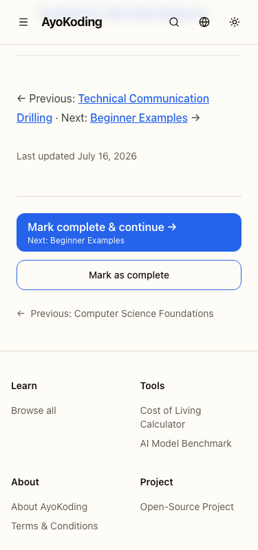
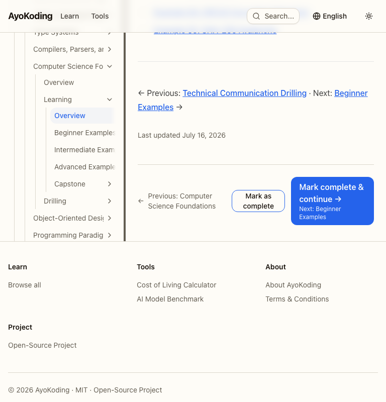
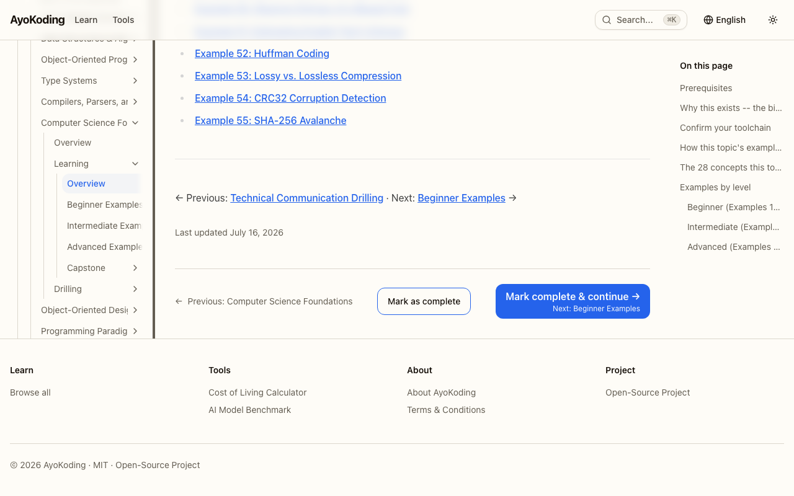

Flow: roadmap **"Start:"** → course landing `…/courses/computer-science-foundations?path=…`
(`?path=` kept) → **"Start course"** → first lesson page
`…/computer-science-foundations/learning/overview?path=careers/fundamentally-strong/generalist-track`
(`?path=` kept — verified by direct URL trace after the click).

- Context bar present: path › phase ("Generalist Track (Fundamentally-Strong)", "Phase 1 · Fixture
  core" links) › "Course 1 of 3"; second line "Page 1 of 6"; counts followed each click.
- **"Mark as complete"** toggles on: `aria-pressed` false→true, label → "Completed".
- Clicking again **un-checks**: `aria-pressed` true→false, label → "Mark as complete".
- **"Mark complete & continue"** marks the page and opens the next page — URL
  `…/learning/…?path=careers/fundamentally-strong/generalist-track`, page shows "Page 2 of 6" with
  `?path=` intact.

## 5 · Course header (375, 768, 1280) — **PASS**

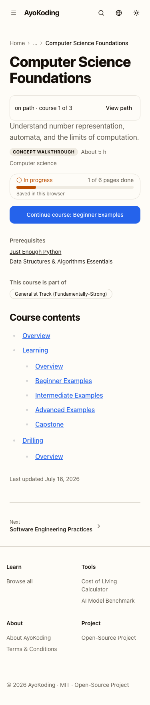


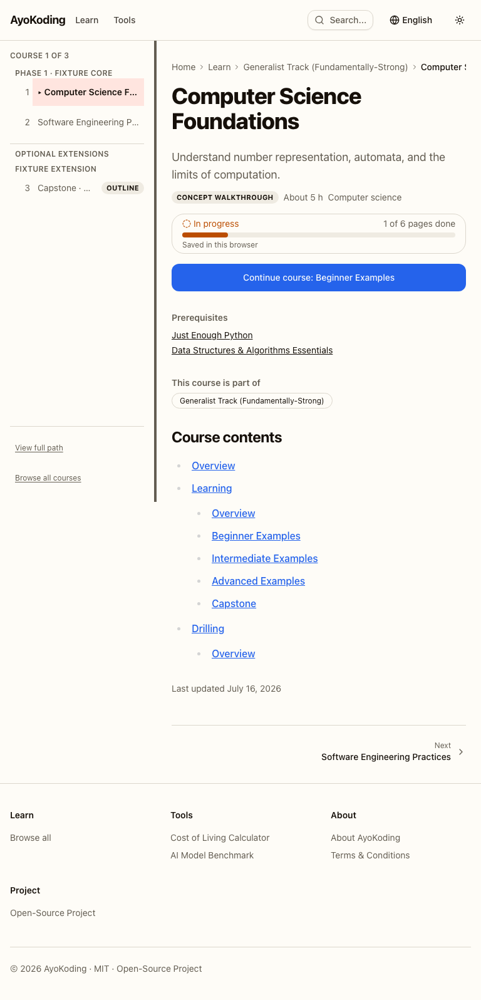
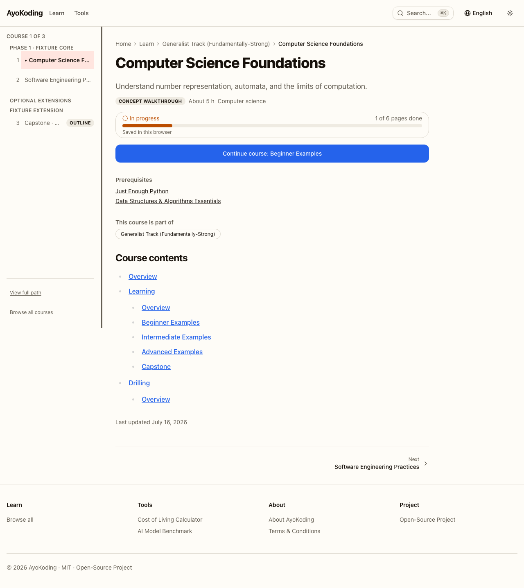

Back on the course landing after one page completed: light progress box **"In progress · 1 of 6
pages done"** (amber bar) + "Saved in this browser", and the blue **"Continue course: Beginner
Examples"** button — at every width. Fresh state (first two screenshots) shows "Start course".

## 6 · Returning reader (1280) — **PASS**

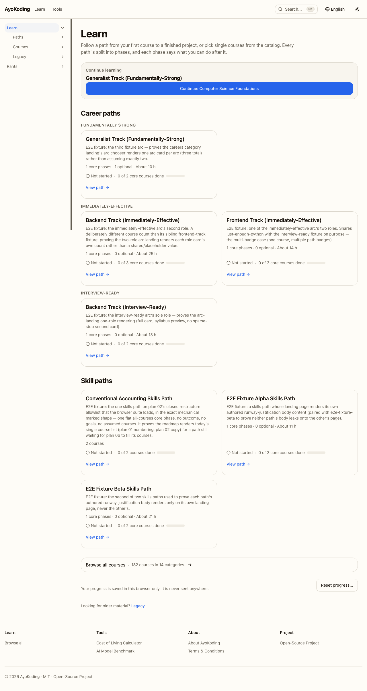


- `/en/learn`: **"Continue learning"** card naming **Generalist Track (Fundamentally-Strong)** with
  **"Continue: Computer Science Foundations"**.
- Roadmap: progress-card button reads **"Continue: Computer Science Foundations"**; the first
  course row (course 1 in Phase 1) shows **"In progress"**. Note: the phase's own count line reads
  "Not started · 0 of 2 done" because the phase status counts _complete_ courses (`PhaseProgress`
  derives from `phaseProgress(done)` — 0 done); the mockup's "In progress · 3 of 4 done" depicts a
  state with completed courses, so the visible behaviour is consistent with the derivation rules —
  recorded as an observation, not a defect.

## 7 · Reset (375) — **PASS**

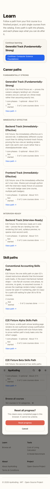
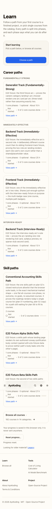

- "Reset progress…" opened the dialog; **Cancel held the initial focus** inside it; after Cancel the
  dialog closed and `document.activeElement` was the trigger (`data-progress-control="reset-trigger"`).
- Second open → "Reset progress" (Confirm) → all counts at zero ("0 of 2 core courses done",
  "Not started" ×7), card reverted to "Start learning", and the "Progress reset." status line
  announced the reset.

## 8 · Redirects — **PASS** (all four recorded)

```
/en/learn/overview              → 308 http://localhost:3101/en/learn
/en/learn                       → 200
/en/learn/overview-does-not-exist → 404
/id/learn                       → 404
```

## 9 · Indonesian regression (375, 768, 1280) — **PASS**

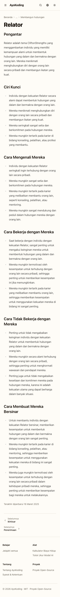
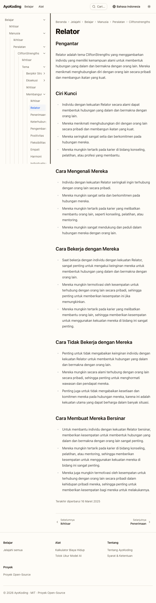
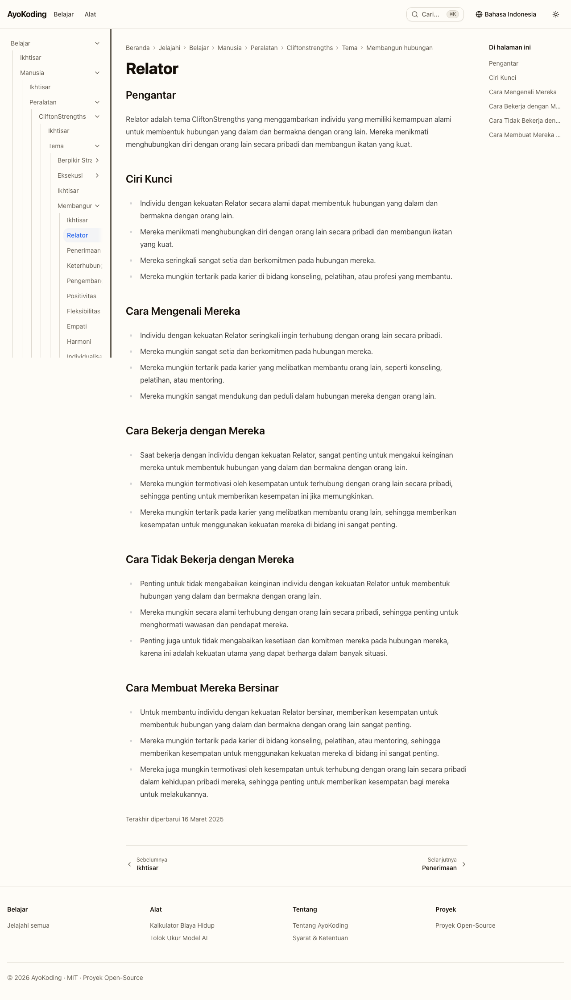
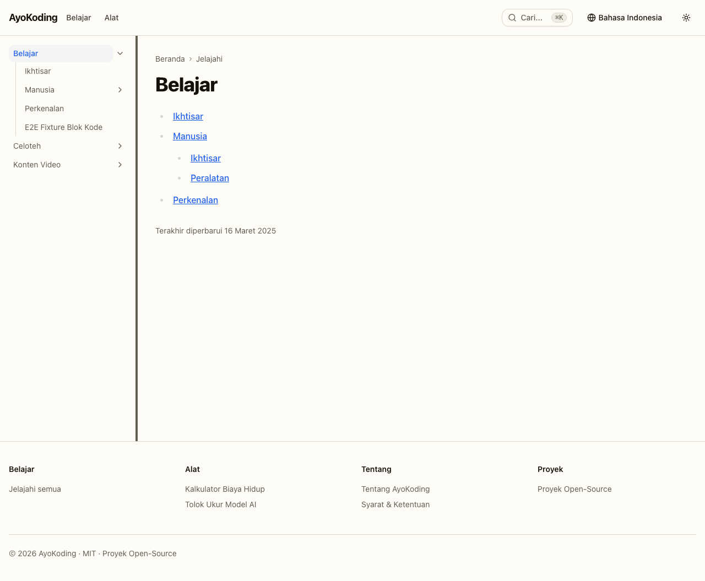

- `/id/belajar/manusia/peralatan/cliftonstrengths/tema/membangun-hubungan/relator`: `html[lang="id"]`
  at all widths; content renders as before (Relator tema page, Indonesian nav, "Terakhir diperbarui…").
- No new English UI strings: none of "Mark as complete", "Mark complete & continue", "Continue
  learning", "Start learning", "pages done", "Browse all courses", "Saved in this browser",
  "Optional extensions" present.
- No progress UI: zero `[data-progress-slot]` / `[data-progress-control]` elements.
- `/id/belajar` root at 1280: legacy sidebar unchanged (Belajar › Ikhtisar, Manusia, Perkenalan,
  E2E Fixture Blok Kode; Celoteh; Konten Video) — no new Learn-site entries.

## 10 · Console — **PASS — zero errors**

Across both passes (22 page loads: learn home ×3, roadmap ×3, lesson flow ×3 bps with landing →
lesson → next page → course landing, returning-reader ×2, reset ×3, ID pages ×4) and every
"console errors" probe: **0 `console.error` and 0 `pageerror` events.** No hydration warnings.

## 11 · Production sign-off — **PASS**

This run already used the production standalone build; the selected mockups are prd.md
Screen 1 Option A (milestone timeline), Screen 2 Option A (context bar + bottom action row),
Screen 3 Option A (stacked landing), Screen 4 Option A (progress line).

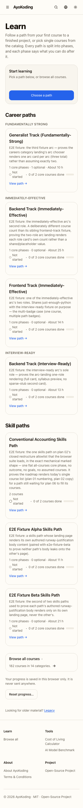


Compared against the mockups: learn home = Screen 3 Option A (heading, intro sentence order,
Start-learning card, arc groupings, Skill paths, Browse-all card, saved-in-browser + Reset +
Legacy); roadmap = Screen 1 Option A (progress card with Start/Continue button, milestone phase
sections with outcome + count + bar, numbered course rows with format badge, hours, status words;
"Optional extensions" as closed sections; no horizontal-scroll at 375); lesson = Screen 2 Option A
(light context bar with blue path/phase/course links, second line with "Page p of P", bottom row
with Previous, the toggle, the blue "Mark complete & continue" button with "Next: <title>" beneath
— full-width stacked controls at 375); course header = Screen 4 Option A (description, format
badge, hours, light progress box with amber bar and "Saved in this browser", blue
"Continue course: <page>" button, plan-03 prerequisites/course contents below). **They match.**

## Defects

**None.** Two harness-side notes (not app defects): (a) Chromium `innerText` returns CSS-uppercased
text, so heading searches for "Optional extensions"/"Core path" must be case-folded — the headings
render correctly; (b) one instrumentation read caught a mid-animation URL lacking `?path=` after
"Start course"; a direct URL trace settled 300 ms later shows the final URL keeps `?path=`.
One design observation for the coordinator: with a course visited but 0 pages done, the roadmap
course row reads "In progress" while its phase's count line reads "Not started · 0 of N done"
(see item 6) — `PhaseProgress`'s done-course derivation works as documented.
