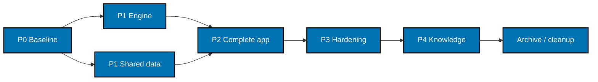

# Delivery Checklist

Executor legend: `[AI]` is an autonomous repository agent; `[HUMAN]` is a user action. Every code or
declarative configuration edit is dispatched to the appropriate `swe-*` agent. The root coordinates
and records proof; it does not implement code. All boxes describe future implementation and remain
unchecked during backlog authoring. `plan-quality-gate: PASS (3 cycles, 0 open findings)`.

## Worktree

Worktree path: `worktrees/ayokoding-app-web/`.

The authoring worktree was supplied with the user's session and adopted before plan authoring.
Its branch reflog records creation from HEAD at `2026-10-25T19:02:55+08:00`; the authoring baseline is
`88d4f0b36156b6efb10c03e532a646cea65f81b1`. The agent did not create it and does not invent the
original actor's identity.

### Historical Authoring Worktree Identity

- Declared repository-relative route: `worktrees/ayokoding-app-web/`.
- Initial branch: `ayokoding-app-web`.
- Created by: user-provided pre-existing session worktree; original actor not recorded in Git.
- Created at: `2026-10-25T19:02:55+08:00`, from the branch-creation reflog.

### Provisioned Worktree Identity

- Declared repository-relative route: `worktrees/ayokoding-app-web/`.
- Initial execution branch: `ayokoding-app-web-base`.
- Created by: Codex execution coordinator under the user's plan-execution request.
- Created at: `2026-10-26T00:12:13Z`, corroborated by the branch-creation reflog.
- Base: `bafba8b77f634cca89a5967f142767b81d743248`, after promotion PR #739 merged.
- Provisioning proof: guarded `git worktree add -b ayokoding-app-web-base
worktrees/ayokoding-app-web origin/main` exited zero. Only the missing historical plan
  registration was removed non-force before provisioning; unrelated registrations were retained.

### Delivery Branch Inventory

| Branch                      | Mode           | Lifecycle state                       | Proof                                                                                                                                                                                                         |
| --------------------------- | -------------- | ------------------------------------- | ------------------------------------------------------------------------------------------------------------------------------------------------------------------------------------------------------------- |
| `ayokoding-app-web`         | worktree-to-pr | delivered; historical branch retained | Authoring PR #738 merged reviewed head `ad2f4d647aa11a2829cab06ad8c10aab44423822`; original actor's branch is preserved.                                                                                      |
| `promote-ayokoding-app-web` | worktree-to-pr | delivered; cleaned                    | Pure promotion PR #739 merged reviewed head `f2e4acfa572c6dcb1da85935ea06ae691bdcdb6f` as `bafba8b77f634cca89a5967f142767b81d743248`; GitHub auto-deletion event and ordinary local branch deletion verified. |
| `ayokoding-app-web-base`    | worktree-to-pr | active                                | Execution identity above; provisioned from the promoted trunk.                                                                                                                                                |

Append every delivery branch before use and record the merged PR plus reviewed 40-character head
SHA. Resolve the worktree route against the selected repository at runtime and reconcile with
`rtk git worktree list --porcelain`; no host-specific path belongs in this tracked plan. If the
worktree has already been cleaned before execution, the workflow's Step 0 re-provisions the same
declared route and records the new branch inventory before implementation. Use only one worktree
for this repository across all units.

## User-requested pause and draft checkpoint (2026-10-26)

The user explicitly stopped execution and requested that all changes and progress be preserved
in the worktree's `local-tmp/` and this checklist, with a draft PR. This is a WIP checkpoint
requested by the user while Phase 0 is incomplete, overriding the usual no-Phase-0-PR behavior
for this checkpoint only. It is not a Phase 0 gate, implementation delivery, or permission to merge.

Verified checklist progress is **7/86 actions (8.14% by item count)**. All 86 actions are `[AI]`;
there is no planned human gate. Phases 1–4 and the Phoenix implementation have not started.

- Bootstrap and Doctor passed; source inventory and the current 497-identity disposition ledger
  are recorded under `evidence/P0/`. Native source/license/prerequisite inspection is complete.
- The calculator lifecycle repair passed the original full quick checkpoint: 248 files,
  4,180 tests, 99.54% lines against the unchanged 99% floor. This predates later semantic repairs.
- The local build-worker control has assertion RED and focused GREEN (45/45), accepted source
  review, and static coverage for all 497 current identities. The original Integration target
  still needs a complete cache-free one-worker run; prior storage/memory stops ran no Integration tests.
- Calculator semantic and runtime repairs preserve all 129 identities and 387 layer obligations.
  Focused calculator proof is 527/527 with zero errors; the localized Lifestyle regression has
  RED 15/17 then GREEN 17/17. Independent delta review has zero actionable findings. Current
  full quick, all required browser E2E, Integration and screenshot/reference proof remain pending.
- Playwright 1.62.1 with playwright-bdd 9.2.0 is the screened candidate for Ubuntu 26.04.
  Only the two AyoKoding E2E manifests were edited. Installation never started: the corrected
  request stayed queued and was cancelled on the user's stop, session `62759`, exit `130`.
  The root lockfile and installed dependencies remain unchanged. These manifest pins are WIP:
  normal lock generation, physical CLI/test/core/BDD resolution, resolved-tree security audit,
  generation/compatibility proof, and all three browser installs/launches remain unverified.

There is no owned live install, test, build, or service to resume or restart. Peer work is preserved.
The plan worktree and branch `ayokoding-app-web-base` remain in place. Complete tracked and
untracked changes, SHA-256 inventory, execution-state copies, review packets, and resumption
instructions are preserved locally under
`local-tmp/plan/ayokoding-app-web/stop-2026-10-26/`. Its `handoff.md` records the draft PR URL
and exact published head after creation. Local logs and snapshots are ignored and are not PR content.

On an explicit resume, reconcile current `origin/main`, the touch ledger and active user decisions;
then complete the supported Playwright dependency/lock repair and every remaining P0 gate before
starting P1. Use the approved per-command HIPPO configuration. The standing congestion exception
in `origin/main` commit `98ce02f412f9eb8900052905a8bc84773cb7d0ef` applies to eligible Git hooks
only, with its manual screens, commit-message validation, fresh leak review and operation-specific
receipts; it does not waive install/build/test admission. No timeout, retry, heap, resource floor,
scenario, assertion, content or dataset weakening is authorized.

## Delivery Mode: worktree-to-pr

Integration target is `main`. The normal `[AI]` merge authority applies only after explicit Git
delivery authorization and hardened prerequisites; this plan's authoring does not authorize
staging, committing, pushing, or merging. No deployment branch is created or modified. Each
authorized PR needs exact-current-head/base `pr-quality-gate.yml`, a fresh-context clean
`leak-reviewer` verdict for its push/merge head, and applicable finite UI/API gates. Broad semantic
PR review runs only if requested.

The user's execution request explicitly authorizes the necessary staging, commits, pushes and
merges to deliver all phases to `origin/main`. This execution authority follows the same hardened
prerequisites; it does not authorize deployment.

## Parallelization Model

N = 3 background agents plus one coordinator. This plan has no external plan dependency. Live
course plans are independent producers of merged shared sources, never blocked nodes in this DAG.



Engine and dataset implementation may proceed concurrently after P0 while they write distinct
files. Their shared root inventories, lockfile, docs, and Git actions serialize under the
coordinator. Inside P2, content/navigation, course/progress, and tools packets can fan out after
the shell/contracts exist; the third lane may finish tests while the coordinator integrates.
Shared renderer/router/test-helper/config files have one named writer and dependent consumers.

Every compile/test/build/process enters HIPPO with its declared complete reservation; independent
work overlaps only if admitted. Use `transactional/standard` for dependency or shared-output edits,
`ephemeral/standard` for Unit/static/type/lint work, `ephemeral/heavy` for full corpus/build/browser
suites, and `service/standard` for servers. Never overlap work that reads another node's incomplete
output. A phase gate blocks its dependent nodes, not unrelated work.

The imported engine, the compatible shared-data extraction, and the complete local application
are natural delivery units. Keep P2 together until its entire canonical corpus has real bindings
and all runtime suites pass; do not merge unfinished scaffolding, prune future scenarios to make
coverage green, or register a target before its referent exists. Cleanup is terminal and depends
on delivered-head verification for every unit; follow
[Dev Artifact Clean-Up](../../../repo-governance/workflows/maintenance/dev-artifact-clean-up.md).

## Evidence and execution contract

Outcome sections reference [PRD acceptance criteria](./prd.md#acceptance-criteria). For every TDD
packet, preserve a failing assertion, then passing focused proof with executed test identities and
positive counts. A missing dependency/compiler error is not RED proof. Establish a compilable
interface first when necessary. Do not retry, sleep, skip, quarantine, loosen assertions, or widen
timeouts to conceal a defect. Fix failures at their owning boundary, including pre-existing
failures found by the required gates.

Ignored execution logs live under `local-tmp/plan/ayokoding-app-web/`; sanitized final accepted
evidence lives under the executing plan's `evidence/`. Each `P1E`, `P1D`, or `P2-*` outcome below
has an evidence prefix of the same name. The node's command output, scenario identities, source
revision, and failure/repair result go there. Gherkin remains canonical in specs; do not maintain
a competing full scenario copy in this checklist.

## Phase 0: Environment, Shared-Source Baseline, and Ownership

**Input:** approved PRD, matching worktree, no inter-plan predecessors. **Outcome:** reproducible
baseline and exact source/scenario ownership. **Proof:** baseline logs and a complete scenario
disposition ledger before production code changes.

- [x] [AI] Read current `AGENTS.md`, the repository adapter, worktree setup, and this plan. Compare
      `rtk git status --short`, branch/worktree list, and the touch ledger; retain foreign work.
      Reconcile active user decisions before resuming and fail the affected packet on conflict.

  **Implementation notes (2026-10-26):** Completed. Read current instructions, adapter,
  worktree setup and full approved plan; reconciled a clean new worktree at
  `bafba8b77f634cca89a5967f142767b81d743248` and the action/touch ledger. Preserved foreign
  worktrees and the historical authoring branch. Active user decisions remain full execution,
  one plan worktree, delivery to `origin/main`, and progress updates. No conflict remains.
  Files changed: this checklist and baseline evidence; ignored coordination state is under
  `local-tmp/plan/ayokoding-app-web/`.

- [x] [AI] Before any guarded command, locate and use the documented operator-approved host policy
      through `HIPPO_CONFIG` or the correct `--config <approved-policy>` option. If HIPPO rejects
      admission because its default exclusive mode conflicts with an existing reservation-mode
      marker, inspect the effective configuration and the documented host policy before continuing.
      An explicit `--config` overrides `HIPPO_CONFIG`; do not add a generic example config to a
      command when it would displace the approved host policy. Use `hippo.local.json.example` only
      when it is documented as approved for the actual host. Confirm admission with that policy.
      Never retry an unchanged rejection, lower resource floors, delete coordination state, or
      terminate peer work. Keep host paths and machine bounds in ignored local handoff notes only.
      Follow
      [consumer configuration and evidence](../../../repo-governance/development/practice/resource-aware-development/consumer-integrity-state-and-evidence.md)
      and the [development setup guidance](../../../docs/how-to/setup-development-environment.md).

  **Implementation notes (2026-10-26):** Completed. Selected the documented operator-approved
  machine policy through `HIPPO_CONFIG` before guarded work; the transactional install was
  admitted and exited zero. No example-policy override, resource-floor change, shared-state
  deletion or peer termination occurred. The scanner's temporary-filesystem quota was diagnosed
  and corrected with task-owned temporary staging on the repository filesystem; checks remain
  unchanged. Host-specific configuration and errno diagnostics remain in ignored handoff notes.
  Files changed: this checklist and baseline evidence under the plan; ignored diagnostics are
  under `local-tmp/plan/ayokoding-app-web/`.

- [x] [AI] Run the mandatory worktree bootstrap from the root:
      `rtk ./hippo run --class transactional --resource-tier standard --disk-path . -- npm install`,
      then `rtk npm run doctor`. Only on reported toolchain drift run the documented transactional
      `./rhino toolchain provision --apply`, then doctor again. Save baseline exit codes; do not
      change Git identity or production/staging environment files.

  **Implementation notes (2026-10-26):** Completed at the new worktree root. Guarded
  `npm install` exited zero with 1,539 packages and Husky `prepare`. Doctor initially reported
  three unavailable tools; the documented drift-only provisioner exited zero with no provision
  vectors. Diagnosis proved all three pinned tools were installed but absent from Bash's PATH.
  Correcting only the command environment produced Doctor exit zero: 24 declared toolchains,
  no findings. No tool installation, repository configuration, Git identity or protected
  environment-file change was needed. Files changed: this checklist and
  `evidence/P0/readiness.md`; exact commands and session results remain in ignored runtime notes.

- [x] [AI] Record the latest merged `origin/main` SHA, current nine-plan statuses, shared content,
      manifest schemas, redirect module order, tool codecs, public assets, and existing config.
      Use the bounded inventory in [001](./tech-docs/001-baseline-and-parity.md); consume no unmerged
      sibling-worktree output. Move the plan to `plans/in-progress/ayokoding-app-web/` only when
      execution actually begins; update both stage indexes and the plan-order DAG in that unit.

  **Implementation notes (2026-10-26):** Completed. Recorded the remote-confirmed merged
  revision `bafba8b77f634cca89a5967f142767b81d743248`, all nine related plan states,
  3,275 English and 125 Indonesian Markdown sources, eight path manifests and their current
  schemas, exact redirect order, tool-codec locations, public assets and existing app/test
  configuration. Consumed no unmerged sibling output. The pure lifecycle move, indexes and DAG
  had already landed independently in promotion PR #739 before setup. Files changed:
  `evidence/P0/current-source-inventory.md` and this checklist.

- [x] [AI] Enumerate and expand the current old-app Gherkin corpus using the existing Cucumber
      parser; record every source scenario/example and its new destination/layer disposition as
      required by 001. Include all current course-path and tool cases. Unmapped user behavior
      blocks its packet; framework-only exclusions need their concrete replacement proof.

  **Implementation notes (2026-10-26):** Completed the baseline mapping, with future runtime
  proof explicitly pending. The existing Cucumber parser expanded all 63 feature files into
  487 identities, including 68 Examples rows, with zero parse/shape errors. The 487-row ledger
  records source lines, examples, revision, exact destination title/feature and layer owners:
  464 adapted, 21 retained at existing owners, two implementation-only dispositions with
  explicit replacement/retained proof. Missing exact destinations are marked `ADD-REQUIRED P2`.
  Root review corrected inherited exemptions and browser/native ownership; all rows have
  destinations and the table validates as eight columns and identities 1–487. Files changed:
  `evidence/P0/scenario-dispositions.md` and this checklist. Raw parser metadata remains in
  ignored runtime evidence. These mappings do not claim implemented or passing behavior.

  **Overlay reconciliation (2026-10-26):** The reviewed build-worker repair adds ten retained
  Next.js-only identities. The evidence ledger preserves all original 487 rows and appends
  stable IDs `BW-SUP-01` through `BW-SUP-10`, pinned to the accepted feature hash. The current
  corpus is 497 identities: 464 adapted, 31 retained, two implementation-only. Each added row
  names its exact Unit alternative for the independently justified Integration/E2E exemptions;
  focused Unit proof is 45/45 and all four static adapters pass. Phoenix proof remains pending.

- [ ] [AI] Read both existing app E2E project configurations. Run the old owner's baseline with
      `rtk ./hippo run --class ephemeral --resource-tier heavy --disk-path . -- npm exec nx -- run ayokoding-www:test:quick`
      and its `test:integration` target with the same guard. Record failures and root causes;
      resolve any baseline that would invalidate subsequent parity evidence before proceeding.

- [ ] [AI] Resolve plan-local Integration build storage and memory pressure without changing resource
      floors or omitting dependencies/tests. Attribute owned output/cache bytes, remove only
      verified unpublished partial artifacts, and prove the original full target can run with
      documented cache controls. Retain diagnostic logs and all source/shared caches.

  **Discovery (2026-10-26):** Integration run 85728 generated all 3,278 pages, then HIPPO
  stopped it with exit 124 before test results while Nx copied the completed build into cache.
  The worktree build used about 17.28 GiB; a verified unpublished partial cache duplicated
  about 11.77 GiB. Source bytes and all resource floors remain unchanged. The documented
  `--skip-nx-cache` flag preserves the full four-node dependency graph and disables cache
  reads/writes. Bounded cleanup recovered 12.64 GB without deleting source or other caches.
  The subsequent full cache-free run hit memory-PSI shedding at static-worker startup, with no
  OOM kill. An app-prefixed one-worker override is being added through the existing build-worker
  contract, with default two and hosted behavior preserved, Gherkin/Unit proof and cache inputs.
  All pages and dependency tasks remain required; full-target confirmation is pending.

- [ ] [AI] Resolve the frozen calculator scenario-trace findings without reducing scenario,
      layer or assertion scope. Revalidate all 57 consolidated findings against their exact
      Unit/E2E contracts, repair each confirmed gap with independent observations, reconcile
      contradictory canonical descriptions to existing accessible behavior, and rerun
      required focused/full proof plus independent semantic review. Record every finding's
      resolution; a runtime green result alone does not close semantic gaps.

  **Discovery (2026-10-26):** The frozen 387-row review retains all 129 calculator identities:
  52 Unit and 33 E2E rows lack substantive outcome proof, invalidating 33 Integration alternative
  proofs. There are 57 consolidated pre-existing findings (25 HIGH, 32 MEDIUM). The reviewed
  sources did not drift. The detailed frozen ledger and refutations remain in ignored
  `local-tmp/gherkin-implementation-review/`; accepted final evidence must accompany delivery.

  **Execution clarifications (2026-10-26):** Criticality and confidence are separate; all
  findings have HIGH repair confidence after revalidation. Preserve the later accepted
  active-tab description visibility and valid radio checked-state semantics. The later
  minimum-role locale scenario explicitly places city and country together in the City cell;
  preserve that existing representation while proving both identities on all three tabs and
  strict adjacent Country/City columns on Cost/Savings. The original cost-breakdown adjacency
  contract remains unchanged. Early snapshot review found an ambiguous input locator and weak
  Unit visibility proof; both require repair and final verification. No runtime gate is closed.

- [x] [AI] Resolve the pre-existing calculator Unit-worker heap exhaustion found by the
      Phase 0 baseline. Diagnose the owning lifecycle or resource boundary, retain regression
      proof and all existing scenarios/assertions/coverage, and verify focused proof before
      rerunning the required quick baseline. Do not widen timeouts, retry failing tests,
      suppress checks, or raise process limits without evidence of the complete resource need.

  **Discovery (2026-10-26):** The old quick baseline exited one after 548.09 seconds:
  246/247 files and 3,970/4,177 tests passed before the calculator frontend step worker
  exhausted Node's heap. The run emitted 99.09% overall line coverage but is not accepted
  because its worker failed. Integration has no completed proof; a prematurely started owned
  invocation was cancelled before build/tests, with no shared-content diff. This repair is
  required before the original baseline action can complete.

  **Implementation notes (2026-10-26):** Completed. Replaced collection-retained input drivers
  with independent lazy sessions released by the existing scenario teardown, and re-queried
  captured DOM elements at their observation steps. Three lifecycle regressions demonstrated
  assertion-based RED then GREEN. Typecheck, focused lint and formatting passed. Independent
  static review read ten files with zero findings and unchanged reviewed hashes. All 526
  calculator step tests then completed under coverage without worker errors; the focused
  command's whole-app threshold failure was retained honestly as diagnostic-only evidence.
  The original unmodified full quick target subsequently exited zero: 248/248 files,
  4,180/4,180 tests, 99.54% line coverage against the unchanged 99% floor, and all static
  adapters passed for 63 features and 487 expanded scenarios. No heap, timeout, coverage,
  scenario, assertion, dataset or content limit was changed. Files changed:
  `apps/ayokoding-www/tests/unit/fe-steps/cost-of-living-calculator.steps.tsx`, its new
  `helpers/scenario-user.ts`, `tests/unit/features/scenario-user.test.tsx`, and this checklist.
  Sanitized baseline evidence is under `evidence/P0/`; detailed logs/review remain in ignored
  `local-tmp/swe-debugger/` and `local-tmp/swe-reviewer/`.

- [ ] [AI] Resolve the detected Playwright/Ubuntu platform incompatibility through the documented
      dependency-bump workflow and fitting SWE repin role. Select an eligible supported stable
      release with published integrity, date, security and functional clearance; verify a coherent
      CLI/test/BDD runtime. Expand manifest scope only when actual shared resolution requires it.
      Route necessary compatibility source changes to the developer and retain all scenarios,
      assertions, browser projects and required affected-owner proof. Do not substitute a host
      override, suppressed validation, forced peers or hand-edited lock integrity.

  **Discovery (2026-10-26):** The guarded install under the verified existing Playwright 1.60.0
  exited one because it does not support `ubuntu26.04-x64`. No browser was installed or smoke
  launched; old cached browsers remain intact. A compatible version is an implementation choice
  within setup scope, subject to the repository's release-age/security policy and real BDD
  compatibility. No new dependency pin is selected or applied by this discovery.

- [ ] [AI] Install the browser revisions required by the locked Playwright package through the
      documented guarded setup path before reference screenshots or E2E proof. Verify Chromium,
      Firefox and WebKit can launch with their required OS dependencies; retain existing unrelated
      browser installations and record the exact package/revision and attributable results.

  **Discovery (2026-10-26):** Installed Playwright 1.60.0 requires Chromium revision 1223,
  Firefox 1522 and WebKit 2287. Read-only cache inspection found only Chromium/headless-shell
  revision 1248, which cannot substitute for the locked binaries. No browser installation or
  launch proof has run. The initial attempt changed no package pins or product behavior; the
  separate supported-tooling repair above now precedes installation and launch proof.

- [ ] [AI] Verify the configured listener inventory in `docs/reference/web-sites.md`. Reserve
      3102/3191 for the new app/test server and retain 3101. A busy listener fails clearly; do not
      kill or reuse another process. Capture existing feature reference screenshots in both
      locales at 375/768/1280 px as described in PRD; own only the server processes started here.
- [x] [AI] Inspect the source library at the exact BeaverNest commit, using its Git tracked-file
      list and notices. Verify the subtree/commit before copying. Record compatible Phoenix 1.8,
      LiveView 1.2, Elixir 1.18+, OTP, MDEx/YAML, Node, and browser dependency requirements from actual
      manifests and cited sources; resolve/lock exact patches during P1/P2. Validate MDEx's native
      NIF or documented build prerequisites on the actual host instead of assuming a Rust setup.

  **Implementation notes (2026-10-26):** Completed the independent source/requirements
  inspection. Verified the pinned BeaverNest subtree's 215 tracked paths and complete MIT/CCK
  notice chain. Recorded compatible library/runtime requirements from versioned manifests and
  cited sources, plus exact existing Node and browser-tooling pins. Actual host metadata and
  successful Doctor 6256 establish the documented native build-prerequisite alternative; no
  NIF fetch, compile or load is claimed. Exact dependency locking and native smoke proof remain
  with P1/P2. The incompatible/missing locked browser binaries are recorded as a separate
  unchecked setup repair before screenshots/E2E. Files changed:
  `evidence/P0/native-prerequisites.md`, the evidence index in `README.md`, and this checklist.

### Phase 0 Gate

- [ ] [AI] Confirm baseline commands have attributable results, every old scenario/example has a
      disposition row, all source paths were discovered, and no content plan became a dependency.
- [ ] [AI] Confirm `rtk git status --short` agrees with the touch ledger and the current baseline
      revision is recorded. No source corpus, secret, or old-app listener was overwritten.

> **Pause Safety:** Existing-app baseline repairs and setup evidence are recorded with their
> verification state. Resume by reconciling the repair findings, source revision and disposition
> ledger, then running `rtk npm run doctor` before the next admitted setup/phase gate. Preserve
> pending proof rather than inferring success from a source edit.

## Phase 1: Imported BDD Engine and Compatible Shared Data

### P1E — AC-11: Import and integrate the BDD engine

**Input:** verified source snapshot, library specs, and current coverage script. **Outcome:**
licensed reusable ExBdd with native static verification and real Unit coverage. **Proof:** library
Unit/Integration/engine coverage, validator regressions, and provenance diff.

- [ ] [AI] Copy the exact tracked library subtree into `libs/ex-bdd` as specified in 003. Compare
      retained source/license/fixtures against the chosen commit before adaptations. Append the
      execution date, local-delta list, and refresh procedure to `UPSTREAM.md`; preserve the old
      upstream chain and CCK notices. Save the import comparison under `P1E` evidence.
- [ ] [AI] **RED:** Under `scripts/behaviour-coverage.test.mjs`, add failing cases for `.ex/.exs`
      native dispatch, failed/empty verification, expanded outline identities, missing/ambiguous/
      unused bindings, mixed Unit ownership, exemptions, and real Mix 99% coverage-floor detection.
      Run `rtk npm run test:validators`; preserve named failing assertions, not missing imports.
- [ ] [AI] **GREEN:** Extend the existing coverage config/dispatcher and add the recorded
      `libs/ex-bdd/lib/mix/tasks/ex_bdd.verify.ex` adaptation from 003. Use ExBdd discovery/verifier,
      not a JavaScript Elixir parser; static verification starts no app and executes no scenarios.
      Rerun `rtk npm run test:validators`; all new and existing validator cases pass.
- [ ] [AI] **REFACTOR:** Consolidate native scope selection between compilation and verification,
      test fail-closed argument-vector dispatch and no-shell execution, then rerun the same
      validator command. Preserve verification identities and avoid changing other languages.
- [ ] [AI] **RED:** Add `libs/ex-bdd/test/behaviour/` adapters and focused self-tests for the new
      canonical library specs, including attribution/import omissions. Run the imported library's
      exact Unit/Integration commands from its inspected `project.json` through HIPPO with cwd
      `libs/ex-bdd`; require a named assertion showing the intended missing adaptation.
- [ ] [AI] **GREEN:** Complete the consumer-neutral verifier task, specification adapters, and
      per-layer target configuration. Preserve imported source behavior and retry-capability tests;
      consumers remain retries0. Keep `test:coverage:engine` separate from static `test:coverage`.
      Run new `ex-bdd:test:quick`, `ex-bdd:test:integration`, and `ex-bdd:test:coverage:engine`
      through the guard classes in 003; Unit and full engine each enforce their real 99% contract.
- [ ] [AI] **REFACTOR:** Review imports, unused dependencies, warnings, support/production coverage
      denominators, and the local modifications record. Rerun those three targets; store positive
      test counts and coverage reports, not just a zero exit from a no-test selection.

### P1D — AC-08/09: Share tool datasets without changing old results

**Input:** current evaluated TypeScript datasets and URL/calculation functions. **Outcome:** one
neutral JSON data source with compatible old exports. **Proof:** old/new data equality, unchanged
reference blocks, and shared vectors for later Elixir parity.

- [ ] [AI] **RED:** Add characterization tests beside the existing tool Unit tests for evaluated
      exports, ordering, optional field absence, independent FX date, comment-only provenance,
      codec duplicates/defaults, and representative scoring/cost/savings/min-role results. Introduce
      expected JSON/vector imports as new artifacts; run the existing `ayokoding-www:test:unit`
      target through HIPPO and preserve failing assertions showing the missing shared-data adapter.
- [ ] [AI] **GREEN:** Create `libs/ayokoding-data` with the exact JSON/provenance/vector families in
      002/005. Export evaluated objects once; retain all dates, numbers, policies and source notes.
      Replace only the six bounded old data modules with typed adapters retaining their named
      exports. Add library data/provenance specs and in-memory Unit tests; no product service or
      Node-to-Elixir export daemon is introduced.
- [ ] [AI] **GREEN:** Register the data owner's meaningful Unit/static/quick targets and source
      inputs. Run `ayokoding-data:test:quick` and `ayokoding-www:test:unit` through HIPPO. Run the
      existing `ayokoding-www:validate-benchmark-reference` target; generated blocks must be
      unchanged. A data-value or provenance mismatch returns to extraction, not to an expectation
      update accepting different results.
- [ ] [AI] **REFACTOR:** Remove duplicated data declarations while preserving old public exports
      and importer paths. Rerun library quick, old app quick, old integration, and the existing
      frontend/backend E2E targets after inspecting their current runtime setup. Keep dataset source
      code and expected vectors independently reviewable; do not generate expectations from the
      same function under test.

### Repository-local rules and docs propagation for P1/P2

- [ ] [AI] Freeze the exact rule inputs in 005 with revision, strengths, scope, user decision,
      observed follow/violate conditions, and affected file families. This is an `ose-public`-only
      transaction; no obligation or change is recorded for BeaverNest or another sibling.
- [ ] [AI] Scan all repo-rule surfaces for conflicts with the new-backend F# default, library
      naming, BDD scopes/coverage, environment rules, target shape, and language-lane detection.
      Use existing sufficient rules unchanged; record each no-change decision and precedence.
- [ ] [AI] Place the explicit app-specific Elixir/Phoenix and test-tool decisions in repository
      adapter/adopter decisions; place the two named library naming exceptions in their narrow
      owner documents. Keep `repo-config.yml` project/stack inventory synchronized; do not copy
      BeaverNest governance or add broad rules unrelated to these projects.
- [ ] [AI] **RED:** Add affected-language detection tests in
      `scripts/workflow-language-lanes.test.mjs` proving a changed Elixir owner cannot be silently
      skipped or run in a Node-only lane. Run `rtk npm run test:validators` and save the assertion.
- [ ] [AI] **GREEN:** Add the minimal pinned Elixir setup and affected quality lane in
      `.github/workflows/pr-quality-gate.yml` and `.github/actions/setup-elixir/action.yml`; invoke
      the same local project gates. No deployment, environment branch, or hosted service setup.
      Rerun `rtk npm run test:validators`; all language lanes remain covered.
- [ ] [AI] **REFACTOR:** Reconcile the lane with HIPPO admission and project tags, remove redundant
      statements, and rerun validator tests. Assign each changed rule a covered/gated/unenforced
      disposition with an exact owner, then validate the affected rule surfaces.
- [ ] [AI] Update library/spec indexes, licensing notice, monorepo reference, and applicable
      project READMEs in the same coherent unit. Run Docs Propagation for these actual surfaces;
      update canonical instructions only if a changed contract requires it, then use pinned Rhino
      adapter generation/validation for any affected mirrors. Never edit a generated route by hand.
- [ ] [AI] Run the repository rules-quality-gate on the frozen rule transaction after deterministic
      verification; record every placement, supersession, relocation, enforcement result, and final
      transaction status. Return failures to their row owner; a generic workflow link is not proof.

### Phase 1 Gate

- [ ] [AI] Run the planned library targets and existing `rtk npm run test:validators` with the
      documented guards; all tests execute positive counts and actual coverage floors pass.
- [ ] [AI] Verify imported notices and copy provenance, old-app data/calculation/reference equality,
      no course/manifests edits, and complete same-unit docs/spec/rules changes. Land independent
      ready units only under explicit Git authorization and the delivery-boundary checklist below.

> **Pause Safety:** The imported library and compatible data extraction are complete, independently
> useful, and leave the existing app working. Resume by rerunning `ex-bdd:test:quick` and
> `ayokoding-data:test:quick` through the commands in 003.

## Phase 2: Complete the Local Phoenix Application

All paths and target names in this phase are **new artifacts**. The phase is one cohesive app
delivery unit with parallel TDD packets; the gate requires the entire corpus, not a partial scope.

### P2-Shell — AC-01/02: App and local launcher

**Input:** P1 engine/data and current visual references. **Outcome:** accessible bilingual Phoenix
runtime with isolated local/test configuration. **Proof:** launcher Unit tests, connected/disconnected
mounts, real browser shell, and simultaneous existing-app server.

- [ ] [AI] Generate `apps/ayokoding-web` with app `ayokoding`, module `AyoKoding`, and verified
      no-Ecto/no-mailer/no-dashboard options from 002. Record actual generated files, compatible
      locked dependencies, MDEx native prerequisites, and a working compiler before behavior REDs.
      Do not generate a second nested repository or overwrite root instructions.
- [ ] [AI] **RED:** Create `test/unit/local_config_test.exs` and shell/browser-helper Unit cases
      for flag>prefixed-env>3102, invalid override failure, generic PORT ignored, both locales,
      public-only socket context, and keyboard/theme behavior. Execute the focused Unit file with
      `rtk ./hippo run --class ephemeral --resource-tier standard --disk-path . --cwd apps/ayokoding-web -- env MIX_ENV=test mix test --no-start test/unit/local_config_test.exs`;
      browser helpers use the new Vitest Unit configuration. Save assertion failures.
- [ ] [AI] **GREEN:** Implement new `Mix.Tasks.Ayokoding.Serve` in
      `lib/mix/tasks/ayokoding.serve.ex`, accepting `--port` and test-only `--fixture parity|unavailable-catalog`.
      Start Phoenix using validated config; never pass an invented `--port` to `mix phx.server`.
      Route Nx `dev` and the owned test launcher through this task. Implement the preserved shell,
      locale, visual tokens, and socket context. Rerun focused Unit proof.
- [ ] [AI] **REFACTOR:** Keep parsing and configuration pure, isolate browser listeners, and reject
      fixture mode outside `MIX_ENV=test`. Rerun launcher/helper Unit files and Integration cases;
      no listener reuse or automatic source mutation is permitted.

### P2-Content — AC-03/04/05/10: Content, routes, search, discovery

**Input:** shell/context contracts, fixtures, and current source schemas. **Outcome:** readable
content and accurate navigation/search/discovery using read-only adapters. **Proof:** matching
canonical scenarios at all three applicable layers and initial-HTML/wire evidence.

- [ ] [AI] **RED:** Add `test/unit/{content,routes,search,discovery}_test.exs` with the full renderer
      fixture matrix, unsafe identity handling, draft/invalid metadata behavior, ordered redirects,
      first-value queries, title/body prefix matching, late-result protection, and discovery
      inclusion. Run each named file with the P2-Shell focused ExUnit command form; require
      assertion-based RED and independent expected output.
- [ ] [AI] **GREEN:** Implement `lib/ayokoding/{content,search}/`, read-only filesystem/static-asset
      adapters, snapshot/reload behavior, redirect plug and discovery controller from 002/004.
      Use MDEx HTML/AST and allowed HTML sanitization; preserve safe authored HTML, shortcodes,
      headings, relative links and code text, and never execute Markdown as HEEx. Add owned local
      fixture Integration and browser steps; rerun the focused Unit cases and relevant scenarios.
- [ ] [AI] **REFACTOR:** Separate pure parsing/tree/excerpt rules from I/O and HEEx. Verify
      concurrent readers see complete snapshots and a source-change notification invalidates
      stale HTML/search without writing `_index.md`. Rerun affected Unit/Integration packets and
      the exact content/navigation/search/discovery scenario selections with positive counts.

### P2-Courses — AC-06/07: Paths and private browser progress

**Input:** current merged manifest/course schemas and browser v1 state. **Outcome:** faithful
catalog/path journeys and private browser-only progress. **Proof:** domain/manifest Unit,
filesystem Integration, browser-helper Unit, and real-browser storage/network E2E.

- [ ] [AI] **RED:** Add `test/unit/course_paths_test.exs` and browser-helper progress Unit tests
      for phase order, prerequisites, outline/fallback rules, exact v1 bounds/schema, undo/reset,
      blocked storage, cross-tab updates, reconnect listener ownership, and progress-free network
      context. Run the focused ExUnit command and new browser Unit runner; record assertion REDs.
- [ ] [AI] **GREEN:** Implement `lib/ayokoding/course_paths/` and its HEEx surfaces plus pure
      TypeScript helpers/hooks under `assets/js/`. Keep progress in a stable browser-owned island;
      public metadata may arrive from the server, but completion/history never leave the browser.
      Use the actual merged transitional/finished manifest state, not a wait for plans 06/07/14.
      Add matching Integration/E2E drivers and rerun focused proof.
- [ ] [AI] **REFACTOR:** Remove duplicate lesson/path decisions, validate unsafe IDs once, and
      preserve course-level completion across paths. Recheck no account, cookie/server record,
      progress connect parameter, or salary/progress logging was introduced. Rerun focused
      Unit/Integration cases and browser progress/storage/privacy scenarios in both locales.

### P2-Tools — AC-08/09: Tool behavior and query state

**Input:** shared JSON/data vectors, current TS algorithms/codecs, and tool reference screens.
**Outcome:** both tools produce existing results and shareable URLs. **Proof:** the same independent
expected vectors pass in both runtimes, plus LiveView and browser behavior.

- [ ] [AI] **RED:** Add `test/unit/{benchmark,calculator}_test.exs` for every shared result vector,
      rounding and no-result/unsupported branches, defaults/duplicates/blank-vs-zero, invalid
      fields, and URL restoration. Run focused ExUnit files with the guarded command form; retain
      assertion REDs while old TS characterization remains green.
- [ ] [AI] **GREEN:** Implement pure contexts under `lib/ayokoding/tools/`, direct validated JSON
      adapters, and accessible tool LiveViews. Wire only the native events/fields in 004; preserve
      all calculator modes and benchmark substitutes/options. Rerun shared-vector Unit proof in
      both runtimes, then connected-mount and real-browser scenarios.
- [ ] [AI] **REFACTOR:** Consolidate validation/encoding per tool, preserve list order/source dates
      and provenance, and prevent logs/persistence of input records. Rerun the same vectors and
      browser back/forward/deep-link cases; no data refresh or expectation rewrite is accepted.

### P2-Bindings — AC-01 through AC-12: Complete corpus proof and ownership

- [ ] [AI] Complete all scenario dispositions from P0, including extra validation/error/replay/
      privacy scenarios specified in 004. Add app `test/behaviour/{steps,support}/` drivers, the
      single shared native discovery scope, complementary Vitest Gherkin Unit scope, and TypeScript
      Playwright steps. Enforce full Unit union; document only genuine per-scenario Integration/
      E2E boundary exemptions in canonical features.
- [ ] [AI] Register new app/E2E project configurations, exact cache/source dependency inputs,
      compile/type/lint/99%-Unit targets and static aggregates from 003, and isolated test fixtures.
      Static completeness must not run tests; quick must not start Integration/browser runtime.
      Run `ayokoding-web:test:coverage:behaviour`; missing/ambiguous/unused or unowned scenarios fail.
- [ ] [AI] Update app/E2E READMEs, `docs/reference/web-sites.md`, monorepo inventory, specs indexes,
      and canonical architecture to the actual as-built app. Run Docs Propagation and reconcile
      P1 rule/CI inventory with actual targets. Remove planned-status claims only for implemented
      behavior; no deployment or production branch entry is created.

### Focused TDD selections and evidence

Use focused ordinary tests to get assertion-based RED/Green feedback before the complete Gherkin
binding set exists. These commands name individual future test files, so they do not load incomplete
`test/behaviour/` modules or filter canonical scenarios. Keep the full app as one delivery unit:
before the final quick gate, bind every canonical expanded scenario; then run the complete static,
Unit, Integration, and Playwright suites without scenario pruning or focused/skipped BDD tags.

| Boundary            | Focused file and command (from the worktree root)                                                                                                                                                                                                                                                                                                                                                                                                                                                                                                                                                                               | Positive execution and evidence                                                                                                                                                                                                                                                                                                      |
| ------------------- | ------------------------------------------------------------------------------------------------------------------------------------------------------------------------------------------------------------------------------------------------------------------------------------------------------------------------------------------------------------------------------------------------------------------------------------------------------------------------------------------------------------------------------------------------------------------------------------------------------------------------------- | ------------------------------------------------------------------------------------------------------------------------------------------------------------------------------------------------------------------------------------------------------------------------------------------------------------------------------------ |
| Elixir Unit         | For each changed `test/unit/<packet>_test.exs`, run `rtk ./hippo run --class ephemeral --resource-tier standard --disk-path . --cwd apps/ayokoding-web -- env MIX_ENV=test mix test --no-start test/unit/<packet>_test.exs`. Packet files are `local_config_test.exs`, `content_test.exs`, `routes_test.exs`, `search_test.exs`, `discovery_test.exs`, `course_paths_test.exs`, `benchmark_test.exs`, and `calculator_test.exs`.                                                                                                                                                                                                | Every invocation reports at least one executed test and assertion-based results. Save exact command, test identities/count, and RED/Green result in `local-tmp/plan/ayokoding-app-web/<packet>/unit-focused.log`; retain accepted summaries in `evidence/<packet>/unit-focused.md`.                                                  |
| Browser-helper Unit | Create focused tests such as `apps/ayokoding-web/assets/js/progress.test.ts` and run `rtk ./hippo run --class ephemeral --resource-tier standard --disk-path . --cwd apps/ayokoding-web -- npm exec vitest -- run assets/js/progress.test.ts`. The app's `vitest.config.ts` owns the browser-helper Unit tree.                                                                                                                                                                                                                                                                                                                  | At least one test executes; record the Vitest test names/count and assertion-based RED/Green in `local-tmp/plan/ayokoding-app-web/<packet>/browser-unit-focused.log`, with the accepted summary under `evidence/<packet>/browser-unit-focused.md`.                                                                                   |
| Local Integration   | Create the packet-owned file under `apps/ayokoding-web/test/integration/` (for example, `content_live_view_test.exs`, `course_paths_live_view_test.exs`, `tool_live_view_test.exs`, or `discovery_controller_test.exs`) and run `rtk ./hippo run --class ephemeral --resource-tier heavy --disk-path . --cwd apps/ayokoding-web -- env MIX_ENV=test mix test test/integration/<packet>_test.exs`.                                                                                                                                                                                                                               | At least one test executes against an owned fixture/resource boundary. Save named test identities/count, result, and fixture cleanup evidence in `local-tmp/plan/ayokoding-app-web/<packet>/integration-focused.log` and `evidence/<packet>/integration-focused.md`.                                                                 |
| Playwright E2E      | Add focused ordinary browser tests at `apps/ayokoding-web-e2e/tests/e2e/browser-progress.spec.ts` and `apps/ayokoding-web-e2e/tests/e2e/native-events.spec.ts`; configure `playwright.config.ts` `webServer` to run `env MIX_ENV=test mix ayokoding.serve --port 3191 --fixture parity` from `apps/ayokoding-web`, with `reuseExistingServer: false` and retries `0`. Run `rtk ./hippo run --class ephemeral --resource-tier heavy --disk-path . --cwd apps/ayokoding-web-e2e -- npm exec playwright -- test tests/e2e/browser-progress.spec.ts --project=chromium` or replace the path with `tests/e2e/native-events.spec.ts`. | At least one real browser test executes against the app and test server; save test identity/count, browser/project, trace or screenshot on failure, and clean owned-server shutdown under `local-tmp/plan/ayokoding-app-web/<packet>/playwright-focused/`; summarize accepted evidence in `evidence/<packet>/playwright-focused.md`. |

Focused selections are for RED/Green during packet work, not proof of complete behavior coverage.
Before P2 closes, run `ayokoding-web:test:quick`, `ayokoding-web:test:integration`, and
`ayokoding-web-e2e:test:e2e` from 003. The complete ExBdd discovery and binding bootstrap includes
the entire canonical feature tree; its final static summary has no missing, ambiguous, unused, or
unowned scenario/step identity. Keep ordinary focused test files outside the BDD discovery tree so
an unfinished binding cannot prevent an unrelated assertion from running.

The concrete future file selections are `test/unit/local_config_test.exs`,
`test/unit/content_test.exs`, `test/unit/routes_test.exs`, `test/unit/search_test.exs`,
`test/unit/discovery_test.exs`, `test/unit/course_paths_test.exs`,
`test/unit/benchmark_test.exs`, and `test/unit/calculator_test.exs`; run the same Unit command once
per file, substituting only that literal path. Integration selections are
`test/integration/content_live_view_test.exs`,
`test/integration/course_paths_live_view_test.exs`,
`test/integration/tool_live_view_test.exs`, and
`test/integration/discovery_controller_test.exs`; run the Integration command once for each
created packet file. Playwright selections are the two literal `*.spec.ts` paths in the table.
Do not use `--grep`, tags, or global filter flags against the canonical BDD bootstrap to get a
focused RED; that bootstrap is invoked only after the complete bindings are implemented.

### Mandatory semantic Gherkin implementation review

- [ ] [AI] In P1E, after registering `ex-bdd` and after each material canonical feature, adapter,
      exemption, or static behavior-coverage change, run
      `gherkin-implementation-review scope=changed owners=ex-bdd`. Run
      `gherkin-implementation-review scope=full owners=ex-bdd` before the Phase 1 gate.
- [ ] [AI] In P1D, after registering `ayokoding-data` and after each material canonical feature,
      adapter, exemption, or behavior-coverage change, run
      `gherkin-implementation-review scope=changed owners=ayokoding-data`, adding any actual
      currently registered owner whose canonical bindings materially change to that comma-separated
      owner list. Run `gherkin-implementation-review scope=full owners=ayokoding-data` before the
      Phase 1 gate.
- [ ] [AI] In P2, register `ayokoding-web` before reviewing its canonical corpus. After each
      material feature, adapter, exemption, or behavior-coverage change, run
      `gherkin-implementation-review scope=changed owners=ayokoding-web`, adding any additional
      currently registered owner whose canonical bindings materially change in the same unit to
      that invocation's comma-separated owner list. Run
      `gherkin-implementation-review scope=full owners=ayokoding-web` before the Phase 2 gate. The
      app owner review includes its dedicated Playwright E2E adapter. Never invoke a future Nx owner
      before its project is registered.
- [ ] [AI] These required `swe-reviewer` runs are BDD implementation gates, separate from the
      optional broad semantic PR review in Delivery Mode.
- [ ] [AI] Save each review report at the workflow's
      `local-tmp/gherkin-implementation-review/` path and retain its sanitized summary at
      `evidence/P1E/gherkin-implementation-review.md`,
      `evidence/P1D/gherkin-implementation-review.md`, or
      `evidence/P2-Bindings/gherkin-implementation-review.md` for its owning unit.
      It contains one row per expanded scenario multiplied by its applicable Unit owner (Elixir or
      complementary browser-helper Vitest), Integration, and dedicated Playwright E2E adapters,
      including owner, feature/scenario identity, implementation
      locations, exemption proof, and PASS/EXEMPT/FAIL. Exemptions do not reduce expected row count.
- [ ] [AI] Require every non-exempt row to show that Given establishes its boundary-valid
      precondition, When calls production behavior or its declared public boundary, and Then observes
      independent evidence caused by that call. For each Integration/E2E exemption, verify the
      scenario-local explanation and alternative proof against the exact exemption contract in 003;
      Unit has no exemption. The report names exact impacted runtime commands/results for Unit,
      manually selected Integration and Playwright cases, and any failing rows. Do not mark a
      material behavior change complete until every applicable row is PASS or a valid EXEMPT and
      impacted runtime proof passes with zero unresolved FAIL/PARTIAL rows.

### Phase 2 Gate

- [ ] [AI] Run `ayokoding-web:test:quick` with `ephemeral/standard`, then `build`,
      `test:integration`, and `ayokoding-web-e2e:test:e2e` with `ephemeral/heavy`, all via
      `rtk ./hippo run ... -- npm exec nx -- run <target>` as enumerated in 003. Every expanded
      canonical scenario has required bindings and runtime proof; retries/skips remain zero.
- [ ] [AI] Reconcile already-merged main changes against the P0 source revision and rerun affected
      parity packets. Start both apps with the manual recipe below; verify 3101 and 3102 together.
      Unfinished course plans do not block this gate. Any unmapped behavior returns to its P2 packet.

> **Pause Safety:** The complete local app, specs, tests, source dependencies, and documentation are
> coherent; the old app is still usable. Resume with the guarded `ayokoding-web:test:quick` command
> in 003 and the recorded source revision.

## Phase 3: Local Parity, Manual Evidence, and Delivery Hardening

**Input:** complete P2 app. **Outcome:** accepted current-corpus and real-browser proof with no
unresolved defects. **Proof:** screenshots, sanitized wire outputs, three-tester findings and
resolutions, and local/authorized-PR gate results. No deployment proof is required.

### Manual browser verification

- [ ] [AI] Start the old app without a generator pass using
      `rtk ./hippo run --class service --resource-tier standard --disk-path . --cwd apps/ayokoding-www -- node ../../scripts/next-with-port.mjs dev --env AYOKODING_WWW_PORT --default 3101`.
      Start the new app in a second owned service with
      `rtk ./hippo run --class service --resource-tier standard --disk-path . --cwd apps/ayokoding-web -- mix ayokoding.serve --port 3102`.
      Record owned service handles and successful responses from both ports.
- [ ] [AI] In each supported locale at 375/768/1280 px, exercise landing, content/browse, catalog,
      paths, lesson navigation, search keyboard/focus, theme/sidebar, progress/reset/reconnect,
      tools/all modes/query state, math/Mermaid/tabs/copy, and missing pages. Inspect language,
      accessible names/contrast, focus order, browser console and network. Capture feature/locale/
      breakpoint-named screenshots in `evidence/`; compare with the existing reference screens.
- [ ] [AI] Inspect network and socket frames while marking/undoing completion, navigating,
      reconnecting, and opening another tab. Assert no stored progress field or record is sent.
      Capture sanitized evidence, invalid/blocked storage recovery, unrelated-key preservation,
      and separation between 3101/3102 origins. Stop only the services created by this plan.

### Manual HTTP and native-event verification

Run these from the worktree root with the 3102 server active; create the named evidence directory
under the executing plan. Record status, headers, body and assertions for each case. `-o`/`-D`
capture synthetic public responses, not secrets. Expected content bodies follow004; compare XML
semantics and current source identities rather than unstable whole-document bytes.

```bash
rtk curl -sS -D plans/in-progress/ayokoding-app-web/evidence/page-en.headers -o plans/in-progress/ayokoding-app-web/evidence/page-en.html -H 'Accept: text/html' http://localhost:3102/en
rtk curl -sS -D plans/in-progress/ayokoding-app-web/evidence/page-id.headers -o plans/in-progress/ayokoding-app-web/evidence/page-id.html -H 'Accept: text/html' http://localhost:3102/id
rtk curl -sS -D plans/in-progress/ayokoding-app-web/evidence/page-missing.headers -o plans/in-progress/ayokoding-app-web/evidence/page-missing.html http://localhost:3102/en/not-a-real-parity-page
rtk curl -sS -D plans/in-progress/ayokoding-app-web/evidence/redirect.headers -o plans/in-progress/ayokoding-app-web/evidence/redirect.body 'http://localhost:3102/EN?from=local'
rtk curl -sS -D plans/in-progress/ayokoding-app-web/evidence/redirect-miss.headers -o plans/in-progress/ayokoding-app-web/evidence/redirect-miss.html http://localhost:3102/ZZ/not-a-real-parity-page
rtk curl -sS -D plans/in-progress/ayokoding-app-web/evidence/sitemap.headers -o plans/in-progress/ayokoding-app-web/evidence/sitemap.xml -H 'Accept: application/xml' http://localhost:3102/sitemap.xml
rtk curl -sS -D plans/in-progress/ayokoding-app-web/evidence/feed.headers -o plans/in-progress/ayokoding-app-web/evidence/feed.xml -H 'Accept: application/rss+xml' http://localhost:3102/feed.xml
rtk curl -sS -D plans/in-progress/ayokoding-app-web/evidence/robots.headers -o plans/in-progress/ayokoding-app-web/evidence/robots.txt -H 'Accept: text/plain' http://localhost:3102/robots.txt
rtk curl -sS -X POST -D plans/in-progress/ayokoding-app-web/evidence/robots-method.headers -o plans/in-progress/ayokoding-app-web/evidence/robots-method.html http://localhost:3102/robots.txt
```

- [ ] [AI] Assert page200 HTML with correct locale and no source/private state; missing page404
      HTML; redirect308 `Location: /en?from=local` with no loop; redirect miss404; sitemap/feed200
      with correct XML media types and no drafts/removed routes; robots200 plain text with configured
      origin; wrong-method robots404 HTML. Assert local `Cache-Control: no-store` for each response.
      Route any mismatch to its content/redirect/discovery owner and rerun the case after repair.
- [ ] [AI] Stop the normal test server if owned and start the test-only unavailable-catalog
      fixture using
      `rtk ./hippo run --class service --resource-tier standard --disk-path . --cwd apps/ayokoding-web -- env MIX_ENV=test mix ayokoding.serve --port 3191 --fixture unavailable-catalog`.
      Run the following GET failures; each must be generic500 HTML with no path/stack disclosure.

```bash
rtk curl -sS -D plans/in-progress/ayokoding-app-web/evidence/sitemap-error.headers -o plans/in-progress/ayokoding-app-web/evidence/sitemap-error.html http://localhost:3191/sitemap.xml
rtk curl -sS -D plans/in-progress/ayokoding-app-web/evidence/feed-error.headers -o plans/in-progress/ayokoding-app-web/evidence/feed-error.html http://localhost:3191/feed.xml
```

- [ ] [AI] Stop only the owned unavailable-catalog fixture, then run Playwright's `webServer`
      fixture on 3191 with `MIX_ENV=test`, `--fixture parity`, and the generated Phoenix LiveSocket
      browser client. Implement `apps/ayokoding-web-e2e/tests/e2e/support/native-events.ts` as a
      test-only helper with this new contract: `connect(options?)`, `reconnect()`,
      `dispatch(event, payload)`, `assertOutcome(expected)`,
      `saveSanitizedEvidence(caseName)`, and `closeOwnedContext()`. Its test-only page bridge
      delegates dispatch through a hook mounted by the parity fixture and that hook's supported
      LiveView event callback; it must not handcraft `/live` frames or expose a product API. Add the
      bridge only to the `MIX_ENV=test` parity fixture, never dev/prod assets. Keep it minimal: the
      malformed nested payloads cannot be entered through ordinary scalar HTML controls, so the
      bridge is needed to exercise the same generated client boundary with those exact values.
- [ ] [AI] Add `apps/ayokoding-web-e2e/tests/e2e/native-events.spec.ts` with the named cases below.
      From the worktree root, run each case independently with the shown selector; the configured
      Playwright server must own 3191 (`reuseExistingServer: false`), and retries remain zero.
      Each test records its exact command/result and a separately named sanitized request/frame plus
      DOM assertion under `evidence/native-events/`; traces and temporary contexts stay under
      `local-tmp/plan/ayokoding-app-web/native-events/`. Each recipe executes at least one browser
      test, asserts the specified DOM/error state, closes only its own page/context, and stops the
      server started by the Playwright fixture. On a failed case, route it to the named owner in
      the table, repair that boundary, and rerun only its command before the final all-scenario gate.

```bash
rtk ./hippo run --class ephemeral --resource-tier heavy --disk-path . --cwd apps/ayokoding-web-e2e -- npm exec playwright -- test tests/e2e/native-events.spec.ts --project=chromium --grep "connection joins and reconnects"
rtk ./hippo run --class ephemeral --resource-tier heavy --disk-path . --cwd apps/ayokoding-web-e2e -- npm exec playwright -- test tests/e2e/native-events.spec.ts --project=chromium --grep "connection rejects forged context"
rtk ./hippo run --class ephemeral --resource-tier heavy --disk-path . --cwd apps/ayokoding-web-e2e -- npm exec playwright -- test tests/e2e/native-events.spec.ts --project=chromium --grep "search accepts valid query"
rtk ./hippo run --class ephemeral --resource-tier heavy --disk-path . --cwd apps/ayokoding-web-e2e -- npm exec playwright -- test tests/e2e/native-events.spec.ts --project=chromium --grep "search rejects malformed query"
rtk ./hippo run --class ephemeral --resource-tier heavy --disk-path . --cwd apps/ayokoding-web-e2e -- npm exec playwright -- test tests/e2e/native-events.spec.ts --project=chromium --grep "benchmark_filters recovers scalar values"
rtk ./hippo run --class ephemeral --resource-tier heavy --disk-path . --cwd apps/ayokoding-web-e2e -- npm exec playwright -- test tests/e2e/native-events.spec.ts --project=chromium --grep "benchmark_filters rejects nested values"
rtk ./hippo run --class ephemeral --resource-tier heavy --disk-path . --cwd apps/ayokoding-web-e2e -- npm exec playwright -- test tests/e2e/native-events.spec.ts --project=chromium --grep "calculator_filters applies valid values"
rtk ./hippo run --class ephemeral --resource-tier heavy --disk-path . --cwd apps/ayokoding-web-e2e -- npm exec playwright -- test tests/e2e/native-events.spec.ts --project=chromium --grep "calculator_filters rejects nested values"
```

| Test title                                 | Exact test-only input / connection action                                                                                                                                                 | Required independent result and artifact                                                                                                                                                        | Failure routing                                                             |
| ------------------------------------------ | ----------------------------------------------------------------------------------------------------------------------------------------------------------------------------------------- | ----------------------------------------------------------------------------------------------------------------------------------------------------------------------------------------------- | --------------------------------------------------------------------------- |
| `connection joins and reconnects`          | `connect()` to the parity fixture, then disconnect and `reconnect()` using its generated public session context.                                                                          | Client joins, receives a rendered LiveView result, reconnects, and retains readable content; `connection-join-reconnect.json` and `.png`. Assert no browser progress field is sent.             | Shell/LiveSocket owner; then browser-progress privacy owner if state leaks. |
| `connection rejects forged context`        | In two isolated contexts, call `connect({csrfToken: "invalid-test-token"})` and `connect({origin: "http://forged.invalid"})`. These are test-driver options, not Phoenix protocol fields. | Both joins are rejected before an event runs; readable page remains and no source/private state appears; `connection-forged-context.json` and `.png` record both attempts without either token. | Shell connection-policy owner.                                              |
| `search accepts valid query`               | `dispatch("search", {"query":"elixir","limit":20})`.                                                                                                                                      | Current-locale ordered results render and stale results clear on the next empty dialog input; `search-valid.json` and `.png`.                                                                   | Search context/LiveView owner.                                              |
| `search rejects malformed query`           | `dispatch("search", {"query":12,"limit":20})`.                                                                                                                                            | Inline `invalid_search`, empty results, and a live process that remains responsive; `search-invalid.json` and `.png`.                                                                           | Search validation owner.                                                    |
| `benchmark_filters recovers scalar values` | `dispatch("benchmark_filters", {"harness":"unknown-harness","tier":"unknown-tier"})`.                                                                                                     | Existing codec defaults render with canonical URL state and no crash; `benchmark-filters-valid.json` and `.png`.                                                                                | Benchmark codec/context owner.                                              |
| `benchmark_filters rejects nested values`  | `dispatch("benchmark_filters", {"harness":{"value":"x"}})`.                                                                                                                               | Inline `invalid_filters`; no crash, source detail, or payload logging; `benchmark-filters-invalid.json` and `.png`.                                                                             | Benchmark event-validation owner.                                           |
| `calculator_filters applies valid values`  | `dispatch("calculator_filters", {"tab":"cost","adults":"1","preschool":"0","schoolkids":"0","area":"center"})`.                                                                           | Rendered results match the independent shared vector and URL state; `calculator-filters-valid.json` and `.png`.                                                                                 | Calculator codec/context owner.                                             |
| `calculator_filters rejects nested values` | `dispatch("calculator_filters", {"adults":{"value":"1"}})`.                                                                                                                               | Inline `invalid_filters`; no crash, misleading finite estimate, source detail, or payload logging; `calculator-filters-invalid.json` and `.png`.                                                | Calculator event-validation owner.                                          |

Evidence JSON contains only case name, event name, sanitized payload (or a redacted marker),
status/result identity, and asserted visible outcome; omit session/CSRF values, salary or household
records, socket tokens, source paths, and unrelated headers. `saveSanitizedEvidence` must write only
the named artifact in the executing plan's evidence directory. Delete only this case's temporary
context/files after capture; never remove unrelated listeners or artifacts. Also verify URL
back/forward state and that later search input wins; route any failure to the owning packet and
retain the accepted evidence after repair.

- [ ] [AI] Check old tRPC behavior with the existing frontend/backend E2E suites after data
      extraction; no new tRPC consumer/migration is allowed. Stop owned fixture services and delete
      only their temporary roots; retain the accepted sanitized evidence. Invalid fixture-mode dev
      startup must fail before opening a listener.

### Terminal behavior retests

- [ ] [AI] Run `swe-web-tester` exploratory, `swe-usability-tester`, and `swe-web-tester` design
      charters against the running new local app across both locales. Use current specs and the
      preserved existing appearance for appropriate charters. Append EWT/UWT/DWT findings as new
      unchecked tasks with their source; fix actual defects and rerun affected proof. Explicit user
      permission is required only to defer a genuinely impossible defect; triage suggestions/spec
      gaps separately. This is future runtime hardening, not a docs-authoring browser test.
- [ ] [AI] Record Rule16 REST/GraphQL API-tester as not applicable: no REST/GraphQL service is added
      or changed. Keep manual HTTP and native LiveView proof mandatory; this is not a test exemption
      for the app's observable interfaces. Reopen the disposition if scope adds such an API.

### Local quality gates before authorized delivery

- [ ] [AI] Reconcile latest merged main, active plan statuses, the final complete parity ledger,
      docs/spec/rules changes, and `rtk git status --short`. Run all new owners' quick/static gates,
      app build, all applicable Integration/E2E suites, library full-engine coverage, old app quick/
      integration/E2E, and unchanged benchmark-reference validation. Use the exact targets and
      guard classes in 003; positive test counts and recorded source revision are required.
- [ ] [AI] Run affected type/lint/static coverage with
      `rtk ./hippo run --class ephemeral --resource-tier standard --disk-path . -- npm exec nx -- affected -t typecheck,lint,test:coverage:behaviour`
      and applicable deterministic Markdown/frontmatter/heading/internal-link/Mermaid checks.
      Fix all failures at the root cause without suppressions. Rerun only the changed boundary and
      required final gate after a repair; do not repeat broad tests without a new reason.

### Authorized PR boundary and post-push verification

- [ ] [AI] Do not stage/commit/push without explicit user authorization for the named change set.
      Once authorized, choose the fewest coherent independently reviewable/revertible commits,
      Conventional Commits, same-unit tests/docs/specs/rules/generated outputs, and a PR body with
      the concrete behavior, natural seam, new-code cost/benefit, proof and rollback. Inspect every
      new commit's full diff and reconcile the ledger before any next delivery action.
- [ ] [AI] For each authorized push and merge head, dispatch fresh-context `leak-reviewer` and
      require the harness's clean current-head verdict. Open the PR against main; require the
      exact-current-head/base Quality gate and applicable finite surface gates. Do not run broad
      semantic PR review unless requested. Poll CI every 2 minutes; never `gh run watch`.
- [ ] [AI] Investigate CI failures at their root cause, repair through the appropriate SWE agent,
      rerun affected proof, and verify fresh head/base gates. After authorized merge, read the full
      delivered diff and rerun required delivered-head confirmation; no deployment is performed.

### Phase 3 Gate

- [ ] [AI] Verify all ACs have final accepted automated/manual proof, every actual tester defect is
      resolved, the old app remains working, and the no-deployment boundary was preserved.
- [ ] [AI] Verify unfinished other plans do not block completion and only merged-main deltas are
      reflected. Record any new current-main change that invalidates evidence and reopen only the
      affected packet; do not hold a ready unit waiting for unrelated course work.

> **Pause Safety:** Local parity and hardened behavior are proven at a recorded revision. Resume
> by rerunning guarded new-app quick and comparing current main to that recorded revision.

## Phase 4: Knowledge Capture

- [ ] [AI] Review every `learnings.md` observation for whether a durable owning surface would
      prevent recurrence. Sanitize private/secret details and discard non-generalizable entries
      with a reason. Public-repo relevance is required; private infrastructure stays private.
- [ ] [AI] Route each surviving entry to exactly one durable owner and record its terminal state.
      Land a small in-scope non-code correction inline when appropriate. A code-homed learning is
      reported separately, not smuggled into these commits; a blocking scoped defect is repaired
      normally. Write a `plans/ideas/` artifact only with literal user authorization after checking
      existing briefs for overlap; otherwise record reported-without-plan-authorization evidence.
- [ ] [AI] If no generalizable learning arose, record the explicit “No generalizable learnings”
      disposition with its reason. Do not invent a lesson solely to populate the scaffold.

### Phase 4 Gate

- [ ] [AI] Verify every learning is routed, authorized/filed, reported with handoff, or discarded,
      or the explicit none disposition exists. Confirm no unrelated code follow-up landed inline.

> **Pause Safety:** No learning is left open. Resume by rereading `learnings.md` terminal states.

## Plan Archival

- [ ] [AI] Run the preliminary execution-completeness audit: trace every approved AC through
      delivered artifacts, TDD/automated/manual proof, local recovery and Knowledge Capture.
      Reopen the earliest affected packet for missing proof; checked boxes alone are insufficient.
- [ ] [AI] Verify every required task/gate is satisfied, both locales and all breakpoints have
      evidence, all EWT/UWT/DWT actual defects are closed or explicitly authorized for impossible
      deferral, and the Rule16 disposition remains accurate. No deployment or other-plan completion
      gate is added at archival.
- [ ] [AI] Register the workflow-owned terminal delivered-head audit with merged PR/head/base,
      final CI and surface proof fields; do not mark it complete before authorized delivery.
      A failing terminal audit reopens execution and prevents a speculative pass/cleanup.
- [ ] [AI] After pre-archival gates pass, resolve the completion date with `rtk date +%F`; never
      substitute the plan-authoring date. Move the executing plan to
      `plans/done/<completion-date>__ayokoding-app-web/`, update stage indexes, remove its live DAG
      node, repair reciprocal plan links and moved relative links, and keep evidence with the plan.
      Deliver the coherent archival change only under explicit Git authorization.
- [ ] [AI] After delivered-head proof, classify all recorded branches as delivered, unused, or
      retained/escalated. Follow the proof gates in
      [mandatory pre-removal checks](../../../repo-governance/development/workflow/worktree-and-artifact-cleanup/mandatory-pre-removal-checks.md)
      and [branch cleanup](../../../repo-governance/development/workflow/worktree-and-artifact-cleanup/branch-cleanup.md),
      remove only this plan's verified worktree non-force from repository root, then complete
      authorized branch cleanup and worktree prune. Never remove another plan's worktree or an
      ambiguous/foreign branch. Terminal cleanup depends on every unit's confirmed delivery.
