# Delivery Checklist

Executor legend: `[AI]` is an autonomous repository agent; `[HUMAN]` is a user action. Every code or
declarative configuration edit is dispatched to the appropriate `swe-*` agent. The root coordinates
and records proof; it does not implement code. All boxes describe future implementation and remain
unchecked until execution begins. The 2026-11-28 amendment added Phases 3 to 7 and renumbered the
former Phases 3 and 4 to 8 and 9.

## Worktree

Worktree path: `worktrees/ayokoding-app-web/`, the plan identifier, as the worktree convention requires; this worktree is already there. This is the
single worktree of this plan for every unit. Its cleanup happens at archival, after the branch inventory below is
classified.

Provisioning status: `pending`. The 2026-11-28 amendment is authored on branch `plan/ayokoding-app-web-parity`
from `origin/main` at `71c7ae840`, in this worktree, which is already at the declared path. The
Provisioned Worktree Identity is recorded by the Step 0 gate at execution, not authored here, so it is omitted
until then.

### Delivery Branch Inventory

| Branch                                                                           | Mode          | Lifecycle state | Proof                                                                                                                                          |
| -------------------------------------------------------------------------------- | ------------- | --------------- | ---------------------------------------------------------------------------------------------------------------------------------------------- |
| `ayokoding-app-web`                                                              | `provisioned` | active          | Branch of the earlier worktree, which is no longer listed; classify before cleanup.                                                            |
| `ayokoding-app-web-go-htmx`                                                      | `planned`     | delivered       | Go+htmx stack rewrite of this plan, merged as PR #761 at `0205fdb3e`.                                                                          |
| `ayokoding-app-web-exec`                                                         | `delivery`    | delivered       | Phase 0 baseline + Phase 1 (harness, shared data, rules) merged as PR #763.                                                                    |
| `ayokoding-app-web-p2`                                                           | `delivery`    | delivered       | Phase 2 complete app, tools codec migration, and first manual-findings repair merged as PR #766 at `29d35c2ef81f274a749833064c2e3a2d810609c9`. |
| `plan/ayokoding-app-web-parity`                                                  | `delivery`    | active          | The 2026-11-28 plan amendment (documents only), branched from `origin/main` at `71c7ae840`.                                                    |
| `ayokoding-web-p3-e2e`                                                           | `planned`     | planned         | `P3-E2E`: both e2e homes under their final names.                                                                                              |
| `ayokoding-web-p3-corpus`                                                        | `planned`     | planned         | `P3-Corpus`: real corpus by default.                                                                                                           |
| `ayokoding-web-p3-inventory`                                                     | `planned`     | planned         | `P3-Inventory`: committed URL inventory and gap report.                                                                                        |
| `ayokoding-web-p4-tree`, `-p4-redirects`, `-p4-search`                           | `planned`     | planned         | Phase 4 units.                                                                                                                                 |
| `ayokoding-web-p5-surfaces`, `-p5-discovery`, `-p5-cache`                        | `planned`     | planned         | Phase 5 units.                                                                                                                                 |
| `ayokoding-web-p6-harness`, `-p6-shell`, `-p6-content`, `-p6-learn`, `-p6-pages` | `planned`     | planned         | Phase 6 units.                                                                                                                                 |
| `ayokoding-web-p7-crawl`, `-p7-fe`                                               | `planned`     | planned         | Phase 7 units.                                                                                                                                 |
| `ayokoding-web-p8-hardening`                                                     | `planned`     | planned         | Phase 8 hardening and archival preparation.                                                                                                    |

Append every delivery branch before use and record the merged PR plus reviewed 40-character head
SHA. Resolve the worktree route against the selected repository at runtime and reconcile with
`rtk git worktree list --porcelain`; no host-specific path belongs in this tracked plan. If the
worktree has already been cleaned before execution, the workflow's Step 0 re-provisions the same
declared route and records the new branch inventory before implementation. Use only one worktree
for this repository across all units.

## Delivery Mode: worktree-to-pr

Integration target is `main`. The normal `[AI]` merge authority applies only after explicit Git
delivery authorization and hardened prerequisites; this plan's authoring does not authorize
staging, committing, pushing, or merging. No deployment branch is created or modified. Each
authorized PR needs exact-current-head/base `pr-quality-gate.yml`, a fresh-context clean
`leak-reviewer` verdict for its push/merge head, and applicable finite UI/API gates. Broad semantic
PR review runs only if requested.

## Parallelization Model

N = 3 background agents plus one coordinator. This plan has no external plan dependency. Its exit condition is
archival to `plans/done/`. Live course plans are independent producers of merged shared sources, never blocked
nodes in this DAG.

Arrows are dependencies. Where two units have no arrow between them, the fixed order below decides which one
runs first, and a unit never runs beside another that shares its writer files, ports, or the single worktree.
The three pairs that would otherwise run in parallel are serialized: `P3-Corpus` before `P3-Inventory`,
`P4-Redirects` before `P4-Search`, and `P6-Content` before `P6-Learn` before `P6-Pages`. They share
`internal/web/server.go`, the layout template, `repo-config.yml`, the lockfile, the spec READMEs, and the ports.
The coordinator integrates every unit into the one worktree in this fixed order:

1. P3-E2E
2. P3-Corpus
3. P3-Inventory
4. P4-Tree
5. P4-Redirects
6. P4-Search
7. P5-Surfaces
8. P5-Discovery
9. P5-Cache
10. P6-Harness
11. P6-Shell
12. P6-Content
13. P6-Learn
14. P6-Pages
15. P7-Crawl
16. P7-FE
17. P8-Hardening
18. P9-Knowledge
19. Archive and cleanup

```mermaid
flowchart LR
  accTitle: Rewrite and parity delivery DAG
  accDescr: Merged baseline, harness, and shared data lead to the e2e homes, then one serialized chain of corpus, inventory, tree, redirects, search, surfaces, discovery, cache, harness, shell, content, learn, and pages units; the crawl and the browser suite follow, then hardening, knowledge capture, and archival.
  P2["P0 to P2 merged"] --> E2E["P3-E2E homes"]
  E2E --> COR["P3-Corpus"]
  COR --> INV["P3-Inventory"]
  INV --> TREE["P4-Tree"]
  TREE --> RED["P4-Redirects"]
  RED --> SRC["P4-Search"]
  TREE --> SUR["P5-Surfaces"]
  SUR --> DIS["P5-Discovery"]
  DIS --> CAC["P5-Cache"]
  SUR --> HAR["P6-Harness"]
  HAR --> SHL["P6-Shell"]
  SHL --> CON["P6-Content"]
  CON --> LRN["P6-Learn"]
  LRN --> PGS["P6-Pages"]
  RED --> CRA["P7-Crawl"]
  INV --> CRA
  CAC --> CRA
  PGS --> CRA
  SRC --> FE["P7-FE"]
  CRA --> FE
  FE --> H["P8 Hardening"]
  H --> K["P9 Knowledge"]
  K --> X["Archive / cleanup"]
  classDef default fill:#0173B2,stroke:#000000,color:#FFFFFF,stroke-width:2px
```



### Delivery Boundaries

Each change-producing phase appears in exactly one row. Each row is one branch and one pull request that merges
at the end of the unit, under `worktree-to-pr`. Every row leaves `main` with both apps running and every gate
passing; no unit wires the new app to a production entry point, so no feature flag is needed, and rollback is a
revert of that unit's pull request.

| Phase(s) | Natural cohesive seam                            | Worktree                           | Branch                                                                                                                               | Delivery opportunity                                    | Exact resulting `main` / rollback evidence                                                                  |
| -------- | ------------------------------------------------ | ---------------------------------- | ------------------------------------------------------------------------------------------------------------------------------------ | ------------------------------------------------------- | ----------------------------------------------------------------------------------------------------------- |
| 0        | — (setup and baseline)                           | —                                  | —                                                                                                                                    | none                                                    | No resulting state change                                                                                   |
| 1-2      | Harness, shared data, and the complete local app | earlier worktree, no longer listed | `ayokoding-app-web-exec`, `ayokoding-app-web-p2`                                                                                     | delivered (PRs #763 and #766)                           | Merged; the old and new apps run together; rollback reverts the merged PR                                   |
| 3        | E2E homes, real corpus, URL inventory            | `worktrees/ayokoding-app-web/`     | `ayokoding-web-p3-e2e`, `ayokoding-web-p3-corpus`, `ayokoding-web-p3-inventory`                                                      | one PR per unit, at its merge                           | Both e2e homes pass and the old `ayokoding-www-*` files are byte-identical; rollback reverts the unit's PR  |
| 4        | Content tree, redirects, search                  | `worktrees/ayokoding-app-web/`     | `ayokoding-web-p4-tree`, `ayokoding-web-p4-redirects`, `ayokoding-web-p4-search`                                                     | one PR per unit, at its merge                           | Every authored page and redirect source is served; rollback reverts the unit's PR                           |
| 5        | Entry pages, discovery, caching                  | `worktrees/ayokoding-app-web/`     | `ayokoding-web-p5-surfaces`, `ayokoding-web-p5-discovery`, `ayokoding-web-p5-cache`                                                  | one PR per unit, at its merge                           | Landing, browse, tools, sitemap, feed, robots, and cache headers are served; rollback reverts the unit's PR |
| 6        | Design parity                                    | `worktrees/ayokoding-app-web/`     | `ayokoding-web-p6-harness`, `ayokoding-web-p6-shell`, `ayokoding-web-p6-content`, `ayokoding-web-p6-learn`, `ayokoding-web-p6-pages` | one PR per unit, at its merge                           | Styling changes only, with the old app untouched; rollback reverts the unit's PR                            |
| 7        | Parity crawl and browser suite                   | `worktrees/ayokoding-app-web/`     | `ayokoding-web-p7-crawl`, `ayokoding-web-p7-fe`                                                                                      | one PR per unit, at its merge                           | Crawl and browser suites pass on the real corpus; rollback reverts the unit's PR                            |
| 8        | Hardening and archival preparation               | `worktrees/ayokoding-app-web/`     | `ayokoding-web-p8-hardening`                                                                                                         | one PR, at its merge                                    | Final evidence at a recorded revision; rollback reverts the PR                                              |
| 9        | Knowledge capture                                | `worktrees/ayokoding-app-web/`     | recorded in the `ayokoding-web-p8-hardening` PR or the archival change                                                               | no separate PR unless it lands with the archival change | Learnings routed; rollback reverts the change                                                               |

Each unit is a natural delivery unit: it merges
only when its whole scenario set has real bindings and every suite passes; do not merge scaffolding,
prune scenarios to make coverage green, or register a target before its referent exists. Cleanup is
terminal and depends on delivered-head verification for every unit; follow
[Dev Artifact Clean-Up](../../../repo-governance/workflows/maintenance/dev-artifact-clean-up.md). The
earlier phases (0 to 2) were delivered by the first three units and need no further work.

## Evidence and execution contract

Outcome sections reference [PRD acceptance criteria](./prd.md#acceptance-criteria). For every TDD
packet, preserve a failing assertion, then passing focused proof with executed test identities and
positive counts. A missing dependency/compiler error is not RED proof. Establish a compilable
interface first when necessary. Do not retry, sleep, skip, quarantine, loosen assertions, or widen
timeouts to conceal a defect. Fix failures at their owning boundary, including pre-existing
failures found by the required gates.

Ignored execution logs live under `local-tmp/plan/ayokoding-app-web/`; sanitized final accepted
evidence lives under the executing plan's `evidence/`. Each `P1H`, `P1D`, or `P2-*` outcome below
has an evidence prefix of the same name. The node's command output, scenario identities, source
revision, and failure/repair result go there. Gherkin remains canonical in specs; do not maintain
a competing full scenario copy in this checklist.

## Phase 0: Environment, Shared-Source Baseline, and Ownership

**Input:** approved PRD, matching worktree, and completed Podman predecessor. **Outcome:** reproducible
baseline and exact source/scenario ownership. **Proof:** baseline logs and a complete scenario
disposition ledger before production code changes.

- [x] [AI] Read current `AGENTS.md`, the repository adapter, worktree setup, and this plan. Compare
      `rtk git status --short`, branch/worktree list, and the touch ledger; retain foreign work.
      Reconcile active user decisions before resuming and fail the affected packet on conflict.
- [x] [AI] Before any guarded command, locate and use the documented operator-approved host policy
      through `HIPPO_CONFIG` or the correct `--config <approved-policy>` option. If HIPPO rejects
      admission because its default exclusive mode conflicts with an existing reservation-mode
      marker, inspect the effective configuration and the documented host policy before continuing.
      An explicit `--config` overrides `HIPPO_CONFIG`; do not add a generic example config to a
      command when it would displace the approved host policy. Use `hippo.local.json.example` only
      when it is documented as approved for the actual host. Confirm admission with that policy.
      Never retry an unchanged rejection, lower resource floors, delete coordination state, or
      terminate peer work. Keep host paths and machine bounds in ignored local notes only.
      Follow
      [consumer configuration and evidence](../../../repo-governance/development/practice/resource-aware-development/consumer-integrity-state-and-evidence.md)
      and the [development setup guidance](../../../docs/how-to/setup-development-environment.md).
- [x] [AI] Run the mandatory worktree bootstrap from the root:
      `rtk ./hippo run --class transactional --resource-tier standard --disk-path . -- npm install`,
      then `rtk npm run doctor`. Only on reported toolchain drift run the documented transactional
      `./rhino toolchain provision --apply`, then doctor again. Save baseline exit codes; do not
      change Git identity or production/staging environment files.
- [x] [AI] Record the latest merged `origin/main` SHA, current nine-plan statuses, shared content,
      manifest schemas, redirect module order, tool codecs, public assets, and existing config.
      Use the bounded inventory in [001](./tech-docs/001-baseline-and-parity.md); consume no unmerged
      sibling-worktree output. Move the plan to `plans/in-progress/ayokoding-app-web/` only when
      execution actually begins; update both stage indexes and the plan-order DAG in that unit.
- [x] [AI] Enumerate and expand the current old-app Gherkin corpus using the existing Cucumber
      parser; record every source scenario/example and its new destination/layer disposition as
      required by 001. Include all current course-path and tool cases. Unmapped user behavior
      blocks its packet; framework-only exclusions need their concrete replacement proof.
- [x] [AI] Read both existing app E2E project configurations. Run the old owner's baseline with
      `rtk ./hippo run --class ephemeral --resource-tier heavy --disk-path . -- npm exec nx -- run ayokoding-www:test:quick`
      and its `test:integration` target with the same guard. Record failures and root causes;
      resolve any baseline that would invalidate subsequent parity evidence before proceeding.
- [x] [AI] Verify the configured listener inventory in `docs/reference/web-sites.md`. Reserve
      3102/3191 for the new app/test server and retain 3101. A busy listener fails clearly; do not
      kill or reuse another process. Capture existing feature reference screenshots in both
      locales at 375/768/1280 px as described in PRD; own only the server processes started here.
- [x] [AI] Inspect the recorded Go precedent at `apps/ayokoding-cli` (go directive, godog pin,
      coverage-gate script, golangci-lint/nilaway/shfmt lint shape, `lang:go` tags). Verify the
      pinned Go toolchain on the actual host with `go version` and confirm `go build` works for a
      scratch module before the new app exists. Record compatible goldmark/bluemonday/yaml/htmx
      pins from their manifests and cited sources; resolve exact patches during P1/P2.

### Phase 0 Gate

- [x] [AI] Confirm baseline commands have attributable results, every old scenario/example has a
      disposition row, all source paths were discovered, and no content plan became a dependency.
- [x] [AI] Confirm `rtk git status --short` agrees with the touch ledger and the current baseline
      revision is recorded. No source corpus, secret, or old-app listener was overwritten.

> **Pause Safety:** Only baseline evidence and honest lifecycle metadata have changed. Resume by
> reading the source revision/disposition ledger and running `rtk npm run doctor`.

## Phase 1: Go Harness and Compatible Shared Data

### P1H — AC-11: Wire the godog harness on the ayokoding-cli pattern

**Input:** verified Go toolchain, `ayokoding-cli` precedent, library specs, and current coverage
script. **Outcome:** a working godog harness with strict bindings and a real 99% Unit coverage
floor. **Proof:** Go unit/coverage runs, validator regressions, and behaviour-coverage reports.

- [x] [AI] **RED:** Under `scripts/behaviour-coverage.test.mjs`, add failing cases for Go adapter
      discovery over the new `apps/ayokoding-web/tests/bdd/` tree: missing/ambiguous/unused step
      bindings, failed/empty verification, expanded outline identities, mixed Unit ownership, and
      exemptions. Run `rtk npm run test:validators`; preserve named failing assertions, not missing
      imports. The `.go` extractor already exists; if a genuine gap is proven, extend it minimally
      in the same unit and keep existing language behavior unchanged.
- [x] [AI] **GREEN:** Add the new app's `behaviour-coverage.json` (unit/integration/e2e adapters
      over `tests/bdd`, corpus `specs/apps/ayokoding/web/behaviours`, driver `go.mod`) and the
      godog suite wiring that runs the consumer's discovery scope. Rerun
      `rtk npm run test:validators`; all new and existing validator cases pass.
- [x] [AI] **REFACTOR:** Consolidate the discovery scope between static verification and test runs,
      then rerun the same validator command. Preserve verification identities and avoid changing
      other languages.
- [x] [AI] **RED:** Add `tests/bdd/` focused godog step stubs for the new canonical library
      specs plus in-memory driver doubles, with at least one named failing step per domain. Run the
      new `ayokoding-web:test:unit` target through HIPPO and preserve the assertion failure showing
      the missing domain implementation — never a build error or panicking stub.
- [x] [AI] **GREEN:** Implement the in-memory drivers and passing step definitions against function
      signatures that P2 will fill. Run new `ayokoding-web:test:unit` and the static
      behaviour gate; full Unit coverage enforces its real 99% floor via `COVERAGE_MINIMUM=99`.
- [x] [AI] **REFACTOR:** Review imports, unused dependencies, linter warnings, and
      support/test-code coverage denominators. Rerun those three targets; store positive test
      counts and coverage reports, not just a zero exit from an empty selection.

### P1D — AC-08/09: Share tool datasets without changing old results

**Input:** current evaluated TypeScript datasets and URL/calculation functions. **Outcome:** one
neutral JSON data source with compatible old exports. **Proof:** old/new data equality, unchanged
reference blocks, and shared vectors for later Go parity.

- [x] [AI] **RED:** Add characterization tests beside the existing tool Unit tests for evaluated
      exports, ordering, optional field absence, independent FX date, comment-only provenance,
      codec duplicates/defaults, and representative scoring/cost/savings/min-role results. Introduce
      expected JSON/vector imports as new artifacts; run the existing `ayokoding-www:test:unit`
      target through HIPPO and preserve failing assertions showing the missing shared-data adapter.
- [x] [AI] **GREEN:** Create `libs/ayokoding-data` with the exact JSON/provenance/vector families in
      002/005. Export evaluated objects once; retain all dates, numbers, policies and source notes.
      Replace only the six bounded old data modules with typed adapters retaining their named
      exports. Add library data/provenance specs and in-memory Unit tests; no product service or
      Node-to-Go export daemon is introduced.
- [x] [AI] **GREEN:** Register the data owner's meaningful Unit/static/quick targets and source
      inputs. Run `ayokoding-data:test:quick` and `ayokoding-www:test:unit` through HIPPO. Run the
      existing `ayokoding-www:validate-benchmark-reference` target; generated blocks must be
      unchanged. A data-value or provenance mismatch returns to extraction, not to an expectation
      update accepting different results.
- [x] [AI] **REFACTOR:** Remove duplicated data declarations while preserving old public exports
      and importer paths. Rerun library quick, old app quick, old integration, and the existing
      frontend/backend E2E targets after inspecting their current runtime setup. Keep dataset source
      code and expected vectors independently reviewable; do not generate expectations from the
      same function under test.

### Repository-local rules and docs propagation for P1/P2

- [x] [AI] Freeze the exact rule inputs in 005 with revision, strengths, scope, user decision,
      observed follow/violate conditions, and affected file families. This is an `ose-public`-only
      transaction; no obligation or change is recorded for any other repository.
- [x] [AI] Scan all repo-rule surfaces for conflicts with the new Go stdlib + htmx selection,
      library naming, BDD scopes/coverage, environment rules, target shape, and language-lane
      detection. Use existing sufficient rules unchanged; record each no-change decision and precedence.
- [x] [AI] Place the explicit app-specific Go/htmx and test-tool decisions in repository
      adapter/adopter decisions; place the `ayokoding-data` language-neutral naming exception in
      its narrow owner document. Keep `repo-config.yml` project/stack inventory synchronized; do
      not copy BeaverNest governance or add broad rules unrelated to these projects.
- [x] [AI] **RED:** Add affected-language detection tests in
      `scripts/workflow-language-lanes.test.mjs` proving the new Go owner is tagged `lang:go` and
      cannot be silently skipped or run in a Node-only lane. Run `rtk npm run test:validators` and
      save the assertion.
- [x] [AI] **GREEN:** Register the new Go projects with `lang:go` tags so the existing
      `lang:go` quality lane (pinned `setup-go` action) picks them up; no new workflow job, no
      deployment, no environment branch, no hosted service setup. Rerun
      `rtk npm run test:validators`; all language lanes remain covered.
- [x] [AI] **REFACTOR:** Reconcile the lane with HIPPO admission and project tags, remove redundant
      statements, and rerun validator tests. Assign each changed rule a covered/gated/unenforced
      disposition with an exact owner, then validate the affected rule surfaces.
- [x] [AI] Update library/spec indexes, licensing notice only if a vendored-code claim changes
      (none is introduced here), monorepo reference, and applicable project READMEs in the same
      coherent unit. Run Docs Propagation for these actual surfaces; update canonical instructions
      only if a changed contract requires it, then use pinned Rhino adapter generation/validation
      for any affected mirrors. Never edit a generated route by hand.
- [x] [AI] Run the repository rules-quality-gate on the frozen rule transaction after deterministic
      verification; record every placement, supersession, relocation, enforcement result, and final
      transaction status. Return failures to their row owner; a generic workflow link is not proof.

### Phase 1 Gate

- [x] [AI] Run the planned library targets and existing `rtk npm run test:validators` with the
      documented guards; all tests execute positive counts and actual coverage floors pass.
- [x] [AI] Verify old-app data/calculation/reference equality, no course/manifests edits,
      no `libs/ex-bdd` subtree was created, and complete same-unit docs/spec/rules changes. Land
      independent ready units only under explicit Git authorization and the delivery-boundary
      checklist below.

> **Pause Safety:** The harness setup and compatible data extraction are complete, independently
> useful, and leave the existing app working. Resume by rerunning `ayokoding-web:test:quick` and
> `ayokoding-data:test:quick` through the commands in 003.

## Phase 2: Complete the Local Go Application

All paths and target names in this phase are **new artifacts**. The phase is one cohesive app
delivery unit with parallel TDD packets; the gate requires the entire corpus, not a partial scope.

### P2-Shell — AC-01/02: App and local launcher

**Input:** P1 harness/data and current visual references. **Outcome:** accessible bilingual Go
runtime with isolated local/test configuration. **Proof:** launcher unit tests, connected/
disconnected mounts, real browser shell, and simultaneous existing-app server.

- [x] [AI] Scaffold `apps/ayokoding-web` as a Go module (`go mod init
github.com/wahidyankf/ose-public/apps/ayokoding-web`), pin godog/goldmark/bluemonday/yaml
      dependencies, and record actual resolved versions and a working `go build ./...` before
      behavior REDs. Do not generate a second nested repository or overwrite root instructions.
      Evidence: `go build ./...` green 2026-10-30; pins recorded in `go.mod`.
- [x] [AI] **RED:** Create `internal/web/config_test.go` and shell/browser-helper unit cases for
      flag>prefixed-env>3102 precedence, invalid override failure, generic PORT ignored, both
      locales, public-only request context, and keyboard/theme behavior. Execute the focused unit
      file with
      `rtk ./hippo run --class ephemeral --resource-tier standard --disk-path . --cwd apps/ayokoding-web -- go test ./internal/web/ -run TestConfig -count=1 -race`;
      browser helpers use the new Vitest unit configuration. Save assertion failures.
      Evidence: assertion RED in `local-tmp/plan/ayokoding-app-web/P2-Shell/red-shell.log`; vitest
      20/20 green 2026-10-30.
- [x] [AI] **GREEN:** Implement `cmd/ayokoding-web` (`--port` flag plus test-only
      `--fixture parity|unavailable-catalog`, `AYOKODING_WEB_PORT` env, 3102 default). Start the
      stdlib server with validated config; route Nx `dev` and the owned test launcher through
      this binary. Implement the preserved shell, locale, visual tokens, and request context.
      Rerun focused unit proof.
      Evidence: GREEN in `local-tmp/plan/ayokoding-app-web/P2-Shell/green-shell.log`; `internal/web`
      tests green 2026-10-30.
- [x] [AI] **REFACTOR:** Keep parsing and configuration pure, isolate browser listeners, and reject
      fixture mode outside test builds. Rerun launcher/helper unit files and integration cases;
      no listener reuse or automatic source mutation is permitted.
      Evidence: REFACTOR green in `P2-Shell/integration-coordinator-quick*.log`; full `go test
./...` green 2026-10-30.

### P2-Content — AC-03/04/05/10: Content, routes, search, discovery

**Input:** shell/context contracts, fixtures, and current source schemas. **Outcome:** readable
content and accurate navigation/search/discovery using read-only adapters. **Proof:** matching
canonical scenarios at all three applicable layers and initial-HTML/wire evidence.

- [x] [AI] **RED:** Add `internal/content/*_test.go`, `internal/search/*_test.go`, and
      `internal/web/{routes,discovery}_test.go` with the full renderer fixture matrix, unsafe
      identity handling, draft/invalid frontmatter behavior, ordered redirects, first-value
      queries, title/body prefix matching, late-result protection, and discovery inclusion. Run
      each named package with the P2-Shell focused Go test command form; require assertion-based
      RED and independent expected output.
      Evidence: assertion RED in `P2-Content/red-web.log` and `red-pipeline.log` (feed media
      type, unavailable-catalog, search fragment assertions).
- [x] [AI] **GREEN:** Implement `internal/content`, `internal/search`, read-only filesystem/
      static-asset adapters, snapshot/reload behavior, redirect middleware, and the discovery
      handler from 002/004. Use goldmark HTML rendering plus bluemonday sanitization; preserve
      safe authored HTML, shortcodes, headings, relative links and code text, and never turn
      Markdown text into template directives. Add owned local fixture integration and browser
      steps; rerun the focused unit cases and relevant scenarios.
      Evidence: GREEN in `P2-Content/green-web.log` and `green-pipeline.log`;
      `internal/content`, `internal/search`, `internal/web` green 2026-10-30.
- [x] [AI] **REFACTOR:** Separate pure parsing/tree/excerpt rules from I/O and templates. Verify
      concurrent readers see complete snapshots and a source-change notification invalidates
      stale HTML/search without writing `_index.md`. Rerun affected unit/integration packets and
      the exact content/navigation/search/discovery scenario selections with positive counts.
      Evidence: REFACTOR green in `P2-Content/gate-*.log`; bdd + bdd-integration suites fully
      green 2026-10-30 (81 + 71 scenarios).

### P2-Courses — AC-06/07: Paths and private browser progress

**Input:** current merged manifest/course schemas and browser v1 state. **Outcome:** faithful
catalog/path journeys and browser-only progress. **Proof:** domain/manifest unit,
filesystem integration, browser-helper unit, and real-browser storage/network E2E.

- [x] [AI] **RED:** Add `internal/coursepaths/*_test.go` and browser-helper progress unit tests
      for phase order, prerequisites, outline/fallback rules, exact v1 bounds/schema, undo/reset,
      blocked storage, cross-tab updates, reconnect listener ownership, and progress-free network
      context. Run the focused Go command and new browser unit runner; record assertion REDs.
      Evidence: assertion RED in `P2-Courses/unit-focused-red.log` and
      `browser-unit-focused-red.log` (manifest validation, loader diagnostics).
- [x] [AI] **GREEN:** Implement `internal/coursepaths/` and its template surfaces plus pure
      TypeScript helpers/hooks under `assets/js/`. Keep progress in a stable browser-owned island
      across htmx swaps; public metadata may arrive from the server, but completion/history never
      leave the browser. Use the actual merged transitional/finished manifest state, not a wait
      for plans 06/07/14. Add matching integration/E2E drivers and rerun focused proof.
      Evidence: GREEN in `P2-Courses/unit-focused-green.log` and
      `browser-unit-focused-green.log`; coursepaths + vitest green 2026-10-30.
- [x] [AI] **REFACTOR:** Remove duplicate lesson/path decisions, validate unsafe IDs once, and
      preserve course-level completion across paths. Recheck no account, cookie/server record, or
      progress query/log value was introduced. Rerun focused unit/integration cases and browser
      progress/storage/privacy scenarios in both locales.
      Evidence: REFACTOR green in `P2-Courses/integration-coordinator-quick.log`; bdd suites
      fully green 2026-10-30.

### P2-Tools — AC-08/09: Tool behavior and query state

**Input:** shared JSON/data vectors, current TS algorithms/codecs, and tool reference screens.
**Outcome:** both tools produce existing results and shareable URLs. **Proof:** the same independent
expected vectors pass in both runtimes, plus handler and browser behavior.

- [x] [AI] **RED:** Add `internal/tools/benchmark/*_test.go` and
      `internal/tools/calculator/*_test.go` for every shared result vector, rounding and
      no-result/unsupported branches, defaults/duplicates/blank-vs-zero, invalid fields, and URL
      restoration. Run focused Go test files with the guarded command form; retain assertion REDs
      while old TS characterization stays green.
      Evidence: RED observed 2026-10-30 as `TestBenchmarkPage`/`TestCalculatorPage` assertion
      failures plus 8 failing BDD tool scenarios against the retired fake-engine codec; fragment
      unit suites stayed green, proving the product (not the harness) was red.
- [x] [AI] **GREEN:** Implement pure packages under `internal/tools/`, direct validated JSON
      adapters, and accessible tool pages plus htmx fragments. Wire only the native query
      fields in 004; preserve all calculator modes and benchmark substitutes/options. Rerun
      shared-vector unit proof in both runtimes, then full-page and real-browser fragment scenarios.
      Evidence: stale legacy-codec expectations updated to the 004 current codec with figures from
      the shared datasets (`server_test.go`, `steps_tools.go`, fixtures); `go test -count=1
./internal/web/ ./tests/bdd/ ./tests/bdd-integration/` all pass uncached 2026-10-30.
- [x] [AI] **REFACTOR:** Consolidate validation/encoding per tool, preserve list order/source
      dates and provenance, and prevent logs/persistence of input records. Rerun the same vectors
      and browser back/forward/deep-link cases; no data refresh or expectation rewrite is accepted.
      Evidence: full `go test -count=1 ./...` green and `go vet ./...` clean 2026-10-30; no shared
      dataset bytes, dates, or provenance changed (fixtures only re-encode shared-data truth).

### P2-Bindings — AC-01 through AC-12: Complete corpus proof and ownership

- [x] [AI] Complete all scenario dispositions from P0, including extra validation/error/replay/
      privacy scenarios specified in 004. Add app `tests/bdd/` godog drivers, the single shared
      native discovery scope, complementary Vitest Gherkin unit scope, and TypeScript Playwright
      steps. Enforce full unit union; document only genuine per-scenario integration/E2E boundary
      exemptions in canonical features.
      Evidence: 81/81 bdd + 71/71 bdd-integration scenarios green 2026-10-30; behaviour-coverage
      unit/integration/e2e adapters exit 0 with 10 features, zero missing/ambiguous/unused.
- [x] [AI] Register new app/E2E project configurations, exact cache/source dependency inputs,
      compile/type/lint/99%-unit targets and static aggregates from 003, and isolated test
      fixtures. Static completeness must not run tests; quick must not start integration/browser
      runtime. Run `ayokoding-web:test:behaviour:coverage`; missing, ambiguous, unused, or
      unowned scenarios fail.
      Evidence: coverage script unit/integration/e2e + e2e behaviour adapters all exit 0
      2026-10-30; coverage gate 99.0%; lint/vet/nilaway/shfmt clean; focused Playwright 10/10.
- [x] [AI] Update app/E2E READMEs, `docs/reference/web-sites.md`, monorepo inventory, specs
      indexes, and canonical architecture to the actual as-built app. Run Docs Propagation and
      reconcile P1 rule/CI inventory with actual targets. This unit rewrites the
      Phoenix-worded proof ownership in `specs/apps/ayokoding/web/` to Go; behavior contracts do
      not change. Remove planned-status claims only for implemented behavior; no deployment or
      production branch entry is created.
      Evidence: `docs/reference/web-sites.md` records 3102/3191; Go-reworded specs README and
      e2e README present in worktree 2026-10-30.

### Focused TDD selections and evidence

Use focused ordinary tests to get assertion-based RED/Green feedback before the complete Gherkin
binding set exists. These commands name individual future test packages, so they do not load
incomplete `tests/bdd/` modules or filter canonical scenarios. Keep the full app as one delivery
unit: before the final quick gate, bind every expanded canonical scenario; then run the complete
static, unit, integration, and Playwright suites without scenario pruning or focused/skipped BDD tags.

| Boundary            | Focused file and command (from the worktree root)                                                                                                                                                                                                                                                                                                                                                                                                                                                                                                                                                                                                                                                                                                                                                                                                                                                                                                                                                                                                                                                                                                                                                                                                                                                                   | Positive execution and evidence                                                                                                                                                                                                                                                                                                      |
| ------------------- | ------------------------------------------------------------------------------------------------------------------------------------------------------------------------------------------------------------------------------------------------------------------------------------------------------------------------------------------------------------------------------------------------------------------------------------------------------------------------------------------------------------------------------------------------------------------------------------------------------------------------------------------------------------------------------------------------------------------------------------------------------------------------------------------------------------------------------------------------------------------------------------------------------------------------------------------------------------------------------------------------------------------------------------------------------------------------------------------------------------------------------------------------------------------------------------------------------------------------------------------------------------------------------------------------------------------- | ------------------------------------------------------------------------------------------------------------------------------------------------------------------------------------------------------------------------------------------------------------------------------------------------------------------------------------ |
| Go Unit             | For each changed `internal/<packet>/` package, run `rtk ./hippo run --class ephemeral --resource-tier standard --disk-path . --cwd apps/ayokoding-web -- go test ./internal/<packet>/ -count=1 -race`. Packet packages are `web`, `content`, `coursepaths`, `search`, `tools/benchmark`, and `tools/calculator`.                                                                                                                                                                                                                                                                                                                                                                                                                                                                                                                                                                                                                                                                                                                                                                                                                                                                                                                                                                                                    | Every invocation reports at least one executed test and assertion-based results. Save exact command, test identities/count, and RED/Green result in `local-tmp/plan/ayokoding-app-web/<packet>/unit-focused.log`; retain accepted summaries in `evidence/<packet>/unit-focused.md`.                                                  |
| Browser-helper Unit | Create focused tests such as `apps/ayokoding-web/assets/js/progress.test.ts` and run `rtk ./hippo run --class ephemeral --resource-tier standard --disk-path . --cwd apps/ayokoding-web -- npm exec vitest -- run assets/js/progress.test.ts`. The app's `vitest.config.ts` owns the browser-helper unit tree.                                                                                                                                                                                                                                                                                                                                                                                                                                                                                                                                                                                                                                                                                                                                                                                                                                                                                                                                                                                                      | At least one test executes; record the Vitest test names/count and assertion-based RED/Green in `local-tmp/plan/ayokoding-app-web/<packet>/browser-unit-focused.log`, with the accepted summary under `evidence/<packet>/browser-unit-focused.md`.                                                                                   |
| Local Integration   | Create the packet-owned suite under `apps/ayokoding-web/tests/integration/` (for example, `content_test.go`, `coursepaths_test.go`, `tools_test.go`, or `discovery_test.go`) and run `rtk ./hippo run --class ephemeral --resource-tier heavy --disk-path . --cwd apps/ayokoding-web -- go test ./tests/integration/ -run Test<Packet> -count=1 -race`.                                                                                                                                                                                                                                                                                                                                                                                                                                                                                                                                                                                                                                                                                                                                                                                                                                                                                                                                                             | At least one test executes against an owned fixture/resource boundary. Save named test identities/count, result, and fixture cleanup evidence in `local-tmp/plan/ayokoding-app-web/<packet>/integration-focused.log` and `evidence/<packet>/integration-focused.md`.                                                                 |
| Playwright E2E      | Add or edit one focused browser test in the fe home, `apps/ayokoding-web-fe-e2e/tests/e2e/browser-progress.spec.ts`, and run it with the real-corpus config, `playwright.real-corpus.config.ts`, which binds every feature file under `behaviours/` except the nine HTTP-only files. The htmx fragment test `apps/ayokoding-web-fe-e2e/tests/e2e/htmx-fragments.spec.ts` runs in the fe home through `playwright.fixture.config.ts` (created in `P3-Corpus`, fixture content, port 3191) until `P5-Surfaces` moves it into the be home as request-level tests, and `playwright.unavailable-catalog.config.ts` (created in `P5-Cache`) runs the be catalog-failure cases. All these configs use `reuseExistingServer: false` and retries `0`. Run `rtk ./hippo run --class ephemeral --resource-tier heavy --disk-path . --cwd apps/ayokoding-web-fe-e2e -- npm exec playwright -- test tests/e2e/browser-progress.spec.ts --project=chromium`, or `--cwd apps/ayokoding-web-fe-e2e -- npm exec playwright -- test tests/e2e/htmx-fragments.spec.ts --project=specs-chromium --config=playwright.fixture.config.ts`, or, once `P5-Surfaces` is merged, `--cwd apps/ayokoding-web-be-e2e -- npm exec playwright -- test tests/e2e/htmx-fragments.spec.ts --project=http-specs --config=playwright.fixture.config.ts`. | At least one real browser test executes against the app and test server; save test identity/count, browser/project, trace or screenshot on failure, and clean owned-server shutdown under `local-tmp/plan/ayokoding-app-web/<packet>/playwright-focused/`; summarize accepted evidence in `evidence/<packet>/playwright-focused.md`. |

Focused selections are for RED/Green during packet work, not proof of complete behavior coverage.
Before P2 closes, run `ayokoding-web:test:quick`, `ayokoding-web:test:integration`, and
`ayokoding-web-e2e:test:e2e` from 003. The complete godog discovery and binding bootstrap includes
the entire canonical feature tree; its final static summary has no missing, ambiguous, unused, or
unowned scenario/step identity. Keep ordinary focused test files outside the BDD discovery tree so
an unfinished binding cannot prevent an unrelated assertion from running.

The concrete future selections are `internal/web`, `internal/content`, `internal/coursepaths`,
`internal/search`, `internal/tools/benchmark`, and `internal/tools/calculator`; run the same Go
unit command once per package, substituting only that literal path. Integration selections are the
named `Test<Packet>` suites above; run the integration command once for each created suite file.
Playwright selections are the two literal `*.spec.ts` paths in the table. Do not use `--grep`,
tags, or global filter flags against the canonical BDD bootstrap to get a focused RED; that
bootstrap is invoked only after the complete bindings are implemented.

### Mandatory semantic Gherkin implementation review

- [ ] [AI] In P1H, after wiring godog and after each material canonical feature, adapter,
      exemption, or static behavior-coverage change, run
      `gherkin-implementation-review scope=changed owners=ayokoding-web`. Run
      `gherkin-implementation-review scope=full owners=ayokoding-web` before the Phase 1 gate.
- [ ] [AI] In P1D, after registering `ayokoding-data` and after each material canonical feature,
      adapter, exemption, or behavior-coverage change, run
      `gherkin-implementation-review scope=changed owners=ayokoding-data`, adding any actual
      currently registered owner whose canonical bindings materially change to that comma-separated
      owner list. Run `gherkin-implementation-review scope=full owners=ayokoding-data` before the
      Phase 1 gate.
- [x] [AI] In P2, keep `ayokoding-web` registered before reviewing its canonical corpus. After each
      material feature, adapter, exemption, or behavior-coverage change, run
      `gherkin-implementation-review scope=changed owners=ayokoding-web`, adding any additional
      currently registered owner whose canonical bindings materially change in the same unit to
      that invocation's comma-separated owner list. Run
      `gherkin-implementation-review scope=full owners=ayokoding-web` before the Phase 2 gate. The
      app owner review includes its dedicated Playwright E2E adapter. Never invoke a future Nx owner
      before its project is registered.
      Evidence: scope=changed review 2026-10-30 overturns all 10 prior tools-E2E FAILs (F-E1–F-E10;
      8 PASS + B4/T5 PASS with strengthened provenance Thens), zero changed-row FAILs
      (`gherkin-implementation-review__changed-final-2026-10-30.md`); scope=full review 2026-10-30
      verdict FAIL only on 12 carried pre-existing rows over untouched code (C10/L6/L7/R6/H4a-c),
      all tools rows PASS with green runtime proof (243 + 30 e2e, 81 + 71 godog).
- [ ] [AI] These required `swe-reviewer` runs are BDD implementation gates, separate from the
      optional broad semantic PR review in Delivery Mode.
- [ ] [AI] Save each review report at the workflow's
      `local-tmp/gherkin-implementation-review/` path and retain its sanitized summary at
      `evidence/P1H/gherkin-implementation-review.md`,
      `evidence/P1D/gherkin-implementation-review.md`, or
      `evidence/P2-Bindings/gherkin-implementation-review.md` for its owning unit.
      It contains one row per expanded scenario multiplied by its applicable Unit owner (Go or
      complementary browser-helper Vitest), Integration, and dedicated Playwright E2E adapters,
      including owner, feature/scenario identity, implementation
      locations, exemption proof, and PASS/EXEMPT/FAIL. Exemptions do not reduce expected row count.
- [ ] [AI] Require every non-exempt row to show that Given establishes its boundary-valid
      precondition, When calls production behavior or its declared public boundary, and Then observes
      independent evidence caused by that call. For each Integration/E2E exemption, verify the
      scenario-local explanation and alternative proof against the exact exemption contract in 003;
      Unit has no exemption. The report names exact impacted runtime commands/results for Unit,
      manually selected Integration and Playwright cases, and any failing rows. Do not mark a
      material behavior change complete until every applicable row is PASS or a valid EXEMPT and
      impacted runtime proof passes with zero unresolved FAIL/PARTIAL rows.

### Phase 2 Gate

- [x] [AI] Run `ayokoding-web:test:quick` with `ephemeral/standard`, then `build`,
      `test:integration`, and `ayokoding-web-e2e:test:e2e` with `ephemeral/heavy`, all via
      `rtk ./hippo run ... -- npm exec nx -- run <target>` as enumerated in 003. Every expanded
      canonical scenario has required bindings and runtime proof; retries/skips remain zero.
      Evidence: `go test -count=1 ./...` all green, coverage 99.0%, lint/vet/nilaway/shfmt clean,
      vitest 20/20, full e2e `ayokoding-web-e2e:test:e2e` exit 0 with 243 + 30 passed and zero
      failures across chromium/firefox/webkit 2026-10-30
      (`local-tmp/.../P2-Bindings/e2e-rerun-fixed-adapter2.log`).
- [x] [AI] Reconcile already-merged main changes against the P0 source revision and rerun affected
      parity packets. Start both apps with the manual recipe below; verify 3101 and 3102 together.
      Evidence: origin/main at `b2f11c908` unchanged (worktree contains it, nothing to absorb);
      old app 200 on 3101 and new app 200 on 3102 simultaneously 2026-10-30; both owned
      servers stopped and probe artifacts removed after.
      Addendum 2026-10-30: origin/main advanced to `959d2f4f1` (#765, docs + hippo.lock only —
      zero file overlap with this delivery). A merge-commit refresh is blocked by a hook defect
      (`public-safety-commit-message` rejects Git's worktree MERGE_MSG path); the branch stays at
      the pushed `feae0f3cf` and CI validates the PR merge commit instead. No history rewritten.
      Unfinished course plans do not block this gate. Any unmapped behavior returns to its P2 packet.

> **Pause Safety:** The complete local app, specs, tests, source dependencies, and documentation are
> coherent; the old app is still usable. Resume with the guarded `ayokoding-web:test:quick` command
> in 003 and the recorded source revision.

## Amendment 2026-11-28: parity phases (3 to 7)

The owner's amendment ([README](./README.md#amendment-2026-11-28-parity-first)) adds Phases
3 to 7 between the merged Phase 2 and the hardening phase, which is now Phase 8. Knowledge Capture is
now Phase 9 and is reopened. Every unit below is one branch, one pull request, and one natural seam:
after its merge `main` builds, passes every gate, and still runs both apps. No unit wires the new app to
a production entry point, so no feature flag is needed. The old `P3` evidence directory under
`evidence/` belongs to the former Phase 3 and keeps its name; each unit below writes to
`evidence/<unit-id>/` (for example `evidence/P3-Corpus/`).

Design and contracts: [006](./tech-docs/006-parity-program-design.md) (audit and contracts),
[007](./tech-docs/007-e2e-suites.md) (e2e homes),
[008](./tech-docs/008-bdd-delta-map.md) (the scenarios, titles, tags, and layers), and
[004](./tech-docs/004-api-contract-delta.md) (HTTP operations and their wire examples).

### Amendment unit contract

Each unit below states its own Input, Outcome, and Proof, its specific RED, GREEN, and REFACTOR steps,
and then closes by this contract, whose steps are named C1 to C6. A unit is not done until C1 to C6 are
recorded under its `evidence/<unit-id>/` directory.

- **C1 Start.** Branch from the current `origin/main` into a branch named `ayokoding-web-<unit-id>` in
  lower case (for example `ayokoding-web-p3-corpus`). Append it to the
  [Delivery Branch Inventory](#delivery-branch-inventory) before first use. Read the full diff of every
  commit that landed on `main` since the last unit and reconcile this plan, the ledger, and the
  inventory of old URLs before acting. Use only the one worktree this plan declares.
- **C2 Gherkin first and static RED.** Write the unit's scenarios from [008](./tech-docs/008-bdd-delta-map.md) into `specs/apps/ayokoding/web/behaviours/` with the exact titles and tags listed there, and update the annotated `README.md` of each directory touched. C2 writes Gherkin only. The `@scenario` reference lines are not part of C2: the first binding step of each layer that binds the scenario adds them, as `P3-E2E` does in its GREEN step. The static RED depends on the file. For a brand-new feature file, run the rhino static check with `--rules B01,B02,B03` (`rtk ./hippo run --class ephemeral --resource-tier standard --disk-path . -- npm exec nx -- run ayokoding-web:test:behaviour:coverage`, and the same target of each e2e home the unit binds into) and save its findings as the static RED proof: every new scenario must be reported as unbound, and no other finding may appear. The rule texts are not in this repository (`repo-governance/development/quality/checks/test-and-gate-contract/005-behaviour-corpus.md` names B01 to B09 without describing them), so the unit records the finding text verbatim when it first runs the check. For a scenario added to a file that is already referenced, the static check cannot fail, so the dynamic RED of C3 (godog in strict mode, an undefined step) is the RED proof, and the unit records that choice.
- **C3 Dynamic RED.** For each layer the unit binds (Unit, Integration, E2E), write the binding and
  run the focused selection. Save the failing assertion text. A compiler error, a missing dependency, or
  a failure of the test tool is not RED: first make the code compile with an empty implementation.
- **C4 Delivery proof.** After GREEN and REFACTOR, run
  `ayokoding-web:test:quick` (`ephemeral`, `standard`), then `ayokoding-web:build`,
  `ayokoding-web:test:integration`, and every e2e target the unit names (`ephemeral`, `heavy`), each as
  `rtk ./hippo run --class <class> --resource-tier <tier> --disk-path . -- npm exec nx -- run <target>`.
  Save command, exit code, executed scenario identities, and positive counts. Retries, sleeps, skips,
  and quarantine stay at zero; a failure is fixed at its owning boundary.
- **C5 Propagation.** Apply [Docs Propagation](../../../repo-governance/workflows/quality/docs-propagation.md)
  to every document the change describes, and name each affected rule or record the sentence "no rule
  changes" with the search that proves it. Update `specs/apps/ayokoding/web/architecture.md` where the
  as-built boundary changed. Regenerate generated files with their generator in the same change.
- **C6 Delivery.** Under explicit Git authorization: run the
  [push leak review](../../../repo-governance/workflows/quality/pr-leak-review/002-push-review.md) on each
  outgoing commit, open the pull request against `main` with the concrete behaviour, the natural seam, the
  cost and benefit of new code, proof, and rollback, wait for a current-head leak-review pass and the
  current-head and base `pr-quality-gate.yml`, poll CI every two minutes (never `gh run watch`), and merge.
  After the merge read the delivered diff, record the pull request number and the 40-character head SHA in
  the branch inventory, and mark the unit delivered.

Every code or declarative-configuration edit below is dispatched to the fitting `swe-*` agent
(`swe-go-dev` for Go and templates, `swe-typescript-dev` for the e2e homes and scripts); the root only
coordinates and records proof.

### Manual HTTP recipe registry

Every new HTTP operation has one literal success recipe and one literal failure recipe, and the units of Phases 3 to 7
cite these IDs. Start the new app as an owned service on port 3102 with the default configuration, except where a
recipe names another start. A recipe passes only when its printed value equals the expected value; any other value
fails it. Save each run's output under `evidence/<unit-id>/` (the paths below are relative to the worktree root, so
the full prefix is `plans/in-progress/ayokoding-app-web/`). The recipes need curl 7.84 or later for the `%header{name}`
write-out variable; the executor records `rtk curl --version` in each unit's evidence.

- **HTTP-01 Generic and nested content pages.** Success, run each line; each prints `200`:
  `rtk curl -sS -o /dev/null -w '%{http_code}\n' http://localhost:3102/en/learn/courses/just-enough-python`
  `rtk curl -sS -o /dev/null -w '%{http_code}\n' http://localhost:3102/en/learn/courses/just-enough-python/learning/beginner`
  Failure: `rtk curl -sS -o /dev/null -w '%{http_code}\n' http://localhost:3102/en/learn/courses/just-enough-python/learning/not-a-real-parity-page`
  must print `404`; any `200` fails the check.
- **HTTP-02 Indonesian trees.** Success: `rtk curl -sS -o /dev/null -w '%{http_code}\n' http://localhost:3102/id/belajar/manusia`
  prints `200`, and `rtk curl -sS http://localhost:3102/id/belajar/manusia | grep -o '<html lang="[a-z-]*"' | head -1`
  prints `<html lang="id"`. Failure: `rtk curl -sS -o /dev/null -w '%{http_code}\n' http://localhost:3102/id/belajar/not-a-real-parity-page`
  must print `404`.
- **HTTP-03 Browse and tools index pages.** Success, run each line; each prints `200`:
  `rtk curl -sS -o /dev/null -w '%{http_code}\n' http://localhost:3102/en/browse`,
  `rtk curl -sS -o /dev/null -w '%{http_code}\n' http://localhost:3102/id/browse`,
  `rtk curl -sS -o /dev/null -w '%{http_code}\n' http://localhost:3102/en/tools`, and
  `rtk curl -sS -o /dev/null -w '%{http_code}\n' http://localhost:3102/id/tools`.
  Failure: `rtk curl -sS -o /dev/null -w '%{http_code}\n' http://localhost:3102/en/tools/not-a-real-parity-page`
  must print `404`.
- **HTTP-04 Revalidation with `If-None-Match`.** Success: run
  `rtk curl -sS -D plans/in-progress/ayokoding-app-web/evidence/<unit-id>/tools-etag.headers -o /dev/null http://localhost:3102/en/tools`,
  then `rtk curl -sS -o plans/in-progress/ayokoding-app-web/evidence/<unit-id>/tools-304.body -w '%{http_code}\n' -H "If-None-Match: $(grep -i '^etag:' plans/in-progress/ayokoding-app-web/evidence/<unit-id>/tools-etag.headers | tr -d '\r' | cut -d' ' -f2-)" http://localhost:3102/en/tools`.
  The second command prints `304`, and `tools-304.body` is empty. Failure: the same command with the header
  `-H 'If-None-Match: "not-the-current-etag"'` must print `200`; a `304` for that value fails the check.
- **HTTP-05 Immutable hashed assets.** Success: run
  `rtk curl -sS -o plans/in-progress/ayokoding-app-web/evidence/<unit-id>/tools-page.html http://localhost:3102/en/tools`, then
  `ASSET=$(grep -o '/assets/js/htmx.min.js?v=[^"]*' plans/in-progress/ayokoding-app-web/evidence/<unit-id>/tools-page.html | head -1)`,
  then `rtk curl -sS -D plans/in-progress/ayokoding-app-web/evidence/<unit-id>/asset.headers -o /dev/null "http://localhost:3102$ASSET"`.
  `grep -i '^cache-control:' plans/in-progress/ayokoding-app-web/evidence/<unit-id>/asset.headers` prints
  `Cache-Control: public, max-age=31536000, immutable`. Failure: the same asset without `?v=`, run as
  `rtk curl -sS -D plans/in-progress/ayokoding-app-web/evidence/<unit-id>/asset-plain.headers -o /dev/null http://localhost:3102/assets/js/htmx.min.js`,
  must print `Cache-Control: public, max-age=0, must-revalidate`, not `immutable`; `grep -ci 'immutable' plans/in-progress/ayokoding-app-web/evidence/<unit-id>/asset-plain.headers`
  must print `0`; and
  `rtk curl -sS -o /dev/null -w '%{http_code}\n' http://localhost:3102/assets/js/not-a-real-asset.js` must print `404`.
- **HTTP-06a Permanent by-example redirect status and target.** Success, run each line; each prints `308` followed by the expected `Location`:
  `rtk curl -sS -o /dev/null -w '%{http_code} %header{location}\n' http://localhost:3102/en/learn/information-security/by-example`
  expects `308 /en/learn/information-security/by-example/foundations`;
  `rtk curl -sS -o /dev/null -w '%{http_code} %header{location}\n' http://localhost:3102/en/learn/software-engineering/software-architecture/by-example`
  expects `308 /en/learn/software-engineering/software-architecture/by-example/overview`; and
  `rtk curl -sS -o /dev/null -w '%{http_code} %header{location}\n' http://localhost:3102/en/learn/software-engineering/system-design/by-example`
  expects `308 /en/learn/software-engineering/system-design/by-example/overview`.
  Failure: `rtk curl -sS -o /dev/null -w '%{http_code}\n' http://localhost:3102/en/learn/information-security/by-example/not-a-real-parity-page`
  must print `404`; any other value, including `307`, fails the check.
- **HTTP-06b Permanent redirect cache lifetime.** Success: run the same three URLs as HTTP-06a with
  `rtk curl -sS -o /dev/null -w '%{http_code} %header{cache-control}\n' <url>`; each prints `308 public, max-age=3600`.
  Failure: any other status or cache value, including `no-store` or a missing header, fails the check.
- **HTTP-07 Retired RPC interface.** Success: `rtk curl -sS -o /dev/null -w '%{http_code}\n' http://localhost:3102/api/trpc/meta.health`
  prints `404`, and `rtk curl -sS http://localhost:3102/api/trpc/meta.health | grep -ci 'panic\|\.go:\|stack trace'`
  prints `0`. Failure: any other status, or any count above `0`, fails the check.
- **HTTP-08 Configured-origin sitemap.** Start the app with `AYOKODING_WEB_SITE_URL=http://localhost:3102`. Success:
  `rtk curl -sS -o /dev/null -w '%{http_code}\n' -H 'Accept: application/xml' http://localhost:3102/sitemap.xml` prints `200`, and
  `rtk curl -sS http://localhost:3102/sitemap.xml | grep '<loc>' | grep -c -v '<loc>http://localhost:3102/'` prints `0`.
  Failure: the same count taken from a start with the default origin prints a number above `0`, and a sitemap
  entry on any other origin fails the check.
- **HTTP-09 Configured-origin robots.** Start the app with `AYOKODING_WEB_SITE_URL=http://localhost:3102`. Success:
  `rtk curl -sS -o /dev/null -w '%{http_code}\n' http://localhost:3102/robots.txt` prints `200`, and
  `rtk curl -sS http://localhost:3102/robots.txt | grep -x 'Sitemap: http://localhost:3102/sitemap.xml'` prints that exact line.
  Failure: `rtk curl -sS -X POST -o /dev/null -w '%{http_code}\n' http://localhost:3102/robots.txt` must print `405`,
  and a start with the default origin makes the `grep -x` line print nothing, which fails the check.

- **HTTP-10 Locale landings.** Success, run each line; each prints the value after the arrow:
  `rtk curl -sS -o /dev/null -w '%{http_code}\n' http://localhost:3102/en` → `200`;
  `rtk curl -sS -o /dev/null -w '%{http_code}\n' http://localhost:3102/id` → `200`;
  `rtk curl -sS http://localhost:3102/en | grep -o '<html lang="[a-z-]*"' | head -1` → `<html lang="en"`;
  `rtk curl -sS http://localhost:3102/id | grep -o '<html lang="[a-z-]*"' | head -1` → `<html lang="id"`.
  Failure: `rtk curl -sS -o /dev/null -w '%{http_code}\n' http://localhost:3102/xx` must print `404`.
- **HTTP-11 Feed.** Success: `rtk curl -sS -o /dev/null -w '%{http_code}\n' http://localhost:3102/feed.xml` prints `200`, and
  `rtk curl -sS http://localhost:3102/feed.xml | grep -c '<item>'` prints the count recorded in
  `plans/in-progress/ayokoding-app-web/evidence/<unit-id>/feed-count.txt`, which the unit writes from the corpus manifest.
  Failure: `rtk curl -sS -o /dev/null -w '%{http_code}\n' http://localhost:3102/feed.xml/not-a-real-parity-page` must print
  `404`; any other value fails the check.
- **HTTP-12 Real-corpus search.** Success: `rtk curl -sS 'http://localhost:3102/htmx/search?q=<term>&limit=20' | grep -c '<page-link>'`
  prints `1`, where `<term>`, `<page-link>` are the title word and page link that the P4-Search RED step records in
  `plans/in-progress/ayokoding-app-web/evidence/P4-Search/real-only-term.txt`, a word found only in the real corpus.
  Failure: `rtk curl -sS 'http://localhost:3102/htmx/search?q=golang&limit=abc' | grep -c 'invalid-search'` must print `1`,
  the inline invalid-search state.

## Phase 3: Real Corpus, E2E Homes, and URL Inventory

**Input:** the merged Phase 2 app serving the fixture; the old app and its sitemap; the old e2e homes.
**Outcome:** the real corpus is the default and bad configuration fails fast; both e2e homes exist under
their final names and follow the no-retry rules; the committed inventory of old URLs exists and a report
shows what the new app still lacks. **Proof:** the three unit evidence directories and the inventory
report with its zero-or-more gaps listed per unit that closes them.

### P3-E2E — AC-21/22/23: Create the two e2e homes under their final names

**Input:** `apps/ayokoding-web-e2e` (one home owning all scenarios, three browsers, the fixture corpus, `playwright.config.ts` with its single `testDir` and `playwright.focused.config.ts`, which runs the ordinary specs under a second config because the BDD runtime resolves its config from the generated directory); the old `apps/ayokoding-www-be-e2e` and `apps/ayokoding-www-fe-e2e` stay untouched.
**Outcome:** `apps/ayokoding-web-fe-e2e` (a `git mv` of the former home) binds every feature file under `behaviours/` except the nine HTTP-only files, through one config, `playwright.real-corpus.config.ts`. That config has per-project `testDir`: for each of its three browsers, a `bdd-<browser>` project whose `testDir` is the bddgen output for the config, and a `specs-<browser>` project whose `testDir` is `tests/e2e` with `testMatch` `*.spec.ts` limited to `browser-progress.spec.ts`, `playwright-owned-server.spec.ts`, and `htmx-fragments.spec.ts`. The htmx spec stays in the fe home in this unit, because it needs fixture content; `P3-Corpus` moves it into a fe fixture config. A new `apps/ayokoding-web-be-e2e` binds the nine HTTP-only files listed in [008](./tech-docs/008-bdd-delta-map.md#http-only-feature-files) through two configs in this unit: `playwright.real-corpus.config.ts` and `playwright.fixture.config.ts`, each with one `bdd-http` project (`request` only, no browser) whose `testDir` is its own bddgen output directory, so the two configs never share generated files. The third config, `playwright.unavailable-catalog.config.ts`, is created in `P5-Cache`. The be home's `test:e2e` runs the fixture config, then the real-corpus config, serially. Neither home has a retry, a reused server, or a request-retry helper. The read-only `BASE_URL` mode covers the be home only. In this unit both real-corpus configs still pass `AYOKODING_WEB_FIXTURE=parity`, labelled "real-corpus (fixture until P3-Corpus)"; `P3-Corpus` removes both switches.
**Proof:** both homes pass `test:e2e` on their configs; the htmx spec's seven tests pass in the fe real-corpus config; the coverage accounting is unchanged by the file moves and tags; the four moved files carry their scenarios with the source Feature header, narrative, and Background; every moved scenario is verified against the real corpus; a search for the retired project name finds no live reference; and every `ayokoding-www-*` file is byte-identical to the base revision.

- [ ] [AI] Do C1. Confirm `apps/ayokoding-web-fe-e2e` and `apps/ayokoding-web-be-e2e` do not exist.
- [ ] [AI] Record the base-revision commit SHA of `apps/ayokoding-www-be-e2e` and `apps/ayokoding-www-fe-e2e` in `evidence/P3-E2E/old-homes.txt`. This unit leaves every file under those two paths byte-identical to that SHA.
- [ ] [AI] Run the retired-name search once before editing: `grep -rn "ayokoding-web-e2e" --exclude-dir=node_modules --exclude-dir=.git --exclude-dir=plans .` and save the list to `evidence/P3-E2E/retired-name-before.txt`.
- [ ] [AI] Read [007](./tech-docs/007-e2e-suites.md#target-state) and the two old Playwright configs. Copy only the port, binary-build, and `BASE_URL` conventions from them.
- [ ] [AI] Reality check, recorded in `evidence/P3-E2E/playwright-mechanisms.md`: run `npx bddgen --config=<probe>` and `npx playwright test --list --config=<probe>` over a throwaway config with two `defineBddConfig` calls that use distinct `outputDir` and `tags`, plus one ordinary `testDir`. Record the listed test counts per project, then delete the probe. The 2026-11-28 check in this plan listed 115 tests in 13 files through a per-project `testDir` and found the ordinary `testDir` specs; confirm that result again before the real configs are written.
- [ ] [AI] Verify each moved scenario against the real corpus before moving it. For every row of "Existing scenarios that move to the HTTP home" in [008](./tech-docs/008-bdd-delta-map.md#existing-scenarios-that-move-to-the-http-home), record in `evidence/P3-E2E/moved-scenario-verification.md` the scenario's data precondition (real corpus, or fixture only), and the real-corpus witness found by rule in `apps/ayokoding-www/content` or `apps/ayokoding-www/src/redirects`. This file is the be witness list that `P3-Corpus` uses. Expected result: every scenario has a real witness except the two rows the next steps handle: the `/en/old-guide?from=local` row of "An old URL redirects 308 to its current page" (no real redirect rule exists; it needs fixture data), and the draft-lesson scenarios (drafts exist only in the fixture). For the `/en/learn/fundamentally-strong/software-engineer/just-enough-python/learning/intro` row, record that the `:path*` rule in `course-rehome.ts` produces the destination and that the destination page itself is absent from the corpus; the scenario asserts only the 308 and its target, so it stays real-corpus.
- [ ] [AI] RED: create `apps/ayokoding-web-be-e2e` with one smoke scenario step file whose assertion fails: the "Static assets and the favicon are served; an unknown asset returns 404" scenario in `local-development/local-development-http.feature`, bound with no step definitions. Run `ayokoding-web-be-e2e:test:e2e` and save the failing assertion.
- [ ] [AI] Save the `ayokoding-web-e2e:test:behaviour:coverage` output before the moves, for the accounting in the next-but-one step.
- [ ] [AI] GREEN: split the Outline "An old URL redirects 308 to its current page" in `navigation/routes-and-navigation.feature` into two blocks. The real-table rows stay in the Outline, which moves to the be home's `navigation/routes-and-navigation-http.feature`. The `/en/old-guide?from=local` row becomes its own scenario, "A fixture-only old URL redirects 308 to its current page", tagged `@fixture`, with the same three Then steps, its `# Behaviour: AYB-022` comment, and no Examples table. Add that title to the 008 table.
- [ ] [AI] GREEN: create the four destination files named in 008 with the source Feature header, narrative, and Background, and paste each moved scenario unchanged, with its `# Behaviour:` comments: `content/content-rendering-http.feature` (Feature "Shared learning content rendering over HTTP"; Background "Given the app is running"; the five moved content scenarios); `navigation/routes-and-navigation-http.feature` (Feature "Canonical routes and learning navigation over HTTP"; Background "Given the app is running"; the Outline and the fixture-only scenario split from it, and the moved scenarios "The root enters the default locale", "Uppercase locale entries resolve to lowercase URLs", and "A legacy archived page URL shows the archived page"); `search/search-http.feature` (Feature "Locale-scoped site search over HTTP"; Background "Given the app is running"; "The search page route returns results for a query without the dialog"); `local-development/local-development-http.feature` (Feature "Independent local development over HTTP"; no Background, because the source file has none; "Static assets and the favicon are served; an unknown asset returns 404"). Each header and narrative copies the source file's three narrative lines unchanged. The source files keep their remaining scenarios and their own headers and Backgrounds.
- [ ] [AI] GREEN: add the `@fixture` tag to the three draft scenarios in `content/content-rendering-http.feature`: "A draft lesson's route returns not found", "A draft lesson is absent from search results", and "With AYOKODING_WEB_SHOW_DRAFTS set to true a draft lesson is shown". Save `evidence/P3-E2E/file-moves.md` listing each moved title, its source path, and its destination path.
- [ ] [AI] GREEN: add `// @scenario specs/apps/ayokoding/web/behaviours/<path>: *` reference lines for the four new files to `apps/ayokoding-web/tests/bdd/suite_test.go` and `apps/ayokoding-web/tests/bdd-integration/suite_test.go`, and to the be home's step files, so that rule C13 reads each new path. The four source files keep their reference lines, because they keep browser scenarios. This step removes no reference line.
- [ ] [AI] Save the `ayokoding-web-e2e:test:behaviour:coverage` output after the moves and the reference lines, and confirm it equals the output saved before the moves. If they differ, stop and record the finding in `learnings.md` before continuing.
- [ ] [AI] GREEN: run `git mv apps/ayokoding-web-e2e apps/ayokoding-web-fe-e2e`, then rename the `package.json` and `project.json` names to `ayokoding-web-fe-e2e` and declare `dependsOn` on `ayokoding-web:build` on its `test:e2e` (the form below).
- [ ] [AI] GREEN: repoint the import in `apps/ayokoding-web-fe-e2e/tests/e2e/playwright-owned-server.spec.ts` from `../../playwright.config` (line 7, checked) to `../../playwright.real-corpus.config`, which keeps the same `webServer` block, and run the spec through `ayokoding-web-fe-e2e:test:e2e`.
- [ ] [AI] GREEN: in `apps/ayokoding-web-fe-e2e`, rename `playwright.config.ts` to `playwright.real-corpus.config.ts`. Its feature selection is `specs/apps/ayokoding/web/behaviours/**/*.feature` with the nine HTTP-only files excluded by negated globs. Give each browser a `bdd-<browser>` project (`testDir` is the bddgen output for this config, `outputDir` `.features-gen/fe-real-corpus`) and a `specs-<browser>` project (`testDir` `tests/e2e`, `testMatch` `*.spec.ts` restricted to the three spec names above). Remove the `not @e2e-exempt` tag filter, because no scenario carries that tag. Keep `AYOKODING_WEB_FIXTURE=parity` in its `webServer` env, labelled "real-corpus (fixture until P3-Corpus)".
- [ ] [AI] GREEN: in `apps/ayokoding-web-fe-e2e`, delete `playwright.focused.config.ts`. Its specs move into the `specs-<browser>` projects of the real-corpus config, so no focused config is kept. `browser-progress.spec.ts` and `playwright-owned-server.spec.ts` keep their runner `ayokoding-web-fe-e2e:test:e2e` and their gate, this unit's Playwright run. `htmx-fragments.spec.ts` stays in the fe home: it asserts fixture content (`go-basics/learning/hello-world`, `data-count="109"`, `SGD 4,718`), and the real corpus has no `go-basics` course (the course exists only in `apps/ayokoding-web/internal/web/seed.go`). Its runner is `ayokoding-web-fe-e2e:test:e2e` and its gate is this unit's fe run, in which its seven tests pass with retries zero.
- [ ] [AI] GREEN: in `apps/ayokoding-web-be-e2e`, create `playwright.real-corpus.config.ts`, labelled "real-corpus (fixture until P3-Corpus)". Its selection is the nine HTTP-only files with `not @fixture`; its single project is `bdd-http`, whose `testDir` is its own bddgen output (`.features-gen/be-real-corpus`); its `webServer` env keeps `AYOKODING_WEB_FIXTURE=parity`.
- [ ] [AI] GREEN: in `apps/ayokoding-web-be-e2e`, create `playwright.fixture.config.ts`. Its selection is the nine HTTP-only files with `@fixture and not @fixture-unavailable`; its single project is `bdd-http`, whose `testDir` is `.features-gen/be-fixture`; the binary is started with `AYOKODING_WEB_FIXTURE=parity` on 3191. It has no browser project.
- [ ] [AI] GREEN: in both homes' `project.json`, name the config files in `inputs`, and remove the deleted `playwright.config.ts` and `playwright.focused.config.ts`. The be `inputs` name the two configs and the nine HTTP-only feature files; the fe `inputs` name the real-corpus config and the three spec files.
- [ ] [AI] GREEN: write the `project.json` target set of both homes. The set is `typecheck` (`npx tsc --noEmit`), `lint` (`npx oxlint .`), `test:quick` (`typecheck`, `lint`, and `test:behaviour:coverage`; no runtime Unit target), `test:e2e` (the `test:e2e` of its configs, each with `npx bddgen --config=<file>` before `npx playwright test --config=<file>`, plus the existing `test.skip` guard), `test:behaviour:coverage` (`./rhino behaviour coverage validate`), `test:e2e:ui` (`npx bddgen --config=playwright.real-corpus.config.ts && npx playwright test --ui --config=playwright.real-corpus.config.ts`), `test:e2e:report` (`npx playwright show-report`), and the existing `deps:audit`. The `test:integration` target is removed from both homes, because a dedicated E2E project owns no Integration adapter. Both `test:e2e` targets declare the `build` dependency, and neither command builds inline. Record the final list of each home in `evidence/P3-E2E/project-targets.md`, citing the [Dedicated E2E project row](../../../repo-governance/development/infra/nx-targets/mandatory-targets-summary-matrix.md) (line 15: `test:e2e` for its owner, and `test:behaviour:coverage`). Per-layer `test:coverage:<layer>` and aggregate `test:coverage` targets are retired (`repo-governance/development/infra/nx-targets/target-naming-rules.md`, line 12), so neither is declared.
- [ ] [AI] GREEN: in both homes, set `retries: 0`, `trace: "retain-on-failure"`, and `reuseExistingServer: false` in every config, and remove any request-retry helper from both homes. Record the measured basis of each timeout beside its config. Add no `test.skip`.
- [ ] [AI] GREEN: write `evidence/P3-E2E/fixture-scenarios.md`, listing every `@fixture` scenario with its reason. Each reason must be deterministic fixture data that the real corpus cannot supply. `@fixture-unavailable` scenarios are added to that file in `P5-Cache`.
- [ ] [AI] GREEN: move the HTTP steps of the moved scenarios into the be home as plain `fetch` or Playwright `request` steps. Find each moved scenario's step definitions by grepping its step text in the fe step files `routes.steps.ts`, `content.steps.ts`, `search.steps.ts`, and `localdev.steps.ts` under `tests/e2e/steps/`. Move each definition into the be step file for its destination feature: `routes-and-navigation-http.steps.ts`, `content-rendering-http.steps.ts`, `search-http.steps.ts`, and `local-development-http.steps.ts`, each with its `@scenario` line. Record the mapping in `evidence/P3-E2E/file-moves.md`.
- [ ] [AI] GREEN: make the be home's `test:e2e` run the fixture config, then the real-corpus config, one after another. Make the fe home's `test:e2e` run its one real-corpus config.
- [ ] [AI] GREEN: make the be home's `test:e2e` honour `BASE_URL`: when it is set, run only its real-corpus config against that address, with GET-only steps and no started server. The fixture config is not run. The fe home has no `BASE_URL` mode and always starts its own server.
- [ ] [AI] GREEN (build prerequisite, both homes): declare `dependsOn: [{ "target": "build", "projects": "ayokoding-web" }]` on each home's `test:e2e`, in the object form the repository already uses. The command itself builds nothing. Nx `dependsOn` is static, so the be home's BASE_URL run invokes `nx run ayokoding-web-be-e2e:test:e2e --excludeTaskDependencies`, which starts no server. Checked: the installed `nx` 22.5.4 declares `excludeTaskDependencies` in `node_modules/nx/src/command-line/yargs-utils/shared-options.js`, and `run-one.js` reads it.
- [ ] [AI] GREEN: write a `README.md` for each home. Each names: the targets and their commands; the layers the home omits and why (the be home has no Unit or Integration target and no browser project; the fe home has no Unit or Integration target, and its design-parity harness is test-support code, as `P6-Harness` states); and the corpus (`specs/apps/ayokoding/web/behaviours/`, with the files it binds and the data-mode tags its configs select). The be home's README names the read-only `BASE_URL` mode; the fe home's README says it has none.
- [ ] [AI] GREEN: update the domain READMEs `specs/apps/ayokoding/web/behaviours/content/README.md`, `navigation/README.md`, `search/README.md`, and `local-development/README.md` so that each indexes its new `-http` file and names the home that binds it. Update the layer statement in `specs/apps/ayokoding/web/behaviours/README.md` to say that the be home binds the nine HTTP-only files and the fe home every other file. Run `./rhino md readme-index validate` and save its output.
- [ ] [AI] GREEN: replace the live reference to the retired name in `repo-config.yml` (project entries and coverage).
- [ ] [AI] GREEN: replace the live reference to the retired name in `.github/workflows/non-product-full-quality.yml` (project list).
- [ ] [AI] GREEN: replace the live reference to the retired name in `.github/workflows/pr-quality-gate.yml` (comments).
- [ ] [AI] GREEN: replace the live reference to the retired name in `docs/reference/web-sites.md` (3191 owners).
- [ ] [AI] GREEN: replace the live reference to the retired name in `docs/reference/monorepo-structure.md`.
- [ ] [AI] GREEN: replace the live reference to the retired name in `docs/reference/gate-inventory.md`.
- [ ] [AI] GREEN: replace the live reference to the retired name in `apps/README.md`.
- [ ] [AI] GREEN: replace the live reference to the retired name in `apps/ayokoding-web/README.md` (lines 27-28).
- [ ] [AI] GREEN: regenerate `package-lock.json` with `npm install` under the transactional guard. The root `package.json` needs no workspace edit, because the workspace glob already matches `apps/*`.
- [ ] [AI] Save the after-search, which must show no hit for the retired name outside historical plans and evidence.
- [ ] [AI] Run `ayokoding-web-fe-e2e:test:e2e` with `rtk ./hippo run --class ephemeral --resource-tier heavy --disk-path . -- npm exec nx -- run ayokoding-web-fe-e2e:test:e2e`. Record the passing count of its one config, with retries zero, including the htmx spec's seven tests.
- [ ] [AI] Run `ayokoding-web-be-e2e:test:e2e` with the same guard. Record the passing counts of its two configs, with retries zero.
- [ ] [AI] Run both homes in one invocation, `rtk ./hippo run --class ephemeral --resource-tier heavy --disk-path . -- npm exec nx -- run-many -t test:e2e -p ayokoding-web-fe-e2e ayokoding-web-be-e2e --parallel=1`, to prove they share port 3191 serially.
- [ ] [AI] Run `ayokoding-web-be-e2e:test:behaviour:coverage` and `ayokoding-web-fe-e2e:test:behaviour:coverage` to prove both homes resolve, with the positive counts recorded.
- [ ] [AI] REFACTOR: with every target green, remove the duplicate server-start code between the two homes into one support module per home. No shared library is created.
- [ ] [AI] REFACTOR: delete the dead steps that the partition made unreachable, then rerun both targets.
- [ ] [AI] Do C5 for the retired-name search, `docs/reference/*`, the workflow comments, and the domain READMEs.
- [ ] [AI] Do C4.
- [ ] [AI] Do C6.

### P3-Corpus — AC-13: Serve the real corpus by default

**Input:** `main` after `P3-E2E`; `internal/web/config.go` and `seed.go` default to the fixture; the be witness list `evidence/P3-E2E/moved-scenario-verification.md`, which `P3-E2E` recorded; and the fe htmx spec, which needs fixture content.
**Outcome:** a default start serves the repository's real content; `--fixture` / `AYOKODING_WEB_FIXTURE` is the only way to serve the fixture; corpus and manifest roots are discovered by the rule in [006](./tech-docs/006-parity-program-design.md#corpus-configuration-g1); an unreadable root stops startup before the listener opens. Both real-corpus configs (be and fe) serve the real corpus with no switch, and their steps use real-corpus witnesses. The fixture-only htmx spec moves into a new fe fixture config, `playwright.fixture.config.ts`, which keeps the switch. **Proof:** the three AC-13 scenarios are green at Unit, Integration, and E2E; both real-corpus configs pass with their switches removed; the fe fixture config passes the htmx spec's seven tests; and a manual default start serves a real lesson.

- [ ] [AI] Do C1 and C2 for the three AC-13 scenarios listed for `P3-Corpus` in 008. Two are HTTP scenarios in `local-development-http.feature`; one is a process-boundary scenario in `local-development.feature`.
- [ ] [AI] RED (Unit): write config-resolution scenarios in `tests/bdd` with a fake corpus root and no fixture; assert the resolved corpus is the real root and the fixture is unset. Save the failure.
- [ ] [AI] RED (Integration): write the `httptest` scenario that starts the real server over the repository's `apps/ayokoding-www/content` (current location) and asserts a known lesson responds 200. Save the failure.
- [ ] [AI] RED (E2E, be home): bind the two AC-13 HTTP scenarios, "A default start serves the real content corpus" (real-corpus config) and "A fixture is served only when one is selected" (fixture config). Save the failures.
- [ ] [AI] RED (E2E, fe home): bind "An unreadable content directory stops startup before the listener opens" through the process boundary in `ayokoding-web-fe-e2e`: spawn the built binary over an unreadable root and assert a non-zero exit and the message. Follow the precedent in `apps/ayokoding-web-fe-e2e/tests/e2e/steps/localdev.steps.ts`. Save the failure.
- [ ] [AI] RED (Integration): bind the unreadable-directory scenario over an unreadable directory on the real filesystem in `tests/bdd-integration`. Save the failure.
- [ ] [AI] RED (documentation): a Unit test asserts that `apps/ayokoding-web/README.md` and `.env.example` name the default corpus and the fixture switch. Before the GREEN step it must fail by assertion, and its diagnostic must name the missing setting (for example, "README does not name AYOKODING_WEB_FIXTURE"), not a missing-file or parse error. Save the failure.
- [ ] [AI] GREEN (default change, first): implement repo-root discovery (nearest `repo-config.yml`; content candidates `apps/ayokoding-web/content` then `apps/ayokoding-www/content`; manifest candidates `apps/ayokoding-web/manifests` then `apps/ayokoding-www/src/features/course-paths/manifests`), the fail-fast check, and the default flip: `internal/web/config.go` defaults to the real corpus, and `FixtureParity` is selected only by `--fixture parity` or `AYOKODING_WEB_FIXTURE`. Keep every existing test's fixture selection explicit by passing the switch in the harnesses. The Unit, Integration, and documentation REDs above now pass.
- [ ] [AI] GREEN: add the two AC-13 HTTP scenarios, with their Gherkin and `# Behaviour:` comments, to `local-development/local-development-http.feature`, which `P3-E2E` created. Tag "A default start serves the real content corpus" `@real-corpus` and "A fixture is served only when one is selected" `@fixture`.
- [ ] [AI] GREEN: add "An unreadable content directory stops startup before the listener opens" to `local-development/local-development.feature` with its `# Behaviour:` comment, untagged, so the fe home's real-corpus config binds it.
- [ ] [AI] RED (witness, both homes): in a scratch copy of each real-corpus config (`playwright.real-corpus.config.ts` of the be home and of the fe home), remove the `AYOKODING_WEB_FIXTURE=parity` env line and run it. The webServer then starts the built binary with no `--fixture` flag and no fixture environment, so the server serves the real corpus, which the step records by requesting a real-corpus witness page. Save the failing assertions to `evidence/P3-Corpus/witness-red-be.md` and `evidence/P3-Corpus/witness-red-fe.md`. Each failure names a step that still expects fixture content. Delete the scratch copies after saving.
- [ ] [AI] GREEN (witness rewrites, both homes): rewrite each be step that expects fixture content to the witness recorded for its scenario in `evidence/P3-E2E/moved-scenario-verification.md`; rows the witness file marks fixture-only keep their fixture content and stay in `playwright.fixture.config.ts`. Rewrite each fe step that fails the RED run to a witness found by rule in `apps/ayokoding-www/content` or `apps/ayokoding-www/src/redirects`, with no hard-coded title. Record each changed step in `evidence/P3-Corpus/witness-rewrites-be.md` and `evidence/P3-Corpus/witness-rewrites-fe.md`.
- [ ] [AI] GREEN (htmx spec to a fixture config): create `apps/ayokoding-web-fe-e2e/playwright.fixture.config.ts`. It binds no feature file. Its single project `specs-chromium` has `testDir` `tests/e2e` and `testMatch` `htmx-fragments.spec.ts`, and its `webServer` starts the binary with `AYOKODING_WEB_FIXTURE=parity` on 3191. Remove `htmx-fragments.spec.ts` from the `specs-<browser>` projects of `playwright.real-corpus.config.ts`, so the htmx spec runs only in the fixture config. Its named runner is `ayokoding-web-fe-e2e:test:e2e`. Its gate is this unit's run of the fixture config, in which its seven tests pass with retries zero. The spec's content (fixture-only `go-basics/hello-world`, `data-count="109"`, and `SGD 4,718`) is the reason it stays on the fixture; `P5-Surfaces` moves it to the be home and then deletes this config.
- [ ] [AI] GREEN (fixture wiring, fe home): add `playwright.fixture.config.ts` to the fe `test:e2e` command, after the real-corpus config, and to the fe `project.json` `inputs`. `P5-Surfaces` reverts this wiring when it deletes the config.
- [ ] [AI] GREEN (the default change, both real-corpus configs): remove `AYOKODING_WEB_FIXTURE=parity` from the `webServer` env of `apps/ayokoding-web-be-e2e/playwright.real-corpus.config.ts` and of `apps/ayokoding-web-fe-e2e/playwright.real-corpus.config.ts`, and remove both labels "fixture until P3-Corpus". Both real-corpus configs now serve the real corpus. The be fixture config and the fe fixture config keep their switches.
- [ ] [AI] Rerun `ayokoding-web-be-e2e:test:e2e` and record the counts of its two configs; the real-corpus config must pass with no switch, and the fixture config must pass unchanged.
- [ ] [AI] Rerun `ayokoding-web-fe-e2e:test:e2e` and record the counts of its real-corpus and fixture configs; the real-corpus config must pass with no switch, and the fixture config must pass the htmx spec's seven tests.
- [ ] [AI] GREEN: update `.env.example` and `apps/ayokoding-web/README.md` with the defaults.
- [ ] [AI] REFACTOR: with tests green, collapse the three place-specific path checks into one function in `internal/web/config.go` and delete any now-unused seed helpers (dead code is a finding).
- [ ] [AI] Manual check, start: run `rtk ./hippo run --class service --resource-tier standard --disk-path . --cwd apps/ayokoding-web -- go run ./cmd/ayokoding-web --port 3102` with no other flag, and record the owned service handle.
- [ ] [AI] Manual check, success: run recipe `HTTP-01` of [the manual HTTP recipe registry](#manual-http-recipe-registry) (generic and nested content page, expected `200`) and save its output to `evidence/P3-Corpus/`.
- [ ] [AI] Manual check, failure: run recipe `HTTP-01` negative case (a missing page, expected `404`) and save its output to `evidence/P3-Corpus/`.
- [ ] [AI] Manual check, stop: stop only the owned service started in the start step.
- [ ] [AI] Do C4.

### P3-Inventory — AC-15: Generate and commit the old site's URL inventory

**Input:** the old app (dev server on 3101), its sitemap, its route files, and the www redirect modules under `apps/ayokoding-www/src/redirects/`; `main` after `P3-E2E` and `P3-Corpus`, so the new app's default start serves the real corpus when the report runs.
**Outcome:** `apps/ayokoding-web-be-e2e/fixtures/www-url-inventory.json` holds `{sourceRevision, urls, redirects[{source,status,location}]}` for every URL and redirect source the old site serves. The inventory tooling is Go in the owning app `apps/ayokoding-web`: package `internal/parity/` holds the logic and `cmd/parity` (subcommands `inventory` and `gap-report`; `pixel-diff` arrives in `P6-Harness`) is the entry. The redirect table reaches Go through one committed export, `apps/ayokoding-web/internal/web/testdata/www-redirects.json`, produced by one recorded Node command over the real www modules (see the reality check below). No new project is created. **Proof:** the inventory is deterministic (two runs identical), every generated URL is verified against the running old app, the report's counts reconcile, the export is committed, and the file has no host-specific value.

**Reality checks** (recorded in `evidence/P3-Inventory/mechanism-checks.md`, each run before the GREEN step that depends on it):

- `go:embed` accepts a file under `testdata/` in the same package (`//go:embed testdata/www-redirects.json`), and an explicit file name beginning with `_` embeds. A pattern with `..` fails with "invalid pattern syntax". The check ran on Go 1.27.1 in a scratch module.
- Node: `apps/ayokoding-www/next.config.ts` cannot be imported by Node 24 (type stripping is on by default in the pinned Node 24.16.0): it fails with `ERR_MODULE_NOT_FOUND` on the extensionless specifier `./environment-bootstrap` inside `src/env-loader.ts`. The six redirect modules have no imports, so they load directly by explicit `.ts` path. The choice is therefore one inline recorded `node -e` command with explicit `.ts` paths, which lists the six modules in the order of the `redirects()` spread in `next.config.ts` (lines 77-82). It runs with `--disable-warning=MODULE_TYPELESS_PACKAGE_JSON`, because the www `package.json` has no `"type"` field. The check printed 87 rules, and exactly three are `permanent: false`: the by-example parents, `/en/learn/software-engineering/software-architecture/by-example`, `/en/learn/software-engineering/system-design/by-example`, and `/en/learn/information-security/by-example`.
- Source gap: `apps/ayokoding-web/internal/web/redirects.go` lists 36 rehomed slugs, and `REHOMED_COURSE_SLUGS` in `course-rehome.ts` has 37. The missing one is `just-enough-typescript`.
- E2E webServer (checked): `apps/ayokoding-web-e2e/playwright.config.ts` lines 40-48 start `apps/ayokoding-web/dist/ayokoding-web` at `http://localhost:3191/en` with `reuseExistingServer: false`, and set `use.baseURL` to `http://localhost:3191`. The fe real-corpus config from `P3-E2E` keeps that block, and `P3-Corpus` removes its fixture env, so a parity-tools E2E step reads the real corpus through `baseURL`. The fixture config binds only the htmx spec, so no parity-tools step runs against the fixture app.

- [ ] [AI] Do C1 for this unit's RED and GREEN steps below. Run only after `P3-E2E` and `P3-Corpus` have merged, because this unit depends on both.
- [ ] [AI] Run the reality checks above and save `evidence/P3-Inventory/mechanism-checks.md`.
- [ ] [AI] Record the scope decision in `learnings.md`. Under C24, a repository's practice code is code that no product project, build, package, deployment, or pipeline imports, builds, runs, or publishes. `cmd/parity` fails that clause: `apps/ayokoding-web` `typecheck` runs `go build ./... && go vet ./...`, which compiles it, and the fe home's design-parity harness runs it (P6). So it is product code, and the tooling is classified as follows. It is a product surface of `ayokoding-web`, bound by Gherkin under C13 (see the next bullet), not a practice exclusion.
- [ ] [AI] C2 for the parity tooling, under C13 and C24. Create `specs/apps/ayokoding/web/behaviours/parity-tools/parity-tools.feature` with its Feature header and narrative, index it in a new `parity-tools/README.md`, and add an annotated `./parity-tools/` entry to `specs/apps/ayokoding/web/behaviours/README.md` (F4). It holds two scenarios, titled without any plan term: "The URL inventory lists each page once, sorted, with no host" and "The gap report classifies each URL by its status and follows no redirect". The redirect export has no scenario: its Unit drift test and the recorded command prove it. Each scenario is bound at Unit, Integration, and E2E. Integration applies because the Executable tool row of [mandatory-targets-summary-matrix.md](../../../repo-governance/development/infra/nx-targets/mandatory-targets-summary-matrix.md) (line 14) names Integration for local resources. E2E applies through the process boundary that row names. Its `@scenario` lines come from the RED binding steps below. The `cmd/parity` dispatch is `Run` in `internal/parity`, because the godog suites cannot import a `main` package.
- [ ] [AI] RED (Unit): write `apps/ayokoding-web/internal/parity/inventory_test.go` over a fixture site given as in-memory values: a sitemap string with three `<loc>` entries, a redirect export string, and a route-pattern list, read through injected readers, so the tests touch no filesystem or network. They assert the output's shape, sorting, and deduplication. Run `ayokoding-web:test:unit` and save the failing assertion.
- [ ] [AI] RED (Unit): write `apps/ayokoding-web/internal/parity/gapreport_test.go` with an injected fetch function over a fixture inventory. They assert status classification (200 passes; a 308 is recorded as a 308 and not followed; any other status fails), the cause grouping (no tree route, nested lesson, Indonesian tree, missing browse or tools index, search, redirect gap, other), and that no redirect chain is followed. Save the failing assertion.
- [ ] [AI] RED (Unit): write `apps/ayokoding-web/cmd/parity/main_test.go` for the two process seams that `apps/ayokoding-web/cmd/ayokoding-web/main.go` lines 28 to 31 use: `exit` (default `os.Exit`) and `hostFor` (default `parity.OSHost`), so that `main` runs `exit(parity.Run(os.Args[1:], hostFor()))`. The test replaces both package variables with doubles and asserts that an unknown subcommand returns a non-zero code and names the subcommand, and that `inventory` and `gap-report` each reach their package function through the host double. Save the failing assertion.
- [ ] [AI] RED (fixtures): create the checked-in fixtures in `apps/ayokoding-web/tests/fixtures/parity-tools/` before any binding: `sitemap.xml` with three `<loc>` entries, and `inventory.json` listing `/en` and `/en/does-not-exist`. The PNG pair for P6-Harness is added in `P6-Harness`.
- [ ] [AI] RED (Unit godog): bind both scenarios in `apps/ayokoding-web/tests/bdd/reg_parity_tools_test.go`. Each step calls `parity.Run(args, host)` with the in-memory host doubles (a sitemap string, a route list, an export string, and a fetch double), and asserts the stdout and exit code the scenario names. Save the failing assertions; `Run` answers an unknown subcommand until GREEN.
- [ ] [AI] RED (Integration): bind both scenarios in `apps/ayokoding-web/tests/bdd-integration/reg_parity_tools_test.go`. The inventory scenario writes a sitemap file, the committed export, and a small route tree into `t.TempDir()`, then calls `parity.Run` with the OS host over those paths. The gap-report scenario serves `/en` (200), a 308 with a `Location`, and `/missing` (404) from an `httptest.Server`, and asserts each classification with no redirect followed. Save the failures.
- [ ] [AI] RED (E2E): bind both scenarios in `apps/ayokoding-web-fe-e2e/tests/e2e/steps/parity-tools.steps.ts`. The inventory step spawns `go -C apps/ayokoding-web run ./cmd/parity inventory --sitemap apps/ayokoding-web/tests/fixtures/parity-tools/sitemap.xml --out <temp file>` with the repository root as `cwd`. The gap-report step spawns `go -C apps/ayokoding-web run ./cmd/parity gap-report --inventory apps/ayokoding-web/tests/fixtures/parity-tools/inventory.json --base-url <baseURL>`, where the checked-in fixture lists `/en` (200) and `/en/does-not-exist` (404), and `baseURL` is Playwright's option for the fe real-corpus webServer (see the reality check above). The 308 case stays at Integration, because the redirect table arrives in `P4-Redirects`. Save the failures.
- [ ] [AI] GREEN: produce the committed export with one inline recorded command, and no checked-in loader file: `node --disable-warning=MODULE_TYPELESS_PACKAGE_JSON --input-type=module -e 'const d = "apps/ayokoding-www/src/redirects/"; const mods = [["locale-entry.ts", "localeEntryRedirects"], ["content-namespace.ts", "contentNamespaceRedirects"], ["learn-reorg.ts", "learnReorgRedirects"], ["course-rehome.ts", "courseRehomeRedirects"], ["learn-home.ts", "learnHomeRedirects"], ["learn-three-bucket.ts", "learnThreeBucketRedirects"]]; const rules = []; for (const [file, name] of mods) { const m = await import("./" + d + file); for (const r of m[name]) rules.push({ source: r.source, destination: r.destination, permanent: r.permanent }); } process.stdout.write(JSON.stringify(rules, null, 2) + "\n");' > apps/ayokoding-web/internal/web/testdata/www-redirects.json`. The script imports the six modules under `apps/ayokoding-www/src/redirects/` by explicit `.ts` path, in `next.config.ts` order, and writes `{source, destination, permanent}` per rule. Run it from the repository root, then commit the output file from this unit's run, because `redirects_drift_test.go` embeds it. The file is test data, so no C24 declaration applies.
- [ ] [AI] GREEN: implement `internal/parity/inventory.go`. Sources, each read through an injected reader: the sitemap XML named by `--sitemap` (a file the operator saves from the old app's `/sitemap.xml`, so the command makes no network call); the export file `internal/web/testdata/www-redirects.json` (the Go code does not parse TypeScript); and the route files under `apps/ayokoding-www/src/app/` (`page.tsx` and `route.ts` patterns, expanded with the content tree: locale roots, `/browse`, `/tools`, tool pages, section `_index`, nested lessons, `feed.xml`, `sitemap.xml`, `robots.txt`).
- [ ] [AI] GREEN: make the generator strip the origin, so the file is host-free, and record `sourceRevision` as the `git rev-parse HEAD` of the old app.
- [ ] [AI] GREEN: implement `internal/parity/gapreport.go`. It reads the committed inventory and a base URL through the injected fetch function, requests each URL once with no retries, classifies each response by status only, and groups every non-passing URL by the cause rule in its Go test. It follows no redirect chain; chain-following arrives with `P4-Redirects`.
- [ ] [AI] GREEN: implement `cmd/parity/main.go` as the thin entry, with the package variables `exit = os.Exit` and `hostFor = parity.OSHost` (the seams of `cmd/ayokoding-web/main.go`), and `main` runs `exit(parity.Run(os.Args[1:], hostFor()))`. `Run(args []string, process Host) int` lives in `internal/parity`, so the godog suites drive it with doubles. `OSHost()` wires function values only: `root: os.DirFS`, `readFile: os.ReadFile`, `fetch` (a method value of an `http.Client`), `stdout: os.Stdout`, and `stderr: os.Stderr`; no `os` call happens outside `OSHost` and `main`. Every run starts from the repository root as `go -C apps/ayokoding-web run ./cmd/parity <subcommand>`, because `go run ./apps/ayokoding-web/cmd/parity` from the root fails: the module is `apps/ayokoding-web/go.mod` (checked: `go list ./apps/ayokoding-web/cmd/ayokoding-web` from the root reports `cannot find main module`), and `go -C` reaches it (checked: the module resolved, and the run then needed dependency downloads that this sandbox does not allow). `Run` finds the repository root by walking up from its working directory to the nearest `repo-config.yml` (the corpus rule of 006), and every relative path flag resolves against that root. The CLI and its defaults: `inventory --sitemap <file>` (required), `[--routes <dir>]` (default `apps/ayokoding-www/src/app`), `[--content <dir>]` (default the first existing of `apps/ayokoding-web/content` and `apps/ayokoding-www/content`), `[--export <file>]` (default `apps/ayokoding-web/internal/web/testdata/www-redirects.json`), and `[--out <file>]` (default stdout); `gap-report --inventory <file>` (required) `--base-url <url>` (required), which prints a markdown report on stdout; `pixel-diff` arrives in `P6-Harness`. Its `main_test.go` covers the seams from the RED step, and its Unit tests pass.
- [ ] [AI] GREEN: make the Unit godog bindings pass: `parity.Run` routes `inventory` and `gap-report` to the package functions through the host.
- [ ] [AI] GREEN: make the Integration bindings pass over the real files and the `httptest` server, with no change to the Unit doubles.
- [ ] [AI] GREEN: make the E2E bindings pass: the step runs `go -C apps/ayokoding-web run ./cmd/parity` from the repository root and asserts the stdout, the written file, and the exit code.
- [ ] [AI] Do C3: confirm each of the two parity-tools scenarios has its Unit, Integration, and E2E bindings, each with a saved RED failure, and run `ayokoding-web:test:behaviour:coverage`, recording its positive counts.
- [ ] [AI] Start the old app as an owned service on 3101, save its `/sitemap.xml` to `evidence/P3-Inventory/old-sitemap.xml` while it runs, stop the service, then run `go -C apps/ayokoding-web run ./cmd/parity inventory --sitemap evidence/P3-Inventory/old-sitemap.xml --routes apps/ayokoding-www/src/app --content apps/ayokoding-www/content --export apps/ayokoding-web/internal/web/testdata/www-redirects.json --out apps/ayokoding-web-be-e2e/fixtures/www-url-inventory.json` from the repository root, and save the inventory's hash to `evidence/P3-Inventory/`.
- [ ] [AI] Run the generator a second time and diff its output against the first; the diff must be empty.
- [ ] [AI] Verify every generated URL against the running old app: request each one, and list in `evidence/P3-Inventory/old-app-verification.md` every URL whose old-app status or redirect differs from its inventory entry, with the reason. Fix a generator mismatch in the generator; record any other mismatch as a finding. None is dropped silently.
- [ ] [AI] Before the inventory is committed, confirm that every URL expanded from a `page.tsx` or `route.ts` pattern answers `200` on the running old app. Save the list as `evidence/P3-Inventory/expanded-200.md`; a pattern whose expansion does not answer `200` is removed from the generator, and the removal is recorded with its reason.
- [ ] [AI] Start the new app as an owned service with its default configuration on port 3102 (the real corpus).
- [ ] [AI] Run `go -C apps/ayokoding-web run ./cmd/parity gap-report --inventory apps/ayokoding-web-be-e2e/fixtures/www-url-inventory.json --base-url http://127.0.0.1:3102` against that service and save its output to `evidence/P3-Inventory/gap-report.md`. Each cause group names the unit that closes it (`P4-Tree`, `P4-Redirects`, `P4-Search`, or `P5-Surfaces`). The report is evidence of the current state and must not be used to shrink the inventory.
- [ ] [AI] Stop the owned service.
- [ ] [AI] REFACTOR: with the generator tests green, split its read, expand, and write steps into functions that the tests exercise individually.
- [ ] [AI] REFACTOR: with the gap-report tests green, split its fetch and classify steps into functions that the tests exercise individually.
- [ ] [AI] Do C4: the app's gate for the new Go tools is `ayokoding-web:test:unit`, which runs every Go Unit test under its 99% line minimum and forbids skipped tests; run it and `ayokoding-web:test:quick`, run the fe home's typecheck and lint for the new steps file, and run `ayokoding-web-fe-e2e:test:e2e`, whose real-corpus config runs the parity-tools E2E bindings.
- [ ] [AI] Do C5: the `apps/ayokoding-web/README.md` names the `cmd/parity` subcommands, their inputs, and that the export is written by the recorded Node command; and `apps/ayokoding-web/internal/parity/` has a README that does the same.
- [ ] [AI] Do C6. The inventory and the export are not generated again until `P7-Crawl`, which reruns the same two commands against the then-current old revision.

### Phase 3 Gate

Gate inputs, in the DAG order: `P3-E2E`, `P3-Corpus`, `P3-Inventory`.

- [ ] [AI] Confirm `main` has both e2e homes under their final names, the old `ayokoding-www-*-e2e`
      homes byte-identical to `evidence/P3-E2E/old-homes.txt`, the real corpus as the default and in both real-corpus configs, the htmx spec on the fe fixture config, and the committed inventory, export, and gap report.
- [ ] [AI] Run `ayokoding-www:test:quick` and the old homes' `test:behaviour:coverage` to prove the old
      site is unaffected.

> **Pause Safety:** Both apps run, the be home passes its fixture and real-corpus configs, the fe home passes its real-corpus and fixture configs, and the gap report names every
> remaining unit. Resume by rereading the branch inventory and the gap report.

## Phase 4: Content Tree, Redirects, and Search

**Input:** `main` after Phase 3 and its gap report. **Outcome:** every authored page the old site serves
is served at its canonical path; every old redirect source answers; search covers the whole corpus.
**Proof:** the tree and redirect scenarios pass against the real corpus at all three layers and the
gap report's tree, nested-lesson, Indonesian, redirect, and search groups are empty.

### P4-Tree — AC-14: One content tree and the generic route

**Input:** the flat per-course lesson loader and `/{locale}/learn/...` routes only.
**Outcome:** a slug-keyed tree over every Markdown file under the corpus; `GET /{locale}/{slug...}`
serves any page or section; lessons use `{lesson...}` so nested folders are reachable; a specific route
always wins over the generic one; traversal is rejected with the ordinary 404. **Proof:** the five
AC-14 scenarios of 008 pass at Unit, Integration (real corpus), and E2E (be home), and the gap report's
tree groups close.

- [ ] [AI] Do C1 and C2 for the five AC-14 scenarios. C2 creates `content/content-tree-routes.feature` (new; the be home's file) with a Feature header, narrative, and no Background unless a step needs one, and its `@scenario` lines come from the RED binding steps.

- [ ] [AI] RED (Unit): an in-memory tree with one page of each kind; assert each canonical path resolves
      with locale, hostile paths (`..`, `%2e%2e`, `%2f`, backslash, NUL) give not-found, and a registered
      specific route wins. Save the failing assertions.
- [ ] [AI] RED (Integration and E2E): bind the real-corpus scenario that finds the first page of each
      kind by rule (not a hard-coded title) and asserts 200 and the page's locale; bind the traversal
      scenario and assert the response body never contains the corpus root path. Save failures.
- [ ] [AI] GREEN: implement `internal/content/tree.go` (slug-keyed map built once per snapshot, section
      `_index.md` pages, draft rules unchanged, id and en namespaces), extend the loader to every file,
      add `SafePath` for nested lessons, register `GET /{locale}/{slug...}` after the specific routes,
      add the section template. Do not change any existing specific route.
- [ ] [AI] GREEN: widen the lesson route to `{lesson...}` and prove the existing flat-lesson scenarios
      still pass unchanged.
- [ ] [AI] REFACTOR: unify the three previous per-kind lookups behind the tree and delete them; rerun
      all quick tests.
- [ ] [AI] Start the new app as an owned service on port 3102 with its default configuration. Run recipes HTTP-01 and HTTP-02 (cite their ids), save the output under `evidence/P4-Tree/`, and stop the service.
- [ ] [AI] Do C4.
- [ ] [AI] Do C5 (`content/README.md` indexing `content-tree-routes.feature` and naming the be home, architecture, 002's content-tree section as built).
- [ ] [AI] Do C6.

### P4-Redirects — AC-15: The real redirect table

**Input:** `internal/web/redirects.go` already has the ordered rules of every www module (`orderedRules()`), the first-match lookup (`ResolveOrderedRedirect`), and the status mapping (308 for `permanent: true`, 307 otherwise). Three gaps remain, and this unit closes only these. (1) The rehomed-slug list has 36 entries where `REHOMED_COURSE_SLUGS` in `apps/ayokoding-www/src/redirects/course-rehome.ts` has 37; `just-enough-typescript` is missing. (2) Three temporary by-example parents, `/en/learn/software-engineering/software-architecture/by-example`, `/en/learn/software-engineering/system-design/by-example`, and `/en/learn/information-security/by-example`, are `permanent: false` in the Go table, so they answer 307; the owner's rule (D14) needs 308, and the export keeps them as 307, which the drift test allows only for these three rules. (3) No redirect chain follower exists (`apps/ayokoding-web/internal/` has none). The committed export `apps/ayokoding-web/internal/web/testdata/www-redirects.json` (87 rules, from `P3-Inventory`) is the drift-test oracle. **Outcome:** the Go table has 37 rehomed slugs, answers 308 for the three parents, follows a redirect chain up to five hops in Go, and the drift test compares every rule with the export. **Proof:** the two redirect scenarios of 008 pass at Unit and Integration, the parents and drift tests pass, and the chain-follower Unit tests pass over the redirect fixtures. Inventory-wide gating belongs to `P7-Crawl`.

- [ ] [AI] Do C1 for the RED and GREEN steps below: read the redirect modules under `apps/ayokoding-www/src/redirects/`, and the committed export `apps/ayokoding-web/internal/web/testdata/www-redirects.json` that `P3-Inventory` writes, before writing any step. The export command is `node --disable-warning=MODULE_TYPELESS_PACKAGE_JSON --input-type=module -e 'const d = "apps/ayokoding-www/src/redirects/"; const mods = [["locale-entry.ts", "localeEntryRedirects"], ["content-namespace.ts", "contentNamespaceRedirects"], ["learn-reorg.ts", "learnReorgRedirects"], ["course-rehome.ts", "courseRehomeRedirects"], ["learn-home.ts", "learnHomeRedirects"], ["learn-three-bucket.ts", "learnThreeBucketRedirects"]]; const rules = []; for (const [file, name] of mods) { const m = await import("./" + d + file); for (const r of m[name]) rules.push({ source: r.source, destination: r.destination, permanent: r.permanent }); } process.stdout.write(JSON.stringify(rules, null, 2) + "\n");' > apps/ayokoding-web/internal/web/testdata/www-redirects.json`. Its scratch check printed 87 rules, three with `permanent: false` (the by-example parents). The check writes to the scratchpad only, and nothing is committed by it.
- [ ] [AI] Do C2 for the two durable redirect scenarios of 008 that this unit binds: `A temporary redirect of the previous site becomes permanent` and `A redirect chain ends in a successful page within five hops`. C2 creates `navigation/url-compatibility.feature` (new; the be home's file) with its Feature header, narrative, and scenarios, and indexes the file in `navigation/README.md`. `P7-Crawl` adds the other three AC-15 scenarios to this file.
- [ ] [AI] RED (parents, Unit): in `apps/ayokoding-web/internal/web/redirects_test.go`, rename `TestOrderedRedirectLearnReorgTemporaryUses307` (line 48) to `TestOrderedRedirectByExampleParentsAnswer308`, and change it to assert 308 and the `Location` for each of the three by-example parents, with a query string on one of them that the handler must keep (the lookup strips the query, `redirects.go` line 11). The current test asserts `http.StatusTemporaryRedirect` for the first parent, so the new test fails with `learn-reorg temporary status = 307, want 308`; save that failure.
- [ ] [AI] RED (drift, Unit): write `apps/ayokoding-web/internal/web/redirects_drift_test.go` in package `web`, which embeds `testdata/www-redirects.json` with `//go:embed` (checked: an embed of a `testdata` file in the same package builds and runs under `go test`), so the test reads no filesystem at run time. It compares the export with the ordered rules of `redirects.go`, rule by rule, on source, destination, and status (`permanent: true` is 308, `permanent: false` is 307). It has an explicit allowlist of exactly three expected differences: the three by-example parents `/en/learn/software-engineering/software-architecture/by-example`, `/en/learn/software-engineering/system-design/by-example`, and `/en/learn/information-security/by-example`, which the export has as 307 and the Go table answers as 308, each with the reason D14 (the owner's rule forbids a temporary answer; see [006](./tech-docs/006-parity-program-design.md#redirect-table-g2)). Any other difference fails, and so does an allowlisted entry that no longer differs. Run it and save the failure.
- [ ] [AI] RED (loop): a Unit test that the chain-follower reports a loop and sends no request after the loop is found. Save the failure.
- [ ] [AI] RED (hop): a Unit test that the chain-follower fails a chain of six 308 hops before sending the sixth request. Save the failure.
- [ ] [AI] Verify, with no RED step: `evidence/P4-Redirects/modules.md` lists each www redirect module with its rule count, and the counts total 87, the export's count. The ordered table, its module mirrors, and the first-match lookup already exist, so they need no new binding; the drift test below is their check.
- [ ] [AI] GREEN: add the missing `just-enough-typescript` entry to `RehomedCourseSlugs` in `apps/ayokoding-web/internal/web/redirects.go` (line 16; its 36 entries become 37, matching `REHOMED_COURSE_SLUGS` in `apps/ayokoding-www/src/redirects/course-rehome.ts`), and confirm the count with the drift test.
- [ ] [AI] GREEN: make the three by-example parents answer 308 by setting `permanent: true` on their three rules in `orderedRules()` (`apps/ayokoding-web/internal/web/redirects.go` lines 140, 141, and 146). The existing status mapping in `ResolveOrderedRedirect` (lines 221 to 223) then answers 308. Run the parents test and save its pass.
- [ ] [AI] GREEN: implement the chain-follower crawl function in Go, with one attempt per URL and no retries, and pass its Unit tests over the redirect fixtures.
- [ ] [AI] GREEN: pass the drift test. Add `{projectRoot}/internal/**/testdata/**/*` to the `inputs` of `ayokoding-web:test:unit` and `ayokoding-web:test:quick`, because the existing `**/*.go` input does not cover JSON, and add `{workspaceRoot}/apps/ayokoding-www/src/redirects/**/*` to the same two inputs, so a change to the www redirect sources re-runs the drift test until www is retired. The export is not regenerated here: `P7-Crawl` reruns the recorded Node command and the drift test must pass on the regenerated file.
- [ ] [AI] GREEN: bind the two durable scenarios in the be home, and add their `@scenario` lines in that binding step.
- [ ] [AI] REFACTOR: remove the canned table and its test helpers after the real table passes.
- [ ] [AI] Start the new app as an owned service on port 3102. Run recipe HTTP-06a (cite its id), save the output under `evidence/P4-Redirects/`, and stop the service.
- [ ] [AI] Do C4 for the Go unit tests, the drift test, and the chain-follower tests.
- [ ] [AI] Do C5 for the redirect rules, the drift test location, and `docs/` references to the by-example parents, if any.
- [ ] [AI] Do C6. Record in `evidence/P4-Redirects/` the number of sources and the longest chain length.

### P4-Search — AC-17: Search built from the tree

**Input:** the canned search index. **Outcome:** the index is built from the content tree at snapshot
time for both locales and never crosses locales. **Proof:** the two AC-17 scenarios pass at all layers, and the
memory measurement is recorded.

- [ ] [AI] Do C1 and C2 for the two AC-17 scenarios.
- [ ] [AI] RED (Unit and Integration): index vectors over an in-memory two-locale tree and over the real
      corpus (a title word that exists only in the real corpus is found; an English word is not found
      in `id`). Save failures.
- [ ] [AI] RED (E2E): bind the real-corpus browser scenario (fe home) and the HTTP locale scenario (be
      home). Save failures.
- [ ] [AI] RED (measurement): with the real corpus loaded in the current canned-index build, record the process's
      resident memory and the exact command in `evidence/P4-Search/memory.md`. Save the output. This is a measurement,
      not a pass or fail check.
- [ ] [AI] GREEN: implement `internal/search/build.go` over the tree; keep draft rules; keep the existing
      query validation and result limit.
- [ ] [AI] REFACTOR: delete the canned index and its loader; rerun quick tests.
- [ ] [AI] Record the figure in `evidence/P4-Search/memory.md`, unevaluated: state the
      number and the command, and set no threshold, as [006](./tech-docs/006-parity-program-design.md) requires.
- [ ] [AI] Start the new app as an owned service on port 3102 with its default configuration. Run recipes HTTP-12 (cite their ids), save the output under `evidence/P4-Search/`, and stop the service.
- [ ] [AI] Do C4.
- [ ] [AI] Do C5.
- [ ] [AI] Do C6.

### Phase 4 Gate

Gate inputs, in the DAG order: `P4-Tree`, `P4-Redirects`, `P4-Search`.

- [ ] [AI] Rerun the gap report. Tree, nested-lesson, Indonesian, redirect, and search groups are empty;
      the remaining groups name units of Phase 5.
- [ ] [AI] Confirm the old app's code is unchanged (`git diff --stat <phase-3-merge-sha> HEAD -- apps/ayokoding-www
':(exclude)apps/ayokoding-www/content'` is empty). Content-only changes under `apps/ayokoding-www/content` are allowed
      and are reported separately. Confirm both apps run together.

> **Pause Safety:** Every authored page and redirect resolves on `main`; discovery and entry pages are
> next. Resume from the gap report and the branch inventory.

## Phase 5: Entry Pages, Discovery, and Caching

**Input:** `main` after Phase 4. **Outcome:** landing, browse, and tools index pages are real; the origin
is configurable and the sitemap, feed, and robots documents are complete; the cache policy is defined and
tested. **Proof:** AC-16, AC-18, and AC-19 scenarios pass at all layers; the gap report is empty.

### P5-Surfaces — AC-16: Landing, browse, and tools index

**Input:** `/en` and `/id` render stubs; `/{locale}/browse` and `/{locale}/tools` index pages do not exist.
**Outcome:** the three surfaces render real content in both locales. **Proof:** the three AC-16 scenarios
pass; the gap report has no browse or tools index group.

- [ ] [AI] Do C1 and C2 for the three AC-16 scenarios. C2 creates two new feature files, and `navigation/README.md` indexes both: `navigation/entry-pages.feature` (fe home; "The locale landing page lists the sections and paths that exist") and `navigation/entry-pages-http.feature` (be home; "The browse page lists every top-level section of the locale" and "The tools index lists both tools with their descriptions in the locale"). Each new file gets its Feature header, narrative, and scenarios, and its `@scenario` lines come from the RED binding steps of the home that binds it. Create the be home's step file for `entry-pages-http.feature` in the same unit.
- [ ] [AI] RED (Unit, Integration, E2E): bind each scenario over the in-memory tree, the real corpus, and
      the be or fe home named in 008, including the negative assertion that a card never names an item the
      corpus lacks. Save failures.
- [ ] [AI] GREEN: add `internal/web/entrypages.go` and its templates; the landing lists top-level
      sections and the landing paths from the manifests; browse lists the locale's top-level sections;
      the tools index lists both tools with locale text. Specific routes keep winning over the generic one.
- [ ] [AI] GREEN: `git mv apps/ayokoding-web-fe-e2e/tests/e2e/htmx-fragments.spec.ts apps/ayokoding-web-be-e2e/tests/e2e/htmx-fragments.spec.ts`, then rewrite the spec as request-level tests with no browser project. In the same unit, add an ordinary-spec project `http-specs` (`testDir` `tests/e2e`, `testMatch` `htmx-fragments.spec.ts`) to the be `playwright.fixture.config.ts`, so the request-level spec runs there under the fixture switch; and delete the fe `playwright.fixture.config.ts` that `P3-Corpus` created, because it then holds no spec. Save the rewrite diff under `evidence/P5-Surfaces/`.
- [ ] [AI] GREEN (revert the fe fixture wiring): remove the fe fixture config from the fe `test:e2e` command and `inputs`, which `P3-Corpus` added, in the same unit that deletes the config.
- [ ] [AI] REFACTOR: reuse the card partial in the section page and the landing; rerun tests.
- [ ] [AI] Start the new app as an owned service on port 3102 with its default configuration. Run recipes HTTP-03 and HTTP-10 (cite their ids), save the output under `evidence/P5-Surfaces/`, and stop the service.
- [ ] [AI] Do C4.
- [ ] [AI] Do C5.
- [ ] [AI] Do C6.

### P5-Discovery — AC-18: Origin, sitemap, feed, and robots

**Input:** the sitemap and feed hard-code an example origin and list part of the routes.
**Outcome:** `AYOKODING_WEB_SITE_URL` / `--site-url` (default `https://www.ayokoding.com`) sets the origin;
invalid values stop startup; the sitemap lists every canonical route class; the feed covers the English
non-section pages with dates; robots names the absolute sitemap URL; canonical and alternate links use
the origin. **Proof:** the AC-18 scenarios of 008 pass; the sitemap stays within 50,000 URLs and 50 MB.

- [ ] [AI] Do C1 for the AC-18 scenarios: read their rows in [008](./tech-docs/008-bdd-delta-map.md) and the sitemap and feed contract in [004](./tech-docs/004-api-contract-delta.md) before writing any step.
- [ ] [AI] Do C2 for the AC-18 scenarios (new and edited): Gherkin first and static RED.
- [ ] [AI] Do C3 for the AC-18 scenarios: bind each scenario at every layer it names, Unit, Integration, and E2E.
- [ ] [AI] RED (Unit): write the scenarios for the four invalid-origin cases. Save the failures.
- [ ] [AI] RED (Unit): write the scenarios for the sitemap route classes and the size limit. Save the failures.
- [ ] [AI] RED (Unit): write the scenarios for the feed, robots, and canonical link. Save the failures.
- [ ] [AI] Gherkin (C2): add "An invalid site origin stops startup with a message" to `local-development/local-development.feature` with its `# Behaviour:` comment, untagged, so the fe home's real-corpus config binds it. Its Gherkin is the first step of this unit (C2).
- [ ] [AI] RED (Integration): bind the invalid-origin scenario over the real environment. Save the failure.
- [ ] [AI] RED (E2E, fe home): bind the invalid-origin scenario through the process boundary in `ayokoding-web-fe-e2e`: spawn the built binary with `AYOKODING_WEB_SITE_URL` set to a value with a path, and assert a non-zero exit and the message. Follow the precedent in `apps/ayokoding-web-fe-e2e/tests/e2e/steps/localdev.steps.ts`. Save the failure.
- [ ] [AI] RED (E2E): bind this unit's scenarios in the be home's HTTP-only files. Save the failures.
- [ ] [AI] RED (documentation): a Unit test asserts that `.env.example` and the app README name the origin setting and its default. It must fail by assertion before GREEN, and its diagnostic must name the missing setting, not a missing-file or parse error. Save the failure.
- [ ] [AI] GREEN: implement the origin setting (validated: absolute `http` or `https` origin without a path).
- [ ] [AI] GREEN: generate the sitemap and the feed from the content tree.
- [ ] [AI] GREEN: pass the origin to the layout for canonical and alternate links.
- [ ] [AI] GREEN: add the setting to `.env.example` and the README.
- [ ] [AI] REFACTOR: delete the hard-coded origin constants; rerun tests.
- [ ] [AI] Start the new app as an owned service on port 3102 with `AYOKODING_WEB_SITE_URL=http://localhost:3102`. Run recipes HTTP-08, HTTP-09, and HTTP-11 (cite their ids), save the output under `evidence/P5-Discovery/`, and stop the service.
- [ ] [AI] Start the new app as an owned service on port 3102 with its default origin, and no `AYOKODING_WEB_SITE_URL`. Run the failure case of recipe HTTP-08 (cite its id), save the output under `evidence/P5-Discovery/`, and stop the service.
- [ ] [AI] Do C4 for the AC-18 unit.
- [ ] [AI] Do C5 for the AC-18 unit, including `web-sites.md`, which mentions the origin variable.
- [ ] [AI] Do C6 for the AC-18 unit.

### P5-Cache — AC-19: Production caching

**Input:** `Cache-Control: no-store` on every response. **Outcome:** the caching table of
[006](./tech-docs/006-parity-program-design.md#production-caching-g7): pages revalidate with a strong
per-generation ETag and 304; fingerprinted assets are immutable for a year; redirects are cached for an
hour; fragments, 404, 500, and fixture responses are `no-store`. The be home gains its third config, `playwright.unavailable-catalog.config.ts`, which binds the `@fixture-unavailable` scenario "A catalog failure response is not stored". **Proof:** the seven AC-19 scenarios pass at Unit, Integration, and E2E in the be home; `cache_test.go` passes through the helper.

- [ ] [AI] Do C1 and C2 for the AC-19 scenarios. C2 creates `discovery/http-caching.feature` (new; the be home's file) with the seven AC-19 scenarios of 008, and `discovery/README.md` indexes it. Its "Responses that must not be stored say so" Outline keeps only the search-fragment and missing-page examples, and "A catalog failure response is not stored" is its own scenario tagged `@fixture @fixture-unavailable`. Its `@scenario` lines come from its RED binding step.
- [ ] [AI] RED (Unit): Unit scenarios for 304, distinct ETags, asset headers with and without `v`, the no-store outline, and the redirect header, bound in `tests/bdd` against the in-memory handlers. Save failures.
- [ ] [AI] RED (Integration): bind the same seven AC-19 scenarios in `tests/bdd-integration` over `httptest` and the real corpus. Save failures.
- [ ] [AI] RED (E2E, be home): bind the seven AC-19 scenarios in the be home's `http` projects. The "A catalog failure response is not stored" scenario is bound in the unavailable-catalog config, which does not exist yet, so its RED is the missing config. Save failures.
- [ ] [AI] RED (Unit, fixture-mode no-store): write `apps/ayokoding-web/internal/web/cache_test.go`, which asserts that every response the unavailable-catalog double produces carries `Cache-Control: no-store`, that the search fragment and missing page carry it in the default mode, and that a fixture-mode response carries `no-store` as the table requires. Run it and save the failure before the helper exists.
- [ ] [AI] Do C3 before GREEN: confirm each of the seven AC-19 scenarios and the catalog-failure scenario has its Unit, Integration, and E2E bindings in the be home, each RED.
- [ ] [AI] GREEN (config and binding): create `apps/ayokoding-web-be-e2e/playwright.unavailable-catalog.config.ts`. Its selection is the nine HTTP-only files with `@fixture-unavailable`; its single project is `bdd-http`, whose `testDir` is its own bddgen output (`.features-gen/be-unavailable-catalog`); its binary is started with `--fixture unavailable-catalog` on 3191; `retries: 0`, `trace: "retain-on-failure"`, and `reuseExistingServer: false`. Add it to the `inputs` of the be home's `project.json`, and make the be home's `test:e2e` run the fixture config, then the unavailable-catalog config, then the real-corpus config, one after another. Record "A catalog failure response is not stored" with its reason in `evidence/P3-E2E/fixture-scenarios.md`. Its step file binds the scenario, and the `@scenario` line is added to the be step file. The config and its binding turn the E2E RED green.
- [ ] [AI] GREEN (helper): add `internal/web/cache.go` (one helper used by every handler), the per-generation ETag, asset hashing in the layout, and the table's headers. Fixture mode keeps `no-store`. Make `cache_test.go` pass through the helper, so the header comes from one place and not from the handlers. The Unit and Integration REDs pass.
- [ ] [AI] REFACTOR: remove the per-handler `no-store` calls the helper replaced; rerun `ayokoding-web:test:unit`, the be home's `test:e2e`, and `cache_test.go`.
- [ ] [AI] Run `ayokoding-web-be-e2e:test:behaviour:coverage` after REFACTOR and record its positive counts, the coverage half of the Do C3 check.
- [ ] [AI] Start the new app as an owned service on port 3102 with its default configuration. Run recipes HTTP-04, HTTP-05, and HTTP-06b (cite their ids), save the output under `evidence/P5-Cache/`, and stop the service.
- [ ] [AI] Do C4.
- [ ] [AI] Do C5.
- [ ] [AI] Do C6. Nothing here depends on a caching reverse proxy or CDN in front of the origin.

### Phase 5 Gate

Gate inputs, in the DAG order: `P5-Surfaces`, `P5-Discovery`, `P5-Cache`.

- [ ] [AI] Rerun the gap report: it is empty. The old app's code is untouched; content-only changes are allowed. The sitemap of the real corpus
      is within protocol limits.

> **Pause Safety:** Every route and document exists and is cacheable on `main`; only visual parity and
> final proof remain. Resume from the gap report.

## Phase 6: Design Parity

**Input:** `main` after Phase 5, the P0 design captures under `evidence/P0/`, the old app's styles.
**Outcome:** every page class matches the old site's rendering in both locales, at 375, 768, and 1280
pixels, in light and dark themes, within the old site's own measured noise, or the owner accepted the
recorded difference. **Proof:** the harness report, the exceptions file, and the owner's written
acceptance of every residual difference.

### P6-Harness — AC-20: The design-parity harness

**Input:** the old app on 3101 and the new app on 3191, both on the real corpus; the parity tooling of `P3-Inventory`.
**Outcome:** a dedicated Nx target `ayokoding-web-fe-e2e:test:e2e:design-parity`, not part of CI, captures both sites per page-class sample and reports pixel and structural differences. The pixel comparison is `parity pixel-diff`, a Go subcommand in `apps/ayokoding-web/cmd/parity` over `internal/parity/pixeldiff.go`. The fe home runs it with `go -C apps/ayokoding-web run ./cmd/parity pixel-diff` from the repository root through a spawn, so the fe home keeps no pixel logic. The capture and structural checks stay in the fe home as test-support code with no Unit or Integration adapter. **Proof:** the pixel-diff scenario and its Unit tests pass; the report on the unchanged new app lists the current differences; the noise floor (old site against itself) is measured and recorded.

- [ ] [AI] Do C1. Read [006](./tech-docs/006-parity-program-design.md#design-parity-method-g8-owner-decision-1) and the Dedicated E2E project row of the [BDD standard](../../../repo-governance/development/behaviour-driven-development.md#project-roles-and-applicable-adapters). The standard allows a dedicated E2E project to implement its owner's corpus only, with no independent Unit or Integration adapter and no independent spec. A self-check spec over two static pages is an independent spec of the harness, so it may not live in the fe home. The pixel comparison therefore lives in the owning app, where its Unit tests run.
- [ ] [AI] Decision record, in `evidence/P6-Harness/pixel-placement.md`: the pixel diff is Go in `apps/ayokoding-web` (standard `image/png`), run as `parity pixel-diff`; the fe home keeps capture and structural checks only and calls the command through a spawn. Its reality check: run `go -C apps/ayokoding-web run ./cmd/parity pixel-diff --help` from the repository root after the GREEN step, and record the exit code and usage text.
- [ ] [AI] C2 for the pixel diff, under C13 and C24: add the scenario "The pixel diff reports the region of a visible change and ignores noise under the tolerance" to `specs/apps/ayokoding/web/behaviours/parity-tools/parity-tools.feature`, bound at Unit godog, Integration, and E2E as the Executable tool row of the summary matrix requires (line 14). Its `@scenario` lines come from the RED binding steps.
- [ ] [AI] C2 exemption: AC-20 is plan-level acceptance of visual parity with the old site. It is not durable product behaviour, as the AC-20 note in [008](./tech-docs/008-bdd-delta-map.md) records, so no Gherkin scenario is added for it. The harness report is the proof for the page-level comparison; the pixel-diff scenario above is the Gherkin for the tool.
- [ ] [AI] Record the target-naming check in `evidence/P6-Harness/target-naming.md`. `test:e2e:design-parity` is the variant form that the [Naming Rules](../../../repo-governance/development/infra/nx-targets/target-naming-rules.md) give a target under the E2E target. The bare `test:design-parity` name would not conform, so register the target only under the conforming name.
- [ ] [AI] Record the page-class matrix in `evidence/P6-Harness/page-classes.md`: one sample route for each class: landing, browse, tools index, AI benchmark, calculator, Learn home, course catalog, course landing, paths hub, path category, arc landing, path landing, lesson, section index, plain content page (about, terms, rants, belajar, celoteh, konten-video), legacy page, search dialog (open, with results, empty), search page, and 404, plus the shell parts on all of them: header, navigation, theme toggle, locale switch, footer, mobile navigation sheet, sidebar, table of contents, breadcrumbs, and previous and next links. Capture each class per locale where the class exists. Every route class of the inventory is assigned to a class.
- [ ] [AI] RED (Unit, Go): write the pixel-diff scenario's Unit binding and `apps/ayokoding-web/internal/parity/pixeldiff_test.go` over two images built in memory with the standard `image` package: a pair that differs by a known block must report that block's bounding box, and a pair whose pixels differ by at most 3 per channel must report no region at `--tolerance 8`. Run `ayokoding-web:test:unit` and save the failure.
- [ ] [AI] RED (Unit godog, pixel diff): the Unit binding in `apps/ayokoding-web/tests/bdd/reg_parity_tools_test.go` drives `parity.Run(["pixel-diff", a, b, "--tolerance", "8"], host)` over in-memory images, one pair with a known block that must be reported and one pair with noise of at most 3 per channel that must report no region; save the failure, because `pixel-diff` is unknown until GREEN.
- [ ] [AI] RED (Integration, pixel diff): the Integration binding in `apps/ayokoding-web/tests/bdd-integration` runs `parity.Run` over the checked-in PNG pair in `apps/ayokoding-web/tests/fixtures/parity-tools/` and asserts the region box; create the files first as checked-in PNGs: one pair that differs by a known block, and one pair that differs by at most 3 per channel (asserted at `--tolerance 8`); save the failure.
- [ ] [AI] RED (E2E, pixel diff): the fe step spawns `go -C apps/ayokoding-web run ./cmd/parity pixel-diff --tolerance 8` with the repository root as `cwd`, over the same checked-in PNG pair, and asserts the JSON for the block and no region for the noise pair; save the failure.
- [ ] [AI] GREEN (Go): implement `apps/ayokoding-web/internal/parity/pixeldiff.go` and the `pixel-diff <a.png> <b.png> --tolerance <n>` subcommand in `parity.Run` (`internal/parity`), through the same dispatch as `inventory` and `gap-report`. `--tolerance <n>` is the largest per-channel difference (0 to 255) that still counts as the same pixel. It prints JSON with the total ratio and the differing region boxes. Its `main_test.go` double covers the usage error. The Unit tests pass, and `ayokoding-web:test:unit` keeps its 99% line minimum.
- [ ] [AI] GREEN: make the three pixel-diff bindings pass (Unit godog, Integration, and E2E) with `pixel-diff` routed in `parity.Run`.
- [ ] [AI] GREEN (fe test-support): implement `apps/ayokoding-web-fe-e2e/tests/e2e/design/*.spec.ts` and `support/design-parity.ts`, which capture the pages, run the structural checks (landmarks, heading order, and focus order), and spawn `go -C apps/ayokoding-web run ./cmd/parity pixel-diff` with the repository root as its working directory, for the pixel comparison. Owned servers start on 3101 and 3191, run one at a time, and stop at the end. No server is reused.
- [ ] [AI] GREEN: add the test-support reason to the fe home's `README.md`: the design-parity harness is test-support code with no Unit or Integration adapter, because the Dedicated E2E project row allows only its owner's corpus; its pixel logic is Unit-tested in `apps/ayokoding-web` and run through `parity pixel-diff`.
- [ ] [AI] Measure the noise floor by capturing the old site twice per sample, and set the tolerance to the largest difference observed.
- [ ] [AI] Record the noise-floor number and both captures in `evidence/P6-Harness/`.
- [ ] [AI] Run the harness against the current new app and save `evidence/P6-Harness/baseline-report.md`.
- [ ] [AI] Save `design-parity-exceptions.md`, listing every difference with page class, region, and size; the owner reviews it at the Phase 6 gate.
- [ ] [AI] REFACTOR: split capture, structural checks, and the process call into separately tested functions; the Go diff is already split by its Unit tests.
- [ ] [AI] Do C3: confirm the pixel-diff scenario has its Unit, Integration, and E2E bindings, each with a saved RED failure, and run `ayokoding-web:test:behaviour:coverage`.
- [ ] [AI] Do C4: typecheck and lint of the fe home, `ayokoding-web:test:quick` (which includes the Go pixel-diff Unit tests), and `ayokoding-web-fe-e2e:test:e2e`, whose real-corpus config runs the pixel-diff E2E binding. The fe home has no Unit runtime target.

### P6-Shell — Tokens, typography, layout shell, and article styling

**Input:** the baseline report. **Outcome:** the shell (header, footer, theme toggle, sidebar frame),
tokens, typography, and article body styles match the old site. **Proof:** the report shows every
shell-related region below the noise floor.

- [ ] [AI] Do C1. Read the old `globals.css` and token sources; copy values by name, never invent.
- [ ] [AI] RED: rerun the harness for the shell regions (header, navigation, theme toggle, locale switch, footer, and mobile navigation sheet) and save the failing diff as the RED proof.
- [ ] [AI] C2 exemption: the shell adds a scenario only if the harness finds an observable contract worth keeping (see [008](./tech-docs/008-bdd-delta-map.md)); its RED proof is the shell-region harness diff below.
- [ ] [AI] GREEN (tokens and typography): update the token partial in `internal/web/assets/css/` from the old `globals.css` values, copied by name.
- [ ] [AI] Rerun the harness for every shell region and the article styling; save the result to `evidence/P6-Shell/tokens-diff.md` and the residual rows to the exceptions file.
- [ ] [AI] GREEN (header, navigation, theme toggle, and locale switch): update the layout template and partials for these regions.
- [ ] [AI] Rerun the harness for header, navigation, theme toggle, and locale switch; save the result to `evidence/P6-Shell/header-diff.md` and the residual rows to the exceptions file.
- [ ] [AI] GREEN (footer and mobile navigation sheet): update the footer and mobile sheet partials.
- [ ] [AI] Rerun the harness for footer and mobile navigation sheet; save the result to `evidence/P6-Shell/footer-diff.md` and the residual rows to the exceptions file.
- [ ] [AI] REFACTOR: remove duplicate rules the shell now covers; rerun tests and harness.
- [ ] [AI] Do C4.
- [ ] [AI] Do C5.
- [ ] [AI] Do C6.

### P6-Content — Lesson, section, and plain-page family

**Input:** the shell. **Outcome:** lesson, section, plain page, sidebar, outline, previous and next
links, and the search dialog match. **Proof:** the report shows these classes below the noise floor.

- [ ] [AI] Do C1. RED: save the failing harness diff for the classes and regions: lesson, section index, plain page, sidebar, table of contents, breadcrumbs, previous and next links, and the search dialog (open, with results, empty).
- [ ] [AI] C2 exemption: a durable scenario is added only if the harness finds an observable contract (see [008](./tech-docs/008-bdd-delta-map.md)); otherwise the harness diff is the RED proof.
- [ ] [AI] GREEN (lesson page): update the lesson template and partials; keep the progress island hooks.
- [ ] [AI] Rerun the harness for the lesson class; save the result to `evidence/P6-Content/lesson-diff.md` and the residual rows to the exceptions file.
- [ ] [AI] GREEN (section index): update the section template.
- [ ] [AI] Rerun the harness for the section index class; save the result to `evidence/P6-Content/section-diff.md` and the residual rows to the exceptions file.
- [ ] [AI] GREEN (plain-page family): update the plain-page template for about, terms, rants, belajar, celoteh, and konten-video.
- [ ] [AI] Rerun the harness for the plain-page class; save the result to `evidence/P6-Content/plain-diff.md` and the residual rows to the exceptions file.
- [ ] [AI] GREEN (sidebar and table of contents): update the sidebar and TOC partials.
- [ ] [AI] Rerun the harness for sidebar and table of contents; save the result to `evidence/P6-Content/nav-aids-diff.md` and the residual rows to the exceptions file.
- [ ] [AI] GREEN (breadcrumbs, previous and next links): update the partials for these links.
- [ ] [AI] Rerun the harness for breadcrumbs and previous and next links; save the result to `evidence/P6-Content/links-diff.md` and the residual rows to the exceptions file.
- [ ] [AI] GREEN (search dialog): update the dialog partial for its open, results, and empty states.
- [ ] [AI] Rerun the harness for the search dialog states; save the result to `evidence/P6-Content/search-dialog-diff.md` and the residual rows to the exceptions file.
- [ ] [AI] REFACTOR: remove duplicate rules; rerun.
- [ ] [AI] Do C4.
- [ ] [AI] Do C5.
- [ ] [AI] Do C6.

### P6-Learn — Learn home, catalog, course, and path pages

**Input:** the shell. **Outcome:** the Learn home, catalog, course, and path pages match.
**Proof:** the report shows these classes below the noise floor.

- [ ] [AI] Do C1. RED: save the failing harness diff for the classes.
- [ ] [AI] C2 exemption: AC-20 is plan-level acceptance, not durable product behaviour (see the AC-20 note in [008](./tech-docs/008-bdd-delta-map.md)); the harness diff is the RED proof.
- [ ] [AI] GREEN (learn home): update the learn-home template; keep the progress island markup hooks.
- [ ] [AI] Rerun the harness for the learn home class; save the result to `evidence/P6-Learn/home-diff.md` and the residual rows to the exceptions file.
- [ ] [AI] GREEN (course catalog): update the catalog template.
- [ ] [AI] Rerun the harness for the course catalog class; save the result to `evidence/P6-Learn/catalog-diff.md` and the residual rows to the exceptions file.
- [ ] [AI] GREEN (course landing): update the course landing template.
- [ ] [AI] Rerun the harness for the course landing class; save the result to `evidence/P6-Learn/course-diff.md` and the residual rows to the exceptions file.
- [ ] [AI] GREEN (paths hub and path category): update the path hub and category templates.
- [ ] [AI] Rerun the harness for the paths hub and path category classes; save the result to `evidence/P6-Learn/paths-diff.md` and the residual rows to the exceptions file.
- [ ] [AI] GREEN (arc landing and path landing): update the arc and path landing templates.
- [ ] [AI] Rerun the harness for the arc landing and path landing classes; save the result to `evidence/P6-Learn/landing-diff.md` and the residual rows to the exceptions file.
- [ ] [AI] REFACTOR: remove duplicate rules; rerun.
- [ ] [AI] Do C4.
- [ ] [AI] Do C5.
- [ ] [AI] Do C6.

### P6-Pages — Tools, landing, browse, and not-found pages

**Input:** the shell and the surfaces from P5. **Outcome:** both tool pages, tools index, landing,
browse, and the 404 and 500 pages match. **Proof:** the report shows these classes below the noise floor.

- [ ] [AI] Do C1. RED: save the failing harness diff for the classes.
- [ ] [AI] C2 exemption: AC-20 is plan-level acceptance, not durable product behaviour (see the AC-20 note in [008](./tech-docs/008-bdd-delta-map.md)); the harness diff is the RED proof.
- [ ] [AI] GREEN (tools index, AI benchmark, and calculator): update the tools index and tool templates.
- [ ] [AI] Rerun the harness for the tools index, AI benchmark, and calculator classes; save the result to `evidence/P6-Pages/tools-diff.md` and the residual rows to the exceptions file.
- [ ] [AI] GREEN (landing): update the landing template.
- [ ] [AI] Rerun the harness for the landing class; save the result to `evidence/P6-Pages/landing-diff.md` and the residual rows to the exceptions file.
- [ ] [AI] GREEN (browse): update the browse template.
- [ ] [AI] Rerun the harness for the browse class; save the result to `evidence/P6-Pages/browse-diff.md` and the residual rows to the exceptions file.
- [ ] [AI] GREEN (404 page): update the not-found template.
- [ ] [AI] Rerun the harness for the 404 class; save the result to `evidence/P6-Pages/not-found-diff.md` and the residual rows to the exceptions file.
- [ ] [AI] REFACTOR: remove duplicate rules; rerun.
- [ ] [AI] Do C4.
- [ ] [AI] Do C5.
- [ ] [AI] Do C6.

### Phase 6 Gate

Gate inputs, in the DAG order: `P6-Harness`, `P6-Shell`, `P6-Content`, `P6-Learn`, `P6-Pages`.

- [ ] [AI] Run the full harness on the current `main` and save `evidence/P6-Gate/design-report.md`:
      every page class, locale, breakpoint, and theme is either below the noise floor or listed in
      `design-parity-exceptions.md` with a reason.
- [ ] [HUMAN] The owner reviews `design-parity-exceptions.md` and records, per row, "accepted" or "fix".
      Each "fix" row becomes a new unit appended to this phase; none is silently waived.
- [ ] [AI] After owner review, confirm no unaccepted difference remains and the old app's code is untouched (content-only changes are allowed).

> **Pause Safety:** The new site is visually at parity or has owner-accepted exceptions on `main`.
> Resume from the exceptions file and its owner decisions.

## Phase 7: Parity Crawl and Real-Corpus Browser Suite

**Input:** `main` after Phase 6. **Outcome:** an automated crawl proves every old URL is served, and the
browser suite proves the real corpus end to end. **Proof:** the crawl passes locally and in read-only mode
against `BASE_URL`, and every old scenario is mapped or dropped with a reason.

### P7-Crawl — AC-15/21: The parity crawler

**Input:** the committed inventory, the redirect table, the sitemap, and the chain-follower crawl function built in
`P4-Redirects`. **Outcome:** an inventory-wide gate runs every inventory URL through that chain-follower (200, or at
most five 308 hops ending in 200); every sitemap entry of the new site answers directly; `/api/trpc/*` stays 404;
and a TypeScript E2E crawler adapter runs the same gate in the be home. It runs locally and against `BASE_URL`.
**Proof:** the three crawl scenarios of 008 pass at Unit, Integration, and E2E, and the inventory-wide gate runs every
inventory URL.

- [ ] [AI] Do C1. Rerun the same two recorded commands as `P3-Inventory`: the inline export command recorded in `P3-Inventory`, `node --disable-warning=MODULE_TYPELESS_PACKAGE_JSON --input-type=module -e 'const d = "apps/ayokoding-www/src/redirects/"; const mods = [["locale-entry.ts", "localeEntryRedirects"], ["content-namespace.ts", "contentNamespaceRedirects"], ["learn-reorg.ts", "learnReorgRedirects"], ["course-rehome.ts", "courseRehomeRedirects"], ["learn-home.ts", "learnHomeRedirects"], ["learn-three-bucket.ts", "learnThreeBucketRedirects"]]; const rules = []; for (const [file, name] of mods) { const m = await import("./" + d + file); for (const r of m[name]) rules.push({ source: r.source, destination: r.destination, permanent: r.permanent }); } process.stdout.write(JSON.stringify(rules, null, 2) + "\n");' > apps/ayokoding-web/internal/web/testdata/www-redirects.json`, then run the Ayokoding Web drift test (`ayokoding-web:test:unit`) and expect it to pass on the regenerated export; `go -C apps/ayokoding-web run ./cmd/parity inventory --sitemap evidence/P7-Crawl/old-sitemap.xml --routes apps/ayokoding-www/src/app --content apps/ayokoding-www/content --export apps/ayokoding-web/internal/web/testdata/www-redirects.json --out evidence/P7-Crawl/www-url-inventory.json` from the repository root, with its output diffed against the committed inventory. Regenerate the inventory from the then-current old revision (start the old app as an
      owned service, run the generator, stop it) and commit the new file if it differs; save the diff
      summary.
- [ ] [AI] Do C2 for the three durable crawl scenarios of 008 bound to `P7-Crawl`: `Every URL of the previous site still answers`, `Every sitemap entry of this site answers directly`, and `The retired RPC interface is not served`, all in `navigation/url-compatibility.feature`.
- [ ] [AI] RED: write an Integration test that runs the `P4-Redirects` chain-follower over every URL of the committed
      inventory against an `httptest` server, with concurrency at most eight and one attempt per URL. It fails on any
      URL that answers 404, loops, exceeds five hops, or ends on a wrong status. Save the failure.
- [ ] [AI] RED: write a sitemap self-check test that requests each sitemap entry of the new site and fails unless it
      answers 200 without a redirect. Save the failure.
- [ ] [AI] RED (E2E): the be home `real-corpus` config binds the scenarios; with `BASE_URL` unset it starts the real
      server, and with it set it only issues GET requests. Save the failure.
- [ ] [AI] GREEN: implement the inventory-wide gate in Go over the committed inventory, and pass its Integration test.
- [ ] [AI] GREEN: implement the TypeScript crawler E2E adapter: no retries, and a failed request is a failure. Pass the
      sitemap self-check through it.
- [ ] [AI] REFACTOR: share nothing between the Go gate and the TypeScript adapter except the inventory format, and
      delete duplicate parsing helpers.
- [ ] [AI] Start the new app as an owned service on port 3102 with its default configuration. Run recipe HTTP-07 (cite its id), save the output under `evidence/P7-Crawl/`, and stop the service.
- [ ] [AI] Do C4.
- [ ] [AI] Do C5.
- [ ] [AI] Do C6. This unit proves the mode with a local `BASE_URL`.

### P7-FE — AC-22: One browser owner on the real corpus

**Input:** the fe home (real-corpus config only) and the old `ayokoding-www-fe-e2e` scenarios (read only).
**Outcome:** the fe home owns every browser scenario, runs real-corpus scenarios, and
`evidence/P7-FE/e2e-scenario-mapping.csv` maps every old scenario to a final home or drops it with a
reason. **Proof:** the three AC-22 scenarios pass through the real-corpus config; mapping rows total the old
ledger's 509 rows.

- [ ] [AI] Do C1 and C2 for the three AC-22 scenarios. `P7-FE` only adds and extends the AC-22 browser steps on the real corpus. It changes no switch, because `P3-Corpus` already removed the fe real-corpus switch.
- [ ] [AI] Extend `evidence/P0/disposition-ledger.csv` into the mapping file with `final_home`,
      `final_scenario_title`, and `drop_reason`. A row may be `dropped` only for a Next- or tRPC-only
      scenario ([007](./tech-docs/007-e2e-suites.md#mapping-the-old-suites)),
      with the replacement proof named. A script checks the row count and that no user-facing row is
      dropped.
- [ ] [AI] RED: the mapping check fails on the unfilled rows; bind the three real-corpus scenarios and
      save their failures.
- [ ] [AI] GREEN: fill the mapping, implement the steps against the real corpus (rule-found lessons, no
      hard-coded titles), and keep `retries: 0`.

- [ ] [AI] Confirm `evidence/P3-E2E/fixture-scenarios.md` still lists exactly the `@fixture` and `@fixture-unavailable` scenarios, each with its reason, and that every scenario in the nine HTTP-only files is bound by the be home, and every other scenario by the fe home's real-corpus config.
- [ ] [AI] REFACTOR: remove fixture-only steps that a real-corpus step now covers only if the fixture
      scenario also remains; rerun the be home's three configs (fixture, unavailable-catalog, and real-corpus) and the fe home's one on the real corpus.
- [ ] [AI] Do C4.
- [ ] [AI] Do C5.
- [ ] [AI] Do C6.

### Phase 7 Gate

Gate inputs, in the DAG order: `P7-Crawl`, `P7-FE`.

- [ ] [AI] Run `ayokoding-web-be-e2e:test:e2e` (fixture, unavailable-catalog, and real-corpus configs), `ayokoding-web-fe-e2e:test:e2e`
      (its real-corpus config, on the real corpus), and the design-parity target; all pass; retries zero.
- [ ] [AI] Verify the old `ayokoding-www-*-e2e` homes are still byte-identical to
      `evidence/P3-E2E/old-homes.txt`.

> **Pause Safety:** Parity is machine-proven on `main`. Resume by rerunning the Phase 7 gate commands.

## Phase 8: Local Parity, Manual Evidence, and Delivery Hardening

**Input:** the app after Phases 3 to 7. **Outcome:** accepted current-corpus and real-browser proof with no
unresolved defects. The evidence of the manual items checked before the amendment sits under
`evidence/P3/` (the former Phase 3 name) and stays valid. **Proof:** screenshots, sanitized wire outputs,
three-tester findings and resolutions, the parity-gate results, and local/authorized-PR gate results.
No deployment proof is required.

The unit procedure C1 to C6 of [the amendment unit contract](#amendment-unit-contract) applies to the
hardening pull request (`P8-Hardening`) as well, with C2 and C3 satisfied by the existing items below.

### Manual browser verification

- [ ] [AI] Start the old app without a generator pass using
      `rtk ./hippo run --class service --resource-tier standard --disk-path . --cwd apps/ayokoding-www -- node ../../scripts/next-with-port.mjs dev --env AYOKODING_WWW_PORT --default 3101`.
      Start the new app in a second owned service with
      `rtk ./hippo run --class service --resource-tier standard --disk-path . --cwd apps/ayokoding-web -- go run ./cmd/ayokoding-web --port 3102`.
      Record owned service handles and successful responses from both ports.
- [ ] [AI] In each supported locale at 375/768/1280 px, exercise landing, content/browse, catalog,
      paths, lesson navigation, search keyboard/focus, theme/sidebar, progress/reset, tools/all
      query modes, math/Mermaid/tabs/copy, htmx swaps with JavaScript enabled and the full-page
      fallbacks with JavaScript disabled, and missing pages. Inspect language, accessible
      names/contrast, focus order, browser console and network. Capture feature/locale/
      breakpoint-named screenshots in `evidence/`; compare with the existing reference screens.
- [ ] [AI] Inspect network traffic while marking/undoing completion, navigating, and opening
      another tab. Assert no stored progress field or record is sent in any request. Capture
      sanitized evidence, invalid/blocked storage recovery, unrelated-key preservation, and
      separation between 3101/3102 origins. Stop only the services created by this plan.

### Manual HTTP and fragment verification

Run these from the worktree root with the 3102 server active; create the named evidence directory
under the executing plan. Record status, headers, body and assertions for each case. `-o`/`-D`
capture synthetic public responses, not secrets. Expected content bodies follow 004; compare XML
semantics and current source identities rather than unstable whole-document bytes.

```bash
rtk curl -sS -D plans/in-progress/ayokoding-app-web/evidence/page-en.headers -o plans/in-progress/ayokoding-app-web/evidence/page-en.html -H 'Accept: text/html' http://localhost:3102/en
rtk curl -sS -D plans/in-progress/ayokoding-app-web/evidence/page-id.headers -o plans/in-progress/ayokoding-app-web/evidence/page-id.html -H 'Accept: text/html' http://localhost:3102/id
rtk curl -sS -D plans/in-progress/ayokoding-app-web/evidence/page-course.headers -o plans/in-progress/ayokoding-app-web/evidence/page-course.html -H 'Accept: text/html' http://localhost:3102/en/learn/courses/just-enough-python
rtk curl -sS -D plans/in-progress/ayokoding-app-web/evidence/page-lesson.headers -o plans/in-progress/ayokoding-app-web/evidence/page-lesson.html -H 'Accept: text/html' http://localhost:3102/en/learn/courses/just-enough-python/learning/beginner
rtk curl -sS -D plans/in-progress/ayokoding-app-web/evidence/page-path.headers -o plans/in-progress/ayokoding-app-web/evidence/page-path.html -H 'Accept: text/html' http://localhost:3102/en/learn/paths/careers/immediately-effective
rtk curl -sS -D plans/in-progress/ayokoding-app-web/evidence/page-missing.headers -o plans/in-progress/ayokoding-app-web/evidence/page-missing.html http://localhost:3102/en/learn/courses/not-a-real-parity-page
rtk curl -sS -D plans/in-progress/ayokoding-app-web/evidence/redirect-course.headers -o plans/in-progress/ayokoding-app-web/evidence/redirect-course.body 'http://localhost:3102/en/learn/fundamentally-strong/software-engineer/just-enough-python?from=local'
rtk curl -sS -D plans/in-progress/ayokoding-app-web/evidence/redirect.headers -o plans/in-progress/ayokoding-app-web/evidence/redirect.body 'http://localhost:3102/EN?from=local'
rtk curl -sS -D plans/in-progress/ayokoding-app-web/evidence/redirect-miss.headers -o plans/in-progress/ayokoding-app-web/evidence/redirect-miss.html http://localhost:3102/ZZ/not-a-real-parity-page
rtk curl -sS -D plans/in-progress/ayokoding-app-web/evidence/sitemap.headers -o plans/in-progress/ayokoding-app-web/evidence/sitemap.xml -H 'Accept: application/xml' http://localhost:3102/sitemap.xml
rtk curl -sS -D plans/in-progress/ayokoding-app-web/evidence/feed.headers -o plans/in-progress/ayokoding-app-web/evidence/feed.xml -H 'Accept: application/rss+xml' http://localhost:3102/feed.xml
rtk curl -sS -D plans/in-progress/ayokoding-app-web/evidence/robots.headers -o plans/in-progress/ayokoding-app-web/evidence/robots.txt -H 'Accept: text/plain' http://localhost:3102/robots.txt
rtk curl -sS -X POST -D plans/in-progress/ayokoding-app-web/evidence/robots-method.headers -o plans/in-progress/ayokoding-app-web/evidence/robots-method.html http://localhost:3102/robots.txt
rtk curl -sS -D plans/in-progress/ayokoding-app-web/evidence/frag-search.headers -o plans/in-progress/ayokoding-app-web/evidence/frag-search.html -H 'Accept: text/html' -H 'HX-Request: true' 'http://localhost:3102/htmx/search?q=golang&limit=20'
rtk curl -sS -D plans/in-progress/ayokoding-app-web/evidence/frag-search-invalid.headers -o plans/in-progress/ayokoding-app-web/evidence/frag-search-invalid.html -H 'Accept: text/html' -H 'HX-Request: true' 'http://localhost:3102/htmx/search?q=%12&limit=999'
rtk curl -sS -D plans/in-progress/ayokoding-app-web/evidence/frag-benchmark.headers -o plans/in-progress/ayokoding-app-web/evidence/frag-benchmark.html -H 'Accept: text/html' -H 'HX-Request: true' 'http://localhost:3102/htmx/benchmark?harness=unknown-harness&tier=unknown-tier'
rtk curl -sS -D plans/in-progress/ayokoding-app-web/evidence/frag-calculator.headers -o plans/in-progress/ayokoding-app-web/evidence/frag-calculator.html -H 'Accept: text/html' -H 'HX-Request: true' 'http://localhost:3102/htmx/calculator?tab=cost&adults=1&preschool=0&schoolkids=0&area=center'
```

- [ ] [AI] Re-run the page, redirect, sitemap, feed, robots, and wrong-method cases above at the final head: pages
      `200` with `<html lang="en|id">`, missing pages `404` HTML, the legacy course redirect `308` with its query
      retained, the redirect miss `404`, sitemap and feed `200` with their XML media types and no drafts or removed
      routes, robots `200` plain text naming the configured origin, and the robots `POST` `405`. Also run
      recipes HTTP-01 to HTTP-09 of the [manual HTTP recipe registry](#manual-http-recipe-registry). Route any
      mismatch to its owning packet and rerun the case after repair.
- [ ] [AI] Re-run the fragment cases above at the final head: each fragment `200` returns its HTML partial with the
      expected inline state (`invalid_search` or `invalid_filters` on the invalid cases) and no source or private
      disclosure.
- [ ] [AI] Assert the caching policy at the final head: pages return `Cache-Control: public, max-age=0, must-revalidate`
      (recipe HTTP-04), and fragments, `404` and `500` pages, and fixture-mode responses return `no-store`. The
      pre-amendment assertion that every local response returns `no-store` is withdrawn, because the wire captures
      below show it for pages that now revalidate.
- [x] [AI] Pre-amendment wire evidence (checked 2026-10-30) is recorded in `evidence/P3/wire-2026-10-30/`: 17 + 12
      files, pages `200` with `<html lang="en|id">`, missing `404`, redirect `308` `Location: /en?from=local`, legacy
      course `308` to `/en/learn/courses/just-enough-python?from=local`, redirect-miss `404`, sitemap
      `application/xml`, feed `application/rss+xml`, robots `text/plain`, robots `POST` `405`, search invalid
      `data-search-invalid data-code="invalid_search"`, and benchmark unknown values recovering to the defaults
      roster. Its `no-store` headers on pages are superseded by the final-head assertion above.
      The checked items of this section (the wire evidence above and the unavailable-catalog run below) were
      proven at the pre-amendment head and are redone at the final head before the Phase 8 gate.
- [x] [AI] Stop the normal test server if owned and start the test-only unavailable-catalog
      fixture using
      `rtk ./hippo run --class service --resource-tier standard --disk-path . --cwd apps/ayokoding-web -- env AYOKODING_WEB_PORT=3191 go run ./cmd/ayokoding-web --port 3191 --fixture unavailable-catalog`.
      Run the following GET failures; each must be generic500 HTML with no path/stack disclosure.
      Evidence: owned 3191 `--fixture unavailable-catalog` server returned generic 500
      `Unavailable` HTML for sitemap.xml and feed.xml with zero stack/trace/panic/`.go:`
      markers (`evidence/P3/wire-2026-10-30/sitemap-error.*`, `feed-error.*`); server stopped
      and artifacts removed after 2026-10-30.

```bash
rtk curl -sS -D plans/in-progress/ayokoding-app-web/evidence/sitemap-error.headers -o plans/in-progress/ayokoding-app-web/evidence/sitemap-error.html http://localhost:3191/sitemap.xml
rtk curl -sS -D plans/in-progress/ayokoding-app-web/evidence/feed-error.headers -o plans/in-progress/ayokoding-app-web/evidence/feed-error.html http://localhost:3191/feed.xml
```

- [ ] [AI] Stop only the owned unavailable-catalog fixture, then run the be home's fixture config on 3191 with the fixture
      content and the plain Go server binary. Extend `apps/ayokoding-web-be-e2e/tests/e2e/htmx-fragments.spec.ts`, which `P5-Surfaces` moves into the be home and rewrites as request-level tests, with the named cases below. The
      catalog-failure cases run in the unavailable-catalog config.
      The configured Playwright server must own 3191 (`reuseExistingServer: false`), and retries
      remain zero. Each test records its exact command/result and a separately named sanitized
      response plus DOM assertion under `evidence/fragments/`; traces and temporary contexts stay
      under `local-tmp/plan/ayokoding-app-web/fragments/`. On a failed case, route it to the named
      owner in the table, repair that boundary, and rerun only its command before the final
      all-scenario gate.

```bash
rtk ./hippo run --class ephemeral --resource-tier heavy --disk-path . --cwd apps/ayokoding-web-be-e2e -- npm exec playwright -- test tests/e2e/htmx-fragments.spec.ts --project=http-specs --config=playwright.fixture.config.ts --grep "search accepts valid query"
rtk ./hippo run --class ephemeral --resource-tier heavy --disk-path . --cwd apps/ayokoding-web-be-e2e -- npm exec playwright -- test tests/e2e/htmx-fragments.spec.ts --project=http-specs --config=playwright.fixture.config.ts --grep "search rejects malformed query"
rtk ./hippo run --class ephemeral --resource-tier heavy --disk-path . --cwd apps/ayokoding-web-be-e2e -- npm exec playwright -- test tests/e2e/htmx-fragments.spec.ts --project=http-specs --config=playwright.fixture.config.ts --grep "benchmark recovers scalar values"
rtk ./hippo run --class ephemeral --resource-tier heavy --disk-path . --cwd apps/ayokoding-web-be-e2e -- npm exec playwright -- test tests/e2e/htmx-fragments.spec.ts --project=http-specs --config=playwright.fixture.config.ts --grep "benchmark rejects nested values"
rtk ./hippo run --class ephemeral --resource-tier heavy --disk-path . --cwd apps/ayokoding-web-be-e2e -- npm exec playwright -- test tests/e2e/htmx-fragments.spec.ts --project=http-specs --config=playwright.fixture.config.ts --grep "calculator applies valid values"
rtk ./hippo run --class ephemeral --resource-tier heavy --disk-path . --cwd apps/ayokoding-web-be-e2e -- npm exec playwright -- test tests/e2e/htmx-fragments.spec.ts --project=http-specs --config=playwright.fixture.config.ts --grep "calculator rejects nested values"
```

| Test title                         | Exact test-only input / action                                                                            | Required independent result and artifact                                                                                                                                | Failure routing                                                           |
| ---------------------------------- | --------------------------------------------------------------------------------------------------------- | ----------------------------------------------------------------------------------------------------------------------------------------------------------------------- | ------------------------------------------------------------------------- |
| `search accepts valid query`       | `GET /htmx/search?q=golang&limit=20` with `HX-Request: true`, then the same query on the full page route. | Current-locale ordered results render and stale results clear on the next empty dialog input; `search-valid.json` and `.png`. Assert no browser progress field is sent. | Search handler owner; then browser-progress privacy owner if state leaks. |
| `search rejects malformed query`   | `GET /htmx/search?q=%12&limit=999` with `HX-Request: true`.                                               | Inline `invalid_search`, empty results; `search-invalid.json` and `.png`.                                                                                               | Search validation owner.                                                  |
| `benchmark recovers scalar values` | `GET /htmx/benchmark?harness=unknown-harness&tier=unknown-tier` with `HX-Request: true`.                  | Existing codec defaults render with canonical URL state and no crash; `benchmark-filters-valid.json` and `.png`.                                                        | Benchmark codec/handler owner.                                            |
| `benchmark rejects nested values`  | `GET /htmx/benchmark?harness[x]=1` with `HX-Request: true`.                                               | Inline `invalid_filters`; no crash, source detail, or payload logging; `benchmark-filters-invalid.json` and `.png`.                                                     | Benchmark validation owner.                                               |
| `calculator applies valid values`  | `GET /htmx/calculator?tab=cost&adults=1&preschool=0&schoolkids=0&area=center` with `HX-Request: true`.    | Rendered results match the independent shared vector and URL state; `calculator-filters-valid.json` and `.png`.                                                         | Calculator codec/handler owner.                                           |
| `calculator rejects nested values` | `GET /htmx/calculator?adults[x]=1` with `HX-Request: true`.                                               | Inline `invalid_filters`; no crash, misleading finite estimate, source detail, or payload logging; `calculator-filters-invalid.json` and `.png`.                        | Calculator validation owner.                                              |

Evidence JSON contains only case name, request URI, sanitized response identity, and asserted
visible outcome; omit salary or household records, source paths, and unrelated headers. Also
verify URL back/forward state and that later search input wins; route any failure to the owning
packet and retain the accepted evidence after repair.

- [ ] [AI] Check old tRPC behavior with the existing frontend/backend E2E suites after data
      extraction; no new tRPC consumer/migration is allowed. Stop owned fixture services and delete
      only their temporary roots; retain the accepted sanitized evidence. Invalid fixture-mode dev
      startup must fail before opening a listener.
      Evidence (partial): `ayokoding-www:validate-benchmark-reference` green 2026-10-30 (generated
      blocks unchanged); old-app unit rerun shed by HIPPO memory pressure after 173 passing checks,
      and its focused rerun shows 4 pre-existing failures from stale `estimatedHours` in
      `just-enough-csharp` (3 vs 11) and `windows-app-development` (6 vs 7) — course content owned
      by the content plans, untouched by this worktree, recorded as a finding for those owners, not
      repaired here. Full old-app unit/E2E rerun still pending; tRPC surfaces unchanged (no new
      consumer introduced).

### P3 tester findings repair (source: `evidence/P3/manual-2026-10-30/p3-findings.md`)

- [x] [AI] E1: add lesson mark-complete/undo controls bound to the existing progress island
      (`progress.js` exports exist but are unbound); course/path completed state, cross-tab sync,
      and blocked-storage notice (E6) ride the same wiring. Prove with real-browser
      mark/undo/reload/tab scenarios plus godog progress rows.
      Evidence: mark/undo controls bound in lesson/course templates + progress bootstrap; browser progress BDD rows and 30 focused specs green incl. undo/reload/tab cases 2026-10-30.

- [x] [AI] E2: push the canonical shareable page URL (codec-ordered, defaults omitted) instead of
      the raw `/htmx/*` fragment URL on filter/input swaps; reloading the pushed URL must render
      the full page. Rerun back/forward/deep-link cases.
      Evidence: HX-Push-URL canonical page state on fragment swaps; reloading pushed URL renders full page; back/forward/deep-link e2e rows green 2026-10-30.

- [x] [AI] E3: give `/{locale}/search` a shell-wrapped results page consistent with its form action
      (or remove the route/action pair if dialog-only is the intended design — record the user
      decision). Hostile input stays escaped either way.
      Evidence: /{locale}/search renders shell-wrapped results page; hostile input escaped (invalid_search); empty query yields data-search-empty with zero data-result items.

- [x] [AI] E4+E10+E9: wire code-copy buttons with feedback; move focus to `#main` on skip-link
      activation (`tabindex="-1"`); serve a favicon instead of 404.
      Evidence: copy buttons wired with feedback; #main tabindex="-1" focus move; favicon served (no 404); hooks e2e row green.

- [x] [AI] E5: render Mermaid diagrams and math through the existing content hooks following the
      old app's approach (no new product design); tabs gain tablist semantics or lose the tab
      pretense. Prove on a hook-bearing lesson in both locales.
      Evidence: mermaid/math/tabs rendered via vendored hooks per old-app approach; hook-bearing lesson proven in both locales; content BDD rows green.

- [x] [AI] E7: add the theme toggle (persisted `theme` key, survives reload) and sidebar resize
      (persisted width) per the shell spec; prove across reload at all breakpoints.
      Evidence: theme toggle persists `theme` key across reload; sidebar resize persists width; shell BDD + focused rows green at all breakpoints.

- [x] [AI] E8: resolve the orphan `web` course (lessons 200 + sitemap-listed while the course 404s
      and the catalog omits it) — list it or redirect it, in both locales.
      Evidence: orphan `web` course resolved; re-check residue also closed 2026-10-30 — stray
      duplicate legacy fixture page removed, `legacy` added to fixture catalog (course 200s),
      sitemap duplicate-`<loc>` guard added to `TestDiscoveryDocuments`; id/go-web/outline-only
      empty lesson lists are intentional fixture scope, consistent across locales.

- [x] [AI] D1: ground shell styling in the existing `globals.css`/token sources per PRD (no
      redesign); emit the stylesheet link from the layout, verify side-by-side captures against
      `evidence/P0` references at 375/768/1280 px in both locales.
      Evidence: layout emits stylesheet link grounded in existing tokens; re-check captures at
      375/768/1280 px × en/id verified styled (no Times fallback). Full P0 design parity remains
      deferred follow-up (re-check D1): the HIGH "unstyled" defect is closed; page-by-page design
      parity is tracked as new work, not this delivery.

- [x] [AI] U1+U5: replace free-text tool filter boxes with visible closed-vocabulary options plus a
      reset control; hide or guide the calculator estimate block until inputs suffice.
      Evidence: tool filters expose closed-vocabulary options + reset; calculator shows guidance until inputs suffice; invalid_filters recovery rows green.

- [x] [AI] U4: switch the lesson fixture embed to `youtube-nocookie` (privacy); confirm no test
      asserts the old embed host.
      Evidence: lesson fixture embed switched to youtube-nocookie; no test pins the old host (suites green).

### Terminal behavior retests

- [ ] [AI] Run `swe-web-tester` exploratory, `swe-usability-tester`, and `swe-web-tester` design
      charters against the running new local app across both locales. Use current specs and the
      preserved existing appearance for appropriate charters. Append EWT/UWT/DWT findings as new
      unchecked tasks with their source; fix actual defects and rerun affected proof. Explicit user
      permission is required only to defer a genuinely impossible defect; triage spec-gap/suggestion
      rows separately. This is future runtime hardening, not a docs-authoring browser test.
- [x] [AI] Record Rule16 REST/GraphQL API-tester as not applicable: no REST/GraphQL service is added
      or changed. Keep manual HTTP and fragment proof mandatory; this is not a test exemption
      for the app's observable interfaces. Reopen the disposition if scope adds such an API.
      Evidence: the new app exposes only HTML pages + HTML fragments (`GET /htmx/*`); no REST/JSON
      or GraphQL contract exists in `internal/web` 2026-10-30. Disposition stands unless scope adds one.

### Local quality gates before authorized delivery

- [ ] [AI] Reconcile latest merged main, active plan statuses, the final complete parity ledger,
      docs/spec/rules changes, and `rtk git status --short`. Run all new owners' quick/static gates,
      app build, all applicable integration/E2E suites, and old app quick/integration/E2E plus
      unchanged benchmark-reference validation. Use the exact targets and guard classes in 003;
      positive test counts and recorded source revision are required.
- [x] [AI] Run affected type/lint/static coverage with
      `rtk ./hippo run --class ephemeral --resource-tier standard --disk-path . -- npm exec nx -- affected -t typecheck,lint,test:behaviour:coverage`
      and applicable deterministic Markdown/frontmatter/heading/internal-link/Mermaid checks.
      Fix all failures at the root cause without suppressions. Rerun only the changed boundary and
      required final gate after a repair; do not repeat broad tests without a new reason.
      Evidence: broad affected run sheds under HIPPO memory pressure (infra, twice), so the changed
      boundary was gated directly instead — `ayokoding-www:typecheck` + `lint` green (nx cache hit),
      `ayokoding-web` build/vet/golangci-lint/nilaway/shfmt clean, 99.0% unit coverage gate green,
      behaviour-coverage unit/integration/e2e/behaviour adapters exit 0, oxlint 0 warnings/errors
      2026-10-30. Old-app unit rerun shed mid-suite (infra); its only failures are the 4
      pre-existing stale-content metadata checks routed to the content plans.

### Authorized PR boundary and post-push verification

- [ ] [AI] Do not stage/commit/push without explicit user authorization for the named change set.
      Once authorized, choose the fewest coherent independently reviewable/revertible commits,
      Conventional Commits, same-unit tests/docs/specs/rules/generated outputs, and a PR body with
      the concrete behavior, natural seam, cost/benefit, proof and rollback. Inspect every
      new commit's full diff and reconcile the ledger before any next delivery action.
- [ ] [AI] For each authorized push and merge head, dispatch fresh-context `leak-reviewer` and
      require the harness's clean current-head verdict. Open the PR against main; require the
      exact-current-head/base Quality gate and applicable finite surface gates. Do not run broad
      semantic PR review unless requested. Poll CI every 2 minutes; never `gh run watch`.
- [ ] [AI] Investigate CI failures at their root cause, repair through the appropriate SWE agent,
      rerun affected proof, and verify fresh head/base gates. After authorized merge, read the full
      delivered diff and rerun required delivered-head confirmation; no deployment is performed.

### Phase 8 Gate

- [ ] [AI] Verify all ACs have final accepted automated/manual proof, every actual tester defect is
      resolved, the old app remains working, and the no-deployment boundary was preserved.
- [ ] [AI] Parity gate, crawl: on `main` at a recorded revision, run the parity crawl with
      `ayokoding-web-be-e2e:test:e2e` on its real-corpus config against the real corpus. Every inventory
      URL answers 200 or a chain of at most five 308 hops ending in 200; none answers 404; `/api/trpc/*`
      answers 404. Save the output under `evidence/P8-Parity/`.
- [ ] [AI] Parity gate, design: rerun the design-parity target and confirm the report matches the owner's
      recorded decisions in `design-parity-exceptions.md`: no difference above the measured noise exists
      outside an owner-accepted row.
- [ ] [AI] Parity gate, suites: confirm the be home passes its three configs (fixture, unavailable-catalog, and real-corpus) and the fe home passes its one real-corpus config on the real corpus, with retries at zero,
      `evidence/P7-FE/e2e-scenario-mapping.csv` accounts for every old scenario, the old
      `ayokoding-www-*-e2e` homes are untouched, and `ayokoding-web-be-e2e` runs read-only against a
      `BASE_URL`.
- [ ] [HUMAN] Close the stale draft pull request
      [#741](https://github.com/wahidyankf/ose-public/pull/741) ("WIP: preserve ayokoding baseline repairs
      and paused execution", branch `ayokoding-app-web-base`) without merging it: it belongs to the
      Phoenix-era plan, and this plan's merged units replace it. Record the closure in the branch inventory.
- [ ] [AI] Verify unfinished related plans do not block completion and only merged-main deltas are
      reflected. Record any new current-main change that invalidates evidence and reopen only the
      affected packet; do not hold a ready unit waiting for unrelated course work.

> **Pause Safety:** Local parity and hardened behavior are proven at a recorded revision. Resume
> by rerunning guarded new-app quick and comparing current main to that recorded revision.

## Phase 9: Knowledge Capture

**Reopened 2026-11-28.** The five entries already routed stay routed. Phases 3 to 8 add execution
observations to `learnings.md`. Phase 9 is unchecked until those new observations are triaged.

- [ ] [AI] Triage every `learnings.md` entry appended for Phases 3 to 8: review whether a durable owning surface
      would prevent its recurrence, sanitize private or secret details, and discard any non-generalizable entry with
      a reason. Public-repo relevance is required; private infrastructure stays private.
- [ ] [AI] Triage the 2026-11-28 `learnings.md` entry "A fixture default hides gaps": decide whether its durable owner
      is a plan-authoring rule for "same as the live site" bars, a test convention, or no owner, and record that
      decision with its terminal state in `learnings.md`.
- [ ] [AI] Route each surviving new entry to exactly one durable owner and record its terminal state. Land a small
      in-scope non-code correction inline when appropriate. A code-homed learning is reported separately, not
      smuggled into these commits; a blocking scoped defect is repaired normally. Write a `plans/ideas/` artifact only
      with literal user authorization after checking existing briefs for overlap; otherwise record
      reported-without-plan-authorization evidence.
- [ ] [AI] If no generalizable learning arose from Phases 3 to 8, record the explicit "No generalizable learnings"
      disposition with its reason. Do not invent a lesson solely to populate the scaffold.

### Phase 9 Gate

- [ ] [AI] Verify every learning from Phases 3 to 8 is routed, filed, reported, or discarded, or the
      explicit none disposition exists. Confirm no unrelated code follow-up landed inline.

> **Pause Safety:** No learning is left open. Resume by rereading `learnings.md` terminal states.

## Plan Archival

- [ ] [AI] Confirm every unit of Phases 3 to 8 appears in the branch inventory as delivered with its pull
      request number and 40-character head SHA, and that the stale draft pull request #741 is closed.
- [ ] [AI] Run the preliminary execution-completeness audit: trace every approved AC through
      delivered artifacts, TDD/automated/manual proof, local recovery and Knowledge Capture.
      Reopen the earliest affected packet for missing proof; checked boxes alone are insufficient.
- [ ] [AI] Verify every required task/gate is satisfied, both locales and all breakpoints have
      evidence, all EWT/UWT/DWT actual defects are closed or explicitly authorized for impossible
      deferral, and the Rule16 disposition remains accurate. No deployment gate is added at archival. Archival is this plan's exit condition. Deployment, DNS cutover, hosting and retiring the old app are outside this plan's scope.
- [ ] [AI] Register the workflow-owned terminal delivered-head audit with merged PR/head/base,
      final CI and surface proof fields; do not mark it complete before authorized delivery.
      A failing terminal audit reopens execution and prevents a speculative pass/cleanup.
- [ ] [AI] After pre-archival gates pass, resolve the completion date with `date +%F`; never
      substitute the plan-authoring date. Move the executing plan to
      `plans/done/<completion-date>__ayokoding-app-web/`, update stage indexes, remove its live DAG
      node, repair reciprocal plan links and moved relative links, and keep evidence with the plan.
      Deliver the coherent archival change only under explicit Git authorization.
- [ ] [AI] After delivered-head proof, classify all recorded branches as delivered, unused, or
      retained/escalated. Follow the proof gates in
      [mandatory pre-removal checks](../../../repo-governance/development/workflow/worktree-and-artifact-cleanup/mandatory-pre-removal-checks.md)
      and [branch cleanup](../../../repo-governance/development/workflow/worktree-and-artifact-cleanup/branch-cleanup.md),
      remove only this plan's verified worktree `worktrees/ayokoding-app-web/` non-force from repository root, then complete
      authorized branch cleanup and worktree prune. Never remove another plan's worktree or an
      ambiguous/foreign branch. Terminal cleanup depends on every unit's confirmed delivery.
