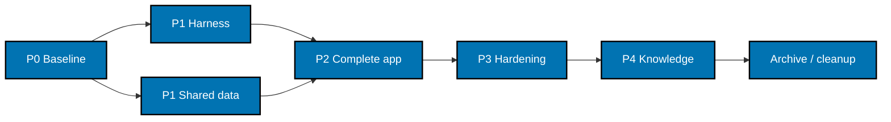

# Delivery Checklist

Executor legend: `[AI]` is an autonomous repository agent; `[HUMAN]` is a user action. Every code or
declarative configuration edit is dispatched to the appropriate `swe-*` agent. The root coordinates
and records proof; it does not implement code. All boxes describe future implementation and remain
unchecked until execution begins. `plan-quality-gate: PASS (2 cycles, 0 open findings)`.

## Worktree

Worktree path: `worktrees/ayokoding-app-web/`.

This is the pre-existing worktree supplied with the user's session, adopted before plan authoring.
Its branch reflog records creation from HEAD at `2026-10-25T19:02:55+08:00`; the authoring baseline is
`88d4f0b36156b6efb10c03e532a646cea65f81b1`. The agent did not create it and does not invent the
original actor's identity.

### Provisioned Worktree Identity

- Declared repository-relative route: `worktrees/ayokoding-app-web/`.
- Initial branch: `ayokoding-app-web`.
- Created by: user-provided pre-existing session worktree; original actor not recorded in Git.
- Created at: `2026-10-25T19:02:55+08:00`, from the branch-creation reflog.

### Delivery Branch Inventory

| Branch                      | Mode          | Lifecycle state | Proof                                                                      |
| --------------------------- | ------------- | --------------- | -------------------------------------------------------------------------- |
| `ayokoding-app-web`         | `provisioned` | active          | Branch reflog creation from the authoring baseline at the timestamp above. |
| `ayokoding-app-web-go-htmx` | `planned`     | delivered       | Go+htmx stack rewrite of this plan, merged as PR #761 at `0205fdb3e`.      |

Append every delivery branch before use and record the merged PR plus reviewed 40-character head
SHA. Resolve the worktree route against the selected repository at runtime and reconcile with
`rtk git worktree list --porcelain`; no host-specific path belongs in this tracked plan. If the
worktree has already been cleaned before execution, the workflow's Step 0 re-provisions the same
declared route and records the new branch inventory before implementation. Use only one worktree
for this repository across all units.

## Delivery Mode: worktree-to-pr

Integration target is `main`. The normal `[AI]` merge authority applies only after explicit Git
delivery authorization and hardened prerequisites; this plan's authoring does not authorize
staging, committing, pushing, or merging. No deployment branch is created or modified. Each
authorized PR needs exact-current-head/base `pr-quality-gate.yml`, a fresh-context clean
`leak-reviewer` verdict for its push/merge head, and applicable finite UI/API gates. Broad semantic
PR review runs only if requested.

## Parallelization Model

N = 3 background agents plus one coordinator. This plan has no external plan dependency. Live
course plans are independent producers of merged shared sources, never blocked nodes in this DAG.



Harness and dataset implementation may proceed concurrently after P0 while they write distinct
files. Their shared root inventories, lockfile, docs, and Git actions serialize under the
coordinator. Inside P2, content/navigation, course/progress, and tools packets can fan out after
the shell/contracts exist; the third lane may finish tests while the coordinator integrates.
Shared renderer/router/test-helper/config files have one named writer and dependent consumers.

The harness setup, the compatible shared-data extraction, and the complete local application
are natural delivery units. Keep P2 together until its entire canonical corpus has real bindings
and all runtime suites pass; do not merge unfinished scaffolding, prune future scenarios to make
coverage green, or register a target before its referent exists. Cleanup is terminal and depends
on delivered-head verification for every unit; follow
[Dev Artifact Clean-Up](../../../repo-governance/workflows/maintenance/dev-artifact-clean-up.md).

## Evidence and execution contract

Outcome sections reference [PRD acceptance criteria](./prd.md#acceptance-criteria). For every TDD
packet, preserve a failing assertion, then passing focused proof with executed test identities and
positive counts. A missing dependency/compiler error is not RED proof. Establish a compilable
interface first when necessary. Do not retry, sleep, skip, quarantine, loosen assertions, or widen
timeouts to conceal a defect. Fix failures at their owning boundary, including pre-existing
failures found by the required gates.

Ignored execution logs live under `local-tmp/plan/ayokoding-app-web/`; sanitized final accepted
evidence lives under the executing plan's `evidence/`. Each `P1H`, `P1D`, or `P2-*` outcome below
has an evidence prefix of the same name. The node's command output, scenario identities, source
revision, and failure/repair result go there. Gherkin remains canonical in specs; do not maintain
a competing full scenario copy in this checklist.

## Phase 0: Environment, Shared-Source Baseline, and Ownership

**Input:** approved PRD, matching worktree, and completed Podman predecessor. **Outcome:** reproducible
baseline and exact source/scenario ownership. **Proof:** baseline logs and a complete scenario
disposition ledger before production code changes.

- [x] [AI] Read current `AGENTS.md`, the repository adapter, worktree setup, and this plan. Compare
      `rtk git status --short`, branch/worktree list, and the touch ledger; retain foreign work.
      Reconcile active user decisions before resuming and fail the affected packet on conflict.
- [x] [AI] Before any guarded command, locate and use the documented operator-approved host policy
      through `HIPPO_CONFIG` or the correct `--config <approved-policy>` option. If HIPPO rejects
      admission because its default exclusive mode conflicts with an existing reservation-mode
      marker, inspect the effective configuration and the documented host policy before continuing.
      An explicit `--config` overrides `HIPPO_CONFIG`; do not add a generic example config to a
      command when it would displace the approved host policy. Use `hippo.local.json.example` only
      when it is documented as approved for the actual host. Confirm admission with that policy.
      Never retry an unchanged rejection, lower resource floors, delete coordination state, or
      terminate peer work. Keep host paths and machine bounds in ignored local handoff notes only.
      Follow
      [consumer configuration and evidence](../../../repo-governance/development/practice/resource-aware-development/consumer-integrity-state-and-evidence.md)
      and the [development setup guidance](../../../docs/how-to/setup-development-environment.md).
- [x] [AI] Run the mandatory worktree bootstrap from the root:
      `rtk ./hippo run --class transactional --resource-tier standard --disk-path . -- npm install`,
      then `rtk npm run doctor`. Only on reported toolchain drift run the documented transactional
      `./rhino toolchain provision --apply`, then doctor again. Save baseline exit codes; do not
      change Git identity or production/staging environment files.
- [x] [AI] Record the latest merged `origin/main` SHA, current nine-plan statuses, shared content,
      manifest schemas, redirect module order, tool codecs, public assets, and existing config.
      Use the bounded inventory in [001](./tech-docs/001-baseline-and-parity.md); consume no unmerged
      sibling-worktree output. Move the plan to `plans/in-progress/ayokoding-app-web/` only when
      execution actually begins; update both stage indexes and the plan-order DAG in that unit.
- [x] [AI] Enumerate and expand the current old-app Gherkin corpus using the existing Cucumber
      parser; record every source scenario/example and its new destination/layer disposition as
      required by 001. Include all current course-path and tool cases. Unmapped user behavior
      blocks its packet; framework-only exclusions need their concrete replacement proof.
- [x] [AI] Read both existing app E2E project configurations. Run the old owner's baseline with
      `rtk ./hippo run --class ephemeral --resource-tier heavy --disk-path . -- npm exec nx -- run ayokoding-www:test:quick`
      and its `test:integration` target with the same guard. Record failures and root causes;
      resolve any baseline that would invalidate subsequent parity evidence before proceeding.
- [x] [AI] Verify the configured listener inventory in `docs/reference/web-sites.md`. Reserve
      3102/3191 for the new app/test server and retain 3101. A busy listener fails clearly; do not
      kill or reuse another process. Capture existing feature reference screenshots in both
      locales at 375/768/1280 px as described in PRD; own only the server processes started here.
- [x] [AI] Inspect the recorded Go precedent at `apps/ayokoding-cli` (go directive, godog pin,
      coverage-gate script, golangci-lint/nilaway/shfmt lint shape, `lang:go` tags). Verify the
      pinned Go toolchain on the actual host with `go version` and confirm `go build` works for a
      scratch module before the new app exists. Record compatible goldmark/bluemonday/yaml/htmx
      pins from their manifests and cited sources; resolve exact patches during P1/P2.

### Phase 0 Gate

- [x] [AI] Confirm baseline commands have attributable results, every old scenario/example has a
      disposition row, all source paths were discovered, and no content plan became a dependency.
- [x] [AI] Confirm `rtk git status --short` agrees with the touch ledger and the current baseline
      revision is recorded. No source corpus, secret, or old-app listener was overwritten.

> **Pause Safety:** Only baseline evidence and honest lifecycle metadata have changed. Resume by
> reading the source revision/disposition ledger and running `rtk npm run doctor`.

## Phase 1: Go Harness and Compatible Shared Data

### P1H — AC-11: Wire the godog harness on the ayokoding-cli pattern

**Input:** verified Go toolchain, `ayokoding-cli` precedent, library specs, and current coverage
script. **Outcome:** a working godog harness with strict bindings and a real 99% Unit coverage
floor. **Proof:** Go unit/coverage runs, validator regressions, and behaviour-coverage reports.

- [ ] [AI] **RED:** Under `scripts/behaviour-coverage.test.mjs`, add failing cases for Go adapter
      discovery over the new `apps/ayokoding-web/tests/bdd/` tree: missing/ambiguous/unused step
      bindings, failed/empty verification, expanded outline identities, mixed Unit ownership, and
      exemptions. Run `rtk npm run test:validators`; preserve named failing assertions, not missing
      imports. The `.go` extractor already exists; if a genuine gap is proven, extend it minimally
      in the same unit and keep existing language behavior unchanged.
- [ ] [AI] **GREEN:** Add the new app's `behaviour-coverage.json` (unit/integration/e2e adapters
      over `tests/bdd`, corpus `specs/apps/ayokoding/web/behaviours`, driver `go.mod`) and the
      godog suite wiring that runs the consumer's discovery scope. Rerun
      `rtk npm run test:validators`; all new and existing validator cases pass.
- [ ] [AI] **REFACTOR:** Consolidate the discovery scope between static verification and test runs,
      then rerun the same validator command. Preserve verification identities and avoid changing
      other languages.
- [ ] [AI] **RED:** Add `tests/bdd/` focused godog step stubs for the new canonical library
      specs plus in-memory driver doubles, with at least one named failing step per domain. Run the
      new `ayokoding-web:test:unit` target through HIPPO and preserve the assertion failure showing
      the missing domain implementation — never a build error or panicking stub.
- [ ] [AI] **GREEN:** Implement the in-memory drivers and passing step definitions against function
      signatures that P2 will fill. Run new `ayokoding-web:test:coverage:unit` and the static
      behaviour gate; full Unit coverage enforces its real 99% floor via `COVERAGE_MINIMUM=99`.
- [ ] [AI] **REFACTOR:** Review imports, unused dependencies, linter warnings, and
      support/test-code coverage denominators. Rerun those three targets; store positive test
      counts and coverage reports, not just a zero exit from an empty selection.

### P1D — AC-08/09: Share tool datasets without changing old results

**Input:** current evaluated TypeScript datasets and URL/calculation functions. **Outcome:** one
neutral JSON data source with compatible old exports. **Proof:** old/new data equality, unchanged
reference blocks, and shared vectors for later Go parity.

- [ ] [AI] **RED:** Add characterization tests beside the existing tool Unit tests for evaluated
      exports, ordering, optional field absence, independent FX date, comment-only provenance,
      codec duplicates/defaults, and representative scoring/cost/savings/min-role results. Introduce
      expected JSON/vector imports as new artifacts; run the existing `ayokoding-www:test:unit`
      target through HIPPO and preserve failing assertions showing the missing shared-data adapter.
- [ ] [AI] **GREEN:** Create `libs/ayokoding-data` with the exact JSON/provenance/vector families in
      002/005. Export evaluated objects once; retain all dates, numbers, policies and source notes.
      Replace only the six bounded old data modules with typed adapters retaining their named
      exports. Add library data/provenance specs and in-memory Unit tests; no product service or
      Node-to-Go export daemon is introduced.
- [ ] [AI] **GREEN:** Register the data owner's meaningful Unit/static/quick targets and source
      inputs. Run `ayokoding-data:test:quick` and `ayokoding-www:test:unit` through HIPPO. Run the
      existing `ayokoding-www:validate-benchmark-reference` target; generated blocks must be
      unchanged. A data-value or provenance mismatch returns to extraction, not to an expectation
      update accepting different results.
- [ ] [AI] **REFACTOR:** Remove duplicated data declarations while preserving old public exports
      and importer paths. Rerun library quick, old app quick, old integration, and the existing
      frontend/backend E2E targets after inspecting their current runtime setup. Keep dataset source
      code and expected vectors independently reviewable; do not generate expectations from the
      same function under test.

### Repository-local rules and docs propagation for P1/P2

- [ ] [AI] Freeze the exact rule inputs in 005 with revision, strengths, scope, user decision,
      observed follow/violate conditions, and affected file families. This is an `ose-public`-only
      transaction; no obligation or change is recorded for BeaverNest or another sibling.
- [ ] [AI] Scan all repo-rule surfaces for conflicts with the new Go stdlib + htmx selection,
      library naming, BDD scopes/coverage, environment rules, target shape, and language-lane
      detection. Use existing sufficient rules unchanged; record each no-change decision and precedence.
- [ ] [AI] Place the explicit app-specific Go/htmx and test-tool decisions in repository
      adapter/adopter decisions; place the `ayokoding-data` language-neutral naming exception in
      its narrow owner document. Keep `repo-config.yml` project/stack inventory synchronized; do
      not copy BeaverNest governance or add broad rules unrelated to these projects.
- [ ] [AI] **RED:** Add affected-language detection tests in
      `scripts/workflow-language-lanes.test.mjs` proving the new Go owner is tagged `lang:go` and
      cannot be silently skipped or run in a Node-only lane. Run `rtk npm run test:validators` and
      save the assertion.
- [ ] [AI] **GREEN:** Register the new Go projects with `lang:go` tags so the existing
      `lang:go` quality lane (pinned `setup-go` action) picks them up; no new workflow job, no
      deployment, no environment branch, no hosted service setup. Rerun
      `rtk npm run test:validators`; all language lanes remain covered.
- [ ] [AI] **REFACTOR:** Reconcile the lane with HIPPO admission and project tags, remove redundant
      statements, and rerun validator tests. Assign each changed rule a covered/gated/unenforced
      disposition with an exact owner, then validate the affected rule surfaces.
- [ ] [AI] Update library/spec indexes, licensing notice only if a vendored-code claim changes
      (none is introduced here), monorepo reference, and applicable project READMEs in the same
      coherent unit. Run Docs Propagation for these actual surfaces; update canonical instructions
      only if a changed contract requires it, then use pinned Rhino adapter generation/validation
      for any affected mirrors. Never edit a generated route by hand.
- [ ] [AI] Run the repository rules-quality-gate on the frozen rule transaction after deterministic
      verification; record every placement, supersession, relocation, enforcement result, and final
      transaction status. Return failures to their row owner; a generic workflow link is not proof.

### Phase 1 Gate

- [ ] [AI] Run the planned library targets and existing `rtk npm run test:validators` with the
      documented guards; all tests execute positive counts and actual coverage floors pass.
- [ ] [AI] Verify old-app data/calculation/reference equality, no course/manifests edits,
      no `libs/ex-bdd` subtree was created, and complete same-unit docs/spec/rules changes. Land
      independent ready units only under explicit Git authorization and the delivery-boundary
      checklist below.

> **Pause Safety:** The harness setup and compatible data extraction are complete, independently
> useful, and leave the existing app working. Resume by rerunning `ayokoding-web:test:quick` and
> `ayokoding-data:test:quick` through the commands in 003.

## Phase 2: Complete the Local Go Application

All paths and target names in this phase are **new artifacts**. The phase is one cohesive app
delivery unit with parallel TDD packets; the gate requires the entire corpus, not a partial scope.

### P2-Shell — AC-01/02: App and local launcher

**Input:** P1 harness/data and current visual references. **Outcome:** accessible bilingual Go
runtime with isolated local/test configuration. **Proof:** launcher unit tests, connected/
disconnected mounts, real browser shell, and simultaneous existing-app server.

- [ ] [AI] Scaffold `apps/ayokoding-web` as a Go module (`go mod init
github.com/wahidyankf/ose-public/apps/ayokoding-web`), pin godog/goldmark/bluemonday/yaml
      dependencies, and record actual resolved versions and a working `go build ./...` before
      behavior REDs. Do not generate a second nested repository or overwrite root instructions.
- [ ] [AI] **RED:** Create `internal/web/config_test.go` and shell/browser-helper unit cases for
      flag>prefixed-env>3102 precedence, invalid override failure, generic PORT ignored, both
      locales, public-only request context, and keyboard/theme behavior. Execute the focused unit
      file with
      `rtk ./hippo run --class ephemeral --resource-tier standard --disk-path . --cwd apps/ayokoding-web -- go test ./internal/web/ -run TestConfig -count=1 -race`;
      browser helpers use the new Vitest unit configuration. Save assertion failures.
- [ ] [AI] **GREEN:** Implement `cmd/ayokoding-web` (`--port` flag plus test-only
      `--fixture parity|unavailable-catalog`, `AYOKODING_WEB_PORT` env, 3102 default). Start the
      stdlib server with validated config; route Nx `dev` and the owned test launcher through
      this binary. Implement the preserved shell, locale, visual tokens, and request context.
      Rerun focused unit proof.
- [ ] [AI] **REFACTOR:** Keep parsing and configuration pure, isolate browser listeners, and reject
      fixture mode outside test builds. Rerun launcher/helper unit files and integration cases;
      no listener reuse or automatic source mutation is permitted.

### P2-Content — AC-03/04/05/10: Content, routes, search, discovery

**Input:** shell/context contracts, fixtures, and current source schemas. **Outcome:** readable
content and accurate navigation/search/discovery using read-only adapters. **Proof:** matching
canonical scenarios at all three applicable layers and initial-HTML/wire evidence.

- [ ] [AI] **RED:** Add `internal/content/*_test.go`, `internal/search/*_test.go`, and
      `internal/web/{routes,discovery}_test.go` with the full renderer fixture matrix, unsafe
      identity handling, draft/invalid frontmatter behavior, ordered redirects, first-value
      queries, title/body prefix matching, late-result protection, and discovery inclusion. Run
      each named package with the P2-Shell focused Go test command form; require assertion-based
      RED and independent expected output.
- [ ] [AI] **GREEN:** Implement `internal/content`, `internal/search`, read-only filesystem/
      static-asset adapters, snapshot/reload behavior, redirect middleware, and the discovery
      handler from 002/004. Use goldmark HTML rendering plus bluemonday sanitization; preserve
      safe authored HTML, shortcodes, headings, relative links and code text, and never turn
      Markdown text into template directives. Add owned local fixture integration and browser
      steps; rerun the focused unit cases and relevant scenarios.
- [ ] [AI] **REFACTOR:** Separate pure parsing/tree/excerpt rules from I/O and templates. Verify
      concurrent readers see complete snapshots and a source-change notification invalidates
      stale HTML/search without writing `_index.md`. Rerun affected unit/integration packets and
      the exact content/navigation/search/discovery scenario selections with positive counts.

### P2-Courses — AC-06/07: Paths and private browser progress

**Input:** current merged manifest/course schemas and browser v1 state. **Outcome:** faithful
catalog/path journeys and browser-only progress. **Proof:** domain/manifest unit,
filesystem integration, browser-helper unit, and real-browser storage/network E2E.

- [ ] [AI] **RED:** Add `internal/coursepaths/*_test.go` and browser-helper progress unit tests
      for phase order, prerequisites, outline/fallback rules, exact v1 bounds/schema, undo/reset,
      blocked storage, cross-tab updates, reconnect listener ownership, and progress-free network
      context. Run the focused Go command and new browser unit runner; record assertion REDs.
- [ ] [AI] **GREEN:** Implement `internal/coursepaths/` and its template surfaces plus pure
      TypeScript helpers/hooks under `assets/js/`. Keep progress in a stable browser-owned island
      across htmx swaps; public metadata may arrive from the server, but completion/history never
      leave the browser. Use the actual merged transitional/finished manifest state, not a wait
      for plans 06/07/14. Add matching integration/E2E drivers and rerun focused proof.
- [ ] [AI] **REFACTOR:** Remove duplicate lesson/path decisions, validate unsafe IDs once, and
      preserve course-level completion across paths. Recheck no account, cookie/server record, or
      progress query/log value was introduced. Rerun focused unit/integration cases and browser
      progress/storage/privacy scenarios in both locales.

### P2-Tools — AC-08/09: Tool behavior and query state

**Input:** shared JSON/data vectors, current TS algorithms/codecs, and tool reference screens.
**Outcome:** both tools produce existing results and shareable URLs. **Proof:** the same independent
expected vectors pass in both runtimes, plus handler and browser behavior.

- [ ] [AI] **RED:** Add `internal/tools/benchmark/*_test.go` and
      `internal/tools/calculator/*_test.go` for every shared result vector, rounding and
      no-result/unsupported branches, defaults/duplicates/blank-vs-zero, invalid fields, and URL
      restoration. Run focused Go test files with the guarded command form; retain assertion REDs
      while old TS characterization stays green.
- [ ] [AI] **GREEN:** Implement pure packages under `internal/tools/`, direct validated JSON
      adapters, and accessible tool pages plus htmx fragments. Wire only the native query
      fields in 004; preserve all calculator modes and benchmark substitutes/options. Rerun
      shared-vector unit proof in both runtimes, then full-page and real-browser fragment scenarios.
- [ ] [AI] **REFACTOR:** Consolidate validation/encoding per tool, preserve list order/source
      dates and provenance, and prevent logs/persistence of input records. Rerun the same vectors
      and browser back/forward/deep-link cases; no data refresh or expectation rewrite is accepted.

### P2-Bindings — AC-01 through AC-12: Complete corpus proof and ownership

- [ ] [AI] Complete all scenario dispositions from P0, including extra validation/error/replay/
      privacy scenarios specified in 004. Add app `tests/bdd/` godog drivers, the single shared
      native discovery scope, complementary Vitest Gherkin unit scope, and TypeScript Playwright
      steps. Enforce full unit union; document only genuine per-scenario integration/E2E boundary
      exemptions in canonical features.
- [ ] [AI] Register new app/E2E project configurations, exact cache/source dependency inputs,
      compile/type/lint/99%-unit targets and static aggregates from 003, and isolated test
      fixtures. Static completeness must not run tests; quick must not start integration/browser
      runtime. Run `ayokoding-web:test:coverage:behaviour`; missing, ambiguous, unused, or
      unowned scenarios fail.
- [ ] [AI] Update app/E2E READMEs, `docs/reference/web-sites.md`, monorepo inventory, specs
      indexes, and canonical architecture to the actual as-built app. Run Docs Propagation and
      reconcile P1 rule/CI inventory with actual targets. This unit rewrites the
      Phoenix-worded proof ownership in `specs/apps/ayokoding/web/` to Go; behavior contracts do
      not change. Remove planned-status claims only for implemented behavior; no deployment or
      production branch entry is created.

### Focused TDD selections and evidence

Use focused ordinary tests to get assertion-based RED/Green feedback before the complete Gherkin
binding set exists. These commands name individual future test packages, so they do not load
incomplete `tests/bdd/` modules or filter canonical scenarios. Keep the full app as one delivery
unit: before the final quick gate, bind every expanded canonical scenario; then run the complete
static, unit, integration, and Playwright suites without scenario pruning or focused/skipped BDD tags.

| Boundary            | Focused file and command (from the worktree root)                                                                                                                                                                                                                                                                                                                                                                                                                                                                                                                                                                                    | Positive execution and evidence                                                                                                                                                                                                                                                                                                      |
| ------------------- | ------------------------------------------------------------------------------------------------------------------------------------------------------------------------------------------------------------------------------------------------------------------------------------------------------------------------------------------------------------------------------------------------------------------------------------------------------------------------------------------------------------------------------------------------------------------------------------------------------------------------------------ | ------------------------------------------------------------------------------------------------------------------------------------------------------------------------------------------------------------------------------------------------------------------------------------------------------------------------------------ |
| Go Unit             | For each changed `internal/<packet>/` package, run `rtk ./hippo run --class ephemeral --resource-tier standard --disk-path . --cwd apps/ayokoding-web -- go test ./internal/<packet>/ -count=1 -race`. Packet packages are `web`, `content`, `coursepaths`, `search`, `tools/benchmark`, and `tools/calculator`.                                                                                                                                                                                                                                                                                                                     | Every invocation reports at least one executed test and assertion-based results. Save exact command, test identities/count, and RED/Green result in `local-tmp/plan/ayokoding-app-web/<packet>/unit-focused.log`; retain accepted summaries in `evidence/<packet>/unit-focused.md`.                                                  |
| Browser-helper Unit | Create focused tests such as `apps/ayokoding-web/assets/js/progress.test.ts` and run `rtk ./hippo run --class ephemeral --resource-tier standard --disk-path . --cwd apps/ayokoding-web -- npm exec vitest -- run assets/js/progress.test.ts`. The app's `vitest.config.ts` owns the browser-helper unit tree.                                                                                                                                                                                                                                                                                                                       | At least one test executes; record the Vitest test names/count and assertion-based RED/Green in `local-tmp/plan/ayokoding-app-web/<packet>/browser-unit-focused.log`, with the accepted summary under `evidence/<packet>/browser-unit-focused.md`.                                                                                   |
| Local Integration   | Create the packet-owned suite under `apps/ayokoding-web/tests/integration/` (for example, `content_test.go`, `coursepaths_test.go`, `tools_test.go`, or `discovery_test.go`) and run `rtk ./hippo run --class ephemeral --resource-tier heavy --disk-path . --cwd apps/ayokoding-web -- go test ./tests/integration/ -run Test<Packet> -count=1 -race`.                                                                                                                                                                                                                                                                              | At least one test executes against an owned fixture/resource boundary. Save named test identities/count, result, and fixture cleanup evidence in `local-tmp/plan/ayokoding-app-web/<packet>/integration-focused.log` and `evidence/<packet>/integration-focused.md`.                                                                 |
| Playwright E2E      | Add focused ordinary browser tests at `apps/ayokoding-web-e2e/tests/e2e/browser-progress.spec.ts` and `apps/ayokoding-web-e2e/tests/e2e/htmx-fragments.spec.ts`; configure `playwright.config.ts` `webServer` to run the built Go server with `AYOKODING_WEB_PORT=3191` and fixture content from `apps/ayokoding-web`, with `reuseExistingServer: false` and retries `0`. Run `rtk ./hippo run --class ephemeral --resource-tier heavy --disk-path . --cwd apps/ayokoding-web-e2e -- npm exec playwright -- test tests/e2e/browser-progress.spec.ts --project=chromium` or replace the path with `tests/e2e/htmx-fragments.spec.ts`. | At least one real browser test executes against the app and test server; save test identity/count, browser/project, trace or screenshot on failure, and clean owned-server shutdown under `local-tmp/plan/ayokoding-app-web/<packet>/playwright-focused/`; summarize accepted evidence in `evidence/<packet>/playwright-focused.md`. |

Focused selections are for RED/Green during packet work, not proof of complete behavior coverage.
Before P2 closes, run `ayokoding-web:test:quick`, `ayokoding-web:test:integration`, and
`ayokoding-web-e2e:test:e2e` from 003. The complete godog discovery and binding bootstrap includes
the entire canonical feature tree; its final static summary has no missing, ambiguous, unused, or
unowned scenario/step identity. Keep ordinary focused test files outside the BDD discovery tree so
an unfinished binding cannot prevent an unrelated assertion from running.

The concrete future selections are `internal/web`, `internal/content`, `internal/coursepaths`,
`internal/search`, `internal/tools/benchmark`, and `internal/tools/calculator`; run the same Go
unit command once per package, substituting only that literal path. Integration selections are the
named `Test<Packet>` suites above; run the integration command once for each created suite file.
Playwright selections are the two literal `*.spec.ts` paths in the table. Do not use `--grep`,
tags, or global filter flags against the canonical BDD bootstrap to get a focused RED; that
bootstrap is invoked only after the complete bindings are implemented.

### Mandatory semantic Gherkin implementation review

- [ ] [AI] In P1H, after wiring godog and after each material canonical feature, adapter,
      exemption, or static behavior-coverage change, run
      `gherkin-implementation-review scope=changed owners=ayokoding-web`. Run
      `gherkin-implementation-review scope=full owners=ayokoding-web` before the Phase 1 gate.
- [ ] [AI] In P1D, after registering `ayokoding-data` and after each material canonical feature,
      adapter, exemption, or behavior-coverage change, run
      `gherkin-implementation-review scope=changed owners=ayokoding-data`, adding any actual
      currently registered owner whose canonical bindings materially change to that comma-separated
      owner list. Run `gherkin-implementation-review scope=full owners=ayokoding-data` before the
      Phase 1 gate.
- [ ] [AI] In P2, keep `ayokoding-web` registered before reviewing its canonical corpus. After each
      material feature, adapter, exemption, or behavior-coverage change, run
      `gherkin-implementation-review scope=changed owners=ayokoding-web`, adding any additional
      currently registered owner whose canonical bindings materially change in the same unit to
      that invocation's comma-separated owner list. Run
      `gherkin-implementation-review scope=full owners=ayokoding-web` before the Phase 2 gate. The
      app owner review includes its dedicated Playwright E2E adapter. Never invoke a future Nx owner
      before its project is registered.
- [ ] [AI] These required `swe-reviewer` runs are BDD implementation gates, separate from the
      optional broad semantic PR review in Delivery Mode.
- [ ] [AI] Save each review report at the workflow's
      `local-tmp/gherkin-implementation-review/` path and retain its sanitized summary at
      `evidence/P1H/gherkin-implementation-review.md`,
      `evidence/P1D/gherkin-implementation-review.md`, or
      `evidence/P2-Bindings/gherkin-implementation-review.md` for its owning unit.
      It contains one row per expanded scenario multiplied by its applicable Unit owner (Go or
      complementary browser-helper Vitest), Integration, and dedicated Playwright E2E adapters,
      including owner, feature/scenario identity, implementation
      locations, exemption proof, and PASS/EXEMPT/FAIL. Exemptions do not reduce expected row count.
- [ ] [AI] Require every non-exempt row to show that Given establishes its boundary-valid
      precondition, When calls production behavior or its declared public boundary, and Then observes
      independent evidence caused by that call. For each Integration/E2E exemption, verify the
      scenario-local explanation and alternative proof against the exact exemption contract in 003;
      Unit has no exemption. The report names exact impacted runtime commands/results for Unit,
      manually selected Integration and Playwright cases, and any failing rows. Do not mark a
      material behavior change complete until every applicable row is PASS or a valid EXEMPT and
      impacted runtime proof passes with zero unresolved FAIL/PARTIAL rows.

### Phase 2 Gate

- [ ] [AI] Run `ayokoding-web:test:quick` with `ephemeral/standard`, then `build`,
      `test:integration`, and `ayokoding-web-e2e:test:e2e` with `ephemeral/heavy`, all via
      `rtk ./hippo run ... -- npm exec nx -- run <target>` as enumerated in 003. Every expanded
      canonical scenario has required bindings and runtime proof; retries/skips remain zero.
- [ ] [AI] Reconcile already-merged main changes against the P0 source revision and rerun affected
      parity packets. Start both apps with the manual recipe below; verify 3101 and 3102 together.
      Unfinished course plans do not block this gate. Any unmapped behavior returns to its P2 packet.

> **Pause Safety:** The complete local app, specs, tests, source dependencies, and documentation are
> coherent; the old app is still usable. Resume with the guarded `ayokoding-web:test:quick` command
> in 003 and the recorded source revision.

## Phase 3: Local Parity, Manual Evidence, and Delivery Hardening

**Input:** complete P2 app. **Outcome:** accepted current-corpus and real-browser proof with no
unresolved defects. **Proof:** screenshots, sanitized wire outputs, three-tester findings and
resolutions, and local/authorized-PR gate results. No deployment proof is required.

### Manual browser verification

- [ ] [AI] Start the old app without a generator pass using
      `rtk ./hippo run --class service --resource-tier standard --disk-path . --cwd apps/ayokoding-www -- node ../../scripts/next-with-port.mjs dev --env AYOKODING_WWW_PORT --default 3101`.
      Start the new app in a second owned service with
      `rtk ./hippo run --class service --resource-tier standard --disk-path . --cwd apps/ayokoding-web -- go run ./cmd/ayokoding-web --port 3102`.
      Record owned service handles and successful responses from both ports.
- [ ] [AI] In each supported locale at 375/768/1280 px, exercise landing, content/browse, catalog,
      paths, lesson navigation, search keyboard/focus, theme/sidebar, progress/reset, tools/all
      query modes, math/Mermaid/tabs/copy, htmx swaps with JavaScript enabled and the full-page
      fallbacks with JavaScript disabled, and missing pages. Inspect language, accessible
      names/contrast, focus order, browser console and network. Capture feature/locale/
      breakpoint-named screenshots in `evidence/`; compare with the existing reference screens.
- [ ] [AI] Inspect network traffic while marking/undoing completion, navigating, and opening
      another tab. Assert no stored progress field or record is sent in any request. Capture
      sanitized evidence, invalid/blocked storage recovery, unrelated-key preservation, and
      separation between 3101/3102 origins. Stop only the services created by this plan.

### Manual HTTP and fragment verification

Run these from the worktree root with the 3102 server active; create the named evidence directory
under the executing plan. Record status, headers, body and assertions for each case. `-o`/`-D`
capture synthetic public responses, not secrets. Expected content bodies follow 004; compare XML
semantics and current source identities rather than unstable whole-document bytes.

```bash
rtk curl -sS -D plans/in-progress/ayokoding-app-web/evidence/page-en.headers -o plans/in-progress/ayokoding-app-web/evidence/page-en.html -H 'Accept: text/html' http://localhost:3102/en
rtk curl -sS -D plans/in-progress/ayokoding-app-web/evidence/page-id.headers -o plans/in-progress/ayokoding-app-web/evidence/page-id.html -H 'Accept: text/html' http://localhost:3102/id
rtk curl -sS -D plans/in-progress/ayokoding-app-web/evidence/page-missing.headers -o plans/in-progress/ayokoding-app-web/evidence/page-missing.html http://localhost:3102/en/not-a-real-parity-page
rtk curl -sS -D plans/in-progress/ayokoding-app-web/evidence/redirect.headers -o plans/in-progress/ayokoding-app-web/evidence/redirect.body 'http://localhost:3102/EN?from=local'
rtk curl -sS -D plans/in-progress/ayokoding-app-web/evidence/redirect-miss.headers -o plans/in-progress/ayokoding-app-web/evidence/redirect-miss.html http://localhost:3102/ZZ/not-a-real-parity-page
rtk curl -sS -D plans/in-progress/ayokoding-app-web/evidence/sitemap.headers -o plans/in-progress/ayokoding-app-web/evidence/sitemap.xml -H 'Accept: application/xml' http://localhost:3102/sitemap.xml
rtk curl -sS -D plans/in-progress/ayokoding-app-web/evidence/feed.headers -o plans/in-progress/ayokoding-app-web/evidence/feed.xml -H 'Accept: application/rss+xml' http://localhost:3102/feed.xml
rtk curl -sS -D plans/in-progress/ayokoding-app-web/evidence/robots.headers -o plans/in-progress/ayokoding-app-web/evidence/robots.txt -H 'Accept: text/plain' http://localhost:3102/robots.txt
rtk curl -sS -X POST -D plans/in-progress/ayokoding-app-web/evidence/robots-method.headers -o plans/in-progress/ayokoding-app-web/evidence/robots-method.html http://localhost:3102/robots.txt
rtk curl -sS -D plans/in-progress/ayokoding-app-web/evidence/frag-search.headers -o plans/in-progress/ayokoding-app-web/evidence/frag-search.html -H 'Accept: text/html' -H 'HX-Request: true' 'http://localhost:3102/htmx/search?q=golang&limit=20'
rtk curl -sS -D plans/in-progress/ayokoding-app-web/evidence/frag-search-invalid.headers -o plans/in-progress/ayokoding-app-web/evidence/frag-search-invalid.html -H 'Accept: text/html' -H 'HX-Request: true' 'http://localhost:3102/htmx/search?q=%12&limit=999'
rtk curl -sS -D plans/in-progress/ayokoding-app-web/evidence/frag-benchmark.headers -o plans/in-progress/ayokoding-app-web/evidence/frag-benchmark.html -H 'Accept: text/html' -H 'HX-Request: true' 'http://localhost:3102/htmx/benchmark?harness=unknown-harness&tier=unknown-tier'
rtk curl -sS -D plans/in-progress/ayokoding-app-web/evidence/frag-calculator.headers -o plans/in-progress/ayokoding-app-web/evidence/frag-calculator.html -H 'Accept: text/html' -H 'HX-Request: true' 'http://localhost:3102/htmx/calculator?tab=cost&adults=1&preschool=0&schoolkids=0&area=center'
```

- [ ] [AI] Assert page200 HTML with correct locale and no source/private state; missing page404
      HTML; redirect308 `Location: /en?from=local` with no loop; redirect miss404; sitemap/feed200
      with correct XML media types and no drafts/removed routes; robots200 plain text with configured
      origin; wrong-method robots404 HTML. Assert each fragment200 returns its HTML partial with
      the expected inline state (`invalid_search` / `invalid_filters` on the invalid cases) and no
      source/private disclosure. Assert local `Cache-Control: no-store` for each response. Route
      any mismatch to its content/redirect/owner packet and rerun the case after repair.
- [ ] [AI] Stop the normal test server if owned and start the test-only unavailable-catalog
      fixture using
      `rtk ./hippo run --class service --resource-tier standard --disk-path . --cwd apps/ayokoding-web -- env AYOKODING_WEB_PORT=3191 go run ./cmd/ayokoding-web --port 3191 --fixture unavailable-catalog`.
      Run the following GET failures; each must be generic500 HTML with no path/stack disclosure.

```bash
rtk curl -sS -D plans/in-progress/ayokoding-app-web/evidence/sitemap-error.headers -o plans/in-progress/ayokoding-app-web/evidence/sitemap-error.html http://localhost:3191/sitemap.xml
rtk curl -sS -D plans/in-progress/ayokoding-app-web/evidence/feed-error.headers -o plans/in-progress/ayokoding-app-web/evidence/feed-error.html http://localhost:3191/feed.xml
```

- [ ] [AI] Stop only the owned unavailable-catalog fixture, then run Playwright's `webServer`
      fixture on 3191 with the fixture content and the plain Go server binary. Add
      `apps/ayokoding-web-e2e/tests/e2e/htmx-fragments.spec.ts` with the named cases below.
      The configured Playwright server must own 3191 (`reuseExistingServer: false`), and retries
      remain zero. Each test records its exact command/result and a separately named sanitized
      response plus DOM assertion under `evidence/fragments/`; traces and temporary contexts stay
      under `local-tmp/plan/ayokoding-app-web/fragments/`. On a failed case, route it to the named
      owner in the table, repair that boundary, and rerun only its command before the final
      all-scenario gate.

```bash
rtk ./hippo run --class ephemeral --resource-tier heavy --disk-path . --cwd apps/ayokoding-web-e2e -- npm exec playwright -- test tests/e2e/htmx-fragments.spec.ts --project=chromium --grep "search accepts valid query"
rtk ./hippo run --class ephemeral --resource-tier heavy --disk-path . --cwd apps/ayokoding-web-e2e -- npm exec playwright -- test tests/e2e/htmx-fragments.spec.ts --project=chromium --grep "search rejects malformed query"
rtk ./hippo run --class ephemeral --resource-tier heavy --disk-path . --cwd apps/ayokoding-web-e2e -- npm exec playwright -- test tests/e2e/htmx-fragments.spec.ts --project=chromium --grep "benchmark recovers scalar values"
rtk ./hippo run --class ephemeral --resource-tier heavy --disk-path . --cwd apps/ayokoding-web-e2e -- npm exec playwright -- test tests/e2e/htmx-fragments.spec.ts --project=chromium --grep "benchmark rejects nested values"
rtk ./hippo run --class ephemeral --resource-tier heavy --disk-path . --cwd apps/ayokoding-web-e2e -- npm exec playwright -- test tests/e2e/htmx-fragments.spec.ts --project=chromium --grep "calculator applies valid values"
rtk ./hippo run --class ephemeral --resource-tier heavy --disk-path . --cwd apps/ayokoding-web-e2e -- npm exec playwright -- test tests/e2e/htmx-fragments.spec.ts --project=chromium --grep "calculator rejects nested values"
```

| Test title                         | Exact test-only input / action                                                                            | Required independent result and artifact                                                                                                                                | Failure routing                                                           |
| ---------------------------------- | --------------------------------------------------------------------------------------------------------- | ----------------------------------------------------------------------------------------------------------------------------------------------------------------------- | ------------------------------------------------------------------------- |
| `search accepts valid query`       | `GET /htmx/search?q=golang&limit=20` with `HX-Request: true`, then the same query on the full page route. | Current-locale ordered results render and stale results clear on the next empty dialog input; `search-valid.json` and `.png`. Assert no browser progress field is sent. | Search handler owner; then browser-progress privacy owner if state leaks. |
| `search rejects malformed query`   | `GET /htmx/search?q=%12&limit=999` with `HX-Request: true`.                                               | Inline `invalid_search`, empty results; `search-invalid.json` and `.png`.                                                                                               | Search validation owner.                                                  |
| `benchmark recovers scalar values` | `GET /htmx/benchmark?harness=unknown-harness&tier=unknown-tier` with `HX-Request: true`.                  | Existing codec defaults render with canonical URL state and no crash; `benchmark-filters-valid.json` and `.png`.                                                        | Benchmark codec/handler owner.                                            |
| `benchmark rejects nested values`  | `GET /htmx/benchmark?harness[x]=1` with `HX-Request: true`.                                               | Inline `invalid_filters`; no crash, source detail, or payload logging; `benchmark-filters-invalid.json` and `.png`.                                                     | Benchmark validation owner.                                               |
| `calculator applies valid values`  | `GET /htmx/calculator?tab=cost&adults=1&preschool=0&schoolkids=0&area=center` with `HX-Request: true`.    | Rendered results match the independent shared vector and URL state; `calculator-filters-valid.json` and `.png`.                                                         | Calculator codec/handler owner.                                           |
| `calculator rejects nested values` | `GET /htmx/calculator?adults[x]=1` with `HX-Request: true`.                                               | Inline `invalid_filters`; no crash, misleading finite estimate, source detail, or payload logging; `calculator-filters-invalid.json` and `.png`.                        | Calculator validation owner.                                              |

Evidence JSON contains only case name, request URI, sanitized response identity, and asserted
visible outcome; omit salary or household records, source paths, and unrelated headers. Also
verify URL back/forward state and that later search input wins; route any failure to the owning
packet and retain the accepted evidence after repair.

- [ ] [AI] Check old tRPC behavior with the existing frontend/backend E2E suites after data
      extraction; no new tRPC consumer/migration is allowed. Stop owned fixture services and delete
      only their temporary roots; retain the accepted sanitized evidence. Invalid fixture-mode dev
      startup must fail before opening a listener.

### Terminal behavior retests

- [ ] [AI] Run `swe-web-tester` exploratory, `swe-usability-tester`, and `swe-web-tester` design
      charters against the running new local app across both locales. Use current specs and the
      preserved existing appearance for appropriate charters. Append EWT/UWT/DWT findings as new
      unchecked tasks with their source; fix actual defects and rerun affected proof. Explicit user
      permission is required only to defer a genuinely impossible defect; triage spec-gap/suggestion
      rows separately. This is future runtime hardening, not a docs-authoring browser test.
- [ ] [AI] Record Rule16 REST/GraphQL API-tester as not applicable: no REST/GraphQL service is added
      or changed. Keep manual HTTP and fragment proof mandatory; this is not a test exemption
      for the app's observable interfaces. Reopen the disposition if scope adds such an API.

### Local quality gates before authorized delivery

- [ ] [AI] Reconcile latest merged main, active plan statuses, the final complete parity ledger,
      docs/spec/rules changes, and `rtk git status --short`. Run all new owners' quick/static gates,
      app build, all applicable integration/E2E suites, and old app quick/integration/E2E plus
      unchanged benchmark-reference validation. Use the exact targets and guard classes in 003;
      positive test counts and recorded source revision are required.
- [ ] [AI] Run affected type/lint/static coverage with
      `rtk ./hippo run --class ephemeral --resource-tier standard --disk-path . -- npm exec nx -- affected -t typecheck,lint,test:coverage:behaviour`
      and applicable deterministic Markdown/frontmatter/heading/internal-link/Mermaid checks.
      Fix all failures at the root cause without suppressions. Rerun only the changed boundary and
      required final gate after a repair; do not repeat broad tests without a new reason.

### Authorized PR boundary and post-push verification

- [ ] [AI] Do not stage/commit/push without explicit user authorization for the named change set.
      Once authorized, choose the fewest coherent independently reviewable/revertible commits,
      Conventional Commits, same-unit tests/docs/specs/rules/generated outputs, and a PR body with
      the concrete behavior, natural seam, cost/benefit, proof and rollback. Inspect every
      new commit's full diff and reconcile the ledger before any next delivery action.
- [ ] [AI] For each authorized push and merge head, dispatch fresh-context `leak-reviewer` and
      require the harness's clean current-head verdict. Open the PR against main; require the
      exact-current-head/base Quality gate and applicable finite surface gates. Do not run broad
      semantic PR review unless requested. Poll CI every 2 minutes; never `gh run watch`.
- [ ] [AI] Investigate CI failures at their root cause, repair through the appropriate SWE agent,
      rerun affected proof, and verify fresh head/base gates. After authorized merge, read the full
      delivered diff and rerun required delivered-head confirmation; no deployment is performed.

### Phase 3 Gate

- [ ] [AI] Verify all ACs have final accepted automated/manual proof, every actual tester defect is
      resolved, the old app remains working, and the no-deployment boundary was preserved.
- [ ] [AI] Verify unfinished other plans do not block completion and only merged-main deltas are
      reflected. Record any new current-main change that invalidates evidence and reopen only the
      affected packet; do not hold a ready unit waiting for unrelated course work.

> **Pause Safety:** Local parity and hardened behavior are proven at a recorded revision. Resume
> by rerunning guarded new-app quick and comparing current main to that recorded revision.

## Phase 4: Knowledge Capture

- [ ] [AI] Review every `learnings.md` observation for whether a durable owning surface would
      prevent recurrence. Sanitize private/secret details and discard non-generalizable entries
      with a reason. Public-repo relevance is required; private infrastructure stays private.
- [ ] [AI] Route each surviving entry to exactly one durable owner and record its terminal state.
      Land a small in-scope non-code correction inline when appropriate. A code-homed learning is
      reported separately, not smuggled into these commits; a blocking scoped defect is repaired
      normally. Write a `plans/ideas/` artifact only with literal user authorization after checking
      existing briefs for overlap; otherwise record reported-without-plan-authorization evidence.
- [ ] [AI] If no generalizable learning arose, record the explicit “No generalizable learnings”
      disposition with its reason. Do not invent a lesson solely to populate the scaffold.

### Phase 4 Gate

- [ ] [AI] Verify every learning is routed, authorized/filed, reported with handoff, or discarded,
      or the explicit none disposition exists. Confirm no unrelated code follow-up landed inline.

> **Pause Safety:** No learning is left open. Resume by rereading `learnings.md` terminal states.

## Plan Archival

- [ ] [AI] Run the preliminary execution-completeness audit: trace every approved AC through
      delivered artifacts, TDD/automated/manual proof, local recovery and Knowledge Capture.
      Reopen the earliest affected packet for missing proof; checked boxes alone are insufficient.
- [ ] [AI] Verify every required task/gate is satisfied, both locales and all breakpoints have
      evidence, all EWT/UWT/DWT actual defects are closed or explicitly authorized for impossible
      deferral, and the Rule16 disposition remains accurate. No deployment or other-plan completion
      gate is added at archival.
- [ ] [AI] Register the workflow-owned terminal delivered-head audit with merged PR/head/base,
      final CI and surface proof fields; do not mark it complete before authorized delivery.
      A failing terminal audit reopens execution and prevents a speculative pass/cleanup.
- [ ] [AI] After pre-archival gates pass, resolve the completion date with `date +%F`; never
      substitute the plan-authoring date. Move the executing plan to
      `plans/done/<completion-date>__ayokoding-app-web/`, update stage indexes, remove its live DAG
      node, repair reciprocal plan links and moved relative links, and keep evidence with the plan.
      Deliver the coherent archival change only under explicit Git authorization.
- [ ] [AI] After delivered-head proof, classify all recorded branches as delivered, unused, or
      retained/escalated. Follow the proof gates in
      [mandatory pre-removal checks](../../../repo-governance/development/workflow/worktree-and-artifact-cleanup/mandatory-pre-removal-checks.md)
      and [branch cleanup](../../../repo-governance/development/workflow/worktree-and-artifact-cleanup/branch-cleanup.md),
      remove only this plan's verified worktree non-force from repository root, then complete
      authorized branch cleanup and worktree prune. Never remove another plan's worktree or an
      ambiguous/foreign branch. Terminal cleanup depends on every unit's confirmed delivery.
